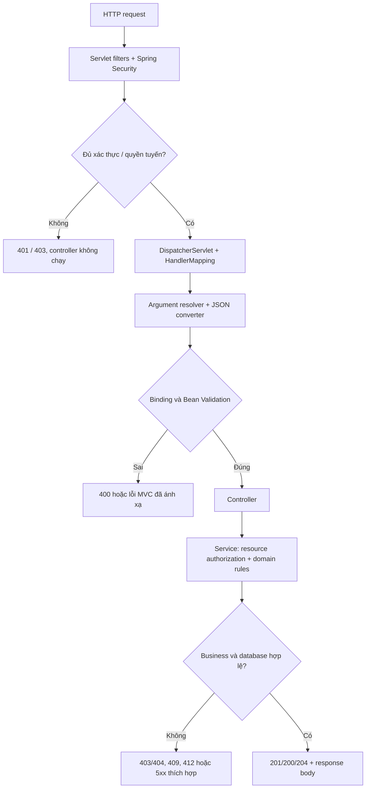

# @Valid, @Validated và kiểm tra phương thức

Một client gửi `POST /api/v1/orders` với `quantity = -2`. Spring có thể trả `400 Bad Request` ngay sau khi đọc JSON, **trước khi vào controller**. Nhưng nếu cùng điều kiện `@Positive` nằm trên tham số `@RequestParam`, luồng kiểm tra và loại exception có thể khác. Khi `@Validated` nằm trên một service, lời gọi đi qua Spring proxy lại được kiểm tra theo cơ chế AOP; gọi nội bộ trong cùng object có thể bỏ qua cơ chế này.

Hiểu các ranh giới đó giúp API không chỉ “có annotation” mà thực sự từ chối đầu vào sai, không rò dữ liệu và trả mã HTTP nhất quán. Bài thuộc chương **Dữ liệu và lỗi Spring**, module **INTEGRATION_API_REST**, gắn Bean Validation với thiết kế tài nguyên, HTTP methods/status, hợp đồng OpenAPI, xác thực–phân quyền và kiểm thử Java/Spring.

Ví dụ sử dụng **Java 17, Jakarta Validation, Spring Boot 3/Spring MVC**. Riêng xử lý *method validation tích hợp sẵn trong MVC* được mô tả cho **Spring Framework 6.1 trở lên** (thường gặp từ Spring Boot 3.2). Với Spring Framework 6.0/phiên bản Boot cũ hơn, cần đối chiếu cơ chế AOP và loại exception thực tế; đừng áp dụng tên exception của 6.1 cho mọi dự án.

## 1. Ba câu hỏi khác nhau: dữ liệu, quyền và nghiệp vụ

| Câu hỏi | Ví dụ | Lớp chịu trách nhiệm | HTTP status thường phù hợp |
|---|---|---|---|
| Dữ liệu có đúng **hình dạng/ràng buộc cục bộ** không? | `quantity > 0`, SKU không rỗng, email đúng định dạng cơ bản | Jakarta Bean Validation + MVC | `400` theo contract minh họa |
| Caller có quyền làm thao tác với tài nguyên này không? | Actor tenant A sửa đơn tenant B | Spring Security + authorization trong service | `401`, `403` hoặc `404` che giấu |
| Trạng thái hệ thống có cho phép thao tác không? | Không hủy đơn đã giao; tồn kho không đủ | Service/domain + database constraint/transaction | `409` hoặc mã nghiệp vụ phù hợp |

**Ranh giới:** Bean Validation không thay thế phân quyền, domain policy hay transaction database.

### 1.1. Phân biệt @Valid và @Validated trong một câu

- **`@Valid`** thuộc **Jakarta Validation**: đánh dấu đối tượng cần được validate, đặc biệt hỗ trợ **cascaded validation** đối với thuộc tính/lồng nhau; mặc định nhóm **Default** khi không chỉ định nhóm khác.
- **`@Validated`** thuộc **Spring**: cung cấp **validation hints/nhóm (groups)** và, khi đặt trên kiểu bean Spring phù hợp, có thể kích hoạt **method validation qua AOP proxy**. Annotation không có nghĩa cứ gắn ở đâu cũng gọi validator ngay.
- **Ràng buộc** như `@NotBlank`, `@Min`, `@Positive`, `@Email`, `@Size` là các annotation định nghĩa điều kiện. **`@Valid` tự nó không có nghĩa “mọi trường phải không null”.**

## 2. Các thành phần chạy khi một request REST được nhận



Sơ đồ là luồng phổ biến, không tuyên bố mọi lỗi đều xảy ra theo đúng thứ tự đó. Ví dụ lỗi JSON có thể được converter phát hiện trước validation; phương thức và media type có thể bị từ chối khi chọn handler; method validation **giá trị trả về** diễn ra sau controller và có thể báo lỗi phía server.

Khi không có token, API có thể trả `401` **trước** khi xét body. Vì vậy để kiểm thử `@Valid` thực sự, cần gửi credential hợp lệ hoặc mock authentication đúng cách. Đừng gán mọi `400` cho Bean Validation: malformed JSON, path UUID không parse được, query parameter thiếu hoặc sai kiểu cũng thường trả 400 nhưng do **binding/conversion**.

## 3. Cấu hình Jakarta Validation cho Spring Boot

Spring Boot 3 sử dụng namespace `jakarta.validation.*`, không phải `javax.validation.*` của các dự án cũ. Với starter Web MVC và Bean Validation:

```groovy
dependencies {
    implementation 'org.springframework.boot:spring-boot-starter-web'
    implementation 'org.springframework.boot:spring-boot-starter-validation'
    implementation 'org.springframework.boot:spring-boot-starter-security'
    implementation 'org.springframework.boot:spring-boot-starter-oauth2-resource-server'
    testImplementation 'org.springframework.boot:spring-boot-starter-test'
    testImplementation 'org.springframework.security:spring-security-test'
}
```

Đây là **đoạn Gradle minh họa**; phiên bản dependency thực tế do Spring Boot BOM/plugin của dự án quản lý. Starter validation đưa vào provider tương thích (thường Hibernate Validator). Có annotation nhưng **thiếu provider/cơ chế kích hoạt** thì kiểm tra sẽ không hoạt động như kỳ vọng; cần test hành vi, không chỉ nhìn import.

### 3.1. Chọn constraint phù hợp với kiểu

| Constraint | Dùng với | Lưu ý |
|---|---|---|
| `@NotNull` | Reference object bất kỳ | Không bảo đảm String có nội dung; `Integer` null khác `0` |
| `@NotBlank` | `CharSequence` | Chặn null, rỗng hoặc chỉ khoảng trắng |
| `@NotEmpty` | Chuỗi, collection, map, array theo đặc tả | Không bảo đảm từng phần tử hợp lệ |
| `@Size(min,max)` | Chuỗi, collection, array/map | Không dùng thay `@Min` để so giá trị số |
| `@Positive`, `@Min`, `@Max` | Các kiểu số được hỗ trợ | Kiểm tra miền giá trị; nullable vẫn có thể hợp lệ nếu không có `@NotNull` |
| `@Email` | Chuỗi | Kiểm tra cú pháp ở mức validator, **không chứng minh địa chỉ tồn tại** |
| `@Pattern` | Chuỗi | Kiểm tra format, không cấp quyền hay ngăn SQL injection thay parameterized queries |
| `@Past`, `@Future` | Kiểu ngày/giờ được hỗ trợ | Phụ thuộc mốc thời gian; test cần kiểm soát clock |

Không áp `@NotBlank` lên `Integer` hoặc `@Positive` lên `String`: một số tổ hợp không có validator tương thích và có thể gây `UnexpectedTypeException`, tức **sai cấu hình/lỗi lập trình**, không phải lý do để mặc định trả 400 cho client.

## 4. @Valid với DTO, record và validation lồng nhau

Ví dụ request tạo đơn:

```java
import jakarta.validation.Valid;
import jakarta.validation.constraints.*;

record AddressInput(
    @NotBlank String street,
    @NotBlank String city
) {}

record CreateOrderRequest(
    @NotBlank @Size(max = 64) String sku,
    @NotNull @Positive Integer quantity,
    @NotNull @Valid AddressInput shippingAddress
) {}
```

Một HTTP request không hợp lệ:

```http
POST /api/v1/orders HTTP/1.1
Host: api.example.com
Authorization: Bearer <access_token>
Content-Type: application/json

{
  "sku": "  ",
  "quantity": -2,
  "shippingAddress": {
    "street": "",
    "city": "Hà Nội"
  }
}
```

Với `@Valid @RequestBody CreateOrderRequest`, Spring MVC đọc JSON thành record rồi validate: `sku` bị `@NotBlank` từ chối; `quantity` không `@Positive`; `shippingAddress.street` không `@NotBlank`. Có thể trả 400 với các field-path được chuẩn hóa. Tên/path field nào được công bố phải nằm trong hợp đồng lỗi, không tự phản chiếu dữ liệu nhạy cảm.

**Vai trò của annotation lồng nhau:**

- `@NotNull` trên `shippingAddress` buộc object tồn tại, còn `@Valid` trên trường đó mới **cascade** vào `street`/`city` khi object có mặt.
- `@Valid` **không tự cấm null**. Nếu chỉ đặt `@Valid` mà bỏ `@NotNull`, một giá trị null thường không vi phạm cascaded validation.
- Với collection, có thể dùng constraints trên phần tử, ví dụ `List<@NotBlank String> tags`, và cascade object `List<@Valid LineInput> lines` nếu container/validation provider hỗ trợ cấu trúc tương ứng.
- Với PATCH từng phần, đừng dùng nguyên DTO bắt buộc tất cả field như POST: cần model PATCH/nullable semantics riêng, tránh vô tình coi field vắng mặt là lỗi hoặc ghi đè dữ liệu.

### 4.1. Đừng nhầm giá trị thiếu với số 0

Trường `quantity` dùng `Integer` thay vì `int` để kết hợp `@NotNull` và `@Positive`. Nếu dùng primitive `int`, không thể biểu diễn null ở đối tượng đã bind; trường thiếu có thể dẫn tới giá trị mặc định tùy cách Jackson khởi tạo/binding hoặc lỗi parse. Chọn kiểu và cấu hình JSON rõ ràng nếu API cần phân biệt **không gửi field** và **gửi 0**.

## 5. Controller: validation xảy ra trước method

```java
import jakarta.validation.Valid;
import java.net.URI;
import org.springframework.http.*;
import org.springframework.security.core.Authentication;
import org.springframework.web.bind.annotation.*;

record OrderView(String id, String status) {}

@RestController
@RequestMapping("/api/v1/orders")
class OrderController {
    private final OrderService orders;
    OrderController(OrderService orders) { this.orders = orders; }

    @PostMapping(consumes = "application/json", produces = "application/json")
    ResponseEntity<OrderView> create(
            @Valid @RequestBody CreateOrderRequest request,
            Authentication principal) {
        OrderView order = orders.createAuthorized(principal, request);
        return ResponseEntity.created(
                URI.create("/api/v1/orders/" + order.id()))
            .cacheControl(CacheControl.noStore()).body(order);
    }
}
```

MVC dùng argument resolver + JSON converter (thường Jackson) để tạo DTO rồi validate. Nếu body không đúng, controller **chưa được gọi**: lỗi `@Valid` điển hình là `MethodArgumentNotValidException` (trừ khi method validation bao phủ như mục 7). JSON parse sai xảy ra trước cả validator. `OrderService` là abstraction, cần kiểm tra actor/tenant, business rules và transaction riêng; validate thành công không cấp quyền hay bảo đảm idempotency của `POST`.

Có thể khai báo `BindingResult` **ngay sau** tham số `@Valid @RequestBody` để controller tự kiểm tra `errors.hasErrors()` trong một số tình huống. Tuy nhiên API lớn nên dùng `@RestControllerAdvice` để thống nhất lỗi; không để mỗi handler tự phát một kiểu JSON. Với `@ModelAttribute`, query và form binding, xử lý validation có điểm khác với JSON body.

## 6. @Validated và các nhóm kiểm tra (groups)

`@Validated` trong Spring cho phép chọn **validation group** cho request DTO. Giả sử tạo mới không nhận ID từ client, còn cập nhật phải có ID:

```java
import java.math.BigDecimal;
import java.util.UUID;
import jakarta.validation.constraints.*;
import org.springframework.validation.annotation.Validated;

interface OnCreate {}
interface OnUpdate {}

record ProductInput(
    @Null(groups = OnCreate.class)
    @NotNull(groups = OnUpdate.class) UUID id,

    @NotBlank(groups = {OnCreate.class, OnUpdate.class})
    String name,

    @NotNull(groups = {OnCreate.class, OnUpdate.class})
    @DecimalMin(value = "0.01", groups = {OnCreate.class, OnUpdate.class})
    BigDecimal price
) {}

@PostMapping("/products")
ResponseEntity<?> createProduct(
        @Validated(OnCreate.class) @RequestBody ProductInput input) {
    // Gọi service và trả status theo hợp đồng.
    return ResponseEntity.status(201).build();
}

@PutMapping("/products/{id}")
ResponseEntity<?> updateProduct(
        @PathVariable UUID id,
        @Validated(OnUpdate.class) @RequestBody ProductInput input) {
    // Xác minh path ID == body ID hoặc bỏ ID khỏi body;
    // service vẫn kiểm tra tenant, If-Match và trạng thái nghiệp vụ.
    return ResponseEntity.noContent().build();
}
```

Các method mapping trên là **minh họa cần đặt trong controller**; không tự tạo endpoint hoạt động khi dán ngoài class. `@Validated(OnCreate.class)` gọi các constraints thuộc nhóm `OnCreate`, còn update gọi `OnUpdate`.

**Bẫy quan trọng:** các constraint **không ghi group** thuộc `Default`. Khi chỉ chạy `OnCreate` hoặc `OnUpdate`, đừng mặc định constraint ở `Default` sẽ được áp dụng cùng. Có thể liệt kê groups, kế thừa từ `Default` hoặc dùng group sequence theo yêu cầu; kiểm chứng chính xác tập constraint bằng test. Group là cách chọn **chính sách validation**, không phải authorization role.

Với nhiều payload khác biệt lớn, **DTO riêng cho Create/Update/Patch thường rõ hơn groups phức tạp**. Group hợp lý khi muốn tái sử dụng model có điều kiện gần nhau; tránh làm schema OpenAPI không biểu diễn được required fields chính xác cho từng operation.

## 7. Method validation trên controller (Spring MVC 6.1+)

Ví dụ GET phân trang không có JSON body:
 
```java
import jakarta.validation.constraints.*;
import org.springframework.security.core.Authentication;
import org.springframework.web.bind.annotation.*;

@GetMapping("/api/v1/orders")
List<OrderView> list(
        @RequestParam(defaultValue = "0") @Min(0) int page,
        @RequestParam(defaultValue = "20") @Min(1) @Max(100) int size,
        Authentication principal) {
    return orders.listAuthorized(principal, page, size);
}
```

Đây là **minh họa method cần đặt trong controller** có dependency `orders`. Trên Spring Framework **6.1+**, ràng buộc đặt **trực tiếp trên method parameter** như `@Min @RequestParam` được MVC kiểm tra bằng *built-in method validation*. Khi input vi phạm, `HandlerMethodValidationException` thường có **HTTP 400**. Khi ràng buộc trên **return value** của handler bị vi phạm, đó là lỗi server, thông thường **HTTP 500**.

| Khai báo | Cơ chế/exception phổ biến (MVC 6.1+) |
|---|---|
| `@Valid @RequestBody Dto` đơn thuần | Per-argument validation → `MethodArgumentNotValidException` |
| `@Validated(Group.class) @RequestBody Dto` | Per-argument group validation → `MethodArgumentNotValidException`, nếu không có method constraints khác |
| `@Min @RequestParam int page` hoặc `@NotBlank @PathVariable String code` | Method validation → `HandlerMethodValidationException` |
| Body `@Valid` và direct method constraint kết hợp | Method validation có thể bao phủ cả object arguments → `HandlerMethodValidationException` |
| Constraint trên return value controller | `HandlerMethodValidationException`, status 500 |
| Bean service `@Validated` qua AOP | Thường `ConstraintViolationException`; một số cấu hình dùng `MethodValidationException` |

**Hai bẫy quan trọng:** `@Valid` chỉ bật cascade, không phải direct constraint như `@Min`; và `@Validated` **ở cấp class của controller** có thể kích hoạt AOP method validation **thay cho built-in MVC 6.1**. Nếu muốn cơ chế MVC mới, tránh đặt `@Validated` lên controller class. Với Spring Framework 6.0/Boot cũ, kiểm tra hướng AOP method validation riêng.

Phân biệt **conversion** với **constraint**: `page=abc` không đổi sang `int` được nên có thể lỗi 400 ở binding; `page=-1` parse thành công rồi mới lỗi `@Min(0)`. Cả hai trả 400 nhưng nguồn lỗi khác nhau.

## 8. Method validation ở service với @Validated và Spring AOP

Ngoài controller, muốn validate **lời gọi Java đến service bean**, thường đặt `@Validated` ở **cấp class** và dùng constraints trên tham số/return value:

```java
import jakarta.validation.Valid;
import jakarta.validation.constraints.NotNull;
import jakarta.validation.constraints.Positive;
import org.springframework.stereotype.Service;
import org.springframework.validation.annotation.Validated;
import org.springframework.transaction.annotation.Transactional;

record ReserveCommand(@NotNull String sku, @Positive int quantity) {}

@Service
@Validated
public class InventoryReservationService {
    private final ReservationRepository repository;

    public InventoryReservationService(ReservationRepository repository) {
        this.repository = repository;
    }

    @Transactional
    public Reservation reserve(@NotNull @Valid ReserveCommand command) {
        // Authentication/tenant context và domain constraints cần có riêng.
        return repository.reserveAtomically(command.sku(), command.quantity());
    }
}
```

Với provider/`MethodValidationPostProcessor` được cấu hình, Spring AOP interceptor thực hiện method validation khi một bean khác gọi `reserve(...)` **qua proxy**. Chẳng hạn gọi từ một controller/service khác thông qua dependency injection. `@Validated` ở service không tự biến exception thành 400 HTTP; một vi phạm có thể là **lỗi lập trình giữa các thành phần tin cậy**, chứ không phải dữ liệu client trực tiếp.

**Các điểm dễ bỏ sót:**

1. **Self-invocation:** `this.reserve(...)` từ method khác trong cùng object thường **không đi qua proxy**, nên method validation AOP có thể không chạy.
2. **Final/private/non-public methods:** khả năng intercept phụ thuộc proxy JDK/CGLIB và cách bean được gọi; đừng dựa vào method private như một API được validate tự động.
3. **Thứ tự interceptor với transaction:** các advice AOP có thể chạy theo thứ tự cấu hình; không dùng method validation để thay database constraint hoặc transaction, và test rollback khi lỗi xuất hiện.
4. **Vi phạm return value:** `@NotNull` trên return của service là hợp đồng **nội bộ**; nếu service trả null, không tự quy lỗi cho client.
5. **Gọi trực tiếp `new InventoryReservationService(...)`** ngoài Spring container không có AOP method validation.

Khi cần validate từ **job, message listener hoặc CLI**, service-level validation hữu ích, nhưng vẫn phải bảo đảm annotation thực sự được gọi qua proxy hoặc chủ động dùng `jakarta.validation.Validator`. Nếu nghiệp vụ cần kiểm tra trạng thái order, số lượng kho, version, quota theo tenant, hãy thực hiện bằng **domain policy + transaction/unique constraint**.

## 9. Ranh giới của @Valid: database, optimistic locking và HTTP

Giả sử hai client đồng thời tạo product cùng mã SKU trong một tenant. Cả hai DTO đều qua `@NotBlank`, nhưng chỉ database unique constraint mới phân xử chính xác trường hợp **trùng trong thời điểm ghi**. Pattern `SELECT exists rồi INSERT` có race. Khi unique constraint bị vi phạm, domain adapter có thể ánh xạ thành `409 Conflict` **nếu xác định đúng business rule**, không mặc định mọi `DataIntegrityViolationException` đều là 409.

Tương tự, `@Version` trong JPA là cơ chế optimistic locking, **không phải validation annotation**. Với `PATCH` mang `If-Match` không khớp, mã `412 Precondition Failed` thường phù hợp; nếu API dùng version trong JSON không có HTTP precondition, hợp đồng có thể chọn 409. `@Validated` không tự bảo vệ lost update.

| Công cụ | Bảo vệ điều gì | Không bảo vệ điều gì |
|---|---|---|
| Bean Validation | Ràng buộc cục bộ của object/parameter | Race, quyền tenant, logic liên bản ghi |
| Spring Security | Credential, coarse role/scope, cơ chế xác thực | Không tự chứng minh ownership của từng resource |
| Domain service | State machine, quota và chính sách nghiệp vụ | Không thay unique constraint/lock nguyên tử |
| Unique constraint/transaction | Bất biến database dưới concurrency | Không tự chọn HTTP status phù hợp cho mọi lỗi |
| JPA `@Version`/If-Match + CAS | Tránh ghi đè do phiên bản cũ nếu triển khai đúng | Không thay kiểm tra nội dung/authorization |

## 10. Exception và HTTP status: không đồng nhất tất cả lỗi

| Exception/ngữ cảnh | Nguồn | Hành vi |
|---|---|---|
| `MethodArgumentNotValidException` | `@Valid` DTO trong MVC argument resolver | 400 với Problem Details |
| `HandlerMethodValidationException` | Built-in MVC 6.1+ method validation | **400 input**, **500 return** |
| `HttpMessageNotReadableException`, type mismatch, thiếu query | JSON/binding/conversion | Thường 400, không phải Bean Validation |
| `ConstraintViolationException`, `MethodValidationException` | AOP service hoặc validation thủ công tùy cấu hình | **Không mặc định 400**; xác định lỗi client hay lỗi nội bộ |
| `DataIntegrityViolationException` | Database constraint/transaction | Chỉ chuyển 409 khi đã xác minh đúng business conflict |
| Authentication/authorization | Spring Security + service | 401 + challenge, 403 hoặc 404 che giấu |
| Domain conflict | Trạng thái resource không cho phép thao tác | 409; lỗi ETag `If-Match` sai thường 412 |
| Lỗi media type, payload lớn | MVC/container/proxy | 415/413; có thể ngoài phạm vi Advice |

`422 Unprocessable Content` cũng có thể được hợp đồng chọn cho một số đầu vào hiểu được nhưng không xử lý được. Ví dụ của bài **chọn 400 cho input validation**, giữ nhất quán giữa controller và OpenAPI. Không trả 400 cho return constraint sai hoặc database hỏng, cũng không để framework exception raw tràn ra client.

## 11. Chuẩn hóa lỗi bằng Problem Details

RFC 9457 định nghĩa Problem Details. Với Spring Framework 6.1+, một `@RestControllerAdvice` có thể xử lý riêng hai kiểu lỗi MVC:

```java
import java.net.URI;
import java.util.Map;
import org.springframework.http.*;
import org.springframework.web.bind.MethodArgumentNotValidException;
import org.springframework.web.bind.annotation.*;
import org.springframework.web.method.annotation.HandlerMethodValidationException;

@RestControllerAdvice
class ValidationErrorAdvice {
    @ExceptionHandler(MethodArgumentNotValidException.class)
    ResponseEntity<ProblemDetail> invalidDto(
            MethodArgumentNotValidException ex) {
        ProblemDetail p = ProblemDetail.forStatus(HttpStatus.BAD_REQUEST);
        p.setType(URI.create("https://api.example.com/problems/invalid-input"));
        p.setTitle("Invalid request body");
        p.setProperty("code", "INVALID_INPUT");
        p.setProperty("violations",
            ex.getBindingResult().getFieldErrors().stream()
                .map(e -> Map.of(
                    "field", e.getField(),
                    "code", "INVALID_FIELD"))
                .toList());
        return ResponseEntity.badRequest().body(p);
    }

    @ExceptionHandler(HandlerMethodValidationException.class)
    ResponseEntity<ProblemDetail> invalidMethod(
            HandlerMethodValidationException ex) {
        HttpStatusCode status = ex.getStatusCode();
        boolean clientError = status.is4xxClientError();
        ProblemDetail p = ProblemDetail.forStatus(status);
        p.setType(URI.create(clientError
            ? "https://api.example.com/problems/invalid-parameter"
            : "https://api.example.com/problems/invalid-server-response"));
        p.setTitle(clientError
            ? "Invalid request parameter" : "Internal response validation error");
        p.setProperty("code", clientError
            ? "INVALID_PARAMETER" : "INVALID_SERVER_RESPONSE");
        return ResponseEntity.status(status).body(p);
    }
}
```

Response mẫu:

```http
HTTP/1.1 400 Bad Request
Content-Type: application/problem+json
Cache-Control: no-store

{
  "type": "https://api.example.com/problems/invalid-input",
  "title": "Invalid request body",
  "status": 400,
  "code": "INVALID_INPUT",
  "violations": [
    {"field": "sku", "code": "INVALID_FIELD"},
    {"field": "quantity", "code": "INVALID_FIELD"}
  ]
}
```

`code`, `violations` là **extensions do ứng dụng định nghĩa**, không phải trường bắt buộc của RFC 9457. Đoạn advice không tự thêm `Cache-Control: no-store`; phải cấu hình response cache/security headers thích hợp nếu muốn response đúng hoàn toàn như mẫu. Đặt `Content-Type: application/problem+json` theo message converter/ProblemDetail support và kiểm thử thực tế.

**Không đưa `rejectedValue`, raw JSON, stack trace, câu SQL hay nội dung bí mật vào Problem Details.** Có thể công bố field path, rule ID và message được kiểm soát/i18n. Với lỗi giá trị trả về (thường status 500), không phản chiếu chi tiết return DTO vì đó là **sự cố phía server**. Nếu muốn xử lý `ConstraintViolationException` từ service, cần biết đó là lỗi đầu vào do client gây ra hay lỗi nội bộ trước khi ánh xạ status; không viết handler trả 400 cho mọi instance một cách mù quáng.

## 12. Bảo mật và hiệu năng

- **Quyền trước dữ liệu:** filter Security có thể từ chối 401/403 trước MVC; service phải xác minh tenant/owner trước khi tiết lộ sự tồn tại hay trạng thái resource. `@NotNull tenantId` do client gửi không cấp quyền tenant đó.
- **Giới hạn payload:** đặt giới hạn ở gateway/Servlet và converter cho JSON lớn, mảng nhiều phần tử, multipart; validator thường chạy **sau khi bind**, không thay quota/rate limit.
- **Custom validator:** tránh gọi database/network tốn kém hoặc kiểm tra uniqueness không nguyên tử. Dùng domain service + unique constraint/transaction cho bất biến có race.
- **Không nhầm kiểm tra định dạng với an toàn:** `@Pattern` không thay parameterized SQL/output encoding; `@Email` không chứng minh hộp thư tồn tại.
- **Lỗi và log:** công bố mã lỗi/field path đã kiểm soát, không trả rejectedValue, body nhạy cảm, SQL, token, stack trace. Log request ID/route template và mã lỗi.

## 13. MockMvc: test đúng lớp validation

Ví dụ cho MVC 6.1+, giả định có controller POST và GET list như các mục trên, security filter và fixture actor/tenant hợp lệ:

```java
import static org.springframework.security.test.web.servlet.request.SecurityMockMvcRequestPostProcessors.jwt;
import static org.springframework.test.web.servlet.request.MockMvcRequestBuilders.*;
import static org.springframework.test.web.servlet.result.MockMvcResultMatchers.*;
import org.junit.jupiter.api.Test;
import org.springframework.beans.factory.annotation.Autowired;
import org.springframework.boot.test.autoconfigure.web.servlet.AutoConfigureMockMvc;
import org.springframework.boot.test.context.SpringBootTest;
import org.springframework.http.MediaType;
import org.springframework.security.core.authority.SimpleGrantedAuthority;
import org.springframework.test.web.servlet.MockMvc;

@SpringBootTest
@AutoConfigureMockMvc
class OrderValidationApiTest {
    @Autowired MockMvc mvc;

    @Test
    void invalidNestedDtoReturns400() throws Exception {
        mvc.perform(post("/api/v1/orders")
                .with(jwt().authorities(
                    new SimpleGrantedAuthority("SCOPE_orders:write")))
                .contentType(MediaType.APPLICATION_JSON)
                .content("""
                  {"sku":"","quantity":-2,
                   "shippingAddress":{"street":"","city":"Hà Nội"}}
                  """))
            .andExpect(status().isBadRequest())
            .andExpect(jsonPath("$.code").value("INVALID_INPUT"));
    }

    @Test
    void invalidQueryParameterReturns400() throws Exception {
        mvc.perform(get("/api/v1/orders?page=-1&size=10")
                .with(jwt().authorities(
                    new SimpleGrantedAuthority("SCOPE_orders:read"))))
            .andExpect(status().isBadRequest())
            .andExpect(jsonPath("$.code").value("INVALID_PARAMETER"));
    }
}
```

`jsonPath("$.code")` phụ thuộc advice mục 11. `jwt()` chỉ mock principal, **không xác minh chữ ký/issuer/audience/JWKS**; cần integration test decoder thực. Nếu controller có class-level `@Validated`, exception/query error có thể khác: xác minh phiên bản và cấu hình trước khi sửa test.

| Kiểm thử | Điều cần chứng minh |
|---|---|
| Body blank SKU, quantity âm, address null/field rỗng | `@NotBlank`/`@Positive`/`@NotNull` và cascade `@Valid` đúng |
| Body JSON hỏng và page=abc | 400 do conversion, không nhầm constraint |
| Create có ID; Update thiếu ID; group Default | `@Validated` chọn đúng group, không tự chạy Default khác |
| GET page=-1; controller return sai | Input → 400; return contract lỗi → 500 (MVC 6.1+) |
| Service gọi qua proxy và self-invocation | AOP validation được/bị bỏ qua theo proxy boundary |
| Không token, thiếu scope, khác tenant | 401/403/404 đúng policy, không lộ resource |
| Hai request cạnh tranh unique SKU/version | DB constraint/CAS giữ bất biến, không dựa vào `@Valid` |

Ngoài MockMvc, dùng `Validator` để test DTO/groups, Spring context để test AOP proxy và database thật để test transaction/concurrency. Kiểm tra **side effects và thông tin bị tiết lộ**, không chỉ HTTP status.

## 14. Bài tập: API đơn hàng nhiều tenant

API gồm `POST /orders` (SKU, quantity, address, 201 + Location), `GET /orders?page=&size=` (0 ≤ page, 1 ≤ size ≤ 100), POST/PUT products có luật ID khác nhau; service đặt hàng dùng `@Validated` và database unique constraint.

**Hãy làm:** (1) viết record DTO với `@NotNull/@NotBlank/@Positive/@Valid`; (2) thiết kế groups `OnCreate/OnUpdate` hoặc tách DTO; (3) controller validate request body và query method parameters; (4) advice phân biệt `MethodArgumentNotValidException`/`HandlerMethodValidationException` và lỗi return 500; (5) authorization tenant + unique constraint/domain conflict; (6) ít nhất 10 test gồm malformed JSON, 401/403, groups, nested cascade, self-invocation, race.

**Đáp án định hướng:** Bean Validation kiểm tra hợp đồng đầu vào; Security/service kiểm quyền; database phân xử bất biến dưới cạnh tranh. Không đổi mọi `ConstraintViolationException` thành 400, cũng không đặt `@Validated` cấp class trên controller MVC 6.1+ nếu muốn built-in method validation.

## 15. Checklist và tài liệu đối chiếu

- [ ] Xác minh phiên bản Framework/Boot, namespace Jakarta và provider Validation.
- [ ] Dùng constraint đúng kiểu; `@Valid` cho cascade, `@NotNull` cho field bắt buộc; nullable/primitive được xác định rõ.
- [ ] Nhóm `@Validated` và Default đã được kiểm thử; không dùng group làm role.
- [ ] Biết khi nào MVC dùng argument validation và method validation; không vô tình chuyển sang controller AOP.
- [ ] Service `@Validated` đi qua proxy; test self-invocation và return constraints.
- [ ] Advice phân biệt 400 input với 500 return, không công bố rejected value, token hoặc SQL.
- [ ] Phân quyền tenant, domain conflict, DB uniqueness và optimistic locking độc lập với `@Valid`.
- [ ] OpenAPI và MockMvc/integration tests phản ánh status, payload lỗi, side effects và security.

**Tài liệu:** Jakarta Validation Specification (*cascading, groups, executable validation*); Spring Framework Reference (*Validation*, *Spring MVC Method Validation*); Spring Boot Reference (*Validation*); RFC 9110 (HTTP Semantics), RFC 9457 (Problem Details). Đối chiếu Spring version trước khi dựa vào `HandlerMethodValidationException`.

**Điểm cần nhớ:** **`@Valid` validate object/cascade; `@Validated` chọn groups và có thể kích hoạt service AOP; direct parameter/return constraints kích hoạt method validation.** Trên MVC 6.1+, `MethodArgumentNotValidException` khác `HandlerMethodValidationException`; lỗi return thường 500, không phải 400. Phải phân biệt validation với authorization, domain policy và database constraints, rồi kiểm thử đúng điểm phát sinh lỗi.
