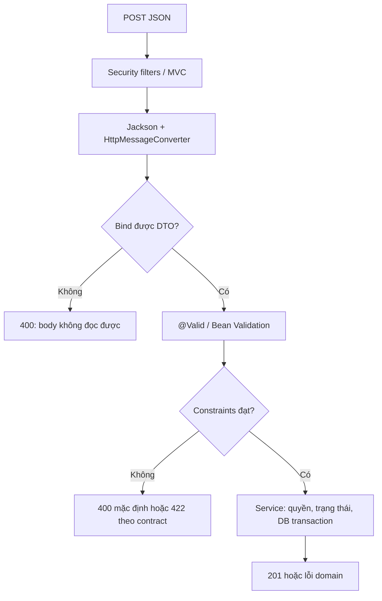

# Ràng buộc tùy chỉnh và kiểm tra nhiều trường

> **Chương:** Dữ liệu và lỗi Spring  
> **Module:** `INTEGRATION_API_REST` — thiết kế REST API theo resource, URI, phương thức và trạng thái HTTP, với hợp đồng dữ liệu rõ ràng; thực hành OpenAPI, xác thực, phân quyền, xử lý lỗi và kiểm thử bằng Java/Spring hoặc công nghệ tương đương.

Trong Spring MVC, `@NotNull`, `@Size` hay `@Email` xử lý tốt các điều kiện của **một trường**. Nhưng có những quy tắc chỉ đúng khi xét **nhiều trường cùng lúc**: nếu chọn giao hàng theo lịch thì phải có cả thời điểm bắt đầu/kết thúc; kết thúc phải sau bắt đầu; người nhận phải có ít nhất một kênh liên hệ hợp lệ. Gắn từng annotation riêng lẻ không đủ biểu diễn mọi quan hệ này.

Bài học hướng dẫn xây dựng **custom constraint ở cấp đối tượng** bằng Jakarta Bean Validation, kết nối với `@Valid @RequestBody` trong Spring, đưa lỗi về đúng field và thiết kế HTTP error contract. Đồng thời, bài phân định rạch ròi giữa **kiểm tra tính nhất quán của DTO** với **quy tắc nghiệp vụ, phân quyền và tính đúng đắn đồng thời tại database**. Việc viết một `ConstraintValidator` không được biến thành một bước truy vấn DB hoặc một cửa hậu phân quyền.

## Mục tiêu học tập

Sau bài học, bạn có thể:

1. Chọn `@NotNull`/`@Size`, `@AssertTrue` hoặc class-level custom constraint theo loại quy tắc.
2. Tạo annotation `@Constraint` và `ConstraintValidator` có logic phụ thuộc nhiều trường, không phụ thuộc trạng thái mutable dùng chung.
3. Gắn lỗi class-level với đúng thuộc tính nhờ `ConstraintValidatorContext` thay vì chỉ có lỗi chung khó hiển thị.
4. Kích hoạt validation đúng chỗ bằng `@Valid`/`@Validated` trong Spring MVC, kể cả nested DTO.
5. Chuẩn hóa `400`/`422` và Problem Details, phân biệt JSON parse error, field validation và domain conflict `409`.
6. Tránh rò rỉ PII, mass assignment, bypass quyền và race condition khi kiểm tra ràng buộc.
7. Kiểm thử validator độc lập, MockMvc/controller, authorization và database invariants; thực hành một bài toán khác.

## 1. Khi nào phải kiểm tra nhiều trường?

Xét `POST /api/shipments` với body:

```json
{
  "orderId": 42,
  "mode": "SCHEDULED",
  "windowStart": "2026-11-20T08:00:00Z",
  "windowEnd": "2026-11-20T10:00:00Z",
  "contactEmail": "buyer@example.test"
}
```

Hợp đồng ví dụ: `orderId` dương; `mode` là `STANDARD` hoặc `SCHEDULED`. `SCHEDULED` yêu cầu hai mốc và `windowEnd > windowStart`; `STANDARD` không cho gửi mốc thời gian. Ít nhất một trong email/phone phải có nội dung. Người gọi cũng phải có quyền với order, và hệ thống không được tạo hai shipment active cho một đơn.

| Điều kiện | Lớp kiểm tra |
| --- | --- |
| ID dương, email đúng format, phone không quá dài | Field constraints: `@Positive`, `@Email`, `@Size`. |
| Thời gian tùy mode, ít nhất một contact | **Class-level custom constraint** (nhiều field). |
| Quyền với order, trạng thái `SHIPPED/CANCELLED` | **Service + security**, dựa trên trạng thái thật. |
| Chỉ một shipment active mỗi order | **Transaction/unique index**, chống request đồng thời. |

Validation DTO chỉ kiểm tra tính nhất quán của dữ liệu đầu vào; nó **không** thay thế phân quyền hoặc điều kiện tại thời điểm commit.

## 2. Pipeline và HTTP status cần phân biệt



| Tình huống | Status phù hợp |
| --- | --- |
| JSON sai cú pháp/kiểu không bind được | **400**, thường `HttpMessageNotReadableException`. |
| DTO hợp lệ về JSON nhưng vi phạm field/cross-field rule | **400** mặc định của Spring MVC; có thể **422** nếu hợp đồng quy định. |
| `Content-Type` không hỗ trợ | **415**. |
| Không xác thực hoặc không được phép | **401/403**, hoặc **404** theo chính sách che giấu. |
| Order hiện không còn cho phép tạo shipment | **409 Conflict** theo state machine. |
| Hai request tranh nhau tạo shipment | **409** theo lỗi uniqueness cụ thể, không phải toàn bộ lỗi DB. |

Với `@Valid @RequestBody`, Spring thường chạy converter trước validation. Security có thể từ chối trước converter; method validation ở một số phiên bản có exception khác. Không coi mọi `4xx` là “field validation”.

## 3. Built-in constraint, @AssertTrue hay custom annotation?

Dùng `@NotNull`, `@Positive`, `@Size`, `@Email` cho một field. `@AssertTrue` trên property phù hợp với điều kiện rất nhỏ nhưng khó tái sử dụng và lỗi thường gắn vào property tổng hợp, không phải field thực tế. **Class-level custom constraint** phù hợp hơn khi cần phối hợp nhiều field, tạo violation có property path và tái sử dụng giữa DTO.

Các rule cần I/O, principal, trạng thái DB hoặc tính nguyên tử **không thuộc `ConstraintValidator`**. Chúng phải được thực thi ở service/repository với transaction thích hợp.

## 4. DTO và field-level constraints trước tiên

Dùng Java records trong Spring Boot 3:

```java
import jakarta.validation.constraints.*;
import java.time.Instant;

enum DeliveryMode {
    STANDARD, SCHEDULED
}

@ValidShipmentRequest
record ShipmentRequest(
    @NotNull @Positive Long orderId,
    @NotNull DeliveryMode mode,
    Instant windowStart,
    Instant windowEnd,
    @Email String contactEmail,
    @Size(max = 30) String contactPhone
) {}
```

Những chi tiết dễ nhầm:

- `@NotNull` cần thiết vì `@Positive`, `@Email`, `@Size` và nhiều constraint thông dụng **chấp nhận null** (để có thể kết hợp constraints).
- `@Email` chỉ đánh giá **định dạng email**, không xác minh địa chỉ có thật hay người dùng sở hữu nó. Trường có thể vắng nếu đã có phone.
- `contactPhone` cần kiểm tra format hợp đồng (ví dụ mã quốc gia theo E.164) nếu ứng dụng yêu cầu; `@Size(max=30)` chỉ giới hạn độ dài, chưa xác minh số hợp lệ.
- `Instant` biểu diễn mốc thời gian tuyệt đối. Client cần gửi dạng có offset như `2026-11-20T08:00:00Z`. Khi thiết kế hệ thống giao hàng theo múi giờ địa phương, còn cần zone/giờ địa phương rõ; không suy ra trực tiếp từ `Instant`.
- Hai field `windowStart/windowEnd` không được đánh dấu `@NotNull` riêng, vì chúng **chỉ bắt buộc khi mode là SCHEDULED**.

Nếu có các item lồng nhau, ví dụ `List<@Valid ShipmentItemRequest> items` cùng `@NotEmpty`, cần cascade `@Valid`. Class-level constraint ở parent không tự kích hoạt validation của mọi nested element nếu thiếu cascade.

## 5. Tạo annotation @ValidShipmentRequest

Annotation khai báo đối tượng áp dụng, validator thực thi và message mặc định:

```java
import jakarta.validation.Constraint;
import jakarta.validation.Payload;
import java.lang.annotation.*;

@Target({ ElementType.TYPE, ElementType.ANNOTATION_TYPE })
@Retention(RetentionPolicy.RUNTIME)
@Constraint(validatedBy = ShipmentRequestValidator.class)
@Documented
public @interface ValidShipmentRequest {
    String message() default "Shipment request has inconsistent fields";
    Class<?>[] groups() default {};
    Class<? extends Payload>[] payload() default {};
}
```

Giải thích:

- `@Constraint(validatedBy=...)` nối annotation với lớp validator.
- `@Target(TYPE)` cho phép đặt constraint trên DTO/record thay vì từng property.
- `@Retention(RUNTIME)` để provider đọc metadata khi chạy.
- `message` là thông báo mặc định; có thể dùng bundle message keys nếu hệ thống cần i18n.
- `groups` và `payload` là thành phần chuẩn của constraint annotation; giữ signature chuẩn để provider hỗ trợ.
- Khi muốn đặt annotation nhiều lần với cấu hình khác nhau, phải thiết kế repeatability tương ứng; ví dụ này chỉ đặt một lần.

Class `ShipmentRequestValidator` kiểm tra **một DTO sau khi đã deserialize**. Annotation không tự đăng ký endpoint Spring và không tự kiểm tra quyền request.

## 6. ConstraintValidator: kiểm tra liên trường và gắn lỗi vào field

Triển khai tương thích Java/Jakarta Validation:

```java
import jakarta.validation.ConstraintValidator;
import jakarta.validation.ConstraintValidatorContext;
import java.time.Instant;

public final class ShipmentRequestValidator
        implements ConstraintValidator<ValidShipmentRequest, ShipmentRequest> {

    @Override
    public boolean isValid(
            ShipmentRequest request,
            ConstraintValidatorContext context) {

        // Dùng @NotNull trên argument/field nếu body không được vắng.
        // Tránh tạo lỗi trùng với các constraints khác.
        if (request == null) {
            return true;
        }

        boolean valid = true;
        context.disableDefaultConstraintViolation();

        boolean hasEmail = hasText(request.contactEmail());
        boolean hasPhone = hasText(request.contactPhone());
        if (!hasEmail && !hasPhone) {
            violation(context, "contactEmail",
                "Provide contactEmail or contactPhone");
            valid = false;
        }

        DeliveryMode mode = request.mode();

        if (mode == DeliveryMode.SCHEDULED) {
            Instant start = request.windowStart();
            Instant end = request.windowEnd();

            if (start == null) {
                violation(context, "windowStart",
                    "windowStart is required for SCHEDULED");
                valid = false;
            }
            if (end == null) {
                violation(context, "windowEnd",
                    "windowEnd is required for SCHEDULED");
                valid = false;
            }
            // Chỉ so sánh khi cả hai có mặt: không NullPointerException.
            if (start != null && end != null && !end.isAfter(start)) {
                violation(context, "windowEnd",
                    "windowEnd must be after windowStart");
                valid = false;
            }
        } else if (mode == DeliveryMode.STANDARD) {
            if (request.windowStart() != null) {
                violation(context, "windowStart",
                    "windowStart is not allowed for STANDARD");
                valid = false;
            }
            if (request.windowEnd() != null) {
                violation(context, "windowEnd",
                    "windowEnd is not allowed for STANDARD");
                valid = false;
            }
        }
        // mode == null: @NotNull trên field báo lỗi riêng.

        return valid;
    }

    private static boolean hasText(String value) {
        return value != null && !value.isBlank();
    }

    private static void violation(
            ConstraintValidatorContext context,
            String field, String message) {
        context.buildConstraintViolationWithTemplate(message)
            .addPropertyNode(field)
            .addConstraintViolation();
    }
}
```

### Vì sao cần addPropertyNode?

Constraint đặt ở cấp **TYPE**; nếu chỉ `return false` với message mặc định, Spring có thể ghi lỗi vào `ObjectError`, không có field để UI highlight. `addPropertyNode("windowEnd")` giúp provider phát `ConstraintViolation` với property path thích hợp để Spring thường biểu diễn dưới dạng **FieldError** cho trường `windowEnd`.

Nếu bài toán thực sự không có trường đại diện, có thể để lỗi cấp object. Không ép tất cả lỗi lên một field giả; client nên hỗ trợ **cả field errors và global errors**.

### Ba quy tắc triển khai quan trọng

1. **Không tích lũy state trong validator.** Provider có thể cache/tái sử dụng instance; không lưu `currentRequest`, `errors` hoặc principal trong biến instance. `isValid` dùng biến local; thread safety là bắt buộc.
2. **Không tự kiểm tra định dạng đã có constraint khác.** Ở đây custom constraint kiểm tra ít nhất một contact có chữ; `@Email` kiểm tra email syntax; một validator riêng có thể kiểm tra phone format. Tách nhiệm vụ giúp thông báo rõ.
3. **Không gọi DB/external service trong `isValid`.** Không biết dữ liệu đã thay đổi lúc commit, không có transaction boundary rõ và tăng latency của mọi request. Truy vấn trạng thái đơn, quyền, unique shipment phải ở service/repository.

Lưu ý: `disableDefaultConstraintViolation()` nghĩa là **nếu trả false thì phải thêm ít nhất một violation tùy chỉnh**. Code trên chỉ trả false sau khi thêm node nên tránh tình trạng validator không tạo được thông báo lỗi.

## 7. Conditional fields, null và những trường hợp biên

| Mode | Mốc thời gian | Contact | Kỳ vọng |
| --- | --- | --- | --- |
| `SCHEDULED` | Start 08:00, end 10:00 | Email hợp lệ | PASS. |
| `SCHEDULED` | Thiếu start hoặc end | Phone có nội dung | Lỗi `windowStart`/`windowEnd`. |
| `SCHEDULED` | End bằng/trước start | Email hợp lệ | Lỗi `windowEnd`. |
| `STANDARD` | Không gửi mốc nào | Phone có nội dung | PASS. |
| `STANDARD` | Có bất cứ mốc nào | Email hợp lệ | Lỗi field tương ứng. |
| `STANDARD` | Không có mốc | Email và phone blank | Lỗi contact. |

`mode=null` được `@NotNull` xử lý; validator không tự suy mode. `"mode":"UNKNOWN"` thường gây lỗi Jackson enum binding **trước** custom validation. `@Email` có thể cho null, nên cần kiểm tra riêng “ít nhất một contact có chữ”.

## 8. @Valid, @Validated, nested DTO và groups

```java
@PostMapping(path="/api/shipments", consumes="application/json")
ResponseEntity<?> create(@Valid @RequestBody ShipmentRequest input) {
    return ResponseEntity.accepted().build();
}
```

`@Valid` chạy cả field constraints lẫn `@ValidShipmentRequest` sau khi Jackson bind DTO. Ứng dụng cần provider Jakarta Bean Validation (thường `spring-boot-starter-validation`). Thiếu `@Valid` hoặc provider là lỗi cấu hình dễ bị bỏ sót nếu chỉ unit-test validator.

Nested DTO phải cascade:

```java
record LineRequest(
    @NotNull @Positive Long productId,
    @NotNull @Min(1) Integer quantity
) {}
record BatchRequest(@NotEmpty java.util.List<@Valid LineRequest> lines) {}
```

`@Validated(CreateChecks.class)` có thể chọn groups, nhưng khiến contract khó theo dõi nếu một constraint nằm ngoài group được kích hoạt. Đối với create/update/PATCH có semantics khác, **DTO riêng** thường rõ hơn groups. Một số Spring MVC method-validation paths có thể ném `HandlerMethodValidationException` thay vì `MethodArgumentNotValidException`; kiểm thử đúng phiên bản/cấu hình.

## 9. Controller Spring: input hợp lệ không có nghĩa được phép ghi

```java
import jakarta.validation.Valid;
import java.net.URI;
import java.security.Principal;
import org.springframework.http.*;
import org.springframework.web.bind.annotation.*;

record ShipmentView(long id, String state) {}

interface ShipmentService {
    ShipmentView createAuthorized(String username, ShipmentRequest request);
}

@RestController
@RequestMapping("/api/shipments")
class ShipmentController {
    private final ShipmentService service;
    ShipmentController(ShipmentService service) { this.service = service; }

    @PostMapping(consumes=MediaType.APPLICATION_JSON_VALUE,
                 produces=MediaType.APPLICATION_JSON_VALUE)
    ResponseEntity<ShipmentView> create(
            Principal principal, @Valid @RequestBody ShipmentRequest body) {
        ShipmentView created =
            service.createAuthorized(principal.getName(), body);
        return ResponseEntity.created(
            URI.create("/api/shipments/" + created.id())).body(created);
    }
}
```

Đây là skeleton; Spring Security phải xác thực `Principal` và service phải kiểm tra owner/tenant, trạng thái đơn và transaction. DB cần bảo vệ uniqueness/concurrency; không tin `tenantId` hoặc `ownerId` do client tự gửi. `201 + Location` chỉ được trả sau khi tạo resource thành công.

## 10. FieldError, ObjectError và Problem Details

`@Valid @RequestBody` thường thất bại bằng `MethodArgumentNotValidException`. `BindingResult` có **FieldError** (như `windowEnd` nhờ `addPropertyNode`) và **ObjectError** (khi validation áp cho toàn object không có field đại diện).

Hợp đồng ví dụ chọn `400 Bad Request` với Problem Details và extension `errors[]`:

```http
HTTP/1.1 400 Bad Request
Content-Type: application/problem+json
Cache-Control: no-store

{
  "type": "https://api.example.test/problems/invalid-request",
  "title": "Request validation failed",
  "status": 400,
  "code": "VALIDATION_FAILED",
  "errors": [
    {"field":"windowEnd","code":"INVALID_DELIVERY_WINDOW",
     "message":"Check delivery window"}
  ]
}
```

`code`/`errors` là extension fields của RFC 9457, cần contract ổn định. Ví dụ Spring Boot 3:

```java
import java.net.URI;
import java.util.*;
import org.springframework.http.*;
import org.springframework.validation.*;
import org.springframework.web.bind.MethodArgumentNotValidException;
import org.springframework.web.bind.annotation.*;

record FieldViolation(String field, String code) {}

@RestControllerAdvice
class ApiValidationAdvice {
    @ExceptionHandler(MethodArgumentNotValidException.class)
    ResponseEntity<ProblemDetail> invalidDto(
            MethodArgumentNotValidException ex) {
        List<FieldViolation> errors = new ArrayList<>();

        for (FieldError e : ex.getBindingResult().getFieldErrors()) {
            errors.add(new FieldViolation(
                e.getField(), codeFor(e.getCode())));
        }
        for (ObjectError e : ex.getBindingResult().getGlobalErrors()) {
            errors.add(new FieldViolation("", codeFor(e.getCode())));
        }

        ProblemDetail p = ProblemDetail.forStatusAndDetail(
            HttpStatus.BAD_REQUEST, "Review request fields.");
        p.setType(URI.create(
            "https://api.example.test/problems/invalid-request"));
        p.setTitle("Request validation failed");
        p.setProperty("code", "VALIDATION_FAILED");
        p.setProperty("errors", errors);
        return ResponseEntity.badRequest()
            .cacheControl(CacheControl.noStore())
            .contentType(MediaType.APPLICATION_PROBLEM_JSON)
            .body(p);
    }

    private static String codeFor(String constraint) {
        if ("ValidShipmentRequest".equals(constraint))
            return "INVALID_SHIPMENT_FIELDS";
        if ("NotNull".equals(constraint))
            return "REQUIRED_FIELD";
        return "INVALID_FIELD";
    }
}
```

Trong sản phẩm thật, tách các mã như `CONTACT_REQUIRED`, `WINDOW_START_REQUIRED`, `WINDOW_INVALID_ORDER` để client xử lý riêng; không parse message người dùng. **Không trả raw `rejectedValue`** chứa PII, token hoặc nội dung JSON bí mật. Handler cho `HttpMessageNotReadableException` (400), `HttpMediaTypeNotSupportedException` (415), lỗi quyền (401/403) và lỗi domain (409) là các nhánh **riêng**, không bắt toàn bộ exception rồi dán `VALIDATION_FAILED`.

## 11. Bảo mật: DTO validation không phải authorization

Ngay cả request `orderId=999` với mọi field hợp lệ vẫn phải bị từ chối nếu order thuộc tenant khác. **Lấy principal/tenant từ security context**, kiểm tra ACL tại service/repository; không dùng body để quyết định quyền.

- Deserialize vào DTO allowlist, **không bind JPA entity** có `role`, `ownerId`, `status`, `paid`.
- Custom validator không truy vấn DB/tìm order tồn tại, tránh race và existence oracle.
- Problem Details không chứa raw phone/email, access token, query SQL hay stack trace.
- Giới hạn JSON body size/depth, số item và số lần validation để giảm rủi ro DoS.
- Batch/events/admin update cũng phải giữ domain invariants; không chỉ tin REST DTO constraint.

Khi thêm `DeliveryMode` mới, cần cập nhật class validator; nhánh không biết mode không được ngầm cho phép cấu hình không an toàn.

## 12. Concurrent writes cần ràng buộc ở database

Hai request đều qua `@Valid` và cùng đọc “chưa có shipment” vẫn có thể tạo **hai hàng** nếu chỉ kiểm tra `existsByOrderId()` rồi `save()`. Bảo vệ ở DB, ví dụ PostgreSQL:

```sql
CREATE UNIQUE INDEX uq_active_shipment_per_order
  ON shipments(order_id)
  WHERE state IN ('CREATED', 'PREPARING', 'IN_TRANSIT');
```

Service thực hiện transaction, xử lý unique violation đúng loại thành **409 SHIPMENT_ALREADY_EXISTS** và rollback; không biến mọi `DataIntegrityViolationException` thành 409 vì lỗi DB khác có thể là 5xx. Nếu invariant trải nhiều hàng/bảng, cần transaction isolation, locking hoặc CAS thích hợp.

`If-Match` cũ trên conditional update dẫn tới `412 Precondition Failed`; thiếu precondition bắt buộc có thể `428`. Đừng nhầm các HTTP preconditions này với DTO validation hoặc unique index.

## 13. Kiểm thử validator, MVC và database

### Unit test của custom constraint

```java
import jakarta.validation.*;
import org.junit.jupiter.api.Test;
import java.time.Instant;
import static org.assertj.core.api.Assertions.assertThat;

class ShipmentRequestValidatorTest {
    private final Validator validator = Validation
        .buildDefaultValidatorFactory().getValidator();

    @Test
    void endBeforeStartAddsWindowEndViolation() {
        var request = new ShipmentRequest(
            42L, DeliveryMode.SCHEDULED,
            Instant.parse("2026-11-20T10:00:00Z"),
            Instant.parse("2026-11-20T08:00:00Z"),
            "buyer@example.test", null);

        assertThat(validator.validate(request))
            .extracting(v -> v.getPropertyPath().toString())
            .contains("windowEnd");
    }
}
```

Cần provider Jakarta Validation trong test classpath; lifecycle test nên đóng `ValidatorFactory` hoặc inject `Validator` từ Spring context.

| Test | Input | Kỳ vọng |
| --- | --- | --- |
| T01 | `SCHEDULED`, start < end | PASS. |
| T02/T03 | Thiếu start hoặc end | Đúng `windowStart`/`windowEnd`. |
| T04 | End bằng/trước start | Lỗi `windowEnd`, không NPE. |
| T05 | `STANDARD` có mốc thời gian | Lỗi field đó. |
| T06 | Email/phone null hoặc blank | `CONTACT_REQUIRED`. |
| T07 | Email có chữ nhưng sai format | Lỗi `@Email`. |
| T08 | `mode=null` hoặc unknown enum | Field `@NotNull` hoặc JSON binding 400. |
| T09 | JSON hỏng hoặc sai format `Instant` | 400 parse/binding; service không chạy. |
| T10 | `Content-Type: text/plain` | 415 nếu chỉ JSON. |
| T11 | Caller thuộc tenant khác | 403/404, không rò dữ liệu. |
| T12 | Hai request cùng order | DB chỉ tạo một shipment active. |
| T13 | Có nested item `quantity=0` | Cascade path tới item. |

### MockMvc: validation qua HTTP thật

```java
// Skeleton: MockMvc, Mockito, Spring Security Test được cấu hình.
@Test
void invalidDeliveryWindowIsBadRequest() throws Exception {
    mvc.perform(post("/api/shipments")
            .with(user("alice")).with(csrf())
            .contentType(MediaType.APPLICATION_JSON)
            .content("""
              {"orderId":42,"mode":"SCHEDULED",
               "windowStart":"2026-11-20T10:00:00Z",
               "windowEnd":"2026-11-20T08:00:00Z",
               "contactEmail":"buyer@example.test"}
              """))
        .andExpect(status().isBadRequest())
        .andExpect(jsonPath("$.code").value("VALIDATION_FAILED"))
        .andExpect(jsonPath("$.errors[*].field",
            org.hamcrest.Matchers.hasItem("windowEnd")));
    verifyNoInteractions(shipmentService);
}
```

**Không cố định `errors[0]`:** thứ tự các violations không được đảm bảo. MockMvc xác minh converter/`@Valid`/advice; integration test với DB, auth thật cần chứng minh `201 + Location` khi hợp lệ, không có side effects khi bị từ chối và unique constraint thắng cuộc đua.

## 14. Sai lầm thường gặp

| Sai | Đúng |
| --- | --- |
| `@NotNull` cho mốc ở mọi mode | Class-level rule phụ thuộc `mode`. |
| Class validator chỉ `return false` | Dùng `addPropertyNode` hoặc chủ động global error. |
| Thiếu `@Valid` trên request/nested DTO | Test qua MVC để chắc validation chạy. |
| `@Email` được hiểu là email bắt buộc | Thêm conditional contact requirement. |
| Validator gọi DB/ACL hoặc giữ mutable state | Validator thuần, stateless; I/O và quyền ở service. |
| Không xử lý null `mode` | Để `@NotNull` xử lý và tránh NPE. |
| Mọi lỗi body trả 409 hoặc 422 | Phân biệt parse 400, validation 400/422, state 409. |
| Problem Details chứa rejected PII | Field path, mã lỗi an toàn, không raw values. |
| Chỉ test controller mock service | Test unique constraint và auth trong integration DB. |
| Groups thay đổi mà không test | Bảo đảm các constraints quan trọng được kích hoạt. |

## 15. Bài tập: mã giảm giá trong checkout

Thiết kế `POST /api/checkout`:

```json
{"customerId":101,"items":[{"productId":15,"quantity":2}],
 "discountType":"PERCENT","discountValue":15,
 "couponCode":"WELCOME","contactEmail":"buyer@example.test"}
```

**Quy tắc minh họa:** `items` không rỗng, item có `quantity` 1–50. `discountType` là `NONE`/`PERCENT`/`FIXED`: `NONE` không cho coupon/giá trị khác 0; `PERCENT` cần giá trị 1–100 và `couponCode` theo chính sách; `FIXED` cần giá trị dương. Tổng đơn hàng và lượt sử dụng coupon **không đáng tin nếu chỉ tính từ request**, nên phải kiểm tra ở service/transaction.

**Nhiệm vụ:** tạo DTO với `List<@Valid ItemRequest>`; viết `@ValidCheckoutRequest` và `ConstraintValidator`, gắn lỗi `discountValue/couponCode`. Thiết kế Problem Details với các mã `VALIDATION_FAILED`, `COUPON_EXHAUSTED`; phân biệt input 400/422 với state conflict 409. Viết sáu unit tests, hai MockMvc tests (kể cả enum JSON sai), một concurrency test khi coupon chỉ còn một lượt.

**Tiêu chí đạt:** validator không gọi repository và không tin `finalAmount` client gửi; service kiểm tra catalog, owner và coupon, DB enforce số lượt bằng điều kiện nguyên tử. Kết quả lỗi không để lộ thông tin của người mua khác.

## 16. Checklist cuối bài

- [ ] Quy tắc một field, liên field và quy tắc cần DB được phân loại đúng.
- [ ] Annotation `@Constraint` và validator stateless, có xử lý null.
- [ ] Violation gắn đúng property path hoặc global error có chủ đích.
- [ ] `@Valid`/nested cascade/groups hoạt động thật qua MVC.
- [ ] Lỗi 400/422, 409, 401/403, 412/428 không bị trộn lẫn.
- [ ] Problem Details dùng safe field/code, không rò PII.
- [ ] Service kiểm tra quyền, DB bảo vệ uniqueness/concurrency.
- [ ] Unit tests + MockMvc + DB integration tests + cross-tenant tests đầy đủ.

**Kết luận:** custom constraint bảo đảm **quan hệ giữa các trường của request**; `@Valid` kích hoạt nó trong Spring MVC. Tính đúng đắn end-to-end còn cần **HTTP error contract**, kiểm tra quyền và cập nhật nguyên tử ở database.
