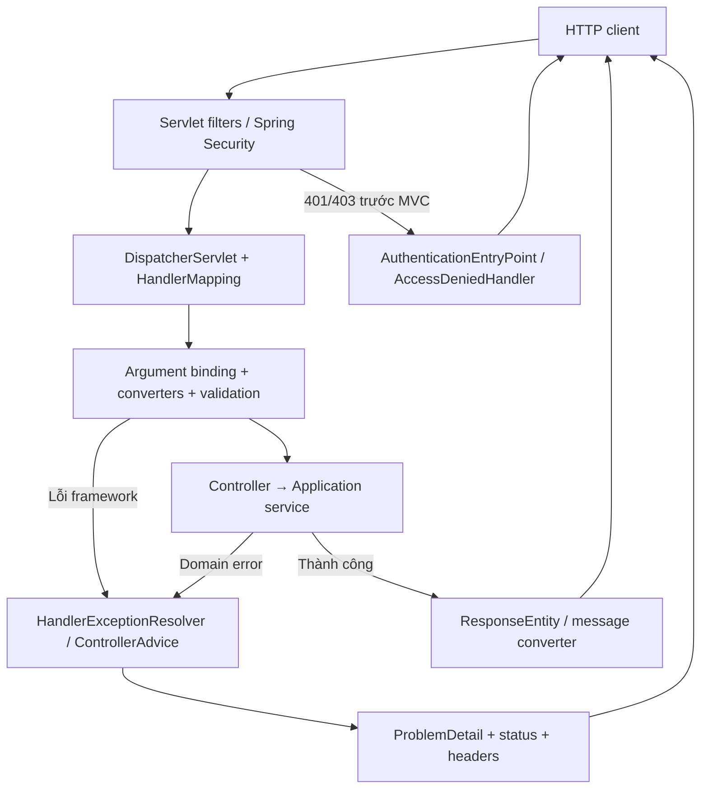

# ResponseEntityExceptionHandler và xử lý lỗi framework

> **Module:** INTEGRATION_API_REST — học thiết kế REST API theo resource, URI, HTTP method/status, hợp đồng dữ liệu, phân trang, cache, idempotency, OpenAPI, xác thực, phân quyền, lỗi và kiểm thử bằng Java/Spring.  
> **Chương:** Dữ liệu và lỗi Spring.  
> **Trọng tâm:** Dùng `ResponseEntityExceptionHandler` trong Spring MVC để chuyển **lỗi do framework phát hiện** thành HTTP response nhất quán, phân biệt chúng với lỗi nghiệp vụ và lỗi từ Spring Security.

## 1. Vì sao lỗi framework cần một hợp đồng riêng?

Xét endpoint nhận yêu cầu tạo đơn:

```http
POST /api/orders HTTP/1.1
Authorization: Bearer <token>
Content-Type: application/json

{"customerId":"cus-17","quantity":"hai"}
```

`quantity` đáng lẽ là số nguyên. Trước khi gọi service, Spring MVC phải giải mã JSON và chuyển kiểu cho DTO. Nếu không chuyển được chuỗi `"hai"` thành `int`, controller có thể **chưa được gọi**, nhưng client vẫn cần một phản hồi dễ hiểu:

```http
HTTP/1.1 400 Bad Request
Content-Type: application/problem+json
Cache-Control: no-store

{
  "type": "https://api.example.com/problems/malformed-request",
  "title": "Nội dung yêu cầu không hợp lệ",
  "status": 400,
  "detail": "Body JSON không đúng định dạng dữ liệu API yêu cầu."
}
```

Một request khác có body hợp lệ về kiểu nhưng vi phạm `@Min(1)`:

```http
POST /api/orders HTTP/1.1
Content-Type: application/json

{"customerId":"cus-17","quantity":0}
```

Đây cũng có thể là `400`, nhưng đi qua **lỗi validation**, không phải lỗi parse JSON. Nếu một resource đã tồn tại và bị khóa nghiệp vụ, service lại cần trả `409`. Nếu không có quyền, Spring Security có thể chặn ngay ở filter trước Spring MVC.

**Mục tiêu:** có một lớp xử lý lỗi nhất quán mà không đánh đồng các nguyên nhân trên, không tiết lộ exception nội bộ và không làm mất header giao thức như `Allow` hoặc `WWW-Authenticate`.

Sau bài, bạn có thể:

1. Giải thích vai trò của `ResponseEntityExceptionHandler` trong chuỗi xử lý lỗi Spring MVC.
2. Nhận biết các exception do **binding, validation, converter, routing và content negotiation**.
3. Ghi đè đúng các hook `handle...` mà không tạo handler trùng.
4. Trả `ProblemDetail` (RFC 9457) với status và thông tin đủ dùng, không lộ dữ liệu.
5. Kết nối đúng lỗi Spring Data, domain service và Spring Security.
6. Viết OpenAPI và MockMvc tests xác minh **status + headers + body**.

## 2. Lỗi có thể phát sinh ở đâu trong đường đi HTTP?



Trong **Spring MVC**, `@ControllerAdvice` và `@ExceptionHandler` được framework dùng để chọn handler khi ngoại lệ xảy ra trong phạm vi xử lý MVC. `ResponseEntityExceptionHandler` là lớp nền cho `@ControllerAdvice`, đã cung cấp logic xử lý nhiều ngoại lệ Spring MVC tiêu chuẩn.

Các trách nhiệm cần tách:

| Tầng | Ví dụ lỗi | Ai thường xử lý? |
|---|---|---|
| Servlet/filter/security | Token thiếu, token sai, không đủ quyền | Spring Security entry point/denied handler |
| Routing/HTTP method | Path không khớp, `POST` vào route chỉ có GET | Spring MVC exception resolver |
| Message conversion | JSON sai, type không đọc được, sai `Content-Type` | Spring MVC + `ResponseEntityExceptionHandler` |
| Binding/validation | Thiếu query param, `@Valid` thất bại | Spring MVC + `ResponseEntityExceptionHandler` |
| Domain/application service | Đơn hết hạn, duplicate mã, version stale | Exception nghiệp vụ + advice |
| Repository/database | Unique constraint, optimistic lock, mất kết nối DB | Service dịch lỗi có ngữ nghĩa; 500/503 khi bất ngờ |
| Serialization response | DTO không ghi được thành JSON | Lỗi server, không gán lỗi cho client |

**Điểm mấu chốt:** xử lý lỗi tập trung không có nghĩa mọi exception đều chuyển thành 400. Cần phân biệt người gửi sửa request được hay server phải sửa sự cố của mình.

## 3. ResponseEntityExceptionHandler là gì?

`ResponseEntityExceptionHandler` là lớp nền của **Spring MVC** cung cấp `@ExceptionHandler` cho nhiều lỗi framework và các hook `protected handle...` để tùy biến status, headers, body. Trong Spring 6.x, nó hỗ trợ `ProblemDetail`/`ErrorResponse`.

```java
@RestControllerAdvice
class ApiErrorAdvice extends ResponseEntityExceptionHandler {
    // Override protected handle... cho lỗi framework.
    // Dùng @ExceptionHandler cho lỗi nghiệp vụ riêng.
}
```

| Hook quan trọng | Lý do tùy biến |
|---|---|
| `handleMethodArgumentNotValid` | Trả field/code từ Bean Validation |
| `handleHttpMessageNotReadable` | Che chi tiết lỗi Jackson/raw input |
| `handleHttpMediaTypeNotSupported` | Thông báo kiểu request được hỗ trợ |
| `handleHttpMediaTypeNotAcceptable` | Thông báo lỗi Accept/negotiation |
| `handleHttpRequestMethodNotSupported` | Giữ đúng 405 và header `Allow` |
| `handleHandlerMethodValidationException` | Giữ phân biệt validation request/return |
| `handleExceptionInternal`, `createResponseEntity` | Chuẩn hóa response trong hook chung |

**Không khai báo lại `@ExceptionHandler(MethodArgumentNotValidException.class)`** trong lớp đã kế thừa `ResponseEntityExceptionHandler`: lớp cha có handler cho exception này, có thể gây mapping mơ hồ. **Override** hook tương ứng. Chỉ dùng `@ExceptionHandler` riêng cho exception domain như `OrderNotFoundException`.

Lớp này không phải catch-all cho mọi thư viện hoặc Spring Security filters. Signature của hook phụ thuộc Spring Framework version; ví dụ sau dùng `HttpStatusCode` của Spring MVC 6.x, không dùng signature cũ nhận `HttpStatus`.

## 4. Phân biệt các ngoại lệ framework

| Exception | Nguyên nhân | Status thường gặp |
|---|---|---|
| `HttpMessageNotReadableException` | JSON sai cú pháp hoặc không deserialize được | 400 |
| `MethodArgumentNotValidException` | `@Valid` trên DTO sau khi bind | 400 |
| `HandlerMethodValidationException` | Constraint trực tiếp trên method | 400 **input**, 500 **return** |
| `MissingServletRequestParameterException` / binding | Thiếu query/header bắt buộc | 400 |
| `TypeMismatchException` | Path/query không convert sang Long/int | 400 |
| `HttpMediaTypeNotSupportedException` | Sai request `Content-Type` | 415 |
| `HttpMediaTypeNotAcceptableException` | Không đáp ứng `Accept` | 406 |
| `HttpRequestMethodNotSupportedException` | Method sai route | 405 + `Allow` |
| `NoHandlerFoundException`/`NoResourceFoundException` | URI không có handler/resource | 404 tùy cấu hình |
| `MaxUploadSizeExceededException` | Multipart quá giới hạn | 413 |
| `AsyncRequestTimeoutException` | Timeout request async | Thường 503 |
| `HttpMessageNotWritableException` | Server không serialize được body | 500 |
| `ResponseStatusException`/`ErrorResponseException` | Exception có status định nghĩa | Theo status exception |

### 4.1. Ba lỗi đều ở POST nhưng nguyên nhân khác nhau

```java
record CreateOrder(@NotBlank String customerId,
                   @Min(1) int quantity) {}

@PostMapping(path="/api/orders", consumes="application/json",
             produces="application/json")
ResponseEntity<OrderView> create(
        @Valid @RequestBody CreateOrder body) {
    OrderView order = service.create(body);
    return ResponseEntity.created(
        URI.create("/api/orders/" + order.id())).body(order);
}

@GetMapping(path="/api/orders/{id}", produces="application/json")
OrderView get(@PathVariable Long id) {
    return service.findVisible(id);
}
```

| Request | Đường lỗi |
|---|---|
| Body `{"quantity":"abc"}` | Conversion/JSON → `HttpMessageNotReadableException`, 400 |
| Body `{"customerId":"cus-17","quantity":0}` | DTO đã bind; `@Min(1)` → `MethodArgumentNotValidException`, 400 |
| `Content-Type: text/plain` | Handler chỉ nhận JSON → 415 |
| `Accept: application/xml`, controller chỉ `produces=json` | 406 |
| DELETE vào URI chỉ có GET | 405, `Allow` |
| `@PathVariable Long id` nhận `abc` | Type mismatch, 400 |

`@Valid` **không** sửa được JSON sai cú pháp: converter phải tạo được DTO trước khi Bean Validation chạy. `HandlerMethodValidationException` trong Spring MVC 6.1+ có thể xuất hiện với `@RequestParam @Min(1)`; nếu dùng `@Validated` kiểu proxy hoặc framework/version khác, có thể gặp `ConstraintViolationException`. Test loại exception thực tế; **không đổi validation giá trị trả về thành 400** vì đó có thể là lỗi server.

Các handler cho 404/405/415 tùy theo cấu hình routing, static resource và phiên bản Spring. Không hứa mọi URI sai đi qua cùng một exception.

## 5. Problem Details và ý nghĩa mã lỗi

Spring hỗ trợ `ProblemDetail` theo **RFC 9457**. Body lỗi minh họa:

```http
HTTP/1.1 400 Bad Request
Content-Type: application/problem+json
Cache-Control: no-store

{
  "type": "https://api.example.com/problems/request-validation",
  "title": "Dữ liệu không hợp lệ",
  "status": 400,
  "detail": "Một số trường không thỏa mãn hợp đồng API.",
  "violations": [{"field":"quantity","code":"Min"}]
}
```

`type` định danh loại lỗi ổn định; `title` tóm tắt; `status` phải khớp HTTP; `detail` chỉ chứa nội dung an toàn; `instance` (nếu có) định danh lần xảy ra. `violations` là **extension của API**, không phải field bắt buộc của RFC. Client nên dựa trên `type`/field code, không parse câu `detail` bằng regex.

| Status | Khi dùng | Phân biệt với |
|---|---|---|
| `400` | JSON/binding/validation đầu vào sai theo policy | 500 do server |
| `404` / `405` | Không có resource/route; method không được phép | 405 cần `Allow` |
| `406` / `415` | Không tạo được response theo Accept; không nhận request Content-Type | Hai hướng negotiation |
| `413` | Payload quá lớn | 415 sai media type |
| `409` | Conflict trạng thái nghiệp vụ | 412 cho precondition cũ |
| `412` / `428` | `If-Match` cũ; thiếu precondition bắt buộc | 409 |
| `422` | Nội dung hiểu được nhưng không hợp quy tắc xử lý | 400 malformed |
| `500` | Lỗi server/serialize | Không ép thành 400 |

Không cần chuyển toàn bộ Bean Validation sang `422`: chọn policy nhất quán và công bố trong OpenAPI.

## 6. Triển khai @RestControllerAdvice đúng cách

Ví dụ Spring MVC 6.x, dùng hook đã có thay vì tạo handler trùng. DTO, service và ngoại lệ nghiệp vụ là giả định của dự án.

```java
import java.net.URI;
import java.util.Map;
import java.util.Objects;

import org.springframework.http.*;
import org.springframework.http.converter.HttpMessageNotReadableException;
import org.springframework.web.bind.MethodArgumentNotValidException;
import org.springframework.web.bind.annotation.*;
import org.springframework.web.context.request.WebRequest;
import org.springframework.web.servlet.mvc.method.annotation
        .ResponseEntityExceptionHandler;

@RestControllerAdvice
class ApiErrorAdvice extends ResponseEntityExceptionHandler {
    private static final String BASE =
            "https://api.example.com/problems/";

    @Override
    protected ResponseEntity<Object> handleMethodArgumentNotValid(
            MethodArgumentNotValidException ex,
            HttpHeaders headers, HttpStatusCode status,
            WebRequest request) {

        ProblemDetail p = ProblemDetail.forStatusAndDetail(
                status, "Một số trường không hợp lệ.");
        p.setTitle("Dữ liệu không hợp lệ");
        p.setType(URI.create(BASE + "request-validation"));

        var violations = ex.getBindingResult().getFieldErrors()
                .stream().map(e -> Map.of(
                        "field", e.getField(),
                        "code", Objects.toString(e.getCode(), "invalid")))
                .distinct().toList();
        p.setProperty("violations", violations);

        return handleExceptionInternal(ex, p, headers, status, request);
    }

    @Override
    protected ResponseEntity<Object> handleHttpMessageNotReadable(
            HttpMessageNotReadableException ex,
            HttpHeaders headers, HttpStatusCode status,
            WebRequest request) {
        ProblemDetail p = ProblemDetail.forStatusAndDetail(
                status, "Body JSON sai cú pháp hoặc sai kiểu dữ liệu.");
        p.setType(URI.create(BASE + "malformed-request"));
        // Không gửi ex.getMessage(): có thể chứa dữ liệu nhạy cảm.
        return handleExceptionInternal(ex, p, headers, status, request);
    }

    @ExceptionHandler(OrderNotFoundException.class)
    ResponseEntity<ProblemDetail> notFound(OrderNotFoundException ex) {
        ProblemDetail p = ProblemDetail.forStatusAndDetail(
                HttpStatus.NOT_FOUND, "Không tìm thấy đơn hàng.");
        p.setType(URI.create(BASE + "order-not-found"));
        return ResponseEntity.status(HttpStatus.NOT_FOUND)
                .contentType(MediaType.APPLICATION_PROBLEM_JSON)
                .body(p);
    }
}
```

**Giải thích những lựa chọn cần giữ:**

1. `handleMethodArgumentNotValid` chỉ công khai field name/code, **không trả rejected value**, SQL hay trace.
2. `handleHttpMessageNotReadable` che chi tiết Jackson, không đổ lỗi body parse thành business conflict.
3. Truyền lại `headers` và `status` vào `handleExceptionInternal`: đừng đổi 415/405/406 thành 400 hay bỏ các header framework đã tính.
4. `OrderNotFoundException` là exception domain **ngoài** tập lớp cha xử lý, nên khai báo `@ExceptionHandler` riêng hợp lệ.
5. Trong production, giữ xử lý validation/JSON thống nhất ở mọi controller, kể cả status trả từ advice.

### 6.1. Nếu muốn tùy biến 415 hoặc 405

Có thể override `handleHttpMediaTypeNotSupported(...)`, tạo `ProblemDetail` có `type` riêng, rồi gọi `handleExceptionInternal(ex, problem, headers, status, request)`. **Giữ header có sẵn**: 405 đặc biệt cần `Allow`; 415 có thể có metadata về media type được hỗ trợ. Không tạo `new HttpHeaders()` rỗng để thay headers framework.

### 6.2. Method validation và hook chung

Với `HandlerMethodValidationException` (Spring 6.1+), nếu ghi đè `handleHandlerMethodValidationException(...)` phải giữ status framework đưa vào: lỗi request input thường 400, **return value violation là 500**.

`createResponseEntity(...)` là hook cuối khi muốn thêm correlation header/`Cache-Control` chung. Nếu override, hãy **copy và bảo toàn header/status** của framework. Không dùng `@ExceptionHandler(Exception.class)` để “đưa tất cả thành ProblemDetail 400”; lỗi bất ngờ phải còn là 5xx và được log an toàn.

## 7. Spring Data: dịch lỗi persistence ở đúng tầng

`ResponseEntityExceptionHandler` xử lý lỗi Spring **MVC**; lỗi Spring Data cần phân loại ở application/service trước khi chuyển sang HTTP.

| Exception | Diễn giải an toàn |
|---|---|
| `DataIntegrityViolationException` | Có thể là unique/FK/NOT NULL; **không tự đồng nghĩa 409** |
| `OptimisticLockingFailureException` | Cập nhật cạnh tranh; `412` nếu precondition HTTP đã cũ, hoặc 409 theo domain contract |
| `DataAccessException` khác | DB/driver/connection bất ngờ; thường là 5xx |
| `MethodArgumentNotValidException` | Validation ở biên request, trước khi gọi repository |

Ví dụ dịch ràng buộc đã biết:

```java
try {
    return orderWriter.createWithReference(request);
} catch (DataIntegrityViolationException ex) {
    if (isKnownOrderReferenceConflict(ex)) {
        throw new DuplicateOrderReferenceException();
    }
    throw ex; // Không gộp mọi lỗi constraint vào 409.
}
```

`isKnownOrderReferenceConflict` là hàm **dự án tự viết** để nhận diện đúng constraint. Với JPA, lỗi có thể chỉ phát sinh khi `flush` hoặc commit; hãy chọn transaction boundary/cách dịch lỗi không bỏ sót. Không trả raw SQL hoặc message driver trong `ProblemDetail`.

Dùng DB unique/version checks để xử lý race; format response **không bảo đảm** transaction nguyên tử. Mọi path ghi cần phân quyền tenant và giữ nguyên invariant nghiệp vụ trước khi trả 201/204.

## 8. Spring Security: 401 và 403 không luôn đi qua advice

Một request không có Bearer token có thể bị **Spring Security filter** chặn trước khi DispatcherServlet gọi controller. Khi đó:

- `AuthenticationEntryPoint` chịu trách nhiệm `401 Unauthorized` và challenge thích hợp.
- `AccessDeniedHandler` chịu trách nhiệm `403 Forbidden` khi caller đã xác thực nhưng thiếu quyền.
- Với OAuth 2.0 Bearer, `WWW-Authenticate` cần được phát đúng theo chuẩn phù hợp (ví dụ `Bearer` và mã lỗi thích hợp), không biến mất vì muốn trả JSON đẹp.

Ví dụ ý tưởng cấu hình:

```java
@Bean
SecurityFilterChain securityFilterChain(
        HttpSecurity http,
        AuthenticationEntryPoint apiEntryPoint,
        AccessDeniedHandler apiDeniedHandler) throws Exception {

    http.authorizeHttpRequests(auth -> auth
            .requestMatchers("/api/**").authenticated()
            .anyRequest().permitAll());

    http.exceptionHandling(ex -> ex
            .authenticationEntryPoint(apiEntryPoint)
            .accessDeniedHandler(apiDeniedHandler));

    // Cấu hình resource server/JWT và CSRF theo ứng dụng.
    return http.build();
}
```

`apiEntryPoint` và `apiDeniedHandler` phải tự được triển khai hoặc delegate đúng security provider; code trên **không đủ để vận hành Bearer/JWT** nếu chưa cấu hình `oauth2ResourceServer(...).jwt(...)` và các chính sách liên quan. Nếu tùy biến Problem Details trong entry point, giữ `WWW-Authenticate` phù hợp; không ghi token hay thông tin người dùng vào body.

**Khác biệt quan trọng:** một `AccessDeniedException` ném trong MVC có thể được một resolver xử lý tùy cấu hình; nhưng lỗi từ **security filter chain** không được bảo đảm đi qua `@RestControllerAdvice`. Test HTTP qua filter chain thật mới cho kết luận đúng.

## 9. Spring Boot, ngôn ngữ và correlation ID

Với Spring Boot 3.x tương thích, có thể bật hỗ trợ Problem Details mặc định:

```yaml
spring:
  mvc:
    problemdetails:
      enabled: true
```

Nhưng bean `@ControllerAdvice`, filter/security hoặc phiên bản Spring có thể thay đổi hành vi; **test response thực**, không chỉ tin cấu hình.

`MessageSource` và `Accept-Language` có thể địa phương hóa `title`/`detail`; giữ `type`, `violations[].code` ổn định cho máy đọc. Nếu cache theo ngôn ngữ, xét `Vary: Accept-Language` nhưng không public-cache lỗi chứa dữ liệu riêng.

Có thể gắn `traceId`/correlation ID **đã kiểm tra** để hỗ trợ đối soát log; không gửi stack trace, SQL, token, password hoặc raw request body. Log nội bộ nên ghi route template, error type, status và trace ID, tránh PII.

## 10. OpenAPI: mô tả framework errors trước khi phát hành

Contract không chỉ có `200` và `201`; hãy mô tả lỗi mà client thực sự nhận được.

```yaml
openapi: 3.1.2
info:
  title: Orders API
  version: 1.0.0
paths:
  /api/orders:
    post:
      operationId: createOrder
      security:
        - bearerAuth: []
      requestBody:
        required: true
        content:
          application/json:
            schema:
              type: object
              required: [customerId, quantity]
              properties:
                customerId:
                  type: string
                  minLength: 1
                quantity:
                  type: integer
                  minimum: 1
      responses:
        "201":
          description: Đã tạo đơn
          headers:
            Location:
              schema: {type: string}
        "400":
          description: JSON/binding/validation không hợp lệ
          content:
            application/problem+json:
              schema:
                $ref: "#/components/schemas/ApiProblem"
        "401": {description: Chưa xác thực}
        "403": {description: Không đủ quyền}
        "405": {description: Phương thức không được hỗ trợ}
        "406": {description: Response media type không đáp ứng Accept}
        "409":
          description: Xung đột nghiệp vụ
          content:
            application/problem+json:
              schema:
                $ref: "#/components/schemas/ApiProblem"
        "415": {description: Request Content-Type không được hỗ trợ}
components:
  securitySchemes:
    bearerAuth:
      type: http
      scheme: bearer
      bearerFormat: JWT
  schemas:
    ApiProblem:
      type: object
      required: [type, title, status]
      properties:
        type: {type: string, format: uri-reference}
        title: {type: string}
        status: {type: integer}
        detail: {type: string}
        instance: {type: string, format: uri-reference}
        violations:
          type: array
          items:
            type: object
            required: [field, code]
            properties:
              field: {type: string}
              code: {type: string}
```

Ví dụ tập trung vào error schema; implementation đầy đủ phải mô tả response `201` có body nếu thực tế có, cũng như các status 404/412/428/413 tại endpoint tương ứng. `bearerFormat: JWT` chỉ là metadata; **không tự kiểm tra token**.

Nếu framework trả body mặc định khác Problem Details mà OpenAPI cam kết, contract đang sai. Chọn **một chiến lược lỗi nhất quán**, rồi test framework handler, domain advice và security entry point/denied handler theo chiến lược ấy.

## 11. MockMvc: kiểm thử đường đi lỗi thật

Chỉ gọi trực tiếp một phương thức trong advice **không chứng minh** routing, converter, validation và Security filter hoạt động. Dùng MockMvc với cấu hình/fixtures thật phù hợp.

| Test | Input | Kỳ vọng |
|---|---|---|
| ERR-01 | JSON sai cú pháp / sai type | 400, Problem Details không lộ Jackson |
| ERR-02 | DTO `quantity=0` | 400, `violations` đúng |
| ERR-03 | `Content-Type: text/plain` cho JSON route | 415 |
| ERR-04 | `Accept: application/xml` khi chỉ JSON | 406 |
| ERR-05 | DELETE khi route chỉ có GET | 405, `Allow` |
| ERR-06 | Path Long nhận `abc`; thiếu param/header | 400 |
| ERR-07 | URI/resource không tồn tại | 404 theo policy |
| ERR-08 | File multipart vượt hạn | 413, không ghi |
| ERR-09 | Return value validation fail | 500 |
| ERR-10 | If-Match cũ / known unique conflict | 412/409, không side effect |
| ERR-11 | Thiếu token / sai quyền | 401 + challenge / 403 |
| ERR-12 | DB/serialization lỗi | 5xx, không lộ chi tiết |

### 11.1. Ví dụ MockMvc

Mẫu giả định `ApiErrorAdvice` đã đăng ký, principal/tenant hợp lệ và controller `POST /api/orders` tồn tại. **Chưa chạy trong dự án.**

```java
@SpringBootTest
@AutoConfigureMockMvc
class FrameworkErrorContractTest {
    @Autowired MockMvc mvc;

    @Test
    void malformedJsonIs400() throws Exception {
        mvc.perform(post("/api/orders")
                .contentType(MediaType.APPLICATION_JSON)
                .content("{\"customerId\":"))
            .andExpect(status().isBadRequest())
            .andExpect(content().contentTypeCompatibleWith(
                MediaType.APPLICATION_PROBLEM_JSON))
            .andExpect(jsonPath("$.type").value(
                "https://api.example.com/problems/malformed-request"));
    }

    @Test
    void validationReturnsFieldCode() throws Exception {
        mvc.perform(post("/api/orders")
                .contentType(MediaType.APPLICATION_JSON)
                .content("{\"customerId\":\"cus-17\",\"quantity\":0}"))
            .andExpect(status().isBadRequest())
            .andExpect(jsonPath("$.violations[0].field")
                    .value("quantity"));
    }

    @Test
    void wrongMediaTypeIs415() throws Exception {
        mvc.perform(post("/api/orders")
                .contentType(MediaType.TEXT_PLAIN)
                .content("not-json"))
            .andExpect(status().isUnsupportedMediaType());
    }

    @Test
    void wrongMethodPreservesAllow() throws Exception {
        mvc.perform(delete("/api/orders/42"))
            .andExpect(status().isMethodNotAllowed())
            .andExpect(header().string(
                HttpHeaders.ALLOW, containsString("GET")));
    }
}
```

Bổ sung imports JUnit, MockMvc, Hamcrest và fixtures phù hợp; kiểm tra 406, 404, 413 cùng tình huống DB rollback. Nếu API yêu cầu JWT, cung cấp principal/token test được chấp nhận: nếu không, **401 từ filter xuất hiện trước lỗi framework cần test**.

### 11.2. Security và gateway tests

Test **thiếu Bearer token** → 401 và `WWW-Authenticate` phù hợp; **có token nhưng thiếu quyền** → 403, không tiết lộ resource tenant khác. Đường đi qua `AuthenticationEntryPoint`/`AccessDeniedHandler`, không phải chỉ chạy advice unit test.

MockMvc không bao phủ hết proxy, CORS, gateway hoặc body-size limit bên ngoài Spring. Thêm HTTP integration tests qua đường thực nếu middleware có thể đổi status/header/response body.

## 12. Phản mẫu thường gặp

| Phản mẫu | Vấn đề | Cách sửa |
|---|---|---|
| Thêm `@ExceptionHandler(MethodArgumentNotValidException)` trong lớp kế thừa | Trùng handler của lớp cha | Override `handleMethodArgumentNotValid` |
| Trả `400` cho mọi `Exception` | Che lỗi server, khó retry/diagnostic | Phân loại lỗi framework/domain/server |
| Trả `ex.getMessage()` | Lộ Jackson/SQL, raw input, PII | Thông báo an toàn và mã lỗi ổn định |
| Quên `headers` gốc khi override 405/415 | Mất `Allow` hoặc metadata negotiation | Dùng headers framework và `handleExceptionInternal` |
| Đổi mọi validation exception thành 400 | Vi phạm return-value validation có thể là 500 | Giữ đúng status do Spring quy định |
| Dùng `ResponseEntityExceptionHandler` để xử lý mọi 401/403 | Security filter có đường đi khác | Cấu hình entry point/denied handler |
| Gắn `409` cho mọi lỗi database | Constraint failure không luôn là xung đột có thể sửa | Dịch exception ở service khi biết nguyên nhân |
| Không test `@RequestParam`/`Accept`/`Content-Type` | Bỏ sót lỗi framework trước controller | MockMvc HTTP boundary tests |
| Trả stack trace trong 500 | Rò cấu trúc code và secrets | Generic problem + trace ID nội bộ |
| Schema OpenAPI và runtime lệch nhau | SDK không dự đoán được lỗi | Contract tests và artifact review |

## 13. Bài tập thực hành

### A — Phân loại lỗi

Với JSON `{"quantity":"abc"}`, JSON `{"quantity":0}` có `@Min(1)`, `Content-Type: text/plain`, `Accept: application/xml`, DELETE sai method, `/orders/abc` khi id là Long, token thiếu, unique constraint và DB timeout: nêu **exception**, mã HTTP và **tầng chịu trách nhiệm**. Không trả lời tất cả đều do `@RestControllerAdvice`.

### B — Hoàn thiện handler

Bổ sung `handleHttpMediaTypeNotSupported` trả type ổn định, **giữ headers gốc**; handler domain duplicate reference → 409; xử lý method validation giữ 400 input/500 return. Thêm `traceId` an toàn và `MessageSource` cho title/detail. Viết test cho malformed JSON **không có violations giả**.

### C — Security error contract

Thiết kế `AuthenticationEntryPoint` và `AccessDeniedHandler` cho 401/403 dạng `application/problem+json`, giữ `WWW-Authenticate` của Bearer scheme. Test qua filter chain thật với token thiếu/token đúng nhưng sai quyền.

### D — Bộ kiểm thử

Viết ít nhất tám tests: parse JSON, Bean Validation, missing param, 405+Allow, 406, 415, 404 domain, 401/403. Thêm test DB rollback cho lỗi conflict và test response từ gateway nếu có proxy.

## 14. Checklist trước production

- [ ] Signature `ResponseEntityExceptionHandler` khớp phiên bản Spring MVC.
- [ ] Override `handle...`; không trùng `@ExceptionHandler` của lớp cha.
- [ ] Lỗi parsing/binding/validation/method/media type trả đúng HTTP status.
- [ ] Không mất `Allow`, `WWW-Authenticate` hoặc headers framework cần giữ.
- [ ] Problem Details có type ổn định, detail an toàn, extension được mô tả trong OpenAPI.
- [ ] Return-value validation và serialization lỗi giữ ngữ nghĩa 5xx.
- [ ] Lỗi domain/DB được phân loại, không lộ SQL/stack trace/PII.
- [ ] AuthN/AuthZ 401/403 từ security filter có handler/test riêng; tenant isolation đúng.
- [ ] Spring Boot/advice/error controller cùng một error contract đã kiểm chứng.
- [ ] MockMvc assert **status + content type + body + headers**, kiểm tra không có side effect.
- [ ] Có trace ID, log an toàn và integration tests qua gateway khi cần.

## 15. Ghi nhớ

**`ResponseEntityExceptionHandler` là nền tảng xử lý nhiều lỗi Spring MVC**, đặc biệt lỗi binding/validation, đọc JSON, HTTP method và content negotiation. Khi cần tùy biến, hãy **override các hook `handle...`**, giữ đúng status/headers, trả `ProblemDetail` rõ ràng và tránh lộ thông tin nội bộ.

**Lỗi nghiệp vụ** cần được dịch từ service sang HTTP theo ngữ nghĩa; **lỗi xác thực/phân quyền** do security filter phát sinh phải được xử lý và kiểm thử tại đường đi của Spring Security. Một REST API đáng tin không chỉ có response lỗi đẹp mà còn giữ đúng **giao thức, an toàn dữ liệu, transaction và hợp đồng OpenAPI** — với bằng chứng từ các ca kiểm thử đầu vào hợp lệ và không hợp lệ.
