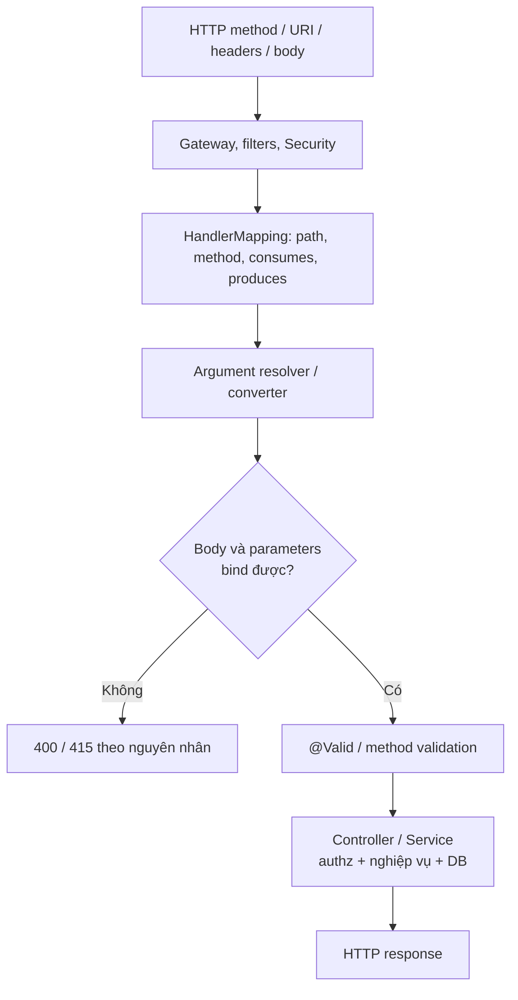

# Chuẩn hóa lỗi parse JSON, thiếu tham số, sai media type

> **Chương:** Dữ liệu và lỗi Spring  
> **Module:** `INTEGRATION_API_REST` — học thiết kế REST API theo resource, URI và HTTP status; thực hành phân quyền, OpenAPI, xử lý lỗi và kiểm thử với Java/Spring.

Một API tạo hóa đơn có thể gặp **JSON hỏng**, **thiếu `page`/`Idempotency-Key`**, **`Content-Type` sai**, hoặc client **không chấp nhận response JSON**. Đây là những tầng lỗi khác nhau; không nên gom lại thành một thông báo “Bad request” tùy ý.

Bài học xây dựng **hợp đồng lỗi HTTP ổn định** bằng Problem Details và `@RestControllerAdvice`, phân biệt các lỗi parse/binding, parameter/header và media negotiation, rồi kiểm tra bằng MockMvc, OpenAPI và security tests. Lỗi nghiệp vụ và database chỉ xuất hiện để xác định ranh giới.

## Mục tiêu

- Phân biệt JSON syntax/type errors, thiếu query/header, validation và content negotiation.
- Ánh xạ các exception Spring MVC thành `400`, `415`, `406` và mã lỗi ứng dụng tương ứng.
- Dùng `ProblemDetail`, `code` ổn định mà không lộ secret/PII.
- Giữ `401/403`, `404/405`, `409` và `5xx` theo đúng ngữ nghĩa; kiểm thử qua HTTP thật.

## 1. Bản đồ lỗi HTTP

| Lỗi | HTTP | `code` minh họa |
| --- | --- | --- |
| JSON sai cú pháp/kiểu hoặc body bắt buộc bị thiếu | **400** | `INVALID_JSON_BODY` |
| Thiếu query parameter | **400** | `MISSING_QUERY_PARAMETER` |
| Thiếu header nghiệp vụ | **400** | `MISSING_REQUIRED_HEADER` |
| Parameter có nhưng không convert được thành kiểu Java | **400** | `INVALID_PARAMETER_TYPE` |
| `@Valid` DTO không đạt | **400** mặc định phổ biến, hoặc **422** theo hợp đồng | `VALIDATION_FAILED` |
| `Content-Type` không được hỗ trợ | **415** | `UNSUPPORTED_MEDIA_TYPE` |
| `Accept` không tương thích representation | **406** | Có thể không có body |
| URL/method không phù hợp | **404 / 405** | Không gộp với lỗi body; 405 cần `Allow` |
| Không đăng nhập/không có quyền | **401 / 403** | Do security policy xử lý |
| Trạng thái nghiệp vụ xung đột | **409** | Ví dụ `INVOICE_ALREADY_PAID` |
| Body vượt hạn mức | **413** | Gateway hoặc server giới hạn |
| Lỗi DB/hệ thống | **5xx** thích hợp | Không gọi là validation |

`422 Unprocessable Content` dành cho content có thể hiểu cú pháp/media type nhưng không xử lý được chỉ dẫn. Spring MVC thường chọn **400** cho lỗi `@Valid @RequestBody`; dùng 422 phải có error contract và handler riêng. JSON bị cắt ngang không nên bị đổi thành 422.

## 2. Ranh giới xử lý lỗi trong Spring MVC



`DispatcherServlet` chọn handler; `@RequestBody` thường qua `HttpMessageConverter`/Jackson, trong khi `@RequestParam`, `@RequestHeader`, `@PathVariable` có resolver riêng. Khi bind DTO xong, `@Valid` mới có thể kiểm tra constraints. Gateway/Spring Security có thể từ chối request **trước** conversion; thứ tự và status cụ thể phụ thuộc cấu hình.

Không bắt `Exception.class` để trả `400`: sẽ che lỗi quyền, database outage và bugs. Chuẩn hóa **từng loại lỗi tại tầng phát sinh**, không gom mọi lỗi thành “JSON sai”.

## 3. JSON sai: syntax, type và body vắng

Ba trường hợp thường dẫn tới `HttpMessageNotReadableException` và **400**:

**JSON bị cắt:**

```http
POST /api/invoices HTTP/1.1
Content-Type: application/json

{"customerId":15,"items":[
```

**JSON đúng cú pháp nhưng không bind vào DTO** cần `Integer quantity`:

```json
{"customerId":15,"items":[{"productId":7,"quantity":{}}]}
```

**Body trống** dù `@RequestBody(required=true)`:

```http
POST /api/invoices HTTP/1.1
Content-Type: application/json
Content-Length: 0
```

Client có thể nhận `400 INVALID_JSON_BODY` cho cả ba; đừng phản chiếu Jackson exception/stack trace. Coercion như `"2"` → integer tùy cấu hình, cần test.

Ngược lại, `{"quantity":0}` có thể bind thành công nhưng vi phạm `@Min(1)` ⇒ **`VALIDATION_FAILED`**, không phải parser error. Trường JSON **vắng** thường bind thành `null` rồi `@NotNull/@NotEmpty` phát hiện; một số Jackson creator/strict settings có thể từ chối sớm. Xác minh trên DTO thực.

## 4. Thiếu query/header và chuyển kiểu parameter

```java
@GetMapping("/api/invoices")
ResponseEntity<?> list(@RequestParam("page") Integer page) {
    return ResponseEntity.ok().build();
}
```

- `GET /api/invoices` → thường `MissingServletRequestParameterException` ⇒ **400 MISSING_QUERY_PARAMETER**.
- `GET /api/invoices?page=abc` → thường `MethodArgumentTypeMismatchException` ⇒ **400 INVALID_PARAMETER_TYPE**.
- `GET ...?page=0` → parse integer được nhưng có thể vi phạm `@Min(1)`/business rule.
- `@RequestParam(defaultValue="1")` biến việc thiếu `page` thành mặc định, phải đồng bộ OpenAPI.

Với `@RequestHeader("Idempotency-Key")`, header vắng thường tạo `MissingRequestHeaderException` ⇒ **400 MISSING_REQUIRED_HEADER**. Header có nhưng rỗng vẫn cần `@NotBlank` hoặc policy riêng; phải kiểm tra độ dài, phạm vi và reuse của key.

**Không xử lý `Authorization` như header nghiệp vụ thiếu**: Spring Security nên trả `401`/challenge Bearer hoặc `403` theo quyền. Với `/api/invoices/{id}`, thiếu hẳn segment `id` thường là **không match route** (404 hoặc route khác), không phải `MissingServletRequestParameterException`. `MissingPathVariableException` thường báo lỗi cấu hình/binding phía server; đừng tự đổ lỗi client bằng 400.

## 5. Content-Type và Accept: 415 khác 406

`Content-Type` mô tả **body client gửi**; `Accept` mô tả **representation client muốn nhận**. Spring `consumes` và `produces` là các giới hạn tương ứng:

```java
@PostMapping(path="/api/invoices",
    consumes="application/json", produces="application/json")
ResponseEntity<InvoiceView> create(
        @Valid @RequestBody CreateInvoiceRequest input) { /* ... */ }
```

| Tình huống | Kết quả |
| --- | --- |
| `Content-Type: text/plain`, body nhìn giống JSON, chỉ nhận JSON | **415**, thường `HttpMediaTypeNotSupportedException`. |
| `Content-Type: application/json`, body hỏng | **400**, JSON parse error; **không** phải 415. |
| Có body nhưng không gửi `Content-Type`, endpoint đòi JSON | Có thể **415** theo mapping/converter. |
| `Accept: text/plain`, handler chỉ trả JSON | **406**, thường `HttpMediaTypeNotAcceptableException`. |
| `Accept: application/json` hoặc `*/*` | Có thể nhận JSON khi response phù hợp. |

**406 có thể không có body.** Nếu client từ chối JSON, trả `application/problem+json` bất chấp `Accept` là mâu thuẫn. Đừng hứa error envelope JSON cho mọi tình huống negotiation. Security filter/mapping có thể từ chối trước nên thứ tự status không tuyệt đối.

## 6. Problem Details: status đúng, mã ổn định

Dùng `application/problem+json` theo RFC 9457; ví dụ lỗi parse:

```http
HTTP/1.1 400 Bad Request
Content-Type: application/problem+json
Cache-Control: no-store

{
  "type": "https://api.example.test/problems/invalid-json-body",
  "title": "Invalid request body",
  "status": 400,
  "detail": "Send a valid JSON request body.",
  "code": "INVALID_JSON_BODY"
}
```

`type` định danh loại lỗi, `title` là tên ngắn, `status` khớp HTTP response và `detail` là thông báo an toàn. `code`, `errors[]` là **extension fields của API**, không bắt buộc trong RFC; client dựa vào code ổn định thay vì parse câu chữ.

Ví dụ thiếu query:

```json
{
  "type": "https://api.example.test/problems/missing-parameter",
  "title": "Required parameter missing",
  "status": 400,
  "code": "MISSING_QUERY_PARAMETER",
  "errors": [{"in":"query","name":"page","code":"REQUIRED"}]
}
```

Không trả raw request, token, stack trace, Java class, SQL hoặc rejected PII. `instance`/`traceId` chỉ thêm nếu nguồn đáng tin, không phản chiếu query hay header tự gửi chứa secret. Với lỗi riêng tư, `Cache-Control: no-store` là lựa chọn thận trọng.

## 7. Ví dụ REST controller: một hợp đồng đầu vào rõ

Spring Boot 3 / Spring Framework 6:

```java
import jakarta.validation.Valid;
import jakarta.validation.constraints.*;
import java.net.URI;
import java.security.Principal;
import java.util.List;
import org.springframework.http.*;
import org.springframework.web.bind.annotation.*;

record InvoiceLineRequest(
    @NotNull @Positive Long productId,
    @NotNull @Min(1) @Max(100) Integer quantity
) {}

record CreateInvoiceRequest(
    @NotNull @Positive Long customerId,
    @NotEmpty List<@Valid InvoiceLineRequest> items
) {}

record InvoiceView(long id, String state) {}

interface InvoiceService {
    InvoiceView createAuthorized(
        String principal, String idempotencyKey, CreateInvoiceRequest request);
    List<InvoiceView> listVisible(String principal, int page);
}

@RestController
@RequestMapping("/api/invoices")
class InvoiceController {
    private final InvoiceService service;

    InvoiceController(InvoiceService service) {
        this.service = service;
    }

    @PostMapping(
        consumes=MediaType.APPLICATION_JSON_VALUE,
        produces=MediaType.APPLICATION_JSON_VALUE
    )
    ResponseEntity<InvoiceView> create(
            Principal principal,
            @RequestHeader("Idempotency-Key") String key,
            @Valid @RequestBody CreateInvoiceRequest input) {
        InvoiceView result =
            service.createAuthorized(principal.getName(), key, input);

        return ResponseEntity
            .created(URI.create("/api/invoices/" + result.id()))
            .body(result);
    }

    @GetMapping(produces=MediaType.APPLICATION_JSON_VALUE)
    ResponseEntity<List<InvoiceView>> list(
            Principal principal,
            @RequestParam(name="page") Integer page) {
        return ResponseEntity.ok(
            service.listVisible(principal.getName(), page));
    }
}
```

Controller này có **cả hai loại đầu vào**: `POST` nhận JSON body và header bắt buộc; `GET` nhận query parameter `page` bắt buộc. Nó giúp kiểm thử các lỗi từ **những resolver khác nhau** chứ không giả định mọi thứ đi qua Jackson.

**Giới hạn của skeleton:** chưa có security filter, implementation service, persistence, error handlers và validation `page>=1`. Trong dự án thật, kiểm tra idempotency key (blank/length/reuse với payload khác), tenant/owner theo principal và trạng thái hóa đơn tại service. Không deserialize request thẳng vào JPA entity chứa `paid`, `tenantId` hay `totalAmount`.

## 8. Spring @RestControllerAdvice: ánh xạ đúng exception

Một cách triển khai dễ kiểm soát là dùng **`@RestControllerAdvice` độc lập**, không mở rộng `ResponseEntityExceptionHandler` trong cùng class dưới đây. Nếu ứng dụng đã **extends `ResponseEntityExceptionHandler`**, hãy override các phương thức `handle...` được framework cung cấp, **không** thêm `@ExceptionHandler` trùng các exception mà base class đã xử lý; việc đăng ký chồng chéo có thể gây ambiguous exception mapping.

Ví dụ sau cố tình chỉ xử lý những nhóm lỗi thuộc phạm vi bài:

```java
import jakarta.servlet.http.HttpServletRequest;
import java.net.URI;
import java.util.List;
import java.util.Map;

import org.springframework.http.*;
import org.springframework.http.converter.HttpMessageNotReadableException;
import org.springframework.web.HttpMediaTypeNotAcceptableException;
import org.springframework.web.HttpMediaTypeNotSupportedException;
import org.springframework.web.bind.MissingRequestHeaderException;
import org.springframework.web.bind.MissingServletRequestParameterException;
import org.springframework.web.bind.MethodArgumentNotValidException;
import org.springframework.web.bind.annotation.*;
import org.springframework.web.method.annotation.MethodArgumentTypeMismatchException;

@RestControllerAdvice
class ApiInputErrorAdvice {

    private ResponseEntity<ProblemDetail> error(
            HttpStatus status, String slug, String code, String detail) {

        ProblemDetail p = ProblemDetail.forStatusAndDetail(status, detail);
        p.setType(URI.create(
            "https://api.example.test/problems/" + slug));
        p.setTitle(status.getReasonPhrase());
        p.setProperty("code", code);

        return ResponseEntity.status(status)
            .cacheControl(CacheControl.noStore())
            .contentType(MediaType.APPLICATION_PROBLEM_JSON)
            .body(p);
    }

    @ExceptionHandler(HttpMessageNotReadableException.class)
    ResponseEntity<ProblemDetail> jsonUnreadable(
            HttpMessageNotReadableException ex) {
        return error(HttpStatus.BAD_REQUEST, "invalid-json-body",
            "INVALID_JSON_BODY", "Send a valid JSON request body.");
    }

    @ExceptionHandler(MissingServletRequestParameterException.class)
    ResponseEntity<ProblemDetail> queryMissing(
            MissingServletRequestParameterException ex) {

        ProblemDetail p = ProblemDetail.forStatusAndDetail(
            HttpStatus.BAD_REQUEST, "A required query parameter is missing.");
        p.setType(URI.create(
            "https://api.example.test/problems/missing-parameter"));
        p.setTitle("Required parameter missing");
        p.setProperty("code", "MISSING_QUERY_PARAMETER");
        p.setProperty("errors", List.of(Map.of(
            "in", "query",
            "name", ex.getParameterName(),
            "code", "REQUIRED")));

        return ResponseEntity.badRequest()
            .cacheControl(CacheControl.noStore())
            .contentType(MediaType.APPLICATION_PROBLEM_JSON)
            .body(p);
    }

    @ExceptionHandler(MissingRequestHeaderException.class)
    ResponseEntity<ProblemDetail> headerMissing(
            MissingRequestHeaderException ex) {
        return error(HttpStatus.BAD_REQUEST, "missing-required-header",
            "MISSING_REQUIRED_HEADER",
            "A required request header is missing.");
    }

    @ExceptionHandler(MethodArgumentTypeMismatchException.class)
    ResponseEntity<ProblemDetail> parameterWrongType(
            MethodArgumentTypeMismatchException ex) {
        return error(HttpStatus.BAD_REQUEST, "invalid-parameter-type",
            "INVALID_PARAMETER_TYPE",
            "A path or query parameter has an invalid type.");
    }

    @ExceptionHandler(MethodArgumentNotValidException.class)
    ResponseEntity<ProblemDetail> dtoInvalid(
            MethodArgumentNotValidException ex) {
        return error(HttpStatus.BAD_REQUEST, "validation-failed",
            "VALIDATION_FAILED",
            "One or more request fields are invalid.");
    }

    @ExceptionHandler(HttpMediaTypeNotSupportedException.class)
    ResponseEntity<ProblemDetail> unsupportedMediaType(
            HttpMediaTypeNotSupportedException ex) {
        return error(HttpStatus.UNSUPPORTED_MEDIA_TYPE,
            "unsupported-media-type",
            "UNSUPPORTED_MEDIA_TYPE",
            "Use a supported request Content-Type.");
    }

    @ExceptionHandler(HttpMediaTypeNotAcceptableException.class)
    ResponseEntity<Void> unacceptable(
            HttpMediaTypeNotAcceptableException ex) {
        // Không cố ép application/problem+json khi Accept cấm JSON.
        return ResponseEntity.status(HttpStatus.NOT_ACCEPTABLE)
            .cacheControl(CacheControl.noStore())
            .build();
    }
}
```

**Vì sao không bắt hết mọi thứ?**

- `MissingPathVariableException` thường chỉ ra lỗi cấu hình handler hoặc binding phía server; trả `400` “thiếu input” có thể đổ lỗi sai cho client.
- `AccessDeniedException`, authentication errors thường đi qua Spring Security và cần status, `WWW-Authenticate`/policy tương ứng.
- `DataIntegrityViolationException` không mặc nhiên là lỗi input; có trường hợp là unique domain conflict `409`, có trường hợp là sự cố cần 5xx.
- `NoResourceFoundException`/`NoHandlerFoundException`, `HttpRequestMethodNotSupportedException` và request limits có handlers riêng, không nằm trong nhóm parse JSON.
- Với constraint trực tiếp trên method parameters, Spring mới có thể phát `HandlerMethodValidationException`; cần xử lý riêng theo cấu hình, không nhầm với `MethodArgumentNotValidException`.

Ví dụ `dtoInvalid` trả mã chung `VALIDATION_FAILED` để tập trung luồng; production có thể thêm `errors[]` từ `BindingResult` với **field name và code an toàn**, không xuất `rejectedValue`. Response của mọi handler cần test với filter/advice thực tế: status và Content-Type của lỗi có thể bị ảnh hưởng khi client chỉ chấp nhận một media type hạn chế.

## 9. Security và thứ tự lỗi

Một request có token sai lẫn JSON hỏng không có status “ưu tiên” bất biến. Spring Security hoặc gateway có thể trả `401/403` trước khi MVC parse body.

- **Authorization** là auth/security concern, không phải `MissingRequestHeaderException` chung của header nghiệp vụ.
- Chỉ service/repository quyết định người gọi có quyền với `customerId`/invoice; có thể dùng `404` để che giấu sự tồn tại.
- Không trả `ex.getMessage()` hay rejected body; parser errors có thể chứa giá trị nhạy cảm.
- Idempotency key được giới hạn kích thước và bảo vệ theo tenant/payload; không log nguyên văn.
- DTO chỉ nhận fields cần thiết; không mass assign `paid`/`ownerId`/`roles`.

Không kiểm tra resource existence trong handler parse JSON để chọn status: nó vừa sai tầng vừa có nguy cơ lộ thông tin.

## 10. Quan sát lỗi mà không tiết lộ dữ liệu

| Nơi | Nên lưu | Tránh |
| --- | --- | --- |
| Client | HTTP status, `type`, `code`, field name an toàn | Parser message, SQL, stack trace, PII |
| Logs/traces nội bộ | Route template, correlation ID đáng tin, exception class, error code | Raw JSON body, bearer token, cookies |
| Metrics | Số lỗi theo `route/status/code` và tỷ lệ sau deploy | User/order/token thành high-cardinality labels |

`INVALID_JSON_BODY` tăng sau release có thể do serializer/SDK đổi; `MISSING_QUERY_PARAMETER` tăng thường do client chưa biết required input; `415` tăng khi đổi `Content-Type`/`consumes`; `406` tăng khi `Accept` hoặc `produces` thay đổi. Truy nguyên ở log nội bộ có redaction, không phản chiếu exception gốc ra response.

## 11. OpenAPI 3.1 phải phản ánh hợp đồng lỗi runtime

Một đoạn contract rút gọn:

```yaml
openapi: 3.1.0
info:
  title: Invoices API
  version: 1.0.0
servers:
  - url: https://api.example.test
security:
  - bearerAuth: []

paths:
  /api/invoices:
    get:
      operationId: listInvoices
      parameters:
        - name: page
          in: query
          required: true
          schema: { type: integer, minimum: 1 }
      responses:
        '200':
          description: Invoices visible to caller
          content:
            application/json:
              schema:
                type: array
                items: { $ref: '#/components/schemas/InvoiceView' }
        '400':
          $ref: '#/components/responses/BadRequest'
        '401': { description: Authentication required }
        '403': { description: Forbidden }
        '406': { description: No acceptable representation }

    post:
      operationId: createInvoice
      parameters:
        - name: Idempotency-Key
          in: header
          required: true
          schema: { type: string, minLength: 1, maxLength: 128 }
      requestBody:
        required: true
        content:
          application/json:
            schema: { $ref: '#/components/schemas/CreateInvoiceRequest' }
      responses:
        '201':
          description: Created
          headers:
            Location:
              description: URI of new invoice
              schema: { type: string }
          content:
            application/json:
              schema: { $ref: '#/components/schemas/InvoiceView' }
        '400':
          $ref: '#/components/responses/BadRequest'
        '401': { description: Authentication required }
        '403': { description: Forbidden }
        '409': { description: Domain or idempotency conflict }
        '415':
          $ref: '#/components/responses/UnsupportedMediaType'
        '406': { description: No acceptable representation }

components:
  securitySchemes:
    bearerAuth:
      type: http
      scheme: bearer
      bearerFormat: JWT
  schemas:
    InvoiceLineRequest:
      type: object
      required: [productId, quantity]
      properties:
        productId: { type: integer, format: int64, minimum: 1 }
        quantity: { type: integer, minimum: 1, maximum: 100 }
    CreateInvoiceRequest:
      type: object
      required: [customerId, items]
      properties:
        customerId: { type: integer, format: int64, minimum: 1 }
        items:
          type: array
          minItems: 1
          items: { $ref: '#/components/schemas/InvoiceLineRequest' }
    InvoiceView:
      type: object
      required: [id, state]
      properties:
        id: { type: integer, format: int64 }
        state: { type: string }
    ApiProblem:
      type: object
      properties:
        type: { type: string, format: uri-reference }
        title: { type: string }
        status: { type: integer }
        detail: { type: string }
        code: { type: string }

  responses:
    BadRequest:
      description: JSON body, required parameter or validation invalid
      content:
        application/problem+json:
          schema: { $ref: '#/components/schemas/ApiProblem' }
    UnsupportedMediaType:
      description: Send application/json request body
      content:
        application/problem+json:
          schema: { $ref: '#/components/schemas/ApiProblem' }
```

**Chú ý:** schema cho `401/403/409/422` trong ví dụ chỉ rút gọn, không phải bản production đầy đủ. `422` không nên công bố nếu runtime không trả nó; `GET` thiếu `page` phải trả `400` như contract. `requestBody.content.application/json` là chỗ mô tả `Content-Type`, còn `Authorization` thuộc `securitySchemes` và `Accept` được hiểu từ media types của response — **không** khai báo chúng như header parameters thông thường.

Các công cụ sinh SDK thường dùng status và schema error nhưng không tự thực hiện security policy hoặc field validation trên server. Kiểm thử runtime vẫn bắt buộc.

## 12. MockMvc: kiểm tra đường lỗi thực, không gọi controller trực tiếp

MockMvc đưa request qua Spring MVC mapping, argument resolvers và converters; nó phù hợp để kiểm chứng exception mapping. Các ví dụ sau giả định test context có controller, advice, service mock và Spring Security Test.

### 12.1 JSON sai cú pháp thành 400

```java
@Test
void malformedJsonHasStableProblemCode() throws Exception {
    mvc.perform(post("/api/invoices")
            .with(user("alice")).with(csrf())
            .header("Idempotency-Key", "invoice-test-1")
            .contentType(MediaType.APPLICATION_JSON)
            .accept(MediaType.APPLICATION_JSON, MediaType.APPLICATION_PROBLEM_JSON)
            .content("{\"customerId\":15,\"items\":["))
        .andExpect(status().isBadRequest())
        .andExpect(content().contentTypeCompatibleWith(
            MediaType.APPLICATION_PROBLEM_JSON))
        .andExpect(jsonPath("$.code").value("INVALID_JSON_BODY"));

    verifyNoInteractions(invoiceService);
}
```

### 12.2 Thiếu query và header

```java
@Test
void missingPageReturns400WithQueryCode() throws Exception {
    mvc.perform(get("/api/invoices")
            .with(user("alice"))
            .accept(MediaType.APPLICATION_JSON, MediaType.APPLICATION_PROBLEM_JSON))
        .andExpect(status().isBadRequest())
        .andExpect(jsonPath("$.code").value("MISSING_QUERY_PARAMETER"))
        .andExpect(jsonPath("$.errors[0].name").value("page"));
}

@Test
void missingIdempotencyKeyIsNotJsonError() throws Exception {
    mvc.perform(post("/api/invoices")
            .with(user("alice")).with(csrf())
            .contentType(MediaType.APPLICATION_JSON)
            .content("{\"customerId\":15,\"items\":[]}"))
        .andExpect(status().isBadRequest())
        .andExpect(jsonPath("$.code").value("MISSING_REQUIRED_HEADER"));
}
```

### 12.3 Media type request 415 và Accept 406

```java
@Test
void textPlainRequestIs415() throws Exception {
    mvc.perform(post("/api/invoices")
            .with(user("alice")).with(csrf())
            .header("Idempotency-Key", "invoice-test-2")
            .contentType(MediaType.TEXT_PLAIN)
            .accept(MediaType.APPLICATION_JSON, MediaType.APPLICATION_PROBLEM_JSON)
            .content("{\"customerId\":15}"))
        .andExpect(status().isUnsupportedMediaType())
        .andExpect(jsonPath("$.code").value("UNSUPPORTED_MEDIA_TYPE"));
}

@Test
void unacceptableResponseTypeIs406() throws Exception {
    mvc.perform(get("/api/invoices")
            .with(user("alice"))
            .param("page", "1")
            .accept(MediaType.TEXT_PLAIN))
        .andExpect(status().isNotAcceptable());
}
```

**Kiểm thử cần cấu hình rõ CSRF/filter và authorization:** `with(user(...))` cung cấp principal giả trong Spring Security Test, nhưng không chứng minh security production chặn truy cập tenant khác. Khi chỉ test controller riêng lẻ, `invoiceService` là mock; phải có integration test với database và security configuration thật.

### Ma trận tối thiểu nên có trong CI

| ID | Request | Status và bất biến |
| --- | --- | --- |
| T01 | POST JSON hợp lệ, đủ header/quyền | `201` + `Location`; service tạo đúng một invoice. |
| T02 | POST JSON hỏng | `400 INVALID_JSON_BODY`; service không gọi. |
| T03 | POST JSON type sai, `quantity={}` | `400`; không ghi. |
| T04 | POST body rỗng, `@RequestBody` bắt buộc | `400` theo contract. |
| T05 | POST thiếu `Idempotency-Key` | `400 MISSING_REQUIRED_HEADER`. |
| T06 | GET thiếu `page` | `400 MISSING_QUERY_PARAMETER`. |
| T07 | GET `page=banana` | `400 INVALID_PARAMETER_TYPE`. |
| T08 | POST `quantity=0`, DTO có `@Min(1)` | `400 VALIDATION_FAILED` theo chính sách. |
| T09 | POST `Content-Type: text/plain` | `415 UNSUPPORTED_MEDIA_TYPE`. |
| T10 | GET `Accept: text/plain` | `406`; không ép Problem JSON khi không được chấp nhận. |
| T11 | Thiếu token, token sai | `401` và auth challenge đúng; không coi là lỗi JSON. |
| T12 | Người dùng tenant B gửi customerId tenant A | `403/404`; dữ liệu không đổi. |
| T13 | Body quá giới hạn gateway | `413` hoặc contract limit phù hợp; không OOM. |
| T14 | Thay Jackson strictness/`consumes` | Test client cũ phát hiện drift. |
| T15 | Trùng idempotency key với payload khác | `409` nếu API quy định; không có side effect thứ hai. |

**Đừng chỉ test trực tiếp** `controller.create(new CreateInvoiceRequest(...))`: thao tác đó bỏ qua Jackson, Servlet parameter resolution, media negotiation và exception advice.

## 13. Lưu ý khi deploy và nâng Spring

- Nếu dùng `ResponseEntityExceptionHandler`, hãy **override `handle...` methods** thích hợp; không thêm `@ExceptionHandler` trùng trong cùng class. Với nhiều advice, kiểm tra phạm vi/`@Order` để tránh handler chồng.
- Security/gateway có thể trả `401/413/431` **trước ứng dụng**, nên không hứa mọi lỗi đều mang Problem Details của Spring. Muốn đồng nhất xuyên gateway cần cấu hình và end-to-end tests riêng.
- Không dùng `ex.getMostSpecificCause().getMessage()` trực tiếp cho `detail`; cần giới hạn request size/depth, redaction và no-store.
- Mã `code` hoặc status thay đổi là **API evolution**; kiểm tra consumer cũ/SDK khi nâng Spring, Jackson hoặc đổi `consumes/produces`.

## 14. Bài thực hành: chuẩn hóa lỗi API hoàn tiền

Thiết kế `POST /api/refunds` nhận:

```json
{"paymentId":"pay_123","amountMinor":150000,"reason":"DUPLICATE_CHARGE"}
```

Contract: bắt buộc `Content-Type: application/json`, `Idempotency-Key`; `amountMinor` dương, `reason` thuộc enum; `GET /api/refunds` đòi `page` integer dương. Chỉ caller có quyền với payment được hoàn tiền. Thành công `201 + Location`; số dư hoàn tiền được kiểm tra trong transaction.

**Nhiệm vụ:** viết DTO/controller, handlers cho `HttpMessageNotReadableException`, `MissingServletRequestParameterException`, `MissingRequestHeaderException`, `MethodArgumentTypeMismatchException` và `HttpMediaTypeNotSupportedException`. Chọn phản hồi `Accept: text/plain` khi server chỉ tạo JSON. Viết OpenAPI schemas/statuses và tám MockMvc tests: JSON hỏng/body rỗng/sai type, thiếu key, thiếu page, `page=abc`, 415, 406; bổ sung security/concurrency test.

| Lỗi | Phản hồi |
| --- | --- |
| `{"paymentId":` | `400 INVALID_JSON_BODY` |
| Thiếu key hoặc `page` | `400` với mã missing tương ứng |
| `page=abc` | `400 INVALID_PARAMETER_TYPE` |
| `Content-Type: text/plain` | `415 UNSUPPORTED_MEDIA_TYPE` |
| `Accept: text/plain` | `406`, có thể không body |
| `amountMinor=-1` | `400/422 VALIDATION_FAILED` theo contract |
| Payment tenant khác / hết số dư hoàn | `403/404` theo quyền hoặc `409` domain conflict |

## 15. Checklist

- [ ] JSON syntax/type/body vắng khác Bean Validation và thiếu query/header.
- [ ] `Content-Type` sai → 415; `Accept` không đáp ứng → 406 khi negotiation thất bại.
- [ ] Mapping thiếu path segment không bị gọi nhầm missing query; method không hỗ trợ giữ 405.
- [ ] Advice không đăng ký handler trùng `ResponseEntityExceptionHandler`.
- [ ] Problem Details có `type/code` ổn định, không lộ rejected PII/secret.
- [ ] Security, domain conflict và 5xx được phân loại riêng.
- [ ] OpenAPI mô tả required inputs, media types và error schemas đúng runtime.
- [ ] MockMvc test 400/415/406; integration test security, gateway limits và DB.
- [ ] Metrics/trace có redaction, CI kiểm tra thay đổi error contract.

**Kết luận:** chuẩn hóa lỗi API là phân biệt **nguồn lỗi**, không làm mọi exception thành một envelope giống nhau. Spring MVC cung cấp resolver, converter và advice để trả đúng `400/415/406`; hiệu quả và an toàn còn phụ thuộc HTTP contract, security, gateway và kiểm thử.
