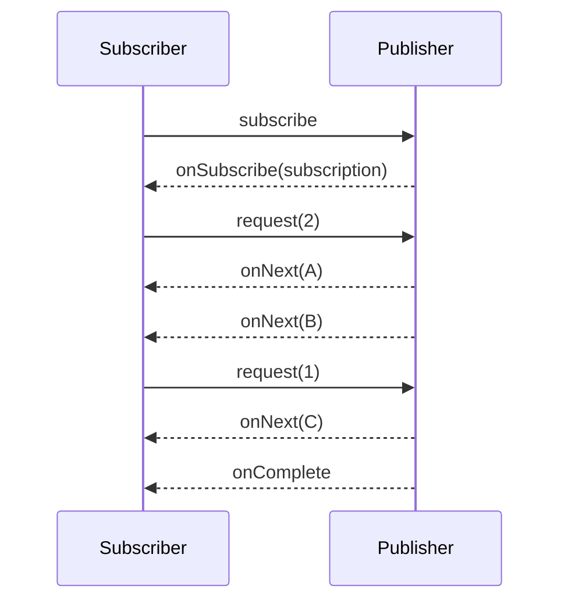
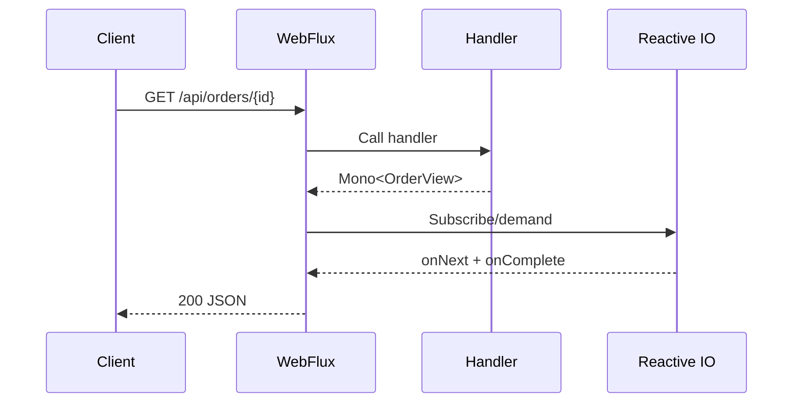

# Reactive Streams, Mono, Flux và vòng đời subscription

## 1. Vì sao REST API cần hiểu subscription?

```http
GET /api/orders/{id}
Accept: application/json

GET /api/orders/{id}/events
Accept: text/event-stream
```

Spring WebFlux có thể trả **`Mono<OrderView>`** khi đọc một resource hoặc **`Flux<ProgressEvent>`** khi phát nhiều sự kiện. Sự khác biệt không chỉ là kiểu Java: **Reactive Streams** quy định cách nguồn và người nhận phối hợp thông qua **subscription, demand, terminal signals và cancellation**.

Bốn lỗi cần tránh: `subscribe()` thủ công khiến HTTP hoàn tất trước business operation; `block()` làm nghẽn event-loop; hai subscription có thể lặp side effect; backpressure không thay giới hạn request/stream.

Bài thuộc chương **Spring WebFlux**, module **INTEGRATION_API_REST**, nối Reactive Streams với resource, HTTP status, dữ liệu, an toàn và kiểm thử Java/Spring. Mục tiêu: giải thích protocol, phân biệt Mono/Flux và cold/hot, điều khiển demand/cancel, compose operators, bảo vệ resource theo tenant và kiểm thử StepVerifier/WebTestClient.

## 2. Reactive Streams: Publisher, Subscriber và Subscription

| Interface | Trách nhiệm |
|---|---|
| `Publisher<T>` | Nguồn phát dữ liệu cho subscriber |
| `Subscriber<T>` | Nhận `onSubscribe/onNext/onError/onComplete` |
| `Subscription` | `request(n)` để tăng demand; `cancel()` để dừng |
| `Processor<T,R>` | Kết hợp Subscriber và Publisher, ít cần tự viết trong WebFlux |



Trong một subscription: `onSubscribe` đến trước dữ liệu; không phát `onNext` vượt demand; item **không null**; `onError` hoặc `onComplete` kết thúc stream, sau đó không phát dữ liệu. `request(n)` với `n <= 0` là vi phạm protocol, không phải cách pause. `Long.MAX_VALUE` biểu thị demand không giới hạn.

`cancel()` yêu cầu nguồn ngừng phát/giải phóng tài nguyên nhưng **không đồng nghĩa transaction rollback ngay**; có thể có tín hiệu đã in-flight. Backpressure giới hạn dữ liệu **trong một subscription**, khác **HTTP rate limit** (số request/giây) và **pagination** (trang kết quả).

## 3. Mono và Flux: số phần tử, empty và error

| Reactor type | Số item | REST use case |
|---|---|---|
| `Mono<T>` | 0 hoặc 1 | GET một đơn, kết quả POST |
| `Flux<T>` | 0 đến nhiều | Danh sách, SSE, export stream |

```java
Mono<String> one = Mono.just("o-123"); // 1 -> complete
Mono<String> none = Mono.empty();      // complete không có item
Flux<Integer> many = Flux.range(1, 3); // 1, 2, 3 -> complete
```

Cả hai đều có thể kết thúc bằng `onError` hoặc kéo dài chưa kết thúc. **Mono không bảo đảm luôn có giá trị**, Flux không mặc định vô hạn; `onNext(null)` không hợp lệ. Với REST GET một resource, `Mono.empty()` ở repository thường phải được chuyển thành HTTP **404** ở controller/service boundary, thay vì mặc nhiên trả response rỗng 200.

## 4. Assembly không phải execution: lazy và subscribe lại

```java
AtomicInteger calls = new AtomicInteger();
Mono<Integer> source = Mono.fromSupplier(calls::incrementAndGet);
// Chỉ assembly: calls == 0
source.subscribe(System.out::println); // 1
source.subscribe(System.out::println); // 2
```

Phần lớn Reactor sources là **lazy**; mỗi subscription có thể khởi động lại nguồn và **side effect**. `Mono.just(expensiveCall())` gọi hàm ngay khi dựng Mono; dùng `fromSupplier/fromCallable/defer` khi cần trì hoãn.

```java
Mono<OrderView> lazyFind(UUID id) {
    return Mono.defer(() -> repository.findById(id)
        .map(mapper::toView));
}
```

Trong WebFlux, framework **subscribe publisher mà handler trả về** để ghi HTTP response. `block()` cũng subscribe và chờ; gọi lại có thể tạo nguồn mới. Không dùng Reactor để giả thay idempotency: việc tạo resource/thu tiền vẫn cần **bảo vệ request trùng tại tầng domain/persistence**.

## 5. Demand và backpressure bằng BaseSubscriber

`subscribe(value -> ...)` tiện cho ví dụ nhỏ nhưng thường yêu cầu demand lớn/không giới hạn. Để **nhìn thấy `request(n)`**, dùng `BaseSubscriber`:

```java
import org.reactivestreams.Subscription;
import reactor.core.publisher.BaseSubscriber;
import reactor.core.publisher.Flux;

Flux.range(1, 3)
    .doOnRequest(n -> System.out.println("Demand: " + n))
    .subscribe(new BaseSubscriber<Integer>() {
        @Override
        protected void hookOnSubscribe(Subscription s) {
            request(1);
        }

        @Override
        protected void hookOnNext(Integer value) {
            System.out.println("Received: " + value);
            request(1);
        }

        @Override
        protected void hookOnComplete() {
            System.out.println("Done");
        }
    });
```

Subscriber xin từng phần tử. Với nguồn đồng bộ `Flux.range`, việc phát có thể diễn ra ngay trong lời gọi `request`; không nên suy từ ví dụ rằng lúc nào cũng có thread nền.

**Demand có thể bị operators thay đổi:** `buffer(10)` có thể yêu cầu số item upstream theo kích thước buffer; `flatMap` thường có prefetch/concurrency. Không giả định subscriber `request(1)` thì mọi upstream chỉ lưu tối đa 1 item. Reactor hỗ trợ backpressure **trong những ranh giới mà nguồn/operator có thể phối hợp**; không thể ép một hệ thống bên ngoài vốn push không kiểm soát ngừng sản xuất.

### Giới hạn backlog

Trong stream nóng (hot producer), producer có thể phát nhanh hơn consumer. Khi đó phải chọn rõ chính sách: **buffer có giới hạn**, drop, latest, báo overflow hoặc điều tiết nguồn. Mỗi lựa chọn đánh đổi dữ liệu/độ trễ. `onBackpressureBuffer` không nên được dùng bừa bãi với dung lượng không kiểm soát vì rủi ro tăng RAM; `onBackpressureDrop` không phù hợp với sự kiện tài chính bắt buộc xử lý đủ.

## 6. Cold vs Hot Publisher

**Cold**: nguồn thường hoạt động lại theo từng subscriber; **hot**: sự kiện có thể phát độc lập với việc một subscriber đến lúc nào.

```java
Flux<Integer> cold = Flux.defer(() -> {
    System.out.println("New subscription");
    return Flux.range(1, 3);
});
cold.subscribe(System.out::println);
cold.subscribe(System.out::println);
```

Một `Sinks.Many` hoặc nguồn event broker chia sẻ có thể là hot: người đến muộn **không mặc nhiên được phát lại** event đã qua. Muốn replay/buffering phải định nghĩa retention/overflow/điều kiện hủy.

Không suy từ kiểu `Mono/Flux` rằng nguồn cold/hot; operators `share`, `cache` hoặc `replay` có thể thay đặc tính. **Cache dữ liệu theo user/tenant** phải có scope và TTL đúng, tránh lộ response qua subscriber khác.

## 7. Vòng đời subscription, dispose và cancellation

`subscribe()` ở ứng dụng standalone có thể trả `Disposable`; `dispose()` yêu cầu cancel. Trong WebFlux controller, **runtime sở hữu subscription HTTP**, không tự subscribe.

```java
Disposable handle = Flux.interval(Duration.ofSeconds(1))
    .doOnSubscribe(s -> System.out.println("Subscribe"))
    .doOnRequest(n -> System.out.println("Demand: " + n))
    .doOnCancel(() -> System.out.println("Cancel"))
    .doFinally(s -> System.out.println("Finally: " + s))
    .subscribe(System.out::println);
handle.dispose(); // minh họa khi client standalone ngừng quan tâm
```

`doOnError` **chỉ quan sát** lỗi, không khôi phục; `doFinally` nhận `ON_COMPLETE`, `ON_ERROR` hoặc `CANCEL`, giúp đo và dọn dẹp. Đóng kết nối SSE có thể cancel upstream, nhưng việc propagation tùy nguồn/runtime; **cancel không có nghĩa rollback DB hoặc hủy job đã enqueue**. Side effect cần tiếp tục sau khi client rời trang phải có lifetime riêng.

## 8. Vòng đời HTTP của WebFlux



**Sai:** fire-and-forget trong handler:

```java
@PostMapping("/api/orders")
Mono<Void> wrong(@RequestBody CreateOrderInput input) {
    repository.save(mapToEntity(input)).subscribe();
    return Mono.empty(); // có thể hoàn tất trước DB commit
}
```

**Đúng:** trả Publisher để HTTP nhận error/completion:

```java
@PostMapping("/api/orders")
Mono<OrderView> better(@RequestBody CreateOrderInput input) {
    return repository.save(mapToEntity(input))
        .map(mapper::toView);
}
```

Ví dụ `better` chỉ chứng minh cách compose; production còn cần status `201 + Location`, validation, auth/idempotency. WebFlux có thể chạy với Netty hay servlet container phù hợp; **blocking JDBC không tự thành non-blocking** chỉ vì bao quanh bởi Mono.

## 9. Map, flatMap, concatMap và các operators

| Operator | Ý nghĩa / bẫy |
|---|---|
| `map` | Biến đổi đồng bộ, **không block/network** |
| `flatMap` | Gộp publisher con, concurrency có thể đổi thứ tự |
| `concatMap` | Giữ thứ tự và xử lý từng publisher con |
| `flatMapSequential` | Concurrent nhưng phát theo thứ tự, có buffer |
| `filter` | Chọn item, **không thay authorization** |
| `zip` | Ghép kết quả; một nguồn empty có thể làm không phát |
| `collectList` | Gom toàn bộ Flux, có nguy cơ RAM lớn |
| `take(n)` | Lấy giới hạn item, thường cancel phần còn lại |

```java
Flux<OrderView> views = Flux.fromIterable(orderIds)
    .flatMap(id -> orderService.findVisible(tenantId, id), 8);
```

`8` giới hạn publisher con đồng thời **trong operator**, không giới hạn tổng HTTP requests. Nếu thứ tự theo `orderIds` quan trọng, dùng `concatMap` hoặc `flatMapSequential` có giới hạn. Để gọi API trả Mono, dùng `flatMap(id -> reactiveClient.fetch(id))`, không `map(id -> reactiveClient.fetch(id).block())` trên event-loop.

## 10. Scheduler không tự làm IO non-blocking

`subscribeOn` ảnh hưởng bối cảnh subscribe/upstream; `publishOn` chuyển ngữ cảnh cho các operators downstream. `Schedulers.parallel()` thích hợp với CPU work ngắn; `Schedulers.boundedElastic()` giúp cách ly **một số blocking calls** khi chưa thay thư viện.

```java
Mono<Customer> fromLegacy(String id) {
    return Mono.fromCallable(() -> legacyRepository.findById(id))
        .subscribeOn(Schedulers.boundedElastic());
}
```

Điều này **không biến JDBC thành reactive I/O**, không tạo vô hạn thread. Cần đo queue, pool, timeout; với DB reactive, cân nhắc R2DBC và reactive transaction phù hợp. Đừng dùng `Thread.sleep` trong operator để chờ: ưu tiên `Mono.delay`/`timeout`/retry policy. Không tự trông chờ imperative `@Transactional` hoạt động giống reactive transaction trên các thread khác nhau.

## 11. onError là terminal, không phải một item

```java
Mono<OrderView> view = orderService.findVisible(tenantId, orderId)
    .switchIfEmpty(Mono.error(
        new ResponseStatusException(HttpStatus.NOT_FOUND)))
    .timeout(Duration.ofSeconds(3))
    .doOnError(metrics::recordFailure);
```

`switchIfEmpty` xử lý **không có item**; `onErrorMap` đổi loại lỗi; `onErrorResume` phát fallback; `timeout` đặt deadline; `retryWhen` **resubscribe** nên có thể thực hiện lại side effect. `doOnError` chỉ quan sát, không nuốt lỗi.

Không dùng `onErrorResume(e -> Mono.empty())` để biến lỗi DB thành 404. Retry GET khi mạng/503 có giới hạn có thể hợp lý, nhưng **không retry mù POST**, 400, 403 hay conflict. Cancellation **khác** `onError` và `onComplete`; quan sát `doFinally(CANCEL)`, cleanup upstream, không giả định transaction rollback.

## 12. WebFlux REST controller: Mono cho một resource

Ví dụ Java 17+/Spring WebFlux kết hợp DTO, reactive service và Spring Security. Đây là **trích đoạn có chủ ý**, không phải project biên dịch độc lập; giả định `OrderService` có các method reactive và Spring Security đã xác thực JWT:

```java
import java.net.URI;
import java.util.List;
import java.util.UUID;
import jakarta.validation.Valid;
import jakarta.validation.constraints.*;
import org.springframework.http.MediaType;
import org.springframework.http.ResponseEntity;
import org.springframework.security.core.annotation.AuthenticationPrincipal;
import org.springframework.security.oauth2.jwt.Jwt;
import org.springframework.web.bind.annotation.*;
import org.springframework.web.server.ResponseStatusException;
import org.springframework.http.HttpStatus;
import reactor.core.publisher.Mono;

record OrderLineInput(@NotBlank String sku, @Min(1) int quantity) {}
record CreateOrderInput(
    @NotEmpty List<@Valid OrderLineInput> items
) {}
record OrderView(UUID id, String status) {}

@RestController
@RequestMapping("/api/orders")
class OrderController {
    private final OrderService orders;

    OrderController(OrderService orders) {
        this.orders = orders;
    }

    @GetMapping(path = "/{id}", produces = MediaType.APPLICATION_JSON_VALUE)
    Mono<OrderView> get(
            @PathVariable UUID id,
            @AuthenticationPrincipal Jwt jwt) {

        String tenant = jwt.getClaimAsString("tenant_id");
        return orders.findVisible(tenant, id)
            .switchIfEmpty(Mono.error(
                new ResponseStatusException(HttpStatus.NOT_FOUND)));
    }

    @PostMapping(consumes = MediaType.APPLICATION_JSON_VALUE)
    Mono<ResponseEntity<OrderView>> create(
            @Valid @RequestBody CreateOrderInput input,
            @RequestHeader("Idempotency-Key") String key,
            @AuthenticationPrincipal Jwt jwt) {

        String tenant = jwt.getClaimAsString("tenant_id");
        return orders.createAuthorizedIdempotently(tenant, key, input)
            .map(view -> ResponseEntity
                .created(URI.create("/api/orders/" + view.id()))
                .body(view));
    }
}
```

Ở đây:
- `Mono<OrderView>` cho GET mang không quá một resource; `switchIfEmpty` dẫn đến 404.
- POST **trả** `Mono<ResponseEntity<OrderView>>` để Spring subscribe, chờ thành công rồi mới gửi `201 + Location`; không có `subscribe()` bên trong handler.
- `@Valid` kiểm tra request body theo luồng WebFlux; nếu dùng `Mono<CreateOrderInput>` làm argument thì cần kiểm chứng khác biệt về **deferred body validation** và error handling.
- `tenant_id` lấy từ **JWT đã xác thực hợp lệ**, nhưng production còn phải kiểm tra claim bắt buộc, quyền/scope và ánh xạ tenant đúng chính sách. `orders.findVisible` phải enforce tenant trong query, không chỉ so sánh ID phía controller.
- `OrderService` cần reactive I/O thật, domain transaction, idempotency key storage; một annotation không bảo đảm các thuộc tính đó.

Tránh đặt logic domain hoặc ghi DB trong `doOnNext` vì hook này có thể bị gọi lại khi retry/resubscribe và không phải ranh giới transaction đáng tin.

## 13. Flux và HTTP: JSON array không giống SSE

Ví dụ list resource:

```java
@GetMapping(path = "/api/orders", produces = MediaType.APPLICATION_JSON_VALUE)
Flux<OrderView> list(@AuthenticationPrincipal Jwt jwt) {
    return orders.findAllVisible(jwt.getClaimAsString("tenant_id"));
}
```

Client có thể nhận JSON array. **Không nên mặc định mỗi `onNext` được flush ngay qua network** khi media type là `application/json`: codec có thể cần định dạng một cấu trúc JSON hoàn chỉnh, buffer hoặc chọn chiến lược ghi phụ thuộc media type. Response body `Flux` không tự là “real-time events”.

Để thông báo tiến độ, dùng **Server-Sent Events**:

```java
import org.springframework.http.codec.ServerSentEvent;
import org.springframework.http.MediaType;
import reactor.core.publisher.Flux;

@GetMapping(
    path = "/api/orders/{id}/events",
    produces = MediaType.TEXT_EVENT_STREAM_VALUE)
Flux<ServerSentEvent<ProgressView>> events(
        @PathVariable UUID id,
        @AuthenticationPrincipal Jwt jwt) {

    String tenant = jwt.getClaimAsString("tenant_id");
    return eventService.authorizedEvents(tenant, id)
        .map(progress -> ServerSentEvent.<ProgressView>builder(progress)
            .id(Long.toString(progress.sequence()))
            .event("progress")
            .build());
}
```

Ví dụ HTTP:

```http
HTTP/1.1 200 OK
Content-Type: text/event-stream
Cache-Control: no-cache

id: 41
event: progress
data: {"state":"RUNNING","percent":70}

id: 42
event: progress
data: {"state":"SUCCEEDED","percent":100}
```

Mã `events` là **fragment minh họa** đặt trong controller có `eventService`, `ProgressView` và import cần thiết. Trong production, cần chính sách reconnect/`Last-Event-ID`, heartbeat, retention/replay, timeout, chống mở quá nhiều stream và **authorization trên mỗi nguồn sự kiện**. Cancellation khi client đóng SSE phải giải phóng nguồn; nếu các sự kiện ảnh hưởng nghiệp vụ không được mất, dùng queue/event store có semantics giao hàng phù hợp thay vì xem SSE như kho lưu bền vững.

## 14. WebClient là reactive HTTP client

```java
Mono<OrderView> loadOrder(UUID id) {
    return webClient.get()
        .uri("/api/orders/{id}", id)
        .retrieve()
        .bodyToMono(OrderView.class)
        .timeout(Duration.ofSeconds(3));
}
```

Request thông thường được thực thi khi Publisher được **subscribe**. `retrieve()` mặc định biến HTTP 4xx/5xx thành error signal; **không tự retry**. Một cold Publisher có hai subscription có thể gửi hai HTTP requests.

Xử lý 404/401/403, 429/503 + `Retry-After`, network timeout theo policy riêng và có **retry budget/deadline**. Tránh `block()` trong WebFlux handler; `bodyToFlux` phù hợp nguồn thực sự stream, còn `bodyToMono(List.class)` có thể đòi buffer toàn bộ response và mất kiểm soát bộ nhớ.

## 15. Reactor Context, authentication và phân quyền

Reactive pipeline có thể đổi thread; **ThreadLocal principal/MDC không tự bảo đảm đúng** sau `publishOn` hoặc async boundaries.

```java
Mono<String> sample = Mono.deferContextual(ctx ->
    Mono.just(ctx.getOrDefault("correlationId", "missing")));

sample.contextWrite(Context.of("correlationId", "demo-123"))
    .subscribe(System.out::println);
```

`Context` là metadata theo **subscription**, không phải nguồn xác thực độc lập. Spring Security reactive dùng `ReactiveSecurityContextHolder` với `SecurityWebFilterChain`; chỉ tin identity/tenant đã được xác thực. Không nhận `X-Tenant-ID` tự khai làm chủ sở hữu.

- Mỗi GET/SSE stream cần object-level authorization trong service/repository.
- Không share `cache()/Sinks` giữa tenant nếu chưa phân vùng/filter đúng.
- Giới hạn active streams/user ngoài request rate limits; backpressure không thay quota.
- Khi quyền bị thu hồi giữa stream, quyết định policy kiểm tra lại/reconnect/TTL.
- CORS/CSRF không thay authentication/authorization, đặc biệt với cookie auth.
- Không log token, PII, body nhạy cảm hoặc đưa user ID vào high-cardinality metrics.

## 16. Buffer và memory: reactive không chống quá tải tự động

- `collectList()` trên stream vô hạn không hoàn tất và có thể tăng RAM.
- `buffer/window` và operator prefetch thay đổi demand, cần giới hạn kích thước.
- `flatMap` cần concurrency cap; `Flux.interval` có thể lỗi overflow khi thiếu demand.
- Nguồn hot không tuân backpressure phải có bounded buffer/drop/latest/error policy.
- Không **drop** sự kiện tài chính yêu cầu xử lý đủ; dùng queue bền vững và acknowledgement.
- Không `subscribe()` trong `map/doOnNext` để tạo IO phụ; dùng `flatMap` để truyền lỗi/cancel.
- Client chậm vẫn tiêu thụ HTTP connection/write buffers, cần timeout/quota.

Với collection lớn, **pagination/cursor** thường rõ hợp đồng hơn việc trả Flux hàng trăm nghìn phần tử. SSE/progress và export incremental là trường hợp streaming có giá trị.

## 17. Kiểm thử Reactive Streams bằng StepVerifier

`StepVerifier` trong `reactor-test` cho phép xác minh **signals và demand**, không chỉ giá trị cuối:

```java
import reactor.core.publisher.Flux;
import reactor.test.StepVerifier;

StepVerifier.create(Flux.just(1, 2, 3), 0)
    .thenRequest(1)
    .expectNext(1)
    .thenRequest(2)
    .expectNext(2, 3)
    .verifyComplete();
```

Test này xác minh Flux không phát giá trị khi initial demand bằng 0, sau đó đáp ứng đúng lượng request. Với source/operator tùy chỉnh, bổ sung assertion khi cancel để bảo vệ cleanup.

### Test thời gian bằng virtual scheduler

```java
import java.time.Duration;
import reactor.core.publisher.Flux;
import reactor.test.StepVerifier;

StepVerifier.withVirtualTime(
        () -> Flux.interval(Duration.ofSeconds(1)).take(2))
    .expectSubscription()
    .thenAwait(Duration.ofSeconds(2))
    .expectNext(0L, 1L)
    .verifyComplete();
```

`withVirtualTime` tránh đợi hai giây thật; **Publisher có time-based operator phải được tạo trong supplier** để virtual scheduler được dùng đúng. Đừng dùng `Thread.sleep` tạo flaky tests.

### Kiểm tra cancellation

```java
AtomicBoolean cancelled = new AtomicBoolean();

StepVerifier.withVirtualTime(() ->
        Flux.interval(Duration.ofSeconds(1))
            .doOnCancel(() -> cancelled.set(true)))
    .expectSubscription()
    .thenAwait(Duration.ofSeconds(1))
    .expectNext(0L)
    .thenCancel()
    .verify();

assertTrue(cancelled.get());
```

Đây là fragment test, cần imports `AtomicBoolean`, `assertTrue` và thư viện Reactor Test. Nó xác minh một nguồn quan sát được cancel; **không chứng minh DB transaction hoặc HTTP request bên ngoài đã rollback**.

## 18. WebTestClient: kiểm thử HTTP, security và streaming

`StepVerifier` kiểm tra chuỗi Publisher; `WebTestClient` kiểm tra **hành vi REST qua HTTP/WebFlux exchange**, bao gồm status/header/body:

```java
webTestClient.get()
    .uri("/api/orders/{id}", id)
    .headers(h -> h.setBearerAuth(testToken))
    .exchange()
    .expectStatus().isOk()
    .expectHeader().contentTypeCompatibleWith("application/json")
    .expectBody()
    .jsonPath("$.id").isEqualTo(id.toString());
```

Đây là trích đoạn test: `webTestClient` được cấu hình cho application context/server thật, `testToken` là token fixture có claim/permission phù hợp; với security test có thể dùng cấu hình mock JWT được hỗ trợ. **Không dùng token thật trong tài liệu/test logs.**

Ma trận tối thiểu:

| Tình huống | Kỳ vọng |
|---|---|
| GET resource thuộc tenant hợp lệ | 200 JSON đúng schema |
| GET resource của tenant khác | 403/404 theo contract, không lộ body |
| GET không token | 401 theo security config |
| GET ID không tồn tại | 404, không biến thành Mono.empty→200 rỗng sai hợp đồng |
| POST hợp lệ | 201 + Location, **một** logical create |
| POST input sai | 400/422 theo hợp đồng, không side effect |
| WebClient gặp 503/network timeout | Có deadline, retry chỉ lỗi phù hợp |
| SSE nhiều events | Đúng `text/event-stream` và event data/order theo policy |
| Client cancel SSE | Nguồn được unsubscribe/cleanup đúng chỗ |
| Một source có hai subscription | Có/không lặp side effects đúng theo thiết kế |
| Payload quá lớn/hot publisher nhanh | Bounded memory/concurrency, policy overflow |
| Lỗi giữa stream | Error terminal, không tiếp tục onNext từ subscription đó |

Để test SSE, bind `WebTestClient` với server đang chạy/handler phù hợp, tiêu thụ stream có giới hạn bằng `take(n)`/`StepVerifier` hoặc cancellation. **Không gọi `collectList()` trên luồng vô hạn** trong integration test. Khi cần kiểm chứng TCP disconnect/proxy behavior, dùng integration test thật, không chỉ test Publisher trong bộ nhớ.

## 19. Quan sát subscription đúng cách

Đo HTTP RPS, **active subscriptions/streams**, buffer/overflow, downstream latency, completion/error/cancel và số stream theo tenant. `doFinally` có thể phân biệt `ON_COMPLETE`/`ON_ERROR`/`CANCEL`, nhưng **cancel không đồng nghĩa job đã hoàn tất**. Khi header SSE đã gửi, lỗi có thể kết thúc stream thay vì trả HTTP 500 mới.

Không dùng token, full order IDs hay PII trong metric labels cardinality cao; Reactor Context giúp mang correlation metadata nhưng không tự mask logs.

## 20. Phản mẫu và cách sửa

| Phản mẫu | Cách sửa |
|---|---|
| `subscribe()` trong controller | **Trả** composed Publisher |
| `block()` trên event-loop | Reactive I/O hoặc boundedElastic cho blocking bridge |
| `Mono.just(blockingCall())` | Dời vào `fromCallable` + scheduler phù hợp |
| Nuốt mọi lỗi bằng `onErrorResume(Mono.empty())` | Map 404 riêng, giữ lỗi 5xx |
| Retry POST bằng `retryWhen` tùy tiện | Idempotency + deadline/budget |
| `collectList` trên stream vô hạn | Bounded consumption/streaming |
| `flatMap` không giới hạn/order | Concurrency cap, `concatMap` khi cần |
| Backpressure thay rate limit | HTTP request quota + active stream limits |
| Hot sink dùng chung mọi tenant | Authorize + partition/filter |
| Cancel được coi là rollback | Domain transaction/cancellation semantics |
| ThreadLocal principal trong pipeline | Spring Security reactive + Context |
| `Flux` JSON array bị coi là SSE | `text/event-stream` theo contract |
| Không test error/cancel | StepVerifier/WebTestClient integration tests |

## 21. Bài tập: stream tiến độ xuất báo cáo

Ứng dụng có `POST /api/report-jobs` và `GET /api/report-jobs/{id}/events`. Worker chạy vài phút; người dùng có thể đóng SSE stream.

1. Vẽ các signal `subscribe → request(n) → onNext → complete/error/cancel`.
2. Tại sao submit dùng `Mono<ResponseEntity<JobView>>`, tiến độ dùng `Flux<ServerSentEvent<ProgressView>>`?
3. Viết controller **trả Publisher**, không tự `subscribe/block`; bảo vệ theo JWT và job owner/tenant.
4. Chọn cold/hot nguồn sự kiện, heartbeat, `Last-Event-ID` và replay/retention khi reconnect.
5. Đặt bounded overflow policy, giới hạn streams/tenant; không drop sự kiện bắt buộc xử lý.
6. Viết StepVerifier tests cho demand, terminal/error, cancellation và virtual time.
7. Viết WebTestClient tests cho 401, cross-tenant 404, SSE type và client disconnect.
8. Giải thích **cancel SSE có hủy job không** và điều gì xảy ra nếu subscribe hai lần vào publisher ghi DB.

**Gợi ý:** POST chỉ tiếp nhận job thì trả `202 + Location` khi đã lưu job bền vững; SSE có lifetime riêng với worker. Nếu không hỗ trợ replay, client cần đọc status resource sau reconnect. Đừng lấy cancellation của HTTP làm cơ chế rollback doanh nghiệp.

## 22. Checklist phát hành WebFlux endpoint

- [ ] `Mono` cho 0..1, `Flux` cho 0..N; hiểu lazy subscription/terminal signals.
- [ ] Không `subscribe` thủ công trong handler và không `block` event-loop.
- [ ] Không emit null; `request(n)`/cancel/backpressure được tuân thủ.
- [ ] Cold/hot, replay và side effects khi resubscribe có hợp đồng.
- [ ] Bounded buffers/concurrency và riêng HTTP rate/stream quotas.
- [ ] Error, empty, timeout được map thành status/Problem Details đúng.
- [ ] Cancellation giải phóng tài nguyên; không coi cancel là rollback.
- [ ] DTO/validation, 201/202/404/5xx, `Location` và SSE content type đúng.
- [ ] Spring Security reactive + tenant authorization thực thi thật.
- [ ] Reactor Context không chứa secrets/trust tenant tự khai.
- [ ] StepVerifier test demand/error/cancel/virtual time.
- [ ] WebTestClient test auth, lỗi HTTP, SSE và disconnect.
- [ ] Proxy timeout, reconnect/heartbeat, metrics/PII safeguards đã kiểm tra.

## 23. Kết luận

**Reactive Streams là hợp đồng về tín hiệu và demand**, không chỉ cú pháp “trả về Mono/Flux”. `Publisher` phát khi có subscriber và demand theo điều kiện nguồn; `Mono` mang 0–1 item, `Flux` mang 0–N item; `onComplete`, `onError` hoặc cancellation đánh dấu cách kết thúc vòng đời quan sát. Những lựa chọn về cold/hot, backpressure, retry và scheduling quyết định tính đúng đắn và chi phí vận hành.

Với **Spring WebFlux**, hãy **trả pipeline để framework subscribe**, không tự tách việc bằng `subscribe()`, và không vô tình block event-loop. Kết hợp authorization theo resource/tenant, HTTP status/headers, SSE contract và giới hạn tải; kiểm thử **Reactor signals bằng StepVerifier** lẫn **HTTP behavior bằng WebTestClient**. Cách tiếp cận này giữ được đặc tính bất đồng bộ mà không đánh đổi an toàn hay độ tin cậy của REST API.

