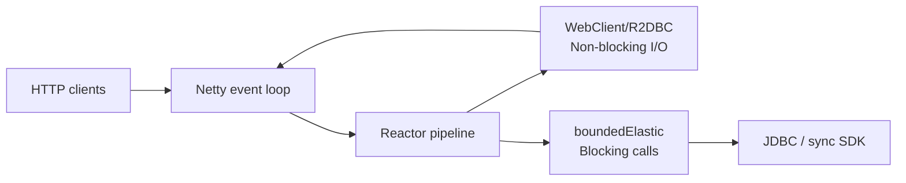

# Tránh chặn event loop khi gọi thư viện blocking

> **Module:** INTEGRATION_API_REST — học thiết kế REST API theo resource, URI, HTTP method/status và hợp đồng dữ liệu rõ ràng; thực hành phân trang, cache, idempotency, OpenAPI, xác thực, phân quyền, xử lý lỗi và kiểm thử với Java/Spring.  
> **Chương:** Spring WebFlux.  
> **Trọng tâm:** Nhận diện các thao tác **blocking** trong chuỗi Reactor, bảo vệ Netty event loop bằng thành phần **non-blocking** hoặc cô lập blocking call đúng cách, kiểm soát tải, transaction, security và kiểm thử.

## 1. Vấn đề: một lệnh JDBC làm nhiều request cùng chậm

Một REST API tìm đơn hàng:

```http
GET /api/orders/ord-901 HTTP/1.1
Authorization: Bearer <token>
Accept: application/json
```

Server phản hồi thành công:

```http
HTTP/1.1 200 OK
Content-Type: application/json
Cache-Control: no-store

{"id":"ord-901","status":"PAID"}
```

Tưởng tượng endpoint Spring WebFlux vẫn gọi Spring Data JPA đồng bộ:

```java
@GetMapping("/api/orders/{id}")
Mono<OrderView> get(@PathVariable String id) {
    // Sai: findById là truy vấn JDBC/JPA blocking.
    OrderEntity entity = jpaRepository.findById(id)
            .orElseThrow(OrderNotFoundException::new);
    return Mono.just(OrderView.from(entity));
}
```

Lời gọi `findById` chạy **ngay khi phương thức controller được thực thi**, trước khi tạo `Mono`. Nếu handler đang chạy trên Netty event loop, thread này sẽ chờ database. Trong lúc chờ, nó **không thể phục vụ các sự kiện socket khác** được gán cho cùng loop.

Khi lưu lượng tăng, hậu quả thường là **độ trễ lan rộng, timeout, throughput giảm** dù CPU chưa sử dụng hết. Tên endpoint có `Mono` không tự làm JDBC trở thành non-blocking.

**Mục tiêu:** đọc được dòng nào đang blocking, di chuyển **chỉ phân đoạn blocking** sang scheduler phù hợp nếu chưa thể thay thư viện, quản lý giới hạn đồng thời, và chứng minh bằng test rằng HTTP request không làm nghẽn event loop.

Sau bài học, bạn có thể:

1. Phân biệt event loop, reactive publisher và thao tác blocking thực tế.
2. Tránh các lỗi `Mono.just(blockingCall())`, `.block()`, `Thread.sleep()`, JDBC/JPA hay HTTP sync trên event loop.
3. Dùng `Mono.fromCallable(...).subscribeOn(Schedulers.boundedElastic())` có kiểm soát.
4. Biết khi nào thay bằng WebClient, R2DBC hoặc driver reactive thật.
5. Giữ đúng ranh giới `@Transactional`, authorization và Reactor Context sau khi đổi scheduler.
6. Thiết kế timeout, bulkhead, rate limit, HTTP status, metrics và tests về blocking/concurrency.

## 2. Event loop, publisher và thread trong WebFlux

Với **Reactor Netty**, các event-loop threads (`reactor-http-nio-*`) điều phối I/O của nhiều kết nối. Mỗi callback cần trả quyền nhanh; một lần chờ JDBC 800 ms có thể giữ loop đang phục vụ những socket khác.



`Mono`/`Flux` **không mặc nhiên đảm bảo** mọi thư viện trong pipeline non-blocking.

| Việc đang làm | Event loop có phù hợp? |
|---|---|
| `map`/`filter` tính toán nhỏ, không chờ | Thường có |
| WebClient hoặc driver R2DBC reactive | Có, theo connector/driver |
| JDBC/JPA, RestTemplate, sync SDK | **Không**, chờ thread |
| `Thread.sleep`, `Future.get`, `Mono.block` | **Không** |
| File I/O đồng bộ hoặc xử lý ảnh lớn | Tránh; dùng API async/worker phù hợp |
| Hash/parse CPU-heavy | Dùng CPU worker/job pool có giới hạn |

**Backpressure** điều phối tín hiệu/demand, không chuyển JDBC thành non-blocking. `Schedulers.parallel()` phù hợp CPU-bound được kiểm soát, **không** phù hợp chờ blocking I/O.

### 2.1. Lazy không đồng nghĩa đổi thread

```java
// Sai: Java tính đối số ngay, DB chạy trước khi dựng Mono.
Mono<OrderView> wrong = Mono.just(blockingDao.load(id));

// Lazy: chỉ gọi DB khi subscribe, nhưng vẫn có thể chạy trên loop.
Mono<OrderView> lazy = Mono.fromCallable(
        () -> blockingDao.load(id));
```

Publisher lazy chỉ quyết định **thời điểm chạy**, không phải **thread chạy**. Trong Reactor, callback `map`/`doOnNext` thường chạy trên thread upstream; hãy chỉ định scheduler ở **đúng đoạn blocking**, không giả định mọi callback tự được chuyển thread.

## 3. Nhận diện dấu hiệu blocking trong WebFlux

Các nguồn phổ biến: `JpaRepository`/JDBC, `RestTemplate`/SDK HTTP sync, `Files.readAllBytes`, `Future.get`/`CompletableFuture.join`, `Mono.block`, `Thread.sleep`; CPU-heavy parsing/mã hóa cũng có thể giữ event loop quá lâu.

Ví dụ **sai** dù trả publisher:

```java
@GetMapping("/api/orders/{id}/shipping")
Mono<ShippingView> shipping(@PathVariable String id) {
    return orderR2dbc.findByPublicId(id)
        .map(order -> restTemplate.getForObject(
            "/shipping/" + order.shipmentId(), ShippingView.class));
}
```

`map` chạy trên thread phát tín hiệu upstream; nếu đó là event loop thì `RestTemplate` chặn nó. Các bẫy tương tự:

| Biểu thức | Vì sao nguy hiểm? |
|---|---|
| `Mono.just(jpaRepo.findById(id))` | Gọi JDBC trước khi dựng publisher |
| `Mono.defer(() -> Mono.just(syncCall()))` | Lazy nhưng vẫn có thể chạy trên event loop |
| `doOnNext(x -> syncAudit.write(x))` | Side effect blocking trong callback |
| `.block()` hoặc `Future.get()` trong controller | Chiếm request thread; có thể bị Reactor cấm |
| `parallel().runOn(Schedulers.parallel())` cho JDBC | Scheduler CPU không phù hợp blocking I/O |
| `subscribe()` trong handler | Tách side effect/error/cancellation khỏi HTTP lifecycle |

Thư viện nào trông có interface “async” nhưng thực chất tạo một thread để gọi blocking cần được đánh giá riêng; đừng suy khả năng non-blocking chỉ từ tên phương thức.

## 4. Cô lập blocking call: fromCallable + boundedElastic

Khi chưa thể thay thư viện đồng bộ:

```java
Mono<OrderView> result =
    Mono.fromCallable(() -> blockingOrderReader.findVisible(tenant, id))
        .subscribeOn(Schedulers.boundedElastic());
```

`fromCallable` **trì hoãn** lời gọi tới lúc subscribe và đưa exception thành `onError`; `subscribeOn` bố trí chạy nguồn trên scheduler `boundedElastic` thích hợp cho blocking I/O. Chỉ dùng `Mono.just(blockingCall())` hoặc `defer` **không giải quyết** chuyện thread. `boundedElastic` có thread/queue giới hạn, không phải phép biến JDBC thành non-blocking.

### 4.1. Controller WebFlux dùng JPA legacy

```java
import org.springframework.http.*;
import org.springframework.security.core.annotation.AuthenticationPrincipal;
import org.springframework.security.oauth2.jwt.Jwt;
import org.springframework.web.bind.annotation.*;
import reactor.core.publisher.Mono;
import reactor.core.scheduler.Schedulers;

@RestController
@RequestMapping("/api/orders")
class OrderController {
    private final BlockingOrderReader reader;
    OrderController(BlockingOrderReader reader) { this.reader = reader; }

    @GetMapping("/{id}")
    Mono<ResponseEntity<OrderView>> get(
            @PathVariable String id,
            @AuthenticationPrincipal Jwt jwt) {

        String tenant = jwt.getClaimAsString("tenant_id");
        return Mono.fromCallable(() -> reader.findVisible(tenant, id))
            .subscribeOn(Schedulers.boundedElastic())
            .map(view -> ResponseEntity.ok()
                .cacheControl(CacheControl.noStore()).body(view));
    }
}
```

Giả định Spring Security đã xác minh JWT; service vẫn phải kiểm tra quyền tenant/resource và thiếu claim. Không mang entity JPA sang HTTP converter.

### 4.2. Gói transaction JPA đúng ranh giới thread

```java
@Service
class BlockingOrderReader {
    private final JpaOrderRepository repository;
    BlockingOrderReader(JpaOrderRepository repository) {
        this.repository = repository;
    }

    @Transactional(readOnly = true)
    public OrderView findVisible(String tenant, String id) {
        OrderEntity entity = repository
            .findByTenantIdAndPublicId(tenant, id)
            .orElseThrow(OrderNotFoundException::new);
        return new OrderView(entity.getPublicId(),
                             entity.getStatus().name());
    }
}
```

Các repository, DTO và exception là kiểu dự án. `@Transactional` imperative/JPA thường gắn với **thread**, nên gọi **method đồng bộ của bean được Spring proxy** bên trong `Callable`; convert DTO trong transaction. Không dùng `@Transactional` ở method trả `Mono` rồi mong transaction JPA tự bao quanh lần subscribe sau đó; không truyền entity lazy sang thread khác. R2DBC cần reactive transaction manager và ranh giới riêng.

### 4.3. subscribeOn, publishOn và đoạn blocking ở giữa

`subscribeOn` tác động tới nguồn/subscription phía upstream; `publishOn` đổi scheduler cho các tín hiệu downstream **sau vị trí operator**.

```java
// Đúng: đoạn IO đồng bộ nằm trong inner publisher được offload.
return reactiveOrderRepository.findByPublicId(id)
    .flatMap(order ->
        Mono.fromCallable(
                () -> legacyShippingClient.lookup(order.shipmentId()))
            .subscribeOn(Schedulers.boundedElastic()));
```

`publishOn(boundedElastic)` **sau một `map` đang blocking** không sửa được map phía trước. Ngược lại, chuyển cả pipeline non-blocking sang boundedElastic vô cớ làm tăng context switching.

### 4.4. Empty result, timeout và cancellation

`Mono.fromCallable` trả **empty completion** khi Callable trả `null`; hãy chủ động chuyển “không tìm thấy” thành 404:

```java
return Mono.fromCallable(() -> jpaReader.findOptional(tenant, id))
    .subscribeOn(Schedulers.boundedElastic())
    .flatMap(Mono::justOrEmpty)
    .switchIfEmpty(Mono.error(new OrderNotFoundException()));
```

Cancellation của publisher sau timeout **không bảo đảm ngắt tức thì** JDBC/socket sync đang chạy. Cần driver/query/read timeout thật, idempotency và xử lý kết quả chưa xác định. Không dùng `cancel()` làm bằng chứng database transaction đã rollback.

## 5. Khi có driver non-blocking, ưu tiên không offload

Offload là **cầu nối tương thích**, không phải đích kiến trúc duy nhất. Nếu toàn bộ luồng IO có reactive driver phù hợp, tiếp tục dùng publisher trực tiếp:

```java
// Repository theo Spring Data R2DBC, dùng driver reactive thật.
interface ReactiveOrderRepository
        extends ReactiveCrudRepository<OrderRow, Long> {
    Mono<OrderRow> findByTenantIdAndPublicId(
            String tenantId, String publicId);
}

@GetMapping("/api/orders/{id}")
Mono<OrderView> get(@PathVariable String id,
                    @AuthenticationPrincipal Jwt jwt) {
    String tenant = jwt.getClaimAsString("tenant_id");
    return reactiveRepository
            .findByTenantIdAndPublicId(tenant, id)
            .switchIfEmpty(Mono.error(new OrderNotFoundException()))
            .map(OrderView::from);
}
```

R2DBC không phải “JPA reactive” theo nghĩa đầy đủ: nó có mô hình repository/transaction và khả năng mapping khác JPA, không tự cung cấp persistence context, lazy-loading và cache giống Hibernate. Migration cần đánh giá transaction, driver, connection pool, query semantics và consistency.

### 5.1. Gọi HTTP ngoài bằng WebClient

```java
Mono<ShippingView> shipping = webClient.get()
        .uri("/shipments/{id}", shipmentId)
        .retrieve()
        .bodyToMono(ShippingView.class)
        .timeout(Duration.ofSeconds(2));
```

`WebClient` với connector reactive cho phép xử lý I/O mà không chặn event loop. Không viết `.block()` để lấy `ShippingView` trước khi trả từ controller. Thiết kế error mapping cho 404, 429, 5xx, connection failure; không mặc định phản chiếu raw lỗi upstream hoặc tiết lộ endpoint nội bộ cho client.

Nếu SDK ngoài **chỉ có API sync** và chưa thể thay thế, dùng `fromCallable + boundedElastic` rồi đo tải. Nếu SDK đã có async/Publisher API thì ưu tiên API đó thay vì bọc lời gọi sync.

### 5.2. CPU-bound khác blocking I/O

Hash tệp lớn, nén ảnh hoặc tính toán dài không “đợi IO” nhưng vẫn giữ thread bận. `Schedulers.parallel()` phù hợp cho tác vụ CPU-bound ngắn/được giới hạn và chia nhỏ, không phải cho JDBC/network blocking. Tác vụ CPU cực nặng cần worker pool/job queue riêng và giới hạn tài nguyên, không đơn giản “chuyển hết sang parallel” làm API ổn định.

## 6. Kiểm soát tải: boundedElastic không phải vô hạn

Giả sử JDBC pool chỉ có 12 connections. Nếu 300 request được offload cùng lúc, event loop không bị chặn nữa, nhưng 300 công việc vẫn tranh 12 connections. Nhiều task xếp hàng, chiếm bộ nhớ, timeout và tăng tail latency.

Các giới hạn phải phối hợp:

| Lớp | Ví dụ giới hạn | Điều gì xảy ra nếu quá tải? |
|---|---|---|
| HTTP ingress | Tốc độ request và số kết nối | 429/503 theo policy |
| Worker scheduler | Bounded thread/queue | Trì hoãn hoặc từ chối task |
| Blocking dependency | JDBC pool, HTTP connection pool | Chờ connection, timeout |
| Domain operation | Số thao tác/tenant/đơn | Tránh một tenant chiếm toàn hệ thống |
| Response | Deadline client/gateway | Kết quả trả sau deadline không còn hữu ích |

### 6.1. Giới hạn concurrency ở điểm cần thiết

```java
Flux<OrderView> views = Flux.fromIterable(orderIds)
    .flatMap(id ->
        Mono.fromCallable(() -> jpaReader.findVisible(tenant, id))
            .subscribeOn(Schedulers.boundedElastic()),
        8  // Tối đa 8 inner publishers đang active.
    );
```

Con số 8 chỉ là **ví dụ**, phải chọn theo JDBC pool, số instance, latency và workload. Với `flatMap`, `concurrency` điều khiển số inner publisher active, không phải cơ chế rate limit toàn hệ thống. Nếu một request gọi 8 DB queries nhưng 100 request cùng lúc, tổng số công việc vẫn có thể vượt pool.

Khi cần bulkhead toàn dịch vụ, dùng semaphore/queue giới hạn có semantics timeout/cancellation rõ, hoặc thư viện resilience đã được kiểm chứng. Tránh tự viết semaphore mà quên release khi publisher bị cancel trước lúc Callable chạy.

### 6.2. Deadline, timeout và retry

```java
return Mono.fromCallable(
            () -> blockingOrderReader.findVisible(tenant, id))
    .subscribeOn(Schedulers.boundedElastic())
    .timeout(Duration.ofSeconds(2))
    .onErrorMap(TimeoutException.class,
            ex -> new DependencyTimeoutException());
```

`timeout` giới hạn **thời gian chờ của reactive pipeline**; nó không luôn ngắt được JDBC/socket sync đang kẹt. Cần kết hợp:

- JDBC driver/query timeout, connection pool acquisition timeout.
- Connect/read/response timeout của HTTP SDK.
- Request deadline ở gateway và client.
- Giới hạn concurrency/queue (bulkhead), metrics/alerts khi bão hòa.
- Retry có **backoff + jitter + giới hạn lần** và chỉ khi thao tác **retry-safe**.

Đừng retry mù quáng `POST` ghi đơn/charge nếu không có idempotency key, business uniqueness hoặc cơ chế đối soát. `Mono.retryWhen(...)` có thể chạy lại lời gọi blocking và tạo side effect lần nữa.

### 6.3. Chọn status HTTP khi dependency chậm

| Tình huống | Hướng xử lý |
|---|---|
| Resource không có trong tenant | 404 theo policy |
| DB/backend tạm không sẵn sàng | 503 Service Unavailable khi đúng ngữ nghĩa |
| Upstream đã quá deadline của ứng dụng | 503 hoặc 504 theo vai trò gateway/contract |
| Quá quota/rate limit cho caller | 429 Too Many Requests |
| DB unique/idempotency conflict xác định | 409 Conflict; không đánh đồng timeout |
| Không rõ thao tác ghi đã commit chưa | Không khởi động lại mù quáng; dùng idempotency/reconciliation |

Trả lỗi ở đúng tầng và đúng policy; không biến mọi `TimeoutException` thành `404` hay `400`. `Retry-After` có thể hữu ích cho 429/503 khi có thông tin thực tế, nhưng không là cam kết deadline hoàn tất.

## 7. Security Context, ThreadLocal và quyền tenant

Lỗi tinh vi khi offload: code sync đang dựa vào `SecurityContextHolder.getContext()` hoặc MDC ThreadLocal từ request thread. Trong WebFlux, **security context nằm trong Reactor Context**, không mặc nhiên được sao chép an toàn như ThreadLocal khi đổi scheduler.

**Nên làm:**

1. Xác thực qua `SecurityWebFilterChain` và JWT/resource-server configuration.
2. Lấy identity ở biên HTTP qua `@AuthenticationPrincipal Jwt` hoặc qua `ReactiveSecurityContextHolder`.
3. Truyền **giá trị immutable đã kiểm tra** (tenant ID, subject, scope cần thiết) cho blocking service.
4. Service vẫn kiểm tra authorization trên resource; không tin object ID thuộc tenant chỉ vì client gửi.
5. Nếu cần MDC/tracing xuyên scheduler, cấu hình context propagation theo phiên bản Reactor/Micrometer và test; không viết logic quyền phụ thuộc ThreadLocal tình cờ.

Ví dụ lấy principal từ context thay vì `SecurityContextHolder`:

```java
Mono<OrderView> findOrder(String id) {
    return ReactiveSecurityContextHolder.getContext()
        .map(ctx -> (JwtAuthenticationToken) ctx.getAuthentication())
        .map(auth -> auth.getToken().getClaimAsString("tenant_id"))
        .flatMap(tenant ->
            Mono.fromCallable(() -> blockingOrderReader.findVisible(tenant, id))
                .subscribeOn(Schedulers.boundedElastic()));
}
```

Đoạn này giả định authentication thực sự là `JwtAuthenticationToken`; trong ứng dụng có nhiều cơ chế auth, cần type-check thay vì cast mù quáng. Không dùng `tenant_id` do client gửi qua header để bỏ qua việc xác thực tenant.

### 7.1. Lỗi bảo mật nằm trong reactive web filter chain

Với WebFlux, những thành phần như `SecurityWebFilterChain`, `ServerAuthenticationEntryPoint` và `ServerAccessDeniedHandler` xử lý nhiều lỗi 401/403 trước controller. Chúng khác với `SecurityFilterChain`/`AuthenticationEntryPoint` của Servlet stack.

Một `@RestControllerAdvice` trong WebFlux không được bảo đảm bắt toàn bộ lỗi từ security WebFilter. Nếu API dùng Problem Details, cấu hình error handling ở cả web framework và security chain, bảo toàn challenge `WWW-Authenticate` cho Bearer auth.

Tuyệt đối không cấp scheduler pool riêng có quyền DB vượt scope chỉ vì WebFlux reactive. Bảo mật và phân quyền không giảm khi đổi thread.

## 8. Lỗi, HTTP status và thời điểm response đã commit

Lỗi trong `Mono` được truyền như `onError`; WebFlux có thể map sang Problem Details **nếu response chưa commit**.

```java
@RestControllerAdvice
class OrderErrorAdvice {
    @ExceptionHandler(OrderNotFoundException.class)
    ResponseEntity<ProblemDetail> notFound(OrderNotFoundException ex) {
        ProblemDetail problem = ProblemDetail.forStatusAndDetail(
                HttpStatus.NOT_FOUND, "Không tìm thấy đơn hàng.");
        problem.setType(URI.create(
                "https://api.example.com/problems/order-not-found"));

        return ResponseEntity.status(HttpStatus.NOT_FOUND)
                .contentType(MediaType.APPLICATION_PROBLEM_JSON)
                .cacheControl(CacheControl.noStore())
                .body(problem);
    }
}
```

Response mẫu:

```http
HTTP/1.1 404 Not Found
Content-Type: application/problem+json
Cache-Control: no-store

{"type":"https://api.example.com/problems/order-not-found",
 "title":"Not Found","status":404,
 "detail":"Không tìm thấy đơn hàng."}
```

Với `Flux` streaming, nếu response headers/body đã bắt đầu được gửi rồi xảy ra lỗi, server **không thể quay lại đổi status từ 200 sang 500** như chưa gửi bytes. Cần thiết kế giao thức sự kiện lỗi, kết thúc stream, metrics và cơ chế client reconnect/tiếp tục phù hợp. Đừng trả `Flux<...>` cho tác vụ blocking dài nếu không có hợp đồng streaming thật.

### 8.1. Đừng “subscribe fire-and-forget” trong controller

```java
// BAD: request có thể trả 202/200 trước khi biết side effect,
// mất cancellation, lỗi không được phản ánh cho HTTP.
@PostMapping("/api/orders")
Mono<Void> create(@RequestBody CreateOrder body) {
    Mono.fromRunnable(() -> legacyWriter.create(body))
        .subscribeOn(Schedulers.boundedElastic())
        .subscribe();
    return Mono.empty();
}
```

Nếu cần API bất đồng bộ, tạo **job resource** hoặc outbox có lưu bền, trả `202 Accepted + Location` chỉ khi đã tiếp nhận công việc an toàn. Không sử dụng `subscribe()` như task queue không được quản lý.

## 9. Ranh giới đúng của một REST endpoint dùng thư viện legacy

```text
HTTP request
  → WebFlux controller (xác thực, lấy tenant)
  → Mono.fromCallable(() -> transactionalBlockingService.loadAndMapDTO())
  → subscribeOn(boundedElastic)
  → Mono<OrderView> / onError
  → WebFlux HTTP 200 JSON hoặc 404 Problem Details
```

Chỉ phần đồng bộ được offload, không giữ Netty thread đợi kết quả. Một service trả `OrderView` **sau khi kết thúc transaction**, không trả entity có lazy relation:

```java
// Sai: DTO mapping lại đụng lazy relationship ngoài transaction.
return Mono.fromCallable(() -> jpaRepository.findById(id))
    .subscribeOn(Schedulers.boundedElastic())
    .map(found -> found.orElseThrow().getItems().size());
```

Hợp đồng HTTP vẫn quan trọng: GET cần 200/404 và tenant scope; POST retry cần idempotency; PATCH cần concurrency control (`If-Match`/ETag nếu hợp đồng yêu cầu); dữ liệu cá nhân nên dùng `no-store`/`private`. Schedulers không thay authorization, transaction hoặc semantics của REST API.

## 10. Kiểm thử blocking, HTTP và tải đồng thời

Chỉ assert HTTP 200 **không chứng minh** Netty event loop không bị giữ. Kết hợp WebTestClient, StepVerifier, BlockHound nếu tương thích và đo latency dưới tải.

### 10.1. WebTestClient: hợp đồng HTTP và tenant isolation

```java
@SpringBootTest(webEnvironment =
        SpringBootTest.WebEnvironment.RANDOM_PORT)
@AutoConfigureWebTestClient
class OrderApiTest {
    @Autowired WebTestClient client;

    @Test
    void orderReturns200Json() {
        client.get().uri("/api/orders/ord-901")
            .headers(h -> h.setBearerAuth(validTestToken()))
            .exchange()
            .expectStatus().isOk()
            .expectHeader().contentTypeCompatibleWith(
                MediaType.APPLICATION_JSON)
            .expectBody().jsonPath("$.id").isEqualTo("ord-901");
    }

    @Test
    void tenantCannotReadOtherOrders() {
        client.get().uri("/api/orders/ord-901")
            .headers(h -> h.setBearerAuth(otherTenantToken()))
            .exchange()
            .expectStatus().is4xxClientError();
    }
}
```

`validTestToken`/`otherTenantToken`, fixtures, imports và security config là phần dự án; **mẫu chưa chạy**. Test thực nên assert chính xác 403/404 theo policy, không chỉ 4xx.

### 10.2. StepVerifier: xác nhận scheduler

```java
@Test
void callableRunsOnBoundedElastic() {
    Mono<String> source = Mono.fromCallable(
            () -> Thread.currentThread().getName())
        .subscribeOn(Schedulers.boundedElastic());

    StepVerifier.create(source)
        .expectNextMatches(name -> name.contains("boundedElastic"))
        .verifyComplete();
}
```

Test tên thread chỉ phù hợp scheduler Reactor mặc định; với scheduler tùy chỉnh/virtual threads cần kiểm tra khác. Test này **không** phát hiện hết blocking IO ẩn trong application.

### 10.3. BlockHound: phát hiện một số thao tác blocking

```java
@BeforeAll
static void installBlockHound() {
    BlockHound.install(); // Test dependency/JVM tương thích.
}

@Test
void sleepOnNonBlockingThreadIsDetected() {
    Mono<String> bad = Mono.just("x")
        .publishOn(Schedulers.parallel())
        .map(value -> {
            try {
                Thread.sleep(10); // Cố ý sai để thử công cụ.
            } catch (InterruptedException ex) {
                Thread.currentThread().interrupt();
                throw new IllegalStateException(ex);
            }
            return value;
        });
    StepVerifier.create(bad)
        .expectError(BlockingOperationError.class)
        .verify();
}
```

BlockHound yêu cầu instrumentation/version JDK tương thích và **không phát hiện mọi** SDK/JDBC blocking. Không dùng kết quả “pass” làm bằng chứng hệ thống không bao giờ block.

### 10.4. Integration/load tests

Giữ một số lời gọi JDBC giả lập chậm có kiểm soát, đồng thời gọi endpoint nhẹ qua HTTP thật: đo p95/p99 latency và event-loop delay, đối chiếu khi có/không offload. Không dùng `Thread.sleep` trong handler chỉ để đo bằng mắt.

| Tình huống | Cần kiểm chứng |
|---|---|
| 20–100 GET có JDBC chậm | Health endpoint vẫn phản hồi tốt |
| JDBC pool/boundedElastic bão hòa | Queue/bulkhead giới hạn, timeout/rejection rõ |
| Dependency timeout, client cancel | Không suy ra blocking IO đã dừng hay side effect rollback |
| Tenant sai/không JWT | 401/403/404 đúng, không lộ data |
| JPA lazy field + DTO mapping | Không truy cập entity ngoài transaction |
| Retry POST | Không nhân đôi effect |
| Stream lỗi sau khi commit | Client xử lý kết thúc stream, không đòi đổi status |
| WebClient/R2DBC | Không offload không cần thiết |

Quan sát `reactor-http-nio` delay, boundedElastic worker/queue, JDBC pool active/pending, connection timeouts và HTTP latency. Không kết luận API khỏe chỉ vì CPU thấp hoặc test đúng response JSON.

## 11. Phản mẫu và cách thay

| Phản mẫu | Cách sửa |
|---|---|
| `Mono.just(syncCall())`; `defer` mà thiếu scheduler | `fromCallable` + `subscribeOn(boundedElastic)` |
| `map`/`doOnNext` gọi sync IO | Dùng WebClient/driver reactive hoặc inner publisher offload |
| `.block()` trong controller | Ghép publisher bằng `flatMap`/`zip` |
| JDBC trên `Schedulers.parallel()` | BoundedElastic cho blocking I/O; parallel cho CPU work có giới hạn |
| Offload rồi trả JPA entity lazy | Service transaction đồng bộ + mapping DTO |
| Retry POST sau timeout không kiểm soát | Idempotency key, unique business ID, đối soát |
| Timeout Mono = IO đã dừng | Driver/client timeout và cancellation policy |
| Đọc tenant từ ThreadLocal sau scheduler switch | Reactor Context/principal đã xác thực |
| `subscribe()` fire-and-forget trong controller | Trả publisher hoặc job resource/outbox |
| BlockHound không phát hiện gì → coi như xong | Đo event-loop delay, DB pool, queue và load tests |

## 12. Bài tập thực hành

### A — Sửa controller dùng JPA

```java
@GetMapping("/api/products/{id}")
Mono<ProductView> get(@PathVariable String id) {
    ProductEntity p = jpaRepo.findById(id).orElseThrow();
    return Mono.just(ProductView.from(p));
}
```

Viết lại thành `Mono<ResponseEntity<ProductView>>`, dùng service `@Transactional(readOnly=true)` và `fromCallable + boundedElastic`; giữ tenant auth, 404 Problem Details và DTO an toàn.

### B — Chọn công cụ

Phân loại WebClient call, SDK đọc PDF đồng bộ 300 MB, hash payload CPU-heavy, JPA query vào **reactive trực tiếp**, **boundedElastic**, **parallel có giới hạn** hoặc **job queue**. Nêu lý do, chi phí thread/bộ nhớ.

### C — Quá tải/timeout

DB pool 10 connections, mỗi query mất 1 giây nhưng API nhận 100 request/giây. Thiết kế concurrency limit, queue/rejection, JDBC timeout, HTTP deadline và 429/503 policy; test một endpoint nhẹ khi 20 tác vụ JDBC đang chờ.

### D — Transaction, Security và test

Chỉ ra vì sao `@Transactional` trên method trả `Mono` không bao quanh JPA IO, và vì sao `SecurityContextHolder` ThreadLocal dễ sai sau offload. Viết WebTestClient test tenant isolation, BlockHound test `Thread.sleep` trong `parallel()` và load test chứng minh event loop không bị nghẽn.

## 13. Checklist trước production

- [ ] Nhận diện tất cả blocking libraries: JDBC/JPA, RestTemplate, sync SDK, file IO, `Thread.sleep`, `Future.get`.
- [ ] Không gọi `Mono.block()` hoặc `subscribe()` thủ công trong request handler.
- [ ] Thư viện sync được cô lập bằng lazy `fromCallable`/`fromRunnable` và `subscribeOn(boundedElastic)`.
- [ ] Ưu tiên WebClient, R2DBC hoặc driver reactive thật khi thích hợp.
- [ ] Không đặt JDBC trên `Schedulers.parallel()` hoặc Netty event loop.
- [ ] Gói toàn bộ transaction JPA và DTO mapping trong một blocking service method có Spring proxy; không trả lazy entity.
- [ ] Security identity được lấy từ principal/Reactor Context, tenant và quyền được kiểm tra ở service.
- [ ] Scheduler, DB pool, HTTP connections, per-tenant quotas và bulkheads có giới hạn tải.
- [ ] Reactive timeout đi kèm timeout thật ở DB/SDK; cancellation không bị hiểu sai là rollback.
- [ ] Retry tác vụ ghi có idempotency/reconciliation, không lặp side effects.
- [ ] HTTP status/error body đúng policy; 401/403 bảo toàn security challenge.
- [ ] Không trả lỗi streaming sau khi HTTP response đã commit như thể có thể đổi status.
- [ ] Tests gồm WebTestClient, StepVerifier, BlockHound khi tương thích và load/concurrency tests.
- [ ] Có metrics p95/p99 latency, event-loop delay, boundedElastic queue và DB pool.

## 14. Ghi nhớ

**Event loop hiệu quả khi mỗi bước xử lý đều ngắn và không giữ thread để chờ I/O đồng bộ.** Một method trả `Mono` hoặc `Flux` **không đảm bảo** non-blocking nếu gọi JDBC/JPA, sync HTTP SDK hoặc `.block()` ngay trên loop. Giải pháp tốt nhất là dùng API reactive thật; khi thư viện cũ chưa thể thay, cô lập chính xác blocking segment bằng **`Mono.fromCallable(...).subscribeOn(Schedulers.boundedElastic())`**.

Cô lập thread chỉ là **một phần** của tính đúng: cần giới hạn concurrency/queue, timeout ở dependency, transaction JPA đúng thread, tenant authorization qua Reactor Context/principal, idempotency khi retry và bằng chứng kiểm thử tải. Thiết kế WebFlux tốt nghĩa là **giữ HTTP contract và bảo mật như REST API thông thường, đồng thời bảo vệ event loop trước mọi chờ đợi không cần thiết**.
