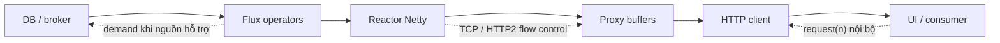

# Backpressure và giới hạn của nó qua HTTP

## 1. Tình huống: producer nhanh, client đọc chậm

Một REST API xuất dòng sự kiện đơn hàng qua `GET /orders/events`. Cơ sở dữ liệu có thể cung cấp 5.000 sự kiện/giây, nhưng ứng dụng di động qua mạng yếu chỉ xử lý 50 sự kiện/giây. Nếu server lấy hết mọi sự kiện rồi đẩy vào hàng đợi trong RAM, bộ nhớ tăng liên tục, latency xấu đi và cuối cùng dịch vụ có thể bị lỗi. Nếu server tự loại bỏ sự kiện để tránh đầy bộ nhớ, ứng dụng kiểm kê hoặc thanh toán có thể mất dữ liệu quan trọng.

**Backpressure** giải quyết một phần bài toán: downstream phát tín hiệu về lượng dữ liệu nó có thể nhận, để upstream không sản xuất/vận chuyển quá nhanh. Spring WebFlux dùng Reactor (`Flux`, `Mono`) và Reactive Streams để truyền tín hiệu này **trong một chuỗi xử lý reactive**. Tuy nhiên, HTTP client, TCP, proxy, database, message broker và UI không tạo thành một chuỗi Reactive Streams xuyên suốt theo cách tự động.

Bài thuộc chương **Spring WebFlux** của học phần `INTEGRATION_API_REST`, liên hệ thiết kế resource/URI, phương thức/status HTTP, hợp đồng dữ liệu, phân trang, cache, idempotency, OpenAPI, xác thực/phân quyền, xử lý lỗi và kiểm thử Java/Spring. Mục tiêu của bài là hiểu **backpressure thực sự bảo đảm gì**, **đâu là ranh giới khi dữ liệu đi qua HTTP**, và thiết kế hệ thống vẫn an toàn khi phía nhận chậm hoặc ngừng nhận.

Sau bài học, bạn sẽ:

- Giải thích `request(n)`, `onNext`, `onError`, `onComplete`, `cancel()` và tính chất của luồng reactive.
- Phân biệt Reactive Streams demand với TCP/HTTP/2 flow control, giới hạn tốc độ và kiểm soát quá tải.
- Thiết kế streaming NDJSON/SSE, chọn cold/hot source và chính sách buffer/drop/fail phù hợp.
- Kiểm soát blocking I/O, concurrency, timeout, bộ nhớ và lifecycle khi client ngắt kết nối.
- Tạo WebFlux server/WebClient có thể kiểm thử bằng `StepVerifier` và `WebTestClient`; bảo vệ tenant, quota và dữ liệu nhạy cảm.

## 2. Reactive Streams: nhu cầu đi ngược chiều dữ liệu

Ở mức trừu tượng, một `Publisher<T>` phát ra phần tử cho một `Subscriber<T>`. Subscriber nhận `Subscription`, sau đó gọi `request(n)` để yêu cầu thêm tối đa n phần tử; có thể gọi `cancel()` khi không cần nữa.

```mermaid
flowchart LR
    P["Publisher: dữ liệu"] -->|onNext: tối đa phần demand| S["Subscriber: xử lý"]
    S -->|request(n)| P
    S -->|cancel()| P
    P -->|onComplete / onError| S
```

Ví dụ một subscriber ban đầu yêu cầu 2 phần tử:

```text
Subscriber -> Subscription.request(2)
Publisher  -> onNext(A)
Publisher  -> onNext(B)
              [không phát tiếp khi demand bằng 0]
Subscriber -> Subscription.request(1)
Publisher  -> onNext(C)
Publisher  -> onComplete()
```

Các điểm chính:

1. `request(n)` là **số phần tử**, không phải số byte, số gói TCP hoặc lệnh “hãy gửi n HTTP responses”. Một phần tử có thể là DTO 200 byte hoặc một DataBuffer 1 MiB.
2. Publisher tuân thủ giao thức không phát `onNext` nhiều hơn tổng demand chưa tiêu thụ; yêu cầu không hợp lệ như `request(0)` là lỗi giao thức. Signals terminal (`onComplete`/`onError`) kết thúc subscription.
3. `cancel()` báo upstream ngừng công việc nếu có thể. Đây là tín hiệu **hợp tác**, không thể thu hồi tác dụng phụ đã commit.
4. Operator trong Reactor cũng có thể là subscriber của upstream và publisher của downstream, nên tín hiệu demand được điều chỉnh qua từng tầng.
5. Demand **không phải** giới hạn số lượng đối tượng đã được tạo ở mọi nơi: operator prefetch, queue, codec, network buffers, nguồn nóng hoặc thư viện driver vẫn có thể giữ dữ liệu trong bộ nhớ.

`Mono<T>` phát tối đa một giá trị; `Flux<T>` phát 0..N giá trị. Cả hai đều triển khai `Publisher`; bản thân việc trả `Flux` chưa chứng minh pipeline không blocking hoặc có giới hạn tài nguyên tốt.

### Chứng minh demand bằng Reactor

```java
Flux<Integer> source = Flux.range(1, 5)
    .doOnRequest(n -> log.debug("upstream requested {}", n))
    .doOnCancel(() -> log.debug("cancelled"));

StepVerifier.create(source, 0)
    .expectSubscription()
    .thenRequest(2)
    .expectNext(1, 2)
    .thenRequest(3)
    .expectNext(3, 4, 5)
    .verifyComplete();
```

`Flux.range` là nguồn **cold, đồng bộ, hỗ trợ demand**: nó không cần tạo trước năm phần tử riêng biệt trước khi được yêu cầu. Test này chứng minh một chuỗi Reactor cục bộ tôn trọng demand, **không** chứng minh rằng client HTTP có thể yêu cầu đúng 2 JSON objects từ server bằng một header chuẩn.

## 3. Backpressure không đồng nghĩa network flow control

| Cơ chế | Đơn vị/tầng | Tác dụng và giới hạn |
| --- | --- | --- |
| **Reactive Streams** | `request(n)` theo phần tử giữa Publisher/Subscriber | Điều tiết tín hiệu nội bộ; không giới hạn mọi queue/bytes |
| **TCP flow control** | Receive window theo byte trên kết nối | Giảm tốc độ gửi bytes; không báo DB đã xử lý xong record |
| **HTTP/2 flow control** | DATA frames theo stream/connection | Giới hạn bytes trên từng hop, không phải số JSON objects |
| **Rate/admission limiting** | Quota request, tenant, concurrency | Từ chối tải mới (429/503), không thay demand của stream |
| **Bounded buffer** | Queue theo phần tử/byte | Hấp thu spike ngắn; khi đầy phải wait/drop/fail |



**Không có HTTP header chuẩn yêu cầu “5 JSON objects tiếp theo”.** Proxy có thể đọc nhanh từ origin và giữ dữ liệu khi client đọc chậm; lúc đó origin thấy proxy có khả năng nhận, không biết UI đã xử lý bao nhiêu event. HTTP/1.1 sử dụng TCP flow control; HTTP/2 thêm window cho stream/connection, nhưng cả hai không tương đương ACK nghiệp vụ.

## 4. Demand trong WebFlux lan truyền có điều kiện

WebFlux response writer có thể truyền demand ngược về publisher; nguồn hỗ trợ như `Flux.range` hoặc driver reactive phù hợp sẽ phát theo nhịp. Nhưng **không có bảo đảm end-to-end** nếu:
 
- Operator `flatMap`, `publishOn`, `buffer` hoặc codec có **prefetch/queue**; số phần tử đang giữ có thể lớn hơn demand ở một tầng.
- Nguồn **cold** phát theo subscription, thường có thể dừng theo demand/cancel; nguồn **hot** từ socket, broker hoặc sink có thể vẫn tiếp tục sinh sự kiện.
- Driver fetch theo batch, tự buffer hoặc không hỗ trợ pause; phải đo behavior thật.
- Serializer, TCP send buffers, proxy/CDN nén hay gom phần tử làm dữ liệu tới client không đồng thời với `onNext`.

```java
// Cold: mỗi subscriber có dãy riêng, tôn trọng demand.
Flux<Integer> cold = Flux.range(1, 1_000);

// Nhịp theo scheduler, không phải hàng đợi sự kiện bền.
Flux<Long> ticks = Flux.interval(Duration.ofMillis(10));
```

`Flux.interval` có thể báo overflow error nếu tick xuất hiện khi thiếu demand. Không dùng nó làm nguồn lossless cho thanh toán/audit. Với dữ liệu bắt buộc đủ và đúng thứ tự, cần log bền, cursor/replay và checkpoint, chứ không trông đợi buffer Reactor trong RAM.

## 5. REST streaming: NDJSON khác SSE và JSON thông thường

Một response `application/json` với một mảng JSON duy nhất thường cần hoàn thành mảng trước khi client parse theo cách thông thường. Để xử lý từng object ngay khi đến, có thể dùng **NDJSON** (mỗi dòng một JSON object) hoặc **Server-Sent Events** (SSE).

| Định dạng | Content-Type | Phù hợp | Cần lưu ý |
| --- | --- | --- | --- |
| JSON object/array | `application/json` | Kết quả hữu hạn nhỏ | Client có thể phải tích lũy để parse |
| NDJSON | `application/x-ndjson` | Kết quả hữu hạn rất nhiều bản ghi, một JSON trên mỗi dòng | Một dòng có thể đi qua nhiều TCP packets; cần parser streaming |
| SSE | `text/event-stream` | Feed sự kiện server → browser, id/reconnect | Kết nối dài, có thể mất sự kiện nếu không replay |
| WebSocket | Giao thức nâng cấp riêng | Tương tác hai chiều | Cần quản lý queue/flow control và chính sách message riêng |

NDJSON minh họa:

```http
GET /orders/events?limit=3 HTTP/1.1
Accept: application/x-ndjson
Authorization: Bearer <access-token>

HTTP/1.1 200 OK
Content-Type: application/x-ndjson
Cache-Control: private, no-store

{"sequence":101,"eventType":"CREATED","orderId":"ord-1"}
{"sequence":102,"eventType":"PAID","orderId":"ord-1"}
{"sequence":103,"eventType":"CREATED","orderId":"ord-2"}
```

Ví dụ bỏ qua framing của HTTP/1.1, trong thực tế có thể dùng chunked transfer khi không biết `Content-Length`. HTTP/2 sử dụng DATA frames, **không** dùng header `Transfer-Encoding: chunked`. Một dòng NDJSON không đồng nghĩa một packet hay một HTTP chunk; proxy/người nhận vẫn có thể buffer.

SSE minh họa:

```http
GET /orders/notifications HTTP/1.1
Accept: text/event-stream

HTTP/1.1 200 OK
Content-Type: text/event-stream
Cache-Control: no-cache

id: 101
event: order-updated
data: {"sequence":101,"orderId":"ord-1","status":"PAID"}

: keep-alive

```

Client có thể nối lại với `Last-Event-ID`, nhưng điều đó **chỉ hữu ích khi server lưu/replay được sự kiện theo ID**. Một `Flux.interval` trong RAM không cung cấp lịch sử cho client vừa mất kết nối. Heartbeat, thời gian timeout, hỗ trợ proxy và max concurrent connections cần được thiết kế.

**Không hứa realtime chỉ bằng Content-Type:** một reverse proxy có thể buffer, encoder có thể gom nhiều phần tử, client decoder có thể đọc chậm. Test qua đường mạng thực để xác nhận độ trễ phần tử.

## 6. WebFlux server: trả Flux nhưng không tạo danh sách trước

Ví dụ Spring Boot 3/Spring WebFlux/Java 17+ trả danh sách sự kiện đơn hàng dạng NDJSON; repo là abstraction dựa trên nguồn hỗ trợ reactive backpressure (như R2DBC phù hợp). `findByTenantAfter` phải truy vấn dữ liệu theo **tenant và thứ tự có xác định**, không để người gọi chọn tenant khác bằng query.

```java
record OrderEventDto(long sequence, String eventType, String orderId) {}
record OrderEvent(long sequence, String eventType, String orderId) {
    OrderEventDto toDto() {
        return new OrderEventDto(sequence, eventType, orderId);
    }
}

@RestController
@RequestMapping("/orders")
class OrderEventController {
    private final ReactiveOrderEventRepository events;
    private final TenantAuthorization authorization;

    OrderEventController(
        ReactiveOrderEventRepository events,
        TenantAuthorization authorization
    ) {
        this.events = events;
        this.authorization = authorization;
    }

    @GetMapping(path = "/events",
                produces = MediaType.APPLICATION_NDJSON_VALUE)
    Flux<OrderEventDto> list(
        @RequestParam(defaultValue = "100") int limit,
        @RequestParam(defaultValue = "0") long after,
        Principal principal
    ) {
        if (limit < 1 || limit > 1_000 || after < 0) {
            throw new ResponseStatusException(
                HttpStatus.BAD_REQUEST, "Invalid limit/after");
        }
        String tenant = authorization.requireTenant(principal);
        return Flux.defer(() ->
            events.findByTenantAfter(tenant, after)
                .take(limit)
                .map(OrderEvent::toDto)
        );
    }
}
```

Nếu repo trả tất cả 100.000 bản ghi như một `List` trong RAM rồi mới biến thành Flux, controller này **không thực sự giải quyết vấn đề buffer đầu nguồn**. Dùng truy vấn theo keyset/cursor, giới hạn số bản ghi, driver phản ứng với demand và kích thước record. Phân trang vẫn hữu ích nếu client cần resume và snapshot; một stream không thay thế chiến lược pagination/cursor.

**Một lưu ý về lỗi:** validation, quyền truy cập và admission control nên thất bại **trước khi response đã bắt đầu phát body**. Nếu stream trả vài dòng rồi mới gặp lỗi DB, server thường không thể quay lại đổi status 200 thành 503 hoặc gửi một Problem Details JSON hoàn chỉnh; kết nối có thể kết thúc bất thường. Client phải phát hiện stream chưa hoàn tất và dùng cursor/checkpoint để thử lại an toàn.

## 7. WebClient: tiêu thụ theo nhịp xử lý, không collectList()

Client WebFlux có thể đọc NDJSON dưới dạng `Flux<OrderEventDto>` thay vì tải hết body vào RAM. Với tác vụ cần ghi từng event xuống database, xử lý theo thứ tự và **chỉ yêu cầu thêm khi xử lý trước đã hoàn tất**:

```java
@Component
class OrderFeedConsumer {
    private final WebClient client;
    private final AsyncEventProcessor processor;

    OrderFeedConsumer(WebClient client, AsyncEventProcessor processor) {
        this.client = client;
        this.processor = processor;
    }

    Mono<Void> consumeOnePage() {
        return client.get()
            .uri("/orders/events?limit=1000")
            .accept(MediaType.APPLICATION_NDJSON)
            .retrieve()
            .bodyToFlux(OrderEventDto.class)
            .limitRate(16)
            .concatMap(processor::persistIdempotently, 1)
            .then()
            .timeout(Duration.ofMinutes(2));
    }
}
```

`AsyncEventProcessor.persistIdempotently` trong ví dụ trả `Mono<Void>`, không blocking, dùng định danh sự kiện để ngăn side effect trùng khi replay. `concatMap(..., 1)` xử lý từng phần tử theo thứ tự; `limitRate(16)` điều chỉnh demand giữa Reactor operators, **không gửi HTTP header yêu cầu server trả đúng 16 JSON objects**. `timeout` đặt ở **Mono hoàn tất cuối** là deadline tổng cho lượt tiêu thụ này, không phải HTTP server đã nhận yêu cầu dừng mọi tác dụng phụ.

Các bẫy:

- `collectList()` sẽ tích lũy toàn bộ stream trước khi trả về; không làm vậy với nguồn vô hạn hoặc file quá lớn.
- `block()`/`blockLast()` trong WebFlux request handler sẽ chặn event-loop; chỉ dùng blocking ở ranh giới được phép của ứng dụng, không bên trong reactive request processing.
- `retrieve()` mặc định chuyển 4xx/5xx thành lỗi WebClient; cần xử lý status 429/503 và Retry-After theo chính sách, khác với lỗi xảy ra **giữa** body stream.
- `limitRate` không tự giới hạn kích thước một JSON record, tổng bytes response, thời gian kết nối hoặc số job của toàn dịch vụ.
- Việc subscribe nên do lifecycle của ứng dụng hoặc framework quản lý; không gọi `subscribe()` tùy tiện trong controller để tạo công việc “fire-and-forget” mất khả năng hủy/quan sát.

Nếu xử lý song song được, có thể dùng `flatMap(processor::persistIdempotently, 8)` để đặt mức concurrency 8; **thứ tự hoàn thành có thể đổi**. Nếu domain yêu cầu cùng thứ tự tuyệt đối, `concatMap` thường rõ ràng hơn. Không tăng concurrency chỉ để đẩy nghẽn cổ chai xuống database.

## 8. Dùng operator để kiểm soát sức chứa, không che lấp mất dữ liệu

| Cơ chế Reactor | Tác dụng | Rủi ro/đánh đổi |
| --- | --- | --- |
| `limitRate(32)` | Điều chỉnh demand phía upstream theo đợt | Không phải giới hạn QPS/bytes hay quota |
| `concatMap(fn, 1)` | Xử lý tuần tự từng phần tử | Có thể throughput thấp nhưng giữ thứ tự |
| `flatMap(fn, 8)` | Tối đa khoảng 8 inner operations đồng thời | Có thể đảo thứ tự, mỗi inner vẫn có buffer |
| `flatMapSequential(fn, 8)` | Làm song song rồi phát theo thứ tự gốc | Có thể phải đệm kết quả chờ phần tử chậm |
| `onBackpressureBuffer(128)` | Hàng đợi hữu hạn cho một số nguồn không theo kịp demand | Đầy sẽ báo lỗi; **không bảo đảm chặn producer hot** |
| `onBackpressureDrop()` | Bỏ phần tử khi downstream chậm | Mất sự kiện, chỉ hợp lệ nếu nghiệp vụ chấp nhận |
| `onBackpressureLatest()` | Chỉ giữ trạng thái mới nhất đang chờ | Phù hợp gauge/UI snapshot, không phải giao dịch |
| `onBackpressureError()` | Báo lỗi khi thiếu demand | Cần retry/replay hợp đồng, không tự phục hồi |

Ví dụ một feed **chỉ mang số người đang online**, nơi việc bỏ trạng thái cũ có thể được chấp nhận:

```java
Flux<OnlineCount> liveGauge = liveMetricsFeed()
    .onBackpressureLatest()
    .doOnDiscard(OnlineCount.class, dropped ->
        metrics.recordDroppedSnapshot());
```

Ngược lại, với sự kiện `OrderPaid`, `MoneyTransferred` hay audit log, **không** dùng drop/latest để “giải quyết lỗi”. Cần nguồn bền có offset, consumer checkpoint, idempotency, cơ chế phát lại và retry budget; nếu quá chậm, giảm tải hoặc tạm dừng consumer theo giao thức broker tương ứng.

Một buffer 128 **phần tử** vẫn có thể quá lớn nếu mỗi phần tử chứa nhiều MiB. Hãy giới hạn cả **số bản ghi và byte size** ở hợp đồng/API, cùng queue length, heap và concurrency. Trong một số operator, downstream demand có thể khiến upstream prefetch mạnh hơn mức nhìn thấy; kiểm tra semantics thực của operator và đo số phần tử đang chờ, không suy từ tên hàm.

### Vì sao onBackpressureBuffer không phải hàng đợi bền?

`onBackpressureBuffer(128)` giữ dữ liệu **trong process**. Khi producer tiếp tục vượt khả năng downstream, buffer đầy và pipeline có thể lỗi; nếu process restart, dữ liệu chưa commit biến mất. Không sử dụng nó thay Kafka/Redis Streams, database outbox hoặc job queue khi yêu cầu **at-least-once delivery**.

## 9. HTTP request body: backpressure không thay giới hạn upload

Backpressure thường được bàn về response streaming, nhưng WebFlux cũng nhận request body theo publisher. Khi client upload nhanh, TCP/HTTP2 flow control và Reactor Netty có thể hạn chế đọc từ socket; tuy nhiên server vẫn phải xử lý:

- Giới hạn **tổng kích thước request**, kích thước từng phần, số phần và request concurrency ở gateway/server.
- JSON/string codec có thể **gom dữ liệu**; `@RequestBody Mono<LargeDto>` không bảo đảm streaming từng trường hay RAM luôn thấp.
- Với `Flux<DataBuffer>`, DataBuffer có thể dùng bộ nhớ được pool; xử lý thủ công phải hiểu **reference counting, retain/release** để tránh leak hoặc double release. Ưu tiên API như `DataBufferUtils` với lifecycle được kiểm chứng.
- Đọc body một lượt; không âm thầm `cache()`, `collectList()` hoặc retry re-subscribe nguồn dữ liệu một lần.
- Auth và quota nên được thực hiện sớm; không dựa vào việc đã parse xong tệp khổng lồ mới từ chối người gọi.

Cấu hình minh họa cho kích thước buffer khi codec **cần gom dữ liệu**:

```yaml
spring:
  codec:
    max-in-memory-size: 256KB
```

`max-in-memory-size` **không phải một giới hạn tổng số byte upload cho mọi loại body/codec**; phải có giới hạn HTTP request riêng. Nhiều định dạng streaming cho phép các phần tử riêng lẻ dưới ngưỡng mà tổng stream vẫn cực lớn. Giới hạn tốc độ, timeout, quota tenant và chính sách huỷ cần nằm ở tầng thích hợp.

## 10. Không blocking event-loop: boundedElastic chỉ là vùng cách ly

WebFlux thường dùng số lượng nhỏ event-loop threads để đọc/ghi network. Nếu callback thực hiện JDBC blocking, `Thread.sleep`, file I/O nặng hoặc gọi HTTP đồng bộ, thread không phục vụ được các kết nối khác. Backpressure **không giải phóng event-loop đang bị blocking**.

Nếu phải dùng thư viện blocking trong thời gian chuyển đổi:

```java
@GetMapping("/legacy-reports/{id}")
Mono<LegacyReportDto> getLegacy(
        @PathVariable String id, Principal principal) {
    String tenant = authorization.requireTenant(principal);
    return Mono.fromCallable(
            () -> blockingReportDao.loadAuthorized(tenant, id))
        .subscribeOn(Schedulers.boundedElastic());
}
```

Đây là đoạn trong controller có `authorization` và `blockingReportDao` được inject; file imports/DI lược bỏ. `boundedElastic` đưa blocking call sang pool có giới hạn, **không làm nó thành non-blocking**. Tải quá lớn vẫn có thể làm cạn pool hoặc hàng đợi; cần timeouts, circuit breaker/concurrency limits và đo latency. Với workload tải lớn lâu dài, ưu tiên R2DBC/driver thật sự reactive hoặc xử lý bằng job queue.

Khi dùng Spring Security reactive, **không mặc định dựa vào ThreadLocal security context** sau các scheduler switches; Reactor Context và cơ chế truyền context của framework cần được dùng/kiểm thử đúng cách. Không truyền nguyên credentials hoặc payload nhạy cảm vào log khi chạy trên pool.

## 11. Khi chậm vì quá tải: admission control và HTTP status

Backpressure chỉ giúp điều tiết một pipeline đã được chấp nhận. Nếu server nhận 2.000 stream đồng thời, mỗi stream “đúng demand” vẫn có thể tiêu hết DB connections và memory. Khi không thể phục vụ an toàn, cần **từ chối sớm hoặc chuyển công việc sang hàng đợi bền**.

| Tình huống | Lựa chọn API |
| --- | --- |
| Caller vượt quota/request-rate | `429 Too Many Requests`, có thể kèm `Retry-After` |
| Dịch vụ tạm không đủ capacity | `503 Service Unavailable`, có thể kèm `Retry-After` |
| Body quá lớn | `413 Content Too Large` với giới hạn rõ ràng |
| Truy vấn mất vài phút, cần kết quả bền | `202 Accepted` và resource job/status, thay vì giữ stream vô hạn |
| Client đã hủy stream | Hủy upstream/giải phóng resource; không coi đây luôn là lỗi nghiệp vụ |

```http
HTTP/1.1 429 Too Many Requests
Retry-After: 10
Content-Type: application/problem+json
Cache-Control: no-store

{"type":"https://api.example.test/problems/rate-limit",
 "title":"Đã vượt giới hạn yêu cầu","status":429}
```

`Retry-After` là tín hiệu **thời gian chờ**, không phải giấy phép retry mọi POST hay stream. Client cần backoff/jitter, deadline và idempotency nếu có side effects. Rate limit theo tenant, quota stream active và các semaphore bảo vệ backend có vai trò khác với `limitRate`.

**Ranh giới bắt đầu response:** nếu admission control phát 429/503 **trước khi stream response bắt đầu**, client nhận status đúng. Sau khi đã phát các dòng NDJSON với status 200, một lỗi backend không thể sửa ngược status; cần cơ chế thất bại/khôi phục phù hợp với định dạng, tránh nhồi một JSON Problem Details bất ngờ vào stream NDJSON như thể đó là event nghiệp vụ.

## 12. Cancel, disconnect và phát lại dữ liệu

Khi mobile client đóng màn hình, ngắt mạng hoặc hủy subscription, WebFlux có thể truyền `cancel()` ngược lên nguồn và giải phóng DB cursor/HTTP connection. Đừng hiểu đây là đảm bảo **mọi công việc đã khởi động sẽ dừng hoặc rollback**: side effect đã commit thì không thu hồi được, nguồn nóng có thể tiếp tục phát, proxy có thể che việc client thật đã rời kết nối.

Có thể quan sát lifecycle mà không làm thay đổi dữ liệu:

```java
Flux<OrderEventDto> feed = events.findByTenantAfter(tenant, cursor)
    .map(OrderEvent::toDto)
    .doOnCancel(() -> metrics.countCancelledFeed())
    .doFinally(signal -> metrics.recordTerminalSignal(signal.name()));
```

`doFinally` chạy khi complete/error/cancel; đừng log từng record nhạy cảm. Nếu xử lý bản ghi quan trọng, checkpoint chỉ được cập nhật **sau khi downstream đã xử lý bền**, không phải ngay khi server gọi `onNext` hoặc ghi bytes vào socket. HTTP không có ACK chuẩn rằng một JSON object đã được UI/DB của client áp dụng thành công.

### SSE và Last-Event-ID

Với feed thông báo cần reconnect, có thể dùng:

```java
@GetMapping(path = "/orders/notifications",
            produces = MediaType.TEXT_EVENT_STREAM_VALUE)
Flux<ServerSentEvent<OrderNotice>> notifications(
        @RequestHeader(value = "Last-Event-ID", required = false)
            String afterId,
        Principal principal) {
    String tenant = authorization.requireTenant(principal);
    return notificationLog.replayAndFollow(tenant, afterId)
        .map(n -> ServerSentEvent.<OrderNotice>builder(n.payload())
            .id(n.id()).event("order-updated").build());
}
```

`notificationLog.replayAndFollow` là abstraction; cần kết nối phần **replay từ log bền** với phần **theo dõi live** mà không có khoảng hở làm mất sự kiện. Nếu client reconnect, sự kiện có thể trùng: dùng ID đơn điệu/ổn định, consumer idempotent và quy tắc giữ lịch sử. Với trạng thái UI cho phép mất update, có thể chủ động chỉ giữ snapshot mới nhất và GET lại bản hiện tại; với giao dịch, không chấp nhận drop.

## 13. Bảo mật và giám sát stream dài

| Rủi ro | Biện pháp |
| --- | --- |
| Truy cập dữ liệu tenant khác | AuthN/AuthZ trước stream; filter tenant tại repository |
| Kết nối/queue quá nhiều | Quota concurrent streams, bounded buffers, idle/max-duration timeouts |
| Event/JSON quá lớn | Giới hạn bytes/record, độ sâu JSON, request total, codec memory |
| Dữ liệu riêng bị cache hoặc log | Cache-Control phù hợp, mask PII, CORS/cookie policy |
| SSE reconnect và mất sự kiện | Revalidate quyền, log bền, replay window và event ID |
| Disconnect/cancel | Giải phóng DB cursor/socket; không dựa vào cancel để rollback |

CORS không phải authorization. Tránh access token trong URL hoặc log, và không giữ pooled `DataBuffer` ngoài lifecycle. Theo dõi active streams, duration, cancellations, bytes/s, event lag, queue occupancy, 429/503 và event-loop latency. Metric labels dùng route templates và nhóm lỗi, **không** dùng order/user ID, raw cursor hoặc token. HTTP ghi xong bytes không xác nhận UI đã xử lý bền.

## 14. Kiểm thử: demand cục bộ và HTTP là hai mức khác nhau

### 14.1. StepVerifier xác nhận demand/cancel

```java
@Test
void coldSourceEmitsOnlyWhenRequested() {
    AtomicLong demand = new AtomicLong();
    Flux<Integer> source = Flux.range(1, 4)
        .doOnRequest(demand::addAndGet);

    StepVerifier.create(source, 0)
        .expectSubscription()
        .thenRequest(1)
        .expectNext(1)
        .thenRequest(2)
        .expectNext(2, 3)
        .thenCancel()
        .verify();

    assertEquals(3L, demand.get());
}
```

Test dùng Reactor Test, `AtomicLong`/JUnit imports theo dự án. Khi source ở một chuỗi operator phức tạp, request có thể bị điều chỉnh bởi prefetch; không nên assert mỗi tầng đều nhận đúng 1/2. Test này chứng minh **Publisher cold tuân thủ demand**, không chứng minh TCP packet được giao theo số phần tử.

### 14.2. WebTestClient xác minh HTTP streaming

```java
@Test
void ndjsonFeedReturnsThreeEvents() {
    FluxExchangeResult<OrderEventDto> response =
        webTestClient.get()
            .uri("/orders/events?limit=3")
            .accept(MediaType.APPLICATION_NDJSON)
            .exchange()
            .expectStatus().isOk()
            .expectHeader()
                .contentTypeCompatibleWith(MediaType.APPLICATION_NDJSON)
            .returnResult(OrderEventDto.class);

    StepVerifier.create(response.getResponseBody(), 0)
        .thenRequest(1).expectNextCount(1)
        .thenRequest(2).expectNextCount(2)
        .verifyComplete();
}
```

Fixture cần security context/tenant và repository phát ba sự kiện. `WebTestClient` có thể decoder/buffer ngầm; assert này chứng minh client nhận ba DTO và kết thúc, **không** chứng minh server đã dừng truy vấn chính xác sau phần tử đầu tiên. Để kiểm tra chống buffer, dùng source giả ghi nhận demand, memory/heap metric và integration test qua Reactor Netty/proxy với client đọc chậm.

| Ca kiểm thử | Kỳ vọng |
| --- | --- |
| Cold source, request(0) rồi request(2) | Không phát thừa; cancellation dừng subscription |
| `flatMap` concurrency 8 | Không vượt giới hạn inner jobs; chấp nhận thứ tự completion khác |
| `onBackpressureBuffer(2)` với nguồn nhanh | Overflow theo policy; không tăng RAM vô hạn |
| Client đọc NDJSON chậm | Buffer/memory bounded theo budget; không tự tạo hàng nghìn futures |
| Client hủy giữa stream | Cursor/connection được giải phóng; không ghi checkpoint quá sớm |
| Nguồn hot gửi nhanh | Chứng minh drop/latest/error hoặc replay được định nghĩa rõ |
| Client ngắt và SSE reconnect | `Last-Event-ID` không làm mất sự kiện; duplicate xử lý idempotent |
| Tenant khác GET stream | 403/404 theo policy; không rò event |
| Quota concurrent vượt mức | 429/503 trước khi body bắt đầu, có thể có Retry-After |
| JSON record/file vượt size | Không OOM; trả 413/4xx theo policy khi còn khả năng |
| Source lỗi sau khi phát 200 | Client phát hiện truncation và resume được, không tưởng hoàn tất |
| Blocking legacy DAO | Không chặn event-loop, boundedElastic có giới hạn và metrics |

## 15. Bài thực hành: event feed cho 10.000 client

**Bối cảnh:** `GET /orders/events?after=<cursor>` trả các sự kiện đơn hàng của tenant qua NDJSON. Có 10.000 client, tốc độ đọc khác nhau. Sự kiện `PAID` **không được mất**; chỉ số số lượng đơn hàng đang mở ở dashboard có thể bỏ snapshot cũ. Gateway có thể buffer dữ liệu.

**Yêu cầu đầu ra:**

1. Vẽ đường đi từ DB/log bền → Flux → Reactor Netty → gateway → client; đánh dấu đâu có `request(n)`, đâu chỉ là TCP/HTTP2 flow control.
2. Viết Spring WebFlux GET NDJSON với giới hạn record count, cursor, quyền theo tenant, quota active streams và lịch sử để resume.
3. Viết WebClient dùng `concatMap` hoặc `flatMap` với concurrency hữu hạn, không `collectList()` hay `block()` trên event-loop.
4. Chọn chính sách **không drop** cho PAID (replay + checkpoint bền) và **latest/drop có chủ đích** cho dashboard gauge. Giải thích điều gì xảy ra khi buffer đầy.
5. Định nghĩa HTTP 429/503, Retry-After, deadline, timeout và cancel; client không retry vô hạn hoặc tạo tác dụng phụ trùng.
6. Test `StepVerifier` demand, `WebTestClient` NDJSON, client chậm, disconnect, overflow và cross-tenant. Đo active streams, buffer occupancy, latency và event loss.

**Thang đánh giá (100 điểm):** semantics Reactive Streams 20; ranh giới HTTP/proxy 20; chính sách buffer/replay và đúng nghiệp vụ 25; Spring/WebClient/tests 25; bảo mật/quan sát 10.

## 16. Câu hỏi tự kiểm tra

1. `request(5)` là năm phần tử Reactor hay năm HTTP requests?
2. Vì sao `Flux<T>` không tự bảo đảm không blocking hoặc không tốn RAM?
3. TCP/HTTP2 flow control khác ACK nghiệp vụ và quota thế nào?
4. Proxy buffering có thể che việc client đọc chậm ra sao?
5. Vì sao `onBackpressureLatest` phù hợp gauge nhưng không phù hợp OrderPaid?
6. `limitRate` khác rate limiter, quota active streams và 429?
7. Tại sao `@RequestBody Mono<Dto>` không thay giới hạn body?
8. Lỗi sau khi phát 200 và vài dòng NDJSON được xử lý thế nào?
9. SSE `Last-Event-ID` cần cơ chế gì để không mất sự kiện?
10. StepVerifier chứng minh demand nào, WebTestClient kiểm tra HTTP nào?

**Điểm cần nhớ:** Reactive Streams backpressure là hợp đồng **demand theo phần tử trong một pipeline**, không phải bảo đảm HTTP end-to-end hoặc bộ nhớ hữu hạn. Khi qua TCP, HTTP/2, proxy và client phải bổ sung nguồn phù hợp, queue/concurrency có giới hạn, quota, phân quyền, cancel/timeout, replay/checkpoint và kiểm thử qua mạng thật. `Flux` không bảo đảm hệ thống tránh quá tải hay mất sự kiện.
