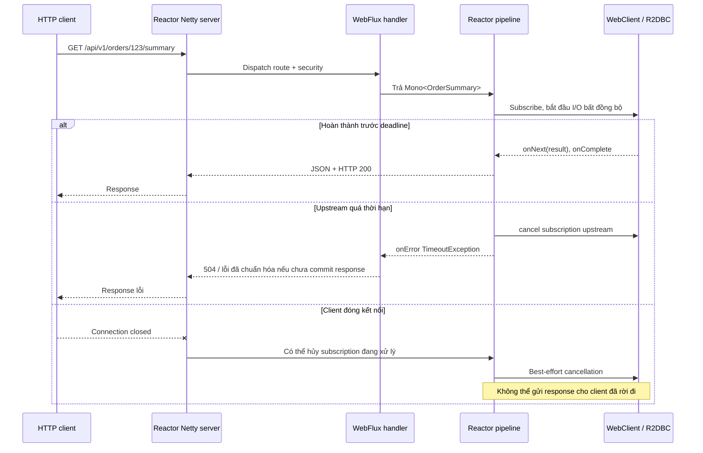

# Hủy yêu cầu, timeout và giải phóng tài nguyên

Một khách hàng mở màn hình xem trạng thái đơn hàng rồi chuyển trang khi API còn chờ dịch vụ vận chuyển. Browser đóng kết nối; server đang gọi một HTTP API khác, đọc dữ liệu từ database và giữ kết nối trong pool. Nếu ứng dụng tiếp tục chạy công việc không còn người nhận, nó lãng phí tài nguyên; nếu hủy không đúng, một thao tác đã gửi ra hệ thống khác có thể vẫn được thực hiện dù client tưởng rằng “đã hủy”.

Trong **Spring WebFlux**, request thường được biểu diễn bằng chuỗi `Mono`/`Flux` theo Reactive Streams. **Cancellation** là tín hiệu yêu cầu dừng việc tiêu thụ từ downstream lên upstream, không phải lệnh “đảo ngược mọi công việc đã diễn ra”. **Timeout** thường là một chính sách làm pipeline phát lỗi và yêu cầu hủy upstream; còn **cleanup** là trách nhiệm thu hồi tài nguyên trong cả ba đường: thành công, lỗi và hủy. Ba khái niệm phải được thiết kế cùng nhau.

Bài thuộc chương **Spring WebFlux** của module **INTEGRATION_API_REST**: vận dụng resource/URI, HTTP methods và status, hợp đồng dữ liệu, cache, idempotency, bảo mật, lỗi và kiểm thử REST API với Java/Spring. Ví dụ theo **Java 17, Spring Boot 3, Reactor Core, Spring WebFlux và Reactor Netty**. Chúng tập trung vào nguyên tắc và ranh giới; cấu hình cụ thể cần kiểm chứng theo phiên bản ứng dụng.

**Sau bài này**, người học có thể phân biệt `cancel` và `onError`, đặt timeout ở các lớp phù hợp, thu hồi connection/file/DataBuffer an toàn, tránh công việc “mồ côi” do gọi `subscribe()` thủ công, thiết kế mã HTTP đúng, và kiểm thử hủy/timeout bằng `StepVerifier`, `WebTestClient`.

## 1. Sơ đồ vòng đời request trong WebFlux



Sơ đồ là **mô hình thường gặp**, không phải cam kết rằng mọi driver hoặc mọi đoạn code tự động ngừng công việc. Việc HTTP client disconnect có lan thành `cancel` trong pipeline hay không phụ thuộc thời điểm, đường ghi/đọc response, server adapter và việc ứng dụng đã tách subscription khỏi request hay chưa. Cần quan sát và test trên stack thực tế.

**Nguyên tắc:** request còn sống là nơi sở hữu subscription phục vụ response. Khi đã trả publisher cho WebFlux, framework quản lý subscribe và backpressure. Nếu controller tự gọi `subscribe()` cho một pipeline khác, nó có thể tách công việc khỏi vòng đời request; client hủy cũng **không tự hủy subscription riêng** đó.

## 2. Ba tín hiệu kết thúc: complete, error và cancel

Reactive Streams có tín hiệu `onNext`, `onError`, `onComplete` và thao tác `Subscription.cancel()`. `cancel` không phải một tín hiệu terminal `onError` chuyển đến subscriber; nó là yêu cầu downstream gửi lên upstream.

| Sự kiện | Nguyên nhân ví dụ | Pipeline nhìn thấy gì? | Điều cần làm |
|---|---|---|---|
| **Complete** | WebClient trả JSON hợp lệ, stream kết thúc | `onComplete` sau giá trị cuối | Thu hồi lease/buffer, ghi success metrics |
| **Error** | JSON decode lỗi, DB lỗi, timeout operator phát lỗi | `onError(Throwable)` | Cleanup, map lỗi theo hợp đồng, tránh lộ stack trace |
| **Cancel** | Client ngắt kết nối, subscriber hết nhu cầu, `take(n)`, timeout hủy upstream | Upstream nhận `cancel()`, không nhất thiết có `onError` | Dừng công việc có thể dừng và cleanup resource |

`Mono` phát tối đa một giá trị; `Flux` phát 0..N giá trị. **Backpressure** qua `request(n)` điều tiết số lượng phần tử, còn **cancel** chấm dứt nhu cầu nhận thêm; hai điều này không đồng nghĩa với “đã thu hồi toàn bộ tài nguyên”.

### 2.1. Vị trí đặt doOnCancel và doFinally

`doOnCancel` chạy khi subscription tại vị trí operator đó bị hủy; `doFinally` chạy khi sequence kết thúc bởi `ON_COMPLETE`, `ON_ERROR` hoặc `CANCEL`. Chúng phù hợp cho metrics/cleanup **đồng bộ, nhẹ**, nhưng không phải framework transaction/distributed compensation.

```java
import java.time.Duration;
import java.util.concurrent.atomic.AtomicInteger;
import reactor.core.publisher.Mono;
import reactor.core.publisher.SignalType;

AtomicInteger cancelled = new AtomicInteger();
Mono<String> upstream = Mono.delay(Duration.ofSeconds(4))
    .map(n -> "shipment")
    .doFinally(signal -> {
        if (signal == SignalType.CANCEL) {
            cancelled.incrementAndGet();
        }
    });

Mono<String> response = upstream.timeout(Duration.ofSeconds(2));
```

Trong ví dụ, **timeout** làm `upstream` nhận hủy nên hook phía trong có thể thấy `CANCEL`, trong khi pipeline phía ngoài thường kết thúc bằng **`ON_ERROR`** do `TimeoutException`. Vì vậy không đếm mọi `CANCEL` là “browser bỏ đi”: upstream có thể bị hủy **do timeout, `take`, chuyển sang fallback**, hoặc operator khác.

**Cảnh báo:** chỉ dùng `doFinally` để phát lệnh `asyncCleanup().subscribe()` có thể tạo subscription tách rời, lỗi cleanup bị bỏ qua. Với tài nguyên cần cleanup bất đồng bộ đáng tin cậy, dùng `usingWhen` hoặc một abstraction quản lý vòng đời (mục 7).

## 3. Timeout theo lớp và HTTP status

Một request có nhiều thời hạn độc lập:
 
| Lớp | Ví dụ | Mục tiêu |
|---|---|---|
| Gateway/Netty server | Response/idle/read timeout | Tránh giữ socket quá lâu; gateway có thể trả lỗi trước backend |
| `Mono.timeout` / `Flux.timeout` | Timeout trong Reactor pipeline | Phát lỗi và hủy upstream khi quá hạn |
| WebClient/Netty client | Connect, response và pool-acquire timeout | Giới hạn outbound connection và HTTP dependency |
| R2DBC/DB | Pool wait, statement/query timeout | Tránh giữ DB connection/query vô hạn |
| Business deadline | Budget còn lại sau auth/DB/retry | Giữ tổng thời gian và quota trong mức định trước |

Ví dụ gateway cho **5 giây**, ứng dụng dành **4 giây**, dependency HTTP **2 giây** và database có giới hạn riêng. Đây là số minh họa, không phải phép cộng bảo đảm request đúng 4 giây: pool, DNS, backoff và retry đều tiêu tốn budget.

**Operator semantics:** `Mono.timeout(Duration)` thường giới hạn thời gian chờ tín hiệu đến; khi quá hạn phát `TimeoutException` và hủy upstream. `Flux.timeout(Duration)` có thể đo **khoảng giữa các tín hiệu**, vì vậy stream phát đều vẫn có thể chạy lâu hơn tổng deadline. Muốn deadline **end-to-end**, phải áp budget tổng riêng. Dạng `timeout(duration, fallback)` chuyển sang publisher dự phòng, cũng hủy upstream; fallback không được âm thầm tạo tác dụng phụ trùng. Timeout Reactor được tính khi **subscribe**, không phải khi tạo object `Mono`.

| Lỗi | HTTP contract |
|---|---|
| Server không nhận đủ HTTP request từ client đúng hạn | `408 Request Timeout` khi phù hợp, **không** dùng cho mọi xử lý chậm |
| API là gateway/proxy và upstream không trả kịp | `504 Gateway Timeout` nếu chưa commit response |
| Service quá tải/tạm chưa thể phục vụ | `503 Service Unavailable`, có thể kèm `Retry-After` |
| Client đóng kết nối | Không thể trả response; `499` là **mã proxy không chuẩn HTTP** |
| Timeout sau khi đã stream byte | Có thể không đổi được status/header; cần stream protocol phù hợp |

Không gọi mọi `TimeoutException` là lỗi gateway: timeout CPU, pool starvation và mất kết nối có ngữ nghĩa riêng. Cần đo thực tế lớp nào hết hạn trước và tránh tiết lộ URL/stack trace upstream.

## 4. WebClient: giới hạn network I/O và end-to-end publisher

Với Reactor Netty-backed WebClient, nên có timeout ở **connector/network** lẫn **Reactor pipeline**. Ví dụ:

```java
import io.netty.channel.ChannelOption;
import java.time.Duration;
import org.springframework.context.annotation.Bean;
import org.springframework.context.annotation.Configuration;
import org.springframework.http.client.reactive.ReactorClientHttpConnector;
import org.springframework.web.reactive.function.client.WebClient;
import reactor.netty.http.client.HttpClient;

@Configuration
class RemoteClientConfiguration {
    @Bean
    WebClient shippingWebClient() {
        HttpClient netty = HttpClient.create()
            .option(ChannelOption.CONNECT_TIMEOUT_MILLIS, 1000)
            .responseTimeout(Duration.ofSeconds(2));
        return WebClient.builder()
            .baseUrl("https://shipping.example.invalid")
            .clientConnector(new ReactorClientHttpConnector(netty))
            .build();
    }
}
```

`CONNECT_TIMEOUT_MILLIS` giới hạn pha **kết nối TCP**; `responseTimeout` áp giới hạn đọc/response theo Reactor Netty, không phải tổng thời gian toàn bộ request kể cả queue/pool/backoff. Thời gian chờ acquire connection trong pool và DNS cũng cần quản lý; timeout chi tiết phụ thuộc phiên bản/connector. Không dùng cấu hình ở trên để tuyên bố “toàn request chắc chắn dưới 2 giây”.

### 4.1. Service dùng một Mono có owner rõ ràng

```java
import java.time.Duration;
import java.util.UUID;
import java.util.concurrent.TimeoutException;
import org.springframework.http.HttpStatus;
import org.springframework.stereotype.Service;
import org.springframework.web.reactive.function.client.WebClient;
import org.springframework.web.server.ResponseStatusException;
import reactor.core.publisher.Mono;

record ShipmentView(String status, String trackingCode) {}

@Service
class ShippingClient {
    private final WebClient webClient;
    ShippingClient(WebClient shippingWebClient) {
        this.webClient = shippingWebClient;
    }

    Mono<ShipmentView> findShipment(UUID shipmentId) {
        return webClient.get()
            .uri("/api/shipments/{id}", shipmentId)
            .retrieve()
            .bodyToMono(ShipmentView.class)
            .timeout(Duration.ofSeconds(3))
            .onErrorMap(TimeoutException.class, ex ->
                new ResponseStatusException(
                    HttpStatus.GATEWAY_TIMEOUT, "Shipping provider timed out"));
    }
}
```

Đây là **lời gọi chỉ đọc**. Khi `timeout` kích hoạt, Reactor yêu cầu hủy publisher từ WebClient; adapter/driver thường cố dừng I/O, **nhưng không thể bảo đảm phía provider ngừng xử lý request đã nhận**. Ví dụ cũng không ngầm chuyển mọi status 4xx/5xx của provider thành 504: `retrieve()` mặc định tạo lỗi cho response HTTP không thành công; cần mapping domain rõ ràng như “tracking không tồn tại”, rate limit hoặc 503.

**Thứ tự timeout:** network response timeout 2 giây có thể phát lỗi trước operator `timeout(3s)` và loại exception sẽ khác `TimeoutException`. Muốn hợp đồng 504 nhất quán, cần phân loại **network connect/response timeout** của connector bên cạnh Reactor timeout, không map mọi `WebClientRequestException` thành timeout (nó còn có thể là DNS, TLS, connection refused). Không retry mọi lỗi mù quáng.

## 5. Controller WebFlux: trả publisher, không tự subscribe

Giả sử service đơn hàng dùng R2DBC để kiểm tra tenant và trạng thái trước khi gọi dependency:

```java
import java.util.UUID;
import org.springframework.http.CacheControl;
import org.springframework.http.ResponseEntity;
import org.springframework.security.core.annotation.AuthenticationPrincipal;
import org.springframework.security.oauth2.jwt.Jwt;
import org.springframework.web.bind.annotation.*;
import org.springframework.web.server.ResponseStatusException;
import org.springframework.http.HttpStatus;
import reactor.core.publisher.Mono;

record OrderSummary(String orderId, String shippingStatus) {}

@RestController
@RequestMapping("/api/v1/orders")
class OrderSummaryController {
    private final OrderSummaryService orders;
    OrderSummaryController(OrderSummaryService orders) {
        this.orders = orders;
    }

    @GetMapping("/{orderId}/summary")
    Mono<ResponseEntity<OrderSummary>> getSummary(
            @PathVariable UUID orderId,
            @AuthenticationPrincipal Jwt jwt) {
        return orders.findVisibleSummary(jwt.getSubject(), orderId)
            .switchIfEmpty(Mono.error(new ResponseStatusException(
                HttpStatus.NOT_FOUND)))
            .map(body -> ResponseEntity.ok()
                .cacheControl(CacheControl.noStore())
                .body(body));
    }
}
```

`OrderSummaryService.findVisibleSummary` là abstraction cần triển khai: kiểm tra actor/tenant **trước khi** đọc hoặc gọi dữ liệu nhạy cảm; không lấy tenantId trực tiếp từ query để tin tưởng. Endpoint GET không có tác dụng phụ nghiệp vụ; `Mono` được **trả** cho WebFlux subscribe. `404` có thể được dùng để không tiết lộ sự tồn tại resource khác tenant; `401/403` do Spring Security và authorization policy xử lý.

### 5.1. Chống detached subscriptions

Phản mẫu:

```java
@PostMapping("/imports")
Mono<Void> importFile() {
    remoteService.startImport().subscribe(); // Tách khỏi HTTP lifecycle!
    return Mono.empty();                      // Client nhận success quá sớm.
}
```

Nếu cần xử lý **gắn với request**, trả publisher đã kết hợp mọi bước:

```java
@PostMapping("/imports")
Mono<ResponseEntity<Void>> importFile() {
    return remoteService.startImport()
        .thenReturn(ResponseEntity.accepted().<Void>build());
}
```

Nhưng `202` ở ví dụ thứ hai chỉ trung thực **nếu** `startImport()` đã lưu bền vững **ý định xử lý**; nếu nó thực thi xong toàn bộ import trước khi hoàn thành thì 202 có thể không phải hợp đồng phù hợp. Nếu job phải **tiếp tục sau khi client disconnect**, hãy tạo *operation resource* và outbox/queue bền vững trong transaction, trả `202 + Location` để polling; worker sở hữu vòng đời riêng. Đừng dùng `subscribe()` “fire-and-forget” trong controller như một hàng đợi không có độ bền.

## 6. Cancel có dừng DB query, thread hoặc side effect không?

**Không có bảo đảm phổ quát.** Một `Subscription.cancel()` nghĩa là consumer không còn muốn các tín hiệu; việc dừng công việc phụ thuộc thư viện và điểm công việc đã tới:

| Công việc | Cancel có thể làm gì? | Điều cần thiết kế thêm |
|---|---|---|
| Reactor timers hoặc publisher thuần Reactor | Hủy scheduling/đơn vị công việc chưa chạy nếu operator hỗ trợ | Cleanup hooks, không tạo side effect ngoài pipeline |
| WebClient I/O | Thường cố ngừng đọc/gửi và giải phóng channel | Timeout connector, giới hạn pool; server đích vẫn có thể xử lý |
| R2DBC query | Phụ thuộc driver/protocol; cancel có thể yêu cầu dừng truy vấn | Statement timeout tại DB, pool giới hạn, cancellation tests |
| JDBC/JPA gọi từ `boundedElastic()` | Subscription có thể hủy, nhưng lệnh chặn đang chạy **có thể tiếp tục** | Query/driver timeout, giới hạn concurrency, không block event loop |
| HTTP POST tạo thanh toán/email | Response bị hủy **không đảo ngược** hiệu ứng đã gửi | Idempotency-Key, outbox, provider dedupe/đối soát |
| File upload/stream/download | Có thể dừng phát/nhận byte | Dọn file tạm, buffers, object upload session, orphan |

Lệnh `Mono.fromCallable(() -> jdbcRepository.query(...)).subscribeOn(Schedulers.boundedElastic())` tránh block Netty event loop, **không biến JDBC thành I/O không chặn** và không bảo đảm driver dừng ngay sau cancellation. Đặt tối đa concurrency, query timeout và pool budget. Ưu tiên R2DBC với pipeline reactive cho hệ thống hoàn toàn WebFlux khi phù hợp.

### 6.1. Transaction có thể rollback khi hủy nhưng không đảo ngược thế giới

Khi dùng Spring reactive transaction (ví dụ R2DBC + `TransactionalOperator`), cancellation trước khi transaction commit có thể dẫn đến rollback theo vòng đời transaction. Tuy nhiên **không thể suy ra rằng client disconnect luôn rollback mọi thay đổi**: commit có thể đã diễn ra, transaction có thể đã thoát scope, hoặc side effect HTTP bên ngoài không tham gia DB transaction.

Ví dụ lưu operation và outbox trong **cùng DB transaction**:

```java
Mono<Void> acceptImport(ImportCommand command) {
    return operationRepository.insertIfAbsent(command)
        .flatMap(op -> outboxRepository.insertOnce(op.id(), "IMPORT_REQUESTED"))
        .as(transactionalOperator::transactional)
        .then();
}
```

Đoạn này minh họa ranh giới, cần các repository và `TransactionalOperator` được cấu hình. Với operation đã commit và 202 trả chậm hoặc response thất lạc, retry phải tìm **cùng operation ID** theo idempotency key. Không dùng việc client cancel làm tín hiệu để xóa job bền vững mà nghiệp vụ cần tiếp tục.

## 7. Cleanup trên success/error/cancel

`doFinally` thích hợp cho metrics/cleanup nhẹ; nó **không đợi một cleanup publisher tự `subscribe()`**. Để quản lý resource bất đồng bộ, Reactor có `Mono.usingWhen`/`Flux.usingWhen`, nhận các nhánh cleanup cho **complete, error, cancel**.

### 7.1. File tạm trong upload WebFlux

```java
import org.springframework.http.codec.multipart.FilePart;
import org.springframework.stereotype.Service;
import reactor.core.publisher.Mono;

@Service
class UploadWorkflow {
    private final TempStore temps;
    private final Scanner scanner;

    UploadWorkflow(TempStore temps, Scanner scanner) {
        this.temps = temps; this.scanner = scanner;
    }

    Mono<ScanResult> receive(FilePart file) {
        return Mono.usingWhen(
            temps.allocate(),
            lease -> file.transferTo(lease.path())
                .then(scanner.scan(lease.path())),
            lease -> temps.delete(lease),           // success
            (lease, error) -> temps.delete(lease),  // error
            lease -> temps.delete(lease)            // cancel
        );
    }
}
```

Các kiểu `TempStore/Scanner/TempLease` là abstractions ứng dụng. Cleanup phải **idempotent**, chịu được file chưa ghi xong, tránh blocking file I/O trên Netty event loop; nếu dùng filesystem blocking, chuyển đúng scheduler. Khi crash/power failure, cleanup publisher không chạy: cần janitor dọn session/file mồ côi. Đừng xóa tệp đã **được promote thành tài nguyên bền vững** khi scope cleanup kết thúc.

### 7.2. DataBuffer và memory

- Pooled `DataBuffer` (thường backed by Netty) có reference-count. Khi **ứng dụng sở hữu buffer**, release trên complete/error/cancel/discard đúng API, ví dụ `DataBufferUtils.release(...)`.
- `doOnDiscard(DataBuffer.class, DataBufferUtils::release)` giúp xử lý buffer do operator discard, **không thay mọi cleanup**; đừng double-release buffer đã được writer/framework sở hữu.
- Không `DataBufferUtils.join(...)` file hàng GB thành một buffer; stream với backpressure, quota và `maxInMemorySize` thích hợp.
- Với download `Flux<DataBuffer>`, client cancel cần kết thúc đọc upstream/đóng connection hoặc file, và release đúng ownership. Ưu tiên helper Spring có vòng đời được hỗ trợ hơn tự giữ `InputStream` blocking.

## 8. Giới hạn time budget và retry an toàn

**Deadline** là thời điểm request không còn được tiếp tục theo chính sách; **timeout** là khoảng thời gian một thao tác được phép chờ. Chúng khác nhau. Một operation có 3 giây còn lại không nên gọi dependency 2 giây rồi retry 2 lần cộng backoff 2 giây.

Ví dụ với một request được phép **4 giây** sau authorization:

1. Kiểm tra deadline/budget còn lại trước mỗi bước, bao gồm chờ pool, database, mạng.
2. Đặt timeout riêng cho dependency nhưng **không vượt phần budget còn lại**.
3. Retry chỉ khi lỗi có tính chất tạm thời và thao tác an toàn/lũy đẳng; áp exponential backoff + jitter với **giới hạn tổng thời gian và tổng số lần thử**.
4. Nếu timeout đã phát và upstream còn có thể tạo side effect, không coi “hủy subscription” là “provider chưa làm gì”.
5. Khi trả `202` cho job dài, công việc chạy trong worker có operation ID và trạng thái `PENDING/RUNNING/SUCCEEDED/FAILED/UNKNOWN` thay vì gắn chặt vòng đời browser.

Nếu nhận header deadline từ client, **không tin tuyệt đối deadline do client tự khai** để vượt chính sách server. Chuẩn hóa timezone/clock, giới hạn max budget và tránh tin clock từ bên ngoài cho bảo mật. Dùng deadline context chủ động trong API gateway/backend khi cần phối hợp nhiều service.

### 8.1. Timeout sau khi gửi POST khác timeout GET

GET lấy đơn hàng có thể thường retry với backoff/giới hạn. Nhưng `POST /payments` đã tới provider có thể **đã thu tiền trước khi kết nối timeout**. Retry chỉ an toàn khi giữ **cùng Idempotency-Key**, provider thực sự hỗ trợ dedupe trong cửa sổ còn hiệu lực hoặc có truy vấn giao dịch/đối soát. Nếu kết quả chưa rõ, giữ `UNKNOWN` thay vì mặc định FAILED. Reactive cancellation **không** thêm bảo đảm exactly-once xuyên mạng.

## 9. Lỗi HTTP và bảo mật trong WebFlux

Không chuyển mọi lỗi Reactor thành `500` hoặc `200 {"error": ...}`. Thiết kế contract tách:

| Trường hợp | Hợp đồng gợi ý |
|---|---|
| Token thiếu/sai hoặc hết hạn | `401` + `WWW-Authenticate: Bearer` từ reactive Spring Security |
| Principal không được truy cập tenant/resource | `403` hoặc `404` che giấu theo chính sách |
| Body không hợp lệ | `400`, mã lỗi ổn định, không lộ raw payload |
| Dependency timeout khi API hành xử như gateway | `504` với Problem Details nếu response chưa commit |
| Service quá tải/không nhận xử lý | `503`, có thể `Retry-After` |
| Resource trạng thái không cho thao tác | `409`; `If-Match` sai thường `412` |
| Client ngắt kết nối | **Không có response hợp lệ gửi đến client đã rời đi**; chỉ ghi telemetry phù hợp |

Ví dụ hóa lỗi timeout đã được phân loại:

```java
import java.net.URI;
import org.springframework.http.*;
import org.springframework.web.bind.annotation.*;

class DependencyTimeoutException extends RuntimeException {
    DependencyTimeoutException(Throwable cause) {
        super("Dependency timed out", cause);
    }
}

@RestControllerAdvice
class ReactiveProblemAdvice {
    @ExceptionHandler(DependencyTimeoutException.class)
    ResponseEntity<ProblemDetail> dependencyTimeout(
            DependencyTimeoutException ignored) {
        ProblemDetail problem =
            ProblemDetail.forStatus(HttpStatus.GATEWAY_TIMEOUT);
        problem.setType(URI.create(
            "https://api.example.com/problems/dependency-timeout"));
        problem.setTitle("Dependency timed out");
        problem.setProperty("code", "DEPENDENCY_TIMEOUT");
        return ResponseEntity.status(HttpStatus.GATEWAY_TIMEOUT)
            .cacheControl(CacheControl.noStore())
            .contentType(MediaType.APPLICATION_PROBLEM_JSON).body(problem);
    }
}
```

Với service WebClient ở mục 4, nếu muốn dùng advice này thì chuyển `TimeoutException` thành `DependencyTimeoutException` (không trộn hai chiến lược trong cùng ứng dụng). Response `application/problem+json` phải được kiểm chứng với message writer/config thực tế. Khi đã stream một phần, `@ExceptionHandler` có thể **không thể** gửi body lỗi mới hoặc đổi status.

**Bảo mật riêng của reactive:** dùng `SecurityWebFilterChain`, không sao chép cấu hình `SecurityFilterChain` Servlet vào WebFlux; xác thực JWT/scope trước controller và ủy quyền **theo tenant trên từng resource** ở service. Reactor có **Context** gắn với subscription; không giả định `ThreadLocal`/MDC hoặc security context luôn đi cùng thread. Nếu tạo task trên scheduler khác, truyền/đọc context qua cơ chế hỗ trợ, không tự lưu principal vào biến singleton. CORS, CSRF và cookie session phải theo loại client; API Bearer stateless khác BFF dùng cookie.

Không log toàn bộ `Authorization`, body, token, URL ký hoặc dữ liệu tenant. Client có thể liên tục mở rồi hủy requests nhằm tạo chi phí cho dependency; kết hợp rate limit, quotas, bulkhead và giới hạn concurrency/buffer, không chỉ trông chờ cancellation.

## 10. Kiểm thử cancel, timeout và cleanup

### 10.1. StepVerifier kiểm tra tín hiệu CANCEL

```java
import org.junit.jupiter.api.Test;
import reactor.core.publisher.Flux;
import reactor.test.StepVerifier;
import reactor.test.publisher.PublisherProbe;

class CancellationTest {
    @Test
    void cancelIsNotOnError() {
        PublisherProbe<Integer> probe =
            PublisherProbe.of(Flux.<Integer>never());
        StepVerifier.create(probe.flux()).thenCancel().verify();
        probe.assertWasSubscribed();
        probe.assertWasCancelled();
    }
}
```

### 10.2. Virtual time cho timeout

```java
import java.time.Duration;
import java.util.concurrent.TimeoutException;
import org.junit.jupiter.api.Test;
import reactor.core.publisher.Mono;
import reactor.test.StepVerifier;

class TimeoutTest {
    @Test
    void timeoutEmitsError() {
        StepVerifier.withVirtualTime(
                () -> Mono.<String>never().timeout(Duration.ofSeconds(3)))
            .expectSubscription()
            .thenAwait(Duration.ofSeconds(3))
            .expectError(TimeoutException.class)
            .verify();
    }
}
```

Tạo time-based publisher **bên trong supplier** của `withVirtualTime`. Muốn xác minh upstream đã cancel, bổ sung `PublisherProbe` hoặc `doFinally`. Với `usingWhen`, test đủ ba nhánh complete/error/cancel và cleanup đúng một lần; cleanup async cần await có giới hạn, không assert sớm.

### 10.3. HTTP integration và test matrix

`WebTestClient` có thể assert status/Problem Details của endpoint, ví dụ dependency giả trả `Mono.never()` dẫn đến 504 theo contract. Để kiểm tra **client đóng socket thật giữa stream**, cần server/connector HTTP thật; `WebTestClient` dạng in-process không chứng minh TCP cancellation. Giữ fixture auth/tenant; `@WithMockUser` hoặc JWT mock không tự kiểm tra JWT signature thực.

| Test | Điều cần chứng minh |
|---|---|
| Downstream cancel `Flux.never()` hoặc HTTP stream | Upstream nhận hủy; không nhầm với `onError` |
| Timeout operator và timeout connect/response WebClient | Phân loại lỗi đúng; không map mọi DNS/TLS error thành 504 |
| Gateway hết hạn trước backend | Không hứa đã trả Problem Details; cleanup/trace vẫn đúng |
| `Flux` phát liên tục | Per-item timeout khác total deadline |
| `usingWhen` success/error/cancel; upload ngắt giữa chừng | Cleanup đúng nhánh, file mồ côi có janitor |
| Pooled DataBuffer bị discard | Không leak và không double release |
| R2DBC và JDBC blocking bị cancel | Driver/DB timeout và pool quota hoạt động thực |
| Client mất response 202 sau operation commit | Retry cùng key không tạo job/tác dụng phụ thứ hai |
| Tenant B đọc/đặt job của tenant A | 403/404 và không gọi upstream chứa dữ liệu A |
| Retry storm/throttle 429/503 | Backoff/jitter/budget, số kết nối không vượt hạn |

Ngoài HTTP status, kiểm tra **pool usage, file tạm, direct memory, số job/side effects và trace ID**. Tiêm lỗi upstream chậm, mất ACK, hủy giữa response; không kiểm thử gây quá tải trực tiếp trong production.

## 11. Bài tập: báo cáo lớn trong SaaS nhiều tenant

SaaS có `GET /reports/{id}/preview` dùng R2DBC + API biểu đồ (client có thể đóng kết nối) và `POST /reports/{id}/exports` tạo tệp hơn 60 giây. Export có `GET /exports/{operationId}` để polling, tải file khi READY; mỗi tenant có quota DB, CPU và storage.

**Yêu cầu:** (1) vẽ đường cancel từ browser tới R2DBC/WebClient; (2) đặt deadline ở gateway, network, DB và Reactor, không cho retry vượt budget; (3) dùng `usingWhen` thu hồi file tạm complete/error/cancel và janitor cho crash; (4) phân tích tại sao cancel JDBC/HTTP POST không bảo đảm rollback; (5) thiết kế `202 + Location`, Idempotency-Key và outbox worker bền vững; (6) xác thực/tenant + HTTP errors; (7) viết ít nhất 10 tests dùng StepVerifier, WebTestClient và fake HTTP/storage.

**Gợi ý:** preview gắn subscription vào request, timeout ngắn; export là **operation resource** do worker sở hữu, không tự `subscribe()` trong controller. Quota và authorization áp tại mỗi điểm đọc/ghi, các bước cleanup dùng resource ownership rõ ràng.

## 12. Checklist và tài liệu đối chiếu

- [ ] Controller **trả `Mono`/`Flux`**, không `subscribe()` tách khỏi vòng đời HTTP cho công việc thuộc request.
- [ ] Phân biệt complete/error/cancel; biết timeout phát lỗi downstream và hủy upstream.
- [ ] Deadline + timeout tại gateway, WebClient, pool, DB, Reactor; retry có giới hạn.
- [ ] Không dùng 408 cho mọi processing timeout, không coi 499 là HTTP chuẩn.
- [ ] `usingWhen`/scope thu hồi resource trên complete/error/cancel; không block event loop khi dọn file.
- [ ] DataBuffer/stream/DB connection có ownership; có cleanup orphan khi crash.
- [ ] Client cancel không được xem là transaction rollback hoặc side effect bên ngoài đã hủy.
- [ ] Job dài có operation ID, outbox, Idempotency-Key; auth/tenant/quota và log an toàn.
- [ ] Test StepVerifier/virtual time, WebTestClient, socket disconnect và metrics tài nguyên thật.

**Tài liệu:** Reactive Streams (*Subscription.request/cancel*), Reactor Reference (*Cancellation*, *usingWhen*, *Testing*), Spring Framework Reference (*WebFlux*, *WebClient*, *DataBuffer*), Spring Security (*Reactive Security*), Reactor Netty (*HTTP Client timeouts*), RFC 9110 (*HTTP Semantics*) và RFC 9457 (*Problem Details*). Đối chiếu phiên bản Spring/driver thực tế khi triển khai.

**Điểm cần nhớ:** **Timeout** giới hạn chờ và thường phát lỗi, **cancellation** yêu cầu dừng best-effort chứ không rollback, còn **cleanup** phải đúng cả trên complete/error/cancel. Request ngắn giữ subscription với HTTP; job dài phải có operation resource bền vững để tiếp tục an toàn sau disconnect.

