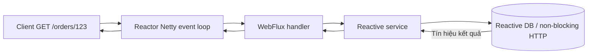

# Phân biệt lựa chọn reactive với lựa chọn phong cách REST

## 1. Hai quyết định kiến trúc khác nhau

Một nhóm xây dịch vụ đơn hàng hỏi: “API đã dùng REST thì có nên chuyển sang Spring WebFlux để *reactive* hơn không?” Câu hỏi này trộn lẫn hai vấn đề:

- **Phong cách API/REST**: tài nguyên được định danh và thao tác như thế nào qua HTTP; URI, method, status, representation, cache, conditional requests, liên kết và hợp đồng có nghĩa gì đối với client?
- **Mô hình thực thi reactive**: server nhận request, phối hợp I/O và phát kết quả như thế nào; có cần thread chờ, luồng dữ liệu bất đồng bộ và cơ chế backpressure không?

Ví dụ **cùng một hợp đồng**:

```http
GET /api/orders/ord-123 HTTP/1.1
Host: api.example.test
Authorization: Bearer <synthetic-access-token>
Accept: application/json
```

```http
HTTP/1.1 200 OK
Content-Type: application/json
Cache-Control: private, no-store

{"id":"ord-123","status":"CONFIRMED","totalMinor":125000,"currency":"VND"}
```

Hợp đồng này có thể chạy trên **Spring MVC** hoặc **Spring WebFlux**. Đổi stack nhưng giữ URI, method, representation, status và security thì **REST contract không đổi**.

Ngược lại, một controller WebFlux vẫn có thể cung cấp một endpoint hành động kiểu `POST /runEverything` thiếu mô hình tài nguyên rõ ràng. `Mono` và `Flux` không tự biến API đó thành REST.

| Trục | Các lựa chọn điển hình | Cần đánh giá |
| --- | --- | --- |
| **Hợp đồng bên ngoài** | REST/resource-oriented HTTP; RPC over HTTP; GraphQL; SSE/event API | Tài nguyên, method, status, tính tương thích, quyền truy cập, cache |
| **Mô hình xử lý bên trong** | Blocking/thread-per-request, Servlet async, reactive non-blocking | I/O, mức đồng thời, latency, memory, backpressure, thư viện và độ phức tạp |

Trong chương **Spring WebFlux** thuộc module **INTEGRATION_API_REST**, người học đã có mục tiêu thiết kế REST theo resource/URI, HTTP method/status, phân trang, cache, idempotency, OpenAPI, xác thực/phân quyền, xử lý lỗi và kiểm thử bằng Java/Spring. Bài này giúp chọn kiến trúc thực thi **mà không nhầm với thay đổi hợp đồng API**.

**Mục tiêu:** phân biệt REST/reactive; hiểu `Mono`/`Flux`, event loop và backpressure; chọn MVC/WebFlux; bảo toàn HTTP contract, bảo mật và kiểm thử.

## 2. REST trả lời “API có ý nghĩa gì?”, reactive trả lời “xử lý bằng cách nào?”

### 2.1. REST không yêu cầu Reactive Streams

Khi thiết kế API theo resource, xét:

1. URI định danh tài nguyên, ví dụ `/api/orders/{id}`; representation cho biết trạng thái tài nguyên.
2. Method có nghĩa nhất quán: `GET` đọc, `POST` tạo/yêu cầu xử lý, `PUT` thay thế, `PATCH` cập nhật một phần, `DELETE` xóa theo hợp đồng.
3. Status phản ánh kết quả HTTP: `200`, `201`, `202`, `204`, `400`, `401`, `403`, `404`, `409`, `412`, `429`, v.v.
4. Header/hợp đồng thống nhất: `Location`, `ETag`, `If-Match`, `Cache-Control`, media type, idempotency policy và Problem Details.
5. Mô hình REST theo nghĩa kiến trúc còn quan tâm tính stateless, cacheability, uniform interface, layered system và hypermedia khi áp dụng đầy đủ các ràng buộc REST.

Không điều nào trong số này bắt buộc backend phải dùng non-blocking I/O, Reactor, `Flux`, virtual thread hay một kiểu database driver cụ thể.

### 2.2. Reactive không tự quyết định HTTP semantics

`Mono<T>` trong Project Reactor phát **tối đa một giá trị** rồi hoàn tất hoặc phát lỗi; `Flux<T>` phát **0 đến nhiều giá trị** với tín hiệu complete/error. Đây là abstraction cho luồng bất đồng bộ, không phải mã HTTP:

```java
Mono<OrderView> oneOrder;
Flux<OrderEvent> manyEvents;
```

`Mono.empty()` không mặc định là `404`, `Flux` không mặc định là `202`; controller quyết định status theo hợp đồng HTTP.

Ví dụ `POST /api/report-operations` trả ngay:

```http
HTTP/1.1 202 Accepted
Location: /api/report-operations/op-42
Content-Type: application/json

{"id":"op-42","status":"PENDING"}
```

Đây là **thiết kế workflow bất đồng bộ ở HTTP**, có thể cài đặt bằng MVC hoặc WebFlux. Nó **khác** với một WebFlux `Mono<ResponseEntity<Report>>` giữ kết nối chờ đến khi có báo cáo rồi trả `200`.

**Điểm quyết định:** REST và reactive có thể kết hợp hoặc lựa chọn riêng. Chọn REST theo hợp đồng giao tiếp, reactive theo concurrency/I/O và hệ sinh thái; ghi hai quyết định riêng.

## 3. Điều gì thật sự xảy ra trong một ứng dụng WebFlux?

### 3.1. Event loop và non-blocking I/O

Khi dùng Reactor Netty (lựa chọn phổ biến của Spring WebFlux), một nhóm nhỏ event-loop threads nhận và xử lý các sự kiện socket. Thay vì giữ một thread ngủ chờ downstream, code gắn callback/chuỗi xử lý để tiếp tục khi dữ liệu sẵn sàng.



Lợi ích tiềm năng là phục vụ **nhiều kết nối đang chờ I/O** với ít thread hơn; nó không bảo đảm mọi endpoint nhanh hơn. Nếu logic xử lý CPU-bound, database đã quá tải, hoặc code gọi thư viện blocking trên event loop, lợi ích giảm mạnh và tail latency có thể tệ hơn.

### 3.2. Bốn nguyên tắc cần nhớ

- **Laziness:** nhiều publisher Reactor là *cold*; chuỗi thao tác chưa thực thi cho đến khi có subscription, và mỗi subscription mới có thể kích hoạt I/O lần nữa.
- **Composition:** dùng `map` cho biến đổi đồng bộ, `flatMap` khi callback trả `Mono`/`Flux` bất đồng bộ; không tự gọi `.subscribe()` trong controller thông thường.
- **Không block event loop:** không dùng `.block()`, `Thread.sleep`, JDBC/JPA blocking hoặc REST client blocking trực tiếp trên đường xử lý non-blocking.
- **Signals:** có `onNext`, `onError`, `onComplete`, `cancel`; HTTP error/timeout/cancellation cần chính sách riêng, không xem chúng đồng nghĩa thất bại nghiệp vụ.

Ví dụ `Mono.just(repository.findById(id))` **không phải non-blocking**: `findById` đã chạy chặn trước khi tạo `Mono`. Tương tự, bọc một lời gọi JPA trong `map(...)` có thể vẫn chặn event-loop thread.

### 3.3. Backpressure có giới hạn ranh giới

Reactive Streams cho consumer yêu cầu tốc độ phát bằng *demand*, thay vì producer tràn dữ liệu vô hạn; Reactor hỗ trợ phối hợp nhu cầu đó qua nhiều operators. Tuy vậy:

- Không phải **mọi nguồn** (JDBC blocking, callback ngoài, message broker, API bên thứ ba) đều tự tuân thủ demand.
- Buffer, `flatMap` concurrency hoặc pipeline chuyển thread có thể tạo bộ nhớ đệm đáng kể.
- TCP/HTTP connection, browser và gateway vẫn có giới hạn timeout, bandwidth, connection count.
- Backpressure **không** đảm bảo một operation nghiệp vụ được thực thi đúng một lần.

Đừng hiểu “trả `Flux`” là hệ thống tự có quota, retry, kiểm soát tài nguyên và thứ tự sự kiện. Chúng vẫn phải được thiết kế.

## 4. Cùng hợp đồng REST, hai cách viết controller

Giả sử `GET /api/orders/{id}` trả JSON đơn hàng hoặc `404`, còn `GET /api/orders?limit=20&cursor=...` trả trang `{items, nextCursor}`. Các status, schema, quyền và URI phải ổn định bất kể công nghệ server.

Ở Spring MVC, controller có thể trả đối tượng trực tiếp:

```java
@GetMapping("/{id}")
public ResponseEntity<OrderView> get(@PathVariable String id,
                                      Principal principal) {
    OrderView view = query.findVisibleTo(principal.getName(), id);
    return ResponseEntity.ok(view);
}
```

Nếu `query.findVisibleTo` chặn trên JDBC, servlet request thread chờ đến khi query xong. Chuyển sang WebFlux **không buộc đổi path, status, schema hay quyền truy cập**; khác biệt nằm ở cách `query` tạo kết quả.

### 4.1. WebFlux annotation controller sử dụng `Mono`

Ví dụ dùng **Java 17+, Spring Boot 3/Spring WebFlux, Project Reactor**. Service được giả định thực sự non-blocking (R2DBC hoặc reactive client), có quyền truy cập tới dữ liệu:

```java
package example.orders.api;

import java.security.Principal;
import java.util.List;
import org.springframework.http.CacheControl;
import org.springframework.http.HttpStatus;
import org.springframework.http.ResponseEntity;
import org.springframework.web.bind.annotation.*;
import reactor.core.publisher.Mono;

record OrderView(String id, String status, long totalMinor, String currency) {}
record OrderPage(List<OrderView> items, String nextCursor) {}

interface ReactiveOrderQuery {
    // Empty: không tồn tại hoặc cố ý che resource ngoài quyền.
    Mono<OrderView> visibleTo(String actor, String id);
    Mono<OrderPage> pageVisibleTo(String actor, String cursor, int limit);
}

@RestController
@RequestMapping("/api/orders")
public class OrderReactiveController {

    private final ReactiveOrderQuery query;

    public OrderReactiveController(ReactiveOrderQuery query) {
        this.query = query;
    }

    @GetMapping(value = "/{id}", produces = "application/json")
    public Mono<ResponseEntity<OrderView>> get(
            @PathVariable String id, Mono<Principal> principal) {
        return principal.flatMap(user -> query.visibleTo(user.getName(), id))
            .map(view -> ResponseEntity.ok()
                .cacheControl(CacheControl.noStore()).body(view))
            .switchIfEmpty(Mono.just(
                ResponseEntity.status(HttpStatus.NOT_FOUND)
                    .<OrderView>build()));
    }

    @GetMapping(produces = "application/json")
    public Mono<ResponseEntity<OrderPage>> list(
            @RequestParam(required = false) String cursor,
            @RequestParam(defaultValue = "20") int limit,
            Mono<Principal> principal) {
        if (limit < 1 || limit > 100) {
            return Mono.error(new org.springframework.web.server
                .ResponseStatusException(HttpStatus.BAD_REQUEST, "Invalid limit"));
        }
        return principal.flatMap(user ->
                query.pageVisibleTo(user.getName(), cursor, limit))
            .map(page -> ResponseEntity.ok()
                .cacheControl(CacheControl.noStore()).body(page));
    }
}
```

**Cách đọc:** `Mono<ResponseEntity<OrderView>>` là một pipeline trả **một kết quả HTTP**; `.switchIfEmpty(...)` ánh xạ tài nguyên không có sang `404`. `OrderPage` là một JSON có biên giới trang rõ, không bắt client đoán liệu một `Flux` đang mở có kết thúc hay không. `limit` phải bị giới hạn và `cursor` phải được kiểm tra ở tầng service. `principal` được lấy từ ngữ cảnh request đã xác thực; với API này, Spring Security phải yêu cầu authentication trước khi vào controller.

Ví dụ cần bean `ReactiveOrderQuery`, security và error handler; phải kiểm tra quyền tenant/owner ở service.

### 4.2. Một service dùng R2DBC thực sự bất đồng bộ

Sơ đồ service non-blocking với Spring R2DBC `DatabaseClient` (tên bảng/cột chỉ là minh họa):

```java
package example.orders.api;

import org.springframework.r2dbc.core.DatabaseClient;
import reactor.core.publisher.Mono;

public final class R2dbcOrderQuery {
    private final DatabaseClient db;

    public R2dbcOrderQuery(DatabaseClient db) {
        this.db = db;
    }

    public Mono<OrderView> findForActor(String actor, String id) {
        return db.sql("""
            SELECT id, status, total_minor, currency
            FROM orders
            WHERE id = :id AND owner_subject = :actor
            """)
            .bind("id", id)
            .bind("actor", actor)
            .map((row, meta) -> new OrderView(
                row.get("id", String.class),
                row.get("status", String.class),
                row.get("total_minor", Long.class),
                row.get("currency", String.class)))
            .one();
    }
}
```

Ví dụ đặt lớp truy vấn trong cùng package với `OrderView` ở mục 4.1 để có thể truy cập record package-private; khi chia package thực tế, hãy đưa DTO ra file public riêng hoặc ánh xạ qua model nội bộ. **R2DBC driver phải thực sự reactive**, tham số truy vấn được bind, và truy vấn phải thực thi policy quyền/tenant chứ không chỉ lọc theo ID.

**Không nên** đổi MVC controller sang `Mono` nhưng service vẫn gọi JPA blocking trên event loop rồi tuyên bố chuyển đổi thành công. Đó chỉ là đổi kiểu trả về, không thay đặc tính I/O.

### 4.3. Functional endpoint cũng không quyết định REST

WebFlux còn hỗ trợ functional routing (`RouterFunction` và `HandlerFunction`) bên cạnh annotation controller. Hai cách khai báo route có thể đưa ra **cùng REST contract**; chọn theo convention dự án, kiểm thử, khả năng tích hợp filter và độ rõ ràng. Không dùng “functional endpoint” như bằng chứng rằng endpoint tuân thủ REST, cũng không coi `@RestController` là bằng chứng code blocking.

## 5. Blocking I/O, Scheduler và WebClient: chỗ dễ gây mất lợi ích nhất

### 5.1. Phân biệt I/O được chờ và I/O không chặn

Ví dụ **sai** trong ứng dụng WebFlux chạy trên event loop:

```java
@GetMapping("/bad")
public Mono<OrderView> bad() {
    OrderView value = jdbcRepository.findOneBlocking(); // Chặn trước Mono.
    return Mono.just(value);
}
```

Ví dụ sau còn nguy hiểm nếu gọi `.block()` ngay trong pipeline đang chạy trên event-loop thread:

```java
OrderView value = webClient.get().uri("/somewhere")
    .retrieve().bodyToMono(OrderView.class).block();
```

`Mono` không thể đảo ngược thực tế lời gọi đã block. Reactor Netty có thể phát hiện một số thao tác blocking và báo lỗi, nhưng **không nên dựa vào phát hiện đó** để bảo đảm mọi thư viện blocking sẽ bị chặn đúng cách.

### 5.2. Bridge tạm thời sang thư viện blocking

Nếu phải giữ JDBC/JPA trong giai đoạn chuyển đổi, tách code blocking sang **bounded elastic scheduler**:

```java
Mono<OrderView> temporaryBridge(String id) {
    return Mono.fromCallable(() -> legacyOrderService.loadBlocking(id))
               .subscribeOn(reactor.core.scheduler.Schedulers.boundedElastic());
}
```

`fromCallable` hoãn thực thi đến subscription; `subscribeOn` xếp phần blocking trên pool có giới hạn thay vì event loop. Nhưng cách này **vẫn tốn worker thread và DB connection**, scheduler có queue/limit, và không tự truyền transaction/security context qua mọi thread. Cần đưa toàn bộ transaction blocking vào method của service được gọi trên worker; không giả định transaction của reactive caller bảo vệ được JPA.

Đây chỉ là **giải pháp chuyển tiếp**. Nếu phần lớn dependency còn blocking, MVC có thể hiệu quả và đơn giản hơn.

### 5.3. WebClient là reactive client, nhưng hệ thống đối tác vẫn có giới hạn

```java
package example.inventory;

import java.time.Duration;
import org.springframework.web.reactive.function.client.WebClient;
import reactor.core.publisher.Mono;

record InventoryView(String sku, int available) {}

public final class InventoryClient {
    private final WebClient webClient;

    public InventoryClient(WebClient.Builder builder) {
        this.webClient = builder.baseUrl("https://inventory.example.test")
            .build();
    }

    public Mono<InventoryView> available(String sku) {
        return webClient.get()
            .uri("/api/inventory/{sku}", sku)
            .retrieve()
            .bodyToMono(InventoryView.class)
            .timeout(Duration.ofSeconds(2));
    }
}
```

`.timeout(...)` giới hạn thời gian quan sát publisher, **không bảo đảm downstream đã dừng mọi xử lý**. Phân biệt connect/read/response timeout của HTTP client, số kết nối trong pool và timeout của API Gateway. Nếu có retry, giới hạn số lần, backoff/jitter và chỉ thử lại khi hợp đồng cho phép; không tự retry một `POST` thu tiền chỉ vì có `Mono`.

**Lưu ý:** MVC cũng dùng được WebClient, không cần chuyển cả server sang WebFlux.

## 6. Trả `Flux` ra HTTP: trang JSON, NDJSON hay SSE?

Một API danh sách không nên mặc định trả `Flux<OrderView>` chỉ vì service có nhiều bản ghi. Chọn representation trước:

| Nhu cầu từ client | Hợp đồng HTTP gợi ý | Kiểu reactive phù hợp |
| --- | --- | --- |
| Lấy **một trang** kết quả hữu hạn có `nextCursor` | `GET /orders?limit=20` → `200 application/json` | `Mono<OrderPage>` |
| Xuất hàng nghìn dòng, xử lý tuần tự khi đến | `GET /exports/{id}/rows` → `200 application/x-ndjson` | `Flux<Row>` |
| Theo dõi sự kiện theo thời gian thực qua HTTP | `GET /orders/{id}/events` → `200 text/event-stream` | `Flux<ServerSentEvent<Event>>` |
| Job mất vài phút, client không cần giữ socket | `POST /report-operations` → `202 Location`, GET operation sau | `Mono` chỉ là implementation; kết quả job lưu bền vững |

### 6.1. Streaming không tương đương phân trang

Với `application/json` thông thường, một danh sách được xem là **một representation JSON hoàn chỉnh**. Cách framework buffer/flush phụ thuộc decoder, media type, adapter và proxy; client thường chỉ dùng được body khi có một JSON hoàn chỉnh. Nếu cần xử lý từng phần độc lập, định nghĩa **framing** cho mỗi bản ghi như NDJSON hoặc SSE.

Ví dụ NDJSON (mỗi dòng là một đối tượng JSON độc lập):

```http
HTTP/1.1 200 OK
Content-Type: application/x-ndjson
Cache-Control: private, no-store

{"id":"ord-1","status":"DRAFT"}
{"id":"ord-2","status":"CONFIRMED"}
{"id":"ord-3","status":"CONFIRMED"}
```

Truyền tải có thể bị cắt ở giữa dòng nếu connection lỗi. Client phải kiểm tra record framing và trạng thái hoàn tất, không tự coi status `200` đã được gửi là chứng minh toàn bộ export thành công. Với file lớn cần tải lại, đôi khi tạo export bất đồng bộ trả `202` rồi download immutable file/range là lựa chọn tốt hơn.

### 6.2. SSE là hợp đồng sự kiện, không phải thay thế resource trạng thái

Đoạn method minh họa trong WebFlux controller có `OrderEventService events`, trả `Flux<OrderEvent>` từ `visibleEvents(actor,id)`:

```java
@GetMapping(value = "/{id}/events",
            produces = MediaType.TEXT_EVENT_STREAM_VALUE)
public Flux<ServerSentEvent<OrderEvent>> stream(
        @PathVariable String id, Mono<Principal> principal) {
    return principal.flatMapMany(p -> events.visibleEvents(p.getName(), id))
        .map(e -> ServerSentEvent.<OrderEvent>builder()
            .id(e.id()).event(e.type()).data(e).build());
}
```

Đặt method trong `@RestController @RequestMapping("/api/orders")`, với import tương ứng từ Spring WebFlux, Reactor và `java.security.Principal`.

Response có thể là:

```http
HTTP/1.1 200 OK
Content-Type: text/event-stream
Cache-Control: no-store

id: evt-51
event: order-updated
data: {"id":"evt-51","type":"order-updated","orderId":"ord-123"}

```

Ví dụ trên chưa giải quyết **event history/replay**: nếu client rớt mạng sau `evt-51`, cần chính sách xử lý `Last-Event-ID`, event ID ổn định, retention, trùng lặp và thứ tự. Phải kiểm tra quyền **trước khi bắt đầu stream** và trước khi phát dữ liệu nhạy cảm. Nếu lỗi phát sinh sau khi response đã commit, server thường không thể đổi sang một body JSON Problem Details hoàn chỉnh.

SSE, NDJSON và endpoint JSON đều có thể là thành phần của hệ thống dùng HTTP theo hướng resource. **Việc có stream không tự làm API “REST hơn”**; lựa chọn nằm ở nhu cầu client, khả năng reconnect, tương thích proxy và resource semantics.

### 6.3. Backpressure không thay quota và bounded memory

Luồng dữ liệu nhanh hơn tốc độ nhận của client có thể làm queue tăng. Cần giới hạn số stream trên user/tenant, thời gian tồn tại, connection pool, số bản ghi, buffering và upstream demand; đo event-loop delay, memory, số connection mở và tỷ lệ hủy.

Ví dụ `onBackpressureBuffer()` **không tham số** có thể tạo hàng đợi quá lớn; nếu phải buffer, dùng giới hạn và chính sách overflow có thể kiểm thử. Không áp dụng `onBackpressureDrop` cho giao dịch tài chính hoặc event bắt buộc giao đầy đủ mà không có khả năng replay.

## 7. Hợp đồng REST và bảo mật không mất đi khi chuyển sang WebFlux

### 7.1. Giữ đúng method, mã HTTP, header và idempotency

WebFlux vẫn phải trả `201 + Location` khi POST tạo tài nguyên, `401/403` cho lỗi quyền, `404` khi không thấy, `412` khi `If-Match` sai, `application/problem+json` cho lỗi và cache headers phù hợp dữ liệu. GET không được cố ý tạo side effect; POST retry cùng `Idempotency-Key` phải được dedup **bền vững**. `Mono.empty()` không phải một chính sách HTTP mặc định.

Một publisher **cold** có thể phát lại side effect khi có subscription mới. Không được viết:

```java
Mono<ChargeResult> result = paymentClient.charge(paymentRequest);
result.subscribe(); // Fire-and-forget, bỏ qua lifecycle HTTP và lỗi.
return result;      // Một subscription khác có thể gọi lại lệnh.
```

Nếu side effect không được lặp, cần operation ID, unique constraint và idempotency record bền vững. Reactor `cache()` **không thay được dedup trong database**.

### 7.2. Reactive Spring Security

WebFlux sử dụng `SecurityWebFilterChain` với `ServerHttpSecurity` (khác `SecurityFilterChain`/`HttpSecurity` của servlet):

```java
package example.orders.security;

import org.springframework.context.annotation.Bean;
import org.springframework.context.annotation.Configuration;
import org.springframework.http.HttpMethod;
import org.springframework.security.config.Customizer;
import org.springframework.security.config.annotation.web.reactive.EnableWebFluxSecurity;
import org.springframework.security.config.web.server.ServerHttpSecurity;
import org.springframework.security.web.server.SecurityWebFilterChain;

@Configuration
@EnableWebFluxSecurity
public class ReactiveSecurityConfiguration {
    @Bean
    SecurityWebFilterChain webFluxSecurity(ServerHttpSecurity http) {
        return http
            .csrf(ServerHttpSecurity.CsrfSpec::disable)
            .authorizeExchange(ex -> ex
                .pathMatchers(HttpMethod.GET, "/api/catalog/**").permitAll()
                .pathMatchers(HttpMethod.GET, "/api/orders/**")
                    .hasAuthority("SCOPE_orders:read")
                .anyExchange().denyAll())
            .oauth2ResourceServer(oauth ->
                oauth.jwt(Customizer.withDefaults()))
            .build();
    }
}
```

**Chỉ tắt CSRF như ví dụ khi ứng dụng là resource server stateless dùng Bearer token, không dựa vào cookie/session để xác thực.** Nếu browser sử dụng cookie, phải đánh giá lại CSRF. Cấu hình JWT cần xác minh **issuer, signature, expiry và audience** phù hợp API; một scope như `orders:read` không cho phép đọc đơn của tenant khác.

Service phải kiểm tra object-level authorization theo dữ liệu có thẩm quyền. Ví dụ query có `WHERE order_id = :id AND tenant_id = :tenant` sau khi lấy tenant từ danh tính đã được xác minh; không dùng tenant do client tự gán trong query/body mà không đối chiếu. Với SSE, quyền có thể bị thu hồi trong lúc stream còn mở, nên cần policy kiểm tra lại/đóng stream thích hợp.

### 7.3. Reactive Context không phải ThreadLocal servlet

Pipeline reactive có thể chuyển execution giữa các threads; không giả định MDC, `ThreadLocal`, JPA session hay servlet `SecurityContextHolder` luôn giữ nguyên. Trong reactive stack, Spring Security dùng **Reactor Context** để mang thông tin security. Truyền subject/tenant đã được xác thực một cách tường minh ở các biên service khi phù hợp và cleanup mọi context bridge.

`subscribeOn`/`publishOn` thay đổi scheduling; nếu custom logic lấy tenant từ ThreadLocal trên event loop, có thể đọc nhầm hoặc mất danh tính. Test chạy cả trên scheduler khác và dưới đồng thời để phát hiện lỗi này. `WebClient` ra ngoài cần cơ chế gắn token được phê duyệt; đừng forward access token của user tới dịch vụ không đáng tin theo mặc định.

### 7.4. Reactive transaction và cancellation

Với R2DBC, các thao tác ghi liên quan cùng nghiệp vụ có thể dùng **reactive transaction manager/`TransactionalOperator`**. Transaction gắn với subscription/Reactive Context, không thể giả định `@Transactional` của JPA blocking tự bao trùm toàn chuỗi reactive. Unique constraint và compare-and-swap vẫn cần để bảo vệ idempotency và optimistic concurrency.

**Cancellation của subscription không phải rollback toàn bộ hệ thống.** Client disconnect có thể ngắt publisher nhưng external service đã thu tiền hoặc database đã commit. Các side effect cần operation state, đối soát/outbox nếu phù hợp. Một request reactive đang chờ cũng phải có timeout và số retry hữu hạn.

## 8. Khi nào chọn MVC, khi nào chọn WebFlux?

| Bối cảnh thực tế | Lựa chọn đáng cân nhắc | Lý do |
| --- | --- | --- |
| CRUD thông thường, phần lớn dùng JPA/JDBC và thư viện blocking | **Spring MVC** | Stack, transaction và debug đơn giản; WebFlux không làm JDBC non-blocking |
| Nhiều kết nối chờ HTTP/DB non-blocking, downstream có reactive drivers | **Spring WebFlux** | Có thể giảm thread bị giữ trong lúc I/O |
| Stream sự kiện dài hạn hoặc NDJSON, số kết nối đồng thời lớn | **WebFlux hoặc giải pháp streaming phù hợp** | Flux/backpressure có ích, nhưng cần đo proxy/connection/buffer |
| Tác vụ nghiệp vụ chạy nhiều phút | **202 + operation resource**, dùng MVC hay WebFlux đều được | Không giữ HTTP socket đến khi job hoàn thành |
| Chỉ một endpoint cần WebClient non-blocking | **Không cần đổi toàn ứng dụng** | MVC có thể dùng WebClient và cơ chế async riêng |
| Team chưa có khả năng quan sát/sửa reactive chain, hạ tầng vẫn blocking | **Giữ MVC, đo bottleneck trước** | Tránh đổi mô hình concurrency mà không có lợi ích |

Trước quyết định, đo **throughput, p95/p99 latency, event-loop lag, thread/connection pool, CPU, heap, timeout rate và DB saturation** dưới tải điển hình và tải đột biến. So sánh trên cùng hạ tầng và contract; không chọn chỉ theo microbenchmark “requests/second” nếu độ phức tạp vận hành tăng hoặc downstream vẫn nghẽn.

**Lộ trình chuyển đổi có kiểm soát:** giữ OpenAPI/consumer contracts; tách service I/O; thay từng dependency bằng reactive driver khi có lợi; chuyển endpoint và bảo đảm 401/403/404, pagination, cache và idempotency không đổi; rollout canary cùng metric/rollback. Có thể chấp nhận kiến trúc hỗn hợp qua các service khác nhau; không cố dùng hai web stacks trong cùng một ứng dụng chỉ để “đẹp công nghệ”.

## 9. Kiểm thử reactive và hợp đồng REST

`StepVerifier` kiểm tra các **tín hiệu Reactor**, còn `WebTestClient` kiểm tra **request/response HTTP của WebFlux**. Hai loại test bổ sung nhau; không test được authorization chỉ bằng một `Mono.just` trong unit test.

```java
package example.orders.api;

import static org.junit.jupiter.api.Assertions.*;
import java.security.Principal;
import java.util.List;
import org.junit.jupiter.api.Test;
import org.springframework.http.HttpStatus;
import org.springframework.test.web.reactive.server.WebTestClient;
import reactor.core.publisher.Mono;
import reactor.test.StepVerifier;

class OrderReactiveContractTest {
    private final ReactiveOrderQuery stub = new ReactiveOrderQuery() {
        public Mono<OrderView> visibleTo(String actor, String id) {
            if (!"alice".equals(actor) || !"ord-123".equals(id)) {
                return Mono.empty();
            }
            return Mono.just(new OrderView(
                "ord-123", "CONFIRMED", 125000, "VND"));
        }
        public Mono<OrderPage> pageVisibleTo(
                String actor, String cursor, int limit) {
            return Mono.just(new OrderPage(List.of(), null));
        }
    };

    @Test
    void monoReturnsResourceWithHttp200() {
        OrderReactiveController controller = new OrderReactiveController(stub);
        StepVerifier.create(controller.get(
                "ord-123", Mono.<Principal>just(() -> "alice")))
            .assertNext(response -> {
                assertEquals(HttpStatus.OK, response.getStatusCode());
                assertEquals("ord-123", response.getBody().id());
            })
            .verifyComplete();
    }

    @Test
    void invalidPageLimitReturns400() {
        WebTestClient client = WebTestClient.bindToController(
            new OrderReactiveController(stub)).build();
        client.get().uri("/api/orders?limit=0")
            .exchange().expectStatus().isBadRequest();
    }
}
```

Đây là kiểm thử **đơn vị/HTTP mỏng với stub**; `bindToController` không tự kiểm tra `SecurityWebFilterChain`, chữ ký JWT, chính sách tenant hoặc R2DBC. Ở integration tests, dùng ứng dụng WebFlux với Spring Security test support, token có/thiếu scope, user khác tenant và database/test server phù hợp. Đặc biệt kiểm tra:

| Kiểm thử | Kết quả cần có |
| --- | --- |
| GET với dữ liệu tồn tại/không tồn tại | `200` JSON đúng schema hoặc `404`, không trả `200` rỗng |
| Token hết hạn/sai audience hoặc thiếu scope | `401`/`403`; object ngoài quyền không bị lộ |
| Danh sách giới hạn/cursor | Không trả trang vô hạn hoặc mất tính ổn định theo contract |
| Blocking call vô tình chạy trên event loop | Phát hiện bằng instrument/BlockHound khi phù hợp và kiểm tra event-loop lag |
| Client nhận SSE chậm, ngắt kết nối | Giới hạn buffer, cleanup subscription và không rò context |
| Timeout/WebClient retry | Không retry side effect ngoài hợp đồng, không tạo thêm thanh toán |
| PATCH cùng version cạnh tranh | CAS/transaction chỉ cho một mutation thắng; status `412` đúng |

## 10. Bài tập và kết luận

**Tình huống:** Dịch vụ đơn hàng hiện chạy Spring MVC/JPA, có 3 endpoint: `GET /orders/{id}` dùng JDBC mất 15 ms; `GET /inventory/{sku}` gọi ba HTTP service, thường chờ 600 ms; `GET /orders/{id}/events` cần theo dõi sự kiện dài hạn. Nhóm muốn chuyển tất cả sang WebFlux vì “REST nên reactive”.

Hãy trả lời: (1) endpoint nào có thể hưởng lợi từ non-blocking, và điều kiện tiên quyết? (2) Vì sao bọc JDBC trong `Mono.just(...)` không giúp? (3) Khi GET đơn không tìm thấy, HTTP trả gì? (4) Nếu SSE bị ngắt, có được hủy đơn không? (5) Ba nhóm kiểm thử nào phải chạy trước release?

**Gợi ý:** giữ MVC/JPA cho CRUD nhanh nếu không có bottleneck; cân nhắc WebClient/async cho HTTP fan-out và WebFlux/SSE cho stream lớn **sau khi đo tải**. Nếu phải bridge JDBC, dùng `Mono.fromCallable(...).subscribeOn(boundedElastic())` có giới hạn, không gọi blocking trên event loop. Trả `404` theo policy cho đơn không tồn tại; client hủy SSE chỉ hủy subscription, không phải lệnh hủy nghiệp vụ. Kiểm thử **HTTP contract**, **security/tenant**, **load/backpressure/reconnect** (và cả idempotency/transaction nếu có ghi).

**Ghi nhớ:** **REST là lựa chọn về giao diện và ngữ nghĩa HTTP; reactive là lựa chọn về xử lý bất đồng bộ/non-blocking.** Dùng Spring WebFlux khi workload và dependency thực sự phù hợp, không chỉ vì `Mono`/`Flux` hiện đại. Dù chọn MVC hay WebFlux, API vẫn cần đúng resource, status, validation, cache, quyền truy cập, khả năng phục hồi và kiểm thử.


