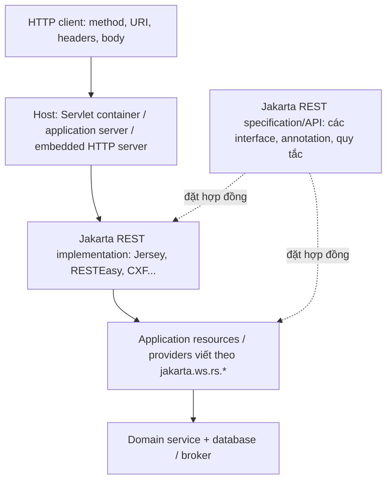

# Phân biệt API đặc tả với Jersey, RESTEasy hoặc runtime khác

## 1. Tình huống: cùng `@Path` nhưng không cùng môi trường chạy

Một nhóm Java viết resource đơn hàng bằng các annotation `@Path`, `@GET`, `@POST`, `@Consumes` và `@Produces`. Ứng dụng chạy trên một server dùng Jersey; khi chuyển sang WildFly/RESTEasy hoặc framework tích hợp khác, mã resource trông vẫn hợp lệ nhưng JSON response, đăng ký provider, dependency injection hoặc cách trả lỗi lại khác.

Vấn đề thường không nằm ở REST hay HTTP: nhóm đã lẫn lộn **hợp đồng API**, **đặc tả lập trình Jakarta REST** và **runtime thực thi cụ thể**. Việc import cùng package `jakarta.ws.rs.*` chỉ cho biết mã sử dụng một API tiêu chuẩn; nó không tự cài HTTP server, JSON provider, dependency injection, bảo mật hay OpenAPI.

Bài thuộc chương **Jakarta REST** của học phần `INTEGRATION_API_REST`: thiết kế resource, URI, HTTP methods/status và hợp đồng dữ liệu, kết hợp phân trang, cache, idempotency, OpenAPI, xác thực/phân quyền, lỗi và kiểm thử API Java. Sau bài, người học có thể:

- Phân định trách nhiệm của **Jakarta REST specification/API**, implementation như **Jersey/RESTEasy**, và **host/container**.
- Viết resource và provider bằng API chuẩn mà không gắn business logic vào lớp triển khai.
- Nhận ra những tính năng **không tự có**: JSON codec, CDI, Bean Validation, security, Servlet, OpenAPI và server runtime.
- Chọn dependency/namespace tương thích; kiểm chứng bằng HTTP contract tests khi chuyển runtime.
- So sánh Jakarta REST với Spring MVC một cách đúng: **hai mô hình API khác nhau**, dù cùng phục vụ REST over HTTP.

## 2. Ba tầng cần tách



| Tầng | Vai trò | Ví dụ |
| --- | --- | --- |
| **Đặc tả Jakarta REST** | Quy định annotation, interface, xử lý request/response và extension points có tính di động | `@Path`, `@GET`, `Response`, `ExceptionMapper`, `ContainerRequestFilter`, Client API |
| **API artifact** | Cung cấp các kiểu Java để **compile** ứng dụng theo đặc tả | `jakarta.ws.rs-api`, package `jakarta.ws.rs.*` |
| **Implementation** | Thực hiện routing, binding, filters, converters, client engine… theo đặc tả | Jersey, RESTEasy, Apache CXF |
| **Host/runtime** | Lắng nghe HTTP, quản lý deployment, threads, TLS, Servlet hoặc tích hợp ứng dụng | Jakarta EE server, Servlet container, standalone/embedded runtime |
| **Ứng dụng** | Định nghĩa resource, domain rules, persistence, ACL và hợp đồng API cụ thể | `OrdersResource`, `OrderService`, JWT policy |

Một implementation có thể tích hợp rất chặt với một host hoặc framework, nhưng **không nên coi tên host là tên đặc tả**. Jersey là một implementation của Jakarta REST; RESTEasy cũng là họ implementation, có các cách tích hợp khác nhau. Jakarta EE application server có thể đã đi kèm implementation; một Servlet container thuần có thể cần cài và đăng ký implementation.

### Sai lầm dễ gặp

```text
Thêm dependency jakarta.ws.rs-api
    ≠ server tự chạy ở port 8080
    ≠ JSON tự serialize mọi POJO/record
    ≠ CDI @Inject luôn hoạt động
    ≠ @RolesAllowed luôn được enforce
    ≠ endpoint tự xuất hiện trong OpenAPI
```

Để biết một tính năng có chạy không, hỏi: **được quy định ở đặc tả nào, do thư viện/provider nào cung cấp, host nào kích hoạt, và đã được test trên runtime đích chưa?**

## 3. JAX-RS, Jakarta REST và namespace `javax`/`jakarta`

Tên lịch sử **JAX-RS** thường được dùng để chỉ đặc tả RESTful Web Services cho Java. Trong thế hệ Jakarta EE mới, API sử dụng namespace `jakarta.ws.rs` và thường được gọi là **Jakarta RESTful Web Services** hoặc **Jakarta REST**.

```java
// Mã theo namespace Jakarta:
import jakarta.ws.rs.GET;
import jakarta.ws.rs.Path;
import jakarta.ws.rs.core.Response;

// Mã JAX-RS cũ có thể vẫn import:
// javax.ws.rs.GET
// javax.ws.rs.Path
```

`javax.ws.rs.*` và `jakarta.ws.rs.*` là **hai kiểu Java khác nhau**: compiler/runtime không tự coi chúng tương đương. Thay API JAR mà không đồng bộ phiên bản implementation, providers và các thư viện integration sẽ dẫn tới lỗi linkage, ClassNotFound, annotation không được nhận diện hoặc deployment thất bại.

| Khi kiểm tra dependency | Câu hỏi cần trả lời |
| --- | --- |
| API version | Module dùng Jakarta REST phiên bản nào? Package `jakarta` hay `javax`? |
| Jersey/RESTEasy/CXF | Phiên bản implementation thực sự tương thích API namespace và host? |
| JSON provider | Jackson/JSON-B integration đã đăng ký, cùng namespace chưa? |
| CDI/Validation | Runtime có hỗ trợ đúng phiên bản Jakarta Inject/CDI/Validation cần dùng? |
| Servlet/server | Host có cung cấp các API Jakarta cần thiết, hay app phải đóng gói? |
| Duplicate libs | Có vô tình đóng gói API/implementation đè lên các bản mà server đã cấp không? |

Ví dụ một module **được host Jakarta EE cấp sẵn** có thể khai báo API chỉ để compile:

```xml
<dependency>
  <groupId>jakarta.ws.rs</groupId>
  <artifactId>jakarta.ws.rs-api</artifactId>
  <version>3.1.0</version>
  <scope>provided</scope>
</dependency>
```

Phiên bản chỉ là **ví dụ minh họa**; phải chọn phù hợp với nền tảng triển khai. `provided` có nghĩa công cụ build không đóng JAR này vào artifact như dependency thông thường, **không có nghĩa** server nào cũng sẵn Jakarta REST. Trong standalone app hoặc một Servlet container thuần, phải có implementation/runtime và dependency set phù hợp. Không “vá lỗi thiếu runtime” bằng cách chỉ đổi scope của API JAR.

## 4. Những gì đặc tả Jakarta REST thực sự cung cấp

Các khả năng chuẩn quan trọng:

| Nhóm | API/annotation điển hình | Ý nghĩa |
| --- | --- | --- |
| Resource routing | `@Path`, `@GET`, `@POST`, `@PUT`, `@DELETE`, `@PATCH` khi API hỗ trợ | Ghép URI và HTTP method với Java resource method |
| Negotiation | `@Consumes`, `@Produces`, `MediaType` | Chọn request/response representation; liên quan 415/406 |
| Tham số HTTP | `@PathParam`, `@QueryParam`, `@HeaderParam`, `@CookieParam` | Đọc dữ liệu từ URI, header, cookie |
| Context | `@Context`, `UriInfo`, `Request`, `SecurityContext` | Thông tin request và tài nguyên liên quan |
| Response | `Response`, `Response.Status`, `EntityTag`, `CacheControl` | Tạo status/headers/body theo hợp đồng |
| Extension | `@Provider`, `ExceptionMapper`, `MessageBodyReader/Writer` | Thay đổi chuyển đổi dữ liệu và ánh xạ lỗi |
| Pipeline hooks | `ContainerRequestFilter`, `ContainerResponseFilter`, interceptors | Xử lý HTTP trước/sau resource hoặc body IO |
| Client | `ClientBuilder`, `Client`, `WebTarget`, `Invocation` | Gọi HTTP từ Java theo Jakarta REST Client API |
| Async/streaming | `AsyncResponse`, `CompletionStage` và API SSE phù hợp phiên bản | Cơ chế lập trình bất đồng bộ, không mặc định end-to-end non-blocking |

**Không nằm sẵn trong chỉ một dependency Jakarta REST API:** quy tắc persistence/JPA, JWT verifier, Bean Validation provider, transaction, JSON serializer tùy chọn, OpenAPI generator, TLS listener, thread pool, metrics, message broker. Một số là Jakarta EE specifications khác, một số thuộc implementation hoặc ứng dụng.

### Ví dụ HTTP vẫn là hợp đồng nền tảng

```http
GET /api/orders/ord-42 HTTP/1.1
Host: api.example.test
Accept: application/json
Authorization: Bearer <access-token>

HTTP/1.1 200 OK
Content-Type: application/json
ETag: "order-42-v8"
Cache-Control: private, no-store

{"id":"ord-42","state":"CONFIRMED"}
```

Status `200`, header `ETag` và JSON thuộc **hợp đồng trên wire**. Jakarta REST cung cấp cách lập trình tạo response; Jersey/RESTEasy/host chịu trách nhiệm hiện thực mạng và lựa chọn provider. Client không nên cần biết phía sau có class `OrdersResource` hay framework nào.

## 5. Java resource dùng API Jakarta REST

Ví dụ quản lý đơn hàng dùng Jakarta REST resource, Jakarta Inject/CDI khi runtime hỗ trợ và một domain service riêng. Với ứng dụng Servlet-style, `@ApplicationPath` có thể thiết lập đường gốc:

```java
import jakarta.ws.rs.ApplicationPath;
import jakarta.ws.rs.core.Application;

@ApplicationPath("/api")
public class OrdersApplication extends Application {}
```

Resource:

```java
import jakarta.inject.Inject;
import jakarta.ws.rs.*;
import jakarta.ws.rs.core.*;

@Path("/orders")
@Produces(MediaType.APPLICATION_JSON)
public class OrdersResource {
    @Inject OrderService service; // cần CDI/injection integration phù hợp

    @GET
    @Path("/{id}")
    public Response get(
            @PathParam("id") String id,
            @Context SecurityContext security) {
        OrderView order = service.getAuthorized(id, security);
        return Response.ok(order)
            .tag(new EntityTag(order.getVersionTag()))
            .header("Cache-Control", "private, no-store")
            .build();
    }

    @POST
    @Consumes(MediaType.APPLICATION_JSON)
    public Response create(
            CreateOrderRequest request,
            @Context UriInfo uriInfo,
            @Context SecurityContext security) {
        OrderView created = service.createAuthorized(request, security);
        URI uri = uriInfo.getAbsolutePathBuilder()
            .path(created.getId()).build();
        return Response.created(uri)
            .entity(created)
            .build();
    }
}
```

Các DTO `OrderView`/`CreateOrderRequest`, `OrderService` và persistence là abstraction của bài; implement bằng Java Bean có constructor/getter phù hợp với JSON provider đang dùng. `getVersionTag()` trong ví dụ trả token ETag đã tính từ **biểu diễn được định danh**, không lấy chuỗi tự do chưa validate. `OrderService` chịu trách nhiệm xác thực quyền theo owner/tenant, validation nghiệp vụ và atomicity; `SecurityContext` chỉ cung cấp context người gọi từ cơ chế security đã cấu hình.

**Luồng HTTP:**

```http
POST /api/orders HTTP/1.1
Content-Type: application/json
Authorization: Bearer <access-token>

{"productId":"p-7","quantity":2}

HTTP/1.1 201 Created
Location: https://api.example.test/api/orders/ord-42
Content-Type: application/json

{"id":"ord-42","state":"CREATED"}
```

`Response.created(uri)` tạo 201 và Location; nó **không** đảm bảo service đã commit transaction hoặc resource thật sự bền, nên việc lưu phải được thực hiện đúng trước khi trả 201. Với POST có retry nguy cơ ghi trùng, bổ sung Idempotency-Key theo hợp đồng ứng dụng, unique constraint và service transaction; Jakarta REST **không tự tạo idempotency**.

`UriInfo.getAbsolutePathBuilder()` tiện tạo URI theo request, nhưng khi đứng sau reverse proxy phải cấu hình forwarded headers/host đáng tin. Không dùng Host không được xác minh để phát signed link hoặc chuyển hướng sang origin do attacker điều khiển.

## 6. Phần được chuẩn hóa và phần cần provider

Điểm thường gây bất ngờ nhất khi đổi Jersey sang RESTEasy là **JSON serialization**. Jakarta REST có `MessageBodyReader<T>` và `MessageBodyWriter<T>` cùng thuật toán chọn provider; một implementation và host có thể tích hợp Jackson, JSON-B hoặc provider khác. Hai provider có thể khác nhau ở:

- Tên field/định dạng timestamp/time zone, xử lý enum, null và unknown properties.
- POJO có constructor/getter nào, Java record, polymorphism, collection và generics.
- Behavior khi gặp validation/parse error; status và error body có thể lệch contract nếu không định nghĩa rõ.
- Serializer bị chọn khi `@Produces`/`@Consumes` trùng nhiều media types.

Một resource khai:

```java
@GET
@Path("/{id}")
@Produces(MediaType.APPLICATION_JSON)
public OrderView get(@PathParam("id") String id) {
    return service.find(id);
}
```

**không phải lời bảo đảm rằng bất kỳ runtime chỉ có Jakarta REST API JAR sẽ biết chuyển mọi `OrderView` thành JSON**. Phải cung cấp provider đúng kiểu, đăng ký/configure và test. Jakarta REST quản lý **cơ chế chọn body provider**, không định nghĩa một thuật toán JSON mapping POJO duy nhất áp dụng mọi implementation.

### Ví dụ provider tự định nghĩa

Một phần mở rộng chuẩn có thể khai dưới dạng:

```java
@Provider
@Produces("application/problem+json")
public final class ProblemWriter
        implements MessageBodyWriter<ApiProblem> {
    // isWriteable(...) nhận diện ApiProblem.
    // writeTo(...) serialize bytes đúng media type.
    // Triển khai body/headers/stream và ưu tiên provider theo đặc tả.
}
```

Đây là **phác thảo giao diện**, chưa phải class có thể biên dịch vì chưa implement tất cả method cần thiết. Nó minh họa extension point chuẩn; cách auto-discovery hoặc đăng ký tường minh, ưu tiên provider và runtime configuration cần kiểm thử. Với JSON thông thường, ưu tiên tận dụng provider đã được chọn của ứng dụng để tránh hai serializer có chính sách trái ngược.

## 7. Jersey, RESTEasy và runtime khác

| Công nghệ | Bản chất | Điều cần kiểm chứng |
| --- | --- | --- |
| **Jersey** | Jakarta REST implementation; tích hợp Servlet/standalone tùy cấu hình | Namespace, JSON module, resource discovery, HK2/CDI |
| **RESTEasy** | Họ Jakarta REST implementation, tích hợp nhiều host/stack | Classic so với reactive integrations, providers, DI, async |
| **Apache CXF** | Framework web service có module hỗ trợ Jakarta REST | Transport, providers và version tương thích |
| **Jakarta EE server** | Host tích hợp REST/DI/JSON/Validation theo profile | Implementation thực, classloading, provided dependencies |
| **Servlet container** | Host Servlet, không tự là Jakarta REST implementation | Phải thêm runtime và đăng ký application/servlet |
| **Spring MVC/WebFlux** | Framework web Spring với API lập trình riêng | `@GetMapping`/Reactor không phải `@Path`/Jakarta REST runtime |

**Đừng đồng nhất tên host với implementation.** Một Quarkus app không bắt buộc dùng cùng RESTEasy stack như ứng dụng WildFly. Jersey cũng không mặc định dùng cùng JSON provider hoặc DI với mọi host. Để di chuyển, ưu tiên resource dùng `jakarta.ws.rs.*` và cô lập lớp khởi tạo, registration, transport cùng **vendor extension** như Jersey `ResourceConfig` hoặc cấu hình RESTEasy. Vendor API có thể hữu ích nhưng cần review khi thay runtime.

## 8. Bootstrap và CDI tùy môi trường chạy

`@ApplicationPath("/api")` và `@Path("/orders")` có thể ánh xạ tới `/api/orders` khi host được cấu hình đúng, **nhưng `new OrdersApplication()` không tự mở HTTP port**.

- **Jakarta EE server:** có thể đã cung cấp implementation, discovery và Jakarta CDI/JSON/Validation theo profile.
- **Servlet container + Jersey/RESTEasy:** cần integration module, servlet/bootstrap config và providers phù hợp.
- **Standalone:** runtime cụ thể chịu trách nhiệm listener, TLS, thread pools, shutdown và wiring.
- **Đổi implementation:** rà soát cả route root, context path, provider registration và cơ chế injection.

`@Inject` thuộc Jakarta Inject/CDI ecosystem; nó chỉ hoạt động khi có integration phù hợp. Scope/lifecycle của resource có thể khác khi deployment thay đổi, nên không giữ `UriInfo`, `SecurityContext` hay dữ liệu người dùng trong mutable instance field dùng chung. Nếu không có CDI, đăng ký dependency theo cách host hỗ trợ, không dùng static mutable state làm phương án thay thế.

## 9. HTTP contract mới là tiêu chí portable

| Tình huống | Kết quả cần giữ sau khi đổi runtime |
| --- | --- |
| GET đơn hợp lệ | 200 JSON, đúng field, Content-Type, ETag |
| POST tạo đơn | 201 + Location tới resource đã commit |
| GET không tìm thấy | 404/Problem Details an toàn |
| Method không hỗ trợ | 405 + Allow phù hợp |
| Không có representation theo Accept | 406 Not Acceptable |
| Request sai Content-Type | 415 Unsupported Media Type |
| JSON hỏng hoặc vi phạm validation | 400/422 theo error policy |
| Caller sai quyền | 401/403/404 theo chính sách tenant |
| Conditional GET khớp ETag | 304 nếu endpoint triển khai preconditions |

Routing, content negotiation và API response có quy tắc chuẩn, nhưng serializer khác có thể đổi null, enum, timestamp và ETag; provider selection hoặc exception mapping khác có thể thay đổi 400/406/415. **Test Java method trả cùng DTO chưa chứng minh HTTP response tương đương.** Chốt contract ở status, headers, JSON body và side effects, rồi chạy tests qua cả hai implementation.

## 10. ExceptionMapper và filters là API chuẩn

Jakarta REST quy định `ExceptionMapper<E>`, `ContainerRequestFilter` và `ContainerResponseFilter`; **policy xử lý lỗi/security thuộc ứng dụng**. Ví dụ mapper:
 
```java
@Provider
public class OrderNotFoundMapper
        implements ExceptionMapper<OrderNotFoundException> {
    @Override
    public Response toResponse(OrderNotFoundException ex) {
        ApiProblem body = new ApiProblem(
            "https://api.example.test/problems/order-not-found",
            "Không tìm thấy đơn hàng", 404, "order.not_found");
        return Response.status(Response.Status.NOT_FOUND)
            .type("application/problem+json")
            .header("Cache-Control", "no-store")
            .entity(body).build();
    }
}
```

`ApiProblem` là DTO theo RFC 9457 với extension `code`; cần JSON provider hỗ trợ `application/problem+json`. `@Provider` đánh dấu extension, còn discovery/registration phải được kiểm chứng. Không dùng `ExceptionMapper<Throwable>` để biến mọi lỗi DB thành 400, không đưa stack trace, SQL hoặc token vào response.

Một request filter cho correlation ID:

```java
@Provider
public class CorrelationFilter implements ContainerRequestFilter {
    @Override
    public void filter(ContainerRequestContext ctx) {
        String id = validateOrGenerateId(
            ctx.getHeaderString("X-Request-ID"));
        ctx.setProperty("requestId", id);
    }
}
```

Helper và imports là phần của dự án. Cần response filter riêng nếu muốn trả header ID. Giới hạn ký tự/độ dài ID để tránh log injection; request filter **không tự biến Authorization header thành principal hợp lệ**. Provider, filter ordering và body reader/writer có thể khác khi cấu hình Jersey/RESTEasy; test media type, headers và bảo mật ở HTTP boundary.

## 11. Validation và security: thuộc đặc tả tích hợp khác

Một resource có thể có:

```java
@POST
@Consumes(MediaType.APPLICATION_JSON)
public Response create(@Valid CreateOrderRequest request) {
    // ...
}
```

`@Valid` thuộc **Jakarta Validation**, không thuộc Jakarta REST API. Annotation trên DTO và khả năng validate tự động khi gọi resource tùy việc host tích hợp Jakarta Validation và provider phù hợp. Nếu chỉ thêm `jakarta.validation-api` mà không có implementation/integration, hành vi có thể không như kỳ vọng. Cần test trường bắt buộc, null, giá trị âm và lỗi message ở runtime thực tế.

Phân biệt ba loại kiểm tra:

1. **Transport/representation:** JSON parse được không, đúng Content-Type, đủ field, hợp schema?
2. **Security:** caller có được xem/sửa `orderId` thuộc tenant này không, đã xác thực đúng chưa?
3. **Domain:** đơn đã thanh toán/hủy, có thể chuyển trạng thái theo quy tắc nghiệp vụ không?

Security context không tự thực hiện kiểm tra đối tượng: `security.isUserInRole("ORDER_EDITOR")` chỉ kiểm tra vai trò theo integration, **không thay** `owner/tenant authorization` cho resource cụ thể. Đừng tin `tenantId` do client đưa trong body; lấy từ principal/claims đã được xác minh, so với metadata lưu bền.

Nếu dùng `@RolesAllowed` thuộc Jakarta Annotations, phải chắc chắn runtime/security integration **thực thi** nó, không chỉ compiler chấp nhận import. Với RESTEasy và Jersey, hook xác thực/token, request context, CDI interceptors và server permissions có thể được kết nối khác nhau. Test denial paths trên deployment thật.

**CORS không phải authorization.** Khi đổi runtime, CORS filter có thể đổi vị trí hoặc xử lý preflight `OPTIONS` khác; kiểm tra browser origins, `Vary: Origin`, credentials và phương thức được phép. API dùng bearer token cũng cần chống rò token qua logs/redirects.

## 12. Async và Jakarta REST Client API

Jakarta REST có các cơ chế async như `CompletionStage<Response>` và `@Suspended AsyncResponse` theo phiên bản. Chúng **không biến JDBC, JSON serialization hay socket output thành non-blocking**.
 
```java
@GET
@Path("/{id}/status")
public CompletionStage<Response> status(
        @PathParam("id") String id,
        @Context SecurityContext context) {
    String tenant = requireTenant(context);
    return orderService.fetchStatusAsync(tenant, id)
        .thenApply(value -> Response.ok(value).build());
}
```

Ví dụ là method trong resource với service/helper riêng. Cần timeout, error mapping và cancellation; callback chạy thread khác không mặc định mang theo ThreadLocal security context. `CompletableFuture.supplyAsync(blockingJdbcCall)` chỉ chuyển blocking sang pool. Jersey, RESTEasy và reactive integrations có async I/O/thread pools khác nhau: muốn biết khả năng chịu client chậm phải **đo buffer, threads và stream lifecycle**.

Jakarta REST cũng có **Client API**, độc lập với việc server chạy runtime nào:

```java
Client client = ClientBuilder.newClient();
try {
    WebTarget target = client.target("https://api.example.test")
        .path("api/orders/{id}").resolveTemplate("id", "ord-42");
    try (Response response = target.request(
            MediaType.APPLICATION_JSON_TYPE).get()) {
        if (response.getStatus() == 200) {
            processJson(response.readEntity(String.class));
        } else {
            handleHttpStatus(response.getStatus());
        }
    }
} finally {
    client.close();
}
```

Engine HTTP, connection pool, TLS, timeouts và redirect behavior phụ thuộc implementation/config. Không tạo Client mới cho mỗi request ở tải lớn; không gửi lại token tới origin lạ qua redirect; `readEntity(String.class)` chưa phải JSON-schema validation.

## 13. OpenAPI là hợp đồng khác, không tự có vì dùng @Path

Jakarta REST định nghĩa cách ánh xạ resource method vào HTTP. **OpenAPI là cách mô tả HTTP contract** cho client/tooling, không phải một phần của Jakarta REST API JAR. Trong một runtime, có thể dùng MicroProfile OpenAPI, extension vendor hoặc công cụ generate spec từ annotations; trong runtime khác, phải cấu hình plugin/dependency riêng.

Trích đoạn OpenAPI 3.0.3 cho API minh họa:

```yaml
openapi: 3.0.3
info: { title: Orders API, version: 1.0.0 }
paths:
  /api/orders/{id}:
    get:
      summary: Lấy một đơn đã được phân quyền
      parameters:
        - in: path
          name: id
          required: true
          schema: { type: string }
      responses:
        '200':
          description: Dữ liệu đơn hợp lệ
          content:
            application/json:
              schema: { $ref: '#/components/schemas/Order' }
        '401': { description: Chưa xác thực }
        '403': { description: Không đủ quyền }
        '404': { description: Không tồn tại hoặc không thể tiết lộ }
components:
  schemas:
    Order:
      type: object
      required: [id, state]
      properties:
        id: { type: string }
        state: { type: string, enum: [CREATED, CONFIRMED, CANCELLED] }
```

Trong ứng dụng thật cần security schemes, các POST responses, cache/ETag, Problem Details, pagination/idempotency và constraints cụ thể. **Không giả định** generator OpenAPI từ `@GET` sẽ biết trạng thái 409 nghiệp vụ, quyền owner, ETag hoặc nullability do serializer đặt. Spec cần review như contract độc lập.

## 14. Kiểm thử portability: so hợp đồng HTTP ở hai runtime

Để chứng minh “mã dùng Jakarta REST chạy được ở Jersey và RESTEasy”, chỉ chạy unit test resource class là **không đủ**. Cần khởi động hai deployment (hoặc hai cấu hình implementation được hỗ trợ) rồi chạy **cùng một bộ HTTP contract tests** đối với hai base URLs. Việc này phát hiện lỗi codec, routing, security, filter và exception mapper thực.

### JUnit + Java HttpClient độc lập implementation

```java
@Test
void getOrderHasPortableHttpContract() throws Exception {
    URI url = URI.create(baseUri + "/api/orders/ord-42");
    HttpRequest request = HttpRequest.newBuilder(url)
        .header("Accept", "application/json")
        .header("Authorization", "Bearer " + testToken)
        .GET().build();

    HttpResponse<String> response = HttpClient.newHttpClient()
        .send(request, HttpResponse.BodyHandlers.ofString());

    assertEquals(200, response.statusCode());
    assertTrue(response.headers()
        .firstValue("Content-Type").orElse("")
        .startsWith("application/json"));
    assertEquals("ord-42", parseJson(response.body()).get("id"));
    assertEquals("CONFIRMED", parseJson(response.body()).get("state"));
}
```

`baseUri`/`testToken`, fixture đơn hàng và `parseJson` là các thành phần của test harness; không hard-code credential thật. Chạy **cùng test này** với Jersey rồi RESTEasy và so JSON fields thực, không so whitespace hay thứ tự properties. Khi API trả ETag, cần test cache/conditional GET và consistency với representation serializer đã chọn.

### Ma trận tối thiểu

| Kịch bản | Kỳ vọng ở mọi runtime |
| --- | --- |
| GET JSON hợp lệ | 200, trường/định dạng đúng, Content-Type |
| POST hợp lệ | 201, Location tới resource đã commit |
| GET không tồn tại | 404 với mã lỗi ổn định, không leak stack trace |
| Sai Content-Type / Accept | 415 / 406 theo hợp đồng |
| JSON sai, field bắt buộc thiếu | 400/422 theo error policy công bố |
| Caller thiếu token hoặc sai tenant | 401/403/404 theo cùng security policy |
| GET ETag đã khớp | 304 nếu endpoint hỗ trợ conditional GET |
| Retry POST với cùng idempotency key | Một resource, không duplicate side effects |
| Request concurrency | Service transaction/ACL không lệch giữa hai deployment |
| Filter/provider | Correlation ID, headers và error media type chính xác |

Với JAX-RS/Jakarta REST-specific unit tests, có thể dùng tiện ích test của implementation, nhưng chúng **không thay** bộ thử nghiệm bên ngoài qua HTTP. Với server đã đóng gói, nên có smoke test trên bản deployment thật cùng security và database fixture; một in-memory resource test có thể bỏ qua filter/Servlet/CDI mà production sử dụng.

## 15. Quy trình chuyển Jersey ↔ RESTEasy có kiểm soát

1. **Kiểm kê:** xác định namespace `javax`/`jakarta`, API version, runtime/host, resource/provider/filter, JSON engine, Bean Validation, security integration và vendor-specific extensions.
2. **Chốt hợp đồng HTTP:** lấy fixtures về status, headers, JSON, ETag, query/pagination, lỗi, auth, idempotency; chạy baseline trên runtime cũ.
3. **Cô lập vendor code:** di chuyển bootstrap/config và custom Jersey/RESTEasy classes vào adapter; domain service chỉ phụ thuộc abstractions ứng dụng.
4. **Thay implementation cùng hệ phiên bản:** cập nhật dependencies, classloading/provided scope, resource discovery, CDI/JSON providers và servlet routes; không ghép lẫn `javax` và `jakarta`.
5. **Chạy contract tests và negative security tests:** đặc biệt kiểm tra 401/403/404, request validation, Problem Details, case enum/date/null/unknown fields.
6. **Kiểm chứng vận hành:** thread pools, streaming/file download, connection/timeouts, CPU/heap, metrics, proxy/TLS/CORS và cách tạo `Location`.
7. **Rollout từng bước:** canary, so sánh lỗi/latency, có rollback về runtime cũ mà không phá schema DB hay API contract.

Không xem “compile thành công” là điều kiện duy nhất để cutover. Các thay đổi serialization mặc định có thể làm SDK cũ lỗi dù response vẫn là 200. Nếu runtime mới chưa đáp ứng một capability mà ứng dụng bắt buộc cần, giữ adapter/vùng tương thích hoặc đánh giá lại lựa chọn công nghệ; đừng sửa HTTP contract một cách ngầm để chạy qua test.

## 16. Bài thực hành và tự đánh giá

**Đề bài:** API đơn hàng dùng `@Path("/orders")` theo `jakarta.ws.rs.*` đang chạy Jersey/Jackson; chuyển sang RESTEasy/host khác mà mobile client không nhận thấy khác biệt. Mỗi đơn thuộc tenant, có GET/POST và ETag/Idempotency-Key.

**Sản phẩm:**

1. **Sơ đồ:** Jakarta REST API, Jersey/RESTEasy implementation, host, CDI, JSON provider và domain service; phân loại từng annotation/dependency.
2. **Resource:** viết GET đơn và POST tạo đơn theo Jakarta REST; POST 201 + Location chỉ sau khi persist; thêm một thao tác có `If-Match` nếu cần concurrency control.
3. **Providers/security:** `ExceptionMapper` trả Problem Details, quyền owner/tenant, validation và JSON config không phụ thuộc vendor tùy tiện.
4. **Dependency plan:** namespace `javax`/`jakarta`, API JAR, host-provided libraries, JSON/Validation/DI modules, resource discovery và vendor adapters.
5. **Contract tests:** chạy cùng fixtures trên hai runtime: 200/201/404/406/415, JSON null/date/enum, unauthorized, cross-tenant, ETag, request sai và retry POST.
6. **Rollout:** canary, quan sát độ trễ, lỗi và rollback nếu wire contract khác.

**Thang điểm:** ba tầng đặc tả/implementation/host 25; HTTP resource 20; DI/providers/validation 20; bảo mật/idempotency 20; contract tests/rollout 15.

**Tự kiểm tra:**

- Thêm `jakarta.ws.rs-api` có tự mở port hoặc cung cấp JSON/CDI không?
- Jersey/RESTEasy khác Servlet container ở điều gì?
- Vì sao `@Produces(application/json)` chưa đảm bảo JSON serializer cụ thể?
- `javax.ws.rs` và `jakarta.ws.rs` có tương thích nhị phân không?
- `@Valid`, `@Inject`, `@RolesAllowed` có tác dụng đến từ đâu?
- Vì sao vai trò ORDER_EDITOR chưa chứng minh quyền sửa một đơn của tenant khác?
- `CompletionStage` có khiến JDBC trở thành non-blocking không?
- Cần kiểm tra gì ngoài compile và resource unit tests khi đổi runtime?

**Điểm cần nhớ:** Jakarta REST là **API đặc tả**; Jersey/RESTEasy/CXF là **implementation**; server/container là **môi trường chạy**. Viết theo `jakarta.ws.rs.*` giúp giảm phụ thuộc vendor, nhưng JSON provider, CDI/Validation, security, bootstrap và extension vẫn phải cấu hình và kiểm tra. **Hợp đồng HTTP trên wire**, cùng test chạy ở cả hai runtime, là tiêu chí quyết định tính tương thích.

