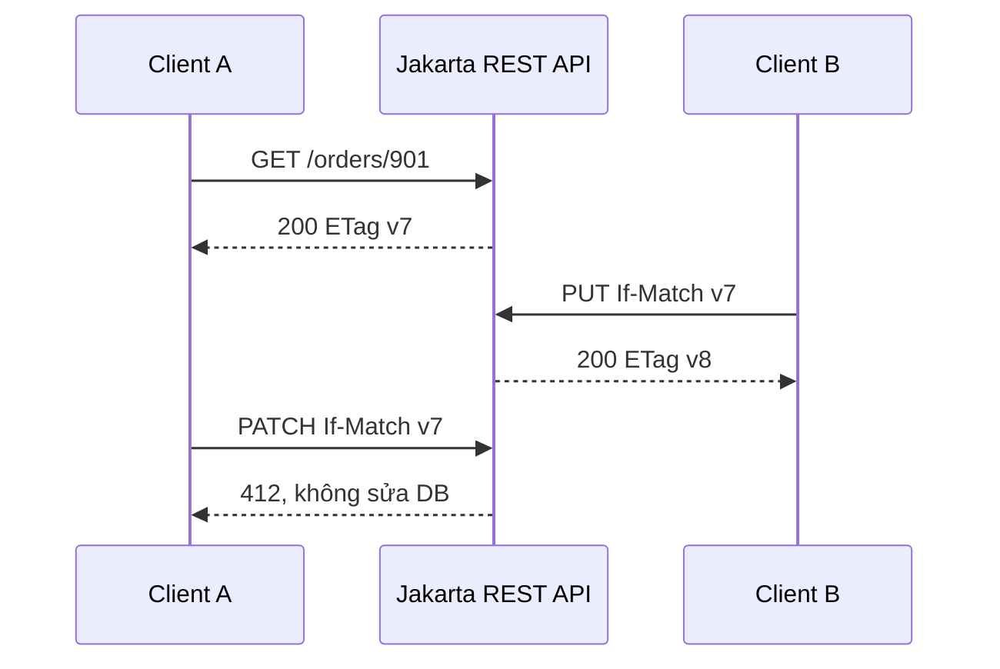

# @Path, @GET, @POST, @PUT, @PATCH và @DELETE

Trong API đơn hàng, `GET`, `POST`, `PUT`, `PATCH` và `DELETE` thao tác trên `/api/orders` hoặc `/api/orders/{id}`. Jakarta REST ánh xạ URI và HTTP method vào Java method; hợp đồng còn quy định dữ liệu, status, phân quyền, cập nhật đồng thời và retry.

Bài thuộc chương **Jakarta REST** của module **INTEGRATION_API_REST**, học thiết kế REST API dựa trên resource, URI, phương thức và mã trạng thái HTTP, cùng hợp đồng dữ liệu, idempotency, cache, OpenAPI, xác thực, phân quyền, xử lý lỗi và kiểm thử. Ví dụ dùng Java 17 và Jakarta REST trên Jakarta EE/Jersey/RESTEasy tương thích; đối chiếu ngắn với Spring MVC. Tên thư viện và bootstrap cụ thể cần được điều chỉnh theo Jakarta REST runtime và phiên bản ứng dụng đang sử dụng.

**Mục tiêu:** sau bài, người học phân biệt trách nhiệm từng annotation, thiết kế đúng ngữ nghĩa HTTP, triển khai resource đa tenant an toàn và viết kiểm thử không chỉ xác nhận route mà còn kiểm tra side effect/response.

## 1. Jakarta REST nằm ở đâu trong ứng dụng Java?

Jakarta RESTful Web Services (thường gọi **Jakarta REST**, trước đây là JAX-RS) là API tiêu chuẩn cho tài nguyên HTTP. Lập trình viên dùng `jakarta.ws.rs.*` để mô tả resource, còn **runtime/implementation** như Jersey, RESTEasy hoặc RESTEasy Reactive cung cấp cơ chế nhận request, tìm resource method, deserialize entity, invoke và serialize response.

| Thành phần | Vai trò |
|---|---|
| `@ApplicationPath`, `Application` | Khai báo gốc URI và cấu hình ứng dụng Jakarta REST |
| `@Path` | Định danh resource bằng URI template |
| `@GET`, `@POST`, `@PUT`, `@PATCH`, `@DELETE` | Gắn **HTTP request method** với Java method |
| `@Consumes` / `@Produces` | Định dạng body có thể **nhận** / **trả** |
| `@PathParam`, `@QueryParam`, `@HeaderParam`, `@Context` | Bind thành phần request, lấy context |
| `Response` / `EntityTag` / `Request` / `UriInfo` | Xây status/headers/body, validator, precondition và URI |
| `ExceptionMapper`, `ContainerRequestFilter` | Chuẩn hóa lỗi và xử lý bảo mật/chính sách trước resource |

Ví dụ bootstrap trong ứng dụng Jakarta EE:

```java
import jakarta.ws.rs.ApplicationPath;
import jakarta.ws.rs.core.Application;

@ApplicationPath("/api")
public class RestApplication extends Application {
    // Runtime có thể tự phát hiện các resource/provider.
}
```

Với cấu hình này và ứng dụng được triển khai ở context root thích hợp, `@Path("/orders")` ánh xạ dưới `/api/orders`. **Context root, URL đầy đủ, component scan và CDI integration phụ thuộc runtime/server**; không mặc định copy ví dụ sang một Spring Boot app là có endpoint Jakarta REST chạy ngay. Spring MVC có hệ thống mapping riêng.

## 2. @Path: resource URI, path và query

`@Path` trên class xác định resource gốc; trên method xác định URI con hoặc *sub-resource locator*. Ví dụ:
 
```java
import jakarta.ws.rs.*;
import jakarta.ws.rs.core.MediaType;
import java.util.List;

@Path("/orders")
@Produces(MediaType.APPLICATION_JSON)
public class OrderReadResource {
    private OrderService orders; // Cần CDI/constructor injection thật.

    @GET
    public List<OrderView> list(
            @QueryParam("status") String status,
            @DefaultValue("20") @QueryParam("size") int size) {
        return orders.searchAuthorized(status, size);
    }

    @GET
    @Path("/{orderId}")
    public OrderView get(@PathParam("orderId") String id) {
        return orders.readAuthorized(id);
    }
}
```

`GET /api/orders` gọi `list`; `GET /api/orders/ord-901` gọi `get`. Dùng path cho **định danh resource**, query cho lọc/phân trang; service phải lấy tenant/actor từ security context đã xác minh, không tin ID một mình. Method trên chỉ minh họa mapping, **chưa** có dependency/auth đầy đủ (xem mục 4 và 8).

`@Path("/orders/{id}/items")` **không kèm HTTP method annotation** có thể là sub-resource locator trả về object resource để runtime tiếp tục mapping, không phải GET ngầm định. Tránh URL hành động kiểu `/cancelOrder` nếu có thể biểu diễn thao tác nghiệp vụ thành resource như `POST /orders/{id}/cancellations`. Regex trong URI template là khả năng có sẵn nhưng cần tránh cấu trúc mơ hồ giữa đường dẫn tĩnh và động.

## 3. Năm phương thức HTTP và tác dụng nghiệp vụ

| Annotation | Ý nghĩa | Safe? | Idempotent theo HTTP? | Thành công thường gặp |
|---|---|---|---|---|
| `@GET` | Đọc representation | Có | Có | 200, 304 có điều kiện |
| `@POST` | Tạo thành viên collection/xử lý yêu cầu | Không | Không mặc định | 201, 200, 202 |
| `@PUT` | Tạo/thay thế trạng thái resource tại URI đích | Không | Có | 200, 201, 204 |
| `@PATCH` | Áp dụng tập thay đổi lên resource | Không | Không mặc định | 200, 204 |
| `@DELETE` | Xóa liên kết tài nguyên theo hợp đồng | Không | Có | 200, 202, 204 |

GET có thể ghi access log nhưng không được tạo tác dụng nghiệp vụ mà client không yêu cầu. Idempotent mô tả **hiệu quả dự kiến**, không bắt buộc các response giống nhau hay event/email ngoài DB được gửi chính xác một lần.

**GET** đọc chi tiết, có thể trả ETag để client áp dụng preconditions:
 
```http
GET /api/orders/ord-901 HTTP/1.1
Authorization: Bearer <access_token>
Accept: application/json

HTTP/1.1 200 OK
ETag: "order-v7"
Content-Type: application/json
Cache-Control: private, no-store

{"id":"ord-901","status":"PENDING","version":7}
```

**POST** tạo thành viên collection và báo resource vừa tạo:
 
```http
POST /api/orders HTTP/1.1
Authorization: Bearer <access_token>
Idempotency-Key: e428b48c-4a09-41e0-a234-98b5c2dc7c13
Content-Type: application/json

{"sku":"sku-42","quantity":2}

HTTP/1.1 201 Created
Location: /api/orders/ord-902
Content-Type: application/json

{"id":"ord-902","status":"PENDING"}
```

`Idempotency-Key` là cơ chế **hợp đồng bổ sung**, không phải điều Jakarta REST tự thực thi. Khi xử lý bất đồng bộ, POST có thể trả 202 kèm URI theo dõi thay vì tuyên bố đã xong.

**PUT** thay thế representation ở `/orders/{id}`; API cần định nghĩa **đầy đủ trường có thể thay thế**. PUT idempotent không ngăn hai client ghi đè nhau, nên endpoint quan trọng cần `If-Match`/ETag và atomic CAS. Nếu precondition sai trả 412; thiếu mà bắt buộc trả 428. PUT tạo resource chưa có hay không tùy chính sách cấp URI.

**PATCH** thay đổi một phần:
 
```http
PATCH /api/orders/ord-902 HTTP/1.1
Authorization: Bearer <access_token>
If-Match: "order-v8"
Content-Type: application/json

{"shippingNote":"Giao sau 18h"}
```

Ở đây JSON là **DTO lệnh riêng** chỉ đổi `shippingNote`, không phải chuẩn JSON Patch (RFC 6902) hoặc JSON Merge Patch (RFC 7396). Nếu khai báo media type chuyên dụng, phải thực thi đúng semantics của chuẩn đó. `@PATCH` sẵn có trong các phiên bản Jakarta REST hiện đại như 3.1; nếu API/runtime cũ thiếu, có thể định nghĩa annotation với `@HttpMethod("PATCH")` theo khả năng provider và kiểm thử dispatch.

**DELETE** thường trả 204 không có body khi xóa hoàn tất theo hợp đồng, hoặc 202 nếu cleanup chạy nền. Retry có thể trả 204, 404 hoặc 410 theo thiết kế mà vẫn idempotent về hiệu quả. Nếu có `If-Match`, xóa với validator cũ phải bị từ chối khi precondition sai; không gửi lại tác dụng ngoài DB mù quáng.

## 4. Resource Jakarta REST: một mẫu Java xuyên suốt

Ví dụ dùng Jakarta REST 3.1+ cho `@PATCH`, CDI và Bean Validation. Những interface `OrderService` và DTO là **thành phần dự án phải viết**, không có sẵn trong framework. Mục đích minh họa đường đi từ annotations đến HTTP status và response.

```java
import jakarta.inject.Inject;
import jakarta.validation.Valid;
import jakarta.ws.rs.*;
import jakarta.ws.rs.core.*;

@Path("/orders")
@Consumes(MediaType.APPLICATION_JSON)
@Produces(MediaType.APPLICATION_JSON)
public class OrderResource {
    @Inject
    OrderService orders;

    @POST
    public Response create(
            @Valid CreateOrderRequest body,
            @HeaderParam("Idempotency-Key") String key,
            @Context UriInfo uriInfo,
            @Context SecurityContext security) {
        String actor = requireActor(security);
        OrderView created = orders.createAuthorized(actor, key, body);
        java.net.URI location = uriInfo.getAbsolutePathBuilder()
            .path(created.id()).build();
        return Response.created(location).entity(created).build();
    }

    @GET
    @Path("/{id}")
    public Response get(
            @PathParam("id") String id,
            @Context SecurityContext security,
            @Context Request request) {
        OrderView visible = orders.readAuthorized(
            requireActor(security), id);
        EntityTag etag = new EntityTag("order-v" + visible.version());
        Response.ResponseBuilder cached = request.evaluatePreconditions(etag);
        if (cached != null) return cached.tag(etag).build();
        return Response.ok(visible).tag(etag)
            .header("Cache-Control", "private, no-store").build();
    }

    @PUT
    @Path("/{id}")
    public Response replace(
            @PathParam("id") String id,
            @HeaderParam("If-Match") String ifMatch,
            @Valid ReplaceOrderRequest body,
            @Context SecurityContext security) {
        requireIfMatch(ifMatch);
        OrderView updated = orders.replaceIfMatch(
            requireActor(security), id, ifMatch, body);
        return Response.ok(updated)
            .tag(new EntityTag("order-v" + updated.version())).build();
    }

    @PATCH
    @Path("/{id}")
    public Response patch(
            @PathParam("id") String id,
            @HeaderParam("If-Match") String ifMatch,
            @Valid EditOrderNoteRequest body,
            @Context SecurityContext security) {
        requireIfMatch(ifMatch);
        OrderView updated = orders.updateNoteIfMatch(
            requireActor(security), id, ifMatch, body);
        return Response.noContent()
            .tag(new EntityTag("order-v" + updated.version())).build();
    }

    @DELETE
    @Path("/{id}")
    public Response delete(
            @PathParam("id") String id,
            @HeaderParam("If-Match") String ifMatch,
            @Context SecurityContext security) {
        requireIfMatch(ifMatch);
        orders.deleteIfMatch(requireActor(security), id, ifMatch);
        return Response.noContent().build();
    }

    private static String requireActor(SecurityContext context) {
        if (context == null || context.getUserPrincipal() == null) {
            throw new NotAuthorizedException("Bearer");
        }
        return context.getUserPrincipal().getName();
    }

    private static void requireIfMatch(String tag) {
        if (tag == null || tag.isBlank()) {
            throw new WebApplicationException(
                "If-Match header is required", 428);
        }
    }
}
```

**Trước sản xuất phải bảo đảm:**

- Service kiểm **tenant và quyền từng order** từ danh tính đã xác thực; `requireActor` chỉ kiểm principal, không tự xác minh JWT.
- Kiểm `If-Match` theo strong ETag và **CAS nguyên tử**; sai điều kiện trả 412, không SELECT rồi UPDATE vô điều kiện.
- ETag phản ánh representation đúng role/format; weak tag không strong-match. Parser danh sách tags/`*` phải tuân theo hợp đồng HTTP.
- POST dùng cùng Idempotency-Key cho cùng ý định, key trùng payload khác báo lỗi; DELETE/retry không gửi trùng tác dụng ngoài DB.
- Cấu hình CDI, JSON provider, Jakarta Validation, security và xác minh runtime có hỗ trợ `@PATCH`.

### 4.1. DTO với Jakarta Bean Validation

```java
import jakarta.validation.constraints.*;

public record CreateOrderRequest(
    @NotBlank String sku,
    @NotNull @Positive Integer quantity
) {}

public record ReplaceOrderRequest(
    @NotBlank String sku,
    @NotNull @Positive Integer quantity,
    String shippingNote
) {}

public record EditOrderNoteRequest(
    @NotBlank String shippingNote
) {}

public record OrderView(
    String id, String sku, int quantity,
    String shippingNote, String status, long version
) {}
```

Các `public record` cần được đặt trong **file .java riêng** hoặc tổ chức lại theo quy tắc Java, không dán bốn public top-level types vào cùng một file. `@Valid` đánh dấu entity parameter cần kiểm tra; nếu Jakarta Bean Validation integration được bật, request vi phạm thường có phản hồi 400 trong ứng dụng được cấu hình phù hợp. Phải kiểm thử mapping thực tế của runtime, không coi lỗi từ constraint là HTTP 400 tự động trong mọi environment.

## 5. @Consumes, @Produces và bind request

`@Consumes(MediaType.APPLICATION_JSON)` chỉ định format request entity có thể đọc; `@Produces(MediaType.APPLICATION_JSON)` là response representation có thể tạo. Có thể đặt ở class và override theo method.

| Đầu vào | Hành vi điển hình |
|---|---|
| POST `Content-Type: text/plain` khi chỉ consume JSON | **415 Unsupported Media Type** |
| GET `Accept: application/xml` khi chỉ produce JSON | **406 Not Acceptable** |
| URI đúng nhưng HTTP method không hỗ trợ | **405 Method Not Allowed**, kèm `Allow` phù hợp |
| JSON sai cú pháp/kiểu | Thường **400** ở message body provider |
| DTO vi phạm Bean Validation | **400** theo contract/cấu hình validation |

`@PathParam` bind biến URI; `@QueryParam` bind query; `@HeaderParam` bind header; `@Context` nhận runtime context. Tham số entity (như `CreateOrderRequest`) không cần `@RequestBody` kiểu Spring MVC: JSON provider đọc body theo `@Consumes`.

Giới hạn body size/collection ở gateway/container/provider: `@Valid` thường chạy **sau parse**, không thay chống DoS. Không dùng cách nối raw string để trả JSON hoặc log toàn bộ body có token/PII.

## 6. ETag, If-Match và cập nhật nguyên tử

Hai client đọc ETag `"order-v7"`. Minh PUT thành công thành v8; Lan PATCH với `If-Match: "order-v7"` phải nhận **412**, không ghi đè.



Jakarta REST hỗ trợ `Request.evaluatePreconditions(EntityTag)` cho conditional GET; khi `If-None-Match` khớp có thể trả **304**, không có body:
 
```java
EntityTag tag = new EntityTag("order-v" + visible.version());
Response.ResponseBuilder rb = request.evaluatePreconditions(tag);
if (rb != null) return rb.tag(tag).build();
return Response.ok(visible).tag(tag).build();
```

Phải **kiểm quyền và chọn representation đúng actor/tenant trước** khi đánh giá ETag. Một token `"order-vN"` chỉ hợp lệ nếu version phản ánh representation; `If-Match` dùng **strong comparison**, không coi `W/"..."` là bằng strong tag.

Đối với mutation, điều kiện và update phải **nguyên tử**:
 
```sql
UPDATE orders SET shipping_note = :note, version = version + 1
WHERE id = :id AND tenant_id = :verified_tenant_id
  AND version = :expected_version AND status = 'PENDING'
RETURNING id, version;
```

Nếu 0 row: cần phân loại ngoài quyền/không tồn tại (403/404), If-Match cũ (412) hoặc business state conflict (409), không tự trả 412 cho mọi lỗi. Nếu API buộc dùng precondition mà header thiếu, chọn **428**. `@PUT`/`@PATCH` tự nó không chống lost update.

## 7. Mã HTTP theo kết quả thực tế

| Status | Dùng khi |
|---|---|
| **200/201/202/204** | Đọc/cập nhật thành công; mới tạo + Location; nhận xử lý nền; thành công không body |
| **304** | Conditional GET chưa thay đổi representation |
| **400** | JSON/tham số sai, input validation theo contract |
| **401/403/404** | Chưa xác thực + challenge; thiếu quyền; không tồn tại hoặc che giấu |
| **405/406/415** | Sai method; Accept không thể đáp ứng; Content-Type không hỗ trợ |
| **409** | Xung đột trạng thái nghiệp vụ hiện tại |
| **412/428** | If-Match sai; thiếu precondition bắt buộc |

Không trả 200 với `"success": false` cho một lỗi thực sự; không gửi body kèm 204. `401` với Bearer cần `WWW-Authenticate` phù hợp. API có thể chọn `422` cho một số đầu vào hợp lệ cú pháp nhưng không xử lý được; cần nhất quán giữa code, OpenAPI và SDK.

## 8. Bảo mật: @Path không tự cấp quyền

Một route `GET /orders/{id}` có thể đúng mapping mà vẫn rò order tenant khác. Thiết kế bảo vệ gồm: **(1)** xác thực token/credential ở runtime/gateway; **(2)** authorization coarse-grained theo action/scope; **(3)** service tra cứu/cập nhật theo actor + tenant/membership đã xác minh; **(4)** kiểm tra domain state và DB transaction; **(5)** kiểm soát cache/log/response error.

`SecurityContext` cho biết principal/role theo tích hợp runtime; nó **không tự kiểm JWT**. `@RolesAllowed` (`jakarta.annotation.security`) chỉ có hiệu lực khi môi trường thực thi security annotations và mapping role đúng. Không cho rằng JWT scope `orders:write` tự biến thành role đó. URI ID khó đoán cũng không thay ownership check.

### 8.1. ContainerRequestFilter

`ContainerRequestFilter` dùng cho tracing, bảo mật/chính sách khi được cấu hình. Ví dụ kiểm tra request ID, **không phải JWT filter**:

```java
import jakarta.annotation.Priority;
import jakarta.ws.rs.Priorities;
import jakarta.ws.rs.container.*;
import jakarta.ws.rs.ext.Provider;
import java.io.IOException;

@Provider
@Priority(Priorities.AUTHENTICATION)
public class RequestIdGuard implements ContainerRequestFilter {
    @Override
    public void filter(ContainerRequestContext context) throws IOException {
        String id = context.getHeaderString("X-Request-ID");
        if (id != null && id.length() > 128) {
            context.abortWith(jakarta.ws.rs.core.Response.status(400).build());
        }
    }
}
```

`@PreMatching` cho phép filter chạy trước resource matching nếu cần, nhưng lúc đó chưa có thông tin handler đích. Đừng tự viết một bộ xử lý Bearer token thiếu kiểm tra chữ ký/issuer/audience/expiry và scope; nên dùng integration bảo mật được kiểm chứng.

**Tenant isolation:** actor A gọi URI order tenant B phải nhận 403/404 theo policy, **không** nhận body, ETag hay business state của B. Ràng buộc tenant trong truy vấn CAS/DELETE. Với dữ liệu nhạy cảm dùng `Cache-Control: no-store` hoặc cache policy theo quyền, không ghi log raw token, cookie, PII. CORS chỉ kiểm soát browser, không thay authorization server.

## 9. ExceptionMapper và Problem Details

Jakarta REST có `ExceptionMapper<T>` để ánh xạ exception thành `Response`; không dùng Spring `@RestControllerAdvice` trong một Jakarta REST runtime thuần.

```java
import jakarta.ws.rs.core.*;
import jakarta.ws.rs.ext.ExceptionMapper;
import jakarta.ws.rs.ext.Provider;
import java.util.Map;

@Provider
public class OrderConflictMapper
        implements ExceptionMapper<OrderStateConflictException> {
    @Override
    public Response toResponse(OrderStateConflictException error) {
        Map<String, Object> problem = Map.of(
            "type", "https://api.example.com/problems/order-state-conflict",
            "title", "Order state conflict",
            "status", 409,
            "code", "ORDER_STATE_CONFLICT");
        return Response.status(Response.Status.CONFLICT)
            .type("application/problem+json")
            .header("Cache-Control", "no-store")
            .entity(problem)
            .build();
    }
}
```

`OrderStateConflictException` là domain exception do ứng dụng định nghĩa. Map được JSON provider serialize, nên phải bảo đảm runtime có provider phù hợp. `type/title/status` là thành phần chuẩn RFC 9457, còn `code` là extension do API định nghĩa.

**Thứ tự xử lý:** exception từ code resource, converter, Bean Validation hoặc filter có thể được runtime ánh xạ bằng các mapper/built-in handlers khác nhau. Không bắt bừa mọi exception rồi trả 400/409: lỗi lập trình, DB unavailable và lỗi serialize cần 5xx đã được làm sạch, log correlation ID nhưng không lộ stack trace. Với lỗi auth trước Jakarta REST runtime (gateway/servlet/security), `ExceptionMapper` có thể không được gọi; cần thống nhất error contract giữa các lớp.

## 10. Đối chiếu với Spring MVC

| Mục đích | Jakarta REST | Spring MVC |
|---|---|---|
| Resource class | `@Path("/orders")` | `@RestController @RequestMapping("/orders")` |
| HTTP methods | `@GET/@POST/@PUT/@PATCH/@DELETE` | `@GetMapping/@PostMapping/@PutMapping/@PatchMapping/@DeleteMapping` |
| URI/query/header | `@PathParam/@QueryParam/@HeaderParam` | `@PathVariable/@RequestParam/@RequestHeader` |
| Body JSON | Entity parameter + JSON provider | `@RequestBody` + HttpMessageConverter |
| Content negotiation | `@Consumes/@Produces` | `consumes/produces` |
| Response/error | `Response` / `ExceptionMapper` | `ResponseEntity` / `@RestControllerAdvice` |
| Auth | `SecurityContext` + runtime integration | Spring Security principal + service policy |

Ví dụ Spring cho GET và POST:
 
```java
import java.net.URI;
import org.springframework.http.ResponseEntity;
import org.springframework.web.bind.annotation.*;

@RestController
@RequestMapping("/api/orders")
class SpringOrderController {
    private final SpringOrderService service;
    SpringOrderController(SpringOrderService service) {
        this.service = service;
    }

    @GetMapping("/{id}")
    OrderView get(@PathVariable String id) {
        return service.readAuthorized(id);
    }

    @PostMapping
    ResponseEntity<OrderView> create(@RequestBody CreateOrderRequest body) {
        OrderView o = service.createAuthorized(body);
        return ResponseEntity.created(
            URI.create("/api/orders/" + o.id())).body(o);
    }
}
```

Mã trên chỉ đối chiếu **annotations**, chưa thể hiện principal/tenant security, DTO validation hay Idempotency-Key. Production phải bổ sung vào Spring Security + service. Không giả định Spring MVC tự hiểu Jakarta REST resource chỉ vì cả hai đều dùng Java annotations.

## 11. Mô tả năm HTTP methods trong OpenAPI

Java annotations không tự mô tả đủ request/response schema, security, errors và retry. OpenAPI 3.1 rút gọn cho cùng resource:
 
```yaml
openapi: 3.1.0
info: { title: Orders API, version: 1.0.0 }
paths:
  /api/orders:
    post:
      security: [{ bearerAuth: [] }]
      parameters:
        - name: Idempotency-Key
          in: header
          required: true
          schema: { type: string }
      requestBody:
        required: true
        content:
          application/json:
            schema: { $ref: "#/components/schemas/CreateOrder" }
      responses:
        "201":
          description: Created
          headers:
            Location: { schema: { type: string } }
        "409": { description: Conflict }
  /api/orders/{id}:
    parameters:
      - name: id
        in: path
        required: true
        schema: { type: string }
    get:
      responses:
        "200": { description: Order JSON, with ETag }
        "304": { description: Not modified }
    put:
      parameters:
        - $ref: "#/components/parameters/IfMatch"
      responses:
        "200": { description: Replaced }
        "412": { description: Stale validator }
    patch:
      parameters:
        - $ref: "#/components/parameters/IfMatch"
      responses:
        "204": { description: Note updated }
        "409": { description: State conflict }
        "412": { description: Stale validator }
    delete:
      parameters:
        - $ref: "#/components/parameters/IfMatch"
      responses:
        "204": { description: Deleted }
        "412": { description: Stale validator }
components:
  securitySchemes:
    bearerAuth: { type: http, scheme: bearer }
  parameters:
    IfMatch:
      name: If-Match
      in: header
      required: true
      schema: { type: string }
  schemas:
    CreateOrder:
      type: object
      required: [sku, quantity]
      properties:
        sku: { type: string }
        quantity: { type: integer, minimum: 1 }
```

Đây là **khung minh họa**, không phải bản OpenAPI sẵn sàng phát hành: cần thêm 401/403/404/415/428, `WWW-Authenticate`, `application/problem+json`, response body/schema, requestBody PUT/PATCH, các rules `If-Match`, Idempotency-Key và security cho từng method. Nếu PATCH chỉ nhận DTO `shippingNote` qua `application/json`, phải ghi đúng semantics đó, không quảng bá JSON Merge Patch khi chưa hỗ trợ. Contract test cần kiểm tra spec khớp response thực.

## 12. Kiểm thử qua runtime HTTP thật

Test gọi trực tiếp Java method không chứng minh `@Path`, `@PATCH`, JSON provider hay media type negotiation hoạt động. Có thể dùng Jersey/RESTEasy test framework hoặc HTTP integration test kết hợp JUnit, REST Assured/Java HttpClient và database thật.

| Nhóm | Tình huống | Điều phải assert |
|---|---|---|
| Mapping | GET list/detail, POST, PUT, PATCH, DELETE | Đúng method/URI, status, headers và **DB effect** |
| Negotiation | POST text/plain; GET chỉ Accept XML; method sai | 415/406/405 (Allow), không ghi DB |
| Validation | JSON hỏng, quantity âm | 400 theo hợp đồng, không tạo order |
| ETag | GET If-None-Match; PUT/PATCH If-Match cũ | 304 không body; 412 không sửa DB |
| Preconditions | Không gửi If-Match khi bắt buộc | 428, không ghi |
| Concurrency | Hai PATCH cùng version | CAS chỉ một thành công, không mất update |
| Idempotency | POST cùng key/body lặp và chạy song song | Chỉ một order; key trùng khác body bị chặn |
| Security | Không token, thiếu scope, tenant A đọc order B | 401/403/404, không lộ body/ETag/tenant |
| Errors | Domain state conflict, storage failure | 409 Problem Details; 5xx không lộ SQL/stack |
| Retry | DELETE lặp, provider/event giao lại | Không tái tạo tác dụng phụ ngoài DB |

### 12.1. Ví dụ JUnit với Java HttpClient

Giả định test harness đã chạy ứng dụng trên localhost và cấp token/fixture hợp lệ. Test ở tầng HTTP độc lập Jakarta REST implementation:
 
```java
import static org.junit.jupiter.api.Assertions.*;
import java.net.URI;
import java.net.http.*;
import org.junit.jupiter.api.Test;

class OrderHttpContractTest {
    HttpClient client = HttpClient.newHttpClient();
    String base = "http://localhost:8080/api";
    String token = "TEST_TOKEN_FROM_FIXTURE";

    @Test
    void postCreatesResource() throws Exception {
        HttpRequest req = HttpRequest.newBuilder(URI.create(base + "/orders"))
            .header("Authorization", "Bearer " + token)
            .header("Content-Type", "application/json")
            .header("Idempotency-Key", "order-test-intent-901")
            .POST(HttpRequest.BodyPublishers.ofString(
                "{\"sku\":\"sku-42\",\"quantity\":2}"))
            .build();

        HttpResponse<String> response =
            client.send(req, HttpResponse.BodyHandlers.ofString());

        assertEquals(201, response.statusCode());
        assertTrue(response.headers().firstValue("Location").isPresent());
        assertTrue(response.body().contains("\"id\""));
        // Kiểm thêm DB: đúng tenant, đúng một order.
    }
}
```

Token trong code là **placeholder**, không phải bearer token dùng thật. Cần test integration security/JSON provider được cấu hình đúng; test cạnh tranh dùng transaction/database thật, không chỉ mock repository. Assert cả `Location`, `ETag`, `WWW-Authenticate`, cache headers, response schema và business side effects.

## 13. Các phản mẫu cần tránh

- Dùng `@POST` cho cả đọc/xóa; dùng GET để kích hoạt thay đổi trạng thái.
- Coi `@Path` tự quyết định HTTP method; nhầm `@PUT` toàn phần với `@PATCH`.
- Quảng bá media type JSON Merge Patch nhưng code chỉ nhận DTO lệnh tùy ý.
- Trả 200 cho mọi tình huống, nhầm 201/202/204, hoặc gửi body cùng 204.
- Gửi `If-Match` nhưng service chỉ SELECT rồi UPDATE không có version CAS.
- Cho rằng PUT/DELETE idempotent đồng nghĩa email/payment ngoài DB không lặp.
- Chỉ dùng `@RolesAllowed` mà không kiểm runtime enforcement/tenant ownership.
- Trả lỗi 400/409 cho mọi exception và lộ SQL/stack trace.
- Giả định Spring MVC tự hiểu Jakarta REST annotation mà không có integration.
- Chỉ unit test Java method rồi kết luận routing/security/media types đã đúng.

## 14. Bài tập: API sản phẩm đa tenant

Thiết kế `/api/products` và `/api/products/{id}` cho SaaS. `POST` tạo sản phẩm SKU/price, trả 201 + Location và chống trùng retry; `GET` đọc danh sách/chi tiết với ETag; `PUT` thay dữ liệu đầy đủ, `PATCH` chỉ đổi price, `DELETE` xóa mềm. PUT/PATCH/DELETE yêu cầu `If-Match`; hai client có thể sửa đồng thời, tenant B không được truy cập dữ liệu A.

**Yêu cầu:** (1) triển khai class `@Path` cùng năm HTTP annotations; (2) khai báo `@Consumes/@Produces`, body/path/query và status; (3) dùng authorization theo tenant + DB CAS; (4) dùng `ExceptionMapper` cho domain conflict; (5) mô tả OpenAPI 3.1 và phiên bản `@PATCH`; (6) viết tối thiểu 12 tests về 201/204/304/409/412/428, validation, wrong media type, retry, concurrency, tenant isolation.

**Gợi ý:** POST 201, GET 200/304, PATCH/DELETE 204, stale ETag 412, thiếu If-Match 428, business conflict 409, actor ngoài quyền 403/404. Annotation không tự bảo vệ quyền, transaction hay retry.

## 15. Checklist và nguồn tham khảo

- [ ] `@Path` ở class/method, path/query và sub-resource được thiết kế rõ.
- [ ] Dùng `@GET/@POST/@PUT/@PATCH/@DELETE` đúng HTTP safe/idempotent semantics.
- [ ] Kiểm tra Jakarta REST runtime/version, `@PATCH`, CDI, JSON và Bean Validation providers.
- [ ] `@Consumes/@Produces`, binding, status 201/202/204/304/405/406/415 đúng hợp đồng.
- [ ] ETag/If-Match, 412/428/409, CAS và POST idempotency được xử lý tại service/DB.
- [ ] Xác thực, quyền resource/tenant, cache, logging, Problem Details đều an toàn.
- [ ] OpenAPI và HTTP integration tests kiểm chứng method routing, response và side effects.

**Đối chiếu:** [Jakarta RESTful Web Services](https://jakarta.ee/specifications/restful-ws/), Jakarta Validation, [RFC 9110 — HTTP Semantics](https://www.rfc-editor.org/rfc/rfc9110.html), [RFC 9457 — Problem Details](https://www.rfc-editor.org/rfc/rfc9457.html), [OpenAPI 3.1](https://spec.openapis.org/oas/v3.1.0). Đọc tài liệu provider cụ thể (Jersey, RESTEasy/Jakarta EE) để xác nhận hỗ trợ `@PATCH`, JSON, security.

**Điểm cần nhớ:** **`@Path` xác định URI; `@GET/@POST/@PUT/@PATCH/@DELETE` xác định HTTP operation.** API đáng tin còn cần media types, status/headers, bảo mật tenant, conditional requests, transaction và test qua HTTP runtime thực; annotations không tự mang những bảo đảm đó.
