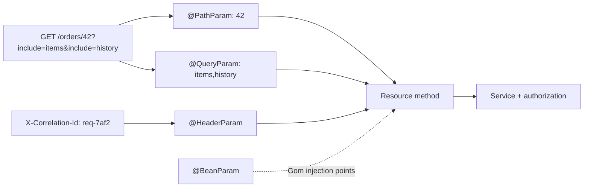

# @PathParam, @QueryParam, @HeaderParam và @BeanParam

> **Chương:** Jakarta REST  
> **Module:** `INTEGRATION_API_REST` — học thiết kế REST API theo resource, URI, phương thức và mã trạng thái HTTP, với hợp đồng dữ liệu rõ ràng; thực hành phân trang, cache, idempotency, OpenAPI, xác thực, phân quyền, xử lý lỗi và kiểm thử bằng Java/Spring hoặc công nghệ tương đương.

Hãy xét một lời gọi:

```http
GET /api/orders/42?include=items&include=history HTTP/1.1
Host: api.example.test
Authorization: Bearer <token>
Accept: application/json
X-Correlation-Id: req-7af2
```

Server cần đọc **ID 42** từ path, các giá trị **include** từ query, và **X-Correlation-Id** từ header; đồng thời không được tin header tự gửi để quyết định danh tính. Trong Jakarta REST (Jakarta RESTful Web Services, còn được gọi là JAX-RS), ba nhu cầu đó lần lượt được khai báo bằng `@PathParam`, `@QueryParam` và `@HeaderParam`. Khi một operation có nhiều filter, phân trang và header, `@BeanParam` gom các tham số có nguồn khác nhau vào một đối tượng để tránh method signature quá dài.

Bài dùng Jakarta REST 3.x và API đơn hàng để giải thích nguồn input, conversion, HTTP semantics và bảo mật; cuối bài đối chiếu Spring MVC/Jersey, OpenAPI 3.1 và kiểm thử runtime.

## Mục tiêu học tập

Sau bài này, bạn có thể:

1. Xác định khi nào dùng `@PathParam`, `@QueryParam`, `@HeaderParam` hoặc `@BeanParam`; không nhầm các nguồn này với JSON request body.
2. Khai báo URI templates, query filters/pagination và header nghiệp vụ rõ ràng, bao gồm kiểu, giá trị mặc định và trường hợp vắng.
3. Giải thích injection/conversion của Jakarta REST, tham số lặp, mã lỗi khi URI/query không hợp lệ và ảnh hưởng của encoding.
4. Dùng `@BeanParam` để gom các input có liên quan, kết hợp Jakarta Bean Validation mà không lẫn với service/domain validation.
5. Đảm bảo xác thực, phân quyền tài nguyên, chống injection và tính đúng đắn của header điều kiện/idempotency.
6. Ánh xạ hợp đồng sang Spring MVC tương đương và OpenAPI 3.1; thực hành kiểm thử HTTP thật.
7. Tránh các lỗi phổ biến khi đổi từ `javax.ws.rs` sang `jakarta.ws.rs` hoặc trộn Jakarta REST với Spring MVC.

## 1. Ba nguồn HTTP và @BeanParam



| Annotation | Nguồn | Ví dụ |
| --- | --- | --- |
| `@PathParam("orderId")` | URI template của `@Path` | `/orders/42` |
| `@QueryParam("include")` | Query string | `?include=items&include=history` |
| `@HeaderParam("X-Correlation-Id")` | Request header | `X-Correlation-Id: req-7af2` |
| `@BeanParam` | Tập hợp injection points vào bean | `OrderSearchParams` |

Các annotation thuộc `jakarta.ws.rs`. `@BeanParam` **không parse JSON body**: POST thường nhận JSON bằng entity parameter riêng với `@Consumes("application/json")`.

## 2. @PathParam: URI template và resource identity

```java
import jakarta.ws.rs.*;
import jakarta.ws.rs.core.*;

@Path("/orders")
@Produces(MediaType.APPLICATION_JSON)
public class OrderResource {
    @GET
    @Path("/{orderId}")
    public Response get(@PathParam("orderId") long orderId) {
        // Service kiểm tra quyền sở hữu/tenant trước khi trả đơn.
        return Response.ok().build();
    }
}
```

`GET /orders/42` inject `42`. Tên `orderId` **phải khớp** `{orderId}` trong template. Với `/customers/{customerId}/orders/{orderId}`, có thể inject cả hai ID, nhưng **client cung cấp ID không chứng minh** chúng thuộc cùng customer hoặc caller có quyền. Service vẫn phải kiểm tra principal/tenant.

Có thể dùng `@Path("/{orderId:[0-9]+}")` để giới hạn route số; `/orders/abc` không match thường là **404**. Lỗi convert sau khi match còn phụ thuộc runtime/mapper. Regex không thay kiểm tra overflow hoặc quy tắc miền ID.

Path values có thể được percent-decode; `@Encoded` tác động đến decoding. Encoded slash `%2F` và path normalization phụ thuộc proxy/container. Ưu tiên ID URL-safe (số, UUID), không double-decode hoặc ghép untrusted path param thành filesystem path.

## 3. @QueryParam: filter và phân trang

```java
@GET
@Path("/orders")
public Response list(
    @QueryParam("page") @DefaultValue("1") int page,
    @QueryParam("size") @DefaultValue("20") int size,
    @QueryParam("status") java.util.List<String> statuses) {
    // Validate page>=1, 1<=size<=100, status allowlist.
    return Response.ok().build();
}
```

```http
GET /orders?page=2&size=20&status=NEW&status=PAID HTTP/1.1
Accept: application/json
```

`List<String>` nhận các query parameters **lặp lại**. Không mặc định `status=NEW,PAID` tự tách thành hai giá trị: contract phải mô tả serialization và tests kiểm chứng.

| Request | Ý nghĩa |
| --- | --- |
| `/orders` | Dùng `@DefaultValue` hay bắt buộc page? |
| `?page=` | Giá trị rỗng; cần policy/kiểm thử. |
| `?page=abc` | Không convert được, thường 400. |
| `?page=0` | Convert được nhưng không hợp lệ theo miền. |

`@QueryParam` **không có `required=true`**. Nếu bắt buộc, dùng `Integer`/`@NotNull` khi Bean Validation integration phù hợp, hoặc boundary check. `@DefaultValue("1")` không thay `@Min(1)`. `sort/status` phải qua allowlist, parameterized queries; giới hạn page size và số filter để chống truy vấn nặng.

## 4. @HeaderParam: metadata, điều kiện và quyền

```java
@POST
@Path("/orders")
@Consumes(MediaType.APPLICATION_JSON)
public Response create(@HeaderParam("Idempotency-Key") String key,
                       CreateOrderRequest body) {
    // Body là entity parameter; service chống trùng theo principal+key.
    return Response.status(Response.Status.CREATED).build();
}
```

Tên header HTTP **không phân biệt hoa/thường**. `@HeaderParam` đọc dữ liệu, **không tự bắt buộc** header có mặt. `Idempotency-Key` thiếu/rỗng cần được validate theo contract; chống trùng thực sự cần scope theo principal/tenant, so payload fingerprint, lưu receipt và xử lý concurrent POST nguyên tử.

**`Authorization` không phải một string header tự xác thực.** Runtime security phải kiểm tra token, sau đó `@Context SecurityContext` cung cấp principal:

```java
@GET
@Path("/{orderId}")
public Response secureGet(@PathParam("orderId") long id,
                          @Context SecurityContext security) {
    if (security.getUserPrincipal() == null) {
        throw new NotAuthorizedException("Bearer");
    }
    // service.getVisible(security.getUserPrincipal().getName(), id)
    return Response.ok().build();
}
```

Role check không thay ACL từng order. `@Context HttpHeaders` phù hợp khi cần đọc nhiều headers.

### If-Match và ETag

```http
PUT /orders/42 HTTP/1.1
If-Match: "order-42-v3"
Content-Type: application/json

{"note":"Giao giờ hành chính"}
```

`@HeaderParam("If-Match") String tag` **chỉ nhận header**. Đánh giá precondition bằng `@Context Request`/`EntityTag`/`evaluatePreconditions` khi phù hợp, rồi update version bằng CAS/transaction ở DB để tránh lost update. Thiếu điều kiện bắt buộc có thể **428**; ETag stale **412**. Không tin `X-Forwarded-*`/`Host` chưa được gateway xác minh.

## 5. @BeanParam: gom nhiều nguồn vào một bean

Khi danh sách tham số dài:

```java
public Response list(
    @QueryParam("page") int page,
    @QueryParam("size") int size,
    @QueryParam("status") List<String> statuses,
    @HeaderParam("X-Correlation-Id") String correlationId,
    @HeaderParam("X-Client-Version") String version) { ... }
```

resource method khó đọc và tái sử dụng. `@BeanParam` cho phép tập hợp các injection points thành một object:

```java
import jakarta.ws.rs.*;
import jakarta.validation.constraints.*;
import java.util.List;

public class OrderSearchParams {

    @QueryParam("page")
    @DefaultValue("1")
    @Min(1)
    public int page;

    @QueryParam("size")
    @DefaultValue("20")
    @Min(1) @Max(100)
    public int size;

    @QueryParam("status")
    public List<String> statuses;

    @HeaderParam("X-Correlation-Id")
    public String correlationId;
}
```

Dùng trong resource:

```java
import jakarta.validation.Valid;
import jakarta.ws.rs.*;
import jakarta.ws.rs.core.*;

@Path("/orders")
@Produces(MediaType.APPLICATION_JSON)
public class OrdersResource {

    @GET
    public Response list(@Valid @BeanParam OrderSearchParams params,
                         @Context SecurityContext security) {

        String caller = requireCaller(security);
        // Service phải thực hiện ACL/filter đúng user.
        // statuses còn cần kiểm tra allowlist.
        return Response.ok().build();
    }

    private static String requireCaller(SecurityContext security) {
        if (security == null || security.getUserPrincipal() == null) {
            throw new NotAuthorizedException("Bearer");
        }
        return security.getUserPrincipal().getName();
    }
}
```

**Cơ chế:** Jakarta REST runtime tạo hoặc tiêm bean, đọc các trường/setter có annotation và inject các giá trị của **request hiện tại**. `@BeanParam` có thể dùng ở method parameter và các injection points được spec cho phép; phạm vi/lifecycle, cách tạo object và hỗ trợ constructor injection phụ thuộc runtime/CDI. Không tự giả định một immutable Java `record` có thể được inject như một mutable bean thông thường.

### @BeanParam KHÔNG làm được những gì?

- **Không đọc JSON body** thay cho entity parameter. `@BeanParam OrderSearchParams` chỉ gom các injection points đã khai báo trong bean (query/header/path/...), không phải converter JSON.
- **Không tự kiểm tra giới hạn** chỉ vì bean có `@Min`. Cần Bean Validation integration và annotation kích hoạt cascade phù hợp như `@Valid`, cùng test trên runtime thực.
- **Không tự xác thực client** vì có trường `correlationId` hoặc `clientVersion`. Chỉ dùng những header này cho mục đích đã công bố.
- **Không bảo đảm tính bất biến/thread-safety** nếu bean bị giữ trong singleton/resource field rồi dùng lại giữa các request. Tránh lưu request-specific bean vào shared mutable state.

### Khi BeanParam có cả @PathParam

Một bean có thể gom cả ID path và option query/header:

```java
public class OrderReadParams {
    @PathParam("orderId")
    public long orderId;

    @QueryParam("include")
    public List<String> includes;

    @HeaderParam("If-None-Match")
    public String ifNoneMatch;
}

@GET
@Path("/{orderId}")
public Response getOrder(@BeanParam OrderReadParams p) {
    // p.orderId / p.includes / p.ifNoneMatch
    return Response.ok().build();
}
```

Bean phải khớp với **resource method/path** nơi sử dụng. Đừng tái sử dụng một bean chứa `@PathParam("orderId")` ở endpoint không có biến `orderId` rồi trông chờ hệ thống biết phải làm gì. Tách `OrderSearchParams` và `OrderReadParams` nếu input thực tế khác nhau.

## 6. Chuyển kiểu parameter và lỗi conversion

Jakarta REST hỗ trợ nhiều kiểu thông dụng; `ParamConverterProvider` mở rộng cho kiểu miền riêng. Đừng giả định enum/`Instant` được convert cùng format trên mọi runtime. Có thể nhận `String sinceText` rồi parse có kiểm soát.

| Input | Điều cần phân biệt |
| --- | --- |
| `/orders/abc` với regex số | Không match thường 404; conversion phụ thuộc mapper/runtime. |
| `?page=abc` | Query conversion lỗi, thường 400. |
| `?page=-1` | Chuyển kiểu được, vi phạm constraint. |
| `?status=UNKNOWN` | Enum conversion hoặc allowlist error. |
| Header bắt buộc vắng | `String` có thể null; validate riêng. |
| `?include=items&include=history` | Collection cần nhận đúng hai phần tử. |

Jakarta REST/Jersey có exception mapping riêng, **không dùng Spring MVC exception classes** để chuẩn hóa lỗi ở đây. Có thể đăng ký `ExceptionMapper<T>` phù hợp với runtime.

## 7. Bean Validation và HTTP error contract

`@BeanParam` gom injection points; constraints như `@Min`/`@Max` **chỉ hoạt động** khi Jakarta Bean Validation được tích hợp và kích hoạt ở đúng điểm:

```java
public class PagingParams {
    @QueryParam("page") @DefaultValue("1") @Min(1)
    public int page;
    @QueryParam("size") @DefaultValue("20") @Min(1) @Max(100)
    public int size;
}

@GET
public Response list(@Valid @BeanParam PagingParams params) { /* ... */ }
```

Test `page=0`, `size=101`, `page=abc`. Conversion có thể lỗi **trước** validation; security filter có thể trả 401 sớm hơn cả hai. Không khẳng định một exception/status cho mọi runtime.

| Tình huống | HTTP phù hợp |
| --- | --- |
| Query/header sai kiểu hoặc ngoài miền | **400** theo contract phổ biến |
| Path không match | **404** |
| JSON body hỏng | **400**, do entity reader, không phải BeanParam |
| `Content-Type` sai / `Accept` không đáp ứng | **415 / 406** |
| Thiếu quyền | **401/403**, có thể 404 che tài nguyên |
| `If-Match` stale hoặc precondition bắt buộc vắng | **412 / 428** |
| Conflict với trạng thái nghiệp vụ | **409** |

Problem Details (RFC 9457) cho query lỗi có thể trả:

```http
HTTP/1.1 400 Bad Request
Content-Type: application/problem+json
Cache-Control: no-store

{"type":"https://api.example.test/problems/invalid-query",
 "title":"Invalid query parameter","status":400,
 "code":"INVALID_QUERY_PARAMETER",
 "errors":[{"in":"query","name":"size","code":"OUT_OF_RANGE"}]}
```

`code`/`errors` là extension fields, không được lộ raw input/token/PII. Một `ExceptionMapper` chỉ nên xử lý lỗi đã biết:

```java
import jakarta.ws.rs.core.*;
import jakarta.ws.rs.ext.*;
import java.util.Map;

final class InvalidPageException extends RuntimeException {}

@Provider
public class InvalidPageMapper
        implements ExceptionMapper<InvalidPageException> {
    @Override
    public Response toResponse(InvalidPageException ex) {
        return Response.status(400)
            .type("application/problem+json")
            .header("Cache-Control", "no-store")
            .entity(Map.of(
                "type","https://api.example.test/problems/invalid-query",
                "title","Invalid query parameter",
                "status",400,"code","INVALID_QUERY_PARAMETER"))
            .build();
    }
}
```

Cần JSON provider để serialize `Map`. Mapper này không tự xử lý mọi conversion exception của Jersey/RESTEasy; hãy test và đăng ký mapper riêng theo runtime. Không gộp `ExceptionMapper<Throwable>` để mọi lỗi thành 400.

## 8. HTTP semantics: đặt input đúng vị trí

| Ý nghĩa | Vị trí |
| --- | --- |
| Định danh resource | **Path:** `/orders/{orderId}` |
| Filter, sort, pagination | **Query:** `?status=PAID&page=2` |
| Retry token, precondition | **Header:** `Idempotency-Key`, `If-Match` |
| Dữ liệu tạo/sửa resource | **Entity body:** POST/PUT/PATCH JSON |
| Nhiều injection points | **Bean:** `@BeanParam` |

Query là một phần URI/cache key; không truyền bearer token hay idempotency key qua query vì URL dễ bị log/history ghi lại. Dữ liệu user-specific cần cache policy phù hợp; content negotiation có thể cần `Vary: Accept`. OpenAPI mô tả `Authorization` bằng security scheme, `Content-Type` bằng requestBody media type, `Accept` bằng response media types.

## 9. OpenAPI 3.1: @BeanParam chỉ là tổ chức code nội bộ

OpenAPI không có một loại parameter “bean”. Khi tài liệu hóa `@BeanParam OrderSearchParams`, **phải bung** các field của bean thành parameters riêng với vị trí `in` đúng.

```yaml
openapi: 3.1.0
info:
  title: Orders API
  version: 1.0.0
servers:
  - url: https://api.example.test
security:
  - bearerAuth: []

paths:
  /orders:
    get:
      operationId: listOrders
      summary: List orders visible to caller
      parameters:
        - name: page
          in: query
          required: false
          schema: { type: integer, minimum: 1, default: 1 }
        - name: size
          in: query
          required: false
          schema: { type: integer, minimum: 1, maximum: 100, default: 20 }
        - name: status
          in: query
          required: false
          style: form
          explode: true
          schema:
            type: array
            items: { type: string, enum: [NEW, PAID, CANCELLED] }
        - name: X-Correlation-Id
          in: header
          required: false
          schema: { type: string, maxLength: 128 }
      responses:
        '200':
          description: Visible order page
          content:
            application/json:
              schema: { $ref: '#/components/schemas/OrderPage' }
        '400':
          description: Invalid filter, page or size
          content:
            application/problem+json:
              schema: { $ref: '#/components/schemas/ApiProblem' }
        '401': { description: Authentication required }
        '403': { description: Forbidden }

  /orders/{orderId}:
    get:
      operationId: getOrder
      parameters:
        - name: orderId
          in: path
          required: true
          schema: { type: integer, format: int64, minimum: 1 }
        - name: include
          in: query
          style: form
          explode: true
          schema:
            type: array
            items: { type: string, enum: [items, history] }
      responses:
        '200':
          description: Visible order
          content:
            application/json:
              schema: { $ref: '#/components/schemas/Order' }
        '401': { description: Authentication required }
        '404': { description: Not found or not disclosed }

components:
  securitySchemes:
    bearerAuth:
      type: http
      scheme: bearer
      bearerFormat: JWT
  schemas:
    Order:
      type: object
      required: [id, status]
      properties:
        id: { type: integer, format: int64 }
        status: { type: string }
    OrderPage:
      type: object
      required: [items]
      properties:
        items:
          type: array
          items: { $ref: '#/components/schemas/Order' }
    ApiProblem:
      type: object
      properties:
        type: { type: string, format: uri-reference }
        title: { type: string }
        status: { type: integer }
        code: { type: string }
```

**Đối chiếu quan trọng:**

- `@PathParam("orderId")` ↔ `in: path, required: true`. Mọi path template variable phải có parameter tương ứng.
- `@QueryParam("status") List<String>` ↔ `in: query, style: form, explode: true` nếu server chấp nhận dạng lặp; phải test cách serialize.
- `@HeaderParam("X-Correlation-Id")` ↔ `in: header`; không mô tả Bearer token như header parameter nghiệp vụ.
- `@DefaultValue("1")` ↔ `schema.default: 1`; runtime vẫn cần thực thi đúng.
- `@BeanParam` không xuất hiện ở wire protocol và không được dùng để giấu required input trong tài liệu.

Không có gì trong YAML tự ràng buộc một ứng dụng Jakarta REST đang chạy; đó là **contract để kiểm tra**, không phải công cụ authorization hay validator tự động.

## 10. Đối chiếu Spring MVC và tích hợp Jersey

| Tác vụ | Jakarta REST | Spring MVC |
| --- | --- | --- |
| Routes/methods | `@Path`, `@GET`, `@POST` | `@RequestMapping`, `@GetMapping`, `@PostMapping` |
| Path/query/header | `@PathParam` / `@QueryParam` / `@HeaderParam` | `@PathVariable` / `@RequestParam` / `@RequestHeader` |
| Gom input | `@BeanParam` | `@ModelAttribute`/DTO binding phù hợp |
| Mặc định | `@DefaultValue("1")` | `@RequestParam(defaultValue="1")` |
| JSON body | Entity parameter + `@Consumes` | `@RequestBody` + `consumes` |
| Errors | `ExceptionMapper<T>` | `@RestControllerAdvice` |
| Security | `@Context SecurityContext` | Spring Security principal/context |

Một controller Spring MVC tương đương:

```java
@RestController
@RequestMapping("/orders")
class SpringOrdersController {
    @GetMapping("/{orderId}")
    ResponseEntity<?> get(
            @PathVariable long orderId,
            @RequestParam(required=false) List<String> include,
            @RequestHeader(value="X-Correlation-Id",required=false)
                String correlationId,
            java.security.Principal user) {
        // service.getVisible(user, orderId)
        return ResponseEntity.ok().build();
    }
}
```

**Không trộn dispatcher:** `@GetMapping` không tự tạo Jakarta REST resource, và `@Path` không tự được Spring MVC nhận. Với Spring Boot, có thể cài Jersey runtime qua dependency hỗ trợ phù hợp (ví dụ `spring-boot-starter-jersey`) và đăng ký resource:

```java
import org.glassfish.jersey.server.ResourceConfig;
import org.springframework.context.annotation.Configuration;

@Configuration
class JerseyConfig extends ResourceConfig {
    JerseyConfig() {
        register(OrdersResource.class);
        register(InvalidPageMapper.class);
    }
}
```

Cần cấu hình JSON provider, service injection, validation, auth filters và servlet path. Tránh Jersey/Spring MVC đăng ký trùng URI; lỗi mapping/conversion của hai framework không dùng chung exception classes.

## 11. Bảo mật: mọi input đều có thể bị giả mạo

| Rủi ro | Cách bảo vệ |
| --- | --- |
| IDOR/cross-tenant qua `@PathParam` | ACL query/service theo principal/tenant. |
| SQL injection qua `sort/filter` | Allowlist fields, parameter binding. |
| Header `X-User-Id`/`X-Tenant-Id` giả | Danh tính từ auth context/trusted proxy. |
| Replay `Idempotency-Key` | Scope principal/payload, TTL, unique constraint/transaction. |
| Cache lộ `GET` riêng tư | `Cache-Control: private/no-store` khi phù hợp. |
| Encoded path traversal | ID URL-safe; canonicalize, không double-decode. |
| Query lớn hoặc lặp vô hạn | Cap page size, repeated params, timeouts/rate limits. |
| Log lộ bí mật | Redact authorization, idempotency key, PII. |

`@BeanParam` gom dữ liệu không đáng tin, **không cấp thêm quyền**. `401` phải có challenge phù hợp; `403/404` phản ánh policy không tiết lộ resource. Không biến lỗi access control thành `400 INVALID_QUERY`.

## 12. Kiểm thử HTTP thật với Jakarta REST

Unit test gọi Java method `resource.getOrder(42)` **bỏ qua injection**, routing, conversion và security filters. Muốn chứng minh annotation hoạt động phải gọi qua Jakarta REST runtime. Có thể dùng Jersey Test Framework (`JerseyTest`), REST Assured, hoặc integration tests chạy ứng dụng thật với runtime được chọn.

### Bộ test tối thiểu

| ID | Request | Kết quả cần xác minh |
| --- | --- | --- |
| T01 | `GET /orders/42` | `@PathParam` nhận 42, service kiểm tra quyền. |
| T02 | `GET /orders/abc` với route numeric | Routing không match hoặc lỗi conversion theo contract, không trả 500. |
| T03 | `GET /orders?page=2&size=20` | Defaults không can thiệp; page/size đúng. |
| T04 | `GET /orders` | `@DefaultValue` đưa page=1, size=20. |
| T05 | `GET /orders?status=NEW&status=PAID` | List chứa hai giá trị đúng thứ tự/semantics đã công bố. |
| T06 | `GET /orders?page=banana` | 4xx có mã query error, service không chạy. |
| T07 | `GET /orders?page=0&size=101` | Validation/contract từ chối; không truy vấn DB với kích thước bất hợp lệ. |
| T08 | `POST` không có `Idempotency-Key` | 400 theo chính sách nếu header bắt buộc, không tạo order. |
| T09 | `POST` cùng key+payload hai lần | Một logical order; concurrency/idempotency được thực thi. |
| T10 | `GET /orders/42` với header `X-Correlation-Id` | Bean/header nhận đúng giá trị; không dùng nó như user identity. |
| T11 | Người dùng tenant B đọc order của A | 403/404 theo policy, không lộ dữ liệu. |
| T12 | Token thiếu/sai | 401 và challenge, không bị quy thành query error. |
| T13 | `GET ?include=items&include=history` qua BeanParam | Cả hai include được inject, filter allowlist. |
| T14 | Header `If-Match` cũ ở PUT | 412, không ghi đè dữ liệu mới. |
| T15 | `Content-Type: text/plain` khi POST chỉ JSON | 415; không deserialize body như entity JSON. |
| T16 | OpenAPI examples/contract | Khớp `in: path/query/header`, default và media type thực tế. |

### Ví dụ test trên Jakarta REST client

Đây là **test sketch** dùng client Jakarta REST; `target` là `WebTarget` được cấu hình trỏ đến ứng dụng test, `service` là test double thu nhận input:

```java
import jakarta.ws.rs.client.WebTarget;
import jakarta.ws.rs.core.Response;
import org.junit.jupiter.api.Test;
import static org.assertj.core.api.Assertions.assertThat;

@Test
void repeatedQueryParamIsReceivedAsCollection() {
    try (Response res = target.path("orders")
            .queryParam("status", "NEW", "PAID")
            .queryParam("page", 2)
            .request("application/json")
            .get()) {

        assertThat(res.getStatus()).isEqualTo(200);
    }
    // Xác minh test service đã nhận danh sách [NEW, PAID];
    // status 200 một mình chưa chứng minh BeanParam hoạt động.
}
```

Nếu test client đưa các biến Java vào URI builder, nên xác minh URI thực trong log test hoặc request capture; mã trên chỉ minh họa kỹ thuật. `JerseyTest` có thể dựng `ResourceConfig` gồm resource, JSON provider, mapper và fake service; phải có authentication test filter phù hợp thay vì vô hiệu hóa mọi security rồi tuyên bố test đã đủ.

### Test @BeanParam cụ thể

Một test tốt không chỉ khẳng định 200, mà ghi nhận object được truyền vào service:

```text
Given: GET /orders?page=3&size=10&status=NEW&status=PAID
       X-Correlation-Id: req-7af2
When:  Jakarta REST inject @BeanParam OrderSearchParams
Then:  page == 3, size == 10,
       statuses == ["NEW","PAID"],
       correlationId == "req-7af2"
       service chỉ query đơn thuộc principal đã xác thực
```

Tách unit test cho logic allowlist/validation và integration test cho binding, để biết lỗi do framework injection hay do business rules. Khi nâng Jersey/RESTEasy/Boot, cần regression tests cho converter, default values, encoded path, header case và status của invalid parameter.

## 13. Bài thực hành: API đặt lịch lấy hàng

Một hệ thống vận chuyển công bố:

- `GET /api/pickups/{pickupId}`: đọc lịch lấy hàng, nhận query `expand=address` hoặc `expand=events`.
- `GET /api/pickups`: lọc `status` (lặp nhiều giá trị), `page` mặc định 1, `size` mặc định 20 và tối đa 50.
- `POST /api/pickups`: nhận JSON `CreatePickupRequest` và header `Idempotency-Key`, trả `201 Created` và `Location`.
- `PUT /api/pickups/{pickupId}`: cập nhật có điều kiện với `If-Match`; yêu cầu header bắt buộc, không ghi đè nếu stale.
- Chỉ người dùng thuộc đúng tenant được xem/sửa pickup.

### Nhiệm vụ

1. Viết Jakarta REST resource dùng `@Path`, `@GET`, `@POST`, `@PUT`, `@PathParam`, `@QueryParam`, `@HeaderParam` và `@BeanParam` cho collection.
2. Thiết kế `PickupSearchParams` có `@DefaultValue` và Jakarta Bean Validation cho `page/size`; kiểm thử null/empty/invalid input.
3. Phân biệt entity parameter JSON của POST với các field thuộc `@BeanParam`; không dùng BeanParam để “đọc” request body.
4. Viết OpenAPI 3.1 khai báo đúng `parameters.in`, `required`, query array `form/explode`, media type và responses.
5. Xử lý thiếu `Idempotency-Key`, stale `If-Match` và token thiếu/sai với status khác nhau; không chỉ dựa vào annotation để bảo đảm idempotency hoặc optimistic locking.
6. Viết ít nhất tám integration tests: path ID, default page, repeated status, out-of-range size, missing key, stale ETag, cross-tenant access, POST sai media type.
7. Viết bảng đối chiếu từng annotation sang Spring MVC khi team cân nhắc chuyển framework, và chỉ ra ít nhất ba khác biệt về lifecycle/validation/error mapping.

### Gợi ý kiểm tra

```http
GET /api/pickups?page=2&size=10&status=READY&status=ASSIGNED HTTP/1.1
Authorization: Bearer <token>
Accept: application/json
```

```http
PUT /api/pickups/91 HTTP/1.1
Authorization: Bearer <token>
If-Match: "pickup-91-v4"
Content-Type: application/json

{"note":"Lấy hàng trước 17:00"}
```

Đáp án cần nêu: `pickupId` là path parameter; `page/size/status` là query; `If-Match` và `Idempotency-Key` là headers; JSON của POST/PUT là body/entity. `@BeanParam` gom input nhưng không đổi nguồn của chúng. Security lấy principal từ context, kiểm tra tenant ở service; DB dùng version/CAS để thực thi precondition và hạn chế lost update.

## 14. Các lỗi thường gặp và checklist

| Sai lầm | Hậu quả | Cách sửa |
| --- | --- | --- |
| Dùng `@PathParam("id")` khi template là `{orderId}` | Không inject đúng ID như mong đợi | Khớp tên template. |
| Đọc `?page` bằng `@PathParam` | Lấy sai nguồn, thường không có giá trị | `@QueryParam("page")`. |
| Cho `@QueryParam List` tự tách comma | Client và server parse sai filter | Công bố/test form exploded repeated values. |
| Tin `@HeaderParam("Authorization")` là xác thực | Token spoofing hoặc bypass quyền | Security filter/context, ACL. |
| Cho rằng `@BeanParam` parse JSON | Request body không được đọc đúng | Entity parameter + `@Consumes`. |
| Dùng `@DefaultValue` rồi nghĩ có validation | `page=-1` vẫn lọt | `@Min`/boundary validation và tests. |
| Tạo `@BeanParam` dùng chung cho endpoint không có path variable | Injection mơ hồ/mặc định sai | Tách bean theo resource operation. |
| Lưu bean request vào singleton mutable field | Rò state giữa requests | Method-scoped input, không giữ mutable state. |
| Không test encoded path/headers | 404/400 khác proxy hoặc runtime | Test HTTP qua gateway. |
| Trộn `@GetMapping` với Jakarta `@Path` một cách tự phát | Handler không đăng ký hoặc route collision | Chọn runtime, đăng ký rõ, kiểm thử. |
| Ánh xạ mọi exception thành 400 | Che 401/403/409/5xx | Typed exception mapper, đúng semantics. |

**Checklist:**

- [ ] URI template và `@PathParam` khớp tên; path ID được kiểm tra quyền.
- [ ] Query filters/default/range và cách biểu diễn collection được công bố chính xác.
- [ ] Header nghiệp vụ được validate; bearer authentication và ACL chạy độc lập.
- [ ] `@BeanParam` gom input theo đúng endpoint, không thay body.
- [ ] Conversion/validation lỗi có HTTP status/Problem Details an toàn.
- [ ] OpenAPI mô tả đúng từng `in`, default và security scheme.
- [ ] Kiểm thử thực qua Jakarta REST runtime, gồm negative/security cases.

**Kết luận:** `@PathParam` chọn **biến từ resource URI**, `@QueryParam` đọc **bộ lọc/tham số URI**, `@HeaderParam` đọc **metadata HTTP**, còn `@BeanParam` **gom các injection points** thành một cấu trúc dễ bảo trì. Những annotation này chỉ giúp binding đúng nguồn; một REST API đáng tin còn cần validation, phân quyền theo principal, kiểm soát concurrency và kiểm thử contract ở đúng Jakarta REST runtime.
