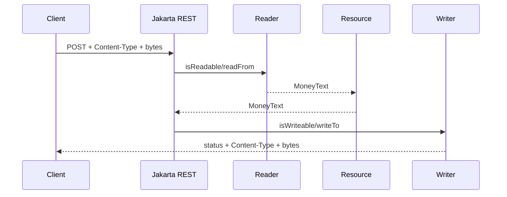

# MessageBodyReader, MessageBodyWriter và chuyển đổi dữ liệu

## 1. Vì sao REST API cần entity conversion?

Client gửi HTTP body dưới dạng **bytes**; resource method Java muốn nhận DTO và trả representation. Jakarta REST (JAX-RS) có:

- **`MessageBodyReader<T>`:** request bytes → Java entity.
- **`MessageBodyWriter<T>`:** Java entity → response bytes.

Ví dụ `POST /api/fee-estimates` nhận `text/plain` chứa `USD 12.50`, tính phí và trả `USD 13.75`. Provider xử lý format; resource/service xử lý nghiệp vụ, quyền và HTTP status.

Bài thuộc chương **Jakarta REST**, module **INTEGRATION_API_REST**, nối media type và Java types với HTTP contract, an toàn và kiểm thử. Bạn sẽ học provider selection, charset/generic types, 400/406/415, giới hạn dữ liệu, unit/HTTP tests và đối chiếu Spring converters.

## 2. Reader/Writer trong request lifecycle



Runtime match `@Path`, HTTP method, `@Consumes`/`@Produces`; chọn reader theo **Java type + request media type**, gọi resource, chọn writer theo response representation. Filters, interceptors, exception mappers và security cũng tham gia; thứ tự chi tiết tùy runtime.

**Reader/writer không phải nơi xử lý nghiệp vụ, truy vấn DB hay quyết định quyền tài nguyên.**

## 3. Content-Type, Accept, consumes và produces

| Thành phần | Ý nghĩa |
|---|---|
| Request `Content-Type` | Body **gửi đến** định dạng gì |
| Request `Accept` | Những dạng **response** client chấp nhận |
| `@Consumes` | Resource/provider chấp nhận input media type |
| `@Produces` | Resource/provider có thể tạo output media type |

```http
POST /api/fee-estimates HTTP/1.1
Content-Type: text/plain; charset=UTF-8
Accept: text/plain
Authorization: Bearer <token>

USD 12.50
```

```http
HTTP/1.1 200 OK
Content-Type: text/plain; charset=UTF-8

USD 13.75
```

Input và output có thể **khác định dạng**, như JSON → CSV. Mapping và provider phải tương thích ở từng hướng. Nếu URL trả nhiều representation có thể cache, cân nhắc `Vary: Accept`; dữ liệu riêng vẫn cần policy `private`/`no-store` và authorization.

## 4. MessageBodyReader<T>: bytes → Java

```java
boolean isReadable(Class<?> type, Type genericType,
                   Annotation[] annotations, MediaType mediaType);

T readFrom(Class<T> type, Type genericType,
           Annotation[] annotations, MediaType mediaType,
           MultivaluedMap<String, String> httpHeaders,
           InputStream entityStream)
    throws IOException, WebApplicationException;
```

`type` là class runtime, `genericType` giữ kiểu như `List<OrderView>`; `annotations` đến từ entity parameter; `mediaType` là request Content-Type; `entityStream` chứa body cần parse **có giới hạn**. Header request do client khai không phải identity đáng tin.

`isReadable` nói provider hỗ trợ **class + media type**, `readFrom` thật sự giải mã. Không dùng `readAllBytes()` vô hạn; parse/charset sai nên báo lỗi 4xx thích hợp.

## 5. MessageBodyWriter<T>: Java → bytes

```java
boolean isWriteable(Class<?> type, Type genericType,
                    Annotation[] annotations, MediaType mediaType);

void writeTo(T entity, Class<?> type, Type genericType,
             Annotation[] annotations, MediaType mediaType,
             MultivaluedMap<String, Object> httpHeaders,
             OutputStream entityStream)
    throws IOException, WebApplicationException;
```

Writer kiểm tra kiểu/media type rồi ghi đúng response representation. Interface còn có `getSize(...)` đã **deprecated**, thường trả `-1` khi không tính trước size.

**Resource quyết định status, writer chỉ serialize.** Validate output trước byte đầu: response đã commit có thể không đổi thành 500/Problem Details hoàn chỉnh. Không buffer toàn bộ response lớn chỉ để tính `Content-Length`.

## 6. Provider registration và selection

```java
@Provider
@Consumes("text/plain")
@Produces("text/plain")
public final class MoneyTextProvider
        implements MessageBodyReader<MoneyText>,
                   MessageBodyWriter<MoneyText> {
    // isReadable/readFrom/isWriteable/writeTo
}
```

`@Provider` đánh dấu extension; Jersey/RESTEasy hoặc implementation tương ứng phải **scan/register** class theo cấu hình. Selection xét resource mapping, Java type/generic type, media type và quy tắc ưu tiên, **không dựa thứ tự file**.

Đừng viết catch-all provider `isReadable=true` cho mọi `Object`/`*/*` khi chỉ xử lý text: nó có thể tranh với JSON provider. Kiểm tra registration bằng HTTP test thật.

## 7. Type/media type thường gặp

| Type/format | Provider | Rủi ro cần test |
|---|---|---|
| `String` / text | Text provider | Charset |
| `byte[]` / binary | Binary provider | RAM |
| `InputStream` response | Streaming provider | Cleanup/disconnect |
| DTO / JSON | JSON-B/Jackson được cài | Null, dates, unknown fields |
| `List<OrderDto>` / JSON | JSON provider có generic metadata | Type erasure |
| `MoneyText` / text | Custom reader/writer | Grammar, byte limit |
| CSV/PDF | Specialized writer | Injection, quoting, size |

**Jakarta REST API không bảo đảm sẵn một JSON provider cụ thể.** Kiểm tra implementation và cấu hình JSON-B/Jackson của ứng dụng thay vì suy rằng mọi runtime serialize giống nhau.

## 8. Hợp đồng MoneyText có giới hạn

Format: `USD 12.50`; endpoint trả `USD 13.75` với phí ví dụ 10%.

- `text/plain; charset=UTF-8`; currency uppercase 3 ký tự ISO 4217.
- Số không âm, **hai chữ số thập phân**, tối đa 9 chữ số phần nguyên.
- **Tối đa 64 byte** trong reader và giới hạn sớm ở gateway/container.
- Không hỗ trợ BOM, xuống dòng, số âm, dấu nghìn hay decimal comma.
- Writer chuẩn hóa số thập phân; không echo raw body trong error.

Đây là format minh họa, **không phải CSV parser**; CSV thật cần quoting/newline/escaping và chống spreadsheet formula injection.

## 9. DTO MoneyText và reader có giới hạn byte

Dùng Java 17+, Jakarta REST và Java standard library:

```java
import java.math.BigDecimal;

public record MoneyText(String currency, BigDecimal amount) {}
```

Ví dụ provider reader (những phần viết writer ở mục sau):

```java
import java.io.*;
import java.lang.annotation.Annotation;
import java.lang.reflect.Type;
import java.math.BigDecimal;
import java.nio.charset.StandardCharsets;
import java.util.Currency;
import java.util.regex.*;
import jakarta.ws.rs.*;
import jakarta.ws.rs.core.*;
import jakarta.ws.rs.ext.*;

@Provider
@Consumes("text/plain")
@Produces("text/plain")
public final class MoneyTextProvider
        implements MessageBodyReader<MoneyText>,
                   MessageBodyWriter<MoneyText> {

    private static final int MAX_BYTES = 64;
    private static final Pattern PATTERN =
        Pattern.compile("([A-Z]{3}) ([0-9]{1,9}\\.[0-9]{2})");

    @Override
    public boolean isReadable(
            Class<?> type, Type genericType,
            Annotation[] annotations, MediaType mediaType) {
        return type == MoneyText.class
            && mediaType.isCompatible(MediaType.TEXT_PLAIN_TYPE);
    }

    @Override
    public MoneyText readFrom(
            Class<MoneyText> type, Type genericType,
            Annotation[] annotations, MediaType mediaType,
            MultivaluedMap<String, String> httpHeaders,
            InputStream stream) throws IOException {

        String charset = mediaType.getParameters().get("charset");
        if (charset != null && !"UTF-8".equalsIgnoreCase(charset)) {
            throw new NotSupportedException("UTF-8 required");
        }

        byte[] bytes = stream.readNBytes(MAX_BYTES + 1);
        if (bytes.length > MAX_BYTES) {
            throw new BadRequestException("Entity exceeds format limit");
        }

        String raw = new String(bytes, StandardCharsets.UTF_8);
        Matcher matcher = PATTERN.matcher(raw);
        if (!matcher.matches()) {
            throw new BadRequestException("Expected: CCC 0.00");
        }

        String currency = matcher.group(1);
        try {
            Currency.getInstance(currency); // kiểm tra mã ISO 4217
        } catch (IllegalArgumentException ex) {
            throw new BadRequestException("Invalid currency");
        }

        return new MoneyText(
            currency,
            new BigDecimal(matcher.group(2))
        );
    }

    // isWriteable/getSize/writeTo ở mục tiếp theo
}
```

**Giải thích những quyết định quan trọng:**

- `type == MoneyText.class` không tranh chấp reader JSON cho DTO khác.
- `@Consumes("text/plain")` và `isReadable` giới hạn media type ở hai lớp.
- `readNBytes(65)` đọc tối đa 65 byte để biết request có vượt 64 byte, không gọi `readAllBytes()` không giới hạn.
- Chuỗi giải mã là UTF-8; grammar chỉ cho phép ASCII, nên byte sai UTF-8 không thể tạo chuỗi khớp pattern. Nếu schema cần Unicode, phải dùng `CharsetDecoder` với `CodingErrorAction.REPORT` để phát hiện dữ liệu mã hóa hỏng thay vì chấp nhận ký tự thay thế.
- Regex chỉ mô tả format; `Currency.getInstance` kiểm tra mã tiền tệ đã định nghĩa, nhưng không đảm bảo currency đó được **nghiệp vụ** cho phép. Ví dụ API chỉ phục vụ VND/USD thì service cần whitelist riêng.
- `BadRequestException` biểu thị body sai cấu trúc (400); `NotSupportedException` có thể dùng khi charset không được hỗ trợ (415), theo policy đã công bố.
- Không trả raw input trong exception. Với body cực lớn, **giới hạn HTTP/gateway phải chặn trước** khi reader tiêu thụ request.

Một trích đoạn provider trong tài liệu có thể được ghép lại với writer ngay dưới để thành một class. Không khai báo hai public classes cùng tên trong một file.

## 10. Writer MoneyText và mã hóa response

Bổ sung vào **chính class `MoneyTextProvider`** ở trên:

```java
@Override
public boolean isWriteable(
        Class<?> type, Type genericType,
        Annotation[] annotations, MediaType mediaType) {
    return type == MoneyText.class
        && mediaType.isCompatible(MediaType.TEXT_PLAIN_TYPE);
}

@Override
@Deprecated
public long getSize(
        MoneyText entity, Class<?> type, Type genericType,
        Annotation[] annotations, MediaType mediaType) {
    return -1; // không tính trước Content-Length
}

@Override
public void writeTo(
        MoneyText entity, Class<?> type, Type genericType,
        Annotation[] annotations, MediaType mediaType,
        MultivaluedMap<String, Object> headers,
        OutputStream stream) throws IOException {

    // Service bảo đảm amount được chuẩn hóa ở domain boundary.
    String payload = entity.currency() + " " +
        entity.amount()
            .setScale(2, java.math.RoundingMode.UNNECESSARY)
            .toPlainString();

    stream.write(payload.getBytes(StandardCharsets.UTF_8));
}
```

Đoạn `getSize` tồn tại cho hợp đồng interface, nhưng đã deprecated; không dùng để ép runtime nạp toàn bộ response vào RAM. Với response này, phép `setScale(2, UNNECESSARY)` giúp giữ format **không làm tròn ngầm**. Nếu service trả số thập phân không hợp lệ, đây là **lỗi phía server**; cần validate/normalize **trước khi writer ghi byte** để không phát ra response nửa vời.

Writer không tự chọn `200/201/204`: resource method/`Response` quyết định status. Provider cũng không tự xác thực principal hoặc bảo đảm thông tin được phép công khai; nó chỉ serialize giá trị đã được resource/service cho phép.

### Charset phải là một phần hợp đồng

Trong production, khai báo rõ `Content-Type: text/plain; charset=UTF-8` ở response đã chọn và test các client gửi `charset` khác. `@Produces("text/plain")` giúp chọn representation nhưng **không tự buộc mọi client hiểu UTF-8** nếu header không thể hiện. Với UTF-8 và body grammar ASCII ở ví dụ này, bytes tương thích ASCII; tình huống Unicode cần test mã hóa thực.

## 11. Resource method sử dụng provider tự động

Resource class theo Jakarta REST:

```java
import java.math.*;
import jakarta.ws.rs.*;
import jakarta.ws.rs.core.*;

@Path("/api/fee-estimates")
public class FeeEstimateResource {

    @POST
    @Consumes("text/plain")
    @Produces("text/plain;charset=UTF-8")
    public MoneyText estimate(
            MoneyText request,
            @Context SecurityContext security) {

        if (security.getUserPrincipal() == null) {
            throw new NotAuthorizedException("Bearer");
        }
        if (!security.isUserInRole("fee:estimate")) {
            throw new ForbiddenException();
        }

        // Chỉ là phép tính ví dụ; service thật còn quy tắc domain.
        BigDecimal result = request.amount()
            .multiply(new BigDecimal("1.10"))
            .setScale(2, RoundingMode.HALF_UP);

        return new MoneyText(request.currency(), result);
    }
}
```

Không có lệnh tự gọi `readFrom`/`writeTo`: Jakarta REST runtime gọi chúng dựa trên kiểu `MoneyText` và `text/plain`. Resource xử lý business logic; security phải có **authentication runtime** thực sự, không chỉ kiểm tra header `Authorization` bằng chuỗi.

**Quan trọng về ví dụ:** `security.isUserInRole("fee:estimate")` chỉ hoạt động khi hệ thống đã **mapping role/scope** vào `SecurityContext` theo runtime. Nếu tổ chức dùng OAuth scopes mà chưa cấu hình role mapping, phải dùng policy enforcement tương ứng. Endpoint thật cần validation/authorization bổ sung và kiểm tra amount/currency được phép trước khi tính toán.

Vì ví dụ này **không tạo resource lâu dài**, `POST` trả `200 OK` với kết quả tính toán có thể hợp lý. Nếu endpoint thực sự tạo và lưu estimate resource, nên cân nhắc `201 Created` và `Location` theo contract.

## 12. Phân biệt HTTP 400, 406, 415 và 500

| Tình huống | HTTP thường phù hợp |
|---|---|
| Content-Type JSON nhưng method chỉ consumes text | `415` |
| Accept chỉ cho phép JSON, method chỉ produces text | `406` |
| Text sai grammar/vượt byte limit trong reader | `400` |
| Charset không hỗ trợ theo policy | `415` |
| Thiếu token / thiếu role hoặc scope | `401` / `403` |
| Business không cho dùng currency | `400/422` theo hợp đồng |
| Writer/server không serialize được response | `500` |

Provider không đăng ký hoặc thiếu converter có thể là **lỗi runtime/deployment**, không luôn là lỗi client. Không map mọi reader exception thành 500, cũng không gán 400 cho lỗi dữ liệu **phía server**. Khi writer đã commit body, có thể chỉ ngắt stream thay vì tạo Problem Details mới: kiểm tra output sớm và test đúng implementation.

## 13. JSON provider, DTO và input validation

Đối với API thông thường, không cần custom MessageBodyReader cho mọi JSON DTO. Khi implementation có JSON-B hoặc Jackson provider phù hợp:

```java
record CreateOrderRequest(
    String customerId,
    List<OrderLine> items
) {}

record OrderLine(String sku, int quantity) {}

@Path("/api/orders")
@Consumes(MediaType.APPLICATION_JSON)
@Produces(MediaType.APPLICATION_JSON)
public class OrderResource {

    @POST
    public Response create(@Valid CreateOrderRequest request) {
        OrderView order = orders.createAuthorized(request);
        return Response.created(URI.create("/api/orders/" + order.id()))
            .entity(order)
            .build();
    }
}
```

Đây là **fragment minh họa**: cần `jakarta.validation.Valid`, imports và service/DTO khác, CDI/security/exception mapping, provider JSON đã đăng ký. JSON provider thực hiện entity conversion; `@Valid` do Bean Validation integration thực thi khi được kích hoạt đúng. Không dùng entity JPA trực tiếp để tránh lộ trường và vòng tham chiếu.

**Thứ tự kiểm tra:** JSON malformed/type mismatch có thể fail trước Bean Validation. API nên map cả hai loại lỗi thành cấu trúc lỗi an toàn, không assume mọi input sai đều tạo cùng exception class.

### Trách nhiệm tách biệt

- **Reader:** byte/charset/shape → Java object.
- **Bean Validation:** field constraints, required, nested fields/collection theo cấu hình.
- **Service:** tenant/resource ownership, domain rules, transaction, idempotency.
- **Writer:** Java value → bytes công bố theo media type.
- **Gateway/container:** giới hạn body size, rate/concurrency, timeout, TLS.

Một DTO có `@NotBlank customerId` không chứng minh caller có quyền tạo đơn cho customer đó.

## 14. Generic types: List<OrderDto> không chỉ là List.class

Do Java **type erasure**, writer thấy `List.class` có thể chưa đủ để biết kiểu phần tử. Jakarta REST cung cấp `genericType`; khi trả entity qua `Response`, dùng `GenericEntity<T>` để giữ metadata nếu cần.

```java
List<OrderView> rows = service.findVisibleOrders();

GenericEntity<List<OrderView>> wrapped =
    new GenericEntity<List<OrderView>>(rows) {};

return Response.ok(wrapped).build();
```

Trong resource method khai trực tiếp `List<OrderView>`, framework thường có thêm thông tin từ declared return type. Nhưng khi object bị đưa vào `Response.ok(Object)` hoặc qua raw type, generic metadata có thể mất. `GenericEntity` giúp runtime/provider biết element type cho JSON hoặc các converter có logic theo generic.

Ở client Jakarta REST:

```java
List<OrderView> orders = client.target(baseUrl)
    .path("/api/orders")
    .request(MediaType.APPLICATION_JSON)
    .get(new GenericType<List<OrderView>>() {});
```

`GenericType` giúp client đọc danh sách thành đúng element type thay vì `List<Map>` hoặc kết quả phụ thuộc provider. Trong ví dụ có bearer auth, client cần filter/header/token thích hợp; **đừng đặt token vào URL hoặc log**.

Nếu provider tự viết cần đọc `List<MoneyText>`, nó phải kiểm tra `genericType` và xử lý container đúng; **không** quảng cáo hỗ trợ mọi `List<?>` rồi cast bừa.

## 15. Provider khác filter, interceptor và exception mapper

| Extension point | Trách nhiệm |
|---|---|
| `MessageBodyReader/Writer` | Bytes ↔ Java entity |
| `ReaderInterceptor/WriterInterceptor` | Bao quanh read/write |
| `ContainerRequest/ResponseFilter` | Headers, security/correlation |
| `ExceptionMapper<E>` | Exception → HTTP response |

Dùng `ExceptionMapper<BadRequestException>` để chuẩn hóa lỗi format thành Problem Details, nhưng không echo thông điệp nội bộ/raw body. `annotations` trên entity giúp provider nhận metadata, **không thực thi authorization**.

Lỗi writer sau khi header/body gửi có thể không đổi thành status mới; với streaming cần protocol-level error hoặc status endpoint nếu hợp đồng yêu cầu.

## 16. Bảo mật tại ranh giới bytes ↔ object

- **DoS/memory:** giới hạn body, decompressed size, số bản ghi, nesting depth và concurrency ở gateway/container **trước** khi đọc.
- **Content-Type spoofing/charset:** header chỉ là lời khai của client; phải parse nội dung thật, kiểm tra UTF-8 và schema.
- **Unsafe deserialization:** không đọc Java serialized objects tùy ý; khóa XML external entities (XXE), tránh polymorphic type tự do.
- **Mass assignment:** input DTO có whitelist, không bind entity có `ownerId/isAdmin`.
- **Output injection:** CSV cần quoting/escaping và chống spreadsheet formula injection; HTML/XML cần escaping tương ứng.
- **Dữ liệu riêng:** không log raw body, token, rejected values, PII hay stack trace vào response.
- **Authorization:** query theo tenant/resource owner từ identity đã xác thực, không tin `tenantId` request khai.
- **Streaming:** giải phóng file/cursor/listener khi close/cancel; test disconnect thật.

**Reader không phải tường lửa, writer không cấp quyền xem dữ liệu.** CORS/CSRF cũng không thay authentication/authorization; mỗi tầng phải có test riêng.

## 17. Đối chiếu Jakarta REST với Spring MVC/WebFlux

| Việc cần làm | Jakarta REST | Spring MVC | Spring WebFlux |
|---|---|---|---|
| Resource | `@Path` + `@GET/@POST` | `@RestController` + `@Get/PostMapping` | Annotated/functional routes |
| Media type | `@Consumes/@Produces` | Mapping `consumes/produces` | Media types/codecs |
| Đọc body | `MessageBodyReader` | `HttpMessageConverter.read` | `HttpMessageReader` |
| Ghi body | `MessageBodyWriter` | `HttpMessageConverter.write` | `HttpMessageWriter` |
| Lỗi | `ExceptionMapper` | `@RestControllerAdvice` | Error handlers |
| Test | Provider + HTTP test | `MockMvc` | `WebTestClient` |

**Một `@Provider` không tự trở thành Spring `HttpMessageConverter`.** Nếu Jersey/RESTEasy được tích hợp vào Spring, xác định runtime nào sở hữu từng route. WebFlux reactive codecs không tương đương việc gọi blocking `InputStream` provider trong event-loop.

## 18. Unit test reader/writer: kiểm tra bytes, không chỉ object

Unit test giúp chứng minh parser/serializer đúng **trước khi** ghép runtime HTTP. Dùng JUnit 5 và chính provider ở ví dụ:

```java
import static org.junit.jupiter.api.Assertions.*;
import java.io.*;
import java.math.BigDecimal;
import java.nio.charset.StandardCharsets;
import jakarta.ws.rs.BadRequestException;
import jakarta.ws.rs.core.MediaType;
import org.junit.jupiter.api.Test;

class MoneyTextProviderTest {
    private final MoneyTextProvider provider = new MoneyTextProvider();

    @Test
    void readsStrictMoneyFormat() throws Exception {
        byte[] bytes = "USD 12.50".getBytes(StandardCharsets.UTF_8);
        MoneyText parsed = provider.readFrom(
            MoneyText.class, MoneyText.class,
            new java.lang.annotation.Annotation[0],
            MediaType.TEXT_PLAIN_TYPE,
            new jakarta.ws.rs.core.MultivaluedHashMap<>(),
            new ByteArrayInputStream(bytes));

        assertEquals("USD", parsed.currency());
        assertEquals(new BigDecimal("12.50"), parsed.amount());
    }

    @Test
    void rejectsMalformedOrOversizedBody() {
        byte[] huge = new byte[65];
        assertThrows(BadRequestException.class, () -> provider.readFrom(
            MoneyText.class, MoneyText.class,
            new java.lang.annotation.Annotation[0],
            MediaType.TEXT_PLAIN_TYPE,
            new jakarta.ws.rs.core.MultivaluedHashMap<>(),
            new ByteArrayInputStream(huge)));
    }

    @Test
    void writesTwoDecimalDigits() throws Exception {
        ByteArrayOutputStream output = new ByteArrayOutputStream();
        provider.writeTo(
            new MoneyText("USD", new BigDecimal("13.75")),
            MoneyText.class, MoneyText.class,
            new java.lang.annotation.Annotation[0],
            MediaType.TEXT_PLAIN_TYPE,
            new jakarta.ws.rs.core.MultivaluedHashMap<>(),
            output);

        assertEquals("USD 13.75",
            output.toString(StandardCharsets.UTF_8));
    }
}
```

Test thêm bảng trường hợp: `USD 12.5`, `USD -1.00`, `USD 12,50`, `USD 12.50\\n`, 65 byte, unknown currency, charset không hỗ trợ, writer có amount >2 decimals. Khi `isReadable`/`isWriteable` chỉ hỗ trợ `MoneyText`, assert cả trường hợp true/false.

**Unit test không chứng minh provider đã được runtime discover** hoặc `@Produces`/`@Consumes` được negotiation đúng: cần integration test HTTP.

## 19. HTTP integration tests: 200, 400, 406, 415 và auth

Ví dụ assertion theo phong cách REST Assured, chạy với Jakarta REST runtime đã khởi động, provider thực sự được đăng ký. `testToken` phải là fixture hợp lệ cho security config, không phải token production:

```java
import static io.restassured.RestAssured.given;
import static org.hamcrest.Matchers.*;

given()
    .auth().oauth2(testToken)
    .header("Content-Type", "text/plain; charset=UTF-8")
    .accept("text/plain")
    .body("USD 12.50")
.when()
    .post("/api/fee-estimates")
.then()
    .statusCode(200)
    .header("Content-Type", containsString("text/plain"))
    .body(equalTo("USD 13.75"));
```

Các negative tests quan trọng:

| Request | Kỳ vọng theo hợp đồng ví dụ |
|---|---|
| `text/plain` đúng grammar, đúng quyền | 200, body đúng UTF-8 |
| `text/plain` sai grammar | 400, lỗi không chứa raw body |
| `text/plain` 65+ byte | 400 hoặc body limit ở gateway theo policy |
| `Content-Type: application/json` | 415 |
| `Accept: application/json` khi chỉ produces text | 406 |
| `charset=ISO-8859-1` | 415 theo policy reader |
| Thiếu token | 401 |
| Token đủ auth nhưng thiếu role `fee:estimate` | 403 |
| Writer có entity không thể chuẩn hóa | Lỗi server, không lộ stack trace |
| Provider không được đăng ký | Test phát hiện lỗi conversion/deployment, không chấp nhận response im lặng |

Để phân biệt lỗi routing với lỗi reader, log/trace nội bộ có correlation ID; không trả tên provider/class/stack trace cho client. Có thể thêm test hai representations (`Accept: application/json` và `text/plain`) nếu resource thực sự hỗ trợ cả hai, nhưng phải dựng đúng hai handlers/providers và negotiation policy.

## 20. Bài tập thực hành: mở rộng REST endpoint cho CSV export

### Yêu cầu

`GET /api/orders/export` trả một bản xuất dữ liệu theo tenant. Client có thể yêu cầu `Accept: text/csv` hoặc `application/json`. Backend hiện chỉ xuất JSON từ `List<OrderView>`; muốn thêm CSV mà không làm hỏng consumer cũ.

**Nhiệm vụ:**

1. Vẽ pipeline resource → writer → HTTP bytes và đánh dấu nơi security/validation/exception mapper hoạt động.
2. Thiết kế `@Produces` và provider selection để JSON tiếp tục hoạt động, CSV được chọn theo `Accept`.
3. Nếu muốn viết `MessageBodyWriter<ExportRows>`, định nghĩa `isWriteable` theo class/media type thay vì `Object` và `*/*`.
4. Với CSV, thiết kế header, row escaping đúng quy tắc quote/comma/newline; **chặn spreadsheet formula injection** theo threat model. Không dùng parser text đơn giản của ví dụ MoneyText làm CSV parser.
5. Giới hạn số bản ghi và dung lượng; chọn phân trang hoặc streaming, giải thích tradeoff về lỗi sau khi response đã commit.
6. Thêm tenant filter **trước khi** truyền dữ liệu cho writer; không tin `tenantId` do client tự khai.
7. Viết integration tests: JSON giữ schema cũ, CSV `Content-Type` đúng, `Accept: application/xml` cho 406, cross-tenant không lộ dữ liệu.
8. Xem xét `Vary: Accept`, `Content-Disposition`, charset UTF-8, BOM policy và CSV formula escaping; không dùng filename tùy ý từ request để tạo header injection.
9. Nếu code chạy bằng Spring MVC, giải thích phải dùng `HttpMessageConverter`/`ResponseEntity` hoặc công cụ tương đương, không mặc định Jakarta `@Provider` được gọi.

### Gợi ý hướng giải

Một lựa chọn là dùng hai resource methods hoặc một method trả `Response` với representation được chọn rõ, cùng các providers tương ứng. CSV writer có thể stream từng dòng nhưng phải kiểm soát lỗi, quoting và quyền từ trước; nếu yêu cầu export kéo dài, có thể tạo job bất đồng bộ và cung cấp URL tải kết quả khi hoàn tất. **Đừng cho writer tự xác thực user hoặc truy vấn đơn hàng không giới hạn**.

## 21. Checklist trước khi phát hành

- [ ] `@Consumes`/`@Produces` phản ánh chính xác `Content-Type`/`Accept` và status 406/415.
- [ ] Reader `isReadable` và writer `isWriteable` chỉ match đúng Java type/media type.
- [ ] Provider được runtime discover/đăng ký; integration test chứng minh được dùng.
- [ ] Reader giới hạn bytes, charset, nesting/record count; không dùng `readAllBytes()` vô hạn.
- [ ] Writer chuẩn hóa dữ liệu trước khi ghi, tránh lỗi sau response commit.
- [ ] DTO/schema/JSON-B/Jackson configuration có contract và tests rõ ràng.
- [ ] GenericEntity/GenericType được dùng khi generic metadata có nguy cơ bị erasure.
- [ ] 400/406/415/500 và Problem Details/error mapping đúng theo nguyên nhân.
- [ ] Input không chứa field đặc quyền có thể bind tùy ý; service enforce owner/tenant.
- [ ] Không lộ token/PII/stack trace/raw body trong response hoặc logs.
- [ ] Body size/rate/concurrency, streaming cleanup và output injection được kiểm soát.
- [ ] Unit tests parse/serialize bytes; HTTP tests kiểm tra provider selection/content negotiation.
- [ ] Nếu chạy Spring MVC/WebFlux, dùng đúng extension point của framework.
- [ ] Với nhiều representations, cache/`Vary: Accept` và security được thử qua gateway.

## 22. Kết luận

**`MessageBodyReader` và `MessageBodyWriter` là ranh giới byte ↔ Java entity** trong Jakarta REST. Reader tiêu thụ HTTP request body theo Java type và `Content-Type`; writer tạo response body theo Java type và `Accept`/`@Produces`. `@Provider` cùng các điều kiện chọn chỉ có ý nghĩa khi implementation thực sự đăng ký provider và có đủ converter cho từng representation.

Thiết kế tốt không dừng ở parse/serialize chạy được: phải có **media type, charset, limits, error mapping, tenant authorization và test HTTP thực**. Với Java/Spring, hãy nhận diện đúng extension point của runtime (Jakarta REST providers khác Spring converters/codecs); với Jakarta REST, ghép unit tests ở mức byte với integration tests 400/406/415, security và streaming. Khi đó quá trình chuyển đổi dữ liệu trở thành phần đáng tin của REST contract thay vì nguồn lỗi khó phát hiện.

