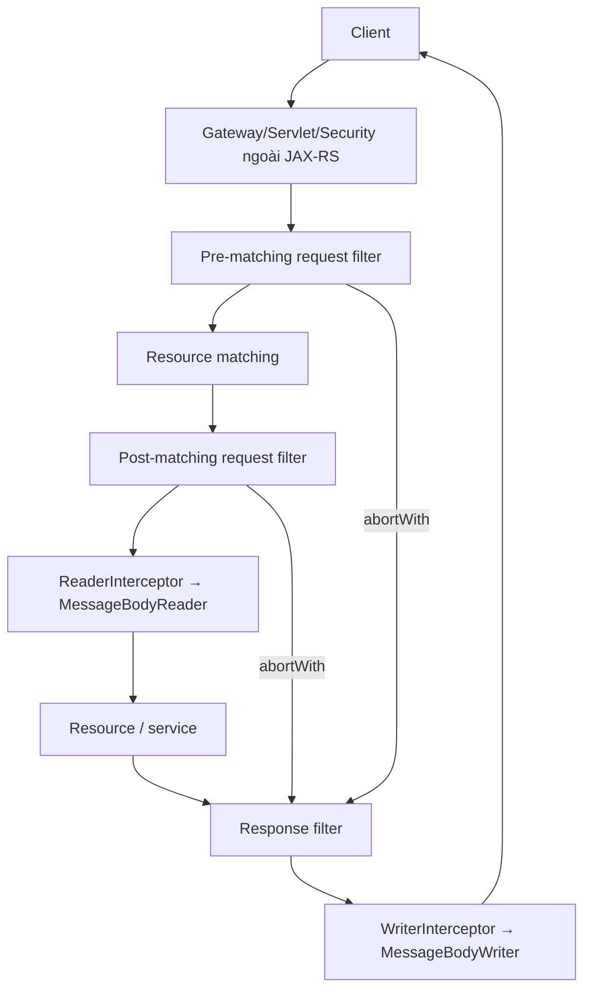

# ContainerRequestFilter, ContainerResponseFilter và interceptor

> **Module:** INTEGRATION_API_REST — học thiết kế REST API theo resource, URI, HTTP method/status và hợp đồng dữ liệu rõ ràng; thực hành phân trang, cache, idempotency, OpenAPI, xác thực, phân quyền, xử lý lỗi và kiểm thử với Java/Spring hoặc công nghệ tương đương.  
> **Chương:** Jakarta REST.  
> **Trọng tâm:** Phân biệt **`ContainerRequestFilter`**, **`ContainerResponseFilter`** và **`ReaderInterceptor`/`WriterInterceptor`**; hiểu thời điểm chạy, phạm vi, thứ tự, cách dừng request, ranh giới bảo mật và kiểm thử hợp đồng HTTP.

## 1. Bài toán: xử lý xuyên suốt mà không lặp code trong resource

Giả sử một API có các endpoint:

```http
GET /api/orders/ord-501 HTTP/1.1
Authorization: Bearer <access-token>
Accept: application/json
X-Request-Id: req-123
```

Ta muốn mọi request được gắn mã theo dõi, một số resource yêu cầu quyền `orders.read`, body upload/JSON bị giới hạn kích thước, và response luôn chứa `X-Request-Id`. Nếu viết logic này trong từng resource method, nó dễ trùng lặp, thiếu nhất quán và khó kiểm thử.

Jakarta REST cung cấp các **provider mở rộng pipeline**:

- **`ContainerRequestFilter`:** đọc/thay đổi metadata request, kiểm tra/chặn trước khi resource method xử lý.
- **`ContainerResponseFilter`:** đọc/thay đổi metadata response (status, headers, entity metadata) trước khi ghi ra HTTP.
- **`ReaderInterceptor`:** bao quanh bước **đọc entity từ byte stream** qua `MessageBodyReader`.
- **`WriterInterceptor`:** bao quanh bước **ghi entity ra byte stream** qua `MessageBodyWriter`.

Các API thuộc namespace `jakarta.ws.rs.*` (Jakarta REST). Chúng **không đồng nhất** với Servlet `Filter`, Spring MVC `HandlerInterceptor` hoặc Spring WebFlux `WebFilter`.

**Mục tiêu học tập:** chọn đúng extension point; thiết kế `@PreMatching`, `@NameBinding`, `@Priority`; dùng `abortWith` an toàn; tránh đọc body trong filter metadata; kiểm thử thứ tự, status, headers, entity và authorization.

## 2. Pipeline và thời điểm can thiệp



Sơ đồ là **luồng khái niệm**: request/response không có entity có thể không gọi reader/writer interceptor.

| Extension point | Vai trò |
|---|---|
| `@PreMatching ContainerRequestFilter` | Trước resource matching: request ID/metadata toàn cục |
| Post-match `ContainerRequestFilter` | Sau resource matching: role, quota, header policy theo endpoint |
| `ReaderInterceptor` | Bọc bytes khi `MessageBodyReader` deserialize |
| `ContainerResponseFilter` | Chỉnh status/header/entity metadata trước khi ghi response |
| `WriterInterceptor` | Bọc bytes khi `MessageBodyWriter` serialize |

`ContainerRequestContext` cung cấp method, URI, headers, security context, properties, `abortWith`. `ContainerResponseContext` cung cấp status, headers và entity. **Không đọc hết body trong filter metadata** chỉ để xem dữ liệu JSON.

## 3. ContainerRequestFilter: pre-matching, post-matching và abort

`ContainerRequestFilter.filter(ContainerRequestContext)` chạy trong request pipeline. `@Provider` hỗ trợ runtime khám phá provider nếu đã cấu hình đúng package/registration.

### 3.1. Pre-matching: chưa có resource method

```java
import jakarta.annotation.Priority;
import jakarta.ws.rs.Priorities;
import jakarta.ws.rs.container.*;
import jakarta.ws.rs.ext.Provider;
import java.util.UUID;

@Provider
@PreMatching
@Priority(Priorities.AUTHENTICATION - 100)
public class RequestIdFilter implements ContainerRequestFilter {
    public static final String ID = "api.requestId";

    @Override
    public void filter(ContainerRequestContext request) {
        request.setProperty(ID, UUID.randomUUID().toString());
    }
}
```

Trước matching không dựa vào `ResourceInfo`/annotation của resource method. Việc thay URI/method từ `Host`, `Forwarded` hoặc tenant header chưa được xác thực có thể phá routing và security.

### 3.2. Post-matching và dừng request

Filter thông thường chạy sau resource matching, có thể dùng `ResourceInfo` để biết method. Nếu phải từ chối:

```java
request.abortWith(Response.status(403)
    .type("application/problem+json")
    .entity(Map.of(
        "type", "https://api.example.com/problems/forbidden",
        "title", "Không đủ quyền", "status", 403))
    .build());
return;
```

`abortWith` ngăn resource chạy; response filters vẫn có thể xử lý response bị abort, còn reader interceptor chưa đến bước thực thi thì không chạy. `Map` cần JSON provider tương thích. Không trả 200 khi thiếu quyền; role filter không thay object-level authorization.

## 4. ContainerResponseFilter: headers và status

Response filter nhận request/response contexts:

```java
import jakarta.ws.rs.container.*;
import jakarta.ws.rs.ext.Provider;

@Provider
public class RequestIdResponseFilter
        implements ContainerResponseFilter {
    @Override
    public void filter(ContainerRequestContext request,
                       ContainerResponseContext response) {
        Object id = request.getProperty(RequestIdFilter.ID);
        if (id != null) {
            response.getHeaders().putSingle(
                "X-Request-Id", id.toString());
        }
    }
}
```

`setProperty/getProperty` giữ state **theo request**. Không giữ request ID trong mutable field của provider có thể được dùng chung giữa nhiều request.

Response filter phù hợp để đặt `Cache-Control`, `Vary`, `X-Request-Id` hoặc metadata theo policy. Ví dụ dữ liệu riêng:

```java
response.getHeaders().putSingle("Cache-Control", "no-store");
```

Đừng áp `no-store` lên mọi public resource ngoài chủ đích; cũng đừng ghi đè `private` thành `public`, đoán `Content-Length` trước serialization/nén, sửa `Content-Type` không phù hợp writer, thêm body vào 204/304 hoặc ép lỗi thành 200.

Nếu request bị chặn **trước Jakarta REST** bởi gateway/Servlet/Spring Security, Jakarta REST response filter không bảo đảm chạy. Header correlation phải được bảo đảm ở tầng chặn đó nếu hợp đồng yêu cầu.

## 5. ReaderInterceptor: bọc luồng đọc entity

`ReaderInterceptor` chạy khi `MessageBodyReader` deserialize body. `ReaderInterceptorContext` cho phép lấy/thay `InputStream`, xem headers/media type và gọi **`proceed()`** để chuyển điều khiển cho reader.

Ví dụ giới hạn bytes thực đọc ngay cả khi không có `Content-Length`:

```java
import java.io.*;
import jakarta.annotation.Priority;
import jakarta.ws.rs.*;
import jakarta.ws.rs.ext.*;

@Provider
@Priority(Priorities.ENTITY_CODER)
public class LimitedBodyReader implements ReaderInterceptor {
    private static final long MAX = 1_048_576L;

    @Override
    public Object aroundReadFrom(ReaderInterceptorContext ctx)
            throws IOException, WebApplicationException {
        InputStream original = ctx.getInputStream();
        ctx.setInputStream(new FilterInputStream(original) {
            private long total;

            private void account(int n) {
                if (n > 0 && (total += n) > MAX)
                    throw new WebApplicationException(413);
            }
            @Override
            public int read() throws IOException {
                int v = super.read();
                if (v != -1) account(1);
                return v;
            }
            @Override
            public int read(byte[] b, int off, int len)
                    throws IOException {
                int n = super.read(b, off, len);
                account(n);
                return n;
            }
        });
        return ctx.proceed();
    }
}
```

Giới hạn này chỉ áp ở **entity reading**; proxy, Servlet và multipart parser vẫn cần bảo vệ sớm khỏi buffering lớn. Body nén cần giới hạn cả bytes nén/sau giải nén. ReaderInterceptor không thay Bean Validation; không đọc hết stream rồi làm provider mất JSON. Scope 1 MiB không phù hợp endpoint upload file lớn.

`WebApplicationException(413)` là status dự kiến, nhưng provider có thể wrap lỗi ở lúc đọc. **Kiểm thử HTTP thật** để bảo đảm không thành 500 và không lộ thông tin nội bộ.

## 6. WriterInterceptor: bọc luồng ghi entity

`WriterInterceptor` chạy quanh `MessageBodyWriter` và phải gọi `proceed()` để serialization tiếp tục. Khác response filter (metadata), nó can thiệp vào **bytes**.

Ví dụ đếm bytes serializer ghi mà không log body:

```java
import java.io.*;
import java.util.concurrent.atomic.AtomicLong;
import jakarta.ws.rs.ext.*;

@Provider
public class CountingWriterInterceptor
        implements WriterInterceptor {
    @Override
    public void aroundWriteTo(WriterInterceptorContext ctx)
            throws IOException {
        OutputStream original = ctx.getOutputStream();
        AtomicLong count = new AtomicLong();

        ctx.setOutputStream(new FilterOutputStream(original) {
            @Override
            public void write(int b) throws IOException {
                out.write(b);
                count.incrementAndGet();
            }
            @Override
            public void write(byte[] data, int off, int len)
                    throws IOException {
                out.write(data, off, len);
                count.addAndGet(len);
            }
        });
        try {
            ctx.proceed();
        } finally {
            ctx.setOutputStream(original);
            // metrics.record(count.get()); không log PII.
        }
    }
}
```

Không đóng stream của container tùy tiện. Metric đếm bytes đi qua writer, không nhất thiết bằng bytes qua TLS/chunking hoặc async streaming.

Nếu triển khai gzip, phải thương lượng `Accept-Encoding`, đặt `Content-Encoding: gzip` và `Vary: Accept-Encoding`, xử lý `Content-Length`/range/response không body, tránh nén lại. **Không thể chỉ bọc `GZIPOutputStream` rồi bỏ mặc HTTP headers**. Khi output đã commit, WriterInterceptor không bảo đảm đổi status thành JSON Problem Details được nữa.

## 7. `@NameBinding`: scope provider theo resource

Provider global dễ chặn nhầm endpoint public. `@NameBinding` cho phép chỉ áp filter/interceptor lên resource/class/method có annotation:

```java
import jakarta.ws.rs.NameBinding;
import java.lang.annotation.*;

@NameBinding
@Retention(RetentionPolicy.RUNTIME)
@Target({ElementType.TYPE, ElementType.METHOD})
public @interface RequireOrderRead {}
```

```java
import jakarta.annotation.Priority;
import jakarta.ws.rs.*;
import jakarta.ws.rs.container.*;
import jakarta.ws.rs.core.*;
import jakarta.ws.rs.ext.Provider;
import java.util.Map;

@Provider
@RequireOrderRead
@Priority(Priorities.AUTHORIZATION)
public class OrderRoleFilter implements ContainerRequestFilter {
    @Override
    public void filter(ContainerRequestContext request) {
        SecurityContext sc = request.getSecurityContext();
        if (sc == null || sc.getUserPrincipal() == null) {
            request.abortWith(Response.status(401)
                .header("WWW-Authenticate", "Bearer")
                .type("application/problem+json")
                .entity(Map.of("type", "about:blank",
                        "title", "Chưa xác thực", "status", 401))
                .build());
        } else if (!sc.isUserInRole("orders.read")) {
            request.abortWith(Response.status(403)
                .type("application/problem+json")
                .entity(Map.of("type", "about:blank",
                        "title", "Không đủ quyền", "status", 403))
                .build());
        }
    }
}
```

```java
import jakarta.inject.Inject;

@Path("/orders")
@Produces("application/json")
public class OrderResource {
    private final OrderService service;

    @Inject
    public OrderResource(OrderService service) {
        this.service = service;
    }

    @GET @Path("/{id}") @RequireOrderRead
    public OrderView get(@PathParam("id") String id) {
        return service.findVisible(id); // Tenant/owner check.
    }
}
```

`OrderService`, DTO và CDI integration do dự án định nghĩa. Filter chỉ kiểm tra **role**, service vẫn phải xác nhận order thuộc tenant được phép, chống IDOR. `SecurityContext` phải đến từ nguồn xác thực đáng tin (JWT signature, issuer, audience, expiry, scope mapping), không phải một header giả mạo. `Map` lỗi cần JSON provider được cấu hình.

Có thể dùng `DynamicFeature.configure(ResourceInfo, FeatureContext)` để đăng ký provider dựa trên metadata resource. `@NameBinding` theo resource không có ý nghĩa với pre-matching filter trước khi method được chọn.

## 8. Thứ tự chạy: `@Priority` và các chuỗi provider

Nếu nhiều providers cùng áp vào request, thứ tự có thể quyết định tính đúng.

Các hằng số trong `jakarta.ws.rs.Priorities` thể hiện mức ưu tiên thông dụng:

| Priority | Ý tưởng |
|---|---|
| `AUTHENTICATION` | Xác thực |
| `AUTHORIZATION` | Kiểm tra quyền |
| `HEADER_DECORATOR` | Thêm metadata |
| `ENTITY_CODER` | Đọc/ghi content encoding |
| `USER` | Logic ứng dụng mặc định |

**Giá trị số nhỏ hơn là ưu tiên cao hơn.** Request filters trong cùng nhóm pre-matching hoặc post-matching được sắp theo **priority tăng dần**; response filters được gọi theo **thứ tự priority giảm dần**. Chuỗi Reader/WriterInterceptor cũng tuân quy tắc đăng ký và priority của runtime/đặc tả; **đừng suy ra vị trí serialize chỉ từ tên class**, hãy có test ghi nhận thứ tự.

Một thứ tự khái niệm:

```text
PRE MATCH : request ID → routing
MATCH     : chọn resource/method
POST MATCH: authentication/authorization → quota/headers
ENTITY IN : reader interceptors → JSON reader
RESOURCE  : application service
RESPONSE  : response filters
ENTITY OUT: writer interceptors → JSON writer
```

Thực tế **authentication ở Servlet/gateway** có thể xảy ra trước toàn bộ Jakarta REST; không có bảo đảm `@Priority(AUTHENTICATION)` của một filter sẽ chạy trước hệ thống auth ở ngoài container JAX-RS.

**Tránh phụ thuộc vào thứ tự giữa hai providers có cùng priority**. Nếu thứ tự ảnh hưởng kết quả, đặt priorities tường minh và kiểm thử trên Jersey/RESTEasy/CXF hoặc implementation đang dùng. Không bao giờ xử lý side effect nghiệp vụ trong một filter chỉ vì nó “chạy trước”; transaction và idempotency thuộc service.

## 9. Hợp đồng HTTP khi thành công hoặc bị chặn

Với `GET /orders/ord-501` có `@RequireOrderRead`, kết quả cần phân biệt:

| Tình huống | HTTP | Điều cần kiểm chứng |
|---|---|---|
| Không có credential hợp lệ | 401 + `WWW-Authenticate: Bearer` | Resource không chạy; không lộ thông tin |
| Có principal nhưng thiếu role | 403 Forbidden | Resource không chạy, không lộ order |
| Role đúng nhưng order thuộc tenant khác | 403 hoặc 404 theo policy | Service chặn object-level access |
| Có quyền và order tồn tại | 200 + JSON | Body đúng schema, có `X-Request-Id` |

Một response lỗi an toàn:

```http
HTTP/1.1 403 Forbidden
Content-Type: application/problem+json
Cache-Control: no-store
X-Request-Id: 0edbd87c-76b0-4245-b388-b26eef0557b2

{"type":"https://api.example.com/problems/forbidden",
 "title":"Không đủ quyền","status":403}
```

`X-Request-Id` hỗ trợ đối soát, **không phải token truy cập**. Nếu một Servlet/gateway security filter chặn **trước** Jakarta REST, chính tầng đó phải bảo đảm challenge và request ID; không kỳ vọng response filter JAX-RS được gọi.

## 10. Bảo mật và ổn định: tránh biến filter thành nguồn rủi ro

### 10.1. Những giới hạn cần đặt đúng tầng

- **Authentication:** ưu tiên runtime/container/gateway có cấu hình xác minh credential; filter authorization chỉ tin `SecurityContext` đã được xác minh.
- **Object-level authorization:** kiểm tra tenant/resource trong service, không chỉ role của method.
- **Request size:** reverse proxy/multipart parser cần chặn sớm; ReaderInterceptor bổ sung kiểm tra bytes khi entity được đọc.
- **Logging:** không log Authorization, cookie, raw JSON, file upload hoặc thông tin PII. Dùng route template, request ID và status.
- **Timeout/backpressure:** interceptor đọc/ghi stream không được buffer toàn bộ body hoặc chặn I/O lâu không có giới hạn.
- **Concurrency:** provider có thể là singleton, nhiều request dùng chung; không giữ request state trong mutable instance fields.
- **CORS/CSRF:** với browser, xử lý OPTIONS preflight trước khi policy auth gây chặn sai; nếu dùng cookie, đánh giá CSRF riêng.
- **Error responses:** không trả stack trace/SQL/exception message; tuân `application/problem+json` và không để filter biến lỗi thành 200.
- **Entity encoding:** không nén lại dữ liệu đã nén, không làm sai ETag/Content-Length/Range; xác minh `Vary` và cache.
- **Resource cleanup:** stream do container quản lý phải được đóng/flush đúng, tránh leak và double-close.

### 10.2. Một rủi ro ít thấy: pre-matching thay URI

Nếu pre-matching filter tự rewrite `/tenant-a/orders` thành `/tenant-b/orders` dựa trên header không đáng tin cậy, kiểm tra quyền ở service có thể nhận sai tenant scope. Hãy để nguồn tenant đến từ principal đã xác thực hoặc một routing policy đáng tin; không cho client dùng `X-Tenant-Id` tự khai để vượt qua authorization.

### 10.3. Filter không thể “cứu” response đã commit

Nếu một WriterInterceptor phát hiện lỗi sau khi đã ghi một phần JSON/bytes, HTTP status có thể đã được gửi. Lúc đó không thể đảm bảo trả Problem Details chuẩn bằng cách đổi `response.setStatus(500)`. Những validation quyết định request có hợp lệ phải chạy **trước** khi bắt đầu output; stream interceptors chủ yếu phục vụ I/O transformation và telemetry.

## 11. So sánh với Spring MVC và Spring WebFlux

Jakarta REST là một API chuẩn cho REST resources; Spring MVC dùng mô hình annotation/controller khác. Tên “interceptor” ở hai bên **không đồng nghĩa**.

| Jakarta REST | Tương đương gần nhất trong Spring MVC | Khác biệt |
|---|---|---|
| Pre-match request filter | Servlet `Filter` / `OncePerRequestFilter` | Servlet filter có thể chạy trước `DispatcherServlet` |
| Post-match request filter | `HandlerInterceptor.preHandle` hoặc security layer | Spring mapping và lifecycle riêng |
| ContainerResponseFilter | `HandlerInterceptor.postHandle`, `ResponseBodyAdvice` hoặc Servlet response filter | Không có một API 1:1 cho mọi status/header/body |
| ReaderInterceptor | `RequestBodyAdvice`, `HttpMessageConverter` wrapper | Spring phân biệt advice và converter |
| WriterInterceptor | `ResponseBodyAdvice`/converter, Servlet output wrapper | `ResponseBodyAdvice` thao tác object trước khi serialize, không phải byte-stream interceptor |
| `ExceptionMapper` / `abortWith` | `@RestControllerAdvice`/`ResponseEntity`/Spring Security handlers | Error path và filter chain khác |
| JAX-RS `@NameBinding` | Custom annotation + MVC interceptor/security matcher | Registration và scope khác |

Một Spring MVC `OncePerRequestFilter` để sinh response header:

```java
@Component
class RequestIdServletFilter extends OncePerRequestFilter {
    @Override
    protected void doFilterInternal(
            HttpServletRequest request,
            HttpServletResponse response,
            FilterChain chain)
            throws ServletException, IOException {

        String requestId = UUID.randomUUID().toString();
        response.setHeader("X-Request-Id", requestId);
        try {
            chain.doFilter(request, response);
        } finally {
            // Ghi telemetry đã loại dữ liệu nhạy cảm nếu cần.
        }
    }
}
```

Đoạn code là **mẫu Spring MVC/Servlet**, không phải implementation của `ContainerRequestFilter`. Nó dùng các imports của Servlet, Spring Web và `UUID` tương ứng.

**Spring WebFlux** dùng `WebFilter`/Reactor, non-blocking backpressure và lifecycle khác; không đưa blocking `InputStream` interceptor của Jakarta REST vào reactive pipeline rồi giả định nó non-blocking. Nếu ứng dụng chạy cả hai framework, xác định runtime chịu trách nhiệm endpoint nào trước khi đăng ký provider/filter.

## 12. OpenAPI: mô tả hành vi ngoài filter

OpenAPI mô tả **hợp đồng HTTP quan sát được**, không khai báo chính xác thứ tự Java provider. Vì vậy filter sinh header hoặc chặn request phải được phản ánh ở response/security schema:

```yaml
openapi: 3.1.2
info:
  title: Orders API
  version: 1.0.0
paths:
  /orders/{id}:
    get:
      summary: Đọc đơn hàng trong phạm vi được phép
      security:
        - bearerAuth: []
      parameters:
        - name: id
          in: path
          required: true
          schema: {type: string}
      responses:
        "200":
          description: Đơn hàng
          headers:
            X-Request-Id:
              schema: {type: string}
          content:
            application/json:
              schema:
                type: object
                required: [id, status]
                properties:
                  id: {type: string}
                  status: {type: string}
        "401":
          description: Chưa xác thực
          headers:
            WWW-Authenticate:
              schema: {type: string}
          content:
            application/problem+json:
              schema:
                $ref: "#/components/schemas/Problem"
        "403":
          description: Không đủ quyền
          content:
            application/problem+json:
              schema:
                $ref: "#/components/schemas/Problem"
        "404": {description: Không tìm thấy hoặc bị ẩn}
components:
  securitySchemes:
    bearerAuth:
      type: http
      scheme: bearer
      bearerFormat: JWT
  schemas:
    Problem:
      type: object
      required: [type, title, status]
      properties:
        type: {type: string, format: uri-reference}
        title: {type: string}
        status: {type: integer}
        detail: {type: string}
```

`bearerFormat: JWT` chỉ mô tả cơ chế, không thực thi xác minh token. Nếu request size limit từ ReaderInterceptor có thể trả 413, mô tả 413 và media type lỗi tương ứng trên các endpoints áp dụng giới hạn; đừng hứa mọi endpoint đều nhận body 1 MiB nếu policy khác.

## 13. Kiểm thử filter/interceptor đúng tầng

Unit test provider có ích, nhưng **không chứng minh discovery, priority và abort path**. Cần integration test bằng runtime Jakarta REST thực tế (Jersey/RESTEasy/CXF hoặc tương đương), có authentication/tenant fixture.

| Test | Trạng thái và assertion |
|---|---|
| Không có token / thiếu role | 401 + challenge / 403, resource không chạy |
| Role đúng nhưng tenant khác | 403/404, không rò order body |
| Filter `@NameBinding` | Chỉ chặn method đã đánh dấu, không chặn health endpoint |
| `abortWith` | Response filter có thể chạy; reader interceptor/resource không chạy |
| Concurrent requests | `X-Request-Id` khác nhau, state không lẫn giữa requests |
| JSON nhỏ/chunked vượt giới hạn | Deserialize đúng / 413 trước khi vào service |
| JSON sai cú pháp | 400, không đổi nhầm thành 413/500 |
| WriterInterceptor | Không thay JSON, số bytes/stream lỗi được xử lý |
| 204/304 | Không có body; writer interceptor có thể không được gọi |
| OPTIONS/CORS | Preflight theo policy, không bị authorization chặn nhầm |
| Gzip nếu có | Header `Content-Encoding`/`Vary` đúng, không double compression |

### 13.1. Ví dụ JUnit gửi HTTP qua runtime

```java
import java.net.URI;
import jakarta.ws.rs.client.*;
import jakarta.ws.rs.core.Response;
import org.junit.jupiter.api.Test;
import static org.junit.jupiter.api.Assertions.*;

class FilterHttpTest {
    // Fixture khởi chạy server và tạo data/tenant/token riêng.
    URI baseUri = URI.create("http://localhost:8080/api");

    @Test
    void noCredentialIs401() {
        try (Client client = ClientBuilder.newClient();
             Response response = client.target(baseUri)
                     .path("orders/ord-501")
                     .request("application/json").get()) {
            assertEquals(401, response.getStatus());
            assertNotNull(response.getHeaderString(
                    "WWW-Authenticate"));
        }
    }

    @Test
    void permittedRequestHasCorrelationId() {
        String token = TestTokens.orderReader(); // Fixture giả định.
        try (Client client = ClientBuilder.newClient();
             Response response = client.target(baseUri)
                     .path("orders/ord-501")
                     .request("application/json")
                     .header("Authorization", "Bearer " + token)
                     .get()) {
            assertEquals(200, response.getStatus());
            assertNotNull(response.getHeaderString("X-Request-Id"));
        }
    }
}
```

Đây là **test minh họa, chưa chạy**; cần Jakarta REST Client implementation, khởi tạo test server, `TestTokens` và provider registration. Nếu security filter bên ngoài JAX-RS chặn sớm, correlation header có thể do tầng khác cấp.

### 13.2. Kiểm tra thứ tự và concurrency

Dùng **test-only provider** ghi tên stage vào recorder theo request (không log body). Với request có entity, assert luồng: `pre-match → post-match → reader → resource → response filter → writer`. Với `abortWith`, assert không chạy reader/resource. Đặt `@Priority` tường minh và test trên runtime dùng thật; đừng dựa vào log bất đồng bộ để suy thứ tự. Test hai request đồng thời nhằm chứng minh không có request state trong mutable field singleton.

## 14. Phản mẫu thường gặp

| Phản mẫu | Cách sửa |
|---|---|
| Request filter đọc sạch body rồi bỏ stream | Dùng ReaderInterceptor và `proceed`, giới hạn bytes |
| Response filter “nén” entity bằng cách đổi header | Dùng WriterInterceptor + negotiation/encoding đúng |
| Interceptor quên `proceed` | Tiếp tục chain chính xác hoặc short-circuit có chủ đích |
| Pre-match dựa vào `@Path` annotation | Chờ post-match hoặc dùng DynamicFeature |
| Provider global chặn nhầm endpoint | `@NameBinding`/registration đúng |
| Request ID nằm trong field singleton | Dùng request properties |
| Role filter thay tenant authorization | Service kiểm tra object/tenant |
| Tự tin Bearer token chưa xác minh | Auth provider kiểm tra signature/issuer/audience |
| Response filter đổi mọi lỗi thành 200 | Giữ status, headers và Problem Details |
| Mock unit test thay cho HTTP test | Kiểm tra discovery, priority, abort, streaming qua runtime |

## 15. Bài tập thực hành

### Bài A — Chọn đúng extension point

Với mỗi yêu cầu sau, chọn **pre-matching request filter, post-matching request filter, response filter, reader interceptor hay writer interceptor** và giải thích:

1. Sinh `X-Request-Id` cho API.
2. Kiểm tra role khi method có annotation `@RequireOrderRead`.
3. Chặn JSON request lớn hơn 1 MiB dù `Content-Length` vắng.
4. Thêm `Cache-Control: no-store` cho response chứa dữ liệu riêng.
5. Nén response JSON khi client chấp nhận gzip, không nén 204.
6. Kiểm tra người dùng có quyền với order ID thuộc tenant khác.
7. Trả 409 khi giao dịch update vi phạm trạng thái đơn hàng.

*Gợi ý:* Mục 6–7 chủ yếu thuộc application service/domain, không phải giải quyết bằng filter.

### Bài B — Code review về stream và abort

Một filter đọc hết `request.getEntityStream()` để log nội dung, rồi để request tiếp tục. Hãy giải thích lỗi gì xảy ra với `MessageBodyReader`, đề xuất phương án không log PII và giới hạn bytes. Viết test cho JSON nhỏ, JSON lớn, request chunked, request lỗi parse và case resource method không được gọi sau `abortWith`.

### Bài C — Thiết kế authorization đúng scope

Tạo `@NameBinding` cho endpoint đọc đơn hàng. Filter kiểm tra role `orders.read` bằng `SecurityContext`; service kiểm tra tenant/owner thực tế. Thiết kế HTTP 401/403/404, `WWW-Authenticate`, Problem Details, các test thiếu token/sai role/sai tenant và chứng minh không trả order body khi lỗi.

### Bài D — So sánh với Spring MVC

Triển khai `X-Request-Id` bằng `ContainerRequestFilter`/`ContainerResponseFilter` của Jakarta REST và bằng `OncePerRequestFilter` của Spring MVC. Thử request thành công, request lỗi validation và request bị security filter chặn. Lập bảng tầng nào bảo đảm header và khi nào phải đưa trách nhiệm lên gateway.

## 16. Checklist và ghi nhớ

- [ ] Chọn **request/response metadata filter** hoặc **entity interceptor** đúng nhu cầu.
- [ ] `@PreMatching` không phụ thuộc resource; `@NameBinding` và `@Priority` được đăng ký/test đúng.
- [ ] `abortWith` giữ HTTP status/headers và dừng resource; không lộ dữ liệu.
- [ ] Reader/WriterInterceptor gọi `proceed`; không làm mất stream hoặc buffer body lớn.
- [ ] Giới hạn size ở proxy/Servlet và stream layer; chống nội dung nén độc hại.
- [ ] Provider không giữ state request trong mutable field; không log PII/token.
- [ ] 401 có challenge; 403/404 theo tenant; cache và encoding metadata đúng.
- [ ] Có HTTP integration tests cho permission, abort, stream, concurrency, CORS và gateway.
- [ ] Tách rõ Jakarta REST với Servlet filter, Spring MVC và Spring WebFlux.

**`ContainerRequestFilter` xử lý request metadata và chặn sớm; `ContainerResponseFilter` điều khiển response metadata; `ReaderInterceptor` và `WriterInterceptor` bọc bytes khi đọc/ghi entity.** Các provider giúp tái sử dụng xử lý xuyên suốt nhưng không thay authentication, object-level authorization, transaction hay idempotency của service. Kiểm thử trên **HTTP và runtime thật** quan trọng hơn việc chỉ gọi trực tiếp phương thức của provider.
