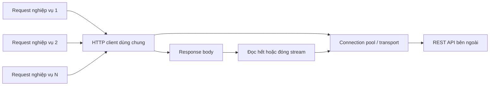

# Khởi tạo client dùng chung và quản lý vòng đời tài nguyên

## 1. Vấn đề: một HTTP request không nên tạo cả một hệ thống kết nối mới

Ứng dụng Java gọi REST API quản lý tồn kho hàng nghìn lần mỗi phút. Nếu mỗi lần gọi đều khởi tạo HTTP client mới, mở một connection rồi bỏ đối tượng mà không quản lý vòng đời, hệ thống có thể tăng chi phí TLS handshake, DNS lookup, socket, thread, bộ đệm và thời gian chờ. Nếu ngược lại tạo **một client dùng chung** nhưng quên đóng response body dạng stream, connection vẫn có thể bị giữ và pool cạn. Cả hai đều biểu hiện như lỗi timeout dù server đích khỏe mạnh.



Bài thuộc chương **Client Java** của module **INTEGRATION_API_REST**, hướng tới thiết kế REST theo resource, URI, HTTP method/status, hợp đồng dữ liệu, phân trang, cache, idempotency, xác thực, phân quyền, lỗi và kiểm thử API với Java/Spring. Ở đây ta tập trung vào **vòng đời HTTP client**, không chỉ vào cú pháp gửi `GET` hay `POST`.

**Mục tiêu:** chọn đúng phạm vi sống của HTTP client, pool và executor; phân biệt transport dùng chung với credential theo request; đóng body/stream đúng; cấu hình timeout, TLS, retry có kiểm soát; kiểm thử để phát hiện lỗi kết nối và rò rỉ tài nguyên.

### 1.1. Ba vòng đời không được đánh đồng

| Tài nguyên | Phạm vi sống điển hình | Điều phải bảo đảm |
| --- | --- | --- |
| **Client/transport** (`HttpClient`, `RestClient`, `WebClient`) | Cấu hình một lần và dùng lại theo service/upstream | Chia sẻ đúng cấu hình, không tạo trên mỗi request |
| **Connection pool và executor** | Cùng vòng đời application hoặc một integration cụ thể | Có giới hạn và được giải phóng khi owner ngừng hoạt động |
| **Một request/response** | Từ lúc gửi đến khi nhận/xử lý xong body | Đọc/đóng body, không giữ stream hoặc subscription vô hạn |

**Dùng chung client không có nghĩa dùng chung trạng thái người dùng.** `Authorization`, cookie, tenant, correlation ID và request-specific headers không được bị lưu nhầm làm mặc định của một singleton nếu chúng thay đổi theo caller.

## 2. Vì sao tạo client trên mỗi request là phản mẫu?

Ví dụ không nên lặp trong service:

```java
// Phản mẫu: thực hiện trong mỗi lần xử lý một request nghiệp vụ.
HttpClient client = HttpClient.newBuilder().build();
HttpRequest request = HttpRequest.newBuilder(
        URI.create("https://inventory.example.test/api/items/sku-7"))
    .GET().build();
HttpResponse<String> response =
    client.send(request, HttpResponse.BodyHandlers.ofString());
```

Đoạn này **có thể chạy đúng** trong ví dụ một lần, nhưng đặt trong hot path là một quyết định cấu hình vòng đời kém. Client mới không tận dụng được đầy đủ kết nối của client cũ; nếu mỗi instance có pool/executor riêng, số connection và thread có thể tăng theo tốc độ request.

Hướng nên dùng:

Hãy tạo client theo **upstream/configuration** lúc khởi động, dùng lại cho nhiều request và chỉ gắn headers/credentials theo lời gọi; đóng response body đúng và shutdown các tài nguyên **do mình sở hữu**. Pooling, idle eviction và API shutdown **phụ thuộc implementation/phiên bản**, không suy từ tên `RestClient` hay `WebClient`.

## 3. Java `java.net.http.HttpClient`: tạo một lần, gửi nhiều lần

Java 11+ cung cấp `java.net.http.HttpClient`; ví dụ này chọn **JDK 17**. Đối tượng client được thiết kế để tái sử dụng, có thể dùng đồng thời từ nhiều thread, sở hữu cấu hình transport và quản lý kết nối nội bộ.

```java
package example.clients;

import java.net.http.HttpClient;
import java.time.Duration;

public final class InventoryHttpTransport {
    private final HttpClient client;

    public InventoryHttpTransport() {
        this.client = HttpClient.newBuilder()
            .connectTimeout(Duration.ofSeconds(2))
            .followRedirects(HttpClient.Redirect.NEVER)
            .version(HttpClient.Version.HTTP_2)
            .build();
    }

    public HttpClient client() {
        return client; // Dùng chung nhiều request.
    }
}
```

`connectTimeout` giới hạn thời gian thiết lập kết nối mới, **không** phải ngân sách thời gian toàn bộ request. Tùy server và điều kiện mạng, client có thể đàm phán HTTP/2 hoặc dùng HTTP/1.1; `version(HTTP_2)` là **ưu tiên**, không phải hợp đồng rằng mọi upstream đều hỗ trợ HTTP/2.

### 3.1. Timeout và response status của từng request

```java
package example.clients;

import java.io.IOException;
import java.net.URI;
import java.net.http.*;
import java.time.Duration;

public final class InventoryGateway {
    private final HttpClient client;

    public InventoryGateway(HttpClient client) {
        this.client = client;
    }

    public String getInventory() throws IOException, InterruptedException {
        HttpRequest request = HttpRequest.newBuilder()
            .uri(URI.create("https://inventory.example.test/api/items/sku-7"))
            .timeout(Duration.ofSeconds(4))
            .header("Accept", "application/json")
            .GET()
            .build();

        HttpResponse<String> response =
            client.send(request, HttpResponse.BodyHandlers.ofString());
        if (response.statusCode() == 404) {
            throw new IllegalArgumentException("Item not found");
        }
        if (response.statusCode() != 200) {
            throw new IOException(
                "Inventory HTTP status: " + response.statusCode());
        }
        return response.body();
    }
}
```

`BodyHandlers.ofString()` nhận và gom body thành `String`, thuận tiện cho payload **nhỏ, có giới hạn kích thước**. Không dùng để tải tệp nhiều gigabyte. Đây là minh họa HTTP và vòng đời; ứng dụng thật nên parse JSON vào DTO được validate, xử lý `401/403/429/503` rõ ràng và giới hạn kích thước response.

### 3.2. Response stream phải được đóng

Khi response trả về dưới dạng `InputStream`, **caller sở hữu stream** và phải đóng, kể cả khi status không thành công:

```java
HttpRequest request = HttpRequest.newBuilder()
    .uri(URI.create("https://files.example.test/api/files/f-204/download"))
    .timeout(Duration.ofSeconds(30))
    .GET().build();

HttpResponse<java.io.InputStream> response =
    client.send(request, HttpResponse.BodyHandlers.ofInputStream());

try (java.io.InputStream body = response.body()) {
    if (response.statusCode() != 200) {
        throw new IOException(
            "Download failed, status=" + response.statusCode());
    }
    body.transferTo(targetOutputStream);
}
```

`targetOutputStream` trong ví dụ do caller cấp và **caller quản lý vòng đời**; không đóng nó ngầm khi chỉ muốn đọc hết HTTP body. `try-with-resources` bảo đảm stream từ HTTP response được đóng trên cả đường thành công lẫn lỗi. Nếu body không được đọc/đóng, connection có thể không tái sử dụng được và giữ tài nguyên lâu hơn cần thiết.

Với file lớn, dùng streaming hoặc `BodyHandlers.ofFile(...)` theo chính sách ghi file; phải kiểm tra quyền và nội dung, tránh path traversal, giới hạn tổng bytes và xử lý file tải dở khi lỗi. Việc `send()` trả về 200 không chứng minh bên nhận đã đọc đầy đủ tệp.

### 3.3. Vòng đời Java HttpClient khác nhau giữa các JDK

Trên **JDK 17**, `java.net.http.HttpClient` chưa có API `close()`/`shutdown()` để ứng dụng gọi trực tiếp như các client đóng được. Vì vậy thiết kế vòng đời phải bám **JDK thực tế đang chạy**; các JDK mới hơn có bổ sung API quản lý vòng đời, không được copy một lời gọi `client.close()` vào code Java 17 rồi cho rằng sẽ biên dịch.

Nếu cấu hình `HttpClient.Builder.executor(...)` với `ExecutorService` tự tạo, ứng dụng **sở hữu executor đó** và phải `shutdown()`/chờ kết thúc ở lifecycle shutdown phù hợp. Không khởi tạo `newFixedThreadPool` cho từng lần gọi API hoặc để nó sống sau khi ứng dụng ngừng.

### 3.4. Đồng bộ và bất đồng bộ không thay đổi sở hữu client

```java
java.util.concurrent.CompletableFuture<HttpResponse<String>> future =
    client.sendAsync(request, HttpResponse.BodyHandlers.ofString());

future.thenAccept(response -> {
    // Kiểm tra status, parse dữ liệu và ghi nhận lỗi theo hợp đồng.
});
```

`sendAsync` giúp thread gọi không phải chờ kết quả, nhưng vẫn dùng **cùng client/transport**. Cần quản lý lỗi qua `exceptionally`/`handle` hoặc composition đầy đủ; đừng tạo future rồi bỏ quên. Cancel future không đồng nghĩa hủy side effect đã bắt đầu tại server đích.

## 4. Spring `RestClient`: singleton facade, request factory quyết định transport

Từ **Spring Framework 6.1 / Spring Boot 3.2+**, `RestClient` cung cấp API HTTP **đồng bộ** kiểu fluent. Nó phù hợp khi business service đang blocking (chẳng hạn JPA/JDBC) nhưng cần hợp đồng HTTP rõ ràng. `RestClient` thường được **xây một lần rồi dùng lại**; không gọi `RestClient.create()` trong mỗi controller invocation.

**Điểm kỹ thuật:** `RestClient` là lớp abstraction. Cơ chế tạo socket, pooling, timeout và shutdown phụ thuộc `ClientHttpRequestFactory` phía dưới: JDK HttpClient, Apache HttpComponents, simple factory, v.v. Nếu muốn một transport cụ thể, cấu hình **tường minh** thay vì đoán Spring tự chọn theo classpath.

### 4.1. Spring configuration cho một upstream ổn định

Ví dụ dùng Spring Boot 3.2+, JDK 17 và JDK request factory:

```java
package example.catalog;

import java.net.http.HttpClient;
import java.time.Duration;
import org.springframework.beans.factory.annotation.Value;
import org.springframework.context.annotation.Bean;
import org.springframework.context.annotation.Configuration;
import org.springframework.http.client.JdkClientHttpRequestFactory;
import org.springframework.web.client.RestClient;

@Configuration
public class CatalogClientConfiguration {

    @Bean
    HttpClient catalogHttpTransport() {
        return HttpClient.newBuilder()
            .connectTimeout(Duration.ofSeconds(2))
            .followRedirects(HttpClient.Redirect.NEVER)
            .build();
    }

    @Bean
    RestClient catalogRestClient(
            RestClient.Builder builder,
            HttpClient catalogHttpTransport,
            @Value("${integrations.catalog.base-url}") String baseUrl) {

        var factory = new JdkClientHttpRequestFactory(catalogHttpTransport);
        factory.setReadTimeout(Duration.ofSeconds(4));
        return builder.baseUrl(baseUrl)
            .requestFactory(factory)
            .build();
    }
}
```

Ví dụ cấu hình ngoài code:

```yaml
integrations:
  catalog:
    base-url: https://catalog.example.test
```

Builder do Spring Boot cung cấp có thể giữ observability và converters; bean đã build dùng chung. Đối chiếu API timeout với **phiên bản Spring thực tế**; connect timeout không phải deadline nghiệp vụ.

### 4.2. Dữ liệu xác thực thuộc một request, không thuộc singleton

```java
package example.catalog;

import org.springframework.http.HttpHeaders;
import org.springframework.stereotype.Service;
import org.springframework.web.client.RestClient;

record CatalogItem(String sku, int available) {}

@Service
public class CatalogGateway {
    private final RestClient client;

    public CatalogGateway(RestClient catalogRestClient) {
        this.client = catalogRestClient;
    }

    public CatalogItem get(String sku, String accessToken) {
        CatalogItem item = client.get()
            .uri("/api/items/{sku}", sku)
            .headers(headers -> headers.setBearerAuth(accessToken))
            .header(HttpHeaders.ACCEPT, "application/json")
            .retrieve()
            .body(CatalogItem.class);
        if (item == null) {
            throw new IllegalStateException(
                "Catalog returned no item representation");
        }
        return item;
    }
}
```

Client dùng chung, còn request builder và headers thuộc **mỗi lời gọi**. Không `mutate` shared client để đặt default `Authorization` theo từng user; token A có thể rò sang B. Với OAuth2, ưu tiên authorized-client manager phù hợp.

`retrieve().body(...)` parse DTO bằng message converters và thường để framework đóng response. Khi thao tác **low-level stream**, cần tuân thủ callback/scope sở hữu và không để response sống vô hạn.

### 4.3. Xử lý status không giống nhau

Với `RestClient.retrieve()`, lỗi `4xx/5xx` mặc định thường được chuyển thành ngoại lệ `RestClientResponseException` (có thể cấu hình status handlers); ứng dụng cần ánh xạ lỗi theo hợp đồng chứ không trả `500` cho mọi upstream `404`.

`200` cần parse/validate DTO; `204` không có body để đọc. `401/403` đòi hỏi kiểm tra credential/quyền; `404` có thể là tài nguyên không tồn tại; `409/412` là xung đột nghiệp vụ/phiên bản. Với `429/503` chỉ retry hữu hạn theo contract và `Retry-After`; `502/504` hoặc socket timeout của POST có side effect có thể để lại **kết quả chưa chắc chắn**.

Một số service trả `application/problem+json`; client nên trích `type`, `status`, `code` ổn định và giới hạn độ dài body lỗi. Không log raw error payload chứa thông tin cá nhân, access token hoặc nội dung bí mật.

## 5. Spring `WebClient`: dùng chung facade, quản lý pool Reactor Netty

`WebClient` hỗ trợ non-blocking HTTP client qua `Mono`/`Flux`; nó dùng được trong **Spring WebFlux và cả Spring MVC**. Bản WebClient đã build thường immutable và có thể dùng lại. Tạo `WebClient` mới trên mỗi item trong `Flux` không mang lợi ích; có thể làm phình cấu hình, connector hoặc transport nếu chúng được tạo mới kèm theo.

### 5.1. WebClient bean mặc định

```java
package example.inventory;

import org.springframework.beans.factory.annotation.Value;
import org.springframework.context.annotation.Bean;
import org.springframework.context.annotation.Configuration;
import org.springframework.web.reactive.function.client.WebClient;

@Configuration
public class InventoryWebClientConfiguration {

    @Bean
    WebClient inventoryWebClient(
            WebClient.Builder builder,
            @Value("${integrations.inventory.base-url}") String baseUrl) {

        return builder.baseUrl(baseUrl)
            .build();
    }
}
```

Trong ứng dụng Spring Boot, ưu tiên **builder được framework cấu hình** để giữ lại các customizer, codec và observability cần thiết. Client trên dùng cùng connector/resources theo cấu hình chung; không tự kết luận rằng mỗi `WebClient` có một pool mới. Nếu ứng dụng thiết lập connector riêng, người tạo phải quyết định **ai sở hữu và giải phóng** connection provider/event-loop resources.

### 5.2. Ví dụ không chặn event loop

```java
package example.inventory;

import java.time.Duration;
import org.springframework.stereotype.Service;
import org.springframework.web.reactive.function.client.WebClient;
import reactor.core.publisher.Mono;

record InventoryItem(String sku, int available) {}

@Service
public class InventoryGateway {
    private final WebClient client;

    public InventoryGateway(WebClient inventoryWebClient) {
        this.client = inventoryWebClient;
    }

    public Mono<InventoryItem> get(String sku, String token) {
        return client.get()
            .uri("/api/inventory/{sku}", sku)
            .headers(h -> h.setBearerAuth(token))
            .retrieve()
            .bodyToMono(InventoryItem.class)
            .timeout(Duration.ofSeconds(5));
    }
}
```

Trong WebFlux request pipeline, hãy **return/compose `Mono`**, không dùng `.block()` trên event loop hoặc tự gọi `.subscribe()` rồi bỏ qua lỗi. Với `retrieve().bodyToMono(...)`, WebClient quản lý việc tiêu thụ/giải phóng response body trong luồng bình thường. Nếu dùng `exchangeToMono`/`exchangeToFlux`, phải xử lý body theo từng nhánh; nếu stream bị hủy, cần đo/kiểm tra cancellation, cleanup và trạng thái HTTP đã commit.

### 5.3. Khi cần pool riêng cho một upstream

Với Reactor Netty, có thể cấu hình `ConnectionProvider` riêng theo yêu cầu đồng thời và giới hạn hàng đợi:

```java
package example.inventory;

import java.time.Duration;
import io.netty.channel.ChannelOption;
import org.springframework.beans.factory.annotation.Value;
import org.springframework.context.annotation.Bean;
import org.springframework.context.annotation.Configuration;
import org.springframework.http.client.reactive.ReactorClientHttpConnector;
import org.springframework.web.reactive.function.client.WebClient;
import reactor.netty.http.client.HttpClient;
import reactor.netty.resources.ConnectionProvider;

@Configuration
public class InventoryPoolConfiguration {
    @Bean(destroyMethod = "dispose")
    ConnectionProvider inventoryConnectionProvider() {
        return ConnectionProvider.builder("inventory")
            .maxConnections(80)
            .pendingAcquireMaxCount(120)
            .pendingAcquireTimeout(Duration.ofSeconds(2))
            .build();
    }

    @Bean
    WebClient pooledInventoryClient(
            WebClient.Builder builder,
            ConnectionProvider inventoryConnectionProvider,
            @Value("${integrations.inventory.base-url}") String baseUrl) {

        HttpClient transport = HttpClient.create(inventoryConnectionProvider)
            .option(ChannelOption.CONNECT_TIMEOUT_MILLIS, 2_000)
            .responseTimeout(Duration.ofSeconds(4));

        return builder.baseUrl(baseUrl)
            .clientConnector(new ReactorClientHttpConnector(transport))
            .build();
    }
}
```

Các giới hạn `80`, `120` chỉ là **giả định minh họa**, cần đo theo downstream capacity. `ConnectionProvider` ở đây được Spring sở hữu qua bean và dispose khi context đóng; event-loop resources toàn cục của Reactor Netty có vòng đời **khác** và không nên dispose giữa chừng nếu client khác còn dùng. Nếu tự tạo `LoopResources`/connector, phải đăng ký shutdown tương ứng. Cần kiểm tra cấu hình TLS, proxy, tracing và metrics khi ghi đè connector do Spring Boot cấu hình.

Không tăng pool vô hạn khi downstream chậm; dùng bounded pool/queue, timeout và bulkhead.

Hai cấu hình `inventoryWebClient` và `pooledInventoryClient` ở trên là **hai phương án thay thế**; không đăng ký cả hai rồi inject `WebClient` theo type nếu không có `@Qualifier`/`@Primary` phù hợp.

## 6. Bảo mật khi tái sử dụng HTTP client

### 6.1. Chia sẻ transport, cách ly danh tính

Một HTTP client dùng chung có thể phục vụ nhiều request thuộc các user/tenant khác nhau **nếu** authentication và authorization gắn với từng request, không rò qua trạng thái mutable của singleton. Hãy phân biệt:

- **Cấu hình ổn định của upstream**: `baseUrl`, TLS trust, proxy, timeout, tracing và policy redirect. Chúng có thể thuộc bean dùng chung.
- **Dữ liệu của lời gọi**: access token, tenant context, correlation ID, conditional headers và idempotency key. Chúng phải được xác định cho **từng request**.
- **Danh tính ở tầng kết nối**: mTLS client certificate, proxy authentication, cookie jar hoặc transport security policy riêng. Nếu các tenant cần certificate/trust/identity khác nhau, **không** dùng bừa một client/pool chung cho các chính sách không tương thích.

Ví dụ sai:

```java
// Phản mẫu: một singleton bị sửa khi user khác gọi đồng thời.
this.sharedToken = accessTokenFromCurrentUser;
// Request sau có thể dùng nhầm token của request trước.
```

Không dùng `defaultCookie` hoặc interceptor có biến instance giữ “user hiện tại”. Với Java HttpClient, `CookieHandler`/`Authenticator` cấu hình tại client có thể mang state; cần đánh giá phạm vi chia sẻ theo ứng dụng. Với WebClient, context truyền xuyên luồng reactive cần dựa vào cơ chế thích hợp (ví dụ Reactor Context/authorized-client manager), không trông cậy ThreadLocal từ servlet.

### 6.2. TLS, redirects và SSRF

- Dùng **HTTPS** và xác thực hostname/chứng chỉ theo trust policy. Không tắt certificate validation hoặc trust-all TLS trong production để sửa lỗi kết nối.
- Tránh tự động theo redirect tới host khác khi request mang bearer token/API key; phải xem xét việc gửi credentials đến đích redirect và chính sách client cụ thể.
- `baseUrl` nên lấy từ **cấu hình đáng tin**, path/query variables được encode bằng URI builder. Không để tham số URL do người dùng cung cấp biến client nội bộ thành công cụ gọi metadata service/private network (**SSRF**).
- Không log nguyên `Authorization`, cookie, API key hoặc URL ký. Với lỗi TLS, ghi host/loại lỗi an toàn và correlation ID, không ghi credential.
- Khi đổi secret/certificate trong vận hành, kiểm tra khả năng hot reload của TLS client. Một singleton có thể cần được **thay thế có kiểm soát** nếu trust/key material không tự cập nhật, sau đó đóng tài nguyên của client cũ khi không còn request đang dùng.

Việc dùng chung client **không tạo ra quyền đọc tài nguyên**: server đích vẫn kiểm tra token, scope và object-level authorization; một `200` từ upstream cũng không thay việc service hiện tại kiểm tra được phép chuyển dữ liệu ấy cho caller hay không.

### 6.3. Giới hạn bộ nhớ và phản hồi lỗi

Không để client tự động đọc toàn bộ error body hoặc response lớn vào heap khi server đích trả hàng trăm megabyte. Giới hạn `maxInMemorySize`/codec buffers với WebClient khi phù hợp; dùng streaming cho file lớn, giới hạn bytes và đảm bảo dọn tài nguyên khi parse thất bại. Response header `Content-Length` có thể thiếu/sai; không dựa riêng vào nó để áp quota.

## 7. Timeout, retry và trạng thái kết nối

Một HTTP client khỏe mạnh cần giới hạn **mọi điểm có thể chờ**:

| Giới hạn | Câu hỏi vận hành |
| --- | --- |
| Pool acquire timeout | Mất bao lâu để chờ một connection trống? |
| Connect timeout | Mất bao lâu để thiết lập kết nối TCP/TLS? |
| Response/read timeout | Chờ server trả kết quả/bytes bao lâu? |
| Tổng deadline nghiệp vụ | Tối đa bao nhiêu thời gian cho toàn bộ bước gọi, retry và xử lý? |
| Max connections/pending requests | Khi đích bị quá tải, queue có giới hạn không? |
| Idle/max lifetime | Connection cũ hoặc không còn hợp lệ được thay thế ra sao? |

Các API timeout **không đồng nghĩa nhau**. Ví dụ timeout của một `Mono` có thể giới hạn thời gian tới tín hiệu hoặc giữa các tín hiệu tùy operator; request body streaming vẫn có thể kéo dài. Với Java HttpClient và `BodyHandlers.ofInputStream`, việc nhận headers và trả về stream không tự bảo đảm caller đã đọc body xong trong một deadline. Cần thiết kế deadline cho **toàn bộ công việc** tại tầng nghiệp vụ.

### 7.1. Retry phải tách khỏi pooling

Pool giúp dùng lại transport; nó không giải quyết được **outcome ambiguity** của một request đã gửi. Giả sử client gửi:

```http
POST /api/payments HTTP/1.1
Idempotency-Key: opaque-intent-789
Content-Type: application/json

{"orderId":"ord-789","amountMinor":125000,"currency":"VND"}
```

Socket bị đóng sau khi server đã commit nhưng trước khi client nhận response: **không được kết luận thanh toán thất bại**. Client có thể retry **cùng key và payload** nếu server có hợp đồng idempotency bền vững, hoặc tra cứu operation/status; không phát một lệnh thu tiền mới bằng key khác.

Nguyên tắc:

1. Có retry budget/deadline hữu hạn, exponential backoff và jitter; khi `429`/`503` cần cân nhắc `Retry-After`.
2. Chỉ retry method/operation **được phép** theo hợp đồng; `GET` thường an toàn hơn POST tạo side effect, nhưng cả GET cũng cần giới hạn tải.
3. Không lặp `401`, `403`, `409`, `412` như transient timeout; cần sửa credential, quyền hoặc mâu thuẫn nghiệp vụ.
4. Với `POST`, chỉ retry khi có idempotency guarantee cụ thể và **giữ nguyên key/payload**. Không suy rằng HTTP client/framework tự bảo vệ double charge.
5. Theo dõi tỷ lệ retry/replay/timeout cùng operation ID và không che lỗi bằng “retry mãi tới khi thành công”.

### 7.2. Không đóng client đang được dùng chỉ vì một request lỗi

Nếu một request trả `500`, timeout hoặc bị cancel, không nên `close()` cả HTTP client hay dispose connection provider đang phục vụ các request khác. Lỗi request được xử lý ở scope request; lỗi transport hỏng cần cơ chế pool eviction/reconnect. Chỉ đóng toàn pool khi **owner shutdown/reconfigure** hoặc khi có kế hoạch thay thế client.

### 7.3. DNS, keep-alive và pool

Connection dùng lại có thể kết nối tới IP đã cũ khi upstream đổi DNS/load balancer. Pool policy, connection max age/idle eviction, DNS resolver và hạ tầng service discovery quyết định tốc độ chuyển sang endpoint mới. Không tắt keep-alive để “sửa” một lỗi DNS mà chưa đo nguyên nhân; cũng không tăng kết nối vô hạn khi lỗi 503 xuất hiện.

## 8. Quan sát và shutdown đúng vòng đời

Theo dõi **active/idle/pending connections**, pool acquire latency, p95/p99 HTTP latency, status, timeout/retry/cancel, bytes, thread/socket count và event-loop lag (nếu có). Truy vết correlation ID, idempotency replay và JSON parse errors; metric labels chỉ nên dùng route template/service/status, **không** token, user/order ID hay URL độ cardinality cao.

### 8.1. Ai sở hữu thì người đó đóng

| Trường hợp | Vòng đời phù hợp |
| --- | --- |
| `HttpClient` JDK 17 dùng chung | Không tạo từng request; quản lý executor tùy chỉnh riêng, hiểu giới hạn API đóng của JDK |
| `CloseableHttpClient` Apache tự tạo | Đóng khi component/context sở hữu ngừng; nếu Spring bean, khai báo destroy phù hợp |
| Reactor Netty `ConnectionProvider` riêng | `dispose()` khi ứng dụng/integration không còn dùng |
| Reactor Netty global resources | Để lifecycle manager của application/context quản lý; không dispose giữa chừng |
| `InputStream` từ response | `try-with-resources` sau khi hoàn tất hoặc gặp lỗi |
| Reactive subscription/stream | Đảm bảo complete/error/cancel cleanup; không giữ subscription mồ côi |

Trong Spring, **singleton bean không đồng nghĩa mọi tài nguyên liên quan sẽ tự giải phóng đúng cách**: với client có `close()`/`dispose()` và resources tự sở hữu, đăng ký `@Bean(destroyMethod = "...")`, `DisposableBean` hoặc shutdown hook tương đương **chỉ một owner**. Khi graceful shutdown, ngừng nhận công việc mới, để request đang thực thi kết thúc trong giới hạn, rồi mới dọn pool/executor.

## 9. Kiểm thử vòng đời và hợp đồng Java client

### 9.1. Kiểm thử một `RestClient` dùng chung, token theo từng request

`MockRestServiceServer` kiểm tra request/response mà không cần gọi Internet. Test dưới đây dùng `CatalogGateway` mục 4; **một gateway và một client** thực hiện hai request với hai token khác nhau:

```java
package example.catalog;

import static org.junit.jupiter.api.Assertions.assertEquals;
import static org.springframework.test.web.client.match.MockRestRequestMatchers.*;
import static org.springframework.test.web.client.response.MockRestResponseCreators.*;

import org.junit.jupiter.api.Test;
import org.springframework.http.HttpHeaders;
import org.springframework.http.HttpMethod;
import org.springframework.http.MediaType;
import org.springframework.test.web.client.MockRestServiceServer;
import org.springframework.web.client.RestClient;

class CatalogGatewayTest {
    @Test
    void oneClientDoesNotLeakAuthorizationBetweenCalls() {
        RestClient.Builder builder = RestClient.builder()
            .baseUrl("https://catalog.example.test");
        MockRestServiceServer server =
            MockRestServiceServer.bindTo(builder).build();

        for (String token : new String[]{"token-A", "token-B"}) {
            server.expect(requestTo(
                    "https://catalog.example.test/api/items/sku-7"))
                .andExpect(method(HttpMethod.GET))
                .andExpect(header(HttpHeaders.AUTHORIZATION,
                    "Bearer " + token))
                .andRespond(withSuccess(
                    "{\"sku\":\"sku-7\",\"available\":3}",
                    MediaType.APPLICATION_JSON));
        }

        CatalogGateway gateway = new CatalogGateway(builder.build());
        assertEquals(3, gateway.get("sku-7", "token-A").available());
        assertEquals(3, gateway.get("sku-7", "token-B").available());
        server.verify();
    }
}
```

Test chứng minh header được đặt **theo lần gọi**, không chứng minh pool hoạt động: mock không mở socket thật. Với Spring Security, cần test thêm OAuth token manager, audience và đường gọi thiếu quyền.

### 9.2. Integration/load tests cần chạy ngoài mock

| Thử nghiệm | Điều cần chứng minh |
| --- | --- |
| 100–500 request đồng thời tới stub HTTP server | Không tạo client/pool theo mỗi request; connection/thread không tăng vô hạn |
| Response `200` nhưng body đọc chậm/hủy giữa chừng | Stream/subscription được cleanup; pool có thể phục hồi |
| Upstream trả `404`, `429`, `503`, đóng kết nối đột ngột | Status được ánh xạ đúng, request lỗi không làm đóng cả shared client |
| Server đích trì hoãn accept hoặc response | Connect/read/total deadline đúng, pending pool có giới hạn |
| Retry POST sau khi stub đã commit nhưng làm mất response | Cùng idempotency key; không gây hai side effect |
| Hai tenant gọi cùng shared transport | Không trộn token/cookie/tenant hay response |
| Application shutdown trong lúc tải file | Có graceful deadline và giải phóng stream, executor, pool do ứng dụng sở hữu |

Kiểm thử có thể dùng WireMock/MockWebServer hoặc stub HTTP server cục bộ và thu thập metrics từ connection provider. Một test HTTP đơn giản chỉ assert status `200` **không đủ** để phát hiện connection leak; phải đo active/idle/pending connections sau chu kỳ tạo tải và kết thúc.

## 10. Bài tập và checklist

**Tình huống:** `OrderService` gọi `InventoryService` 300 lần/giây. Code hiện tại tạo `HttpClient.newHttpClient()` trong mỗi lần gọi, lấy body bằng `BodyHandlers.ofInputStream()` nhưng không đóng stream khi nhận `404`. Đồng thời, một singleton `WebClient` được gắn token người dùng A ở default headers để phục vụ nhiều tenant.

**Yêu cầu:** (1) xác định ba lỗi về vòng đời/bảo mật; (2) đề xuất bean/configuration dùng chung; (3) chọn phạm vi đóng stream và pool; (4) nêu cách kiểm thử khi upstream đóng socket và khi hai người dùng gọi đồng thời.

**Hướng giải:** chuyển client thành bean theo upstream, dùng cấu hình timeout và giới hạn pool phù hợp; `try-with-resources` đóng `InputStream` cho cả 2xx và non-2xx; token phải đi theo **từng request** hoặc OAuth client context đáng tin; chỉ dispose pool khi owner shutdown. Test load có connection metrics, 404/timeout cleanup và hai token độc lập; không dùng retry không giới hạn để che socket leak.

**Checklist nhanh:** client dùng chung nhưng không chia sẻ credential; timeout và pending queue hữu hạn; HTTPS/redirect policy an toàn; đọc/đóng response body; retry dựa trên HTTP semantics và idempotency; lifecycle executor/pool rõ owner; giám sát và kiểm thử lỗi thực tế.

## 11. Kết luận

**Khởi tạo HTTP client một lần và tái sử dụng** thường giảm chi phí kết nối, nhưng chỉ an toàn khi phân biệt **client/transport**, **pool/executor** và **response body**. Trong Java/Spring, chọn cách quản lý theo implementation và JDK cụ thể, đặt thông tin xác thực cho từng request, đóng stream đúng lúc và chỉ shutdown tài nguyên do mình sở hữu. Pooling không thay thế retry có kiểm soát, idempotency hay phân quyền REST API.

