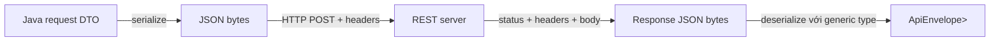

# Serialize yêu cầu và deserialize kiểu generic của phản hồi

## 1. Bài toán: JSON hợp lệ nhưng Java client đọc sai kiểu

Một Java client gửi điều kiện tìm đơn hàng tới REST API:

```http
POST /orders/search HTTP/1.1
Host: api.example.test
Authorization: Bearer <access-token>
Accept: application/json
Content-Type: application/json

{"statuses":["PAID"],"limit":2}
```

Server trả một trang kết quả được bọc trong envelope:

```http
HTTP/1.1 200 OK
Content-Type: application/json
Cache-Control: private, no-store

{
  "data": {
    "items": [
      {"id":"ord-42","amount":150000.50,"status":"PAID"},
      {"id":"ord-43","amount":20000.00,"status":"PAID"}
    ],
    "nextCursor":"c_9a"
  },
  "requestId":"req-73"
}
```

Về HTTP, request có media type đúng và response là JSON hợp lệ. Nhưng một client gọi `mapper.readValue(body, ApiEnvelope.class)` có thể nhận `data` dạng `LinkedHashMap`, còn `items` là `List<LinkedHashMap>`, **không phải** `Page<OrderView>`. Khi ép từng phần tử thành `OrderView`, ứng dụng dễ gặp `ClassCastException` ở nơi rất xa lời gọi HTTP.

Nguyên nhân là **Java type erasure**: kiểu generic trong `ApiEnvelope<Page<OrderView>>` không luôn còn đầy đủ khi chạy. Client phải cung cấp **thông tin kiểu đầy đủ** cho JSON deserializer — bằng `TypeReference` của Jackson, `JavaType` hoặc `ParameterizedTypeReference` của Spring.

Bài thuộc chương **Client Java** trong học phần `INTEGRATION_API_REST`, gắn với thiết kế resource, URI, phương thức/status HTTP, hợp đồng dữ liệu, phân trang, cache, idempotency, OpenAPI, authentication/authorization, lỗi và kiểm thử Java/Spring. Mục tiêu không chỉ “parse JSON thành object” mà là xây một client giữ đúng **hợp đồng trên wire**, kể cả lỗi và trường hợp dữ liệu không tương thích.

Sau bài, bạn có thể giải thích cơ chế serialize/deserialize, giữ generic type nhiều tầng, gọi HTTP bằng JDK `HttpClient` và Spring `RestClient`/`WebClient`, xử lý status/error và bảo mật, kiểm thử round-trip cũng như contract với JSON fixtures.

## 2. Phân biệt serialization, deserialization và HTTP binding



| Khâu | Ví dụ | Rủi ro nếu nhầm |
| --- | --- | --- |
| **Serialize** | Java `SearchOrdersRequest` → JSON body | Sai tên trường, enum/date/number hoặc gửi trường nhạy cảm |
| **HTTP transport** | `POST`, URI, `Content-Type`, `Accept`, token | Server 400/401/415/406 hoặc ghi lặp khi retry |
| **Deserialize** | JSON body → `ApiEnvelope<Page<OrderView>>` | Erasure, dữ liệu không đúng kiểu, null, trường lạ |
| **Validate contract** | So trạng thái/headers và schema | Một DTO deserialize được vẫn có thể sai nghiệp vụ |
| **Domain mapping** | Chuyển DTO thành logic nội bộ | Tin dữ liệu client/server ngoài ranh giới tin cậy |

`Content-Type` của request chỉ ra **định dạng bytes được gửi**; `Accept` cho server biết những response media types client muốn nhận. Server có thể dùng `application/problem+json` cho lỗi dù thành công dùng `application/json`. Hai headers này **không** chứa kiểu Java như `Page<OrderView>`.

Client nên quyết định cách xử lý dựa trên **status + headers trước**, rồi mới decode body theo response schema tương ứng. HTTP 204 không có body là trường hợp bình thường; không thử deserialize một chuỗi rỗng thành object bắt buộc.

## 3. Thiết kế DTO: để JSON mapping kiểm chứng được

Ví dụ dùng Java 17+ record và Jackson 2.12+ (có hỗ trợ Java record). Định nghĩa model tách khỏi lớp persistence/JPA:

```java
import java.math.BigDecimal;
import java.util.List;

record SearchOrdersRequest(List<String> statuses, int limit) {}

record OrderView(
    String id,
    BigDecimal amount,
    String status
) {}

record Page<T>(
    List<T> items,
    String nextCursor
) {}

record ApiEnvelope<T>(
    T data,
    String requestId
) {}
```

`SearchOrdersRequest` là request body của thao tác tìm kiếm, không phải nơi lưu HTTP status. `OrderView` mô tả **một phần tử JSON**; `Page<T>` giữ danh sách, cursor; `ApiEnvelope<T>` giữ dữ liệu và requestId. Response JSON được biểu diễn bằng kiểu đầy đủ:

```java
ApiEnvelope<Page<OrderView>>
```

**Tại sao dùng `BigDecimal` cho số tiền?** JSON có number nhưng không có kiểu Decimal của Java. Sử dụng `double` có nguy cơ sai số nhị phân với tính toán tiền; tuy nhiên dù `BigDecimal` giữ được chữ số decimal, hệ thống vẫn phải thống nhất đơn vị tiền, scale, làm tròn và quy tắc business. Không coi kiểu Java là đủ để chứng minh hợp đồng thanh toán đúng.

### DTO không phải hợp đồng bảo mật

Request DTO chỉ nên chứa các trường client được phép gửi. Không đưa `tenantId`, `role`, `isAdmin` vào DTO rồi tin chúng để kiểm tra quyền. Server phải lấy tenant/identity từ thông tin xác thực hợp lệ. Với client, không log raw request/response có token, PII hoặc dữ liệu thanh toán chỉ để debug JSON.

## 4. Jackson ObjectMapper: serialize request có chủ đích

Jackson `ObjectMapper` thường được dùng trong ứng dụng Java. Thiết lập phù hợp với JSON contract và tái sử dụng mapper sau cấu hình:

```java
ObjectMapper mapper = JsonMapper.builder()
    .addModule(new JavaTimeModule())
    .disable(SerializationFeature.WRITE_DATES_AS_TIMESTAMPS)
    .build();

SearchOrdersRequest request =
    new SearchOrdersRequest(List.of("PAID"), 2);

String json = mapper.writeValueAsString(request);
// {"statuses":["PAID"],"limit":2}
```

Ví dụ sử dụng Jackson Databind cùng module `jackson-datatype-jsr310`; imports đã lược bỏ. Trong Spring Boot, nên ưu tiên sử dụng **ObjectMapper do application cấu hình**, tránh tạo mapper khác trong từng lời gọi rồi vô tình lệch naming, dates, custom modules hoặc unknown-fields policy.

**Kiểm soát serialization:**

- `@JsonProperty("external_name")` định nghĩa tên property nếu JSON khác tên Java; đổi tên field là thay đổi hợp đồng.
- `@JsonIgnore` có thể loại trường khỏi JSON, nhưng **không thay thế** thiết kế request DTO tối thiểu.
- `@JsonInclude` ảnh hưởng việc bỏ null/empty: server có thể phân biệt **trường vắng mặt** với **trường hiện diện có giá trị null**.
- `@JsonFormat` và date/time modules ảnh hưởng cách biểu diễn thời gian; ưu tiên timestamp ISO 8601 có offset khi contract yêu cầu một thời điểm tuyệt đối.
- Enum mặc định thường biểu diễn bằng tên; nếu JSON yêu cầu snake-case hoặc mã ổn định, map tường minh và test.

Không kích hoạt Jackson default typing với JSON từ endpoint không tin cậy để client có thể chọn class Java tùy ý. Nếu cần polymorphic DTO, dùng allowlist subtype rõ ràng và hợp đồng tag ổn định.

### Ví dụ thời gian phải rõ về timezone

```java
record CreatedOrder(
    String id,
    OffsetDateTime createdAt
) {}
```

JSON `"createdAt":"2026-11-18T09:30:00+07:00"` chứa offset rõ ràng. `LocalDateTime` **không chứa offset/timezone**, nên client và server có thể hiểu khác nhau khi trao đổi qua nhiều múi giờ. Cần thống nhất cách mapping và kiểm thử giờ DST/UTC khi có liên quan.

## 5. Java type erasure: nguyên nhân của `LinkedHashMap`

Trong Java, `List<OrderView>` và `List<String>` đều có raw class là `List.class` lúc chạy. Nếu gọi:

```java
List<?> raw = mapper.readValue(jsonArray, List.class);
Object first = raw.get(0);
// Thường là LinkedHashMap, không phải OrderView.
```

Jackson không biết `OrderView` vì bạn chỉ truyền `List.class`. Tương tự, `ApiEnvelope.class` không chứa runtime type argument của `data`. Các phép ép kiểu như `(List<OrderView>) raw` chỉ đổi **khai báo tại compile time**, không chuyển từng phần tử thành `OrderView`. Ứng dụng có thể biên dịch với unchecked cast rồi nổ khi truy cập.

### Cách 1 — TypeReference cho kiểu đã biết khi viết code

```java
TypeReference<List<OrderView>> listType =
    new TypeReference<List<OrderView>>() {};

List<OrderView> orders =
    mapper.readValue(jsonArray, listType);
assert orders.get(0) instanceof OrderView;
```

Lớp anonymous `new TypeReference<...>() {}` giữ **type token** bằng cách ghi lại generic superclass. Điều quan trọng là kiểu cụ thể xuất hiện trong chữ ký:

```java
TypeReference<ApiEnvelope<Page<OrderView>>> envelopeType =
    new TypeReference<ApiEnvelope<Page<OrderView>>>() {};

ApiEnvelope<Page<OrderView>> envelope =
    mapper.readValue(jsonResponse, envelopeType);

OrderView first = envelope.data().items().get(0);
String nextCursor = envelope.data().nextCursor();
```

Khi generic lồng hai tầng, `TypeReference` giữ cả `Page<OrderView>` và `ApiEnvelope<...>`. Đây là trường hợp code mẫu thường bỏ sót nếu chỉ hướng dẫn parse một `List<OrderView>`.

### Không dùng TypeReference<T> ngây thơ trong một hàm generic

```java
// KHÔNG đủ thông tin kiểu cụ thể tại runtime:
static <T> T unsafeRead(String json, ObjectMapper mapper)
        throws JsonProcessingException {
    return mapper.readValue(json, new TypeReference<T>() {});
}
```

Ở đây `T` vẫn là một **type variable bị erasure**. Không thể tự suy ra `Page<OrderView>` từ một lời gọi Java sau khi chương trình chạy. API tiện ích phải **nhận type token từ caller** hoặc một `JavaType` đã dựng đủ.

## 6. JavaType: deserialize kiểu generic được quyết định lúc chạy

Khi kiểu phần tử chỉ biết tại runtime (ví dụ thư viện SDK nhiều loại resource), Jackson `TypeFactory` tạo cây kiểu:

```java
TypeFactory factory = mapper.getTypeFactory();
JavaType orderType = factory.constructType(OrderView.class);
JavaType pageType = factory.constructParametricType(
    Page.class, orderType);
JavaType envelopeType = factory.constructParametricType(
    ApiEnvelope.class, pageType);

ApiEnvelope<Page<OrderView>> value =
    mapper.readValue(jsonResponse, envelopeType);
```

`JavaType` mô tả phần tử bên trong generic wrappers. Một cách khác cho list/map:

```java
JavaType ordersType = factory.constructCollectionType(
    List.class, OrderView.class);
JavaType byIdType = factory.constructMapType(
    Map.class, String.class, OrderView.class);
```

Không tự ghép tên class từ JSON thành `Class.forName(...)` rồi tạo subtype: đó là rủi ro bảo mật. Tập kiểu được phép phải do ứng dụng/SDK quy định. Một `ObjectReader` tạo từ `mapper.readerFor(envelopeType)` có thể được tái sử dụng sau cấu hình để giảm lỗi sử dụng sai type.

| Tình huống | Type token gợi ý |
| --- | --- |
| `OrderView` đơn | `OrderView.class` |
| `List<OrderView>` | `TypeReference<List<OrderView>>` |
| `Page<OrderView>` | `TypeReference<Page<OrderView>>` |
| `ApiEnvelope<Page<OrderView>>` | `TypeReference<ApiEnvelope<Page<OrderView>>>` |
| Kiểu phần tử xác định tại runtime | `JavaType` từ `TypeFactory` |
| Spring generic response body | `ParameterizedTypeReference<...>` |

**Phân biệt:** `Class<T>` đủ cho kiểu không generic; `TypeReference<T>`/`JavaType` giữ type arguments. Chọn ít nhất một cách làm **thật sự còn thông tin runtime**, đừng chỉ đổi cú pháp mà giữ raw class bên trong.

## 7. JDK HttpClient: tự serialize, tự giữ generic type

JDK `java.net.http.HttpClient` (Java 11+) cung cấp HTTP transport, **không phải JSON object mapper**. Kết hợp với Jackson, client phải thực hiện rõ bốn bước: tạo JSON, gửi HTTP, kiểm tra status/media type, rồi deserialize bằng type token.

```java
class OrderSearchHttpClient {
    private static final TypeReference<
        ApiEnvelope<Page<OrderView>>> RESPONSE_TYPE =
        new TypeReference<ApiEnvelope<Page<OrderView>>>() {};

    private final HttpClient http;
    private final ObjectMapper mapper;
    private final URI searchUri;

    OrderSearchHttpClient(
        HttpClient http, ObjectMapper mapper, URI searchUri
    ) {
        this.http = http;
        this.mapper = mapper;
        this.searchUri = searchUri;
    }

    ApiEnvelope<Page<OrderView>> search(
        SearchOrdersRequest query, String accessToken
    ) throws IOException, InterruptedException {
        String payload = mapper.writeValueAsString(query);
        HttpRequest request = HttpRequest.newBuilder(searchUri)
            .timeout(Duration.ofSeconds(10))
            .header("Authorization", "Bearer " + accessToken)
            .header("Accept", "application/json")
            .header("Content-Type", "application/json; charset=UTF-8")
            .POST(HttpRequest.BodyPublishers.ofString(
                payload, StandardCharsets.UTF_8))
            .build();

        HttpResponse<String> response = http.send(
            request, HttpResponse.BodyHandlers.ofString(
                StandardCharsets.UTF_8));
        if (response.statusCode() != 200) {
            throw decodeApiFailure(response, mapper);
        }
        requireJsonContentType(response.headers());
        return mapper.readValue(response.body(), RESPONSE_TYPE);
    }
}
```

`decodeApiFailure` và `requireJsonContentType` là helpers **chưa triển khai**; phải kiểm tra status, media type và giới hạn error body như mục sau. `HttpClient` nên được chia sẻ/lifecycle quản lý để tái sử dụng connections. `searchUri` phải được cấu hình từ endpoint trusted và xây bằng URI builder có encoding đúng, không nối query/user input hoặc URL tùy ý vào một HTTP client mang Authorization token.

Một client đồng bộ có thể hợp lý cho batch nhỏ, nhưng mỗi lần `BodyHandlers.ofString` sẽ **tích lũy toàn response trong RAM**. Với body quá lớn, cần giới hạn ở gateway/client hoặc dùng streaming parser/body handler có giới hạn.

### Khi status không thành công

JDK HttpClient **không tự ném exception khi server trả 400 hoặc 500**. Nó trả `HttpResponse`; ứng dụng phải kiểm tra status trước khi coi JSON là kiểu thành công. Nếu server trả `204 No Content`, API client có thể trả `Optional.empty()`/`void` theo contract; đừng parse response rỗng thành `ApiEnvelope<T>`.

## 8. Spring RestClient: giữ kiểu bằng ParameterizedTypeReference

Spring Framework 6.1+ có `RestClient` đồng bộ. Với JSON message converter được cấu hình, `body(query)` serialize request và `retrieve().body(type)` deserialize response:
 
```java
final class SpringOrderSearch {
    private static final ParameterizedTypeReference<
        ApiEnvelope<Page<OrderView>>> TYPE =
        new ParameterizedTypeReference<
            ApiEnvelope<Page<OrderView>>>() {};

    private final RestClient restClient;
    SpringOrderSearch(RestClient restClient) {
        this.restClient = restClient;
    }

    ApiEnvelope<Page<OrderView>> search(
        SearchOrdersRequest query, String token) {
        return restClient.post().uri("/orders/search")
            .contentType(MediaType.APPLICATION_JSON)
            .accept(MediaType.APPLICATION_JSON)
            .headers(h -> h.setBearerAuth(token))
            .body(query).retrieve().body(TYPE);
    }
}
```

Khởi tạo với `RestClient.builder().baseUrl("https://api.example.test").build()`; trong Spring Boot ưu tiên builder/converters đã cấu hình chung, gồm connection/read timeouts và observability. Giữ client dùng lại, chỉ gửi token tới trusted origin. `ParameterizedTypeReference` lưu cả `ApiEnvelope<Page<OrderView>>` cho decoder. Nếu dùng `body(ApiEnvelope.class)`, phần `data` lại có thể là `LinkedHashMap`.

Muốn lấy HTTP headers/status, thay `body(TYPE)` bằng `toEntity(TYPE)`:

```java
ResponseEntity<ApiEnvelope<Page<OrderView>>> response =
    restClient.post().uri("/orders/search")
        .contentType(MediaType.APPLICATION_JSON)
        .body(query).retrieve().toEntity(TYPE);
HttpStatusCode status = response.getStatusCode();
String etag = response.getHeaders().getETag();
```

`ResponseEntity<T>` là wrapper của **HTTP client Spring**, còn `ApiEnvelope<T>` là **JSON trên wire**: không nhầm hai lớp này. Mặc định `retrieve()` chuyển 4xx/5xx thành lỗi; 204 thường cho body null, không phải object rỗng.

## 9. Spring WebClient: generic type trong Mono

Với WebFlux, `WebClient` cần cùng type token, nhưng trả kết quả reactive:
 
```java
final class ReactiveOrderSearch {
    private static final ParameterizedTypeReference<
        ApiEnvelope<Page<OrderView>>> TYPE =
        new ParameterizedTypeReference<
            ApiEnvelope<Page<OrderView>>>() {};

    private final WebClient client;
    ReactiveOrderSearch(WebClient client) { this.client = client; }

    Mono<ApiEnvelope<Page<OrderView>>> search(
        SearchOrdersRequest query, String token) {
        return client.post().uri("/orders/search")
            .contentType(MediaType.APPLICATION_JSON)
            .accept(MediaType.APPLICATION_JSON)
            .headers(h -> h.setBearerAuth(token))
            .bodyValue(query).retrieve().bodyToMono(TYPE);
    }
}
```

`Mono<ApiEnvelope<Page<OrderView>>>` mô tả **một JSON document chứa một trang**, không phải `Flux<OrderView>`. Dùng `bodyToFlux` khi response thực sự có thể decode thành nhiều item liên tiếp, như NDJSON, không phải vì muốn “bật backpressure” cho một envelope. Trong reactive handler, trả/chaining `Mono`, không gọi `block()` trên event-loop; kiểm soát bytes, timeout và concurrency.

**Chọn API client:** JDK `HttpClient` là HTTP transport, cần mapper riêng; Spring `RestClient` dùng converters đồng bộ; `WebClient` dùng Mono/Flux; code cũ `RestTemplate.exchange(...)` cũng hỗ trợ `ParameterizedTypeReference`. Cách nào cũng cần kiểm tra JSON contract và type token.

## 10. Status và lỗi: không đọc Problem Details thành thành công

Server có thể trả lỗi theo RFC 9457:
 
```http
HTTP/1.1 422 Unprocessable Content
Content-Type: application/problem+json
Cache-Control: no-store

{"type":"https://api.example.test/problems/invalid-query",
 "title":"Truy vấn không hợp lệ","status":422,
 "detail":"limit phải từ 1 đến 100",
 "code":"orders.query.invalid"}
```

Đây **không phải** `ApiEnvelope<Page<OrderView>>`. `code` là extension ứng dụng tự định nghĩa, không phải field chuẩn bắt buộc.

```java
record ApiProblem(String type, String title, int status,
                  String detail, String code) {}
```

**Quy trình client:** kiểm tra HTTP status trước; kiểm tra Content-Type; với 2xx đọc success schema, 204 không đọc body; với 4xx/5xx chỉ parse `ApiProblem` khi media type tương thích `application/problem+json`. Nếu proxy gửi HTML 502 hoặc body quá lớn, báo lỗi upstream có status và thông điệp an toàn thay vì đổ raw body/stack trace vào log.

JDK `HttpClient` trả `HttpResponse` cho cả 4xx/5xx nên helper `decodeApiFailure` phải phân nhánh; Spring `RestClient/WebClient.retrieve()` mặc định báo lỗi 4xx/5xx, có thể custom status handler. 401/403 liên quan quyền; 409 conflict; 422 validation; 429/503 có thể kèm `Retry-After`. Việc retry phải có deadline/backoff và idempotency, **không mặc định retry mọi POST**. Không tin một field `status` trong JSON hơn status HTTP thật.

## 11. Null, thiếu field, number và ngày tháng

Deserialization thành công **chưa chứng minh toàn bộ JSON hợp lệ theo OpenAPI schema**. Những trường hợp cần quyết định rõ:

| Trên wire | Nguy cơ trong Java | Cách xử lý |
| --- | --- | --- |
| Field thiếu | Record constructor nhận `null` hoặc primitive mặc định `0` | Validate required và phân biệt missing/null khi cần |
| `"nextCursor":null` | Có thể là trang cuối hợp lệ | Khai rõ nullable/optional theo contract |
| Số tiền decimal | `double` có sai số, `BigDecimal` có scale | Dùng `BigDecimal` và rule nghiệp vụ |
| Giá trị số quá lớn | Tràn `int/long` hoặc parser từ chối | Chọn kiểu/phạm vi đúng, validate |
| Timestamp thiếu offset | `LocalDateTime` mất ngữ nghĩa thời điểm tuyệt đối | Chuẩn hóa ISO 8601/UTC-offset |
| Enum mới | `IllegalArgumentException`/mapping fail | Versioning hoặc unknown handling có chủ đích |
| JSON field mới | Fail do strict mapper hoặc bị bỏ qua | Có chính sách backward compatibility và test |
| JSON duplicate keys | Parser có thể chấp nhận giá trị sau | Bật duplicate detection nếu contract/security yêu cầu |
| JSON nested quá sâu | CPU/stack/memory exhaustion | Giới hạn độ sâu, size, timeout |
| Empty body / 204 | Jackson báo end-of-input | Trả `void/Optional` theo status |

**Chính sách unknown properties:** với dữ liệu từ server có hợp đồng mở rộng, client thường muốn chấp nhận trường mới để giữ tương thích; với API nhạy cảm hoặc nội bộ, strict mode có thể hữu ích để phát hiện drift. Không chọn một chế độ toàn cục mà bỏ qua nhu cầu từng endpoint. Thực hiện qua cấu hình Jackson/Spring converters nhất quán và contract tests, không chỉ dựa vào annotation ở một DTO.

**Validation hai chiều:** server cần validate JSON request khi xử lý. Client cũng nên kiểm tra những invariant của response thực sự quan trọng — ví dụ `data != null` với 200, `items` không null, `limit` trong phạm vi, `id` đúng định dạng, `nextCursor` không bị sử dụng sai. Bean Validation `@NotNull` **không tự được chạy** chỉ vì Jackson vừa tạo DTO; cần gọi validator ở tầng phù hợp nếu hợp đồng yêu cầu.

## 12. An toàn khi serialize/deserialize dữ liệu từ mạng

Java client là một ranh giới tin cậy: server hoặc proxy có thể bị cấu hình sai, bị chiếm quyền, hoặc trả body không đúng contract. Generic type token **chỉ cho biết kiểu mong đợi**, không xác nhận dữ liệu đã được ủy quyền hay an toàn.

| Rủi ro | Kiểm soát |
| --- | --- |
| **Polymorphic deserialization nguy hiểm** | Không bật default typing cho input chưa tin cậy; dùng allowlist subtype nếu thực sự cần |
| **JSON quá lớn/deep** | Limit response bytes, nesting depth, item count và timeout; không dùng `collectList()` vô hạn |
| **Gửi token sai origin** | HTTPS, trusted base URL/host allowlist; kiểm tra redirect cross-origin và cookie/token forwarding |
| **Lộ bí mật trong logs** | Không log Authorization, refresh token, request/response thô có PII hoặc exception chứa toàn body |
| **Server trả dữ liệu sai tenant** | Không tin trường tenant trên wire thay auth; server phải kiểm tra ACL, client có thể phát hiện invariant tenant/order |
| **Retry tạo side effect trùng** | Chỉ retry phương thức an toàn hoặc operation có idempotency key và chính sách cụ thể |
| **JSON metadata sai** | Kiểm tra Content-Type, status, required fields, kiểu số/date và error contract |

Với POST tạo resource, timeout **không chứng minh server chưa xử lý**. Đừng retry tự động nếu không có idempotency contract; khi dùng header `Idempotency-Key`, phải giữ cùng key và semantic payload qua các lần thử. 429/503 có thể có `Retry-After`, nhưng cần deadline và backoff, không retry vô hạn.

Khi tải tệp nhị phân, tránh deserialize bytes bằng JSON mapper: đọc theo stream, xác minh `Content-Type`, `Content-Length`/Range/checksum khi contract có, và kiểm soát đường lưu. Khi decode một JSON collection có hàng trăm nghìn phần tử, ưu tiên pagination/cursor, hoặc NDJSON + streaming decoder; generic type token **không giúp giảm RAM** nếu client vẫn tải toàn bộ body vào `String`.

## 13. OpenAPI mô tả shape cụ thể, Java client chọn generic wrapper

`Page<T>` là abstraction Java; HTTP chỉ mang JSON. OpenAPI phải mô tả shape cụ thể của endpoint, ví dụ:
 
```yaml
components:
  schemas:
    Order:
      type: object
      required: [id, amount, status]
      properties:
        id: {type: string}
        amount: {type: number}
        status: {type: string}
    OrderSearchResult:
      type: object
      required: [data, requestId]
      properties:
        requestId: {type: string}
        data:
          type: object
          required: [items]
          properties:
            nextCursor: {type: string, nullable: true}
            items:
              type: array
              items: {$ref: '#/components/schemas/Order'}
```

Trích đoạn Schema Object thuộc OpenAPI 3.0.x, cần nhúng vào tài liệu có `openapi/info/paths` và khai request/status/security thực tế. Client có thể map `OrderSearchResult` thành `ApiEnvelope<Page<OrderView>>`, nhưng generator có thể sinh class khác: **tên Java không phải hợp đồng wire**. Test JSON fixtures với schema khi nâng version hoặc đổi SDK.

## 14. Kiểm thử Jackson và HTTP contract

### Unit test: TypeReference giữ kiểu nested

```java
@Test
void readsOrderViewRatherThanRawMap() throws Exception {
    String json = """
        {"data":{"items":[{"id":"ord-42","amount":150000.50,
        "status":"PAID"}],"nextCursor":null},"requestId":"req-73"}
        """;
    TypeReference<ApiEnvelope<Page<OrderView>>> type =
        new TypeReference<ApiEnvelope<Page<OrderView>>>() {};

    ApiEnvelope<Page<OrderView>> result = mapper.readValue(json, type);
    OrderView order = result.data().items().get(0);
    assertEquals("ord-42", order.id());
    assertEquals(new BigDecimal("150000.50"), order.amount());

    ApiEnvelope<?> raw = mapper.readValue(json, ApiEnvelope.class);
    assertInstanceOf(LinkedHashMap.class, raw.data());
}
```

### Spring RestClient: gửi đúng JSON, nhận generic object

```java
@Test
void postsSearchAndDecodesPage() {
    RestClient.Builder builder = RestClient.builder()
        .baseUrl("https://api.example.test");
    MockRestServiceServer server =
        MockRestServiceServer.bindTo(builder).build();
    String body = """
        {"data":{"items":[{"id":"ord-42","amount":150000.50,
        "status":"PAID"}],"nextCursor":null},"requestId":"req-73"}
        """;
    server.expect(requestTo("https://api.example.test/orders/search"))
        .andExpect(method(HttpMethod.POST))
        .andExpect(content().json(
            "{\"statuses\":[\"PAID\"],\"limit\":2}"))
        .andRespond(withSuccess(body, MediaType.APPLICATION_JSON));

    ApiEnvelope<Page<OrderView>> actual =
        new SpringOrderSearch(builder.build()).search(
            new SearchOrdersRequest(List.of("PAID"), 2),
            "test-token");
    assertEquals("ord-42", actual.data().items().get(0).id());
    server.verify();
}
```

Mẫu dùng Java 17+/JUnit 5/Spring Test phù hợp với RestClient; imports và `mapper` được cấu hình trong test. Ngoài mock, kiểm thử server/proxy thật cho TLS, charset, timeouts và redirects. **Ca âm phải có:** raw class → map, generic lồng nhau/cursor, 204, lỗi 422 Problem Details, 401/403/429/503, null/unknown fields/enum, số tiền/offset, JSON body quá lớn, retry POST cùng key, redirect khác origin không rò token. Test cả bytes/request headers và mã lỗi, không chỉ object đầu ra.

## 15. Bài thực hành: client tìm kiếm đơn hàng có kiểu lồng nhau

**Đề bài:** triển khai Java SDK gọi `POST /orders/search`, nhận `ApiEnvelope<Page<OrderView>>`, phân trang theo `nextCursor` và hiển thị các đơn PAID; server có thể trả lỗi theo Problem Details.

**Sản phẩm cần nộp:**

1. Thiết kế request/response records; định nghĩa rõ `BigDecimal amount`, `limit`, `nextCursor` nullable và status enum hoặc string.
2. Dùng Jackson serialize `SearchOrdersRequest`; giải thích vì sao `mapper.readValue(body, ApiEnvelope.class)` không đủ và thay bằng `TypeReference<ApiEnvelope<Page<OrderView>>>`.
3. Viết JDK `HttpClient` kiểm tra HTTP status/media type trước khi deserialize. Đặt timeout, dùng trusted base URL và không log token.
4. Viết Spring `RestClient` với `ParameterizedTypeReference`; viết biến thể `WebClient` trả `Mono<ApiEnvelope<Page<OrderView>>>` mà không gọi `block()` trong reactive handler.
5. Xử lý 200, 204, 401, 422, 429, 503, null cursor và JSON không khớp hợp đồng; giới hạn bộ nhớ khi response quá lớn.
6. Viết unit test Jackson và HTTP contract tests gồm request JSON, generic deserialization, Problem Details, retry/idempotency, redirect/credentials.

**Thang đánh giá 100 điểm:** JSON/DTO và type erasure 25; Jackson TypeReference/JavaType 20; JDK/Spring clients 20; status/errors/security 20; tests/operability 15.

## 16. Câu hỏi tự kiểm tra

1. Tại sao `List.class` không đủ để nhận `List<OrderView>`?
2. `TypeReference<ApiEnvelope<Page<OrderView>>>` giữ những lớp kiểu nào?
3. Vì sao `new TypeReference<T>() {}` trong generic method có thể vẫn thiếu kiểu cụ thể?
4. Khi nào chọn `JavaType` thay vì `TypeReference`?
5. JDK `HttpClient` có tự serialize POJO thành JSON không?
6. Spring `ResponseEntity<T>` khác `ApiEnvelope<T>` ở đâu?
7. `WebClient.bodyToMono(type)` khác `bodyToFlux(OrderView.class)` như thế nào?
8. Vì sao phải kiểm tra 422 trước khi deserialize thành kiểu thành công?
9. Jackson deserialize xong có tự chạy Bean Validation không?
10. Vì sao JSON body lớn vẫn gây OOM dù dùng type token đúng?
11. Khi timeout một POST, tại sao retry phải xét idempotency?
12. Khi response có trường null/unknown/enum mới, đâu là ranh giới giữa tương thích và lỗi hợp đồng?

**Điểm cần nhớ:** serialize là chuyển DTO thành JSON bytes; deserialize là chuyển JSON bytes thành **kiểu Java đã xác định đầy đủ**. Với `List<T>`, `Page<T>` hoặc wrapper lồng nhau, Java type erasure khiến raw `Class` không đủ: dùng **Jackson `TypeReference`/`JavaType`** hoặc **Spring `ParameterizedTypeReference`**. Luôn kiểm tra HTTP status/media type, giới hạn tài nguyên, bảo vệ token và kiểm thử JSON thật trước khi coi phản hồi là dữ liệu hợp lệ.
