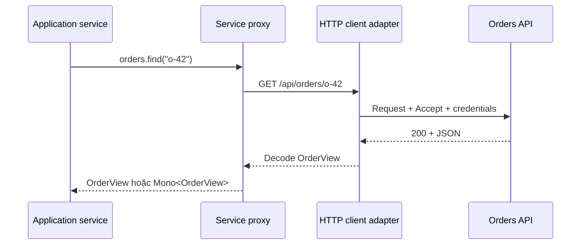

# HTTP Service Interface với @HttpExchange

## 1. Vì sao viết HTTP client bằng interface?

Một ứng dụng Java gọi dịch vụ Orders API:

```http
GET /api/orders/o-42 HTTP/1.1
Host: orders.example.test
Accept: application/json
Authorization: Bearer <access-token>
```

Nếu mỗi service tự ghép URL, thêm headers, serialize JSON và kiểm tra status, các lời gọi nhanh chóng không nhất quán. **HTTP Service Interface** của Spring cho phép mô tả outbound HTTP calls bằng **Java interface có annotation** rồi tạo proxy thực thi bằng HTTP client đã cấu hình. Spring Framework 6+ hỗ trợ cơ chế này; ví dụ `RestClient` trong bài giả định Spring Framework **6.1+**.

- `@HttpExchange` đặt URI prefix và các thuộc tính chung.
- `@GetExchange`, `@PostExchange`, `@PutExchange`, `@PatchExchange`, `@DeleteExchange` biểu diễn HTTP method.
- `HttpServiceProxyFactory` tạo implementation động của interface.
- `RestClientAdapter` dùng client đồng bộ; `WebClientAdapter` dùng WebClient cho reactive calls.

Bài thuộc chương **Client Java**, module **INTEGRATION_API_REST**: thiết kế REST bằng resource/URI, HTTP methods/status, hợp đồng dữ liệu, phân trang, cache, idempotency, OpenAPI, xác thực/phân quyền, xử lý lỗi và kiểm thử Java/Spring. Trọng tâm bài là **HTTP client khai báo và sự chính xác của request trên wire**, không thay thế lý thuyết REST.

**Sau bài học:** bạn có thể mô tả request bằng interface, tạo proxy blocking/reactive, đọc response headers/status, xử lý 4xx/5xx và retry an toàn, cấu hình token/timeout, rồi kiểm thử URI, query, body, headers và compatibility.

## 2. Từ method Java tới network request



| Thành phần | Trách nhiệm |
|---|---|
| **HTTP interface** | Method, URI template, query/header/body, return type |
| **Proxy/adapter** | Encode request, gửi HTTP, nhận/giải mã response, báo lỗi |
| **Domain service** | Quyết định khi nào gọi, retry budget, business invariants |
| **Server API** | Xác thực và phân quyền thật, trả HTTP contract đã công bố |

`@HttpExchange` **không tự tạo server controller**, tự cài JWT, tự xác thực domain hay bảo đảm OpenAPI khớp triển khai. Java method trông giống lời gọi local, nhưng thực chất có độ trễ, timeout, mất kết nối, response sai schema và lỗi authorization.

## 3. HTTP contract dùng xuyên suốt

Ta thiết kế client cho các operations:

| Request | Response thành công | Quy tắc quan trọng |
|---|---|---|
| `GET /api/orders/{id}` | 200 + JSON `OrderView` | Có thể 404 nếu không thấy |
| `GET /api/orders?status=PAID&page=0&size=20` | 200 + JSON `OrderPage` | Encode query, pagination rõ |
| `POST /api/orders` | 201 + Location + JSON | Request body và `Idempotency-Key` |
| `DELETE /api/orders/{id}` | 204 No Content | Không mong đợi body |

DTO phía client:

```java
import java.util.List;

record OrderLine(String sku, int quantity) {}
record CreateOrderRequest(String customerId, List<OrderLine> items) {}
record OrderView(String id, String status, long totalMinor, String currency) {}
record OrderPage(List<OrderView> items, int page, int size, boolean hasNext) {}
```

Đây là **DTO truyền qua HTTP**, không phải JPA entities. Trong dự án thật, schema phải công bố validation, nullability, date-time/enum, lỗi `400/401/403/404/409/429/503` và contract phân quyền. Client không có quyền coi body parse được là dữ liệu chắc chắn đúng nghĩa nghiệp vụ.

## 4. Khai báo interface đồng bộ

```java
import org.springframework.http.MediaType;
import org.springframework.http.ResponseEntity;
import org.springframework.web.bind.annotation.*;
import org.springframework.web.service.annotation.*;

@HttpExchange(url = "/api/orders", accept = MediaType.APPLICATION_JSON_VALUE)
interface OrdersBlockingApi {

    @GetExchange("/{id}")
    OrderView find(@PathVariable("id") String id);

    @GetExchange
    OrderPage list(@RequestParam("status") String status,
                   @RequestParam("page") int page,
                   @RequestParam("size") int size);

    @PostExchange(contentType = MediaType.APPLICATION_JSON_VALUE)
    ResponseEntity<OrderView> create(
            @RequestBody CreateOrderRequest body,
            @RequestHeader("Idempotency-Key") String key);

    @DeleteExchange("/{id}")
    void delete(@PathVariable("id") String id);
}
```

`@HttpExchange` cấp interface cung cấp URI prefix; `@GetExchange("/{id}")` ghép vào `/api/orders/{id}`. Tránh thêm cùng lúc nhiều exchange annotations lên một method. **Tên path/query phải khai tường minh**, ví dụ `@PathVariable("id")`, để không phụ thuộc Java compiler parameter metadata.

| Annotation | Ý nghĩa outbound |
|---|---|
| `@PathVariable` | Thay biến trong URI template |
| `@RequestParam` | Thêm query parameters |
| `@RequestHeader` | Thêm HTTP header |
| `@RequestBody` | Serialize DTO theo content type |
| `@Get/Post/Put/Patch/DeleteExchange` | Chọn HTTP method |
| `@HttpExchange` | Cấu hình method/URL/media types/headers chung |

Một interface khai báo GET không có nghĩa backend triển khai đúng GET. Cần đối chiếu với **published OpenAPI contract và response thật**, kể cả lỗi. Interface client không nên bị coi như server implementation.

## 5. Tạo proxy blocking với RestClientAdapter

Spring Framework **6.1+**:

```java
import org.springframework.web.client.RestClient;
import org.springframework.web.client.support.RestClientAdapter;
import org.springframework.web.service.invoker.HttpServiceProxyFactory;

RestClient restClient = RestClient.builder()
    .baseUrl("https://orders.example.test")
    .build();

OrdersBlockingApi orders = HttpServiceProxyFactory
    .builderFor(RestClientAdapter.create(restClient))
    .build()
    .createClient(OrdersBlockingApi.class);

OrderView order = orders.find("o-42");
```

`find` ở trên là lời gọi **đồng bộ/blocking**. Proxy gửi GET, client chờ HTTP response và deserialize thành `OrderView`. Không xây lại `RestClient` và proxy mỗi request: tái sử dụng client, connection pool, configuration và observability.

Ví dụ tích hợp Spring Boot configuration:

```java
@Configuration
class OrdersClientConfig {

    @Bean
    OrdersBlockingApi ordersBlockingApi(RestClient.Builder builder) {
        RestClient client = builder
            .baseUrl("https://orders.example.test")
            .build();

        return HttpServiceProxyFactory
            .builderFor(RestClientAdapter.create(client))
            .build().createClient(OrdersBlockingApi.class);
    }
}
```

Fragment trên cần import Spring `@Configuration` và `@Bean`. Trong production, **base URL là cấu hình tin cậy** và timeouts/credentials được cấu hình riêng. Không nhận base URL tùy ý từ request người dùng: dễ dẫn tới **SSRF**.

## 6. Proxy reactive với WebClientAdapter

Một interface trả reactive types:

```java
import org.springframework.http.MediaType;
import org.springframework.http.ResponseEntity;
import org.springframework.web.bind.annotation.*;
import org.springframework.web.service.annotation.*;
import reactor.core.publisher.Mono;

@HttpExchange(url = "/api/orders", accept = MediaType.APPLICATION_JSON_VALUE)
interface OrdersReactiveApi {

    @GetExchange("/{id}")
    Mono<OrderView> find(@PathVariable("id") String id);

    @PostExchange(contentType = MediaType.APPLICATION_JSON_VALUE)
    Mono<ResponseEntity<OrderView>> create(
            @RequestBody CreateOrderRequest body,
            @RequestHeader("Idempotency-Key") String key);
}
```

Cấu hình proxy:

```java
import org.springframework.web.reactive.function.client.WebClient;
import org.springframework.web.reactive.function.client.support.WebClientAdapter;
import org.springframework.web.service.invoker.HttpServiceProxyFactory;

WebClient webClient = WebClient.builder()
    .baseUrl("https://orders.example.test")
    .build();

OrdersReactiveApi orders = HttpServiceProxyFactory
    .builderFor(WebClientAdapter.create(webClient))
    .build().createClient(OrdersReactiveApi.class);

Mono<OrderView> result = orders.find("o-42");
```

Tạo `Mono` **chưa chắc đã gửi request**: quá trình I/O thường bắt đầu khi subscribe. Trong WebFlux, compose và **trả publisher** cho framework, không `subscribe()` thủ công trong controller hoặc `block()` trên event-loop.

`RestClientAdapter` là lựa chọn cho API blocking; `WebClientAdapter` hỗ trợ reactive return types. **Không mang `Mono<T>` sang adapter đồng bộ rồi giả định nó có cùng hành vi.** Reactive cũng không biến JDBC hoặc code blocking bên dưới thành non-blocking.

## 7. Return types: body hay toàn bộ HTTP response?

| Return type | Mục đích |
|---|---|
| `OrderView` | Chỉ cần body thành công, blocking |
| `ResponseEntity<OrderView>` | Cần status/Location/ETag, blocking |
| `void` | Response thành công không có body |
| `Mono<OrderView>` | Một body reactive hoặc empty |
| `Mono<ResponseEntity<OrderView>>` | Reactive và cần headers/status |
| `Flux<T>` | Luồng nhiều phần tử khi server thực sự stream |

`ResponseEntity` nên dùng khi client cần kiểm tra `201 Created` và `Location`, hoặc `ETag` và các cache headers. **Một response 204 không có body; 304 cũng không có body**. Không suy rằng `Mono.empty()` luôn là 404: phản hồi 4xx/5xx thường phát sinh exception theo mặc định của adapter.

Kiểu Java không tự diễn đạt business error protocol. Nếu server trả 202 + job status URI thay vì 201 + OrderView, **client cũ có thể compile nhưng xử lý sai**. Hãy xem status, headers và body shape là một hợp đồng duy nhất.

## 8. Arguments, encoding và optional parameters

Method:

```java
OrderPage list(@RequestParam("status") String status,
               @RequestParam("page") int page,
               @RequestParam("size") int size);
```

Lời gọi `orders.list("PAID", 0, 20)` cần tạo:

```http
GET /api/orders?status=PAID&page=0&size=20 HTTP/1.1
Accept: application/json
```

Không tự ghép query/path bằng chuỗi để tránh sai **percent encoding** và path manipulation. `@RequestParam` null/vắng, multi-value query hoặc collection encoding có thể có khác biệt theo contract/version: **kiểm thử wire request**, đừng đoán null sẽ thành `status=` hay bị bỏ qua.

`@RequestPart` và multipart/streaming request có thể hỗ trợ tùy adapter và version: cần xác minh format, converter, size và test riêng. Cookie/token/`X-Tenant-ID` không nên bị ghép vào URL; giữ credential ở cơ chế xác thực/header thích hợp.


## 9. Phân loại lỗi HTTP và Problem Details

Ví dụ server từ chối một POST:

```http
HTTP/1.1 409 Conflict
Content-Type: application/problem+json

{"type":"https://api.example.test/problems/order-conflict",
 "title":"Order conflict","status":409,"code":"ORDER_CONFLICT"}
```

Với các adapter mặc định, 4xx/5xx thường trở thành `RestClientResponseException` (blocking) hoặc `WebClientResponseException` (reactive), **không phải một OrderView rỗng**. Đừng dùng `onErrorResume(e -> Mono.empty())` cho mọi lỗi: server 503 có thể bị hiểu nhầm là đơn không tồn tại.

Ví dụ chỉ ánh xạ 404:

```java
Mono<OrderView> findForUi(String id) {
    return orders.find(id)
        .onErrorMap(
            org.springframework.web.reactive.function.client
                .WebClientResponseException.NotFound.class,
            ex -> new OrderNotVisibleException(id));
}
```

`OrderNotVisibleException` là domain exception do ứng dụng định nghĩa. Xử lý các nhóm lỗi theo contract:

| HTTP status | Cách phản ứng |
|---|---|
| `400/422` | Sửa request; không retry mù |
| `401` | Chính sách đăng nhập/refresh token |
| `403` | Quyền không đủ; không đổi danh tính để thử lại |
| `404` | Resource không thấy theo hợp đồng |
| `409` | Business/idempotency conflict |
| `429` | Quota, cân nhắc `Retry-After` |
| `503`/timeout | Có thể tạm thời; đánh giá retry và idempotency |

Phần `detail` của Problem Details có thể dịch hoặc chứa nội dung nhạy cảm. Client nên phân nhánh theo **status và mã lỗi ổn định**, không theo chuỗi thông báo; không log token, raw body hoặc headers chứa PII.

## 10. Timeouts, pool và business deadline

HTTP proxy là **lời gọi mạng**, có thể bị treo nếu không có giới hạn:

- **Connect timeout:** thời gian mở kết nối.
- **Response/read timeout:** giới hạn chờ/đọc response.
- **Pool wait:** thời gian đợi connection rảnh.
- **Business deadline:** tổng thời gian cho thao tác gồm các lần retry.
- **Cancellation:** client dừng chờ, không có nghĩa server rollback side effect.

Ví dụ WebClient + Reactor Netty:

```java
import java.time.Duration;
import reactor.netty.http.client.HttpClient;
import org.springframework.http.client.reactive.ReactorClientHttpConnector;
import org.springframework.web.reactive.function.client.WebClient;

HttpClient transport = HttpClient.create()
    .responseTimeout(Duration.ofSeconds(4));

WebClient client = WebClient.builder()
    .baseUrl("https://orders.example.test")
    .clientConnector(new ReactorClientHttpConnector(transport))
    .build();
```

`responseTimeout` **không đồng nghĩa tổng deadline**: connect timeout, pool wait và retry cần cấu hình riêng. `Mono.timeout(Duration)` có thể giới hạn pipeline reactive, nhưng khi POST timeout, server **có thể đã tạo đơn**. Với RestClient, dùng request factory/timeouts của blocking client, không dùng các option Reactor Netty.

## 11. Retry và idempotency: hai lớp khác nhau

`retryWhen` trong Reactor **resubscribe** publisher, thường gửi thêm HTTP request. Ví dụ GET có retry 503 giới hạn:

```java
Mono<OrderView> findWithRetry(String id) {
    return orders.find(id)
        .retryWhen(reactor.util.retry.Retry
            .backoff(2, Duration.ofMillis(200))
            .filter(ex -> ex instanceof
                org.springframework.web.reactive.function.client
                    .WebClientResponseException.ServiceUnavailable))
        .timeout(Duration.ofSeconds(3));
}
```

Đây chỉ là chính sách minh họa. Trong production, cần `Retry-After`, jitter, overall budget, circuit breaker, concurrency/rate limits. Nhiều tầng tự retry có thể tạo **retry storm**.

**Không retry POST tùy tiện:** key phải ổn định cho cùng logical operation, cùng payload; server phải lưu kết quả idempotency trong retention window/transaction và từ chối key với payload khác. Một timeout không chứng minh POST chưa commit. HTTP interface chỉ **gửi** `Idempotency-Key`; nó không tự bảo vệ ghi trùng tại database.

## 12. Xác thực và token đúng identity

`@HttpExchange` không cấp JWT, không kiểm tra audience/scope và không enforce ownership. Có hai use cases:

- **Service-to-service:** machine identity hoặc OAuth2 client credentials, secret được lưu an toàn.
- **On behalf of user:** delegation/token exchange theo chính sách; không gửi token cho upstream sai audience.

Ưu tiên OAuth2 Client integration, filter/interceptor tương ứng với `WebClient`/`RestClient` để gắn credential **theo request**. Không hard-code:

```java
// Phản mẫu: credential tĩnh lộ trong code và dùng nhầm tenant.
RestClient.builder()
    .defaultHeader("Authorization", "Bearer hardcoded-token")
    .build();
```

Cũng không đặt token trong `@RequestParam`, URL hay mutable singleton field. Nếu dùng `@RequestHeader("Authorization")`, caller phải lấy đúng credential từ security context tin cậy. **Server vẫn phải kiểm tra quyền theo resource/tenant**; test 401, 403/404, token hết hạn và cross-tenant. CORS không phải authorization.

## 13. TLS, redirects và SSRF

Một outbound client có thể gửi credential/dữ liệu đến sai server nếu không kiểm soát điểm đến:

| Nguy cơ | Quy tắc |
|---|---|
| Base URL nhận từ input bất kỳ | Allowlist/configuration, chặn SSRF |
| Bỏ TLS hostname verification | Sử dụng CA trust và hostname validation |
| Redirect sang host ngoài | Kiểm soát redirect; không chuyển token ngoài policy |
| Tự ghép URL có ký tự đặc biệt | URI template + percent-encoding |
| Token dùng chung nhiều user | Request-scoped authentication |
| Logs toàn bộ URL/header/body | Redaction token, PII, sensitive query |
| Response lạ, enum ngoài contract | Schema/semantic validation và size limits |

`@HttpExchange` giải quyết **request mapping**, không tự làm SSRF protection. Kiểm thử redirect cross-host và proxy/DNS behavior trong môi trường phù hợp; không mặc định HTTP library sẽ luôn drop Authorization khi đổi origin.

## 14. ETag, Location và các response headers

Nếu cần status/header chứ không chỉ body, dùng `ResponseEntity`:

```java
@HttpExchange(url = "/api/orders")
interface OrdersWithHeadersApi {
    @GetExchange("/{id}")
    org.springframework.http.ResponseEntity<OrderView> get(
        @PathVariable("id") String id);
}
```

Client có thể đọc `get(...).getHeaders().getETag()` hoặc `getHeaders().getLocation()` với response phù hợp. `ETag`/`Last-Modified` giúp conditional requests, nhưng `304 Not Modified` **không có body**; muốn dùng bản lưu phải có cache hợp lệ và đã xác thực quyền. Không dùng `Cache-Control: no-store` rồi phụ thuộc vào body cache cũ.

`ResponseEntity` cũng cần cho `201 + Location` và khi đọc `Retry-After` từ response thành công đặc thù. Với lỗi 429/503 mặc định phát exception, headers lỗi nên được đọc từ exception/status handler nếu retry policy cần chúng.

## 15. Pagination, filter và optional parameters

`orders.list("PAID", 0, 20)` cần tạo query đúng; server phải công bố page base (0 hay 1), max size, default sort, `hasNext` hoặc cursor. Với optional filters cần phân biệt **null, vắng, rỗng**; đừng đoán adapter sẽ gửi `status=null`, `status=` hay bỏ param. Kiểm thử wire request theo đúng Spring version.

Query collection có thể encode thành nhiều key lặp hoặc chuỗi comma-separated tùy hợp đồng. Cursor là **opaque token** và phải được URL-encode như giá trị thông thường, không tự parse. Dù JSON `OrderPage` deserialize tốt, client vẫn phải tuân quy tắc ordering và cursor/next-page do server trả.

## 16. Đừng nhầm interface client với OpenAPI/server

| Nguồn | Điều được mô tả |
|---|---|
| `@GetExchange` trên client | Request outbound proxy sẽ gửi |
| OpenAPI được công bố | Contract mà các consumers kỳ vọng |
| Spring MVC/Jakarta REST server | Behavior thật, lỗi và security |

Nếu server thay POST `201 + Location + OrderView` thành `202 + JobView`, Java client có thể **vẫn compile nhưng sai workflow**. Thêm response enum mới cũng có thể phá decoder cũ. Đánh giá mọi thay đổi bằng **OpenAPI diff + wire-level client tests + server contract tests**, kể cả error behavior và business semantics.

Đừng chia sẻ JPA/domain entities làm client DTO chỉ để “dùng chung một class”: khiến triển khai và tiến hóa hai dịch vụ bị coupling. Gói client nên mô tả **hợp đồng HTTP**, không sở hữu business rules phía server.


## 17. Kiểm thử blocking client bằng MockRestServiceServer

**Đừng chỉ mock `OrdersBlockingApi` bằng Mockito:** test đó không chứng minh request đã tạo đúng URL, method, headers hay content type. Với Spring Test + RestClient (6.1+), gắn `MockRestServiceServer` vào builder **trước khi build**:

```java
import static org.junit.jupiter.api.Assertions.*;
import static org.springframework.test.web.client.match.MockRestRequestMatchers.*;
import static org.springframework.test.web.client.response.MockRestResponseCreators.*;

import org.junit.jupiter.api.Test;
import org.springframework.http.*;
import org.springframework.test.web.client.MockRestServiceServer;
import org.springframework.web.client.RestClient;
import org.springframework.web.client.support.RestClientAdapter;
import org.springframework.web.service.invoker.HttpServiceProxyFactory;

class OrdersBlockingApiTest {
    @Test
    void findBuildsGetWithPathAndAccept() {
        RestClient.Builder builder = RestClient.builder()
            .baseUrl("https://orders.example.test");

        MockRestServiceServer server =
            MockRestServiceServer.bindTo(builder).build();

        OrdersBlockingApi api = HttpServiceProxyFactory
            .builderFor(RestClientAdapter.create(builder.build()))
            .build().createClient(OrdersBlockingApi.class);

        server.expect(requestTo("https://orders.example.test/api/orders/o-42"))
            .andExpect(method(HttpMethod.GET))
            .andExpect(header(HttpHeaders.ACCEPT, "application/json"))
            .andRespond(withSuccess(
                "{\"id\":\"o-42\",\"status\":\"PAID\"," +
                "\"totalMinor\":12500,\"currency\":\"VND\"}",
                MediaType.APPLICATION_JSON));

        OrderView order = api.find("o-42");
        assertEquals("o-42", order.id());
        assertEquals("PAID", order.status());
        server.verify();
    }
}
```

Test trên chứng minh **method, URI, header và JSON decoding** của proxy. Cần dependencies JUnit/Spring Test/Jackson đúng với Spring version. Bổ sung POST test cho `Content-Type: application/json`, `Idempotency-Key`, JSON body, `201 + Location`; query test cho `page=0&size=20`.

Một lỗi chỉ xuất hiện khi gọi **qua gateway** (prefix, auth, TLS) cần integration test thực hơn; test mock transport chỉ kiểm tra request formation phía client.

## 18. Kiểm thử reactive bằng HTTP stub và StepVerifier

Reactive proxy trả `Mono`, vì vậy kiểm tra vừa **Reactor signals** vừa request được gửi tới HTTP server giả. Ví dụ với **OkHttp MockWebServer** (dependency test riêng, phiên bản phù hợp):

```java
try (MockWebServer upstream = new MockWebServer()) {
    upstream.start();
    upstream.enqueue(new MockResponse()
        .setResponseCode(200)
        .addHeader("Content-Type", "application/json")
        .setBody("""
          {"id":"o-42","status":"PAID",
           "totalMinor":12500,"currency":"VND"}
          """));

    WebClient webClient = WebClient.builder()
        .baseUrl(upstream.url("/").toString())
        .build();

    OrdersReactiveApi api = HttpServiceProxyFactory
        .builderFor(WebClientAdapter.create(webClient))
        .build().createClient(OrdersReactiveApi.class);

    StepVerifier.create(api.find("o-42"))
        .expectNextMatches(o -> "o-42".equals(o.id()))
        .verifyComplete();

    RecordedRequest req = upstream.takeRequest();
    assertEquals("GET", req.getMethod());
    assertEquals("/api/orders/o-42", req.getPath());
}
```

Đây là fragment JUnit cần imports `MockWebServer`, `MockResponse`, `RecordedRequest`, `WebClient`, `WebClientAdapter`, `StepVerifier` và assertions. API/package của MockWebServer có thể thay đổi giữa phiên bản, nên chọn dependency phù hợp. **Không dùng token production** trong fixtures.

`StepVerifier` kiểm tra Publisher phát đúng một value và complete; `RecordedRequest` kiểm tra method/path **trên wire**. Nếu test muốn chứng minh một Publisher cold gửi hai requests khi subscribe hai lần, enqueue **hai responses** và đếm requests; tránh vô tình làm treo test vì thiếu stub.

## 19. Ma trận kiểm thử lỗi, quyền và HTTP contract

| Kịch bản | Assertion quan trọng |
|---|---|
| GET 200 | Method/URI/Accept đúng, DTO đúng schema |
| GET query params | Encode đúng `status`, `page`, `size`, cursor |
| POST 201 | Body/Content-Type/key đúng, `Location` tồn tại |
| GET 404 | Có lỗi/mapping domain rõ, không 200 rỗng giả |
| POST 400/409 | Không tự retry, giữ mã lỗi nghiệp vụ |
| 401/token hết hạn | Auth policy áp đúng, không log token |
| 403 / user sai tenant | Không nhận dữ liệu của tenant khác |
| 429 | `Retry-After` và quota được tôn trọng |
| 503/network timeout | Deadline, bounded retries và call count đúng |
| Query có ký tự `&`, space, `/` | URI encoding đúng, không path injection |
| 204/304 | Không cố parse body JSON không tồn tại |
| Response thiếu required field | Báo contract violation an toàn |
| Redirect cross-origin | Không chuyển credential ngoài policy |
| Concurrent calls | Token, tenant và idempotency key không bị lẫn |

**Test client không thay test server authorization:** HTTP stub có thể trả 403 như giả lập, nhưng chỉ integration test với security/backend thực mới chứng minh tenant A không xem được đơn B. Đối với client library nhiều consumer, nên duy trì consumer contract fixtures từ OpenAPI và kiểm tra backward compatibility khi nâng phiên bản server.

## 20. Observability và kiểm soát tài nguyên

Lời gọi qua HTTP cần số liệu như một dependency bên ngoài:

- **Metrics:** RPS theo operation, status groups, p95/p99 latency, errors, timeouts, số retries.
- **Pool:** active/pending connections, connect errors, saturation và queue wait.
- **Tracing:** correlation/trace IDs đi qua client đúng policy; không lấy raw query/token làm metric labels.
- **Circuit breaker/bulkhead:** ngăn một downstream chậm làm cạn thread/pool của cả hệ thống.
- **Payload size:** decoder buffer cap và response limits; export lớn cần streaming/job thay vì deserialize `List<OrderView>` vô hạn.
- **Deploy:** base URL, TLS trust, credentials, quota và timeout theo môi trường, có kiểm thử integration/gateway.
- **Fallback:** chỉ trả stale cache khi domain cho phép; không dùng fallback mặc định cho thanh toán/quyền.

Một proxy trông giống Java local call nhưng phải luôn xem network failure là **kết quả có thể xảy ra**. Log HTTP client chỉ nên giữ thông tin cần chẩn đoán; tránh `Authorization`, PII, raw body và URL chứa thông tin nhạy cảm.

## 21. Các phản mẫu đáng tránh

| Phản mẫu | Sửa bằng |
|---|---|
| Dùng `@HttpExchange` rồi tin server tự có endpoint | Test backend route/OpenAPI |
| Dựng client/proxy mỗi request | Reuse bean/connection pool |
| Gọi `block()` trong WebFlux event-loop | Compose reactive Publisher |
| Hard-code bearer token | OAuth2 Client/credential manager theo caller |
| Base URL lấy từ user input | Allowlist endpoint, chặn SSRF |
| Ghép URL bằng chuỗi | URI template và encoding |
| Retry POST vô điều kiện | Idempotency key + policy server |
| Biến mọi 404/503 thành empty | Error mapping theo status |
| Không cấu hình timeout/deadline | Connect/read/pool/business timeouts |
| Chỉ Mockito mock interface | HTTP stub/MockRestServiceServer |
| Bỏ qua `Location`/`ETag` | `ResponseEntity` khi cần metadata |
| Gửi token qua query | Authorization header/filter |
| Share cache/token giữa tenants | Request/tenant scoped policy |
| Không test response 204/304 | Xử lý body rỗng đúng contract |

## 22. Bài tập: xây client Orders API có bảo mật

### Yêu cầu

Nhóm đang gọi HTTP bằng chuỗi và bỏ qua response status:

```java
String json = restClient.get()
    .uri("/api/orders/" + orderId)
    .retrieve().body(String.class);
```

Chuyển thành HTTP Service Interface hỗ trợ đọc đơn, phân trang, tạo đơn theo `Idempotency-Key`, và đọc `Location`. Backend có 404, 409, 429, 503, bảo vệ bằng bearer authentication và quyền theo tenant.

**Nhiệm vụ:**

1. Khai báo interface blocking `OrdersBlockingApi`, có `@HttpExchange` cấp interface và `@GetExchange`/`@PostExchange`.
2. Tạo proxy `HttpServiceProxyFactory` + `RestClientAdapter`; lấy base URL từ cấu hình tin cậy.
3. Viết interface reactive `OrdersReactiveApi` trả `Mono<OrderView>` và `Mono<ResponseEntity<OrderView>>`, tạo proxy `WebClientAdapter`.
4. Phân biệt 200/201/204/404, giải thích khi nào cần `ResponseEntity`.
5. Thiết kế authentication không hard-code token; nêu cách phòng cross-tenant và redirect credential leaks.
6. Đặt connect/response/business timeout; lập retry policy cho GET và POST với idempotency.
7. Viết `MockRestServiceServer` tests xác minh method/URI/query/headers/body và 201 Location.
8. Viết `StepVerifier` + HTTP stub tests cho 200, 404, 503, kiểm đếm số HTTP requests sau retry.
9. So với OpenAPI published contract, xác định breaking changes nếu server đổi enum/status/schema.
10. Liệt kê log redaction, metrics, size limits và các kiểm thử trước release.

**Gợi ý:** Interface mô tả **HTTP contract client**; adapter cấu hình transport, TLS và codec; security component cấp credentials, domain service quyết định retry/validation. Kiểm thử cả **Java method result** lẫn request thực tế trên wire.

## 23. Checklist phát hành

- [ ] URI prefix, HTTP methods, query/path/header/body annotations chính xác.
- [ ] Return type phù hợp `RestClientAdapter` blocking hoặc `WebClientAdapter` reactive.
- [ ] HTTP client/proxy được reuse; base URL allowlisted, TLS và redirects an toàn.
- [ ] Token/audience/scope hợp lệ theo caller; không lộ credential trong URL/logs.
- [ ] Timeouts, pool limits, deadlines và retry budget được cấu hình.
- [ ] 201/Location, 204/304, 400/401/403/404/409/429/503 được kiểm thử.
- [ ] Retry POST có idempotency key/transaction policy; GET retry có giới hạn.
- [ ] DTO và JSON serialization/enum khớp OpenAPI, không expose JPA entity.
- [ ] URI encoding và optional/multi-value query đã kiểm tra trên wire.
- [ ] `MockRestServiceServer`/HTTP stub tests kiểm method, URL, headers, body.
- [ ] Integration tests xác minh server security và tenant isolation thực sự.
- [ ] Observability, redaction, payload size, connection pooling và version compatibility đạt.

## 24. Kết luận

**`@HttpExchange` biến một Java interface thành bản khai outbound HTTP requests**. `HttpServiceProxyFactory` cùng `RestClientAdapter`/`WebClientAdapter` thực thi lời gọi, nhưng không tự mang lại authentication, authorization, idempotency, business retry hay tương thích với backend.

Muốn HTTP Service Interface bền vững, hãy giữ **URI/method/headers/body/status** sát hợp đồng công bố, cấu hình endpoint và token an toàn, xem timeout/network error là điều bình thường, và kiểm chứng bằng **wire-level tests** thay vì chỉ mock Java method. Khi đó code client gọn hơn mà vẫn giữ được tính đúng đắn và an toàn của REST API.


