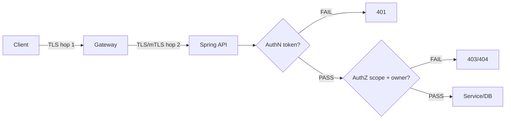
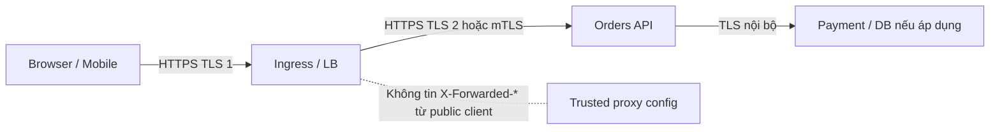

# Phân biệt xác thực, phân quyền và bảo mật đường truyền

> **Chương:** Xác thực  
> **Module:** `INTEGRATION_API_REST` — thiết kế REST API theo resource, URI, HTTP method/status và hợp đồng dữ liệu; thực hành OpenAPI, phân trang, cache, idempotency, xác thực, phân quyền, xử lý lỗi và kiểm thử bằng Java/Spring hoặc công nghệ tương đương.

Một client gọi `GET /api/orders/42` qua HTTPS, đính kèm `Authorization: Bearer <access-token>`. Hệ thống phải trả lời **ba câu hỏi độc lập**:

1. **Xác thực (authentication, AuthN):** Ai đang gửi request? Token hay phiên đăng nhập có đáng tin không?
2. **Phân quyền (authorization, AuthZ):** Danh tính ấy có được đọc **đơn 42** hay chỉ được đọc đơn của mình?
3. **Bảo mật đường truyền (transport security):** Dữ liệu giữa các điểm kết nối có được bảo vệ khỏi nghe lén, thay đổi và giả mạo đầu cuối không?

Một API có TLS nhưng thiếu phân quyền vẫn có thể để người A đọc đơn của người B; một API xác minh JWT đầy đủ nhưng truyền token qua HTTP không mã hóa có thể làm lộ credential. Bài này tách ba trách nhiệm, sau đó ghép chúng trong kiến trúc REST với **OAuth 2.0 Bearer/JWT, TLS, Spring Security 6 / Spring Boot 3, OpenAPI và kiểm thử**.

## Mục tiêu học tập

- Phân biệt chính xác **xác minh danh tính**, **quyết định quyền trên hành động/tài nguyên** và **bảo vệ kênh truyền**.
- Hiểu vòng đời access token, điều cần kiểm tra khi API nhận JWT hoặc opaque token và giới hạn của mTLS.
- Phân biệt `401 Unauthorized`, `403 Forbidden`, `404 Not Found` khi che giấu tài nguyên; dùng `WWW-Authenticate` đúng với HTTP.
- Thiết kế TLS end-to-end qua load balancer/API gateway, tránh giả mạo forwarded headers và bỏ quên các hop nội bộ.
- Cấu hình một Spring Security resource server dùng Bearer token, scope và kiểm tra ownership/tenant tại service.
- Đánh giá CORS, CSRF, cookie, cache và logging; viết security tests thực chất, không chỉ mock một principal có sẵn.
- Xây dựng OpenAPI security contract và giải một bài tập thiết kế/kiểm thử API đa tenant.

## 1. Ba lớp bảo vệ, ba câu hỏi

| Lớp | Câu hỏi | Cơ chế | Không bảo đảm |
| --- | --- | --- | --- |
| **AuthN** | Caller là ai? | Login/session, access token, client certificate | Caller có quyền đọc mọi đơn. |
| **AuthZ** | Caller được làm gì trên resource nào? | Scope, role, tenant/owner ACL | Token không bị nghe lén. |
| **TLS** | Kết nối có riêng tư/toàn vẹn, peer có đúng? | HTTPS, certificate validation, mTLS | JSON/logic nghiệp vụ hay quyền chính xác. |



Alice có `orders.read` và gọi `GET /api/orders/42`. AuthN xác minh Alice; AuthZ kiểm tra **đơn 42** thuộc tập Alice được xem; TLS bảo vệ từng hop của request/response. Ba việc độc lập: có HTTPS không ngăn IDOR, có JWT hợp lệ không chứng minh owner, có ACL không thay mã hóa credential trên mạng.

Sơ đồ mô tả các lớp logic; gateway/filter có thể chặn trước MVC và TLS handshake diễn ra trước HTTP.

## 2. Authentication: mô hình và credential

| Mô hình | Công dụng | Điều cần nhớ |
| --- | --- | --- |
| **Session cookie** | Browser đăng nhập, server quản lý session | `Secure`/`HttpOnly`/`SameSite`, CSRF và invalidation. |
| **OAuth2 access token** | Client gọi resource server | Bearer là secret, cần issuer/audience/scope/time checks. |
| **OIDC ID token** | Client nhận thông tin xác thực người dùng | Không mặc định dùng thay access token gọi API. |
| **API key** | Định danh một ứng dụng/caller theo chính sách | Không tự xác thực user cuối; rotation/permission/rate limits. |
| **mTLS certificate** | Xác thực workload trong kết nối TLS | Không tự cấp quyền theo order hoặc đại diện người dùng. |

```http
GET /api/orders/42 HTTP/1.1
Authorization: Bearer <access-token>
Accept: application/json
```

Resource server kiểm tra credential rồi mới dựng principal. **OAuth2 không đồng nghĩa JWT:** access token có thể là JWT tự chứa hoặc opaque token cần introspection. **OIDC** thêm chức năng xác thực người dùng, trong khi API vẫn phải kiểm tra access token được cấp cho mình.

Bearer nghĩa là ai **sở hữu** token có thể trình token để yêu cầu quyền tương ứng. TLS giảm nghe lén nhưng không ngăn token bị lộ từ log, máy bị xâm phạm hoặc XSS; dùng TTL, scope/audience hẹp và bảo vệ token trong suốt vòng đời.

## 3. JWT: kiểm tra chữ ký mới chỉ là một phần

JWT có thể chứa claims như:

```json
{
  "iss": "https://id.example.test/realms/shop",
  "sub": "user-724",
  "aud": ["orders-api"],
  "exp": 1795107600,
  "nbf": 1795104000,
  "scope": "orders.read orders.create"
}
```

Đây là **payload minh họa**; không dùng giá trị trên làm bằng chứng token hợp lệ. Bất cứ ai cũng có thể **decode** phần claims của JWT mà không xác minh chữ ký. Một resource server cần kiểm tra ít nhất:

1. **Signature/algorithm**: chữ ký hợp lệ với khóa tin cậy và thuật toán được cấu hình cho issuer; không chấp nhận `alg=none` hay thuật toán do token tùy ý ép chọn.
2. **Issuer (`iss`)**: đúng authorization server được tin cậy; kiểm tra metadata/JWK endpoint qua HTTPS đáng tin.
3. **Audience (`aud`)**: token được phát cho API hiện tại, không dùng ID token hoặc access token dành cho resource khác.
4. **Thời hạn**: `exp`, `nbf`, và clock skew giới hạn; token hết hạn thì từ chối.
5. **Subject và scope/authorities**: danh tính ổn định trong phạm vi issuer, các quyền cần thiết cho operation; không coi claim `role=ADMIN` tự động đáng tin nếu issuer/policy không cho phép.
6. **Revocation/rotation**: kế hoạch đổi khóa, token TTL, xử lý token bị thu hồi khi chính sách yêu cầu. JWT tự chứa không tự lập tức bị vô hiệu hóa chỉ vì user logout.

**Phân biệt `sub` và user ID trong database:** `sub` là subject do issuer xác định, không nhất thiết là ID nội bộ; nếu chấp nhận nhiều issuer, danh tính nên được ánh xạ theo cặp (`issuer`, `subject`) hoặc identity mapping đáng tin, tránh trùng `sub` giữa tenant/issuer.

Ví dụ sai: server chỉ gọi `Base64.decode(payload)`, đọc `scope=orders.read` rồi cho truy cập. Đây là **đọc dữ liệu do client cung cấp**, không phải xác thực.

### Mặt trái của token dài hạn

Token kéo dài nhiều ngày khiến một lần lộ credential gây thiệt hại lớn. Dùng access token có thời hạn phù hợp, refresh token chỉ ở client được phép giữ an toàn, rotation/revocation theo rủi ro và giới hạn audience/scope. Với machine-to-machine, cân nhắc OAuth client credentials và/hoặc mTLS workload authentication; không nhét shared static API key vào source code.

## 4. Authorization: scope không thay ownership

Token đã hợp lệ mới đến câu hỏi: **caller có quyền thực thi operation trên resource cụ thể không?**

| Mức kiểm soát | Ví dụ | Phải bổ sung |
| --- | --- | --- |
| **Scope** | `orders.read` | Không chỉ ra đơn nào được đọc. |
| **RBAC** | `SUPPORT_AGENT` | Tenant/assignment và quyền theo nhiệm vụ. |
| **ABAC/relationship** | `tenantId`, `ownerSubject` | Thuộc tính phải đến từ nguồn tin cậy. |
| **Object ACL** | Caller có quan hệ với order 42 | Kiểm tra trên dữ liệu thật ở service/DB. |

**BOLA/IDOR:** user đổi `/orders/42` thành `/orders/43` của người khác; JWT, scope và HTTPS đều có thể đúng, nhưng trả order 43 vẫn là lỗ hổng.

Triển khai theo lớp: filter xác thực token; method security kiểm tra permission; service/repository lọc `id + owner/tenant`; transaction/DB bảo vệ hành động ghi khi trạng thái thay đổi đồng thời. Không lấy `ownerId` hoặc `tenantId` do client tự khai để cấp quyền.

**403 hay 404?** Khi policy cho phép công khai tồn tại nhưng cấm thao tác, 403 có thể phù hợp. Nếu cần che sự tồn tại của order khác quyền, trả 404 như resource không tìm thấy, không vô tình tiết lộ owner qua body/timing khác biệt.

## 5. HTTP 401, 403 và 404: cùng một request, ba ý nghĩa

Giả sử endpoint `GET /api/orders/42` yêu cầu access token và permission `orders.read`.

| Trạng thái | Ví dụ | Client nên làm gì? |
| --- | --- | --- |
| **401 Unauthorized** | Không có Bearer token, token sai chữ ký/hết hạn/sai audience. | Xác thực lại hoặc lấy token mới theo flow hợp lệ; không retry vô hạn. |
| **403 Forbidden** | Token hợp lệ, caller thiếu permission `orders.read` hoặc không có quyền theo policy. | Không tự refresh vô hạn; cần thay đổi quyền/đăng nhập đúng account. |
| **404 Not Found** | Không có order hoặc API chủ ý che order ngoài quyền. | Không suy đoán từ mã lỗi rằng order có/không có trong database. |
| **200 OK** | Đã xác thực, có scope và quyền resource; đơn được tìm thấy. | Dùng response theo HTTP caching/contract. |

RFC về HTTP authentication yêu cầu **401 có `WWW-Authenticate` challenge** phù hợp. Với Bearer, một response điển hình:

```http
HTTP/1.1 401 Unauthorized
WWW-Authenticate: Bearer realm="orders-api"
Cache-Control: no-store
```

Với token không hợp lệ, challenge có thể nêu mã lỗi tiêu chuẩn:

```http
HTTP/1.1 401 Unauthorized
WWW-Authenticate: Bearer realm="orders-api", error="invalid_token"
Cache-Control: no-store
```

Khi token đã hợp lệ nhưng **thiếu scope**, một API theo Bearer token error semantics có thể trả:

```http
HTTP/1.1 403 Forbidden
WWW-Authenticate: Bearer realm="orders-api", error="insufficient_scope", scope="orders.read"
Cache-Control: no-store
```

**Không lộ token, thông tin user khác hay nội dung xác minh chữ ký** trong `WWW-Authenticate`, Problem Details hoặc logs. 403 không bắt buộc luôn có Bearer header khi lý do là ownership/policy thay vì thiếu OAuth scope. Security error handler phụ thuộc runtime; không tùy tiện bắt mọi `AccessDeniedException` rồi trả `401`.

**Phân biệt lỗi input:** `400` có thể do JSON hoặc parameter không hợp lệ, `415` do request media type, `409` do xung đột trạng thái nghiệp vụ, `412` do `If-Match` stale. Chúng không thay thế 401/403 và không được dùng để che lỗi lập trình 5xx.

## 6. TLS/HTTPS: bảo vệ kết nối, không trao quyền nghiệp vụ

TLS cung cấp chủ yếu **bảo mật nội dung, toàn vẹn dữ liệu và xác thực peer bằng chứng chỉ** cho một kết nối. Trong cấu hình HTTPS phổ biến, client xác thực **server certificate** và tên host; mTLS có thêm xác thực certificate phía client. TLS không hiểu claim `scope`, order owner hay JSON schema.

Một triển khai nên có:

- **TLS 1.2/1.3** với cipher suites an toàn, ưu tiên TLS 1.3 nơi tương thích; tắt SSL/TLS cũ và cấu hình yếu.
- **Certificate validation đầy đủ**: certificate chain, SAN/hostname, hiệu lực, trust anchor; không dùng `trustAll` hoặc bỏ hostname verification trong production.
- **HTTPS ở mọi đường mang credential/PII**, gồm browser→gateway và gateway→service nếu đi qua mạng; thiết kế trust boundary giữa các hop.
- **HTTP → HTTPS redirect** khi phù hợp và HSTS ở edge cho browser, sau khi kiểm tra tác động subdomain/rollout.
- **Secure cookie** cho session, cùng `HttpOnly` và `SameSite` phù hợp; TLS không tự ngăn XSS hoặc CSRF.
- **Certificate rotation, alert expiry** và kiểm thử sau mỗi lần thay ingress/cert/proxy.

**Một chứng chỉ TLS hợp lệ không chứng minh API đáng tin về nghiệp vụ.** Nó chứng minh kết nối tới peer khớp chính sách tin cậy/cert, không chứng minh response có đúng số tiền hay principal được phép thực thi.

### 6.1 TLS termination tạo thêm trust boundary



Nếu load balancer giải mã TLS rồi chuyển HTTP plaintext qua một mạng khác, **TLS từ client chỉ bảo vệ hop tới load balancer**. Quyết định dùng TLS/mTLS trên hop sau dựa vào trust boundary/threat model nhưng không nên suy rằng “client dùng HTTPS nên mọi lưu lượng nội bộ đã được mã hóa”.

`Forwarded` / `X-Forwarded-Proto` / `X-Forwarded-Host` có thể giúp backend biết URI công khai khi ở sau proxy, nhưng **chỉ tin headers do proxy tin cậy đặt hoặc chuẩn hóa**. Nếu nhận trực tiếp header này từ client, có nguy cơ tạo redirect sai scheme/host, sai `Location`, host-header injection hay bỏ qua chính sách HTTPS ở application.

### 6.2 mTLS có thay Bearer token không?

mTLS **xác thực danh tính ở cấp kết nối TLS**, thường hiệu quả cho service-to-service: client certificate map tới workload identity. Nó **không mặc nhiên** xác thực người dùng cuối đang thao tác qua browser, và cũng không thực thi permission theo order. Một hệ thống có thể kết hợp mTLS (workload) + access token (delegated end user) + resource-level authorization.

Nếu chứng chỉ từ mTLS gateway chuyển danh tính cho backend qua header, phải giới hạn backend chỉ nhận từ trusted proxy/mTLS link và đảm bảo header được gateway **xóa/ghi đè**, không tin header caller tự gửi.

## 7. Spring Security: thực thi Authentication trước Authorization

Ở Spring Boot 3 / Spring Security 6, ứng dụng dùng OAuth2 Resource Server có thể xác thực Bearer JWT rồi kiểm tra scope và owner. Các đoạn dưới là **skeleton để học**, cần dependencies, cấu hình issuer/keys, storage và error handling thực tế.

### 7.1 Dependency và issuer tin cậy

Ứng dụng cần Spring Web, Spring Security và OAuth2 Resource Server với hỗ trợ decode JWT. Một cấu hình tham khảo:

```yaml
spring:
  security:
    oauth2:
      resourceserver:
        jwt:
          issuer-uri: https://id.example.test/realms/shop
```

Issuer là nơi phát hành token đã được tổ chức tin cậy. Runtime cần tải/kiểm tra metadata/JWK hợp lệ và validate signature/issuer/time. **Còn phải kiểm tra audience** `orders-api`: cấu hình audience validator hoặc thuộc tính cấu hình tương ứng phiên bản Spring Boot, rồi test token hợp lệ về chữ ký nhưng `aud` sai. Không coi `issuer-uri` là đủ bảo đảm audience được phép.

### 7.2 Cấu hình SecurityFilterChain

```java
import org.springframework.context.annotation.*;
import org.springframework.security.config.Customizer;
import org.springframework.security.config.annotation.method.configuration.EnableMethodSecurity;
import org.springframework.security.config.annotation.web.builders.HttpSecurity;
import org.springframework.security.config.http.SessionCreationPolicy;
import org.springframework.security.web.SecurityFilterChain;

@Configuration
@EnableMethodSecurity
public class ApiSecurityConfig {

    @Bean
    SecurityFilterChain apiSecurity(HttpSecurity http) throws Exception {
        http
            // CHỈ phù hợp khi API thuần stateless Bearer header,
            // không dùng cookie/session để tự động xác thực request.
            .csrf(csrf -> csrf.disable())
            .sessionManagement(session -> session
                .sessionCreationPolicy(SessionCreationPolicy.STATELESS))
            .authorizeHttpRequests(auth -> auth
                .requestMatchers("/actuator/health").permitAll()
                .requestMatchers("/api/**").authenticated()
                .anyRequest().denyAll())
            .oauth2ResourceServer(oauth ->
                oauth.jwt(Customizer.withDefaults()));

        return http.build();
    }
}
```

`authenticated()` chỉ yêu cầu **AuthN** cho route. Nó không đủ để phân quyền đơn hàng. `@EnableMethodSecurity` kích hoạt method security, còn `@PreAuthorize` cần quyền được ánh xạ từ token (ví dụ `scope: "orders.read"` thành authority `SCOPE_orders.read` theo converter cấu hình).

**Quan trọng về CSRF:** tắt CSRF chỉ có cơ sở khi API thực sự không dựa vào credential mà browser tự gửi (session/cookie/basic auth phù hợp) để xác thực các thay đổi trạng thái. Nếu ứng dụng dùng **cookie session hoặc refresh cookie có hành vi ghi**, cần CSRF defense và SameSite/cors policy phù hợp; không sao chép `csrf.disable()` sang mọi ứng dụng Spring.

## 8. Kiểm tra quyền trên resource trong service

Controller không nên xem claim `orders.read` là “đọc được mọi đơn”:

```java
import org.springframework.http.ResponseEntity;
import org.springframework.security.access.prepost.PreAuthorize;
import org.springframework.security.core.annotation.AuthenticationPrincipal;
import org.springframework.security.oauth2.jwt.Jwt;
import org.springframework.web.bind.annotation.*;

record OrderView(long id, String status, long totalMinor) {}

@RestController
@RequestMapping("/api/orders")
class OrderController {
    private final OrderService service;

    OrderController(OrderService service) {
        this.service = service;
    }

    @GetMapping("/{orderId}")
    @PreAuthorize("hasAuthority('SCOPE_orders.read')")
    ResponseEntity<OrderView> get(
            @PathVariable long orderId,
            @AuthenticationPrincipal Jwt jwt) {

        return ResponseEntity.ok(
            service.getVisible(jwt.getSubject(), orderId));
    }
}
```

Tại service:

```java
import org.springframework.http.HttpStatus;
import org.springframework.web.server.ResponseStatusException;

interface OrderRepository {
    java.util.Optional<OrderRecord> findByIdAndOwnerSubject(
        long orderId, String ownerSubject);
}

record OrderRecord(long id, String status, long totalMinor) {}

class OrderService {
    private final OrderRepository repository;

    OrderService(OrderRepository repository) {
        this.repository = repository;
    }

    OrderView getVisible(String callerSubject, long orderId) {
        OrderRecord order = repository
            .findByIdAndOwnerSubject(orderId, callerSubject)
            .orElseThrow(() ->
                new ResponseStatusException(HttpStatus.NOT_FOUND));

        return new OrderView(
            order.id(), order.status(), order.totalMinor());
    }
}
```

Đây là **mẫu ownership đơn giản**: caller sở hữu order nếu `ownerSubject` khớp. Trong sản phẩm thật, identity mapping có thể phải dùng `(issuer, sub)`, tenant ID đáng tin, quyền nhân viên hỗ trợ, scope và trạng thái account. Service/repository nên áp các điều kiện đó **trong chính truy vấn hoặc transaction**; không nhận `ownerId` tự khai từ query/header/body làm authority.

Với POST/PUT/DELETE, kiểm tra cả **hành động**, **resource state** và **quyền**; dùng update có điều kiện/CAS hoặc lock khi cần. Việc kiểm tra một lần trước khi ghi không tự bảo đảm dữ liệu không bị thay đổi bởi request cạnh tranh.

### Vì sao trả 404 cho đơn không thuộc quyền?

`findByIdAndOwnerSubject` không tìm thấy có thể do ID không tồn tại hoặc thuộc user khác. Trả cùng `404` có thể giảm khả năng liệt kê ID. Đừng để khác biệt timing/message/cache tiết lộ thông tin mà status đã cố che. Nếu policy yêu cầu thông báo rõ `403`, phải thiết kế mức thông tin có thể công bố.

## 9. Trình duyệt: CORS, CSRF và token storage

- **CORS** giới hạn JavaScript từ origin khác đọc response trong browser; **không phải authentication/authorization**. curl, mobile và backend không dùng cùng cơ chế browser CORS. Preflight `OPTIONS` không thay kiểm tra quyền ở request thực.
- **CSRF** liên quan browser tự gửi credential như cookie session tới endpoint làm thay đổi trạng thái. Dùng CSRF token/Origin checks và `SameSite` theo threat model; nếu Bearer token được client chủ động thêm header, nguy cơ CSRF khác nhưng XSS/token theft vẫn còn.
- **XSS/token storage:** `localStorage` có thể bị script xâm phạm đọc; `HttpOnly` cookie giảm đọc bằng JS nhưng vẫn cần CSRF defense. Mô hình BFF có thể giữ access token phía server và dùng session cookie được bảo vệ.

CORS cần allowlist origin/method/header và cấu hình credentials chính xác; không dùng wildcard origin với credentialed browser requests. Không có cách lưu token nào an toàn tuyệt đối khi client bị xâm phạm: giới hạn scope, TTL, thiết lập CSP và giảm XSS vẫn cần thiết.

## 10. Logs, cache và các chặng giao tiếp

| Rủi ro dù đã có HTTPS/JWT | Biện pháp |
| --- | --- |
| Log `Authorization`, cookies, JWT | Redact; chỉ log route template, code lỗi và trace ID đáng tin. |
| CDN trả order của Alice cho Bob | `Cache-Control: private/no-store` khi phù hợp; cache phải phân tách theo auth. |
| Token xuất hiện trong query/referrer | Đưa credential vào Authorization/cookie bảo vệ, không URL. |
| Hậu trường HTTP plaintext qua mạng khác | TLS/mTLS cho hop theo trust boundary. |
| JWT metadata/key đổi bất ngờ | Tin issuer/JWKS qua HTTPS, timeout, rotation và tests. |
| Bearer bị sao chép từ log/XSS | TTL ngắn, scope/audience nhỏ; cân nhắc proof-of-possession nếu cần. |

Public data vẫn có thể cache khi policy cho phép; `no-store` đặc biệt phù hợp với nội dung/token nhạy cảm. Không lấy toàn bộ JWT để debug; chỉ ghi metadata đã được phép và có chính sách retention.

## 11. OpenAPI: mô tả bảo mật mà không nhầm với runtime

OpenAPI 3.1 mô tả Bearer auth và hành vi response, nhưng **không tự bật Spring Security hay TLS**.

```yaml
openapi: 3.1.0
info:
  title: Orders API
  version: 1.0.0
servers:
  - url: https://api.example.test
security:
  - bearerAuth: []

paths:
  /api/orders/{orderId}:
    get:
      operationId: getOrder
      summary: Get an order visible to caller
      parameters:
        - name: orderId
          in: path
          required: true
          schema: { type: integer, format: int64, minimum: 1 }
      responses:
        '200':
          description: Visible order
          content:
            application/json:
              schema:
                $ref: '#/components/schemas/Order'
        '401':
          description: Access token missing, invalid or expired
          headers:
            WWW-Authenticate:
              description: Bearer challenge
              schema: { type: string }
        '403':
          description: Permission missing when existence may be disclosed
        '404':
          description: Order absent or hidden by resource authorization

components:
  securitySchemes:
    bearerAuth:
      type: http
      scheme: bearer
      bearerFormat: JWT
  schemas:
    Order:
      type: object
      required: [id, status, totalMinor]
      properties:
        id: { type: integer, format: int64 }
        status: { type: string }
        totalMinor: { type: integer, format: int64 }
```

`bearerFormat: JWT` chỉ là thông tin gợi ý định dạng. `security: [{bearerAuth: []}]` không mô tả scope semantics theo cách OAuth2 security scheme; nếu cần trình bày OAuth scopes trong spec, dùng một **`type: oauth2` scheme** với flows/scopes đúng loại client, đồng thời giữ endpoint authentication/authorization thực tế nhất quán.

`servers.url` dùng HTTPS là cam kết hợp đồng, **không tự cấu hình certificate**. Tài liệu nên giải thích token issuer/audience, quyền `orders.read`, cách hoạt động 401/403/404 và chính sách không trả raw token. Các trường `Authorization` không được khai báo như parameter `in: header`; dùng security scheme.

## 12. Kiểm thử ba lớp bảo vệ

Một bộ security tests có ý nghĩa phải kiểm tra **JWT validation thực**, **authorization trên resource** và **TLS edge configuration**. Chỉ test controller trả 200 khi truyền sẵn principal không chứng minh lớp nào đã an toàn.

| ID | Điều kiện | Kỳ vọng |
| --- | --- | --- |
| T01 | Không gửi Bearer token | **401** và `WWW-Authenticate: Bearer...`. |
| T02 | JWT sai chữ ký, hết hạn hoặc `nbf` chưa tới | **401**; service không chạy. |
| T03 | JWT chữ ký đúng nhưng `iss`/`aud` sai | **401**; không nhận token cho API khác. |
| T04 | Token hợp lệ, thiếu `orders.read` | **403**; không gọi truy vấn order. |
| T05 | Token hợp lệ + scope đúng, order thuộc caller | **200**, schema đúng. |
| T06 | Token hợp lệ + scope đúng, order thuộc tenant/user khác | **403/404** theo policy, không lộ dữ liệu. |
| T07 | Token đã đổi hoặc thiếu quyền admin | Không thể thực hiện POST/DELETE trái quyền. |
| T08 | Gửi `X-User-Id: admin` giả | Không làm thay đổi authenticated principal. |
| T09 | HTTP tới edge | Chuyển sang HTTPS hoặc từ chối theo policy; không cấp token qua plaintext. |
| T10 | HTTPS với certificate sai hostname/CA hết hạn | Client chuẩn **không tin** kết nối. |
| T11 | Gateway→API không có TLS trái với policy | Kiểm tra cấu hình/đường truyền thất bại trước production. |
| T12 | CORS origin không được duyệt / CSRF với cookie session | Bị xử lý theo chính sách mà không bypass authentication. |
| T13 | Cache/proxy và hai principal | Không lộ response riêng tư của user A sang B. |
| T14 | Role/scope mới sau thay token | Consumer + permission tests bắt contract drift. |

### 12.1 MockMvc kiểm thử authorization

Spring Security Test cho phép tạo principal JWT giả để **test filter/method authorization**, ví dụ:

```java
// Skeleton: @WebMvcTest / MockMvc + Spring Security Test,
// controller và service mock đã cấu hình phù hợp.
@Test
void missingTokenReturns401() throws Exception {
    mvc.perform(get("/api/orders/42"))
        .andExpect(status().isUnauthorized())
        .andExpect(header().string(
            "WWW-Authenticate",
            org.hamcrest.Matchers.startsWith("Bearer")));
}

@Test
void validPrincipalWithoutReadScopeReturns403() throws Exception {
    mvc.perform(get("/api/orders/42")
            .with(jwt().jwt(jwt -> jwt.subject("alice"))
                .authorities(new SimpleGrantedAuthority("SCOPE_profile.read"))))
        .andExpect(status().isForbidden());
    verifyNoInteractions(orderService);
}

@Test
void correctScopeCannotReadAnotherOwnersOrder() throws Exception {
    when(orderService.getVisible("alice", 42L))
        .thenThrow(new ResponseStatusException(HttpStatus.NOT_FOUND));

    mvc.perform(get("/api/orders/42")
            .with(jwt().jwt(jwt -> jwt.subject("alice"))
                .authorities(new SimpleGrantedAuthority("SCOPE_orders.read"))))
        .andExpect(status().isNotFound());
}
```

**Giới hạn:** `with(jwt())` tạo authentication cho test, **không kiểm tra chữ ký/issuer/audience/expiry của token thực**. Phải bổ sung integration tests cho `JwtDecoder` với khóa kiểm thử/JWK endpoint được kiểm soát (hoặc opaque-token introspection nếu dùng opaque token), cùng test auth entry point, error mapper và owner/tenant query với database. Đừng ghi “JWT verified” chỉ vì test `with(jwt())` PASS.

### 12.2 TLS không thể được chứng minh chỉ bằng MockMvc

MockMvc không thực hiện TLS handshake và không chứng minh certificate chain, hostname validation hay proxy TLS termination. Cần **end-to-end/network configuration tests** tại ingress/gateway (kể cả hop nội bộ), kiểm tra redirect/HSTS, certificate rotation và mọi đường vào trái phép. Client test phải bật **certificate verification đúng chuẩn**, không dùng `-k`/`trustAll` rồi xem kết quả 200 là thành công bảo mật.

### 12.3 Kiểm thử phân quyền tại DB

Integration test cần tạo hai user Alice/Bob, hai order khác owner; gọi API với token của Alice đến ID của Bob và xác nhận **không có dữ liệu/side effect**, ngay cả khi thay path/query/body. Nếu policy trả 404 cho resource không thuộc quyền, test response và payload không tiết lộ tenant/owner; không chỉ assert exception trong service.

## 13. Ba tình huống chẩn đoán

**A. Alice đổi URI sang order của Bob.** HTTPS và token `orders.read` đều hợp lệ (**TLS/AuthN PASS**), nhưng service phải chặn **AuthZ theo resource** bằng 403/404.

**B. JWT có chữ ký đúng nhưng `aud=billing-api`.** Kênh TLS và chữ ký có thể hợp lệ, song **Orders API phải từ chối token** vì audience sai: 401 trước khi kiểm tra ownership.

**C. Browser→gateway dùng HTTPS, gateway→backend dùng HTTP ngoài trust boundary.** Browser thấy kết nối an toàn nhưng còn một hop plaintext: bảo mật đường truyền **chưa đủ**. Cần TLS/mTLS backend và chuẩn hóa forwarded headers.

## 14. Bài thực hành: Orders API đa tenant

Thiết kế `GET /api/orders/{id}`, `POST /api/orders` và `PATCH /api/orders/{id}` cho SaaS có user và support agent, chạy sau ingress TLS. Token có `iss`, `sub`, `aud=orders-api`, `scope`; order có `tenantId`, `ownerSubject`, `status` và `version`.

**Nhiệm vụ:**

1. Vẽ trust boundaries client → gateway → API → DB, xác định hop dùng TLS/mTLS và vị trí certificate validation.
2. Thiết kế AuthN kiểm tra signature, issuer, audience, expiry, key rotation; thiếu/sai token trả 401 với Bearer challenge.
3. Thiết kế AuthZ cho `orders.read/create/write`, owner/tenant và role support; giải thích vì sao scope chưa đủ.
4. Viết Spring SecurityFilterChain, `@PreAuthorize` và repository query giới hạn theo danh tính tin cậy.
5. Viết OpenAPI 3.1 security scheme, 401/403/404 và 412 nếu `If-Match` cũ.
6. Viết tối thiểu tám tests: missing token, sai signature/issuer/audience, expired token, thiếu scope, tenant khác, đúng owner, giả mạo user header. Có thêm TLS ingress/JWT decoder/DB integration tests.
7. Chọn CSRF/CORS policy nếu frontend dùng cookie/BFF; thiết kế cache/log không để token/PII/order của tenant khác bị lộ.

**Tiêu chí đạt:** 401 dành cho AuthN failure; 403 hoặc 404 cho AuthZ theo policy. JWT được kiểm tra đầy đủ; TLS không thay object ACL. Chủ đơn/tenant không lấy từ body và update PATCH dùng CAS/version. MockMvc `jwt()` test scope/ACL, **không thay** decoder và TLS tests.

## 15. Checklist trước khi phát hành

- [ ] Định nghĩa riêng AuthN, permission trên operation và ownership/tenant trên resource.
- [ ] Verify token signature/issuer/audience/time; opaque token có introspection theo chính sách.
- [ ] Trả 401 + `WWW-Authenticate` đúng; 403/404 theo policy, không lộ thông tin.
- [ ] Enforce BOLA/IDOR ở service/DB; ghi dữ liệu bằng transaction/condition phù hợp.
- [ ] HTTPS/certificate validation ở edge và các hop; proxy headers chỉ tin nguồn kiểm soát.
- [ ] Cookie/CSRF/CORS/XSS theo credential thực tế, không dùng CORS làm AuthZ.
- [ ] Không log/cross-cache token, PII hay order ngoài quyền; có rotation/revocation plan.
- [ ] OpenAPI nhất quán với Spring; test JWT decoder, DB ACL và TLS end-to-end.

**Kết luận:** AuthN trả lời *ai gửi request*, AuthZ trả lời *được làm gì trên resource nào*, còn TLS bảo vệ *bytes trên từng kết nối*. Một REST API đáng tin cần kiểm chứng từng lớp và toàn bộ đường đi client → gateway → service → database.
