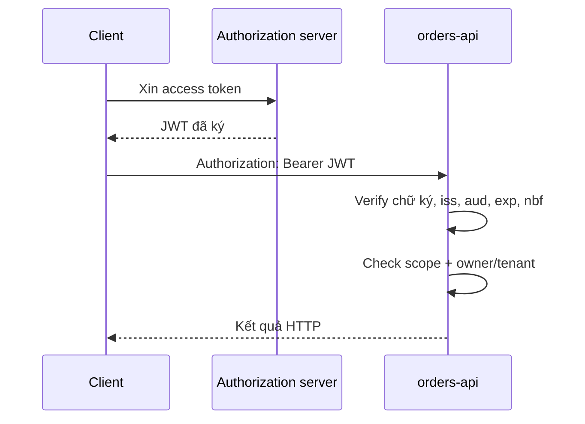
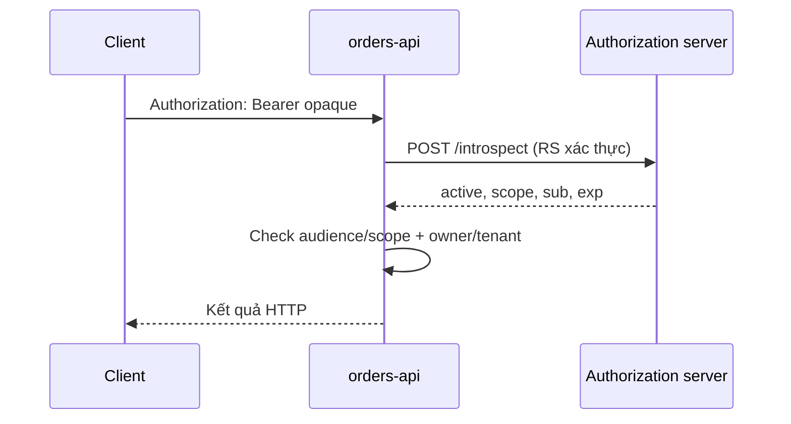

# JWT và opaque token: mô hình kiểm tra, thu hồi và đánh đổi

> **Phạm vi:** Chương **Xác thực** của module **INTEGRATION_API_REST**. Bài học tập trung xác thực access token cho REST API dựa trên HTTP, đặc biệt với Java/Spring Security; đồng thời làm rõ giới hạn thu hồi, kiểm soát quyền, bảo mật và kiểm thử. Tên miền, token, khóa và tài nguyên dưới đây đều minh họa.

## 1. Mục tiêu và bối cảnh

Sau bài học, người học có thể:

1. Phân biệt access token dạng JWT và opaque, tách biệt **định dạng** với **cơ chế kiểm tra**.
2. Thiết kế luồng HTTP `Authorization: Bearer`, kiểm tra JWT bằng chữ ký và opaque qua OAuth 2.0 introspection.
3. Phân tích khả năng thu hồi theo thời gian, tác động của cache và tình huống authorization server gặp sự cố.
4. Cấu hình Spring Security xác minh issuer, audience, thời hạn và scope; thực hiện kiểm soát quyền theo từng đối tượng.
5. Kiểm thử JWT sai chữ ký, sai audience, token hết hạn, opaque bị thu hồi, thiếu quyền và hỏng hệ thống xác thực.

Giả sử client đã lấy access token từ **authorization server (AS)** rồi gọi **resource server (RS)** `orders-api`:

```http
GET /v1/orders/ord-482 HTTP/1.1
Host: api.example.test
Authorization: Bearer <access-token>
Accept: application/json
```

API phải giải quyết **hai bài toán độc lập**: (1) token có đáng tin, đúng đích, còn hiệu lực không; (2) chủ thể của token có được phép đọc đơn hàng `ord-482` không. JWT được ký hợp lệ chưa chứng minh người dùng có quyền trên mọi đơn hàng.

| Thành phần | Trách nhiệm chính |
|---|---|
| Client | Xin token và gửi qua TLS, bảo vệ token trước rò rỉ. |
| Authorization server | Cấp token, nắm khóa và/hoặc trạng thái hiệu lực. |
| Resource server | Kiểm tra token, scope, audience và chính sách truy cập tài nguyên. |
| Resource owner | Chủ sở hữu dữ liệu/quyền; có thể tham gia ủy quyền tùy luồng. |

**Access token** mang quyền truy cập API. **ID token** trong OpenID Connect dùng cho client xác nhận danh tính đăng nhập; không dùng ID token thay access token chỉ vì cả hai có thể có dạng JWT. **Refresh token** dùng tại AS để xin access token mới, không gửi tới API nghiệp vụ.

## 2. JWT: thông tin tự chứa, xác minh bằng mật mã

JWT (RFC 7519) là định dạng chứa claim. Dạng access token phổ biến là **JWT có chữ ký JWS** gồm:

```text
base64url(header).base64url(payload).base64url(signature)
```

Ví dụ header và payload đã giải mã:

```json
{
  "alg": "RS256",
  "typ": "JWT",
  "kid": "key-2026-11"
}
```

```json
{
  "iss": "https://id.example.test/",
  "sub": "user-183",
  "aud": ["orders-api"],
  "client_id": "shop-web",
  "scope": "orders.read orders.write",
  "iat": 1795000000,
  "nbf": 1795000000,
  "exp": 1795000300,
  "jti": "c6aa6f90-..."
}
```

Các số thời gian là ví dụ; khi phát hành thật dùng **Unix timestamp tính bằng giây**. JWS chỉ ký nội dung, **không mã hóa payload**: bất kỳ ai cầm token thường có thể giải mã base64url để đọc `sub`, `scope`… Không đặt mật khẩu, secret, dữ liệu nhạy cảm không cần thiết trong JWT. Nếu yêu cầu tính bí mật của nội dung, giảm claim hoặc dùng cơ chế mã hóa phù hợp như JWE.

| Claim/header | Kiểm tra hoặc ý nghĩa |
|---|---|
| `iss` | Phải khớp chính xác issuer đã cấu hình tin cậy. |
| `aud` | Phải chứa `orders-api`; chống đưa token cấp cho API A sang API B. |
| `exp`, `nbf` | Giới hạn thời gian hiệu lực; xét đồng hồ và clock skew nhỏ. |
| `iat` | Thời điểm phát hành; có thể phục vụ chính sách tuổi token. |
| `sub` | Định danh chủ thể; không phải quyền sở hữu từng object. |
| `scope`/`scp` | Phạm vi cấp phép; cần thống nhất tên claim và cách ánh xạ. |
| `client_id` | Ứng dụng được cấp token; không thay thế kiểm audience. |
| `jti` | Định danh token tùy chọn để audit/denylist; không tự thu hồi được. |
| `kid` | Chọn khóa trong tập JWKS đáng tin, không phải địa chỉ tùy ý để tải khóa. |
| `alg` | Chỉ chấp nhận thuật toán trong allowlist của RS. |
| `typ` | Kiểm loại token theo hợp đồng; `at+jwt` thuộc profile RFC 9068. |

Luồng xác thực tại chỗ:



RS nên thực hiện pipeline sau:

1. Nhận Bearer token qua HTTPS ở vị trí contract quy định; hạn chế kích thước header, từ chối malformed token.
2. Chỉ verify bằng thuật toán được cấu hình (`RS256`/`ES256` theo thiết kế), dùng public key thuộc issuer tin cậy.
3. Kiểm `iss` chính xác, `aud` đúng API, `exp` và `nbf`, và loại access token (`typ` hoặc các ràng buộc theo profile); clock skew phải ngắn.
4. Ràng buộc subject/client/tenant/scope theo hợp đồng, rồi kiểm authorization tại tầng nghiệp vụ.

**Parse/giải mã không bằng verify chữ ký.** Kẻ tấn công có thể tự ghi `sub=admin` vào payload chưa ký đúng. Chỉ sử dụng claim sau khi xác minh chữ ký và toàn bộ điều kiện token được chấp nhận.

### Khóa, JWKS và xoay khóa

Với chữ ký bất đối xứng, AS giữ private key ký; RS kiểm bằng public key lấy từ **JWKS endpoint đã cấu hình trước**. Khi đổi khóa, AS xuất bản public key mới, ký token mới với `kid` mới, giữ khóa cũ đến khi các token cũ hết hạn theo kế hoạch, sau đó loại khóa cũ.

Không tin `alg=none`, không tự tải khóa theo `jku`/`x5u` hoặc URL do header token cung cấp, tránh SSRF và key/algorithm confusion. Cần timeout và cache JWKS; phải xử lý trường hợp `kid` mới xuất hiện, AS mất kết nối và khóa bị lộ. Nếu private key bị lộ, loại bỏ khóa khỏi JWKS tin cậy hoặc chặn khóa ở RS có thể khiến **tất cả** JWT còn hạn được ký bằng khóa đó bị từ chối, nên phải có runbook khẩn cấp.

## 3. Opaque token: RS hỏi AS về trạng thái

Opaque token là chuỗi mà resource server **không thể tự diễn giải để quyết định quyền**. Ví dụ:

```text
Tkn_Yo5svZarzuTehJtkmpXXBnbtTBdRFE8F
```

Nếu tự thiết kế AS, dùng CSPRNG tạo token ngẫu nhiên có entropy cao, tránh token tuần tự/dễ đoán. AS có thể lưu tham chiếu và trạng thái trong DB/cache; cần bảo vệ token như mật khẩu bearer, cân nhắc lưu hash thay giá trị thô. Format bên ngoài không quyết định toàn bộ: một JWT cũng có thể được introspect, trong khi một opaque token có thể tham chiếu dữ liệu nội bộ phong phú.

Thường RS sử dụng **OAuth 2.0 Token Introspection (RFC 7662)**:

```http
POST /oauth2/introspect HTTP/1.1
Host: id.example.test
Authorization: Basic <resource-server-credentials>
Content-Type: application/x-www-form-urlencoded

token=Tkn_Yo5svZarzuTehJtkmpXXBnbtTBdRFE8F&token_type_hint=access_token
```

Ví dụ phản hồi active:

```json
{
  "active": true,
  "sub": "user-183",
  "client_id": "shop-web",
  "scope": "orders.read",
  "aud": ["orders-api"],
  "iss": "https://id.example.test/",
  "exp": 1795000300,
  "token_type": "Bearer"
}
```

Khi token bị thu hồi/hết hạn/không thể công bố chi tiết, phản hồi có thể chỉ là:

```json
{"active": false}
```

**`active=true` chưa đủ cho mọi resource server.** Theo RFC 7662, các trường như `aud`/`iss` có thể tùy chọn; hai bên phải có hợp đồng rõ rằng token đã bị giới hạn đúng RS hay RS phải tự kiểm các claim. Không suy luận “được gọi mọi API” chỉ từ `active`. Introspection endpoint phải có TLS, xác thực resource server, chính sách phân quyền xem thuộc tính token, timeout và rate limit.



Điểm mạnh của introspection là RS hỏi **trạng thái tập trung** và có thể phát hiện token bị thu hồi ở lần hỏi tiếp theo. Đổi lại, RS phụ thuộc kết nối, độ trễ và tính sẵn sàng của AS; cache phản hồi làm chậm hiệu lực thu hồi. Nếu endpoint không trả lời, RS không được tự suy luận token vẫn hợp lệ.

Phân biệt ba thao tác thường bị nhầm:

- **Introspection (RFC 7662):** RS hỏi token đang active và có thuộc tính nào.
- **Revocation (RFC 7009):** một bên được cấp phép yêu cầu AS vô hiệu hóa token; không đồng nghĩa mọi RS biết ngay.
- **Logout/refresh token rotation:** chấm dứt phiên hoặc khả năng xin access token **mới**; JWT access token **đang có** có thể còn dùng được đến `exp` nếu không có cơ chế kiểm trạng thái bổ sung.

## 4. Đánh đổi giữa các mô hình

| Tiêu chí | JWT verify tại RS | Opaque + introspection |
|---|---|---|
| Thông tin | Claims nằm trong token ký, có thể giải mã. | RS nhận chuỗi không diễn giải, AS trả thông tin được phép. |
| Kiểm tra chính | Chữ ký, issuer/audience/time tại RS. | Gọi AS hỏi `active` và metadata. |
| Độ trễ | Thường thấp; ít cuộc gọi AS sau khi có JWKS. | Có round trip mạng, trừ khi cache. |
| Thu hồi access token | Không tức thời nếu chỉ kiểm chữ ký; cần state hoặc chờ `exp`. | Có thể nhanh sau khi AS cập nhật, nhưng cache tạo độ trễ. |
| AS bị gián đoạn | Có thể kiểm token với khóa đã cache trong điều kiện cho phép. | Không xác thực được token chưa có kết quả tin cậy. |
| Vận hành | Key rotation, validator, denylist nếu cần. | SLA AS, xác thực RS, timeout, pool, cache, quan sát độ trễ. |
| Khả năng mở rộng | Tốt cho nhiều API, lưu lượng cao. | AS phải đủ tải hoặc dùng cache được kiểm soát. |

Ba cách triển khai phổ biến:

1. **JWT ngắn hạn, kiểm cục bộ:** chọn cho traffic lớn, yêu cầu chịu lỗi AS tốt, chấp nhận token bị đánh cắp có thể dùng đến lúc hết hạn.
2. **Opaque + introspection:** chọn khi cần điều khiển hiệu lực tập trung, hạ tầng AS có SLA cao và network latency chấp nhận được.
3. **JWT + denylist/phiên:** RS verify chữ ký rồi kiểm `jti` hoặc `session_version` trong state store; giảm độ trễ xác thực nhưng tăng chi phí trạng thái, đồng bộ và xử lý lỗi.

Không có TTL đúng chung cho mọi hệ thống. TTL 5–15 phút chỉ là ví dụ tham khảo, phải căn theo thiệt hại nếu token rò rỉ, ngân sách thu hồi, khả năng refresh và trải nghiệm người dùng.

## 5. Thu hồi là một hợp đồng thời gian

Giả sử 10:00:00 quản trị viên khóa tài khoản, access token hết hạn lúc 10:05:00. Khi AS ghi nhận token bị thu hồi, các RS sẽ phản ứng khác nhau:

| Cơ chế | Hành vi sau khi AS thu hồi | Độ trễ/cửa sổ còn hiệu lực |
|---|---|---|
| JWT chỉ verify chữ ký và hạn | Chữ ký vẫn đúng, `exp` chưa đến. | Có thể chấp nhận đến 10:05:00. |
| JWT + denylist `jti` | RS kiểm token ID trong kho thu hồi. | Phụ thuộc cache và lan truyền sự kiện. |
| JWT + `tokens_valid_after` hoặc version phiên | RS đối chiếu trạng thái phiên/người dùng. | Phụ thuộc thời điểm trạng thái mới tới RS. |
| Opaque, introspect mọi request | AS trả `active=false` sau khi cập nhật. | Gần thời gian AS xử lý + round trip, nếu không cache. |
| Opaque cache `active=true` 30 giây | RS có thể tiếp tục dùng kết quả cũ. | Gần 30 giây trong trường hợp xấu, nếu không invalidation. |
| Thu hồi refresh token | Chặn việc cấp access token mới qua refresh. | Không tự động loại access token cũ. |

Cần mô tả **ngân sách thu hồi** bằng con số, ví dụ “99,9% request bị từ chối trong 20 giây kể từ khi khóa tài khoản khi cơ chế kiểm trạng thái hoạt động”. Sau đó chọn TTL, event invalidation, metric và kiểm thử tương ứng. Cụm từ “thu hồi ngay” là không chính xác khi cache dương vẫn giữ `active=true`.

Nếu dùng JWT denylist:

- Token có `jti` hoặc ID phiên đáng tin; RS **verify JWT trước**, rồi tra denylist.
- Giữ denylist entry ít nhất đến `exp` cộng leeway cần thiết, tránh lưu vô thời hạn.
- State store phải được nhân bản/đồng bộ giữa các instance; phải xác định fail-closed khi không thể tra trạng thái ở endpoint nhạy cảm.
- Thu hồi toàn bộ token của một người dùng có thể dùng `session_version` hoặc `tokens_valid_after`, nhưng phải tính tới race, cache và phiên đang chạy.

Nếu cache introspection, TTL kết quả dương phải bị chặn bởi **thời hạn token** và **ngân sách thu hồi**. Khóa cache không được làm lộ bearer token; có thể dùng HMAC fingerprint, phân tách theo client/RS và chính sách. Cache kết quả âm phải ngắn và **không nhầm lỗi timeout/`5xx` với `active=false`**. Khi AS gặp sự cố, áp dụng chính sách fail-closed thay vì giả định quyền truy cập vẫn có hiệu lực.

**Ví dụ “đăng xuất mọi thiết bị”:** Vô hiệu hóa refresh token ngăn tạo token mới, nhưng ba JWT access token đã cấp vẫn có thể hoạt động. Muốn chặn sớm cần kiểm trạng thái phiên/denylist hoặc chuyển sang cơ chế introspection. Phải công bố và đo được thời gian thu hồi thực trên nhiều instance.

## 6. HTTP: khi nào 401, 403 và 404?

RFC 6750 quy định bearer token và challenge. Khi không có credential hoặc token sai/hết hạn/bị thu hồi, thường trả **401 Unauthorized**:

```http
HTTP/1.1 401 Unauthorized
WWW-Authenticate: Bearer realm="orders", error="invalid_token"
Cache-Control: no-store
Content-Type: application/problem+json

{
  "type": "https://api.example.test/problems/invalid-token",
  "title": "Access token không hợp lệ",
  "status": 401
}
```

Với request thiếu hẳn credential, challenge có thể chỉ chứa `Bearer realm="orders"` mà không kèm `error`. Khi token hợp lệ nhưng thiếu scope, trả **403 Forbidden**, ví dụ:

```http
HTTP/1.1 403 Forbidden
WWW-Authenticate: Bearer realm="orders", error="insufficient_scope", scope="orders.read"
Content-Type: application/problem+json

{
  "type": "https://api.example.test/problems/forbidden",
  "title": "Không đủ quyền",
  "status": 403
}
```

Nếu cần tránh tiết lộ một đơn hàng có tồn tại hay không cho người ngoài tenant, API có thể chọn **404 Not Found** nhất quán cho lỗi object-level authorization. Lỗi AS không phản hồi là **sự cố hệ thống**, không nên bị ghi nhận như token đã thu hồi; tuy nhiên tuyệt đối không trả dữ liệu khi chưa xác minh được token. Không dùng `200` với JSON `{"authenticated":false}` để biểu diễn thất bại của endpoint cần xác thực.

## 7. Java/Spring: cấu hình JWT hoặc opaque

Ví dụ giả định Spring Boot 3.x / Spring Security 6.x đã thêm `spring-boot-starter-security` và `spring-boot-starter-oauth2-resource-server`. Các cấu hình dưới đây là **hai phương án triển khai thay thế** cho cùng API; chọn một tương ứng với AS.

### 7.1. JWT: giới hạn thuật toán, issuer và audience

```yaml
# application.yml
security:
  jwt:
    issuer: https://id.example.test/
    jwk-set-uri: https://id.example.test/.well-known/jwks.json
    audience: orders-api
```

```java
package example.orders.security;

import org.springframework.beans.factory.annotation.Value;
import org.springframework.context.annotation.Bean;
import org.springframework.context.annotation.Configuration;
import org.springframework.http.HttpMethod;
import org.springframework.security.config.Customizer;
import org.springframework.security.config.annotation.method.configuration.EnableMethodSecurity;
import org.springframework.security.config.annotation.web.builders.HttpSecurity;
import org.springframework.security.config.annotation.web.configurers.AbstractHttpConfigurer;
import org.springframework.security.config.http.SessionCreationPolicy;
import org.springframework.security.oauth2.core.*;
import org.springframework.security.oauth2.jose.jws.SignatureAlgorithm;
import org.springframework.security.oauth2.jwt.*;
import org.springframework.security.web.SecurityFilterChain;

@Configuration
@EnableMethodSecurity
public class ApiSecurity {

    @Bean
    SecurityFilterChain apiFilterChain(HttpSecurity http) throws Exception {
        return http
            // Chỉ áp dụng cho API stateless dùng Bearer trong header,
            // không sử dụng cookie xác thực tự gửi từ browser.
            .csrf(AbstractHttpConfigurer::disable)
            .sessionManagement(s -> s.sessionCreationPolicy(
                SessionCreationPolicy.STATELESS))
            .authorizeHttpRequests(auth -> auth
                .requestMatchers(HttpMethod.GET, "/v1/health").permitAll()
                .requestMatchers(HttpMethod.GET, "/v1/orders/**")
                    .hasAuthority("SCOPE_orders.read")
                .requestMatchers(HttpMethod.POST, "/v1/orders")
                    .hasAuthority("SCOPE_orders.write")
                .anyRequest().authenticated())
            .oauth2ResourceServer(oauth -> oauth.jwt(Customizer.withDefaults()))
            .build();
    }

    @Bean
    JwtDecoder jwtDecoder(
            @Value("${security.jwt.issuer}") String issuer,
            @Value("${security.jwt.jwk-set-uri}") String jwkSetUri,
            @Value("${security.jwt.audience}") String audience) {

        NimbusJwtDecoder decoder = NimbusJwtDecoder
            .withJwkSetUri(jwkSetUri)
            .jwsAlgorithm(SignatureAlgorithm.RS256)
            .build();

        OAuth2TokenValidator<Jwt> audienceValidator = jwt ->
            jwt.getAudience().contains(audience)
                ? OAuth2TokenValidatorResult.success()
                : OAuth2TokenValidatorResult.failure(new OAuth2Error(
                    "invalid_token", "Audience không hợp lệ", null));

        decoder.setJwtValidator(new DelegatingOAuth2TokenValidator<>(
            JwtValidators.createDefaultWithIssuer(issuer),
            audienceValidator));
        return decoder;
    }
}
```

Cơ chế này lấy public key từ URL JWKS đã cấu hình, giới hạn `RS256`, rồi kiểm issuer và time bằng validator mặc định có issuer; validator `aud` chống dùng token sai API. Spring Security thông thường ánh xạ `scope` hoặc `scp` thành authority có tiền tố `SCOPE_`. Nếu AS dùng claim khác, cấu hình `JwtAuthenticationConverter` rõ ràng. Nếu theo RFC 9068, bổ sung kiểm `typ` và các claim bắt buộc của profile (ví dụ `client_id`); mẫu này chưa triển khai mọi ràng buộc của RFC 9068.

**Phân biệt profile token:** ví dụ cấu hình trên xác thực JWT access token tổng quát với header `typ=JWT`. Nếu AS sử dụng OAuth 2.0 JWT access token profile RFC 9068 (`typ=at+jwt`), cần cấu hình kiểm loại token và các claim bắt buộc theo profile. Ví dụ với Spring Security **6.5+** và một client được phép là `shop-web`:

```java
NimbusJwtDecoder atDecoder = NimbusJwtDecoder.withJwkSetUri(jwkSetUri)
    .jwsAlgorithm(SignatureAlgorithm.RS256)
    .validateTypes(false)
    .build();
atDecoder.setJwtValidator(JwtValidators.createAtJwtValidator()
    .issuer(issuer)
    .audience(audience)
    .clientId("shop-web")
    .build());
```

Khi nhiều client hợp lệ, phải thiết kế validator `client_id` theo chính sách thực thay vì cố định một ID; cần xác nhận API tương thích phiên bản Spring đang sử dụng. Dùng `validateTypes(false)` mà không bổ sung validator loại token phù hợp sẽ mở rộng những loại JWT được chấp nhận ngoài ý muốn.

Dòng tắt CSRF chỉ phù hợp API stateless không dùng cookie tự động; nếu ứng dụng xác thực bằng session/cookie trên browser, phải phân tích và bảo vệ CSRF phù hợp.

### 7.2. Authorization theo object: tránh IDOR/BOLA

`orders.read` chỉ cho phép **đề nghị** đọc đơn hàng. Tầng service phải kiểm theo dữ liệu thật:

```java
@GetMapping("/v1/orders/{id}")
public ResponseEntity<OrderDto> getOrder(
        @PathVariable String id,
        @AuthenticationPrincipal Jwt jwt) {

    Order order = orderService.getById(id);
    String subject = jwt.getSubject();
    String tenant = jwt.getClaimAsString("tenant_id");

    if (!order.getTenantId().equals(tenant)
            || !order.getOwnerSubject().equals(subject)) {
        throw new ResponseStatusException(HttpStatus.NOT_FOUND);
    }
    return ResponseEntity.ok(orderMapper.toDto(order));
}
```

Đoạn này chỉ minh họa phần policy, cần import Spring MVC và entity/service thực tế. Khi làm thật, ưu tiên ràng buộc truy vấn theo `orderId`, `tenantId` và `subject` tại service/repository, bảo đảm object-level authorization ở mọi endpoint. Không lấy `tenant` từ query/path chưa đáng tin để thay cho claim đã được xác minh, không tin `ownerSubject` do client tự đặt.

### 7.3. Opaque: introspection bằng Spring Security

Ở deployment dùng opaque, thay cấu hình JWT bằng:

```yaml
# application.yml
spring:
  security:
    oauth2:
      resourceserver:
        opaquetoken:
          introspection-uri: https://id.example.test/oauth2/introspect
          client-id: orders-api-rs
          client-secret: ${INTROSPECTION_CLIENT_SECRET}
```

```java
@Bean
SecurityFilterChain opaqueApiFilterChain(HttpSecurity http) throws Exception {
    return http
        .csrf(AbstractHttpConfigurer::disable)
        .sessionManagement(s -> s.sessionCreationPolicy(
            SessionCreationPolicy.STATELESS))
        .authorizeHttpRequests(auth -> auth
            .requestMatchers(HttpMethod.GET, "/v1/health").permitAll()
            .requestMatchers(HttpMethod.GET, "/v1/orders/**")
                .hasAuthority("SCOPE_orders.read")
            .anyRequest().authenticated())
        .oauth2ResourceServer(oauth ->
            oauth.opaqueToken(Customizer.withDefaults()))
        .build();
}
```

Đây là **thay thế** `apiFilterChain` JWT, không đăng ký hai bean có matcher trùng nhau. Spring sẽ dùng introspection URI và credential cấu hình để dựng `OpaqueTokenIntrospector`. Secret phải lấy từ secret manager/biến môi trường. Cần bổ sung validation audience/issuer/token type nếu AS chưa ràng buộc token cho đúng RS; có thể bọc `OpaqueTokenIntrospector` tùy chỉnh hoặc sửa hợp đồng AS. Đặt connect/read timeout, connection pool, giới hạn retry và chính sách fail-closed khi introspection lỗi; không giả vờ token đã bị thu hồi nếu thực tế AS đang không sẵn sàng.

## 8. Những lỗi bảo mật phổ biến

| Rủi ro | Nguyên nhân | Phòng vệ |
|---|---|---|
| Token substitution | Token hợp lệ nhưng cấp cho API khác. | Validate issuer và audience, loại access token. |
| Algorithm/key confusion | Tin header `alg`, `jku`, `kid` vô điều kiện. | Allowlist algorithm, JWKS cấu hình trước, không fetch URL do token đưa. |
| Token replay | Người nhặt được bearer token dùng lại. | HTTPS, TTL phù hợp, bảo vệ client storage; cân nhắc DPoP/mTLS nếu cần. |
| Lộ claim JWT | Nhầm base64url với mã hóa. | Hạn chế dữ liệu nhạy cảm, cân nhắc JWE nếu có yêu cầu. |
| Lộ token qua log | Log `Authorization`, URL chứa `access_token`. | Redact header, không truyền token qua query, không ghi token trong metric. |
| Introspection bị lạm dụng | AS tiết lộ trạng thái token cho client lạ. | RS authentication, phân quyền endpoint, giới hạn thuộc tính, rate limit. |
| Cache quá lâu | `active=true` còn lưu sau thu hồi. | TTL theo ngân sách thu hồi, invalidation và test đa instance. |
| Fail-open | AS hoặc denylist lỗi nhưng RS mặc định cho phép. | Từ chối truy cập khi chưa xác minh, cảnh báo và runbook sự cố. |
| IDOR/BOLA | Chỉ kiểm scope rồi trả object theo ID. | Kiểm owner/tenant/role tại service hoặc repository. |
| Browser threat | XSS chiếm token, CSRF với cookie xác thực. | Giảm XSS, CSP, CSRF với cookie; chọn storage theo threat model. |

Không ghi raw access token, refresh token, client secret, private key hoặc toàn bộ introspection response nhạy cảm vào log. Có thể log request ID, loại lỗi, issuer đã rút gọn, latency; nếu cần liên kết token để debug, dùng HMAC fingerprint có kiểm soát và không công khai khóa. DPoP hoặc mTLS-bound access token có thể giảm khả năng replay nhưng yêu cầu RS xác minh proof/ràng buộc `cnf`; chỉ nhận header DPoP mà không verify không có tác dụng.

## 9. Kiểm thử đúng ranh giới bảo mật

Nên tách **kiểm policy/controller** và **kiểm cấu hình decoder/introspection**. Với `spring-security-test`, MockMvc có thể giả lập Authentication:

```java
// Trong MockMvc test có fixture đơn hàng do subject test sở hữu.
mockMvc.perform(get("/v1/orders/ord-482")
        .with(jwt().authorities(
            new SimpleGrantedAuthority("SCOPE_orders.read"))))
    .andExpect(status().isOk());
```

`with(jwt())` là mock authentication, **không verify chữ ký thật**; test này không chứng minh khóa/JWKS/issuer/audience được cấu hình đúng. Đối với JWT integration, tạo token ký bằng test private key, public key qua JWKS test và đưa token thật qua HTTP. Đối với opaque, mock HTTP introspection endpoint và kiểm phản hồi thực sự được xử lý.

| Test | Kỳ vọng |
|---|---|
| Không gửi Bearer token | `401` + `WWW-Authenticate: Bearer`. |
| JWT thay một byte hoặc chữ ký sai | `401`, không vào business service. |
| JWT đúng chữ ký nhưng `iss` hoặc `aud` sai | `401`. |
| `exp` ở quá khứ, `nbf` tương lai | `401` với clock skew cấu hình. |
| `alg` cấm, `kid` không tìm thấy trong JWKS | `401`, không fetch URL lạ. |
| ID token gửi nhầm như access token | Từ chối nhờ audience/type/profile. |
| Token hợp lệ thiếu `orders.read` | `403` + `insufficient_scope` khi phù hợp. |
| Đủ scope nhưng sai owner/tenant | `403` hoặc `404` theo policy; không lộ dữ liệu. |
| Opaque `active=false` | `401`. |
| Opaque `active=true` nhưng scope/audience không phù hợp | Từ chối. |
| AS introspection timeout/`5xx` | Fail-closed, metric lỗi AS riêng. |
| Thu hồi token với cache/multi-instance | Từ chối trong thời hạn đã cam kết. |
| Xoay JWKS/key compromise | Nhận khóa hợp lệ theo kế hoạch; từ chối khóa không được tin. |

Thử thủ công bằng token **test** qua HTTP:

```bash
curl -i 'https://api.example.test/v1/orders/ord-482' \
  -H 'Authorization: Bearer <test-access-token>' \
  -H 'Accept: application/json'
```

Trong vận hành, theo dõi `p95/p99` introspection latency, timeout rate, tỷ lệ `401` invalid token, `403` policy deny, độ trễ thu hồi và cache hit. Không dùng token thô làm nhãn metric (rò rỉ bí mật và cardinality cao).

**Chaos/failure test:** ngắt introspection; xoay client secret; ép timeout; AS trả `5xx`; JWKS cũ hết cache; token mới có `kid` mới; một instance nhận sự kiện thu hồi muộn. Kết quả phải chứng minh hệ thống không tự cho phép request khi thiếu bằng chứng xác thực, đồng thời phân biệt lỗi security với lỗi availability.

## 10. Bài tập thực hành

**Bài 1 — Chọn kiến trúc.** Một hệ thống bán hàng có `catalog-api` đọc lớn, `orders-api` chứa dữ liệu cá nhân. Thiết kế issuer, audiences, scopes, TTL, kiểm owner/tenant và chính sách thu hồi khi khóa tài khoản. Chọn JWT cục bộ, opaque introspection hoặc JWT + trạng thái cho từng API, giải thích hiệu năng/availability/khả năng thu hồi.

**Bài 2 — Tìm lỗi logic.** Một lập trình viên chỉ base64-decode JWT lấy `sub`, kiểm có `scope=orders.read` rồi query `Order` theo ID. Liệt kê ít nhất năm lỗi; viết pseudocode gồm verify chữ ký, allowlist algorithm, issuer, audience, time, type và object authorization.

**Bài 3 — Tính thời gian thu hồi.** Opaque token sống 10 phút, cache `active=true` 45 giây. Token bị thu hồi tại giây 20 sau khi cấp; RS vừa lưu cache dương một tích tắc trước đó. Token có thể được chấp nhận thêm gần bao lâu nếu không có invalidation? Thay TTL để đạt mục tiêu thu hồi trong 10 giây và nêu giả định về AS/clock/event. Với JWT thuần không có state, giải thích vì sao access token có thể còn dùng đến `exp`.

**Bài 4 — Viết integration test Spring.** Kiểm JWT sai `aud`, sai chữ ký, hết hạn, thiếu scope, truy cập chéo tenant, opaque `active=false`, AS timeout và JWKS rotation. Chỉ rõ test nào dùng `jwt()` giả lập Authentication, test nào bắt buộc đi qua JWT decoder hoặc HTTP introspection thật.

**Câu hỏi tự kiểm tra:** Vì sao JWT đã ký vẫn có thể bị từ chối? Vì sao refresh token bị thu hồi chưa đủ để chặn JWT access token? `active=true` có cho phép xem mọi đơn hàng không? Cache ảnh hưởng gì tới lời hứa “thu hồi trong 5 giây”? Tại sao test bằng `with(jwt())` không xác minh được chữ ký?

Một thiết kế đạt yêu cầu phải trình bày được **đường tin cậy**, **audience/scope**, **quyền trên tài nguyên**, **ngân sách thu hồi định lượng** và **hành vi khi AS/state store lỗi**.

## 11. Kết luận và nguồn tham khảo

JWT kiểm tại chỗ giúp giảm phụ thuộc vào AS, nhưng cần quản lý chữ ký/khóa/claim và không có thu hồi tức thời nếu chỉ verify JWT. Opaque + introspection cho phép tra trạng thái tập trung, nhưng phụ thuộc AS và cache. Dù chọn gì, luôn tách **xác thực token** khỏi **phân quyền trên từng tài nguyên**, và kiểm thử cả khi hạ tầng xác thực bị lỗi.

- [RFC 7519 — JSON Web Token (JWT)](https://www.rfc-editor.org/rfc/rfc7519)
- [RFC 8725 — JWT Best Current Practices](https://www.rfc-editor.org/rfc/rfc8725)
- [RFC 6750 — OAuth 2.0 Bearer Token Usage](https://www.rfc-editor.org/rfc/rfc6750)
- [RFC 7662 — OAuth 2.0 Token Introspection](https://www.rfc-editor.org/rfc/rfc7662)
- [RFC 7009 — OAuth 2.0 Token Revocation](https://www.rfc-editor.org/rfc/rfc7009)
- [RFC 9068 — JWT Profile for OAuth 2.0 Access Tokens](https://www.rfc-editor.org/rfc/rfc9068)
- [Spring Security — OAuth 2.0 Resource Server](https://docs.spring.io/spring-security/reference/servlet/oauth2/resource-server/index.html)
