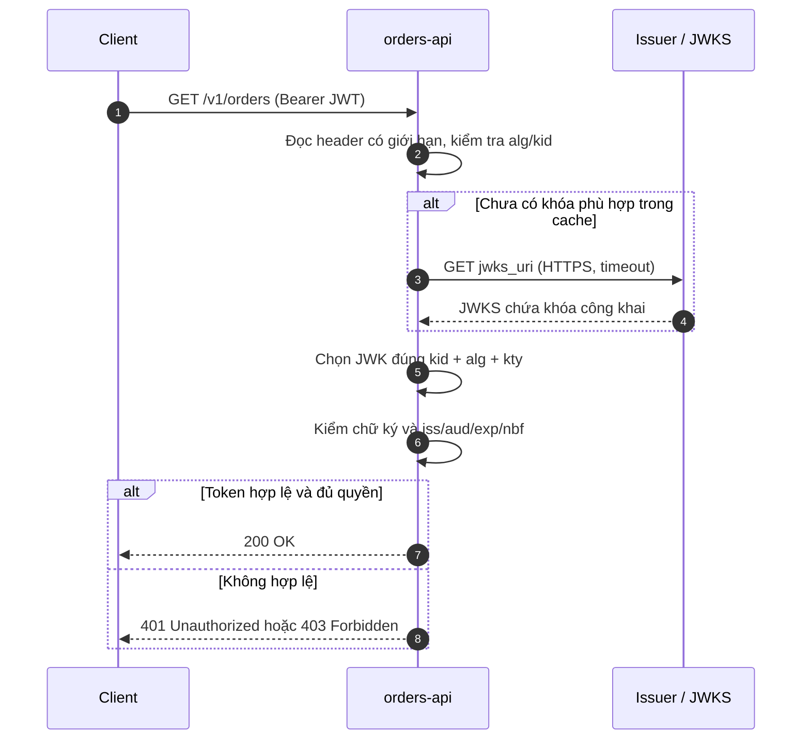
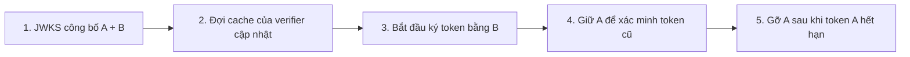

# JWKS, xoay khóa và xử lý lỗi lấy khóa

Khi một REST API nhận `Authorization: Bearer <access_token>` dưới dạng JWT có chữ ký số, API cần xác minh chữ ký trước khi tin vào danh tính, quyền và các claim bên trong token. **JSON Web Key Set (JWKS)** giúp resource server lấy **khóa công khai** của bên phát hành (issuer), còn **xoay khóa (key rotation)** cho phép issuer thay khóa ký mà hệ thống vẫn xác minh được các token chưa hết hạn. Hai bài toán phải được thiết kế cùng nhau: nếu cache hoặc lịch xoay khóa sai, API có thể từ chối hàng loạt người dùng hợp lệ; nếu xử lý lỗi lấy khóa sai, API có thể vô tình bỏ qua xác minh hoặc tạo cơ hội tấn công từ chối dịch vụ.

Ví dụ xuyên suốt: `orders-api` là REST API Java/Spring Boot, nhận JWT access token do `https://id.example.com/realms/shop` phát hành. Ứng dụng chỉ chấp nhận token có `iss` đúng issuer này, `aud` chứa `orders-api`, chữ ký RS256 hợp lệ và thời gian hiệu lực hợp lệ. Đây là xác thực JWT tại **resource server**; API không giữ khóa bí mật để ký token.

## 1. Mục tiêu học tập

Sau bài này, người học có thể:

1. Giải thích quan hệ giữa JWT/JWS, `kid`, JWK, JWKS và URL `jwks_uri`; phân biệt khóa công khai dùng để xác minh với khóa riêng dùng để ký.
2. Thiết kế cache, làm mới khóa và xử lý trường hợp `kid` chưa có trong cache mà không để mỗi request gây ra một lượt tải JWKS.
3. Lập lịch xoay khóa có thời gian chồng lấn để token ký bằng khóa cũ và khóa mới cùng được xác minh an toàn.
4. Xử lý timeout, lỗi TLS, HTTP 5xx, JWKS sai định dạng và cache quá hạn theo nguyên tắc **không bỏ qua xác minh chữ ký**.
5. Cấu hình resource server Spring Security, xác minh cả chữ ký lẫn các claim quan trọng và viết kiểm thử cho tình huống thay khóa/mất kết nối.

## 2. Mô hình tin cậy: token chứa chỉ dẫn, không chứa quyền quyết định

Một JWT đã ký thường có ba phần `BASE64URL(header).BASE64URL(payload).BASE64URL(signature)`. Header và payload **chỉ là dữ liệu do client chuyển tới** cho đến khi chữ ký được xác minh. Một header minh họa:

```json
{
  "typ": "JWT",
  "alg": "RS256",
  "kid": "shop-rsa-2026-11"
}
```

- `alg` nói thuật toán mà token **tự khai báo**; resource server phải có danh sách thuật toán được phép, chẳng hạn chỉ `RS256`, rồi kiểm tra tính tương thích giữa thuật toán và loại khóa. Không được chọn chấp nhận thuật toán chỉ vì header yêu cầu; `alg: none` không phải lựa chọn thay thế khi tải khóa thất bại.
- `kid` (key ID) là **gợi ý chọn khóa** trong JWKS của issuer đã tin cậy. Nó không chứng minh ai ký token. Chuỗi `kid` phải được coi là dữ liệu không tin cậy, giới hạn độ dài và không đưa trực tiếp vào đường dẫn file, câu SQL, URL, log hoặc truy vấn mạng tùy ý.
- `typ` có thể hỗ trợ phân biệt loại token theo hợp đồng với issuer (ví dụ hồ sơ JWT access token quy định `at+jwt`). Không dựa duy nhất vào `typ` để xác thực token; mọi claim và chữ ký vẫn phải được kiểm tra.

Một JWK biểu diễn một khóa bằng JSON. Một JWKS chứa tập các JWK và thường được công bố qua HTTPS:

```http
GET /realms/shop/protocol/openid-connect/certs HTTP/1.1
Host: id.example.com
Accept: application/json
```

```http
HTTP/1.1 200 OK
Content-Type: application/json
Cache-Control: public, max-age=300
ETag: "shop-jwks-v8"

{
  "keys": [
    {
      "kty": "RSA",
      "kid": "shop-rsa-2026-10",
      "use": "sig",
      "alg": "RS256",
      "n": "<modulus-base64url-cua-khoa-A>",
      "e": "AQAB"
    },
    {
      "kty": "RSA",
      "kid": "shop-rsa-2026-11",
      "use": "sig",
      "alg": "RS256",
      "n": "<modulus-base64url-cua-khoa-B>",
      "e": "AQAB"
    }
  ]
}
```

Các giá trị `n` trong ví dụ là **placeholder**, không phải khóa RSA hợp lệ để chạy thật. Trong RSA, `n` và `e` mô tả khóa công khai; thành phần bí mật như `d`, `p`, `q` **không được** xuất hiện trong JWKS công khai. Đối với EC, trường khóa công khai tương ứng là `crv`, `x`, `y`. `use: sig` cho biết khóa dành cho chữ ký; một JWK có thể còn dùng `key_ops` để giới hạn thao tác. Đừng dùng một khóa mã hóa (`enc`) để xác minh JWS.

**Nguồn tin cậy phải đi từ cấu hình hệ thống:** API tin cậy issuer được cấu hình, nhận URL `jwks_uri` qua cấu hình hoặc discovery metadata của issuer được xác thực, tải JWKS bằng kết nối HTTPS hợp lệ, rồi chọn khóa trong tập đó. Tuyệt đối không làm theo `jku`, `x5u` hay URL bất kỳ được gửi bên trong JWT chưa xác minh: cách làm ấy mở đường cho SSRF hoặc đưa khóa do kẻ tấn công điều khiển vào quá trình kiểm tra.



## 3. Quy trình xác minh JWT tại REST API

Hãy phân biệt hai câu hỏi: **“Ai ký và token có bị sửa không?”** là xác minh chữ ký; **“Token có dành cho API này, còn hạn và đủ quyền không?”** là xác minh claim và phân quyền. Cả hai đều bắt buộc.

1. **Nhận token đúng ngữ cảnh.** Chỉ đọc bearer token từ nguồn được chấp nhận (`Authorization` header theo hợp đồng), giới hạn kích thước header/token, định dạng JWS và số lượng phần. Token opaque cần introspection hoặc cơ chế riêng; không cố diễn giải mọi bearer token là JWT.
2. **Ràng buộc issuer và thuật toán.** Chỉ chấp nhận issuer đã cấu hình; cấu hình thuật toán ký hợp lệ. Không trộn khóa của nhiều issuer vào một kho chọn theo `kid` đơn thuần: hai issuer có thể dùng trùng `kid`.
3. **Chọn khóa công khai.** Tìm JWK trong cache JWKS của issuer đó theo `kid`; kiểm tra `kty`, `use`/`key_ops`, độ dài khóa/đường cong và thuật toán tương thích. Nếu nhiều khóa cùng `kid` gây mơ hồ, từ chối cấu hình/bộ khóa ấy và cảnh báo vận hành; không chọn ngẫu nhiên.
4. **Xác minh chữ ký bằng thư viện chuẩn.** Với RS256, dùng RSA và SHA-256 theo JWS; với ES256, dùng EC P-256 đúng định dạng chữ ký JWS. Không tự viết phép toán kiểm chữ ký hoặc tự giải mã bằng các hàm RSA thô.
5. **Xác minh claim.** `iss` phải khớp chính xác issuer mong đợi; `aud` phải chứa định danh API; `exp` phải còn hiệu lực; `nbf` (nếu có) không nằm trong tương lai vượt mức lệch đồng hồ cho phép; áp dụng các yêu cầu `iat`, loại token, tenant, client hoặc scope theo hệ thống. Độ lệch đồng hồ nên nhỏ và được cấu hình có chủ đích.
6. **Phân quyền theo resource và hành động.** Ví dụ `GET /v1/orders/{id}` cần `orders:read` và còn phải kiểm tra người gọi được phép xem **đúng order đó**. Chữ ký hợp lệ không tự động cho phép truy cập dữ liệu của người khác.

Sai lầm điển hình: chỉ `Base64URL.decode(payload)` rồi tin trường `sub`; chấp nhận `aud` không đúng; bỏ qua `exp`; cho phép `HS256` đồng thời với `RS256` mà không có chính sách chặt; hoặc thử mọi khóa có sẵn khi `kid` lạ. Các lỗi này phá vỡ ranh giới tin cậy ngay cả khi endpoint JWKS hoạt động hoàn hảo.

## 4. Cache JWKS và làm mới khóa

JWKS thường được truy cập qua HTTP và có thể được cache để giảm độ trễ, chi phí và phụ thuộc vào availability của issuer. Nhưng cache cũng làm chậm thời điểm resource server biết đến khóa vừa được công bố hoặc khóa vừa bị thu hồi. Thiết kế cần thống nhất giữa **issuer, edge/cache/CDN và mọi resource server**.

| Tình huống | Hành vi khuyến nghị | Lý do |
|---|---|---|
| Cache có khóa phù hợp, bản JWKS còn tươi | Xác minh ngay, không gọi mạng cho mỗi request | Độ trễ thấp; tránh biến issuer thành điểm nghẽn |
| Cache đến thời hạn làm mới | Tải lại JWKS một lần cho mỗi nhóm request, giới hạn đồng thời; có thể revalidate bằng ETag | Hạn chế thác request khi hết TTL |
| Có token với `kid` mới | Có thể kích hoạt refresh sớm nếu đã qua khoảng tối thiểu; vẫn giới hạn tần suất | Hỗ trợ xoay khóa, chống flood bằng `kid` ngẫu nhiên |
| `kid` không tồn tại sau refresh hợp lệ | Không xác minh được token, từ chối | `kid` không phải lời hứa rằng khóa chắc chắn tồn tại |
| Nhận HTTP `304 Not Modified` cho `If-None-Match` | Giữ bộ khóa trước đó và cập nhật độ tươi theo HTTP policy | 304 không chứa bộ khóa mới |
| Nhận JWKS lỗi cú pháp, trùng `kid` bất thường hoặc khóa yếu | Không thay cache đang hợp lệ bằng dữ liệu lỗi, ghi cảnh báo | Tránh hỏng hàng loạt do bản xuất bản sai |

### Các lớp trạng thái cache

Một thiết kế dễ vận hành định nghĩa tối thiểu:

- **Fresh:** bộ khóa đã tải và còn trong `max-age`/TTL nội bộ; dùng theo chính sách xác minh thông thường.
- **Refresh due:** tới hạn làm mới, chỉ một tác vụ tải JWKS (single-flight) làm việc tại một thời điểm; các request đồng thời có thể dùng cache còn hợp lệ theo chính sách đã đặt.
- **Stale:** cache vượt TTL thông thường. Có cho phép tạm dùng *khóa đã biết* trong khoảng ngắn khi issuer lỗi hay không là một quyết định bảo mật có giới hạn rõ, không phải hành vi mặc định chung cho mọi SDK.
- **Empty/unusable:** chưa từng lấy được khóa đáng tin cậy, hoặc hết thời gian sử dụng an toàn; không thể xác minh chữ ký bằng khóa phù hợp.

Ví dụ issuer trả `Cache-Control: public, max-age=300` thì mỗi instance có thể giữ JWKS **tối đa khoảng năm phút theo chính sách đó**, trừ khi cơ chế refresh sớm được cấu hình. ETag cho phép tiết kiệm băng thông:

```http
GET /realms/shop/protocol/openid-connect/certs HTTP/1.1
Host: id.example.com
If-None-Match: "shop-jwks-v8"
```

```http
HTTP/1.1 304 Not Modified
ETag: "shop-jwks-v8"
Cache-Control: public, max-age=300
```

**TTL thực tế phụ thuộc thư viện.** Một số trình xác minh JWKS có cache riêng, không tự tuân theo mọi HTTP cache header hoặc chỉ refresh khi gặp `kid` không biết. Đọc tài liệu phiên bản đang chạy; kiểm chứng bằng mock JWKS server, thay vì giả định mọi hành vi trong bảng đều được Spring/Nimbus kích hoạt tự động.

### Chống bão refresh và tấn công `kid` ngẫu nhiên

Nếu mỗi bearer token chứa `kid` không biết đều lập tức gây một HTTP GET đến issuer, kẻ tấn công có thể gửi hàng nghìn JWT rác để tạo **JWKS fetch amplification**. Cơ chế đề xuất:

1. Đặt timeout kết nối/đọc, giới hạn response body, số redirect (tốt nhất không đi theo redirect ngoài miền đã cho phép), số key trong JWKS và độ dài `kid`.
2. Dùng single-flight: nhiều request cùng cần JWKS chỉ chờ **một** lượt refresh; giới hạn số request đang đợi và concurrency HTTP.
3. Giới hạn refresh do unknown `kid` bằng cooldown, ví dụ vài chục giây tùy SLA; có backoff và jitter khi endpoint lỗi. Nếu cache mới vừa được cập nhật và vẫn không có `kid`, từ chối ngay.
4. Negative cache có thời hạn ngắn cho một số `kid` không tồn tại, kèm giới hạn số phần tử/độ dài khóa để không bị tấn công bộ nhớ. Không ghi toàn bộ giá trị `kid` do client gửi vào log không giới hạn.
5. Giữ kết quả JWKS được xác thực gần nhất khi lần tải mới thất bại, nhưng chỉ sử dụng trong phạm vi **stale policy** đã được phê duyệt. Không bao giờ coi “fetch failed” là tín hiệu để chấp nhận token chưa xác minh.

Ví dụ pseudocode mô tả **chính sách cần triển khai/kiểm chứng**, không phải mã sẵn có trong Spring:

```text
verify(jwt):
    header = parse_bounded_jws_header(jwt)
    require header.alg in allowed_algs
    require valid_bounded_kid(header.kid)

    key = jwks_cache.find(issuer, header.kid, header.alg)
    if key == NONE and refresh_cooldown_expired():
        single_flight_refresh_jwks_with_timeout()
        key = jwks_cache.find(issuer, header.kid, header.alg)

    if key == NONE:
        reject_as_unverifiable()  # không được bỏ qua chữ ký

    require key_allowed_for_signature(key, header.alg)
    require valid_jws_signature(jwt, key)
    require valid_issuer_audience_time_and_token_type(jwt)
    return authenticated_principal_with_scopes(jwt)
```

Đoạn trên giả định `issuer`/`jwks_uri` đã được cấu hình tin cậy, cache chỉ chứa bộ khóa được tải từ URL đó, và việc dùng khóa cũ tuân thủ chính sách freshness/staleness. Khi chuyển pseudocode thành mã thật phải phân biệt riêng lỗi token và lỗi phụ thuộc JWKS để tạo phản hồi HTTP/metric phù hợp.

## 5. Xoay khóa có chồng lấn (planned rotation)

Trình ký token và trình xác minh token có nhịp cập nhật khác nhau. Việc issuer bắt đầu ký bằng khóa B **trước** khi resource server biết khóa B gây ra 401 hàng loạt. Việc issuer xóa khóa A **trước** khi token cuối cùng ký bằng A hết hạn cũng gây ra lỗi tương tự. Cần tách **công bố khóa mới**, **bắt đầu ký bằng khóa mới**, **ngừng ký bằng khóa cũ** và **gỡ khóa cũ** thành các thời điểm riêng.



Giả sử thời gian cache lớn nhất của verifier là 5 phút, JWT sống tối đa 30 phút, clock skew chấp nhận là 1 phút. Ví dụ lịch **mang tính minh họa**:

| Mốc | Issuer ký bằng | JWKS công bố | Kỳ vọng ở resource server |
|---|---|---|---|
| 09:00 | A | A + B | Cache bắt đầu học khóa B |
| Từ 09:06 | B | A + B | Các instance đã có B trước khi nhận token mới |
| 09:06–09:37 | B | A + B | Vẫn xác minh được token A chưa hết hạn |
| Sau 09:37, khi xác nhận hết token A hợp lệ | B | B | Có thể bỏ khóa A theo lịch vận hành |

Thời gian 09:37 dựa trên giả định **token A cuối cùng được ký không muộn hơn 09:06**, sống tối đa 30 phút và clock skew 1 phút. Nếu có nhiều instance ký chưa chuyển đồng bộ, token sống lâu hơn, refresh token ký JWT riêng hoặc cache CDN chậm cập nhật, lịch phải tính theo trường hợp chậm nhất. Trong thực tế, đặt thêm biên an toàn và xác minh bằng telemetry trước khi gỡ A.

Công thức thiết kế:

```text
publish(B) <= first_sign(B) - max_key_propagation_delay

remove(A) >= last_sign(A) + max_access_token_lifetime
             + accepted_clock_skew + operational_margin
```

`max_key_propagation_delay` gồm TTL JWKS, thời gian proxy/CDN, polling interval và độ trễ triển khai. `last_sign(A)` phải xét mọi instance của issuer, không chỉ thời điểm một node được chuyển cấu hình. Không tái sử dụng cùng một `kid` cho vật liệu khóa khác: cache theo `kid` có thể tiếp tục chọn khóa cũ và tạo lỗi khó truy vết.

### Nhiều issuer, nhiều vùng và các hình thức xoay khóa

Nếu API chấp nhận token từ nhiều issuer, cấu hình **một tập nguồn tin cậy cho mỗi issuer** và ràng buộc quá trình chọn khóa vào issuer tương ứng. Với hệ thống nhiều region, kiểm chứng độ trễ cập nhật JWKS giữa region, tải lại trên từng node và hành vi của CDN. Một issuer dùng khóa RSA, issuer khác dùng EC cần một danh sách thuật toán/quy tắc key type tương ứng riêng; đừng nới toàn cục chỉ để vượt qua một lần rotate.

**Xoay định kỳ** có thể chồng lấn khóa. **Thu hồi khẩn cấp do lộ khóa riêng** có ràng buộc khác: giữ A để hỗ trợ token cũ cũng đồng nghĩa vẫn có thể chấp nhận token giả mạo bằng khóa bị lộ. Khi nghi ngờ compromise, phải ưu tiên loại bỏ khả năng dùng A, cập nhật hoặc chủ động làm hết hiệu lực cache verifier, thu hồi session/token nếu kiến trúc hỗ trợ, đánh giá phạm vi ảnh hưởng và chấp nhận gián đoạn có kiểm soát. JWT tự chứa không tự có khả năng thu hồi tức thời: việc xóa A khỏi JWKS **không đủ** nếu API còn giữ A trong cache hoặc chấp nhận stale key.

## 6. Khi lấy JWKS thất bại: chọn phản hồi rõ ràng và an toàn

Lấy khóa là một phụ thuộc hạ tầng của việc xác thực. Cần phân biệt **token thực sự không hợp lệ** với **API tạm thời không đủ dữ liệu để xác minh token**. Dù chọn status nào, không được cho request đi vào handler nghiệp vụ khi chữ ký chưa được xác minh.

| Sự kiện | Có thể xác minh bằng khóa tin cậy đã có? | Hành động ở API |
|---|---|---|
| JWKS trả 200 hợp lệ; chữ ký, claim đều hợp lệ | Có | Tiếp tục kiểm tra quyền; có thể trả 2xx |
| Token hết hạn, sai chữ ký, sai `iss`/`aud` | Không hợp lệ | `401 Unauthorized`, có thể `WWW-Authenticate: Bearer error="invalid_token"` |
| Token hợp lệ nhưng không có quyền đối với resource | Có, nhưng thiếu quyền | `403 Forbidden` |
| JWKS HTTP 500 hoặc timeout; cache **fresh** có đúng khóa | Có | Xác minh bình thường bằng cache; ghi metric lỗi refresh |
| JWKS lỗi; chỉ còn khóa **stale** | Tùy chính sách stale có giới hạn | Chỉ chấp nhận khóa đã biết trong thời hạn rõ ràng nếu mô hình rủi ro cho phép; hết hạn thì từ chối |
| Cold start: cache rỗng, không thể tải JWKS | Chưa có | Không cho truy cập nghiệp vụ; có thể trả `503 Service Unavailable` khi xác định phụ thuộc xác thực đang lỗi |
| Token có `kid` lạ; JWKS vừa làm mới vẫn không có khóa | Không | Từ chối, thường `401`; không thử khóa khác hoặc fetch theo URL trong token |
| JWKS trả JSON lỗi, thiếu `keys`, khóa không hợp lệ hoặc TLS sai | Không có bộ khóa mới đáng tin | Giữ cache hợp lệ trước đó theo policy, cảnh báo; nếu không xác minh được thì chặn request |

**Quy ước HTTP cần được công bố nhất quán:** `401` dành cho thông tin xác thực thiếu/không hợp lệ, `403` dành cho người dùng đã xác thực nhưng thiếu quyền, còn `503` có thể dùng khi hệ thống không thể hoàn tất xác thực do dịch vụ khóa tạm thời lỗi (ví dụ cold start không có khóa). Đừng hứa rằng mọi lỗi JWKS đều trả `503`: SDK/Spring có thể chuyển lỗi fetch thành lỗi xác thực `401` theo handler mặc định, và `kid` lạ còn có thể là token rác do kẻ tấn công cố ý tạo. Nếu muốn phân biệt `503` ở lớp vận hành, phải xử lý **đúng loại lỗi có thể chứng minh là do phụ thuộc**, tránh biến trạng thái HTTP thành oracle cho attacker, tránh rò rỉ khóa/endpoint/stack trace và kiểm thử cả khi không có kết nối.

Ví dụ phản hồi cho token không hợp lệ:

```http
HTTP/1.1 401 Unauthorized
WWW-Authenticate: Bearer realm="orders-api", error="invalid_token"
Cache-Control: no-store
Content-Type: application/problem+json

{
  "type": "about:blank",
  "title": "Unauthorized",
  "status": 401,
  "detail": "Access token is invalid or expired"
}
```

Ví dụ khi **phụ thuộc xác minh thực sự đang không khả dụng** và API chủ động ánh xạ lỗi này thành 503:

```http
HTTP/1.1 503 Service Unavailable
Retry-After: 10
Cache-Control: no-store
Content-Type: application/problem+json

{
  "type": "about:blank",
  "title": "Service Unavailable",
  "status": 503,
  "detail": "Authentication is temporarily unavailable"
}
```

`Retry-After` chỉ nên dùng khi có một khoảng retry hợp lý; client không nên retry vô hạn hay đồng thời. Gateway/backend cần timeout hữu hạn, circuit breaker phù hợp, exponential backoff có jitter cho truy vấn JWKS và readiness được đánh giá theo khả năng xác thực thực tế. Không gắn liveness vào việc issuer phải hoạt động tại mọi thời điểm: việc ấy có thể khiến tất cả pod tự khởi động lại khi issuer gặp sự cố, khuếch đại sự cố.

### Stale key: đánh đổi giữa availability và thu hồi khóa

Có hệ thống cho phép **stale-if-error** đối với khóa *đã từng được tải tin cậy và vẫn khớp `kid`*, ví dụ thêm 2 phút trong trường hợp issuer mất kết nối. Chính sách này có thể giúp token hiện hữu tiếp tục hoạt động, nhưng tạo cửa sổ chấp nhận khóa đã bị thu hồi. Để triển khai có kiểm soát:

- Đặt giới hạn tuyệt đối `max-stale` và đo thời gian khóa đã được tải; không kéo dài vô hạn sau mỗi lần timeout.
- Không dùng stale để chấp nhận `kid` chưa từng thấy, chữ ký sai, token quá hạn hoặc `iss`/`aud` sai.
- Với tài nguyên nhạy cảm hoặc lúc nghi ngờ lộ khóa, có thể buộc **fail closed ngay khi cache hết fresh**; quyền lợi availability không vượt yêu cầu bảo mật.
- Khi issuer thông báo compromise, chủ động invalidation cache/denylist và đẩy cấu hình tới mọi region; chính sách stale định kỳ phải có cách tắt khẩn cấp.

Khác biệt cần nhớ: **fail closed** nghĩa là request không được thực thi khi chưa xác minh thành công, chứ không nhất thiết mọi lỗi mạng đều chuyển thành `401`. Việc mã lỗi nào được chọn là hợp đồng API và cách ánh xạ exception của hệ thống.

## 7. Cấu hình Java/Spring Security Resource Server

Spring Security OAuth2 Resource Server cung cấp đường xác thực JWT bằng thư viện có sẵn. Ví dụ dưới đây minh họa cấu hình **một issuer tin cậy** và URL JWKS cố định; thay hostname, audience và scope theo môi trường thật. Dependency Maven thường cần `spring-boot-starter-security` và `spring-boot-starter-oauth2-resource-server` (cùng module JOSE tương ứng theo bộ dependency Spring đang dùng).

```yaml
# application.yml
spring:
  security:
    oauth2:
      resourceserver:
        jwt:
          issuer-uri: https://id.example.com/realms/shop
          jwk-set-uri: https://id.example.com/realms/shop/protocol/openid-connect/certs
```

Cấu hình cả `issuer-uri` và `jwk-set-uri` giúp ứng dụng xác minh issuer đã định và biết trực tiếp địa chỉ khóa; việc thiết lập này có thể tránh phụ thuộc vào discovery metadata khi khởi động trong các phiên bản Spring Boot/Security hỗ trợ tổ hợp thuộc tính đó. Nếu tự khai báo `JwtDecoder` như dưới đây, **bean tự khai báo quyết định cấu hình thực tế**. Chỉ dùng `jwk-set-uri` của issuer đã xác minh, không nhận từ request.

```java
package com.example.orders.security;

import org.springframework.beans.factory.annotation.Value;
import org.springframework.context.annotation.Bean;
import org.springframework.context.annotation.Configuration;
import org.springframework.http.HttpMethod;
import org.springframework.security.config.Customizer;
import org.springframework.security.config.annotation.web.builders.HttpSecurity;
import org.springframework.security.oauth2.core.DelegatingOAuth2TokenValidator;
import org.springframework.security.oauth2.core.OAuth2Error;
import org.springframework.security.oauth2.core.OAuth2TokenValidator;
import org.springframework.security.oauth2.core.OAuth2TokenValidatorResult;
import org.springframework.security.oauth2.jose.jws.SignatureAlgorithm;
import org.springframework.security.oauth2.jwt.Jwt;
import org.springframework.security.oauth2.jwt.JwtDecoder;
import org.springframework.security.oauth2.jwt.JwtValidators;
import org.springframework.security.oauth2.jwt.NimbusJwtDecoder;
import org.springframework.security.web.SecurityFilterChain;

@Configuration
public class ApiSecurityConfig {

    @Bean
    SecurityFilterChain apiSecurity(HttpSecurity http) throws Exception {
        http.authorizeHttpRequests(authorize -> authorize
                .requestMatchers("/actuator/health/liveness").permitAll()
                .requestMatchers(HttpMethod.GET, "/v1/orders/**")
                    .hasAuthority("SCOPE_orders:read")
                .anyRequest().authenticated());

        http.oauth2ResourceServer(oauth2 -> oauth2.jwt(Customizer.withDefaults()));
        return http.build();
    }

    @Bean
    JwtDecoder jwtDecoder(
            @Value("${spring.security.oauth2.resourceserver.jwt.issuer-uri}")
            String issuer,
            @Value("${spring.security.oauth2.resourceserver.jwt.jwk-set-uri}")
            String jwksUri) {

        NimbusJwtDecoder decoder = NimbusJwtDecoder.withJwkSetUri(jwksUri)
                .jwsAlgorithm(SignatureAlgorithm.RS256)
                .build();

        OAuth2TokenValidator<Jwt> defaultValidators =
                JwtValidators.createDefaultWithIssuer(issuer);

        OAuth2TokenValidator<Jwt> audienceValidator = jwt -> {
            if (jwt.getAudience() != null
                    && jwt.getAudience().contains("orders-api")) {
                return OAuth2TokenValidatorResult.success();
            }
            return OAuth2TokenValidatorResult.failure(new OAuth2Error(
                    "invalid_token", "Required audience is missing", null));
        };

        decoder.setJwtValidator(new DelegatingOAuth2TokenValidator<>(
                defaultValidators, audienceValidator));
        return decoder;
    }
}
```

Các điểm cần tự kiểm tra khi dùng đoạn mã:

- `SignatureAlgorithm.RS256` là **allowlist có chủ đích**; nếu issuer dùng ES256, hãy thỏa thuận và đổi cấu hình đúng loại khóa, không mở rộng thuật toán vô điều kiện. Thư viện phải xác minh chữ ký JWS trước khi trả về principal.
- `JwtValidators.createDefaultWithIssuer(issuer)` kiểm tra issuer và các điều kiện thời gian chuẩn theo phiên bản Spring; validator `audienceValidator` là phần bổ sung để token dành cho một dịch vụ khác không được dùng vào `orders-api`.
- Spring Security thường ánh xạ authority từ claim `scope`/`scp` thành `SCOPE_...`; cách ánh xạ phụ thuộc dạng token và converter. Nếu issuer dùng claim quyền riêng, cấu hình converter rõ ràng, và vẫn kiểm tra quyền trên từng tài nguyên ở service layer.
- Đoạn mã tập trung vào JWT. Cấu hình session/CSRF/CORS tùy kiểu client và API (nhất là ứng dụng có cookie), không được vô hiệu hóa các bảo vệ khác một cách máy móc.
- Cache, HTTP timeout, tự động refresh unknown `kid`, HTTP response mapping và stale policy **không được định nghĩa bởi đoạn bean này**. Hãy đọc khả năng của đúng phiên bản Spring Security/Nimbus, bổ sung client/cache hoặc lớp vận hành nếu SLA yêu cầu, và kiểm thử với JWKS endpoint giả lập.

### Kiểm soát thời gian kết nối và JWKS endpoint

Trong vận hành, phải chọn HTTP client có connect/read timeout hữu hạn, bảo vệ TLS, giới hạn redirect/body và có thể instrument số lần fetch. Với `NimbusJwtDecoder`, việc tùy biến HTTP client/cache có API khác nhau giữa các phiên bản Spring Security; kiểm tra phiên bản của dự án trước khi viết cấu hình bổ sung. Ví dụ, một số phiên bản cung cấp builder `restOperations(...)` hoặc `cache(...)`, nhưng chúng không tự triển khai mọi quy tắc negative cache, single-flight và stale-if-error đã nêu ở trên.

Ở phía issuer, nên đảm bảo `jwks_uri` công khai và có HA, trả `Content-Type` phù hợp, không đưa khóa riêng vào JSON, có cache header hợp lý, TLS hợp lệ và phát hành A+B đủ sớm. Việc JWKS là public **không** đồng nghĩa ai cũng được phép cập nhật nó; đường xuất bản khóa phải được kiểm soát và audit.

## 8. Kiểm thử đúng tầng: controller test chưa đủ

Kiểm thử `MockMvc` với `spring-security-test` có thể xác nhận request matcher và scope mà không cần issuer đang chạy:

```java
// Minh họa trong một bài kiểm thử MockMvc đã có controller /v1/orders/{id}.
mockMvc.perform(get("/v1/orders/123")
        .with(jwt().authorities(
                new SimpleGrantedAuthority("SCOPE_orders:read"))))
    .andExpect(status().isOk());

mockMvc.perform(get("/v1/orders/123")
        .with(jwt().authorities(
                new SimpleGrantedAuthority("SCOPE_profile"))))
    .andExpect(status().isForbidden());
```

Những request dùng `jwt()` ở đây **chèn Authentication giả lập**, nên không chứng minh rằng endpoint JWKS, chữ ký hay `aud` được kiểm tra thật. Test phải có controller và dữ liệu quyền tương ứng; nếu service còn kiểm tra owner của order, fixture cần thỏa điều kiện owner để đạt 200.

Để kiểm thử quá trình xác minh mật mã và xoay khóa, tạo **integration test** chạy `JwtDecoder` thật với mock HTTP server (WireMock/MockWebServer) và cặp khóa RSA sinh trong test; ký JWS bằng private key A/B. Trong test, trỏ `jwk-set-uri` đến localhost của mock server **qua cấu hình test đáng tin cậy**, tuyệt đối không nhận từ JWT. Đặt đồng hồ giả/fixed clock nếu cần điều khiển `exp`, `nbf`, TTL chính xác.

| Kịch bản test | Dữ liệu và điều kiện | Kết quả cần xác minh |
|---|---|---|
| A hợp lệ | JWKS có A; JWT do private key A ký, đúng iss/aud, còn hạn | Xác thực thành công và đúng scope |
| Chặn giả mạo | JWT khai báo `kid=A` nhưng ký bằng private key X | Chữ ký sai, bị từ chối |
| Unknown kid sau rotate | Cache chỉ có A, sau đó endpoint công bố A+B và token ký bằng B | Sau refresh hợp lệ, token B xác minh được theo chính sách retry/cooldown |
| Chồng lấn | JWKS chứa A+B; token A và B còn hạn | Cả hai xác minh được |
| Gỡ khóa A | JWKS chỉ còn B và cache đã được cập nhật | Token A không còn được xác minh bằng A; xử lý stale theo policy |
| Sai claim | Chữ ký hợp lệ nhưng `aud` của API khác, `iss` lạ, `exp` quá khứ, `nbf` tương lai | Bị từ chối trước khi vào controller |
| JWKS trả 500/timeout | Cache fresh có A hoặc cache rỗng | Cache fresh vẫn có thể xác minh A; cache rỗng không cho request qua |
| JWKS trả 304 | Cache trước đó có A; server trả 304 cho ETag đã biết | Vẫn dùng A; không cố parse body 304 như JSON |
| JWKS sai dữ liệu | Trả JSON lỗi, `keys` rỗng, `kid` trùng mơ hồ, khóa không tương thích | Không chấp nhận khóa lỗi; giữ cache hợp lệ trước đó trong policy |
| Unknown-kid flood | Hàng trăm token có `kid` ngẫu nhiên | Số lần gọi JWKS được giới hạn, không cạn thread/memory |
| Header URL độc hại | JWT có `jku: http://169.254.169.254/...` | Không phát sinh request đến URL do token cung cấp |
| Lỗi TLS/redirect | Chứng chỉ hết hạn, redirect sang host lạ | Không âm thầm tắt TLS hoặc tin host mới |

Kiểm thử nên dùng metric/counter của mock server để kiểm **số lần fetch** và timestamp, không chỉ kiểm status API. Nếu phiên bản thư viện không có hành vi refresh/stale như kỳ vọng, thay cấu hình hoặc điều chỉnh cơ chế tương ứng, không sửa test để che mất khác biệt.

### Kiểm thử HTTP thủ công (khi đã có token ký hợp lệ)

```bash
# 1) Token hợp lệ, có orders:read
curl -i -H "Authorization: Bearer $VALID_ACCESS_TOKEN" \
  https://api.example.com/v1/orders/123

# 2) Token hết hạn hoặc bị sửa chữ ký: kỳ vọng 401
curl -i -H "Authorization: Bearer $INVALID_ACCESS_TOKEN" \
  https://api.example.com/v1/orders/123

# 3) Không có token: kỳ vọng 401 nếu endpoint yêu cầu xác thực
curl -i https://api.example.com/v1/orders/123
```

Đừng đưa access token thật vào log, issue công khai hoặc lịch sử shell chia sẻ. Đối với `403`, dùng token **xác thực hợp lệ** nhưng thiếu `orders:read` hoặc không được phép xem order; token sai chữ ký không thể dùng để kiểm thử phân quyền.

## 9. Quan sát, cảnh báo và runbook khi rotation lỗi

Những metric tối thiểu nên tách theo `issuer` đã cấu hình (nhãn hữu hạn, tránh label từ `kid` tùy ý):

- `jwks_fetch_total{outcome=success|not_modified|timeout|http_error|invalid_body|tls_error}`; latency theo histogram, số retry và thời điểm fetch thành công gần nhất.
- Tuổi bộ khóa trong cache, số instance dùng bộ khóa cũ, số refresh do unknown `kid` và số lần bị giới hạn bởi cooldown/rate limit.
- `jwt_validation_total{reason=signature|issuer|audience|expired|nbf|unknown_kid|jwks_unavailable|success}` dưới dạng nhóm lý do hữu hạn.
- Tỷ lệ 401/403/503, phân bố theo endpoint/region; quan sát spike ngay sau lúc issuer đổi khóa.

Không gắn token đầy đủ, payload nhạy cảm, giá trị `kid` chưa được kiểm soát hay JWK private material vào log/trace. Có thể log `kid` đã chuẩn hóa/được cắt ngắn trong môi trường kiểm soát, hoặc hash để đối chiếu giữa các instance; luôn giới hạn cardinality của metric.

**Runbook nhanh** khi 401 tăng đột biến ngay sau rotation:

1. Xác nhận `iss`, `aud`, `kid` của token mẫu qua kênh an toàn; đối chiếu issuer và `jwks_uri` cấu hình. Không chia sẻ raw token.
2. Kiểm tra endpoint JWKS qua HTTPS từ từng region, status/cache header, có khóa B chưa, `kid` có duy nhất và `alg/kty` có đúng không.
3. Kiểm tra lần refresh JWKS gần nhất ở verifier, TTL thực tế và nhóm lỗi fetch; phân biệt cache chưa cập nhật với token sai chữ ký/claim.
4. Nếu issuer đã ký B quá sớm, khôi phục xuất bản A+B và đồng bộ cache/refresh có kiểm soát; tránh xóa A khi token cũ còn hạn. Không mở bỏ qua chữ ký để “chữa cháy”.
5. Nếu là sự cố lộ khóa, kích hoạt quy trình thu hồi khẩn cấp, vô hiệu cache chứa khóa bị lộ, đánh giá token đã phát hành và theo dõi dấu hiệu giả mạo.
6. Sau phục hồi, kiểm thử cả token A/B, ghi nhận thời gian công bố và chuyển khóa thực tế; điều chỉnh lịch rotation, TTL, cooldown và cảnh báo.

## 10. Bài tập thực hành

### Bài 1 — Lập lịch thay khóa

`payments-api` có JWKS cache tối đa 8 phút, JWT access token sống tối đa 20 phút, clock skew 2 phút. Issuer có hai cụm ký ở hai region, cụm chậm nhất ngừng ký A lúc 11:15. Hãy đề xuất mốc **muộn nhất** cần công bố B trước khi bắt đầu ký B lúc 11:00 và mốc **sớm nhất** được gỡ A. Nêu thêm biến số nếu CDN có thể trả JWKS cũ lâu hơn TTL dự kiến.

*Gợi ý kiểm tra:* nếu propagation thật sự không quá 8 phút, cần công bố B không muộn hơn **10:52**; A chỉ nên bị gỡ **sau 11:37** (11:15 + 20 + 2 phút), cộng biên an toàn và thời gian truyền cache nếu cần. Vì region chậm vẫn ký A tới 11:15, không thể tính theo mốc 11:00 của region nhanh. Nếu CDN làm propagation lâu hơn, mốc công bố B phải sớm hơn tương ứng.

### Bài 2 — Thiết kế chính sách khi JWKS lỗi

Viết bảng quyết định cho bốn trường hợp: `(a)` cache fresh có A + token ký A; `(b)` cache rỗng + issuer timeout; `(c)` cache stale 15 phút + token `kid=B` mới; `(d)` cache fresh có A + token khai báo `kid=A` nhưng chữ ký không hợp lệ. Chọn status HTTP phù hợp, nêu metric cần ghi và chỉ rõ trường hợp nào có thể dùng stale-if-error.

*Gợi ý kiểm tra:* `(a)` xác minh như thường; `(b)` fail closed, cân nhắc 503 cho phụ thuộc hỏng; `(c)` không được dùng A để xác minh B, từ chối và refresh theo cooldown; `(d)` 401 do chữ ký sai. Stale-if-error chỉ xét khóa **đã biết**, trong giới hạn chính sách và khi không có cảnh báo compromise.

### Bài 3 — Cấu hình và integration test

Xây `orders-api` bằng Spring Security theo ví dụ, bổ sung mock JWKS server hỗ trợ 200, 304, 500 và timeout. Sinh RSA keypair A/B trong test, ký token đúng/sai `aud`, quan sát refresh khi `kid=B` xuất hiện. Kiểm tra rằng `jwt()` trong `MockMvc` test quyền **không** thay cho integration test giải mã chữ ký thật.

*Tiêu chí đạt:* có ít nhất một phép thử chữ ký sai, một phép thử `aud` sai, một phép thử A+B cùng hợp lệ, một phép thử cache rỗng lúc JWKS lỗi, một phép đo số lần tải JWKS trước cơn bão unknown `kid`, và một phép thử URL `jku` độc hại không gây outbound request.

### Bài 4 — Phân tích sự cố bảo mật

Nhóm vận hành phát hiện private key A có thể bị lộ; issuer đã chuyển sang B nhưng API dùng stale cache A thêm 60 phút. Hãy phân tích rủi ro của token được ký giả bằng A và đưa ra thứ tự hành động với issuer, API, gateway, giám sát và người dùng bị ảnh hưởng. Giải thích vì sao “xóa A khỏi JWKS” chưa lập tức vô hiệu hóa mọi token A.

*Gợi ý kiểm tra:* cần có biện pháp vô hiệu cache/khóa A ở verifier, giới hạn hoặc thu hồi token/session, tạm thắt chính sách stale, theo dõi 401/503 và đánh giá phạm vi token bị giả mạo. Khóa A còn trong cache vẫn có thể được dùng để xác minh token cho đến khi cache bị thay/thanh lọc.

## 11. Checklist đưa vào production

| Nhóm | Câu hỏi tự kiểm tra |
|---|---|
| Trust | `issuer` và `jwks_uri` được cấu hình từ nguồn tin cậy, dùng HTTPS/TLS hợp lệ? Không làm theo `jku`/`x5u` từ JWT? |
| Crypto | Có allowlist thuật toán, kiểm `kty`, `kid`, use/key_ops và từ chối chữ ký/claim sai? |
| Claim | Có kiểm tra chính xác `iss`, `aud`, `exp`, `nbf`, loại token, scope và quyền truy cập trên resource cụ thể? |
| Rotation | Đã công bố khóa mới trước lúc ký bằng nó đủ lâu? Giữ khóa cũ đủ đến khi token cuối cùng hết hạn? Có kế hoạch thu hồi khẩn cấp? |
| Availability | Cache/TTL có đo được? Có timeout, cooldown, single-flight, backoff/jitter, giới hạn body và số lượng key? |
| Failure | Cold start, unknown `kid`, timeout, TLS lỗi, JWKS lỗi cú pháp đều fail closed? Chính sách stale có giới hạn và chế độ vô hiệu khẩn cấp? |
| Operations | Có metric theo issuer/region, alert sau rotate, test chữ ký thật và runbook ứng phó sự cố? |

## 12. Tài liệu chuẩn nên đọc thêm

- **RFC 7517 — JSON Web Key (JWK):** cấu trúc JWK/JWKS và trường `keys`.
- **RFC 7515 — JSON Web Signature (JWS):** chữ ký và header trong compact serialization.
- **RFC 7519 — JSON Web Token (JWT):** cấu trúc JWT và các claim đăng ký như `iss`, `aud`, `exp`, `nbf`.
- **RFC 8725 — JWT Best Current Practices:** khuyến nghị chống algorithm confusion, cross-JWT confusion và các lỗi xác minh.
- **RFC 8414 — OAuth 2.0 Authorization Server Metadata:** cách công bố metadata (bao gồm `jwks_uri`) từ authorization server.
- **RFC 6750 — OAuth 2.0 Bearer Token Usage:** cách dùng bearer token và thông điệp `WWW-Authenticate`.
- **Spring Security Reference — OAuth 2.0 Resource Server JWT:** hành vi decoder, validator, cấu hình issuer/JWK Set và khả năng tùy biến theo phiên bản thư viện.

Điểm cốt lõi của kiến trúc là **issuer giữ private key để ký, REST API chỉ tin khóa công khai từ JWKS của issuer đã cấu hình, và mọi request phải đi qua kiểm chữ ký + claim + quyền**. Xoay khóa thành công cần chồng lấn thời gian phát hành/xác minh; xử lý lỗi lấy khóa thành công cần cache có giới hạn, khả năng phục hồi đã được kiểm thử và không mở lối đi vòng qua xác thực.
