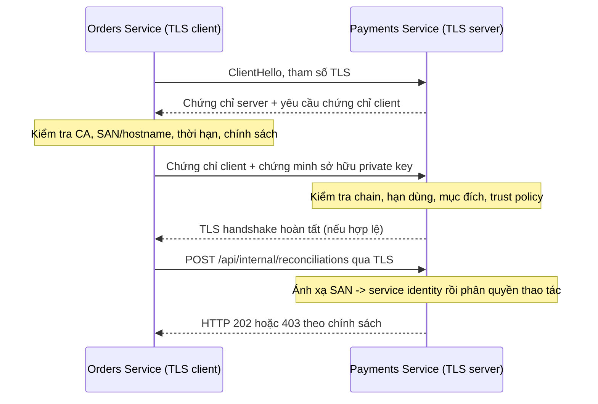

# mTLS và định danh giữa các dịch vụ trong REST API

## 1. Khi hai dịch vụ gọi nhau, HTTPS thông thường còn thiếu điều gì?

Một `Orders Service` gọi `Payments Service` để yêu cầu đối soát. Với **HTTPS thông thường**, phía client kiểm tra chứng chỉ máy chủ, bảo đảm đang kết nối tới một endpoint đáng tin; máy chủ chưa nhất thiết biết **dịch vụ nào** đang gọi. Nếu một ứng dụng bên trong mạng lấy được URL nội bộ, điều kiện “đang ở cùng VPC/Kubernetes cluster” không nên tự động trao quyền gọi API nhạy cảm.

**Mutual TLS (mTLS)** bổ sung xác thực hai chiều: **server trình chứng chỉ cho client kiểm tra; client cũng trình chứng chỉ cho server kiểm tra**. Sau handshake thành công, hai bên thiết lập kênh mã hóa và server có bằng chứng mật mã rằng phía kết nối đang nắm private key tương ứng với chứng chỉ client được tin cậy.



Sơ đồ mô tả **ý nghĩa** handshake (đường đi thông điệp cụ thể khác giữa TLS 1.2 và TLS 1.3), không biểu diễn mọi thông điệp `CertificateVerify`/`Finished`.

Bài thuộc chương **Xác thực** của module **INTEGRATION_API_REST**: học thiết kế REST theo resource/URI, phương thức và mã HTTP, hợp đồng dữ liệu, phân trang, cache, idempotency, OpenAPI, xác thực/phân quyền, xử lý lỗi và kiểm thử với Java/Spring. Trọng tâm ở đây là **xác minh danh tính workload khi dịch vụ gọi dịch vụ**, không phải đăng nhập người dùng cuối.

**Mục tiêu:** giải thích mTLS, PKI và identity; nhận diện trust boundary khi có ingress/mesh; cấu hình Java/Spring và client an toàn; kết hợp mTLS với authorization/token; thiết kế rotation, quan sát và kiểm thử âm tính; tránh nhầm handshake fail thành HTTP `401`.

### 1.1. HTTPS, mTLS, OAuth token và API key không thay thế nhau hoàn toàn

| Cơ chế | Câu hỏi chủ yếu | Giới hạn |
| --- | --- | --- |
| HTTPS/TLS server authentication | Tôi đang nói với **server đúng** và kênh có mã hóa không? | Server chưa chắc xác thực client bằng chứng chỉ |
| mTLS client authentication | Bên kết nối có **chứng chỉ client hợp lệ** và private key tương ứng không? | Chứng chỉ hợp lệ chưa chắc được **phép** gọi operation này |
| OAuth 2.0 access token | Chủ thể/client được cấp **scope/audience** nào cho API? | Bearer token bị đánh cắp có thể bị dùng lại nếu không ràng buộc |
| API key | Caller có credential được phát hành trong hệ thống không? | Không tự cung cấp bằng chứng sở hữu khóa riêng như mTLS |
| Business authorization | Service/user có quyền trên **tenant/order/payment cụ thể** không? | Cần dữ liệu nghiệp vụ có thẩm quyền, không chỉ TLS |

Một REST API có thể yêu cầu **mTLS AND OAuth scope** cho endpoint nội bộ có rủi ro cao. mTLS không buộc API đổi `POST` thành `GET`, không quyết định `201` hay `202`, cũng không tự sinh idempotency key.

## 2. X.509, chứng chỉ và danh tính dịch vụ

### 2.1. Những thành phần trong chứng chỉ

Một X.509 certificate của workload thường có:

- **Subject/Public key**: khóa công khai và metadata chứng chỉ; private key ở workload hoặc khóa bảo vệ tương ứng, **không được gửi** trong handshake.
- **Issuer/chain**: CA phát hành và chuỗi intermediate; bên nhận xây dựng đường tin cậy tới trust anchor được cấu hình.
- **Validity**: `notBefore`, `notAfter`; chứng chỉ hết hạn hoặc chưa có hiệu lực không được chấp nhận.
- **Subject Alternative Name (SAN)**: DNS name hoặc URI name biểu thị identity, ví dụ `spiffe://prod.example/ns/orders/sa/worker`.
- **Extended Key Usage (EKU)**: mục đích dùng khóa, ví dụ `clientAuth` và `serverAuth` khi profile yêu cầu.
- **Serial / key identifiers**: phục vụ điều tra, thu hồi và rotation theo hệ thống PKI.

**Chứng chỉ do một CA được tin không có nghĩa mọi SAN trong trust domain đều được phép gọi mọi API.** CA xác nhận danh tính theo chính sách cấp phát; **service authorization** quyết định endpoint cụ thể có chấp nhận danh tính ấy hay không.

### 2.2. SAN, DNS identity và SPIFFE ID

Định danh theo **DNS SAN** phù hợp xác thực một hostname server, ví dụ `payments.internal.example`. Với workload identity, **URI SAN** theo mô hình SPIFFE tách danh tính logic khỏi pod IP, port và hostname tạm thời:

```text
spiffe://prod.example/ns/orders/sa/worker
spiffe://prod.example/ns/orders/sa/reconciler
```

Đây chỉ là ví dụ. SPIFFE/SPIRE có thể cấp **X.509-SVID** và trust bundle; mTLS **không bắt buộc** dùng SPIFFE. Một chuỗi `spiffe://...` trong HTTP header không phải bằng chứng danh tính nếu thiếu xác minh mật mã.

Tránh dùng **CN-only** làm danh tính workload mặc định. Hiện đại hóa kiểm chứng hostname/server identity dựa trên SAN; khi cấp quyền machine-to-machine nên dùng **SAN URI/DNS đã xác thực và mapping rõ ràng**. Đặc biệt tránh coi một chuỗi `CN=orders` giống nhau ở hai CA/trust domain khác nhau là cùng một service.

### 2.3. Trust domain và nguyên tắc cấp quyền tối thiểu

Ví dụ policy:

| Danh tính đã xác thực | Phạm vi TLS | Quyền REST |
| --- | --- | --- |
| `spiffe://prod.example/ns/orders/sa/worker` | Cert chain hợp lệ từ trust bundle production | `POST /api/internal/reservations` |
| `spiffe://prod.example/ns/orders/sa/reconciler` | Cert chain hợp lệ từ trust bundle production | `POST /api/internal/reconciliations` |
| `spiffe://dev.example/ns/orders/sa/reconciler` | Trust domain dev | **Không** có quyền production |
| Không có chứng chỉ client | Không đạt yêu cầu mTLS trên listener | Handshake bị từ chối |

Policy cần **identity chính xác**, trust domain, method/path và quyền nghiệp vụ; prefix `spiffe://prod.example/` là quá rộng. Cũng phải kiểm soát việc workload có thể xin chứng chỉ mang identity nào.

## 3. Từ kết nối TLS đến HTTP: xác thực xảy ra ở tầng nào?

### 3.1. Handshake không thành công thường không có response HTTP

Khi server **yêu cầu** chứng chỉ client và phía gọi không có cert, cert hết hạn, issuer không tin cậy hoặc proof-of-possession sai, kết nối TLS có thể bị từ chối **trước** khi server nhận HTTP request. Client có thể thấy `SSLHandshakeException`, TLS alert hoặc lỗi transport. **Không được viết unit test mong `401 Unauthorized` cho một TLS handshake chưa hoàn tất.**

Sau handshake thành công, HTTP vẫn cần phân biệt:

```http
POST /api/internal/reconciliations HTTP/1.1
Host: payments.internal.example
Content-Type: application/json
Idempotency-Key: reconcile-2026-11-18
Authorization: Bearer <synthetic-access-token>

{"batchId":"batch-41"}
```

```http
HTTP/1.1 202 Accepted
Location: /api/internal/reconciliation-operations/op-41
Content-Type: application/json

{"id":"op-41","status":"PENDING"}
```

Đây là **một kịch bản nghiệp vụ**: HTTP `202` nghĩa là thao tác đối soát đã được **tiếp nhận** nhưng chưa hoàn tất; không phải vì dùng mTLS. Idempotency key cần có chính sách lưu bền vững để retry không tạo hai lệnh. Client certificate identity cần được kiểm tra **trước khi tiếp nhận** thao tác.

Nếu cert TLS hợp lệ nhưng service **không được phép** vào resource hoặc thiếu OAuth scope, server có thể trả `403 Forbidden` theo policy. Nếu access token bắt buộc mà thiếu/sai, có thể trả `401` cùng `WWW-Authenticate` phù hợp **sau** TLS. Việc kết hợp mTLS và bearer yêu cầu định nghĩa rõ cả hai lớp để không trả mã lỗi mơ hồ.

### 3.2. Đường kết nối trực tiếp và TLS termination

```text
Trực tiếp:
Orders Client == mTLS ==> Payments Application

Qua proxy:
Orders Client == mTLS ==> Gateway/Sidecar --(kênh nội bộ)--> Payments App
```

Trong trường hợp thứ hai, gateway/sidecar là bên **trực tiếp** xác minh certificate. Backend không mặc nhiên được thấy certificate client TLS gốc. Nếu proxy chuyển identity bằng HTTP header, header ấy **chỉ đáng tin** khi:

1. Backend chỉ nhận request từ proxy đáng tin qua kênh được bảo vệ, có network policy/identity phù hợp.
2. Proxy **xóa và ghi đè** mọi identity header do client bên ngoài gửi.
3. Proxy trích identity từ handshake đã xác minh; có allowlist route/operation và log nguồn xác minh.
4. Không có đường bypass cho client trực tiếp gọi backend mà tự điền header.

**Không tin** `X-Forwarded-Client-Cert`, `X-Client-Cert` hoặc `X-Service-Identity` chỉ vì chúng tồn tại; trong môi trường không proxy kiểm soát, đó chỉ là chuỗi có thể bị giả mạo. TLS ingress ở cổng Internet có thể yêu cầu cert đối tác; sidecar mesh có thể cung cấp mTLS **riêng giữa workloads**. Cần định nghĩa rõ mỗi hop được xác minh và authorization diễn ra tại điểm nào.

### 3.3. SNI, ALPN, proxy và HTTP/2

Client vẫn phải kiểm tra **hostname/SAN của TLS server**. SNI giúp chọn cert, ALPN thương lượng HTTP/2 hoặc HTTP/1.1; proxy/mesh có thể đổi peer TLS thực tế, nên đừng nhầm HTTP `Host` với identity đã được xác minh.

## 4. Thiết kế PKI và vòng đời chứng chỉ an toàn

### 4.1. Ai phát hành, ai lưu khóa, ai quyết định tin cậy?

Một hệ thống mTLS cần tối thiểu:

1. **Identity authority** xác minh workload trước khi cấp cert; quy trình bootstrap không được cho phép một service tự yêu cầu SAN của service khác.
2. **CA và trust bundle** có phạm vi rõ giữa production/staging, tenant và vùng; tránh nhập tất cả CA không liên quan vào một trust store dùng chung.
3. **Kho khóa riêng** ở quyền truy cập tối thiểu (secret mount/keystore/HSM nếu phù hợp); không commit `.p12`, `.key`, mật khẩu hay private key vào repository hoặc Docker image.
4. **Cấp phát/rotation/thu hồi**: cert có thời hạn hữu hạn, được cấp lại trước khi hết hạn, trust bundle được xoay vòng có khoảng chồng lấp.
5. **Policy authorization** dựa trên identity đã xác thực, không chỉ dựa vào chuyện cert có một chữ ký thuộc CA được tin.

Mẫu tổ chức dữ liệu:

```text
Payments listener:
  server identity  = payments.internal.example
  server key + cert = secret riêng của Payments
  trusted client CA = bundle workload production
  clientAuth        = REQUIRED
  allowed caller    = spiffe://prod.example/ns/orders/sa/reconciler
  allowed action    = POST /api/internal/reconciliations
```

**Một trust store không phải ACL.** Nếu CA phát cert cho hàng trăm service, dựa vào CA mà không xét SAN khiến hàng trăm service đó có thể qua được handshake. Hãy kiểm tra service identity sau TLS và phân quyền theo method/resource.

### 4.2. Rotation không gây gián đoạn

- Cấp cert mới trước khi cert cũ hết hạn; workload cập nhật keystore hoặc sidecar certificate source, thiết lập kết nối mới bằng cert mới.
- Khi **đổi CA**, phát hành trust bundle chấp nhận CA cũ và mới trong cửa sổ chuyển tiếp, cập nhật verifier trước, rồi chuyển issuer/cert của clients, cuối cùng loại CA cũ sau kiểm chứng.
- Theo dõi `notAfter` theo workload/issuer; alert đủ sớm để tránh tất cả replica hết hạn cùng lúc.
- Kiểm thử connection **mới**, không chỉ request đi qua keep-alive connection đã handshake từ trước; cert rotation không bắt buộc kết nối đang mở xác thực lại ngay.
- Lên kế hoạch phản ứng với **lộ private key**: revoke/thu hồi khi có cơ chế phù hợp, thu hẹp trust, rotate secret và cắt session theo policy.

CRL/OCSP và chính sách fail-open/fail-closed phụ thuộc TLS stack/PKI. Cert ngắn hạn và rotation nhanh **không thay** kế hoạch xử lý private key bị lộ.

### 4.3. Không chỉ kiểm tra cert chain

TLS phải kiểm tra hạn dùng, issuer, **EKU**, SAN/peer identity và sở hữu private key; authorization kiểm tra quyền workload. Code REST đọc kết quả **đã xác minh**, không thay PKIX validation bằng regex CN.

## 5. Spring Boot: mTLS trực tiếp tại ứng dụng

Ví dụ này dùng **Java 17, Spring Boot 3.x / Spring Security 6, Spring MVC** với embedded server xử lý TLS trực tiếp. Với ingress hoặc service mesh terminate TLS, ví dụ servlet certificate attribute bên dưới **không thể được áp dụng nguyên xi**; phải dùng cơ chế identity propagation tin cậy ở mục 3.2.

### 5.1. Cấu hình HTTPS bắt buộc chứng chỉ client

```yaml
server:
  port: 8443
  ssl:
    enabled: true
    key-store: file:/run/secrets/payments-server.p12
    key-store-type: PKCS12
    key-store-password: ${MTLS_SERVER_KEYSTORE_PASSWORD}
    trust-store: file:/run/secrets/workload-client-ca.p12
    trust-store-type: PKCS12
    trust-store-password: ${MTLS_CLIENT_TRUSTSTORE_PASSWORD}
    client-auth: need
```

`client-auth: need` yêu cầu client certificate trong handshake trên **listener này**; `want` chỉ yêu cầu tùy chọn nên không đủ thay thế khi endpoint buộc mTLS. Chứng chỉ server trong keystore phải có SAN hợp lệ cho hostname mà client kết nối; trust store phía server chứa CA dùng kiểm chứng cert client.

Không cho listener/cổng nội bộ khác bypass mTLS; tách health endpoint có ranh giới an ninh riêng thay vì hạ `client-auth`. Spring SSL bundles có thể thay keystore properties khi phiên bản hỗ trợ.

### 5.2. Ánh xạ URI SAN thành service identity đã xác minh

Tại **mô hình terminate TLS trực tiếp** này, Servlet container cung cấp certificate chain của client đã qua handshake tại request attribute `jakarta.servlet.request.X509Certificate`. Code application chỉ **đọc** chain đó; container/TLS đã chịu trách nhiệm xác minh CA/chain/key proof. Không cho caller gửi header giả để thay attribute.

```java
package example.payments.security;

import jakarta.servlet.http.HttpServletRequest;
import java.security.cert.CertificateParsingException;
import java.security.cert.X509Certificate;
import java.util.Collection;
import java.util.HashSet;
import java.util.List;
import java.util.Optional;
import java.util.Set;

final class VerifiedClientIdentity {
    private VerifiedClientIdentity() {}

    static Optional<String> uriSan(HttpServletRequest request) {
        Object raw = request.getAttribute(
            "jakarta.servlet.request.X509Certificate");
        if (!(raw instanceof X509Certificate[] chain)
                || chain.length == 0) {
            return Optional.empty();
        }
        try {
            Collection<List<?>> sans =
                chain[0].getSubjectAlternativeNames();
            if (sans == null) return Optional.empty();

            Set<String> uriNames = new HashSet<>();
            for (List<?> san : sans) {
                // X.509 GeneralName type 6 = uniformResourceIdentifier.
                if (san.size() >= 2 && Integer.valueOf(6).equals(san.get(0))
                        && san.get(1) instanceof String value) {
                    uriNames.add(value);
                }
            }
            // Fail closed khi thiếu hoặc có nhiều URI identities.
            return uriNames.size() == 1
                ? Optional.of(uriNames.iterator().next())
                : Optional.empty();
        } catch (CertificateParsingException malformed) {
            return Optional.empty();
        }
    }
}
```

`uriSan(...)` **không xác minh** chain/expiry/EKU hoặc private key; nó chỉ đáng tin sau mTLS do container thực thi với `client-auth: need`. Mock attribute hoặc proxy header không bảo vệ không thay được handshake thật.

Ví dụ từ chối nhiều URI SAN để tránh nhập nhằng identity. Nếu dùng DNS SAN, kiểm tra đúng loại SAN/policy; không âm thầm fallback sang CN.

### 5.3. Spring Security: mTLS identity AND quyền OAuth

Ví dụ đường `POST /api/internal/reconciliations` yêu cầu **cả** mTLS identity đúng **và** bearer access token có authority `SCOPE_payments:reconcile`. Spring Security kiểm tra JWT qua OAuth2 Resource Server; phần TLS client authentication vẫn do embedded server thực hiện.

```java
package example.payments.security;

import org.springframework.context.annotation.Bean;
import org.springframework.context.annotation.Configuration;
import org.springframework.http.HttpMethod;
import org.springframework.security.authorization.AuthorizationDecision;
import org.springframework.security.config.Customizer;
import org.springframework.security.config.annotation.web.builders.HttpSecurity;
import org.springframework.security.config.annotation.web.configuration.EnableWebSecurity;
import org.springframework.security.config.annotation.web.configurers.AbstractHttpConfigurer;
import org.springframework.security.config.http.SessionCreationPolicy;
import org.springframework.security.core.Authentication;
import org.springframework.security.web.SecurityFilterChain;

@Configuration
@EnableWebSecurity
public class PaymentsSecurityConfiguration {

    private static final String ALLOWED_SERVICE =
        "spiffe://prod.example/ns/orders/sa/reconciler";

    @Bean
    SecurityFilterChain securityFilterChain(HttpSecurity http)
            throws Exception {
        http
            .csrf(AbstractHttpConfigurer::disable)
            .sessionManagement(s -> s
                .sessionCreationPolicy(SessionCreationPolicy.STATELESS))
            .authorizeHttpRequests(auth -> auth
                .requestMatchers(HttpMethod.POST,
                    "/api/internal/reconciliations")
                .access((authentication, context) -> {
                    Authentication caller = authentication.get();
                    boolean hasScope = caller != null &&
                        caller.getAuthorities().stream().anyMatch(a ->
                            "SCOPE_payments:reconcile"
                                .equals(a.getAuthority()));
                    boolean allowedIdentity = ALLOWED_SERVICE.equals(
                        VerifiedClientIdentity
                            .uriSan(context.getRequest()).orElse(null));
                    return new AuthorizationDecision(
                        hasScope && allowedIdentity);
                })
                .anyRequest().denyAll())
            .oauth2ResourceServer(oauth ->
                oauth.jwt(Customizer.withDefaults()));
        return http.build();
    }
}
```

Đây là **một mẫu tối giản cho ứng dụng chỉ cung cấp endpoint được cấp quyền ở trên**: `anyRequest().denyAll()` chặn các route còn lại. Với API có nhiều route, cần thiết kế matcher/policy riêng, không bỏ `denyAll` rồi vô tình mở mặc định. `SCOPE_` là cách ánh xạ scope phổ biến của Spring Security JWT converter, nhưng phải xác nhận claim (`scope`/`scp`) của issuer và cấu hình converter nếu cần.

Với JWT, cấu hình issuer/JWK validation trong Spring Resource Server **chưa đủ** nếu API không xác minh `aud` theo hợp đồng: kiểm tra signature, issuer, expiry, not-before, **audience** và các ràng buộc thuật toán đúng. Spring Security sẽ quyết định `401`/`403` theo authentication/authorization flow thực tế; kiểm thử cả hai. Với endpoint không cần bearer, có thể dùng policy **mTLS-only** và principal extraction chuyên biệt; đừng bật OAuth chỉ để làm mTLS “trông bảo mật hơn”.

**Bảo vệ CSRF:** chỉ tắt CSRF như ví dụ khi endpoint máy–máy **stateless**, dùng bearer header và client cert, không dựa cookie/session của browser. Nếu cùng ứng dụng có browser credential, cần chính sách CSRF tương ứng. Authorization tại TLS/security filter vẫn chưa thay kiểm tra **quyền trên từng batch, tenant, hạn mức và trạng thái** ở business service.

### 5.4. Mã HTTP sau xác thực

| Điều kiện | Biểu hiện thường gặp |
| --- | --- |
| Client không có cert hoặc cert không đáng tin khi `client-auth: need` | Handshake TLS thất bại, **không có HTTP status** |
| Cert hợp lệ, thiếu bearer token bắt buộc | `401 Unauthorized` và `WWW-Authenticate: Bearer` theo cấu hình |
| Cert hợp lệ, JWT sai issuer/audience/expiry | Thường `401`, không cho truy cập |
| Cert hợp lệ nhưng URI SAN không được phép hoặc thiếu scope | `403` khi đã xác thực nhưng không đủ quyền; kiểm tra entry point thực tế |
| Đúng mTLS + scope, nhưng không được truy cập batch cụ thể | `403` hoặc `404` theo policy che resource |
| Đúng mTLS + scope + quyền nghiệp vụ, lệnh được nhận | `202`/`200`/`201` theo semantics thao tác |

Không gửi raw certificate chain, private key, token, stack trace hoặc nội bộ issuer/trust configuration trong HTTP error body. Dùng `application/problem+json` với mã lỗi ổn định cho **lỗi sau handshake** khi phù hợp, nhưng TLS error trước HTTP không thể biến thành Problem Details ở controller.

## 6. Java HTTP client: trình chứng chỉ client và kiểm tra server

Ứng dụng gọi Payments cần **hai kho tin cậy khác nhau về vai trò**: key material chứa cert **và private key của caller** để trình trong handshake, và trust material để xác minh chứng chỉ **server**. Không đổi vị trí hoặc dùng trust-all manager chỉ để làm test thành công.

Ví dụ Java 17 dùng `java.net.http.HttpClient`, PKCS#12 cho client identity và server CA:

```java
package example.orders.integration;

import com.fasterxml.jackson.databind.ObjectMapper;
import java.io.InputStream;
import java.net.URI;
import java.net.http.HttpClient;
import java.net.http.HttpRequest;
import java.net.http.HttpResponse;
import java.nio.file.Files;
import java.nio.file.Path;
import java.security.KeyStore;
import java.security.SecureRandom;
import java.time.Duration;
import javax.net.ssl.KeyManagerFactory;
import javax.net.ssl.SSLContext;
import javax.net.ssl.TrustManagerFactory;

public final class PaymentsMtlsClient {
    private static final ObjectMapper JSON = new ObjectMapper();
    private final HttpClient http;
    private final URI endpoint;

    public PaymentsMtlsClient(
            Path clientP12, char[] keyPassword,
            Path serverCaP12, char[] trustPassword,
            URI endpoint) throws Exception {
        KeyStore identity = KeyStore.getInstance("PKCS12");
        try (InputStream input = Files.newInputStream(clientP12)) {
            identity.load(input, keyPassword);
        }
        KeyManagerFactory keys = KeyManagerFactory.getInstance(
            KeyManagerFactory.getDefaultAlgorithm());
        keys.init(identity, keyPassword);

        KeyStore trustedServers = KeyStore.getInstance("PKCS12");
        try (InputStream input = Files.newInputStream(serverCaP12)) {
            trustedServers.load(input, trustPassword);
        }
        TrustManagerFactory trust = TrustManagerFactory.getInstance(
            TrustManagerFactory.getDefaultAlgorithm());
        trust.init(trustedServers);

        SSLContext ssl = SSLContext.getInstance("TLS");
        ssl.init(keys.getKeyManagers(), trust.getTrustManagers(),
            new SecureRandom());

        this.http = HttpClient.newBuilder()
            .sslContext(ssl)
            .connectTimeout(Duration.ofSeconds(3))
            .followRedirects(HttpClient.Redirect.NEVER)
            .build();
        this.endpoint = endpoint;
    }

    public int requestReconciliation(String bearerToken, String batchId,
            String idempotencyKey) throws Exception {
        String json = JSON.writeValueAsString(
            java.util.Map.of("batchId", batchId));
        HttpRequest request = HttpRequest.newBuilder(endpoint)
            .timeout(Duration.ofSeconds(8))
            .header("Content-Type", "application/json")
            .header("Authorization", "Bearer " + bearerToken)
            .header("Idempotency-Key", idempotencyKey)
            .POST(HttpRequest.BodyPublishers.ofString(json))
            .build();
        HttpResponse<String> response = http.send(
            request, HttpResponse.BodyHandlers.ofString());
        return response.statusCode();
    }
}
```

**Phạm vi của ví dụ:** dùng Jackson để serialize dữ liệu thay vì nối JSON tùy ý; validation của `batchId` và `idempotencyKey` vẫn thuộc service. Key cần ổn định qua retry **cùng một ý định**, theo entropy/policy của API. `endpoint` phải là HTTPS URI từ cấu hình đáng tin, không lấy từ caller để tránh SSRF. Trong ứng dụng thật, parse/validate body và status; trả `int` chỉ minh họa transport.

`SSLContext` quyết định key/trust managers. JDK `HttpClient` mặc định vẫn cần **kiểm chứng hostname của TLS server**: không tắt endpoint identification hoặc hostname verification. `followRedirects(NEVER)` tránh chuyển token sang destination mới ngoài chính sách. Một HTTP client dùng chung có thể tái sử dụng các kết nối tới service, nhưng phải gắn **bearer token và idempotency key theo request**, không lưu credential của người dùng cuối làm state mutable của singleton.

Trong JDK 17, `HttpClient` không có lifecycle `close()` như một số JDK mới; nếu tự tạo `ExecutorService` cho builder, ứng dụng phải quản lý executor. Với `HttpResponse.BodyHandlers.ofInputStream()`, đóng stream ở cả đường lỗi để không giữ socket/pool. Khi rotate private key/CA, SSLContext và client đã build **không tự bảo đảm reload keystore**; cần cơ chế tái tạo client và giải phóng tài nguyên cũ có kiểm soát.

### 6.1. Spring RestClient và WebClient có dùng được mTLS không?

**Có**, nhưng cấu hình mTLS nằm ở **transport của từng client**:

- `RestClient` trên JDK HTTP transport có thể dùng `JdkClientHttpRequestFactory` với `HttpClient` đã cấu hình `SSLContext`.
- `WebClient` trên Reactor Netty dùng `ReactorClientHttpConnector` và `HttpClient.secure(...)` với trust/key manager theo Reactor Netty/Netty API của phiên bản dự án.
- Nếu dùng Apache HttpComponents, cần cấu hình TLS strategy/connection manager, không lấy keystore property của server rồi giả định nó tự áp vào outbound HTTP client.

Ví dụ bean RestClient trên Java 17/Spring Framework 6.1+ (dùng `HttpClient` đã cấu hình như trên, hoặc factory tạo riêng từ cùng identity/trust policy):

```java
@Bean
RestClient paymentsRestClient(
        RestClient.Builder builder,
        HttpClient configuredPaymentsTransport) {
    return builder
        .baseUrl("https://payments.internal.example")
        .requestFactory(
            new JdkClientHttpRequestFactory(configuredPaymentsTransport))
        .build();
}
```

`configuredPaymentsTransport` **phải là** client tạo với đúng SSLContext trong phương án ở trên, không phải bean default chưa có client cert. Nếu nhiều upstream có trust domain/cert khác nhau, chọn **transport và pool theo chính sách**, không chia sẻ bừa identity giữa các kết nối.

## 7. OpenAPI, OAuth token và quyền nghiệp vụ

### 7.1. Khai báo mTLS và OAuth ở cùng Security Requirement Object

OpenAPI 3.1 có kiểu `mutualTLS`:

```yaml
openapi: 3.1.0
info:
  title: Payments Internal API
  version: 1.0.0
components:
  securitySchemes:
    internalMtls:
      type: mutualTLS
      description: Client certificate thuộc production trust domain.
    machineOAuth:
      type: oauth2
      flows:
        clientCredentials:
          tokenUrl: https://auth.example.test/oauth2/token
          scopes:
            payments:reconcile: Được yêu cầu đối soát trong phạm vi được cấp.
paths:
  /api/internal/reconciliations:
    post:
      security:
        - internalMtls: []
          machineOAuth: [payments:reconcile]
      responses:
        '202': { description: Accepted for processing }
        '401': { description: Invalid access token after TLS }
        '403': { description: Client identity or scope not authorized }
```

Trong **cùng một object**, `internalMtls` **AND** `machineOAuth` đều cần thỏa. Nếu tách thành hai phần tử:

```yaml
security:
  - internalMtls: []
  - machineOAuth: [payments:reconcile]
```

đó lại là **OR**, vô tình mô tả rằng chỉ cần *một trong hai*. Đừng dùng `http: bearer` rồi tự ghi `[payments:reconcile]` như OAuth requirement; cần scheme OAuth2/OIDC phù hợp với scope model.

OpenAPI **mô tả hợp đồng**, không tự cấu hình listener mTLS, cấp cert, xác minh JWT hoặc check quyền. Nếu TLS handshake thất bại, không nên kỳ vọng server sẽ trả body của response `'401'` trong spec; đó là điều kiện vận chuyển trước HTTP.

### 7.2. mTLS kết hợp token: AND khác certificate-bound token

Yêu cầu **mTLS AND bearer token** cung cấp hai điều kiện riêng: cert phải từ một workload được cho phép, token phải hợp lệ và có scope. Nếu token chỉ là bearer token độc lập, nó có thể bị dùng lại từ một service khác cũng có cert được phép nếu chính sách danh tính/token không liên kết chặt chẽ.

OAuth 2.0 Mutual-TLS Client Authentication và **certificate-bound access tokens** (RFC 8705) bổ sung cơ chế ràng buộc token với client certificate, thường thông qua confirmation claim (`cnf`, `x5t#S256`) và kiểm tra thumbprint chứng chỉ trên kết nối hiện tại. **Chỉ yêu cầu hai credential cùng hiện diện chưa đồng nghĩa đã kiểm tra sự ràng buộc này.** Nếu chọn certificate-bound token, Resource Server bắt buộc kiểm tra binding và token audience/scope, không chỉ dựa vào `.oauth2ResourceServer(...jwt())` mặc định.

### 7.3. Định danh service không phải định danh user cuối

Cert của `Orders Service` xác thực **workload**, không tự xác nhận Alice đã yêu cầu thanh toán. Nếu hệ thống tác động dữ liệu của người dùng, cần mô hình ủy quyền rõ: service principal, delegation/on-behalf-of token đáng tin, tenant context có nguồn gốc xác thực, audit identity của caller và quyền nghiệp vụ. Không cho phép một internal service đọc mọi tài khoản chỉ vì đang dùng mTLS.

## 8. Kiểm thử mTLS và chính sách ở đúng tầng

### 8.1. Unit test SAN extraction không phải TLS integration test

`VerifiedClientIdentity` có thể được unit test bằng Mockito/JUnit 5 để kiểm tra URI SAN type 6 và cách fail-closed. Ví dụ đặt test trong cùng package `example.payments.security`:

```java
import static org.junit.jupiter.api.Assertions.*;
import static org.mockito.Mockito.*;

import jakarta.servlet.http.HttpServletRequest;
import java.security.cert.X509Certificate;
import java.util.List;
import java.util.Optional;
import org.junit.jupiter.api.Test;

class VerifiedClientIdentityTest {
    @Test
    void extractsSingleUriSan() throws Exception {
        HttpServletRequest request = mock(HttpServletRequest.class);
        X509Certificate cert = mock(X509Certificate.class);
        when(cert.getSubjectAlternativeNames()).thenReturn(
            List.of(List.of(6,
                "spiffe://prod.example/ns/orders/sa/reconciler")));
        when(request.getAttribute(
            "jakarta.servlet.request.X509Certificate"))
            .thenReturn(new X509Certificate[]{cert});

        assertEquals(Optional.of(
            "spiffe://prod.example/ns/orders/sa/reconciler"),
            VerifiedClientIdentity.uriSan(request));
    }

    @Test
    void rejectsMissingCertificateAttribute() {
        HttpServletRequest request = mock(HttpServletRequest.class);
        assertTrue(
            VerifiedClientIdentity.uriSan(request).isEmpty());
    }
}
```

Test này kiểm tra **thuật toán trích SAN**, không chứng minh cert do CA tin cậy ký hoặc key proof hợp lệ: Mockito có thể tạo ra cert giả tùy ý. Tương tự, `MockMvc` với `.requestAttr("jakarta.servlet.request.X509Certificate", ...)` chỉ test policy ở tầng MVC/Spring Security, **không thực hiện TLS handshake**.

### 8.2. TLS integration test trên loopback/ephemeral listener

Để chứng minh mTLS thật, khởi động embedded Spring Boot server với `client-auth: need` và bộ test PKI có **CA server riêng, CA client production-test, cert caller được cấp đúng SAN và cert caller sai identity**. Có thể dùng JUnit/Spring Boot random port, Testcontainers hoặc một local TLS server; **không** để fixture private key production trong repository.

Ví dụ gửi request bằng `curl` với chứng chỉ **test** khi server TLS đang chạy trên loopback cổng 8443:

```bash
curl --resolve payments.internal.example:8443:127.0.0.1 \
  --cacert test-pki/server-ca.pem \
  --cert test-pki/reconciler.crt \
  --key test-pki/reconciler.key \
  -H "Authorization: Bearer ${TEST_ACCESS_TOKEN}" \
  -H "Content-Type: application/json" \
  -H "Idempotency-Key: test-reconcile-41" \
  --data '{"batchId":"batch-41"}' \
  https://payments.internal.example:8443/api/internal/reconciliations
```

Không sử dụng `-k`/`--insecure`: lệnh phải kiểm tra **server hostname/SAN và CA**. Token `TEST_ACCESS_TOKEN` phải được phát bởi **test Authorization Server** với issuer/audience/scope hợp lệ, không phải chuỗi giả trong production. `--resolve` giữ hostname TLS đúng nhưng trỏ mạng tới loopback, giúp kiểm tra hostname verification ngay cả trong môi trường local.

**Ma trận kiểm thử bắt buộc:**

| Kịch bản | Kỳ vọng |
| --- | --- |
| Cert caller hợp lệ + đúng URI SAN + JWT hợp lệ/scope và quyền batch | HTTP `202` theo contract |
| Không gửi client certificate | TLS handshake bị từ chối, **không kỳ vọng HTTP 401** |
| Cert hết hạn, sai CA hoặc sai EKU theo TLS policy | Handshake từ chối; không xử lý HTTP operation |
| Cert client hợp lệ, URI SAN thuộc service khác | HTTP authorization từ chối; không thực thi đối soát |
| Cert hợp lệ, token sai issuer/audience/hết hạn | HTTP `401`, response không tiết lộ token |
| Cert hợp lệ, token thiếu `payments:reconcile` | HTTP `403` khi authenticated; không có side effect |
| Cert + token hợp lệ nhưng batch ngoài tenant/quyền | HTTP `403` hoặc `404` nhất quán |
| Proxy gửi header `X-Client-Cert` giả từ bên ngoài | Bị loại/ghi đè, không tạo danh tính hợp lệ |
| Rotate client cert khi keep-alive còn mở | Kết nối **mới** dùng cert mới; cert/trust cũ bị loại đúng thời điểm |

**Kết quả âm tính phải xác minh cả side effect:** không đủ nếu test thấy 403 nhưng business service đã tạo reconciliation job trước khi check quyền. Với endpoint có idempotency, retry cùng key phải bảo đảm không tạo hai lệnh trong DB/queue.

### 8.3. Test certificate-bound token nếu có sử dụng

Với RFC 8705 token binding, thêm test: token được cấp cho cert A, nhưng request trình cert B (cả hai đều thuộc CA tin cậy) **bị từ chối**. Đây là trường hợp mà chỉ kiểm tra “có cert được phép và có scope” chưa đủ. Kiểm tra resource server lấy thumbprint cert **đã xác minh bởi TLS/proxy tin cậy**, so sánh với confirmation claim trong token và từ chối mismatch. Nếu không triển khai token binding, tài liệu phải nói rõ hai cơ chế chỉ đang kết hợp theo AND.

## 9. Lựa chọn triển khai và xử lý sự cố

Ứng dụng terminate mTLS trực tiếp thì đọc được cert đã xác minh; gateway/ingress tập trung TLS policy nhưng phải truyền identity tới backend **qua ranh giới đáng tin**; mesh tự động hóa cert workload song vẫn cần kiểm tra authorization. Khi xử lý sự cố, đừng hạ TLS verification: với handshake failure, kiểm tra DNS/SNI/SAN/CA/EKU/cert expiry; với `401`, kiểm tra token issuer/audience; với `403`, kiểm tra SAN/scope/ACL; với lỗi sau rotation, kiểm tra trust bundle và **connection mới**. Theo dõi handshake failures, cert expiry và HTTP 401/403 theo route template, không log key/token/PEM nhạy cảm.

## 10. Bài tập tình huống và checklist

`Orders Service` gọi `POST /api/internal/reconciliations` trên `Payments Service`. Cả hai nằm trong Kubernetes, có service mesh. Một nhóm đề xuất chỉ kiểm tra `X-Client-Cert` ở controller, bật `client-auth: want` tại gateway, rồi coi mọi chứng chỉ từ CA production đều có quyền đối soát.

**Yêu cầu:**

1. Chỉ ra ít nhất ba lỗ hổng trong thiết kế và mô tả đường attacker có thể lợi dụng.
2. Thiết kế danh tính service theo URI SAN/SPIFFE và policy phân quyền cho đúng operation.
3. Nêu điều kiện để `X-Forwarded-Client-Cert` có thể được backend tin cậy; có thể loại bỏ header hoàn toàn không?
4. Định nghĩa response/sự cố cho bốn trường hợp: thiếu cert, cert hợp lệ nhưng service sai, cert đúng nhưng OAuth scope thiếu, và tất cả hợp lệ nhưng batch ngoài tenant.
5. Lập ma trận kiểm thử certificate rotation và retry POST có `Idempotency-Key`.

**Hướng giải:** `want` là mTLS **tùy chọn**, còn header từ client có thể giả mạo; CA trust là xác thực nguồn cấp cert chứ không phải ACL. Mesh/gateway cần verify peer cert, xóa header caller, ngăn đường bypass và truyền identity có bảo vệ; hoặc dùng identity đã xác thực của sidecar qua cơ chế tích hợp đáng tin. Policy chỉ cho phép URI SAN cụ thể cùng OAuth scope và quyền batch. Thiếu cert trên listener `need` gây **TLS failure**; cert sai service hoặc thiếu scope sau TLS dẫn đến HTTP denial theo policy; batch ngoài tenant bị 403/404. Test cert mới/cũ, kết nối mới sau rotation, hai client cert khác nhau và retry cùng idempotency key không tạo hai side effects.

**Checklist ngắn:** cert client và server được xác minh hai chiều; trust bundle giới hạn; danh tính lấy từ SAN đã verify; TLS termination/bypass được kiểm soát; route/resource authorization áp dụng độc lập; bearer token được xác minh issuer/audience/scope; private key được bảo vệ và rotate; TLS/HTTP test âm tính đầy đủ.

## 11. Kết luận

**mTLS xác thực workload đang nắm private key hợp lệ tại ranh giới TLS; authorization xác định workload ấy được làm gì với REST resource.** Không nhầm một trust chain hợp lệ với quyền truy cập, không dựa vào header định danh dễ giả mạo và không đánh đồng TLS handshake failure với HTTP `401`. Java/Spring có thể triển khai trực tiếp hoặc dùng gateway/mesh, nhưng mọi lựa chọn đều cần identity SAN rõ, trust boundary nhất quán, certificate lifecycle an toàn, kiểm thử end-to-end và quyền nghiệp vụ ở điểm thực thi.

