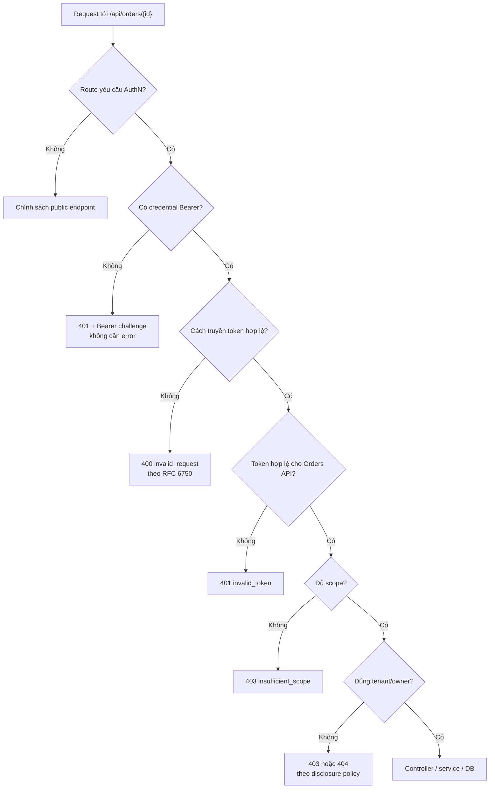
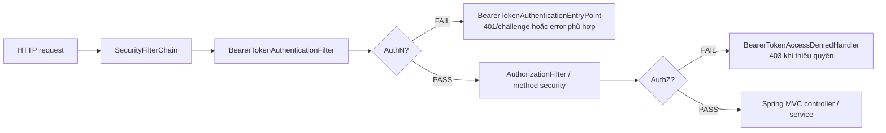

# 401, WWW-Authenticate và lỗi token

> **Chương:** Xác thực  
> **Module:** `INTEGRATION_API_REST` — thiết kế REST API theo resource, URI và HTTP methods/status codes; thực hành OpenAPI, xác thực, phân quyền, xử lý lỗi và kiểm thử bằng Java/Spring.

Với `GET /api/orders/42`, hãy phân biệt: **không có token** → `401` cùng Bearer challenge; **token không hợp lệ** → thường `401 invalid_token`; **token hợp lệ nhưng thiếu scope** → `403 insufficient_scope`. Nếu mọi tình huống đều bị trả một mã và một JSON message chung, client dễ refresh vô hạn hoặc hiểu sai quyền; nếu 401 thiếu `WWW-Authenticate`, API không tuân HTTP authentication.

Bài giải thích RFC 9110 (HTTP authentication), RFC 6750 (OAuth Bearer), RFC 9457 (Problem Details), cùng ví dụ **Spring Security 6 / Spring Boot 3**, OpenAPI, authz theo owner/tenant và kiểm thử. Hành vi cụ thể còn phụ thuộc gateway, filter chain và framework version.

**Mục tiêu:** phân biệt 400/401/403/404; đọc/tạo `WWW-Authenticate` đúng, không lộ token; kiểm tra JWT/opaque credential, cấu hình security entry point, xử lý retry/refresh và viết contract/security tests.

## 1. HTTP 401: yêu cầu credential hợp lệ

`401 Unauthorized` nghĩa là request tới tài nguyên bảo vệ **không có authentication credential hợp lệ**, mặc dù tên status dễ gây nhầm với authorization. Theo HTTP authentication, phản hồi 401 **phải chứa ít nhất một `WWW-Authenticate` challenge**:

```http
GET /api/orders/42 HTTP/1.1
Accept: application/json

HTTP/1.1 401 Unauthorized
WWW-Authenticate: Bearer realm="orders-api"
Cache-Control: no-store
```

| Trường hợp | Status thông dụng | Lý do |
| --- | --- | --- |
| Không Bearer token trên protected route | **401** + challenge | Thiếu credential. |
| Token hết hạn/sai chữ ký/issuer/audience | **401** `invalid_token` | Credential không được chấp nhận. |
| Token hợp lệ thiếu scope | **403** `insufficient_scope` | Authorization thất bại. |
| Có scope nhưng order khác tenant | **403/404** | Object-level authorization; 404 để che tài nguyên. |
| Resource không tồn tại | **404** | Không tìm thấy. |
| JSON sai, media type sai hoặc DB outage | **400/415/5xx** phù hợp | Không phải mọi lỗi đều do authentication. |

Không trả 401 chỉ vì public endpoint thiếu token. Nếu cố ý dùng 404 để che đơn thuộc user khác, body/cache/timing cũng không nên tiết lộ sự tồn tại của đơn.

## 2. WWW-Authenticate: nội dung Bearer challenge

`WWW-Authenticate` là **HTTP response header**, không phải JSON error. Bearer challenge có thể chứa:

| Thuộc tính | Ý nghĩa |
| --- | --- |
| `Bearer` | Authentication scheme. |
| `realm` | Tên vùng bảo vệ, ví dụ `orders-api`. |
| `error` | Mã chuẩn như `invalid_token`, `insufficient_scope`. |
| `error_description` | Mô tả ngắn, tùy chọn, không chứa dữ liệu nhạy cảm. |
| `error_uri` | URI tài liệu lỗi, nếu dùng nên là HTTPS đáng tin. |
| `scope` | Scope cần thiết khi thiếu quyền, chỉ công bố khi an toàn. |

```http
HTTP/1.1 401 Unauthorized
WWW-Authenticate: Bearer realm="orders-api", error="invalid_token"
```

```http
HTTP/1.1 403 Forbidden
WWW-Authenticate: Bearer realm="orders-api", error="insufficient_scope", scope="orders.read"
```

Khi client **hoàn toàn chưa gửi credential**, RFC 6750 khuyên không thêm `error`: `WWW-Authenticate: Bearer realm="orders-api"` là đủ. Với các giá trị động, phải escape/serialize HTTP auth-params đúng chuẩn; **không nối raw exception hoặc dữ liệu request** thành header. Không lộ token, user khác, key hoặc stack trace trong challenge.

Nếu API hỗ trợ nhiều schemes, 401 có thể có nhiều challenges. `407 Proxy Authentication Required` và `Proxy-Authenticate` dành cho proxy, không thay 401/`WWW-Authenticate` của API.

## 3. RFC 6750: invalid_request, invalid_token và insufficient_scope

| Mã `error` | HTTP thường được khuyến nghị | Tình huống |
| --- | --- | --- |
| `invalid_request` | **400** | Yêu cầu truyền token sai cách/malformed; dùng nhiều phương thức truyền credential hoặc input auth trùng. |
| `invalid_token` | **401** | Token expired, revoked, malformed hoặc không hợp lệ cho API. |
| `insufficient_scope` | **403** | Token được chấp nhận nhưng thiếu scope cần thiết. |

Đây là các mã lỗi của **Bearer protocol**, không đồng nghĩa những `code` do API tự định nghĩa trong Problem Details. Chi tiết có thể phụ thuộc tình huống và Spring Security configuration; kiểm thử runtime thay vì suy rằng mọi chuỗi `Bearer ...` sai đều phát đúng một exception.

Token nên truyền qua `Authorization: Bearer <access-token>`. Tránh `?access_token=...` vì URL thường được ghi vào lịch sử trình duyệt, logs, cache và referrers. Một chính sách hiện đại nên cho phép **chỉ header** nếu không có yêu cầu đặc biệt.

Token có `orders.read` mà cố đọc order khác owner là **object-level authorization failure**: có thể 403/404 theo disclosure policy, **không tự động gọi là `insufficient_scope`** hoặc tiết lộ scope nội bộ.

## 4. Decision tree cho REST API dùng Bearer



Sơ đồ là **logic quyết định**, không phải thứ tự tuyệt đối của mọi middleware. Một gateway có thể trả lỗi TLS hoặc 413 trước resource server; Spring Security filter có thể trả 401 trước khi Spring MVC parse JSON. Nếu API xác thực Bearer ở gateway rồi đưa principal vào backend, phải xác minh trust boundary và ngăn client giả mạo forwarded identity.

**Chủ thể và quyền phải nhất quán:** kiểm tra OAuth scope ở method/filter là coarse-grained; service/repository vẫn cần kiểm tra owner/tenant cho từng `orderId` (BOLA/IDOR).

## 5. JWT, opaque token và lỗi credential

JWT payload minh họa:

```json
{"iss":"https://id.example.test/realms/shop",
 "sub":"alice-subject","aud":["orders-api"],
 "exp":1795107600,"nbf":1795104000,
 "scope":"orders.read orders.create"}
```

Decode claims **không phải verify**. Resource server kiểm tra: **signature + thuật toán được tin cậy**, `iss`, `aud=orders-api`, `exp`/`nbf` (với clock skew có giới hạn), loại access token đúng, scope/subject. Token chữ ký đúng nhưng `aud=billing-api` vẫn **401 invalid_token**, không phải 403. Đừng cho JWT header ép dùng `alg=none` hoặc key do nguồn không tin cậy cung cấp.

Cần kế hoạch **JWK/key rotation**, access-token TTL, bảo vệ bearer token trước logs/XSS. JWT tự chứa không tự bị revoke ngay khi user logout; nếu yêu cầu thu hồi tức thì cần cơ chế bổ sung.

**Opaque token:** API thường gọi trusted introspection endpoint để xác minh `active`, audience/scope và các thuộc tính được công bố. Inactive → 401 nếu phù hợp. Sự cố mạng/JWK/introspection là lỗi vận hành: phải **fail closed**, đo riêng và không tự xem mọi outage là “token client sai”.

**OIDC ID token không thay access token:** ID token thường dành cho client/RP và có `aud` của client; đưa nó vào resource server khác audience phải bị từ chối. Với nhiều issuer, không dùng `sub` đơn lẻ làm ID toàn cục nếu có thể trùng; kết hợp issuer/subject hoặc mapping tin cậy.

## 6. Spring Security: 401 phát sinh ở filter chain

Với Spring Security 6, request Bearer đi qua một security filter (thường là `BearerTokenAuthenticationFilter`) và authentication provider/decoder. Khi chưa xác thực, `AuthenticationEntryPoint` quyết định cách bắt đầu authentication; khi đã xác thực nhưng thiếu quyền, `AccessDeniedHandler` xử lý từ chối truy cập.



**`@RestControllerAdvice` không phải chỗ duy nhất xử lý 401/403.** Security exceptions thường được xử lý trong servlet filter chain **trước khi request đến controller**; một `@ExceptionHandler(AuthenticationException.class)` trong MVC không bảo đảm bắt được chúng. Cấu hình error contract tại **security entry point/denied handler** hoặc gateway, không chỉ tại `@ControllerAdvice`.

### Resource server config tham khảo

```yaml
spring:
  security:
    oauth2:
      resourceserver:
        jwt:
          issuer-uri: https://id.example.test/realms/shop
```

```java
import org.springframework.context.annotation.*;
import org.springframework.security.config.Customizer;
import org.springframework.security.config.annotation.method.configuration.EnableMethodSecurity;
import org.springframework.security.config.annotation.web.builders.HttpSecurity;
import org.springframework.security.config.http.SessionCreationPolicy;
import org.springframework.security.web.SecurityFilterChain;

@Configuration
@EnableMethodSecurity
class ApiSecurityConfig {

    @Bean
    SecurityFilterChain apiFilterChain(HttpSecurity http) throws Exception {
        http
            // Chỉ dùng khi API stateless Bearer header; không dùng
            // cookie/session tự gửi làm authentication cho thao tác ghi.
            .csrf(csrf -> csrf.disable())
            .sessionManagement(session -> session
                .sessionCreationPolicy(SessionCreationPolicy.STATELESS))
            .authorizeHttpRequests(auth -> auth
                .requestMatchers("/actuator/health").permitAll()
                .requestMatchers("/api/**").authenticated()
                .anyRequest().denyAll())
            .oauth2ResourceServer(oauth -> oauth
                .jwt(Customizer.withDefaults()));
        return http.build();
    }
}
```

Cần dependency Web, Security và OAuth2 Resource Server/JWT. `issuer-uri` thường bật các xác minh mặc định như signature/issuer/time; **không mặc nhiên đảm bảo audience theo chính sách Orders API ở mọi phiên bản/cấu hình**. Bổ sung audience validator, rồi chạy tests sai `aud`. Không nên sao chép `csrf.disable()` vào ứng dụng dùng session cookie; khi browser tự gửi credential, cần CSRF defense.

### Bổ sung audience validation có chủ đích

Một cách minh họa với Spring Security 6:

```java
import org.springframework.context.annotation.Bean;
import org.springframework.security.oauth2.core.*;
import org.springframework.security.oauth2.jwt.*;
import java.util.List;

@Bean
JwtDecoder ordersJwtDecoder() {
    String issuer = "https://id.example.test/realms/shop";
    String audience = "orders-api";

    NimbusJwtDecoder decoder =
        NimbusJwtDecoder.withIssuerLocation(issuer).build();

    OAuth2TokenValidator<Jwt> defaultChecks =
        JwtValidators.createDefaultWithIssuer(issuer);

    OAuth2TokenValidator<Jwt> audienceCheck = jwt ->
        jwt.getAudience().contains(audience)
            ? OAuth2TokenValidatorResult.success()
            : OAuth2TokenValidatorResult.failure(
                new OAuth2Error("invalid_token", "Invalid audience", null));

    decoder.setJwtValidator(
        new DelegatingOAuth2TokenValidator<>(defaultChecks, audienceCheck));
    return decoder;
}
```

Đây là skeleton bean; đặt trong class `@Configuration` của ứng dụng, externalize `issuer/audience`, quản lý thuật toán/JWK trust và test decoder thật. Nếu đã cung cấp `JwtDecoder` bean, kiểm tra nó **thực sự được filter chain dùng**. Đừng vô tình thay validator mặc định bằng audience-only validator, bỏ qua issuer/expiry.

## 7. Scope denial và quyền trên resource

Với JWT đã xác minh, Spring có thể ánh xạ claim `scope` thành authorities dạng `SCOPE_orders.read` nếu converter được cấu hình tương ứng.

```java
import org.springframework.http.ResponseEntity;
import org.springframework.security.access.prepost.PreAuthorize;
import org.springframework.security.core.annotation.AuthenticationPrincipal;
import org.springframework.security.oauth2.jwt.Jwt;
import org.springframework.web.bind.annotation.*;

@RestController
@RequestMapping("/api/orders")
class OrdersController {
    private final OrderService service;

    OrdersController(OrderService service) { this.service = service; }

    @GetMapping("/{orderId}")
    @PreAuthorize("hasAuthority('SCOPE_orders.read')")
    ResponseEntity<OrderView> get(
            @PathVariable long orderId,
            @AuthenticationPrincipal Jwt jwt) {

        return ResponseEntity.ok(
            service.getVisible(jwt.getSubject(), orderId));
    }
}
```

Nếu token hợp lệ mà không có `SCOPE_orders.read`, method-security authorization có thể phát **403**; với Bearer semantics, framework có thể gắn `insufficient_scope` challenge thích hợp. Sau khi scope đạt, service vẫn phải truy vấn theo **owner/tenant đã xác minh**:

```java
record OrderView(long id, String status) {}
record OrderRecord(long id, String ownerSubject, String status) {}

interface OrderRepository {
    java.util.Optional<OrderRecord> findByIdAndOwnerSubject(
        long id, String ownerSubject);
}

class OrderService {
    private final OrderRepository repository;
    OrderService(OrderRepository repository) {
        this.repository = repository;
    }

    OrderView getVisible(String callerSubject, long orderId) {
        return repository.findByIdAndOwnerSubject(orderId, callerSubject)
            .map(o -> new OrderView(o.id(), o.status()))
            .orElseThrow(() ->
                new org.springframework.web.server.ResponseStatusException(
                    org.springframework.http.HttpStatus.NOT_FOUND));
    }
}
```

Ví dụ ownership đơn giản; nếu nhiều issuer hoặc nhiều tenant, identity mapping phải cân nhắc **(issuer, subject)** và tenant/assignment từ nguồn tin cậy. Không dùng `X-User-Id`, `ownerId` trong body/query hay header tự khai để cấp quyền. Lỗi thiếu scope và lỗi order không thuộc quyền cần được phân loại tách biệt.

## 8. Spring entry point, denied handler và Problem Details

Spring Security có các thành phần chuyên trách: `BearerTokenAuthenticationEntryPoint` cho authentication failure, `BearerTokenAccessDeniedHandler` cho authorization denial, `BearerTokenResolver` lấy token từ request, `JwtDecoder` hoặc `OpaqueTokenIntrospector` xác minh credential. **Ưu tiên default handlers** đã tạo status/challenge hợp lệ.

```java
import org.springframework.security.oauth2.server.resource.web.*;
import org.springframework.security.config.Customizer;

// Trong SecurityFilterChain:
http.oauth2ResourceServer(oauth -> oauth
    .authenticationEntryPoint(new BearerTokenAuthenticationEntryPoint())
    .accessDeniedHandler(new BearerTokenAccessDeniedHandler())
    .jwt(Customizer.withDefaults()));
```

Nếu API muốn JSON lỗi, `ProblemDetail` có thể là **phần bổ sung**, không thay `WWW-Authenticate`:

```http
HTTP/1.1 401 Unauthorized
WWW-Authenticate: Bearer realm="orders-api", error="invalid_token"
Content-Type: application/problem+json
Cache-Control: no-store

{"type":"https://api.example.test/problems/authentication-required",
 "title":"Authentication required","status":401,
 "code":"INVALID_ACCESS_TOKEN"}
```

`invalid_token` là mã lỗi Bearer chuẩn trong header; `INVALID_ACCESS_TOKEN` là extension code của API. Không trả chữ ký lỗi, token, JWK, subject hay nguyên chuỗi exception cho caller.

Ví dụ custom entry point **ủy quyền trước cho handler chuẩn** và chỉ bổ sung body khi phù hợp:

```java
import jakarta.servlet.*;
import jakarta.servlet.http.*;
import java.io.IOException;
import org.springframework.security.core.AuthenticationException;
import org.springframework.security.web.AuthenticationEntryPoint;
import org.springframework.security.oauth2.server.resource.web.BearerTokenAuthenticationEntryPoint;

final class SafeBearerEntryPoint implements AuthenticationEntryPoint {
    private final BearerTokenAuthenticationEntryPoint delegate =
        new BearerTokenAuthenticationEntryPoint();

    @Override
    public void commence(HttpServletRequest req, HttpServletResponse res,
            AuthenticationException ex) throws IOException, ServletException {
        delegate.commence(req, res, ex); // giữ status và WWW-Authenticate
        res.setHeader("Cache-Control", "no-store");
        if (res.isCommitted() || res.getStatus() != 401) return;

        // Chỉ là heuristic minh họa: production cần HTTP Accept
        // negotiation đầy đủ và JSON serializer tin cậy.
        String accept = req.getHeader("Accept");
        if (accept != null && !accept.contains("*/*")
                && !accept.contains("application/problem+json")) return;

        res.setContentType("application/problem+json;charset=UTF-8");
        res.getWriter().write(
            "{\"type\":\"https://api.example.test/problems/authentication-required\","
            + "\"title\":\"Authentication required\",\"status\":401,"
            + "\"code\":\"AUTHENTICATION_REQUIRED\"}");
    }
}
```

Wrapper dùng `AUTHENTICATION_REQUIRED` chung cho cả thiếu/không hợp lệ credential; nếu muốn phân loại riêng, dựa trên lỗi chuẩn đã xác minh chứ không parse exception text. Nó **không xử lý đủ** media ranges/`q=0`; production cần content negotiation chuẩn. Khi client loại trừ JSON, 401 **chỉ có challenge và không body** vẫn phù hợp. Có thể cấu hình entry point riêng ở `oauth2ResourceServer(...)`; với 403, bọc `BearerTokenAccessDeniedHandler` tương tự nhưng phải giữ nguyên `insufficient_scope` và chính sách không tiết lộ quyền. Không biến `invalid_request` status 400 thành 401 khi thêm JSON.

## 9. Lỗi trong security filter khác lỗi trong controller

Spring MVC `@RestControllerAdvice` phù hợp cho `HttpMessageNotReadableException`, `MethodArgumentNotValidException` và lỗi domain **sau khi request vào MVC**. Còn 401/403 thường được xử lý ở security filters/`ExceptionTranslationFilter` và các entry point/denied handler.

| Vấn đề | Nơi xử lý chủ yếu | Mã điển hình |
| --- | --- | --- |
| Không có access token | Security entry point | 401 + `WWW-Authenticate` |
| Token invalid/expired/audience mismatch | Bearer authentication/decoder | 401 + `invalid_token` |
| Malformed cách truyền Bearer | Token resolver/entry point | 400 `invalid_request` khi phù hợp |
| Token hợp lệ thiếu authority | Access denied handler | 403; có thể `insufficient_scope` |
| Authenticated user đọc order khác quyền | Method/service/resource authorization | 403 hoặc 404 theo policy |
| JSON malformed, đã qua authentication | MVC message converter | 400 |
| Content-Type không hỗ trợ | MVC mapping/converter | 415 |
| Service/DB không khả dụng | Infrastructure/domain handler | 5xx phù hợp |

Một request đồng thời có token invalid và body JSON hỏng có thể bị security filter từ chối trước khi Jackson đọc body. **Không lập hợp đồng cam kết ưu tiên JSON 400 trước Bearer 401** cho mọi request. Ngược lại, cần tránh thiết kế lộ thông tin body/resource cho unauthenticated caller.

**Không thay lỗi thiếu token bằng redirect HTML login page** trong REST API Bearer-only nếu client kỳ vọng 401/challenge; cần tách filter chain hoặc cấu hình phù hợp khi một ứng dụng đồng thời phục vụ browser login form.

## 10. Client: refresh, retry và xử lý phản hồi

| HTTP/challenge | Hành động client |
| --- | --- |
| 401 không credential | Đi qua luồng lấy credential nếu có quyền. |
| 401 `invalid_token` | Có thể refresh **một lần** đúng flow, nếu thất bại yêu cầu đăng nhập lại. |
| 400 `invalid_request` | Sửa định dạng/gửi token; refresh không sửa malformed request. |
| 403 `insufficient_scope` | Không refresh vô hạn; cần quyền/consent hợp lệ. |
| 403/404 theo owner/tenant | Không tự enumerate ID; thông báo theo policy. |
| 429/503, timeout | Retry có backoff và kiểm soát idempotency; không tạo trùng POST. |

Khi 20 request đồng thời nhận 401, dùng **single-flight refresh**: chỉ một refresh chạy, các request còn lại đợi kết quả, retry có giới hạn. Refresh token thuộc authorization server/token endpoint, **không gửi tới resource server**. Với POST/PUT/PATCH, chỉ retry nếu operation an toàn/idempotent hoặc được bảo vệ bằng `Idempotency-Key`/state reconciliation.

Một số 401 không thể chữa bằng refresh (issuer/audience cấu hình sai, tài khoản bị khóa, client nhận sai loại token). Phân loại trong telemetry, không lặp vô hạn.

## 11. Bảo mật challenge, error body và quan sát

| Bề mặt | Kiểm soát |
| --- | --- |
| `WWW-Authenticate` / `error_description` | Mã chuẩn chung; không phản chiếu token, lỗi chữ ký chi tiết hoặc khóa ký. |
| Problem Details | `type`/`code` ổn định, không raw claims, user PII, SQL hay stack trace. |
| Logs, tracing | Redact `Authorization`, cookie, query chứa token; giữ route template và trace ID an toàn. |
| CDN/shared cache | `Cache-Control: no-store/private` theo policy; không cache data order giữa users. |
| Network | HTTPS với certificate validation, TLS/mTLS qua các hop cần bảo vệ. |
| Browser | CORS không phải authentication; CSRF policy theo cookie/session, phòng XSS/token theft. |

Giám sát `auth_failures_total{route,code,status}`, tỷ lệ invalid token/scope errors sau deploy. **Không** đưa `sub`, token hoặc email vào metric labels (PII và cardinality cao). Có thể phân loại signature/issuer/audience/expiry **ở nội bộ đã redact**, nhưng chỉ gửi thông báo lỗi tổng quát cho caller.

TLS bảo vệ một kết nối, không trao quyền theo order. Với ingress termination, cần kiểm soát trusted proxies và forwarded identity/headers, không tin header user tự khai.

## 12. OpenAPI 3.1: Bearer challenge và error contract

OpenAPI phải biểu diễn auth scheme ở `components.securitySchemes`, không đặt `Authorization` thành business header parameter.

```yaml
openapi: 3.1.0
info:
  title: Orders API
  version: 1.0.0
servers:
  - url: https://api.example.test
security:
  - bearerAuth: []
paths:
  /api/orders/{orderId}:
    get:
      operationId: getOrder
      summary: Read a visible order
      parameters:
        - name: orderId
          in: path
          required: true
          schema: { type: integer, format: int64, minimum: 1 }
      responses:
        '200':
          description: Visible order
          content:
            application/json:
              schema: { $ref: '#/components/schemas/Order' }
        '400':
          description: Malformed request or invalid Bearer request
        '401':
          description: Missing or invalid access token
          headers:
            WWW-Authenticate:
              description: Bearer authentication challenge
              schema: { type: string }
          content:
            application/problem+json:
              schema: { $ref: '#/components/schemas/ApiProblem' }
        '403':
          description: Insufficient scope or forbidden operation
          headers:
            WWW-Authenticate:
              description: May contain Bearer insufficient_scope challenge
              schema: { type: string }
          content:
            application/problem+json:
              schema: { $ref: '#/components/schemas/ApiProblem' }
        '404':
          description: Order absent or hidden by access policy
components:
  securitySchemes:
    bearerAuth:
      type: http
      scheme: bearer
      bearerFormat: JWT
  schemas:
    Order:
      type: object
      required: [id, status]
      properties:
        id: { type: integer, format: int64 }
        status: { type: string }
    ApiProblem:
      type: object
      properties:
        type: { type: string, format: uri-reference }
        title: { type: string }
        status: { type: integer }
        code: { type: string }
```

**Lưu ý contract:** ví dụ `401` có `application/problem+json` nhưng nếu client gửi `Accept` loại trừ JSON, runtime có thể chỉ trả 401/challenge không body. Tài liệu nên mô tả body tùy điều kiện hoặc chính sách negotiation của API. `bearerFormat: JWT` chỉ là hint, không bật validation. Nếu cần mô tả OAuth 2.0 **scopes** trong OpenAPI, dùng `type: oauth2` với flows/scopes đúng client type; `type: http, scheme: bearer` không có danh sách scope trong `security` array.

## 13. Kiểm thử 401 và Bearer challenge

Security tests phải xác minh **status, challenge và không có side effect**, không chỉ JSON body.

| Trường hợp | Kỳ vọng |
| --- | --- |
| Không Authorization | 401 + `WWW-Authenticate: Bearer`; không có token value. |
| Bearer malformed | 400 `invalid_request` khi đúng loại lỗi theo runtime/RFC; test tình huống cụ thể. |
| JWT expired/invalid signature/issuer/audience | 401 `invalid_token`, controller/service không chạy. |
| Opaque token inactive | 401 sau introspection. |
| Token hợp lệ thiếu `orders.read` | 403, có thể `insufficient_scope` challenge. |
| Đủ scope, order của tenant khác | 403/404 theo policy, không lộ owner. |
| Đủ scope và đúng owner | 200, body đúng contract. |
| Token trong header giả `X-User-Id`, error/logs | Không đổi principal, không echo secrets. |
| `Accept: text/plain` | Challenge vẫn đúng, không ép JSON trái negotiation. |
| JWK/introspection outage | Fail closed, telemetry phân biệt sự cố, không cho 200. |

MockMvc test skeleton (Spring Security Test, service mock, method security đúng cấu hình):

```java
@Test
void noBearerTokenReturnsChallenge() throws Exception {
    mvc.perform(get("/api/orders/42"))
        .andExpect(status().isUnauthorized())
        .andExpect(header().string("WWW-Authenticate",
            org.hamcrest.Matchers.startsWith("Bearer")));
    verifyNoInteractions(orderService);
}

@Test
void authenticatedWithoutScopeIs403() throws Exception {
    mvc.perform(get("/api/orders/42")
            .with(jwt().jwt(j -> j.subject("alice"))
                .authorities(new SimpleGrantedAuthority("SCOPE_profile.read"))))
        .andExpect(status().isForbidden());
    verifyNoInteractions(orderService);
}

@Test
void anotherUsersOrderIsHidden() throws Exception {
    when(orderService.getVisible("alice", 42L))
        .thenThrow(new ResponseStatusException(HttpStatus.NOT_FOUND));
    mvc.perform(get("/api/orders/42")
            .with(jwt().jwt(j -> j.subject("alice"))
                .authorities(new SimpleGrantedAuthority("SCOPE_orders.read"))))
        .andExpect(status().isNotFound());
}
```

**`with(jwt())` không verify chữ ký, issuer, audience hoặc expiry**: helper này dựng authentication để kiểm tra method security/ACL. Kiểm thử decoder phải gửi Bearer thật với test JWKS/key hoặc mock `JwtDecoder` báo token lỗi rồi xác minh 401/challenge và service không được gọi. Integration test với DB xác minh owner/tenant; kiểm tra gateway TLS/log/cache ở môi trường tương ứng.

## 14. Bài thực hành: Orders API đa tenant

SaaS có `GET /api/orders/{id}` yêu cầu `orders.read` và `POST /api/orders` yêu cầu `orders.create`. Token được phát bởi issuer tin cậy, `aud=orders-api`; order phân tách tenant và owner.

**Nhiệm vụ:** (1) lập ma trận không token, expired, sai chữ ký/issuer/audience, Bearer malformed, thiếu scope, order khác tenant và caller hợp lệ, kèm `status`/`WWW-Authenticate`; (2) cấu hình Spring Security JWT resource server có audience validator, `@PreAuthorize` và owner/tenant query; (3) thiết kế Problem Details mà không ghi đè challenge hoặc làm lộ token; (4) viết OpenAPI 3.1 với 401/403/404; (5) viết ít nhất tám tests gồm missing token, invalid JWT, wrong audience, scope, cross-tenant, valid owner, raw-token leakage và Accept negotiation; (6) đề xuất client refresh **một lần** và chống refresh storm.

**Tiêu chí:** 401 có challenge đúng; `invalid_token` không bị nhầm `insufficient_scope`; chữ ký tốt nhưng `aud` sai vẫn từ chối; scope đúng vẫn phải kiểm tra quyền theo order. Mock `jwt()` không thay decoder, DB ACL và TLS integration tests.

## 15. Checklist phát hành

- [ ] 401 có Bearer challenge, không thêm `error` khi hoàn toàn thiếu credential.
- [ ] Phân biệt `invalid_request` (400), `invalid_token` (401) và `insufficient_scope` (403).
- [ ] JWT verify signature/issuer/audience/time; opaque token introspection theo policy.
- [ ] Token hợp lệ vẫn phải qua scope và owner/tenant checks.
- [ ] Entry point và denied handler không làm mất `WWW-Authenticate`/status.
- [ ] Problem Details/logs không chứa raw token, PII, exception internals.
- [ ] Client refresh có giới hạn; không refresh vô hạn ở 403/400.
- [ ] HTTPS/proxy trust, CORS/CSRF và cache/no-store phù hợp.
- [ ] OpenAPI và security/decoder/DB/TLS tests khớp runtime.

**Kết luận:** `401` yêu cầu **credential hợp lệ** với `WWW-Authenticate`; `invalid_token` phản ánh lỗi token, còn `insufficient_scope` và kiểm tra owner thuộc authorization. Bảo mật thật đòi HTTP semantics, decoder, filter chain, ACL và kiểm thử thực, không chỉ một JSON lỗi đẹp.


