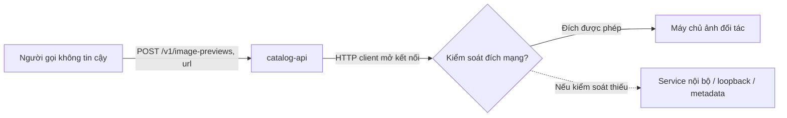
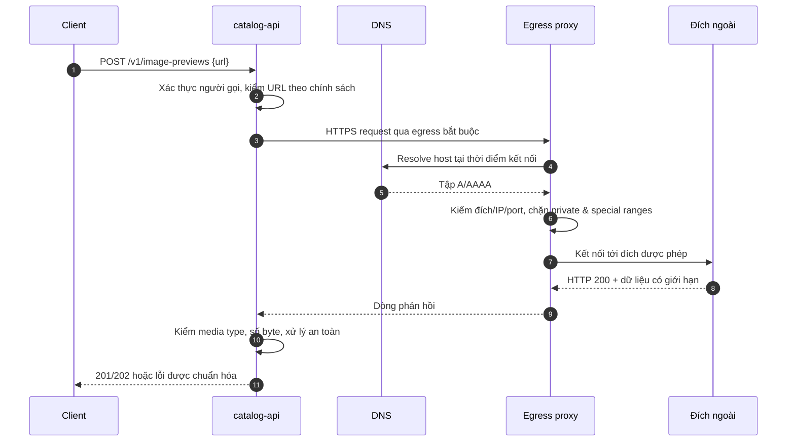
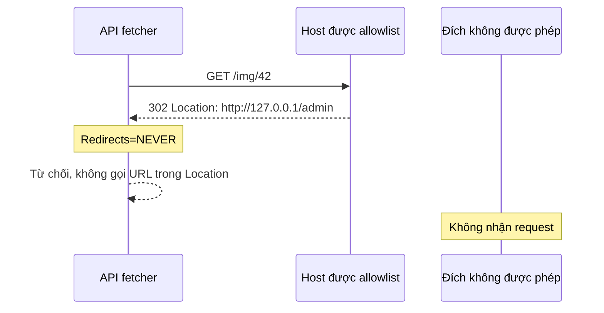

# SSRF khi server tải URL do người dùng cung cấp

Trong REST API, một tính năng tưởng đơn giản như “nhập URL ảnh để tạo thumbnail”, “xem trước liên kết”, “nhập dữ liệu từ URL” hay “kiểm tra webhook” có thể biến server thành công cụ gửi HTTP request thay người dùng. Nếu kẻ gọi API kiểm soát đích đến, họ có thể khiến backend truy cập dịch vụ nội bộ, giao diện quản trị, địa chỉ loopback hoặc endpoint metadata của hạ tầng đám mây. Lỗ hổng này gọi là **Server-Side Request Forgery (SSRF)**.

Bài học thuộc phần **Phân quyền và an toàn** của module `INTEGRATION_API_REST`. Trọng tâm là cách thiết kế resource và hợp đồng HTTP khi backend cần tải dữ liệu bên ngoài; kiểm soát URL, DNS, địa chỉ IP, redirect và quyền truy cập; triển khai một ví dụ Java/Spring có giới hạn rõ; và kiểm thử để ngăn SSRF ngay cả khi dữ liệu đầu vào thay đổi giữa lúc kiểm tra và kết nối.

Ví dụ xuyên suốt: `catalog-api` cho phép chủ cửa hàng gửi địa chỉ ảnh từ nhà cung cấp để tạo bản xem trước. API có `POST /v1/image-previews` nhận `{ "url": "https://assets.partner.example/items/42.png" }`. Server sẽ gọi mạng để lấy ảnh. Người dùng được quyền tạo preview **không có nghĩa** họ được quyền chỉ định bất kỳ máy đích nào mà server có thể kết nối.

## 1. Kết quả học tập

Sau bài này, người học có thể:

1. Nhận diện SSRF ở endpoint đồng bộ, job nền, webhook, import/export, trình tạo PDF, crawler và các bước redirect gián tiếp.
2. Phân biệt xác thực/phân quyền người gọi với **ủy quyền đích mạng**; xác định các ranh giới tin cậy phải kiểm tra trước khi server mở kết nối.
3. Áp dụng ưu tiên thiết kế: không nhận URL tùy ý nếu chỉ cần `resourceId`; nếu cần tải URL, dùng allowlist đích, HTTP client an toàn và kiểm soát egress tại lúc kết nối.
4. Giải thích vì sao chỉ kiểm `hostname`, regex hoặc chỉ resolve DNS một lần chưa đủ; xử lý redirect, DNS rebinding, IPv4/IPv6 và hostname có nhiều bản ghi.
5. Cấu hình Java/Spring cho API nhận URL, giới hạn thời gian/kích thước đáp ứng; thiết kế kiểm thử lỗi và quan sát vận hành.

## 2. Cơ chế SSRF và ranh giới tin cậy

Một request từ trình duyệt tới backend và một request từ backend tới URL bên ngoài có **quyền mạng rất khác nhau**. Backend có thể ở trong VPC/VNet, nhìn thấy service nội bộ, DNS private, loopback và địa chỉ metadata mà client bên ngoài không thể truy cập. SSRF xuất hiện khi dữ liệu **không tin cậy** được sử dụng để quyết định nơi backend gửi request mà không có chính sách kiểm soát đích hiệu quả.



Ví dụ request hợp lệ theo nghiệp vụ:

```http
POST /v1/image-previews HTTP/1.1
Host: api.example.com
Authorization: Bearer <access_token>
Content-Type: application/json

{"url":"https://assets.partner.example/items/42.png"}
```

Nếu API chỉ kiểm tra rằng `url` bắt đầu bằng `http`, kẻ gọi có thể tìm cách khiến backend tải một đích ngoài phạm vi nghiệp vụ như `http://127.0.0.1/`, một tên miền trỏ vào mạng riêng hoặc một đích được chuyển hướng tới địa chỉ nội bộ. Địa chỉ `169.254.169.254` thường được nhắc đến trong bài học SSRF vì một số nền tảng đám mây sử dụng vùng link-local cho metadata instance; đây là **ví dụ về lớp địa chỉ cần chặn**, không phải endpoint ứng dụng nên truy cập. Các biện pháp bảo vệ metadata của nhà cung cấp cloud vẫn hữu ích nhưng không thay thế chính sách chặn SSRF ở server.

| Vị trí phát sinh URL | Vì sao có thể không tin cậy | Hậu quả khi server gọi theo URL |
|---|---|---|
| JSON field `url`, query `?link=...` | Người gọi điều khiển trực tiếp | Server gửi request vào đích không được phép |
| URL trong CSV, file import, feed XML/JSON | Kẻ gửi dữ liệu điều khiển gián tiếp | Job nền thực hiện SSRF ngoài luồng API gốc |
| Header `Location` từ HTTP 3xx | Máy chủ ban đầu điều khiển redirect | URL ban đầu hợp lệ nhưng lần kết nối kế tiếp không hợp lệ |
| URL trong HTML/CSS, SVG, PDF, manifest | Bộ render/parser có thể tự tải subresource | SSRF phát sinh từ thư viện thứ ba dù code chính không gọi HTTP trực tiếp |
| Webhook callback URL do tenant cấu hình | Người dùng có quyền cấu hình webhook nhưng không sở hữu mạng backend | Gửi dữ liệu/secret hoặc request tới đích nội bộ |
| Tên miền do người dùng cung cấp | DNS của miền có thể thay đổi giữa các lần resolve | Kết nối đến IP khác với IP đã kiểm tra |

Một số SSRF chủ yếu **đọc dữ liệu phản hồi**; một số chỉ quan sát thời gian, mã trạng thái hoặc tác động của request dù không nhận body (*blind SSRF*). Không được dựa vào việc “API không trả nội dung tải về” để xem tính năng an toàn. Một yêu cầu HTTP gửi từ server vẫn có thể tạo tác dụng phụ ở một dịch vụ khác.

**SSRF khác với CORS:** CORS là cơ chế trình duyệt kiểm soát JavaScript đọc phản hồi xuyên origin. HTTP client chạy ở backend không chịu CORS của trình duyệt. Cũng không thể giải quyết SSRF chỉ bằng `@PreAuthorize`, JWT scope hoặc CSRF token: những cơ chế đó trả lời *ai được gọi API*, còn SSRF đòi hỏi trả lời *API được phép gọi máy nào*.

## 3. Mô hình đe dọa theo từng bước

Một luồng tải URL thường có nhiều bước, mỗi bước có thể tạo một lần chuyển đổi từ dữ liệu sang kết nối mạng:



Đây là kiến trúc mục tiêu khi có **egress proxy/gateway áp chính sách thực sự**. Nếu ứng dụng kết nối trực tiếp, lớp HTTP client phải đảm bảo tương đương: resolve, kiểm **toàn bộ** địa chỉ, dùng đúng địa chỉ đã duyệt để connect, giữ hostname gốc cho TLS/SNI và certificate validation, đồng thời chặn redirect ngoài chính sách. Chỉ gọi `InetAddress.getAllByName()` rồi để một HTTP client khác tự resolve lại có thể bị **TOCTOU (time-of-check/time-of-use)**: IP được kiểm khác IP thực tế dùng khi connect.

### Các mục tiêu cần bảo vệ

- **Loopback, địa chỉ unspecified và mạng nội bộ:** `127.0.0.0/8`, `::1`, các mạng riêng IPv4, unique-local IPv6, các dịch vụ và cổng nội bộ.
- **Link-local và metadata:** IPv4 `169.254.0.0/16`, IPv6 `fe80::/10`, cùng các đường mạng metadata hoặc endpoint quản trị riêng của nền tảng.
- **Các dải không phù hợp cho đích Internet:** multicast, reserved, broadcast, IPv4-mapped IPv6, IP mã hóa ở dạng khác thường; việc phân loại phải dùng thư viện IP/CIDR đáng tin cậy và policy cập nhật.
- **Danh tính workload và dữ liệu phản hồi:** service token, secret, dữ liệu tenant, kết quả từ service nội bộ và log. Một số thư viện tự thêm `Authorization`, `Cookie` hoặc header có thể làm dữ liệu bí mật đi sang đích ngoài nếu tái sử dụng client sai cách.
- **Tài nguyên hệ thống:** connection pool, worker thread, băng thông, CPU, bộ nhớ, dung lượng lưu trữ và hàng đợi job. SSRF có thể đồng thời gây DoS nếu cho tải tệp rất lớn hoặc endpoint phản hồi chậm.

Đừng mặc định “IP public thì an toàn”: một service công khai có thể chuyển hướng, phản chiếu request, trả nội dung nguy hiểm hoặc bị chiếm quyền. Kiểm soát địa chỉ mạng là một lớp; chính sách **đích theo nghiệp vụ** và xử lý phản hồi vẫn cần độc lập.

## 4. Quyết định kiến trúc theo mức độ kiểm soát

Chọn cách thiết kế ít trao quyền mạng nhất mà nghiệp vụ thực sự cần:

| Nhu cầu nghiệp vụ | Hợp đồng API ưu tiên | Lý do |
|---|---|---|
| Lấy ảnh đã lưu trong kho nội bộ | `POST /v1/image-previews { "assetId": "..." }` | Client không quyết định URL/hệ thống mạng |
| Lấy ảnh từ nhà cung cấp đã tích hợp | `{ "provider": "vendorA", "imageId": "42" }` | Backend tự dựng URL từ template cố định và validate ID |
| Tải từ vài miền đối tác được phê duyệt | `{ "url": "https://assets.partner.example/..." }` + allowlist host | Linh hoạt cho path/query nhưng cố định phạm vi đích |
| Thực sự hỗ trợ URL tùy ý của Internet | URL + sandbox tải riêng, proxy egress kiểm tại connect, quota và kiểm nội dung | Cần phối hợp an toàn ứng dụng, DNS, mạng, runtime |

Với một URL do người dùng cung cấp, việc backend **truy cập đích hợp lệ về mặt mạng** chưa nói lên người gọi **được phép xem nội dung của đích**. Ví dụ, `https://assets.partner.example/private/other-tenant.png` có thể cùng host được cho phép nhưng không thuộc tenant hiện tại. Khi có thông tin định danh asset, hãy dùng API đối tác với quyền ràng buộc tenant hoặc kiểm soát resource ID; không dùng allowlist hostname làm bằng chứng quyền đọc tài nguyên.

### Thiết kế resource REST an toàn hơn

Một API tạo preview nên coi việc tải URL là thao tác có chi phí và rủi ro, không biến `GET /preview?url=...` thành tác vụ mạng tốn tài nguyên có side effect. Ví dụ:

```http
POST /v1/image-previews HTTP/1.1
Authorization: Bearer <token-with-previews:write>
Content-Type: application/json
Idempotency-Key: 5c4d...user-generated-key

{"url":"https://assets.partner.example/items/42.png"}
```

Nếu tải/scan ảnh có thể lâu, API trả job bất đồng bộ:

```http
HTTP/1.1 202 Accepted
Location: /v1/image-previews/jobs/pv_8f9b
Content-Type: application/json
Cache-Control: no-store

{"id":"pv_8f9b","status":"QUEUED"}
```

Mỗi job phải gắn với `tenantId`, người tạo, quota và chính sách đích. **Worker phải kiểm chính sách lại khi thực sự kết nối**, kể cả request đã được validate khi enqueue: URL, DNS, cấu hình đối tác và policy có thể đổi theo thời gian. `Idempotency-Key` giúp tránh tạo job lặp do retry của client, nhưng không thay thế quota/rate limit hoặc kiểm SSRF. `GET /v1/image-previews/jobs/{id}` cần kiểm quyền sở hữu job để tránh IDOR/BOLA.

## 5. Kiểm tra URL đúng chỗ: parse, chuẩn hóa và allowlist

Đừng xây kiểm tra bảo mật bằng `url.startsWith("https://partner")`, regex tự viết hoặc tìm substring `.example.com`. Các trường hợp có userinfo (`@`), host giống tiền tố, encoding, IPv6, dấu chấm cuối, Unicode/IDN và scheme dễ khiến biểu thức chuỗi hiểu khác HTTP client.

Một policy rõ ràng nên xác định:

1. Chỉ chấp nhận **URL tuyệt đối** với scheme được phép, thường là `https` cho nguồn ngoài. Không nhận `file:`, `ftp:`, `gopher:`, `jar:`, `data:`, `http+unix:` hoặc URL không có scheme. Nếu nghiệp vụ thật sự cần HTTP, giới hạn riêng các đích và đánh giá rủi ro truyền không mã hóa.
2. Dùng URI parser chuẩn để tách scheme, authority, hostname, port, path và query. Từ chối URI mơ hồ, host rỗng, `userinfo` (`user:pass@host`), fragment hoặc những thành phần không cần thiết.
3. Áp allowlist host **chính xác** và port có chủ đích, tốt nhất là host cố định do server cấu hình. Nếu hỗ trợ subdomain, dùng đối sánh nhãn DNS với ranh giới dấu chấm, ví dụ `host == "example.com" || host.endsWith(".example.com")`, và chỉ khi mọi subdomain đều thuộc vùng tin cậy. Đối sánh này vẫn không kiểm IP cuối cùng.
4. Nếu chính sách cho phép quốc tế hóa tên miền, chuyển đổi/so khớp IDN theo quy tắc nhất quán và tránh homograph. Với allowlist ASCII cố định, có thể từ chối mọi host không khớp thay vì âm thầm diễn giải ký tự đặc biệt.
5. Giới hạn độ dài URL, query, số redirect (tốt nhất **0**), response bytes, thời gian connect/response/tổng job. Không coi `Content-Length` do server đích khai báo là giới hạn đáng tin; phải đếm số byte thực đọc.
6. Chính sách IP/CIDR phải được áp **tại lúc kết nối** cho mọi địa chỉ IPv4 và IPv6, kể cả qua proxy, DNS aliases, dải link-local, mapped addresses và kết nối từ service mesh.

Ví dụ phân tích URL mà code chỉ kiểm chuỗi dễ bỏ sót:

| URL minh họa | Điểm cần kiểm |
|---|---|
| `https://assets.partner.example/a.png` | Đúng host được phép, HTTPS, path hợp lệ |
| `https://assets.partner.example.evil.test/a.png` | Host hoàn toàn khác; tiền tố chuỗi không đủ |
| `https://assets.partner.example@evil.test/a.png` | Có userinfo; host thực là `evil.test` |
| `https://assets.partner.example:8443/a.png` | Port ngoài allowlist |
| `https://assets.partner.example./a.png` | Dạng DNS có dấu chấm cuối; phải có policy chuẩn hóa nhất quán, không lọt qua so khớp |
| `http://127.0.0.1/admin` | Scheme/loopback phải bị chặn |
| `https://[::1]/admin` | IPv6 loopback, phải bị chặn |
| `https://assets.partner.example/a.png#x` | Fragment không được gửi tới server, thường không cần và nên từ chối trong hợp đồng này |

Ví dụ không cố thống kê mọi biểu diễn IPv4 lạ (integer, octal, hexadecimal, mixed encoding). Hãy để URI/IP parser đáng tin và **kết nối thực tế tại lớp egress** quyết định đích; đừng chuẩn hóa rồi đoán bằng regex tự chế.

## 6. Redirect và DNS rebinding: kiểm tra một lần không đủ

### Redirect từ đích đã allowlist

Một URL ban đầu khớp allowlist có thể trả `301`, `302`, `303`, `307` hoặc `308` với `Location` trỏ đến host khác. Khi client tự `followRedirects(ALWAYS)`, check trước request đầu tiên không còn bảo vệ hop thứ hai. Cách an toàn mặc định là **tắt tự động follow redirect**. Nếu nghiệp vụ phải theo redirect, hãy parse và kiểm **mỗi `Location` đã resolve theo URL hiện tại**, giới hạn hop, scheme, host, port và IP đích tại connect; không chuyển header bí mật, credential hoặc cookie sang origin khác.



### DNS rebinding và TOCTOU

Tên miền có thể trả nhiều bản ghi A/AAAA hoặc thay bản ghi theo thời gian. Mẫu lỗi nguy hiểm:

```text
09:00:00 validation: resolve host -> địa chỉ Internet, pass
09:00:01 HTTP client: resolve lại host -> địa chỉ private, connect
```

Việc gọi `InetAddress.getAllByName(host)` ở service rồi mới dùng `HttpClient.send(URI.create(url))` **không chứng minh** địa chỉ IP được kiểm là địa chỉ đã kết nối. DNS cache, CNAME, dual-stack, proxy hoặc lớp mạng có thể tạo khác biệt.

Các cách triển khai đúng thường là: (a) dùng **outbound proxy bắt buộc** áp policy khi proxy resolve và mở socket, từ chối địa chỉ bị cấm, chặn kết nối trực tiếp bỏ proxy; hoặc (b) dùng HTTP transport có DNS resolver/connect hook cho phép ràng buộc chính xác IP đã được kiểm ngay tại socket connect, đồng thời giữ TLS SNI/hostname verification theo **host gốc**. Cả hai phải kiểm tất cả candidate address; không chỉ chọn một A record thuận lợi rồi cho client tự thử địa chỉ khác.

NetworkPolicy/firewall cấp subnet có thể ngăn đường tới dải nội bộ, nhưng riêng Kubernetes NetworkPolicy tiêu chuẩn không cung cấp allowlist FQDN động hoàn chỉnh. Với URL tùy ý, cần giải pháp egress gateway/proxy có khả năng lọc tên miền, port, IP đích và lưu audit. Kiểm cả đường outbound của pod, init container, job worker, service mesh và các vùng mạng phụ; một quy tắc cho frontend không tự bảo vệ worker chạy nơi khác.

## 7. Ví dụ Java/Spring: chốt policy, tắt redirect và giới hạn body

Giả sử backend chỉ cần tải ảnh JPEG/PNG từ **hai host đã được phê duyệt**: `assets.partner.example` và `images.vendor.example`. Thiết kế mẫu dùng Java 17+ `java.net.http.HttpClient`, với một thành phần kiểm URL trước khi tải và một lớp egress độc lập bắt buộc chặn đích IP bị cấm ở lúc connect. **Đoạn Java không tự giải quyết DNS rebinding nếu kết nối trực tiếp**; đảm bảo egress proxy/gateway và chính sách mạng đã triển khai như mục 6 mới đạt mục tiêu phòng thủ toàn diện.

### 7.1. Kiểm URL tại ranh giới ứng dụng

```java
package com.example.catalog.security;

import java.net.URI;
import java.net.URISyntaxException;
import java.util.Locale;
import java.util.Set;
import org.springframework.stereotype.Component;

@Component
public final class ExternalImageUrlPolicy {
    private static final int MAX_URL_LENGTH = 2048;
    private static final Set<String> ALLOWED_HOSTS = Set.of(
            "assets.partner.example", "images.vendor.example");

    public URI requireAllowed(String input) {
        if (input == null || input.isBlank()
                || input.length() > MAX_URL_LENGTH
                || !input.equals(input.trim())) {
            throw new DisallowedUrlException();
        }

        final URI uri;
        try {
            uri = new URI(input); // phân tách URI, không dùng startsWith
        } catch (URISyntaxException ex) {
            throw new DisallowedUrlException();
        }

        String host = uri.getHost();
        if (!uri.isAbsolute()
                || !"https".equalsIgnoreCase(uri.getScheme())
                || uri.getRawUserInfo() != null
                || uri.getRawFragment() != null
                || host == null
                || !ALLOWED_HOSTS.contains(host.toLowerCase(Locale.ROOT))
                || (uri.getPort() != -1 && uri.getPort() != 443)
                || (uri.getRawQuery() != null
                    && uri.getRawQuery().length() > 1024)) {
            throw new DisallowedUrlException();
        }
        return uri;
    }

    public static final class DisallowedUrlException
            extends RuntimeException {
        public DisallowedUrlException() {
            super("URL is outside the permitted source policy");
        }
    }
}
```

Ở ví dụ này, allowlist chứa **hostname ASCII cố định**. Kết quả `URI.getHost()` không khớp (kể cả nhiều dạng host mơ hồ) bị từ chối, không tự cố sửa URL cho người dùng. Việc từ chối fragment và userinfo đơn giản hóa hợp đồng. `uri.getPort() == -1` nghĩa là dùng cổng mặc định HTTPS 443; chỉ cho phép cổng 443 nếu chỉ định rõ. Tên miền đối tác phải được cấu hình từ server/deployment, không từ body hoặc từ một tenant tự ý thêm vào allowlist chung.

### 7.2. HTTP client có giới hạn kết nối, redirect và dữ liệu

```java
package com.example.catalog.integration;

import com.example.catalog.security.ExternalImageUrlPolicy;
import java.io.ByteArrayOutputStream;
import java.io.IOException;
import java.io.InputStream;
import java.net.URI;
import java.net.http.HttpClient;
import java.net.http.HttpRequest;
import java.net.http.HttpResponse;
import java.time.Duration;
import java.util.Locale;
import java.util.Set;
import org.springframework.stereotype.Service;

@Service
public final class ExternalImageFetcher {
    private static final int MAX_BYTES = 5 * 1024 * 1024;
    private static final Set<String> MEDIA_TYPES = Set.of(
            "image/png", "image/jpeg");

    private final ExternalImageUrlPolicy policy;
    private final HttpClient client;

    public ExternalImageFetcher(ExternalImageUrlPolicy policy) {
        this.policy = policy;
        this.client = HttpClient.newBuilder()
                .connectTimeout(Duration.ofSeconds(2))
                .followRedirects(HttpClient.Redirect.NEVER)
                .build();
        // Môi trường chạy phải cưỡng chế egress qua policy gateway.
        // Không dùng cấu hình proxy hệ thống làm bằng chứng kiểm soát IP.
    }

    public byte[] fetch(String rawUrl)
            throws IOException, InterruptedException {
        URI uri = policy.requireAllowed(rawUrl);
        HttpRequest request = HttpRequest.newBuilder(uri)
                .timeout(Duration.ofSeconds(8))
                .header("Accept", "image/png, image/jpeg")
                .GET()
                .build();

        HttpResponse<InputStream> response = client.send(
                request, HttpResponse.BodyHandlers.ofInputStream());

        try (InputStream body = response.body()) {
            if (response.statusCode() != 200) {
                // Bao gồm 3xx: KHÔNG tự theo Location.
                throw new IOException("Source did not return HTTP 200");
            }

            String contentType = response.headers()
                    .firstValue("Content-Type")
                    .orElse("")
                    .split(";", 2)[0]
                    .trim().toLowerCase(Locale.ROOT);
            if (!MEDIA_TYPES.contains(contentType)) {
                throw new IOException("Unsupported source media type");
            }

            long announcedSize = response.headers()
                    .firstValueAsLong("Content-Length").orElse(-1);
            if (announcedSize > MAX_BYTES) {
                throw new IOException("Source image too large");
            }

            ByteArrayOutputStream buffer = new ByteArrayOutputStream();
            byte[] chunk = new byte[8192];
            int length;
            while ((length = body.read(chunk)) != -1) {
                if (length > MAX_BYTES - buffer.size()) {
                    throw new IOException("Source image exceeded size limit");
                }
                buffer.write(chunk, 0, length);
            }
            byte[] data = buffer.toByteArray();
            verifyMagicBytes(data, contentType);
            return data;
        }
    }

    private static void verifyMagicBytes(byte[] bytes, String mediaType)
            throws IOException {
        boolean png = bytes.length >= 8
                && (bytes[0] & 0xff) == 0x89
                && bytes[1] == 'P' && bytes[2] == 'N' && bytes[3] == 'G'
                && bytes[4] == 0x0d && bytes[5] == 0x0a
                && bytes[6] == 0x1a && bytes[7] == 0x0a;
        boolean jpeg = bytes.length >= 3
                && (bytes[0] & 0xff) == 0xff
                && (bytes[1] & 0xff) == 0xd8
                && (bytes[2] & 0xff) == 0xff;
        if (!((mediaType.equals("image/png") && png)
                || (mediaType.equals("image/jpeg") && jpeg))) {
            throw new IOException("Source image signature is invalid");
        }
    }
}
```

Code trên **cố ý chỉ là lớp bảo vệ ứng dụng**. Để dùng production, cần cấu hình đường outbound thực sự chỉ tới proxy/gateway đã phê duyệt hoặc transport có kiểm tra connect IP; chính sách proxy phải cấm loopback/private/link-local/reserved, giải quyết cả IPv4 lẫn IPv6 và ngăn bypass trực tiếp. Nếu đi qua HTTP proxy, phải kiểm đặc tính `CONNECT`, TLS hostname và certificate validation trong deployment thật. Mẫu không cố tạo một kiểm tra DNS trước request rồi tuyên bố an toàn.

`HttpRequest.timeout` giới hạn thời gian request theo hành vi của JDK, nhưng thời gian đọc stream/chạy toàn job vẫn cần **deadline/cancellation** được cưỡng chế ở lớp worker hoặc transport: endpoint có thể trả header rất nhanh rồi giữ stream mở mãi. `MAX_BYTES` chặn body quá lớn dù `Content-Length` vắng hoặc sai; production cũng cần giới hạn tổng concurrency, memory, kích thước ảnh sau giải nén và thời gian decode (tránh decompression/image bombs). Magic bytes là kiểm tra sơ bộ; trước khi lưu hoặc tạo thumbnail phải dùng image decoder an toàn, kiểm số pixel và định dạng thực tế. Không cho client chọn trực tiếp `Accept-Encoding`, `Host`, `Authorization` hoặc proxy qua header của request.

### 7.3. Endpoint Spring REST và kiểm tra phân quyền

```java
package com.example.catalog.api;

import com.example.catalog.security.ExternalImageUrlPolicy;
import jakarta.validation.Valid;
import jakarta.validation.constraints.NotBlank;
import java.net.URI;
import org.springframework.http.ResponseEntity;
import org.springframework.security.access.prepost.PreAuthorize;
import org.springframework.web.bind.annotation.PostMapping;
import org.springframework.web.bind.annotation.RequestBody;
import org.springframework.web.bind.annotation.RequestMapping;
import org.springframework.web.bind.annotation.RestController;

record ImagePreviewRequest(@NotBlank String url) {}
record PreviewJobResponse(String id, String status) {}

@RestController
@RequestMapping("/v1/image-previews")
public class ImagePreviewController {
    private final ExternalImageUrlPolicy urlPolicy;
    private final PreviewJobService jobs;

    public ImagePreviewController(ExternalImageUrlPolicy urlPolicy,
                                  PreviewJobService jobs) {
        this.urlPolicy = urlPolicy;
        this.jobs = jobs;
    }

    @PostMapping
    @PreAuthorize("hasAuthority('SCOPE_previews:write')")
    public ResponseEntity<PreviewJobResponse> create(
            @Valid @RequestBody ImagePreviewRequest request) {
        URI approved = urlPolicy.requireAllowed(request.url());
        // jobs.enqueue(...) phải gắn user/tenant từ SecurityContext,
        // áp quota và chuyển URL tới worker để KIỂM LẠI lúc fetch.
        String jobId = jobs.enqueue(approved.toString());
        return ResponseEntity.accepted()
                .header("Location", "/v1/image-previews/jobs/" + jobId)
                .body(new PreviewJobResponse(jobId, "QUEUED"));
    }
}
```

`PreviewJobService` ở đây là **cổng nghiệp vụ minh họa**, cần được triển khai với tenant/owner/quota, idempotency, worker kiểm lại URL và egress. Nếu ví dụ chạy thực tế, cung cấp interface hoặc service phù hợp và bật method security (`@EnableMethodSecurity`) để `@PreAuthorize` được áp dụng. Với JWT, resource server phải xác minh chữ ký, issuer, audience, thời hạn token; scope `previews:write` không tự bảo vệ đích mạng.

### 7.4. Trả lỗi HTTP nhất quán, không tiết lộ mạng nội bộ

Một cách định nghĩa lỗi hợp đồng API:

| Trường hợp | HTTP gợi ý | Ghi chú |
|---|---:|---|
| JSON sai định dạng, URL không parse được | `400 Bad Request` | `invalid_request`; trả thông tin đủ để client sửa cú pháp |
| URL hợp cú pháp nhưng host/scheme/port ngoài chính sách | `422 Unprocessable Content` hoặc `400` theo hợp đồng | Cùng thông điệp chung, không tiết lộ địa chỉ nội bộ |
| Thiếu bearer token hoặc token sai | `401 Unauthorized` | Có `WWW-Authenticate: Bearer` phù hợp |
| Token hợp lệ nhưng thiếu scope/quyền tenant | `403 Forbidden` | Không đánh đồng với URL bị từ chối theo policy |
| Job vượt quota/rate limit | `429 Too Many Requests` | Có thể kèm `Retry-After` |
| Nguồn trả 3xx/4xx/5xx mà worker không thể lấy nội dung | Trạng thái job `FAILED_SOURCE`; nếu đồng bộ có thể `502 Bad Gateway` | Không copy nguyên lỗi, body hay header nhạy cảm từ upstream |
| Kết nối nguồn timeout | Trạng thái job `FAILED_TIMEOUT`; nếu đồng bộ có thể `504 Gateway Timeout` | Timeout có giới hạn, không retry vô hạn |
| Worker hoặc egress hạ tầng tạm không khả dụng | `503 Service Unavailable` hoặc trạng thái job phù hợp | Tách lỗi hạ tầng khỏi URL không hợp lệ |
| Dữ liệu nguồn quá lớn | Trạng thái job `FAILED_SIZE`; có thể `422`/`502` tùy hợp đồng | `413` thường dành cho **request body gửi tới API** quá lớn |

Hợp đồng lựa chọn `400` hay `422` cho policy URL cần được thống nhất trong OpenAPI; không dùng `403` cho mọi URL bị chặn vì đó dễ bị hiểu lầm là phân quyền người gọi. Với job bất đồng bộ, API đã trả `202` thì lỗi fetch sau đó xuất hiện trong trạng thái job và metric; không thay đổi response `202` đã gửi. `Retry-After` khi hạ tầng tạm lỗi nên dựa trên khả năng phục hồi, tránh khiến mọi client retry đồng thời.

Ví dụ response khi URL ngoài phạm vi:

```http
HTTP/1.1 422 Unprocessable Content
Content-Type: application/problem+json
Cache-Control: no-store

{
  "type": "https://api.example.com/problems/source-url-not-allowed",
  "title": "Source URL is not allowed",
  "status": 422,
  "detail": "Use an HTTPS URL from an approved image provider"
}
```

Không gửi về `detail` kiểu “127.0.0.1:8080 có admin console” hoặc trace chứa DNS record, IP, nội dung upstream hay cloud metadata. Có thể ghi nguyên nhân chi tiết vào log nội bộ **đã che token/credential** và giới hạn giá trị URL để tránh log injection hoặc metric cardinality cao.

## 8. Kiểm soát egress, identity và xử lý dữ liệu phản hồi

Một mô hình phòng thủ có nhiều lớp:

| Lớp | Bảo vệ chính | Sai lầm thường gặp |
|---|---|---|
| API contract | Chấp nhận `resourceId`/`providerId` thay URL tùy ý nếu có thể | Cấp quyền gọi URL không cần thiết |
| Authorization | JWT/scope, tenant, quyền trên job và asset, quota | Tưởng người dùng đã đăng nhập thì mọi URL đều được phép |
| URL parser/policy | Scheme HTTPS, allowlist host/port, loại userinfo/fragment, length limit | `startsWith`, regex substring hoặc host từ JWT/body tự khai |
| HTTP transport | Redirect mặc định tắt, timeout, giới hạn response | Cho 302 nhảy tới host khác, giữ connection quá lâu |
| DNS/egress | Áp policy tại lúc connect, chặn private/link-local/loopback ở IPv4/IPv6 | Chỉ resolve trước rồi để client resolve lại |
| Runtime | Chạy fetcher với quyền tối thiểu, network namespace riêng, không có credential nhạy cảm | Cho worker chung identity với service quản trị |
| Response processing | Giới hạn byte/decode, kiểm kiểu nội dung, lưu ở vùng riêng, không render raw HTML/SVG | Tin `Content-Type`, tạo XSS hoặc parser-based SSRF |
| Observability | Metric theo outcome, host trong allowlist và vùng, cảnh báo | Ghi raw URL/token vào metric và log |

**Không chuyển secret theo URL người dùng.** Tránh tái sử dụng HTTP client có `Authorization`, cookie, mTLS client certificate hoặc header nội bộ mặc định khi gọi nguồn URL. Với đối tác cần xác thực, dùng client riêng cho **một đối tác cố định**, không trộn token đối tác A vào URL do người dùng tùy ý chọn. Tắt redirect xuyên origin; request outbound phải dùng danh tính hạ quyền và egress riêng nếu có thể.

**Không trust dữ liệu trả về.** Một file được tải từ host hợp lệ vẫn là input bên ngoài. Nếu server phân tích HTML, XML, SVG, Office document hoặc PDF, tắt external entity/resource fetch ở parser, chặn URL subresource, dùng sandbox và giới hạn tài nguyên. Với ảnh, xác thực định dạng và hạn mức pixel trước khi lưu hoặc hiển thị. Với nội dung phục vụ cho người dùng, cân nhắc `Content-Disposition: attachment`, Content Security Policy, `X-Content-Type-Options: nosniff` và miền lưu trữ riêng để giảm tác hại khi nguồn trả dữ liệu active content.

**Đừng dựa duy nhất vào cloud metadata hardening.** Ví dụ cấu hình IMDS an toàn hoặc tắt metadata khi không cần thiết có thể giảm rủi ro, nhưng SSRF cũng có thể hướng tới service khác trong nội bộ; cần chặn tại lớp egress và giảm quyền service account. Secrets, signed headers, credentials trong environment/process nên được hạn chế tới đúng workload.

### Vận hành nhiều tenant và job nền

Nếu một tenant tạo hàng trăm nghìn URL, ngay cả các đích hợp lệ cũng có thể bị lạm dụng để tiêu tốn băng thông. Áp quota theo tenant, giới hạn đồng thời theo nguồn, kích thước kết quả, số job trong hàng đợi, số retry và thời gian tồn tại job. Dùng exponential backoff có jitter cho các lỗi mạng có thể thử lại; không retry URL vi phạm policy hoặc redirect bị chặn. Mỗi job cần audit các quyết định `allowed/denied`, nhưng log chỉ nên chứa host đã chuẩn hóa và mã lý do hữu hạn.

## 9. Kiểm thử SSRF theo tầng

Không thể chứng minh phòng chống SSRF chỉ bằng một unit test kiểm tra URL. Cần xác minh cả đường kết nối thực và behavior của HTTP client khi gặp DNS, redirect và phản hồi bất thường.

### 9.1. Unit test cho URL policy

Ví dụ JUnit 5 cho `ExternalImageUrlPolicy`:

```java
package com.example.catalog.security;

import static org.junit.jupiter.api.Assertions.assertEquals;
import static org.junit.jupiter.api.Assertions.assertThrows;
import org.junit.jupiter.api.Test;

class ExternalImageUrlPolicyTest {
    private final ExternalImageUrlPolicy policy =
            new ExternalImageUrlPolicy();

    @Test
    void acceptsApprovedHttpsImageSource() {
        var uri = policy.requireAllowed(
                "https://assets.partner.example/items/42.png");
        assertEquals("assets.partner.example", uri.getHost());
    }

    @Test
    void rejectsUntrustedAndAmbiguousDestinations() {
        String[] denied = {
                "http://127.0.0.1/admin",
                "https://[::1]/admin",
                "https://169.254.169.254/latest/",
                "https://assets.partner.example.evil.test/item.png",
                "https://assets.partner.example@evil.test/item.png",
                "https://assets.partner.example:8443/item.png",
                "https://assets.partner.example./item.png",
                "file:///etc/hosts",
                "//assets.partner.example/item.png",
                "https://assets.partner.example/item.png#fragment"
        };
        for (String url : denied) {
            assertThrows(
                    ExternalImageUrlPolicy.DisallowedUrlException.class,
                    () -> policy.requireAllowed(url), url);
        }
    }
}
```

Các test này kiểm **đúng phần parse và allowlist**, chưa kiểm DNS rebinding hoặc network policy; hostname được cho phép chưa chắc trỏ tới IP được phép. Không đưa literal URL có chứa `@` hoặc các ký tự dễ gây hiểu nhầm vào log mà không normalize/escape.

### 9.2. Integration test cho redirect, DNS và egress

Thiết lập mock server/capture proxy trong môi trường test cô lập, kiểm rằng **số request đến đích bị cấm bằng 0**. Các bài kiểm tra tối thiểu:

| Kịch bản | Thiết lập kiểm thử | Điều kiện đạt |
|---|---|---|
| Redirect từ host được phép | Mock host hợp lệ trả `302 Location: http://127.0.0.1/...` | Fetcher từ chối 3xx; không mở kết nối đến đích redirect |
| DNS trả IP private | Test DNS/gateway trả IP trong mạng riêng cho host hợp lệ | Lớp egress chặn **trước connect** |
| DNS đổi sau kiểm tra | Lượt resolve đầu public, lượt connect private | Connect-time policy vẫn chặn (không bị TOCTOU) |
| Nhiều bản ghi A/AAAA | Một IP public và một IP private/IPv6 nội bộ | Không có bất kỳ đường kết nối tới IP bị cấm |
| IPv4-mapped IPv6, link-local, loopback | Dùng fixture địa chỉ phù hợp, không gọi dịch vụ thật | Bị chặn dù biểu diễn địa chỉ khác nhau |
| Response không dứt | Server gửi header rồi stream vô hạn/nhỏ giọt | Worker hủy khi hết deadline và thu hồi tài nguyên |
| `Content-Length` sai hoặc vắng | Server gửi quá giới hạn `MAX_BYTES` | Dừng đọc ở ngưỡng, không lưu toàn bộ dữ liệu |
| Content-Type giả | Khai `image/png` nhưng body HTML hoặc payload khác | Từ chối ở kiểm tra định dạng/decoder |
| Nhiều URL đồng thời | Tenant gửi job đến host hợp lệ rất nhiều | Quota/limit concurrency hoạt động, worker ổn định |
| Mất kết nối proxy | Egress proxy timeout/5xx | Job thất bại có kiểm soát, không fallback kết nối trực tiếp |
| Scope/tenant sai | Token thiếu `previews:write`, truy cập job tenant khác | API trả 403/404 phù hợp, không tạo job và không lộ dữ liệu |

Khi dùng MockWebServer hoặc WireMock chạy `localhost`, cần phân biệt hai loại test: (a) test logic HTTP client trong mạng test với **dependency injection/test transport** hoặc DNS fixture; (b) test policy egress thực bằng container/network namespace/proxy riêng. **Đừng thêm `localhost` vào allowlist production chỉ để test dễ hơn.** Test phải chứng minh request outbound bị chặn, không chỉ kiểm response controller trả `422` hoặc `502`.

### 9.3. Kiểm thử REST và tài liệu hợp đồng

Controller test bằng `MockMvc` có thể kiểm ràng buộc body và quyền:

```java
// Pseudocode kiểm thử controller: jobs được mock và method security đã bật.
mockMvc.perform(post("/v1/image-previews")
        .with(jwt().authorities(
                new SimpleGrantedAuthority("SCOPE_previews:write")))
        .contentType(MediaType.APPLICATION_JSON)
        .content("{\"url\":\"https://assets.partner.example/a.png\"}"))
    .andExpect(status().isAccepted());

mockMvc.perform(post("/v1/image-previews")
        .with(jwt().authorities(
                new SimpleGrantedAuthority("SCOPE_profile")))
        .contentType(MediaType.APPLICATION_JSON)
        .content("{\"url\":\"https://assets.partner.example/a.png\"}"))
    .andExpect(status().isForbidden());
```

`jwt()` của `spring-security-test` tạo Authentication giả để test authorization; nó **không chứng minh** chữ ký JWT, issuer, audience hay egress hoạt động. Cần riêng integration test bảo mật JWT và integration test mạng. OpenAPI nên mô tả các giới hạn URL, loại file, quota, response job, `400/401/403/422/429`, và cách client lấy trạng thái thất bại của job.

## 10. Quan sát và xử lý sự cố SSRF

Cần metric giúp phát hiện sự cố mà không biến log thành chỗ thu thập URL nhạy cảm:

- `url_fetch_total{outcome=allowed|policy_denied|redirect_denied|dns_denied|timeout|upstream_error|oversize|success}` với nhãn từ danh sách hữu hạn; không dùng raw URL/query/hostname tùy ý làm label.
- Latency connect/read/total job, số byte tải, số job đang chờ, concurrent outbound requests và thời gian xếp hàng.
- Số lượt kết nối egress bị chặn theo lớp đích (`loopback`, `private`, `link_local`, `reserved`, `unapproved_host`), không công bố IP nội bộ cho client.
- Cảnh báo khi đột ngột tăng deny, nhiều host lạ, redirect tới vùng không được phép, hàng đợi tăng hoặc proxy mất kết nối.

Runbook khi phát hiện truy cập bất thường:

1. Kiểm tra log và network flow tại egress để xác định workload, user/tenant/job ID, policy result và lớp đích; không chia sẻ token hoặc full URL chứa query secret.
2. Tạm vô hiệu hóa tính năng tải URL hoặc siết allowlist/quota nếu đang bị khai thác; kiểm tra có đường outbound bypass proxy hay không.
3. Kiểm tra ảnh hưởng tới service nội bộ, metadata, credential và dữ liệu được trả qua API/job; xoay secret khi có bằng chứng lộ.
4. Bổ sung test cho biến thể thực tế (redirect, DNS, IPv6, parser), triển khai bản sửa ứng dụng **cùng** policy egress.
5. Theo dõi deny/timeout/số fetch sau khi khắc phục; cập nhật threat model và audit các chức năng khác cũng có hành vi tải URL.

## 11. Bài tập thực hành

### Bài 1 — Phân tích endpoint tạo preview

Một API cho phép client gọi `GET /v1/preview?url=...`. Backend dùng `new URL(url).openStream()`, không timeout, trả thẳng body cho client. Người gọi đã đăng nhập bằng JWT nhưng có thể kiểm soát `url`.

Yêu cầu: xác định ít nhất **sáu rủi ro** và sửa thiết kế HTTP/resource phù hợp. Nêu cách tách quyền tạo preview khỏi quyền truy cập mạng và cách giới hạn chi phí.

*Gợi ý:* URL tùy ý, scheme ngoài HTTP, redirect, DNS rebinding, thiếu timeout/size limit, trả dữ liệu nội bộ, truy cập tài nguyên tenant khác, request có side effect, DoS. Đề xuất `POST /v1/image-previews` tạo job `202`, policy host/IP, egress, authz, quota và xử lý dữ liệu trước khi hiển thị.

### Bài 2 — Lựa chọn mức bảo vệ đúng

Nhóm phát triển dự định gọi `InetAddress.getByName(uri.getHost())`, kiểm `!isSiteLocalAddress()` rồi truyền nguyên URI cho `RestClient` để tải. Hãy giải thích vì sao thiết kế này chưa đủ; đề xuất hai phương án khắc phục với đánh đổi rõ ràng.

*Gợi ý:* Chỉ kiểm một bản ghi; `isSiteLocalAddress()` không phủ mọi special-use address; có thể có IPv6, DNS rebinding và HTTP client resolve lại. Phương án A là bắt buộc proxy egress kiểm tại connect và không cho bypass. Phương án B là HTTP transport có DNS resolver/connect hook pin IP đã được kiểm, vẫn giữ TLS hostname verification và chặn redirect. Cả hai cần allowlist nghiệp vụ.

### Bài 3 — Thực hành Spring + test

Triển khai `ExternalImageUrlPolicy`, `ExternalImageFetcher` và endpoint `POST /v1/image-previews`. Cấu hình method security, `SCOPE_previews:write`, `@Valid`, global `ProblemDetail` exception handler cho URL ngoài policy. Viết JUnit tests cho URL có `@`, port lạ, IP literal, fragment, và mock nguồn trả `302`, `200` với body quá lớn, `200` với `Content-Type` giả.

*Tiêu chí đạt:* request chứa URL bị cấm không tạo job hoặc outbound request; test redirect chứng minh không có hop thứ hai; timeout/size limit không giữ worker vô hạn; response lỗi không lộ thông tin hạ tầng; mỗi job được ràng buộc tenant/owner.

### Bài 4 — Sự cố DNS thay đổi khi chạy job

Một URL trên host đã cho phép có A record public khi người dùng submit job. Mười phút sau, khi worker xử lý, DNS đã thay đổi sang IP private. API đã lưu cờ `validated=true` lúc enqueue và worker không kiểm thêm.

Yêu cầu: mô tả đường lỗi, thay đổi thiết kế từ controller tới worker/egress, và đề xuất ba metric/alert để phát hiện. Giải thích vì sao không thể giải quyết chỉ bằng cách giảm TTL DNS cache.

*Gợi ý:* Cờ validate không ràng buộc địa chỉ kết nối sau này; worker phải kiểm lại policy và egress áp chính sách tại connect. Đo `dns_denied`, `policy_denied`, job failure/timeout; ghi đối chiếu job ID với quyết định egress, giới hạn cardinality nhãn.

### Bài 5 — Đánh giá quyền dữ liệu và callback URL

Một hệ thống SaaS cho tenant đăng ký `https://hooks.partner.example/notify` và tự động gửi đơn hàng mới qua HTTP POST. Domain thuộc allowlist nhưng người dùng có thể chọn path/query và gửi dữ liệu nhiều tenant.

Yêu cầu: thiết kế kiểm soát quyền tenant, chữ ký webhook, bảo vệ credential, redirect và dữ liệu response; xác định điều gì còn thiếu nếu chỉ kiểm HTTPS/hostname.

*Gợi ý:* Authorize chủ sở hữu cấu hình webhook và từng order, kiểm payload theo tenant, ký request bằng secret riêng của tenant/endpoint, không gửi header auth nội bộ, cấm redirect, áp quota/egress, không trả raw response. HTTPS và hostname không giải quyết IDOR/BOLA hoặc rò rỉ dữ liệu xuyên tenant.

## 12. Checklist trước production

| Hạng mục | Câu hỏi kiểm tra |
|---|---|
| Contract | Có thể dùng `assetId`/`providerId` thay URL? Nếu cần URL, đã mô tả rõ scheme/host/port/media/size trong OpenAPI? |
| Trust | URL từ body, file, redirect, HTML parser và job đều được coi là không tin cậy? Có kiểm lại tại worker? |
| Policy | URI được parse chuẩn? Chỉ HTTPS? Exact host allowlist? Chặn userinfo, fragment, port lạ, IP literal? |
| Egress | Có chính sách tại socket connect hoặc proxy bắt buộc? Chặn private/loopback/link-local/reserved IPv4/IPv6? Không bypass qua worker? |
| Redirect & DNS | Đã tắt redirect mặc định? Không TOCTOU do resolve lại? Kiểm mọi record, CNAME/IPv6, TLS hostname/SNI? |
| Resource limit | Có connect/read/job deadline, byte limit, media/content validation, quota, concurrency, retry budget? |
| Identity | Có JWT/scope, tenant isolation, quyền trên job/asset, service identity tối thiểu, không chuyển secret ra URL? |
| Error | Phân biệt 400/401/403/422/429 và lỗi nguồn? Problem JSON không tiết lộ mạng nội bộ? |
| Testing | Unit URL, redirect, DNS rebinding, private IPv4/IPv6, oversized body, timeout, job authorization và test egress thực đã chạy? |
| Operations | Có metric hữu hạn, audit deny, cảnh báo, runbook và cách vô hiệu hóa fetcher khi khẩn cấp? |

## 13. Tài liệu nền tảng

- **OWASP SSRF Prevention Cheat Sheet:** các trường hợp kiểm URL/IP/domain, phòng DNS rebinding, network segmentation và allowlist.
- **OWASP API Security Top 10 (2023), API7 — Server Side Request Forgery:** SSRF trong API hiện đại khi server tải resource theo URL người dùng cung cấp.
- **CWE-918 — Server-Side Request Forgery:** định nghĩa lỗi và các tình huống dẫn tới request không mong muốn.
- **RFC 3986 — URI Generic Syntax:** cấu trúc scheme, authority, path, query, fragment và các điểm dễ nhầm khi parse URI.
- **RFC 9110 — HTTP Semantics:** status code, redirect và ý nghĩa phương thức HTTP.
- **RFC 9457 — Problem Details for HTTP APIs:** cấu trúc phản hồi lỗi `application/problem+json`.
- **Java `java.net.URI` và `java.net.http.HttpClient` documentation; Spring Security & Spring MVC reference:** kiểm soát URI, redirect, timeout, xác thực/phân quyền và validation trong phiên bản sử dụng.

Một lớp kiểm URL ở controller giúp giảm lỗi phổ biến, nhưng điểm quyết định về SSRF nằm ở **kết nối outbound thực tế**. Thiết kế vững cần thu hẹp quyền chọn đích theo nghiệp vụ, kiểm lại ở worker, chặn đường mạng không hợp lệ tại connect, không đi theo redirect không kiểm soát và luôn coi dữ liệu nhận từ Internet là đầu vào không tin cậy.
