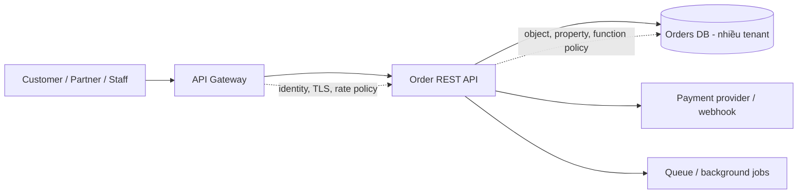

# Rà soát rủi ro theo OWASP API Security Top 10

## 1. Mục tiêu của một cuộc rà soát bảo mật REST API

Một API đơn hàng có `GET /api/orders/{id}`, `PATCH /api/orders/{id}` và `POST /api/orders/{id}/approve`. Các request đều đi qua HTTPS, kiểm tra chữ ký JWT và trả JSON đúng OpenAPI. **Vậy API đã an toàn chưa?** Chưa chắc. Một người dùng có token hợp lệ vẫn có thể thay `{id}` để đọc đơn của tenant khác; ghi đè thuộc tính `ownerId` trong JSON; hoặc gọi chức năng duyệt vốn dành cho quản lý. Những lỗi này liên quan tới **quyết định phân quyền của nghiệp vụ**, không phải chỉ tới TLS hay cú pháp bearer token.

OWASP API Security Top 10 là **khung nhận diện các nhóm rủi ro API phổ biến**, giúp tổ chức rà soát có hệ thống thay vì chỉ quét lỗ hổng phụ thuộc phần mềm. Danh sách dưới đây dựa trên **OWASP API Security Top 10 – 2023**; nếu tổ chức dùng bản khác, phải ghi rõ năm vì tên và nhóm rủi ro có thể thay đổi. Đây không phải tiêu chuẩn chứng nhận an toàn: một API xử lý hết mười nhóm vẫn có thể có lỗi riêng của hệ thống.

Bài thuộc chương **Phân quyền và an toàn** của module **INTEGRATION_API_REST**: học thiết kế REST theo resource, URI, method và status HTTP; hợp đồng dữ liệu, phân trang, cache, idempotency, OpenAPI, xác thực, phân quyền, lỗi và kiểm thử với Java/Spring hoặc công nghệ tương đương.

**Sau bài học, bạn có thể:** lập danh mục tài sản/endpoint và trust boundary; phân biệt từng nhóm OWASP; xây ma trận actor–resource–action–property; đưa biện pháp giảm thiểu vào Spring Security và service; thiết kế HTTP/MockMvc/integration tests, ghi bằng chứng và ưu tiên sửa theo tác động.

### 1.1. OWASP API Security Top 10 (2023) – bản đồ rà soát

| Nhóm | Tên chính thức | Câu hỏi cần kiểm tra |
| --- | --- | --- |
| **API1:2023** | Broken Object Level Authorization (BOLA) | User A có đổi `orderId` để xem/sửa đối tượng của B không? |
| **API2:2023** | Broken Authentication | Token/session/credential có được xác minh và quản lý an toàn? |
| **API3:2023** | Broken Object Property Level Authorization | Caller có đọc hoặc ghi trường JSON vượt quyền không? |
| **API4:2023** | Unrestricted Resource Consumption | API có giới hạn size, số bản ghi, CPU, timeout, kết nối và chi phí? |
| **API5:2023** | Broken Function Level Authorization (BFLA) | Người dùng thường có gọi được chức năng admin/duyệt/xuất dữ liệu? |
| **API6:2023** | Unrestricted Access to Sensitive Business Flows | Workflow đặt vé, thanh toán, giữ chỗ có bị tự động hóa/lạm dụng? |
| **API7:2023** | Server Side Request Forgery (SSRF) | API có gọi URL do attacker ảnh hưởng tới mạng nội bộ/metadata? |
| **API8:2023** | Security Misconfiguration | CORS, debug, headers, TLS, lỗi và các cấu hình mặc định có an toàn? |
| **API9:2023** | Improper Inventory Management | Có endpoint/version/test host cũ không được quản lý? |
| **API10:2023** | Unsafe Consumption of APIs | Có tin response/webhook/API bên thứ ba mà không xác minh? |

Điều quan trọng là **một endpoint có thể nằm trong nhiều nhóm**: `POST /api/orders` vừa phải xác thực (API2), kiểm tra field (API3), giới hạn request (API4), chặn bot lạm dụng đặt hàng (API6), và kiểm chứng callback thanh toán từ ngoài (API10). Bảng trên là **các góc nhìn để đặt câu hỏi**, không phải ten rules tự động chạy bằng một công cụ.

## 2. Từ danh mục endpoint đến threat model có thể kiểm thử

### 2.1. Xác định tài sản, actor, trust boundary

Ví dụ Order API có ba loại actor: khách hàng, nhân viên hỗ trợ và bộ xử lý thanh toán. Dữ liệu cần bảo vệ là địa chỉ giao hàng, tổng tiền, định danh tenant, trạng thái duyệt và idempotency records. Điểm vượt ranh giới tin cậy gồm Internet → Gateway → Service → Database và Service → API thanh toán bên ngoài.



Khi rà soát, ghi rõ **điểm nào xác thực danh tính, điểm nào phân quyền, điểm nào kiểm tra dữ liệu nhập và điểm nào bảo đảm side effect**. Gateway xác minh JWT không đồng nghĩa service được bỏ kiểm tra tenant; API khác trả `200` không đồng nghĩa dữ liệu đó được phép dùng/trả lại cho caller.

Trong inventory, mô tả riêng các route `GET /orders/{id}`, `PATCH /orders/{id}`, `POST /orders/{id}/approve`, danh sách phân trang và payment webhook: **ai gọi, trường nào nhạy cảm, chức năng nào và security policy nào**. Đặc biệt, webhook là ranh giới dữ liệu từ provider ngoài, không phải một user đăng nhập thông thường.

### 2.2. Ma trận actor × resource × action × property

Đừng chỉ viết “role USER có quyền `GET /orders/{id}`”. Quyền phải xét **đối tượng cụ thể**:

| Actor | Đơn của chính mình | Đơn cùng tenant nhưng của người khác | Đơn tenant khác |
| --- | --- | --- | --- |
| Customer A | Đọc trường được phép; sửa ghi chú theo trạng thái | Không mặc nhiên đọc/sửa | Từ chối |
| Staff được phân công | Xem phạm vi hỗ trợ theo policy | Chỉ khi được phân công và có lý do | Từ chối |
| Approver | Duyệt theo chức năng/trạng thái | Phải được phân công/phạm vi rõ | Từ chối |

Với mỗi operation, ghi **actor, resource, property, action, business state và tenant**. JWT scope chỉ là quyền khái quát, **không** cấp quyền đọc mọi order.

### 2.3. Cách xác định rủi ro có ưu tiên

Ghi `asset`, `exposure`, `precondition`, `impact`, `likelihood`, `control`, `evidence`, `owner` và `remediation`. Chấm điểm theo thang nội bộ nhưng ưu tiên thực tế các lỗi lộ nhiều tenant, chuyển tiền, không cần đăng nhập. Bằng chứng là test/trace/cấu hình đã che dữ liệu nhạy cảm; rủi ro chưa sửa cần owner, hạn và release gate rõ.

## 3. API1, API3, API5: ba lớp phân quyền thường bị đánh đồng

### 3.1. API1 – Broken Object Level Authorization (BOLA)

Khách hàng đã đăng nhập có thể gọi:

```http
GET /api/orders/ord-101 HTTP/1.1
Authorization: Bearer <token-customer-A>
Accept: application/json
```

Server trả `200` vì `ord-101` thuộc A. Nếu thay path thành `/api/orders/ord-202` (thuộc B) mà vẫn nhận `200`, đó là **BOLA**. Không quan trọng ID là UUID ngẫu nhiên hay số tăng dần: **khó đoán ID chỉ làm giảm cơ hội đoán, không phải kiểm tra quyền**.

Những đường dễ bỏ sót: `GET`, `PATCH`, `DELETE`, nested path `/users/{userId}/orders/{orderId}`, filter `?tenantId=...`, batch `POST /orders/bulk-read`, export và xử lý background. Từng ID trong **mảng ID** cũng cần kiểm tra quyền; một lần check tenant ở request không đủ cho các resource không cùng tenant.

**Biện pháp:** dùng truy vấn bị giới hạn theo identity/tenant đã xác thực, kết hợp ownership/ACL tại service, không tin `userId` hay `tenantId` từ query/body. `404` có thể dùng để che sự tồn tại tài nguyên nếu policy thống nhất, nhưng không thay việc chặn truy vấn trái quyền.

### 3.2. API3 – Broken Object Property Level Authorization

Khách hàng chỉ được đổi `shippingNote` nhưng gửi:

```http
PATCH /api/orders/ord-101 HTTP/1.1
Authorization: Bearer <token-customer-A>
Content-Type: application/json

{"shippingNote":"Giao trước 17h","totalMinor":1,"approved":true,
 "ownerId":"customer-B"}
```

Nếu backend tự động bind JSON vào entity và gọi `save`, caller có thể **ghi các trường không được phép** (*mass assignment*). API3 cũng bao gồm **đọc thuộc tính vượt quyền**: server serialize entity trả `internalRiskScore`, `paymentToken` hoặc trường của nhóm support dù caller chỉ cần `status`.

Biện pháp gồm **DTO request allowlist**, DTO response theo vai trò, validation, mapping explicit và authorization tại domain/service. Không dựa vào `@JsonIgnore` duy nhất khi nhiều serializer, admin endpoint và mapper khác có thể vô tình mở trường nhạy cảm. Với JSON Patch, phải allowlist từng path/op, không chuyển trực tiếp patch tùy ý vào persistence entity.

### 3.3. API5 – Broken Function Level Authorization (BFLA)

Khách hàng có thể đọc đơn của mình nhưng **không** được gọi:

```http
POST /api/orders/ord-101/approve HTTP/1.1
Authorization: Bearer <token-customer-A>
Content-Type: application/json

{"decision":"APPROVED"}
```

Nếu server chỉ xác minh bearer token mà không xét quyền `approve`, lỗi là BFLA. Một approver hợp lệ cũng **không mặc nhiên** được duyệt mọi đơn ngoài tenant hoặc duyệt đơn mình tạo (tùy chính sách separation of duties). Vì thế một request có thể cần kiểm tra **cả chức năng lẫn đối tượng lẫn trạng thái nghiệp vụ**.

| Lớp | Câu hỏi | Ví dụ biện pháp |
| --- | --- | --- |
| API1 – Object | Có quyền với *đơn này*? | Query theo tenant/ownership, ACL |
| API3 – Property | Được *xem/sửa trường này*? | DTO allowlist, output projection |
| API5 – Function | Được *thực hiện thao tác này*? | Scope/role/method security + domain policy |

**Không thay thế ba lớp này bằng một `hasRole('USER')` chung.** Cần các ca âm tính đối với user cùng tenant, khác tenant, staff không được phân công, và role có function nhưng resource ngoài phạm vi.

## 4. Java/Spring: thực thi object, property và function authorization

Ví dụ dưới đây sử dụng **Java 17+, Spring Boot 3 / Spring Security 6**. Mục tiêu là một đường đọc đơn **tách rõ token, policy, truy vấn tenant và response DTO**. Đây là mẫu rút gọn: project thực tế phải có cấu hình database, JWT decoder, exception mapping và repository implementation.

### 4.1. Chỉ nhận tenant từ danh tính đã xác minh

```java
package example.orders.api;

import java.util.Optional;
import org.springframework.http.ResponseEntity;
import org.springframework.security.access.AccessDeniedException;
import org.springframework.security.core.annotation.AuthenticationPrincipal;
import org.springframework.security.oauth2.jwt.Jwt;
import org.springframework.web.bind.annotation.*;

record OrderRow(
    String id, String tenantId, String ownerSubject,
    String status, long totalMinor, String internalRiskFlag) {}

// Không đưa internalRiskFlag vào DTO public.
record OrderView(String id, String status, long totalMinor) {}

interface OrderRepository {
    Optional<OrderRow> findByIdAndTenantId(String id, String tenantId);
}

@org.springframework.stereotype.Service
class OrderReadService {
    private final OrderRepository repository;
    OrderReadService(OrderRepository repository) {
        this.repository = repository;
    }

    OrderView visibleOrder(String id, Jwt jwt) {
        String tenant = jwt.getClaimAsString("tenant_id");
        String subject = jwt.getSubject();
        if (tenant == null || tenant.isBlank() || subject == null) {
            throw new AccessDeniedException("Identity incomplete");
        }

        OrderRow order = repository.findByIdAndTenantId(id, tenant)
            .orElseThrow(() ->
                new org.springframework.web.server.ResponseStatusException(
                    org.springframework.http.HttpStatus.NOT_FOUND));

        // Chính sách ví dụ: customer chỉ xem đơn của chính mình.
        if (!subject.equals(order.ownerSubject())) {
            // Che sự tồn tại của đơn theo policy đã công bố.
            throw new org.springframework.web.server.ResponseStatusException(
                org.springframework.http.HttpStatus.NOT_FOUND);
        }
        return new OrderView(order.id(), order.status(), order.totalMinor());
    }
}

@RestController
@RequestMapping("/api/orders")
class OrderController {
    private final OrderReadService service;
    OrderController(OrderReadService service) {
        this.service = service;
    }

    @GetMapping("/{id}")
    OrderView get(
            @PathVariable String id,
            @AuthenticationPrincipal Jwt jwt) {
        return service.visibleOrder(id, jwt);
    }
}
```

**Vì sao cần hai lớp kiểm tra?** `findByIdAndTenantId` bảo vệ **ranh giới tenant ngay tại truy vấn**; `ownerSubject` bảo vệ **ownership của từng order** trong cùng tenant. DTO cố tình **không** chứa `internalRiskFlag` để giảm nguy cơ excessive data exposure. Với staff/approver, phải xây nhánh policy riêng có bằng chứng assignment và audit; không đơn giản bỏ kiểm tra owner khi role lớn hơn.

`tenant_id`/`sub` chỉ có giá trị sau khi JWT đã được xác minh chữ ký, issuer, expiry và audience thích hợp. Nếu tenant được cấp bởi một hệ thống bên ngoài, phải quy định nguồn sự thật và tránh cho caller tự thay đổi tenant bằng body hoặc `X-Tenant-Id`. Không suy rằng một `JWT` bất kỳ là hợp lệ chỉ vì decode được Base64.

### 4.2. Function policy trước, domain policy sau

Mẫu method trong Spring-managed `OrderApprovalService` (được gọi từ controller qua bean/proxy):

```java
@PreAuthorize("hasAuthority('SCOPE_orders:approve')")
public void approve(String orderId, Jwt jwt) {
    String tenant = jwt.getClaimAsString("tenant_id");
    String actor = jwt.getSubject();
    if (tenant == null || actor == null) {
        throw new AccessDeniedException("Identity incomplete");
    }
    // Repository enforce tenant + assignment + state trong transaction.
    repository.approveIfAllowed(orderId, tenant, actor);
}
```

Imports: `org.springframework.security.access.prepost.PreAuthorize`, `Jwt`, `AccessDeniedException`; `repository` là bean đã inject. `@EnableMethodSecurity` bật kiểm tra method qua proxy; `this.approve(...)` tự gọi nội bộ có thể bỏ qua proxy. `approveIfAllowed` vẫn phải bảo vệ object, assignment, state và optimistic concurrency; không chấp nhận `tenant/actor` từ body hoặc header tự gửi.

### 4.3. DTO allowlist cho trường đầu vào

```java
import jakarta.validation.Valid;
import jakarta.validation.constraints.NotBlank;
import jakarta.validation.constraints.Size;

record ChangeShippingNote(
    @NotBlank @Size(max = 300) String shippingNote
) {}

@PatchMapping("/{id}/shipping-note")
ResponseEntity<Void> changeNote(
        @PathVariable String id,
        @Valid @RequestBody ChangeShippingNote request,
        @AuthenticationPrincipal Jwt jwt) {
    // Service phải xác thực tenant, owner, trạng thái và If-Match
    // nếu contract yêu cầu conditional update.
    noteService.changeAllowed(id, jwt, request.shippingNote());
    return ResponseEntity.noContent().build();
}
```

Đây là method minh họa trong controller có `noteService` đã inject. DTO chỉ nhận `shippingNote`, **không** nhận `approved/totalMinor/ownerId`; Jackson có thể bỏ qua unknown properties thay vì trả `400`. Định nghĩa rõ chính sách reject/ignore và test rằng **trường cấm không đổi**.

### 4.4. Security filter chain và giới hạn của URL matcher

```java
@Bean
SecurityFilterChain apiSecurity(HttpSecurity http) throws Exception {
    return http
        .csrf(AbstractHttpConfigurer::disable)
        .sessionManagement(s -> s
            .sessionCreationPolicy(SessionCreationPolicy.STATELESS))
        .authorizeHttpRequests(a -> a
            .requestMatchers(HttpMethod.GET, "/api/orders/**")
                .hasAuthority("SCOPE_orders:read")
            .requestMatchers(HttpMethod.PATCH, "/api/orders/{id}/shipping-note")
                .hasAuthority("SCOPE_orders:write")
            .requestMatchers(HttpMethod.POST, "/api/orders/{id}/approve")
                .hasAuthority("SCOPE_orders:approve")
            .anyRequest().denyAll())
        .oauth2ResourceServer(o -> o.jwt(Customizer.withDefaults()))
        .build();
}
```

Đây là cấu hình minh họa cho **API stateless dùng bearer** (imports Spring Security, `HttpMethod`, `Bean`); không tắt CSRF cho browser cookie/session. Thêm PATCH/DELETE matcher nếu cần; `denyAll` giữ mặc định an toàn. Matcher xét route/scope; domain service vẫn xét object/property.

Spring Resource Server cần `JwtDecoder`/validators kiểm tra **signature, issuer, thời hạn, audience và thuật toán cho phép**, không dựa riêng vào `issuer-uri`. CORS/rate limiter ở gateway không thay service authorization.

## 5. API2 – Broken Authentication: chứng minh caller thực sự là ai

Khi rà soát API2, đừng chỉ hỏi “có header `Authorization` không?” mà phải kiểm tra **đường cấp token, bảo quản và xác minh token**:

- **JWT access token**: chữ ký bằng thuật toán/key đã cho phép, `iss`, `aud`, `exp`, `nbf`, scopes/roles và key rotation; không chấp nhận `alg=none`, không sử dụng ID token thay access token cho API.
- **Opaque token**: introspection với Authorization Server đáng tin, cache kết quả theo TTL/revocation policy; không coi chuỗi bất kỳ là authenticated.
- **Session/cookie**: `Secure`, `HttpOnly`, `SameSite` theo threat model; CSRF khi credential được browser tự gửi.
- **Credential/password/MFA** nếu API tự cấp token: bảo vệ endpoint đăng nhập, chống brute force, credential stuffing, enumeration và takeover; hash password bằng thuật toán phù hợp.
- **Machine identity**: mTLS/service account có thể bổ sung xác thực workload; vẫn cần audience, scope và chính sách trên resource.
- **Đăng xuất/rotation/revocation**: xác định TTL, cách xử lý token bị lộ, refresh token reuse và secret rotation theo loại client.

```http
GET /api/orders/ord-101 HTTP/1.1
Authorization: Bearer <expired-token>
Accept: application/json
```

```http
HTTP/1.1 401 Unauthorized
WWW-Authenticate: Bearer error="invalid_token"
Content-Type: application/problem+json

{"type":"about:blank","title":"Unauthorized","status":401}
```

**`401`** nghĩa là request chưa có authentication hợp lệ cho tài nguyên; **`403`** dùng khi đã xác thực nhưng không đủ quyền. `WWW-Authenticate` phải tuân theo authentication scheme (ví dụ Bearer của RFC 6750); không công khai token, claims nội bộ hoặc thông tin lỗi xác thực chi tiết cho attacker.

Checklist âm tính: token không có chữ ký hợp lệ, token ký bằng key khác, sai audience/issuer, hết hạn, bị thu hồi theo policy, thiếu `Bearer`, thiếu scope, và caller đã xác thực nhưng không thuộc tenant. Test JWT signature/audience phải chạy qua **resource server thực**, không chỉ dùng `MockMvc.with(jwt())` vì helper đó tạo authentication test mà **không chứng minh decoder đã xác minh token thật**.

## 6. API4 – Unrestricted Resource Consumption: từ HTTP tới ngân sách hệ thống

Một endpoint hợp lệ vẫn có thể làm cạn thread, DB, heap hoặc ngân sách cloud nếu request được phép yêu cầu tài nguyên không giới hạn:

```http
GET /api/orders?limit=1000000&include=items,payments,history HTTP/1.1
Authorization: Bearer <valid-token>
```

Nguy cơ còn xuất hiện ở JSON quá sâu, file upload lớn, ảnh/zip giải nén, export bảng dữ liệu, GraphQL/query fan-out, pagination cursor bị lặp, lời gọi downstream đắt tiền và số kết nối long-poll/SSE không giới hạn.

| Ranh giới | Control được rà soát | Bằng chứng |
| --- | --- | --- |
| Request HTTP | Max headers/body bytes, timeout, media type, depth | `413 Payload Too Large`, validation tests |
| Phân trang/truy vấn | `limit` mặc định/trần, filter/sort allowlist, DB timeout | Test `limit=0`, `limit=1000000`, query plan |
| Rate/concurrency | Per-identity/tenant quotas, bounded queue, bulkhead | `429` + `Retry-After` theo policy, load test |
| Upload/export | Quota bytes, scan, storage budget, cleanup | Hủy upload/export không rò tài nguyên |
| External API | Connect/read/total deadline, retry budget, circuit breaker | Fault injection, timeout/retry metrics |
| Kết nối streaming | Giới hạn subscriber, idle/max lifetime, cancel cleanup | Test client ngắt kết nối, pool không tăng vô hạn |

Đặt trần **ở nhiều tầng**: gateway giới hạn mức chung, controller validation, service quota theo tenant và database/query limits. Nếu sử dụng `429`, tài liệu hóa cơ chế rate limit, retry/burst và bảo đảm retry của client không tạo **retry storm**. Một `503` do quá tải khác `409` do xung đột nghiệp vụ. Không retry POST có side effect khi chưa có idempotency guarantee.

## 7. API6 – Unrestricted Access to Sensitive Business Flows

Không phải mọi hành vi lạm dụng đều vượt qua authentication hay làm cạn CPU. Một bot có **tài khoản và token hợp lệ** vẫn có thể tự động giữ toàn bộ chỗ trống, lấy hết mã khuyến mại, tạo hàng loạt tài khoản nhận thưởng, thực hiện thử mã OTP hoặc chiếm hàng tồn kho để người thật không mua được.

```http
POST /api/reservations HTTP/1.1
Authorization: Bearer <valid-customer-token>
Idempotency-Key: intent-42
Content-Type: application/json

{"sku":"sku-7","quantity":1}
```

Request đơn lẻ có thể hợp lệ; rủi ro nằm ở **chuỗi hành động, tốc độ, trạng thái và tác động kinh doanh**. Rà soát từng flow từ tạo giỏ → giữ hàng → thanh toán → hoàn tiền, xác định bước nào tiêu thụ tài nguyên khan hiếm và cách một actor điều khiển nhiều phiên/tài khoản.

Biện pháp cần theo nghiệp vụ: giới hạn giữ hàng đồng thời theo danh tính/đơn vị tin cậy, TTL của reservation, tính nhất quán stock update, giới hạn số lần đổi trạng thái, cơ chế phát hiện tự động hóa bất thường, vận tốc theo nhiều tín hiệu và giải phóng hàng khi hết hạn. CAPTCHA có thể bổ sung khi phù hợp nhưng **không thay** kiểm soát giao dịch ở backend; cân nhắc accessibility và false positive.

**Phân biệt API4 và API6:** API4 quan tâm **tiêu thụ tài nguyên kỹ thuật không giới hạn** (CPU, RAM, bandwidth, chi phí); API6 quan tâm **lạm dụng một chuỗi nghiệp vụ nhạy cảm** dù mỗi request rất nhẹ. Hai nhóm có thể cùng tồn tại, nhưng biện pháp không chỉ là rate limiter tổng.

**Kiểm thử:** gửi một chuỗi reservation hợp lệ vượt quota kinh doanh, thử song song nhiều request cùng stock, thử phát lại idempotency key và thử đổi account mà không giải phóng reservation. Kết quả mong muốn: quota được áp dụng nguyên tử, không oversell và có audit; response `409`, `429` hoặc status khác phải phản ánh chính sách cụ thể, không tự tùy tiện đổi `200` thành lỗi tổng quát.

## 8. API7 – Server Side Request Forgery (SSRF)

Một endpoint nhận URL để tải ảnh sản phẩm, tạo PDF từ website hoặc kiểm tra webhook có thể khiến server gửi request thay người dùng:

```http
POST /api/preview-imports HTTP/1.1
Content-Type: application/json

{"sourceUrl":"https://partner.example.test/catalog/p-7"}
```

Nếu backend gọi **URL tùy ý** mà không kiểm soát destination, attacker có thể thử truy cập hệ thống nội bộ, loopback, link-local, cloud metadata hoặc một service mà Internet không gọi trực tiếp được. Kiểm tra `sourceUrl.startsWith("https://")` **không đủ**: hostname có thể redirect, resolve về private IP, đổi DNS giữa kiểm tra và kết nối, hoặc encode dưới nhiều dạng.

Rà soát data flow **input → parser URI → DNS/redirect → HTTP client → response**:

- **Tốt nhất không nhận URL tùy ý** khi bài toán chỉ cần ID resource: ứng dụng giữ `baseUrl` cố định, caller cung cấp `productId` và các query parameters được validate.
- Nếu buộc nhận URL, giới hạn scheme (`https`), hostname/port được phép, resolver/route mạng, IP ranges bị cấm (loopback, private/link-local/metadata theo threat model), redirects và DNS rebinding. Một allowlist ở HTTP code cần được bổ sung egress policy tại hạ tầng.
- Không chuyển bearer token, cookie hoặc mTLS client identity sang host do caller điều khiển. Không auto-follow redirect sang domain khác.
- Giới hạn response bytes, streaming time, connect/read timeout và không expose raw response chứa internal secrets cho client cuối.

Ví dụ client hướng **fixed upstream**:

```java
public final class PartnerCatalogClient {
    private final org.springframework.web.reactive.function.client.WebClient web;

    public PartnerCatalogClient(
            org.springframework.web.reactive.function.client.WebClient.Builder builder) {
        this.web = builder
            .baseUrl("https://partner.example.test")
            .build();
    }

    public reactor.core.publisher.Mono<String> product(String productId) {
        // Input là ID resource, không phải URL tùy ý từ người dùng.
        if (!productId.matches("[A-Za-z0-9_-]{1,64}")) {
            return reactor.core.publisher.Mono.error(
                new IllegalArgumentException("Invalid product id"));
        }
        return web.get().uri("/catalog/{id}", productId)
            .retrieve().bodyToMono(String.class)
            .timeout(java.time.Duration.ofSeconds(3));
    }
}
```

Đây là minh họa giới hạn destination: **trong production vẫn cần egress allowlist, cấu hình proxy/redirect/DNS, response-size limit, TLS validation và JSON parsing**, không nên dùng `String` cho payload không giới hạn. Một thay đổi của DNS/route mạng cũng có thể dẫn tới địa chỉ không mong muốn; không dựa riêng vào regex ID.

## 9. API8 và API9 – Cấu hình an toàn và kiểm kê toàn bộ API

### 9.1. API8 – Security Misconfiguration

Nhóm này bao gồm debug endpoints, credentials mặc định, sai CORS policy, thiếu HTTP security headers, TLS yếu, verbose errors, cấu hình cache trái chính sách và các resource quản trị bị phơi bày. Dưới đây là một số câu hỏi cần có **bằng chứng cấu hình và request thực tế**:

| Thành phần | Điều rà soát | Thử nghiệm |
| --- | --- | --- |
| TLS/proxy | HTTPS bắt buộc ở ranh giới tin cậy, cert/hostname đúng | Không thể bypass sang HTTP admin port |
| CORS | Chỉ những origin được duyệt; credentials không đi với wildcard origin | Preflight từ origin lạ bị từ chối |
| Actuator/debug | Không public heap dump, env, mappings, trace, stack trace | Request anonymous đến endpoint nhạy cảm không đọc được |
| Lỗi HTTP | Không lộ SQL, stack trace, JWT, nội bộ host | Trigger validation/DB error có kiểm soát |
| Cache | Không để response cá nhân lưu vào shared cache | User B không nhận body của A qua CDN/proxy |
| Dependencies/config | Framework được cập nhật, secrets không hardcode | Scan dependencies/config và review secrets |

Ví dụ cấu hình Spring Boot hạn chế thông tin lỗi và Actuator:

```yaml
server:
  error:
    include-message: never
    include-stacktrace: never
management:
  endpoints:
    web:
      exposure:
        include: health,info
  endpoint:
    health:
      show-details: never
```

Các property chỉ là **một phần** của hardening; còn phải áp dụng network isolation, authentication cho management endpoints, TLS và cấu hình theo môi trường. Không tắt CSRF chỉ vì “API là REST”: nếu browser gửi cookie/session tự động, phải đánh giá CSRF. CORS **không phải phân quyền server-side**: curl và ứng dụng không phải browser không bị ràng buộc bởi CORS browser.

### 9.2. API9 – Improper Inventory Management

Một bản `/v1` đã ngừng dùng nhưng vẫn chạy trên domain phụ, OpenAPI debug ở staging public, phiên bản partner cũ không rate limit, hoặc endpoint `/internal` mở qua ingress mới đều là rủi ro quản lý inventory.

**Danh mục API nên có**: host/environment/region, base path và version, owner, data classification, auth method, consumer được hỗ trợ, exposure, upstream/downstream, deprecation/sunset policy và phiên bản spec đã phát hành. Nguồn kiểm chứng phải kết hợp repository/router/gateway/OpenAPI với quan sát **traffic thật**; một spec không liệt kê endpoint bí mật chưa đủ để kết luận nó không tồn tại.

Khi loại bỏ version cũ: thông báo và đo consumer usage, migration window, test route thực sự bị đóng, thu hồi credential/ACL dư, cập nhật tài liệu và kiểm tra còn đường bypass qua một subdomain hoặc gateway khác. Đừng xóa tài liệu rồi để service cũ tiếp tục chạy.

## 10. API10 – Unsafe Consumption of APIs: đừng tin upstream vì đó là “đối tác”

Một REST API thường gọi payment provider, shipping API, webhook hoặc message broker. Dữ liệu đầu vào từ những nguồn đó vẫn là **untrusted input** cho tới khi xác minh nguồn, quyền, schema và trạng thái nghiệp vụ.

Ví dụ webhook:

```http
POST /api/payment-webhooks HTTP/1.1
Content-Type: application/json
X-Provider-Signature: <synthetic-signature>
X-Provider-Timestamp: 2026-11-18T10:00:00Z

{"eventId":"evt-42","orderId":"ord-101","status":"PAID"}
```

Nếu server chấp nhận `status=PAID` chỉ dựa trên JSON body, caller có thể giả mạo trạng thái thanh toán. **Biện pháp phụ thuộc hợp đồng provider:** verify chữ ký/MAC trên **raw request bytes** đúng cách canonicalization, kiểm tra key/key rotation, timestamp/replay window, event ID dedup và đối chiếu thanh toán với operation/amount/currency đã lưu. Tránh tự tạo một thuật toán chữ ký tùy ý thay vì dùng scheme/SDK của nhà cung cấp đã được kiểm chứng.

Với **outbound HTTP**, phải xác minh certificate/hostname, giới hạn host/redirect, timeout và kích thước body, parse schema bằng DTO, xử lý `4xx/5xx` và giá trị thiếu, không đưa dữ liệu upstream vào SQL/HTML/log mà không xử lý đúng ngữ cảnh. Chưa xác minh dữ liệu thì không đưa nó vào workflow có side effect. Một response `200 OK` từ bên thứ ba **không tự chứng minh** giao dịch cuối cùng đã được thanh toán.

**Kiểm thử:** chữ ký sai, event cũ/replay, event trùng ID, event đến sai thứ tự, amount/currency không khớp, provider trả field lạ/null/quá lớn, `302` sang host khác, socket timeout sau khi đã nhận lệnh. Bảo đảm hệ thống **không** commit trạng thái sai, không gửi tiếp token và không tạo hai side effects khi retry.

## 11. Chuyển rà soát thành test tự động và bằng chứng review

### 11.1. Một bộ ca âm tính theo danh tính và dữ liệu

Không chỉ chạy happy path bằng token admin. Tạo **hai tenant, hai customer cùng tenant, một approver, caller không có quyền** và fixture tổng hợp. Kiểm tra các ca chính: token thiếu/sai (`401`), đọc chính mình (`200`, DTO public), đọc người khác/cross-tenant (`403`/`404` theo policy), thiếu quyền approve (`403`), PATCH trường cấm (**không đổi dữ liệu**), quota, URL nội bộ, webhook giả, endpoint version cũ. Với request bị từ chối, phải kiểm tra **DB/queue không có side effect**.

### 11.2. MockMvc để khóa lại hành vi authorization

Ví dụ JUnit 5, `spring-security-test`, `@SpringBootTest` và `@AutoConfigureMockMvc`. Dữ liệu fixture được **seed vào test DB**: `ord-alice` thuộc Alice/tenant-A, `ord-bob` thuộc Bob/tenant-A, `ord-other-tenant` thuộc tenant-B. Chạy **service/repository thật**, không mock `OrderReadService`, vì mock có thể bỏ qua phép kiểm tra owner.

```java
package example.orders.api;

import static org.springframework.security.test.web.servlet.request
    .SecurityMockMvcRequestPostProcessors.jwt;
import static org.springframework.test.web.servlet.request
    .MockMvcRequestBuilders.get;
import static org.springframework.test.web.servlet.result
    .MockMvcResultMatchers.*;

import org.junit.jupiter.api.Test;
import org.springframework.beans.factory.annotation.Autowired;
import org.springframework.boot.test.autoconfigure.web.servlet.AutoConfigureMockMvc;
import org.springframework.boot.test.context.SpringBootTest;
import org.springframework.security.core.authority.SimpleGrantedAuthority;
import org.springframework.test.web.servlet.MockMvc;
import org.springframework.test.web.servlet.request.RequestPostProcessor;

@SpringBootTest
@AutoConfigureMockMvc
class OrderAuthorizationIT {
    @Autowired MockMvc mvc;

    private static RequestPostProcessor customer(
            String subject, String tenant, String scope) {
        return jwt()
            .jwt(j -> j.subject(subject).claim("tenant_id", tenant))
            .authorities(new SimpleGrantedAuthority("SCOPE_" + scope));
    }

    @Test
    void ownOrderHasOnlyPublicProperties() throws Exception {
        mvc.perform(get("/api/orders/ord-alice")
                .with(customer("alice", "tenant-A", "orders:read")))
            .andExpect(status().isOk())
            .andExpect(jsonPath("$.id").value("ord-alice"))
            .andExpect(jsonPath("$.internalRiskFlag").doesNotExist());
    }

    @Test
    void anotherCustomerSameTenantIsNotVisible() throws Exception {
        mvc.perform(get("/api/orders/ord-bob")
                .with(customer("alice", "tenant-A", "orders:read")))
            .andExpect(status().isNotFound());
    }

    @Test
    void foreignTenantOrderIsNotVisible() throws Exception {
        mvc.perform(get("/api/orders/ord-other-tenant")
                .with(customer("alice", "tenant-A", "orders:read")))
            .andExpect(status().isNotFound());
    }

    @Test
    void missingScopeCannotReadOrders() throws Exception {
        mvc.perform(get("/api/orders/ord-alice")
                .with(customer("alice", "tenant-A", "profile")))
            .andExpect(status().isForbidden());
    }
}
```

Điều kiện quan trọng: cấu hình security/test DB phải thật sự chứa các fixture và `@EnableMethodSecurity` nếu dùng method-level rules. Phần `jwt()` từ `spring-security-test` **tiêm authentication test**, không thực hiện chữ ký/issuer/audience verification. Vì vậy thêm integration tests gửi **JWT thật** (test issuer/keys) qua resource server và assert token sai `aud`/`exp`/signature bị `401`. Cần test response status và side effect ở DB/queue sau khi request bị từ chối, tránh trường hợp controller trả `403` sau khi business đã commit.

### 11.3. Test theo lớp, không đặt tất cả kỳ vọng vào unit test

**Unit tests** kiểm tra owner/role/state/field; **MockMvc + DB fixture** xác minh service và HTTP; **full HTTP integration** kiểm chứng JWT thật, upload/CORS/lỗi; **staging/gateway** kiểm chứng ingress, mTLS, route/egress/cache; **load/fault injection** tìm resource leak; **DAST/SAST/dependency scans** tìm mẫu lỗi cấu hình/phụ thuộc. Không lớp nào thay thế lớp khác. Một scanner xanh **không chứng minh** BOLA/BFLA an toàn; kiểm thử xâm nhập phải trong phạm vi được cho phép, không dùng dữ liệu thật trái chính sách.

## 12. Quy trình rà soát trước release và mẫu ghi rủi ro

Thực hiện theo vòng lặp có bằng chứng:

1. **Lấy baseline:** API inventory thực tế (gateway/routes/OpenAPI), các phiên bản còn hỗ trợ, data classification và owner.
2. **Vẽ luồng và policy:** actor, tenant, resource, property, function, side effect, upstream/downstream và trust boundary.
3. **Gắn 10 nhóm OWASP:** ghi rõ endpoint bị ảnh hưởng, điều kiện lạm dụng và kiểm soát dự kiến; ưu tiên rủi ro có tác động lớn.
4. **Thiết kế test trước/sau sửa:** HTTP request, dữ liệu fixture, expected status/body và expected DB/queue state; không chỉ assert số HTTP.
5. **Sửa ở tầng phù hợp:** JWT/ingress ở security layer; object/field/function ở service/domain; quota, egress, config và provider verification ở các tầng tương ứng.
6. **Chạy CI/gate:** test security âm tính, schema/contract tests, secret/dependency scan, config review, load tests cho endpoints đắt tiền.
7. **Review + rollout:** owner ký nhận residual risk, điều kiện canary/rollback, metrics 401/403/429/5xx, audit sự kiện nhạy cảm và kế hoạch cập nhật inventory.

Mẫu ghi risk cho một bug phân quyền:

```yaml
id: SEC-ORDER-017
category: API1:2023 - Broken Object Level Authorization
asset: GET /api/orders/{id}
threat: Customer của tenant-A có thể đọc đơn tenant-B
impact: High - lộ thông tin đơn hàng/địa chỉ
precondition: Caller có access token khách hàng hợp lệ
evidence: Integration test crossTenantCannotRead (synthetic fixture)
control: Tenant-scoped repository query + ownership policy
owner: Order API team
verification: MockMvc + DB integration test, auth negative matrix
release_gate: Block cho đến khi test pass và reviewer xác nhận
```

Không coi đây là mẫu YAML bắt buộc của ứng dụng: nó chỉ minh họa **risk register** phục vụ review. Không đưa raw bearer token, URL có signed secret, dữ liệu người dùng thật hoặc payload khai thác nhạy cảm vào ticket/CI log. Nếu cần ngoại lệ release, phải ghi rõ owner, hạn khắc phục, giới hạn exposure và lý do chấp nhận rủi ro; không “tạm bỏ test bảo mật để pipeline xanh”.

## 13. Bài tập: review Order API theo OWASP API Security Top 10

**Tình huống:** Một nhóm sắp triển khai release mới với các thay đổi:

1. `GET /api/orders/{id}` chỉ yêu cầu scope `orders:read`, repo gọi `findById(id)` và trả nguyên JPA entity.
2. `PATCH /api/orders/{id}` bind thẳng JSON vào entity, cho phép trường `approved`, `ownerId`.
3. `POST /api/orders/{id}/approve` được mở cho mọi caller đã đăng nhập.
4. `GET /api/orders?limit=...` chấp nhận số lượng tùy ý, mở rộng cả payment history.
5. `POST /api/reservations` cho mỗi tài khoản giữ hàng không giới hạn trong 20 phút.
6. API import cho phép fetch `sourceUrl` tùy ý từ request.
7. Cổng `/internal/actuator/env` tồn tại trên host staging có thể truy cập Internet.
8. Version `/v1` cũ vẫn active nhưng không xuất hiện trong API registry.
9. Payment webhook chỉ kiểm tra JSON `status=PAID`, không verify signature/eventId.
10. Token issuer được kiểm tra nhưng audience không được kiểm tra.

**Yêu cầu:** gắn nhóm OWASP thích hợp cho từng vấn đề, chọn ba rủi ro cần chặn release ngay, đề xuất chỗ sửa và viết ít nhất năm negative HTTP tests. Phân biệt rõ “test có scope” với “test có quyền trên resource”.

**Gợi ý đáp án:** (1) API1 và API3; (2) API3; (3) API5 (và API1 nếu duyệt ngoài tenant); (4) API4; (5) API6; (6) API7; (7) API8; (8) API9; (9) API10; (10) API2. Ưu tiên chính xác tùy dữ liệu và exposure, nhưng các trường hợp **đọc chéo tenant, sửa quyền duyệt/owner, giả webhook thanh toán** đều có khả năng tạo tác động nghiêm trọng.

Ví dụ negative tests: Alice không đọc được đơn Bob cùng tenant; Alice không đọc được đơn tenant B; customer không gọi được approve; PATCH không đổi `approved/ownerId`; JWT sai audience bị `401`; `limit=1000000` không chạy query vô hạn; import URL nội bộ bị từ chối; webhook chữ ký sai không làm order chuyển `PAID`. Các test về quyền phải xác minh **DB state/side effect** chứ không chỉ status.

## 14. Kết luận và checklist quyết định

Rà soát theo **OWASP API Security Top 10 (2023)** là quá trình đặt câu hỏi đúng và thu thập **bằng chứng kiểm thử** cho từng trust boundary, không phải chỉ bật Spring Security hay chạy một lượt scanner. Ba phép kiểm tra quyền **object – property – function** là nền móng; authentication, giới hạn tài nguyên, workflow anti-abuse, SSRF, cấu hình, inventory và dữ liệu đối tác bổ sung các lớp bảo vệ khác.

Trước mỗi release, cần trả lời được: **API nào đang mở, ai gọi, dữ liệu/operation nào được phép, điều gì bị từ chối, test nào chứng minh, và ai chịu trách nhiệm cho rủi ro còn lại?**

### Tài liệu chuẩn tham khảo

- [OWASP API Security Top 10 – 2023](https://owasp.org/API-Security/editions/2023/en/0x11-t10/) – danh mục và mô tả từng nhóm rủi ro.
- [OWASP API Security Project](https://owasp.org/www-project-api-security/) – hướng dẫn và phiên bản cập nhật.
- [RFC 9110 – HTTP Semantics](https://www.rfc-editor.org/rfc/rfc9110) và [RFC 9457 – Problem Details](https://www.rfc-editor.org/rfc/rfc9457) – mã HTTP và cấu trúc lỗi.
- [RFC 6750 – OAuth 2.0 Bearer Token Usage](https://www.rfc-editor.org/rfc/rfc6750) – header và authentication challenge.

