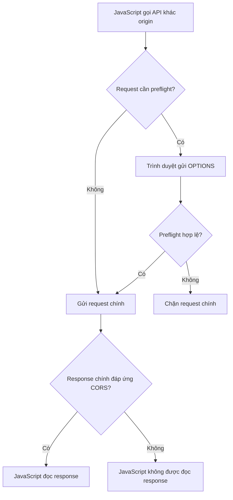

# CORS simple request và preflight request

## Mục tiêu học tập

Sau bài này, bạn có thể:

- Giải thích vì sao JavaScript gọi REST API khác origin phải tuân theo CORS, kể cả khi request được gửi đi bình thường.
- Phân biệt **simple request** (request không cần preflight) với request phải **preflight**, dựa trên phương thức, header và kiểu nội dung.
- Đọc được chuỗi HTTP `OPTIONS → request thực tế`, hiểu vai trò của từng header CORS ở cả request và response.
- Cấu hình CORS phù hợp trong Java/Spring, chẩn đoán lỗi bằng DevTools và kiểm thử các tình huống thành công/thất bại.
- Tránh nhầm CORS với xác thực, phân quyền hoặc biện pháp chống CSRF.

## 1. Vì sao trình duyệt cần CORS?

Giả sử ứng dụng giao diện chạy tại `https://app.example.com`, còn REST API chạy tại `https://api.example.com`. Hai địa chỉ này **khác origin** vì hostname khác nhau. Origin được xác định bởi bộ ba **scheme + host + port**: `http://localhost:5173` và `http://localhost:8080` cũng khác origin dù cùng máy.

**Same-origin policy (SOP)** giới hạn việc JavaScript của một origin đọc dữ liệu từ origin khác. **Cross-Origin Resource Sharing (CORS)** là cơ chế dùng HTTP header để máy chủ API cho phép một số origin đọc response qua trình duyệt.

Ví dụ giao diện gọi:

```javascript
const response = await fetch("https://api.example.com/api/products");
const products = await response.json();
```

API có thể nhận request và trả `200 OK` nhưng JavaScript vẫn không đọc được JSON nếu response thiếu header CORS hợp lệ. Đây là điểm cốt lõi: **một request có được gửi đi và JavaScript có được đọc response là hai vấn đề riêng**.

Trình duyệt tự áp dụng CORS cho `fetch` hoặc `XMLHttpRequest`. Công cụ như `curl`, Postman và đa số Java HTTP client không tự thực thi chính sách đọc response của trình duyệt. Vì thế, “gọi được bằng Postman” không chứng minh frontend sẽ gọi được.

## 2. Simple request: không gửi OPTIONS trước

“**Simple request**” là thuật ngữ quen dùng trong tài liệu CORS; trong thuật toán Fetch, các yêu cầu tương ứng gần với điều kiện **CORS-safelisted**. Khi request thỏa các điều kiện này, trình duyệt có thể gửi **request chính ngay**, không cần hỏi máy chủ qua preflight trước.

Các điều kiện quan trọng thường gặp:

| Thành phần | Điều kiện thường gặp để không cần preflight |
| --- | --- |
| HTTP method | `GET`, `HEAD` hoặc `POST` |
| Header do mã ứng dụng đặt | Chỉ dùng các request header thuộc danh sách CORS-safelisted, chẳng hạn `Accept`, `Accept-Language`, `Content-Language`, `Content-Type` và `Range` (dải byte đơn) |
| `Content-Type` nếu được đặt | Media type thuộc `application/x-www-form-urlencoded`, `multipart/form-data` hoặc `text/plain` |
| Các ràng buộc khác | Giá trị header phải thỏa giới hạn an toàn của Fetch; một số cách dùng upload listener/stream cũng có thể khiến request phải preflight |

Đây là **quy tắc thực dụng**, không phải phép kiểm tra chỉ dựa vào tên header. Ví dụ, header safelisted vẫn có giới hạn về giá trị và độ dài; các header do trình duyệt tự thêm như `Origin` không mặc nhiên khiến request phải preflight.

### Ví dụ GET không cần preflight

```javascript
const result = await fetch("https://api.example.com/api/products", {
  method: "GET",
  headers: { Accept: "application/json" }
});
console.log(await result.json());
```

Chuỗi HTTP điển hình:

```http
GET /api/products HTTP/1.1
Host: api.example.com
Origin: https://app.example.com
Accept: application/json

HTTP/1.1 200 OK
Content-Type: application/json
Access-Control-Allow-Origin: https://app.example.com
Vary: Origin

[{"id":1,"name":"Keyboard"}]
```

Máy chủ cho phép origin này qua `Access-Control-Allow-Origin`, nên JavaScript đọc được response. Nếu bỏ header đó, **GET vẫn có thể đến máy chủ và được xử lý**, nhưng trình duyệt chặn mã JavaScript đọc response và `fetch` thường reject với `TypeError: Failed to fetch`.

### Ví dụ POST có thể vẫn là simple request

```javascript
await fetch("https://api.example.com/api/feedback", {
  method: "POST",
  headers: { "Content-Type": "text/plain" },
  body: "Useful documentation"
});
```

`POST` với `text/plain` và không có header không an toàn thường không cần preflight. Ngược lại, đổi `Content-Type` thành `application/json` sẽ làm phát sinh preflight. **Không nên cố khai báo JSON thành `text/plain` chỉ để né preflight**: server có thể từ chối bằng `415 Unsupported Media Type`, và việc xác định đúng kiểu dữ liệu quan trọng hơn tiết kiệm một lượt OPTIONS.

> **Ghi nhớ:** “Simple” chỉ có nghĩa *không phải preflight*; nó **không** có nghĩa request luôn được phép đọc, không cần xác thực hoặc không thể gây thay đổi dữ liệu.

## 3. Khi nào cần preflight request?

Khi request nằm ngoài nhóm safelisted, trình duyệt thường gửi một request `OPTIONS` để hỏi máy chủ trước:

- `POST` hoặc `PUT` có `Content-Type: application/json`.
- `GET` có `Authorization: Bearer ...`.
- Request có header tùy biến như `X-Request-Id`.
- Phương thức như `PUT`, `PATCH`, `DELETE`, dù không có body.

Preflight là **request do trình duyệt tự tạo**, không phải lệnh `OPTIONS` mà lập trình viên phải tự gửi bằng `fetch`.

### Dòng chảy POST JSON kèm Bearer token

Frontend:

```javascript
const response = await fetch("https://api.example.com/api/orders", {
  method: "POST",
  headers: {
    "Content-Type": "application/json",
    Authorization: "Bearer <access-token>"
  },
  body: JSON.stringify({ productId: 42, quantity: 2 })
});

if (!response.ok) throw new Error("HTTP " + response.status);
const order = await response.json();
```

**Bước 1 — trình duyệt gửi preflight:**

```http
OPTIONS /api/orders HTTP/1.1
Host: api.example.com
Origin: https://app.example.com
Access-Control-Request-Method: POST
Access-Control-Request-Headers: authorization,content-type
```

Ba header đáng chú ý:

- `Origin`: origin đang muốn truy cập API.
- `Access-Control-Request-Method`: phương thức **request chính** dự kiến dùng; ở đây là `POST`.
- `Access-Control-Request-Headers`: danh sách header không thuộc safelist mà request chính dự kiến gửi; tên thường được chuẩn hóa thành chữ thường.

**Bước 2 — API đồng ý với yêu cầu preflight:**

```http
HTTP/1.1 204 No Content
Access-Control-Allow-Origin: https://app.example.com
Access-Control-Allow-Methods: GET, POST
Access-Control-Allow-Headers: Authorization, Content-Type
Access-Control-Max-Age: 600
Vary: Origin
```

`204` là một status thành công thường dùng; một response `2xx` khác cũng có thể hợp lệ. Nội dung body không phải trọng tâm của preflight. Trình duyệt kiểm tra origin, method và headers được cho phép.

**Bước 3 — chỉ sau khi preflight hợp lệ, request chính mới được gửi:**

```http
POST /api/orders HTTP/1.1
Host: api.example.com
Origin: https://app.example.com
Authorization: Bearer <access-token>
Content-Type: application/json

{"productId":42,"quantity":2}
```

**Bước 4 — response thực tế cũng phải đáp ứng CORS:**

```http
HTTP/1.1 201 Created
Content-Type: application/json
Access-Control-Allow-Origin: https://app.example.com
Vary: Origin
Location: /api/orders/9001

{"id":9001,"status":"CREATED"}
```

Preflight thành công **không thay thế** việc kiểm tra CORS trên response của `POST`. Nếu response chính thiếu `Access-Control-Allow-Origin` phù hợp, trình duyệt vẫn không cho JavaScript đọc kết quả dù đơn hàng có thể đã được tạo.

### Sơ đồ quyết định



Preflight thường **không mang cookie hoặc Bearer token của request chính**. Vì vậy, nếu middleware yêu cầu đăng nhập với mọi `OPTIONS` và trả `401` trước khi xử lý CORS, request chính sẽ không bao giờ được gửi. Cần tích hợp CORS ở đúng vị trí trong chuỗi filter để preflight được đánh giá độc lập với cơ chế xác thực của endpoint.

## 4. Phân biệt các header CORS

| Header | Xuất hiện ở đâu? | Mục đích |
| --- | --- | --- |
| `Origin` | Request chính và preflight | Cho biết origin gửi yêu cầu |
| `Access-Control-Request-Method` | Preflight request | Phương thức request chính dự kiến dùng |
| `Access-Control-Request-Headers` | Preflight request | Những header request chính muốn gửi |
| `Access-Control-Allow-Origin` | Preflight response và response chính | Origin nào được phép đọc response |
| `Access-Control-Allow-Methods` | Preflight response | Phương thức được phép trong ngữ cảnh preflight |
| `Access-Control-Allow-Headers` | Preflight response | Các request header được phép |
| `Access-Control-Max-Age` | Preflight response | Thời gian (giây) trình duyệt có thể cache kết quả preflight |
| `Access-Control-Allow-Credentials` | Response CORS khi dùng credentials | Cho phép frontend đọc response với chế độ credentials |
| `Access-Control-Expose-Headers` | Response chính | Cho phép JavaScript đọc thêm response header ngoài nhóm được expose sẵn |

Hai lưu ý thường bị nhầm:

1. `Access-Control-Allow-Methods` và `Access-Control-Allow-Headers` ở **preflight response** chỉ cho phép trình duyệt **gửi request chính** với method/header đó. Chúng không thay thế kiểm tra nghiệp vụ ở controller, authorization policy hoặc việc trả header CORS trên response chính.
2. `Access-Control-Expose-Headers: X-Request-Id, Location` dùng khi frontend muốn đọc các **response header** này bằng `response.headers.get(...)`. Nó không cấp phép frontend **gửi request header** `X-Request-Id`; việc đó thuộc `Access-Control-Allow-Headers`.

### Origin wildcard và request có credentials

Với API công khai, response có `Access-Control-Allow-Origin: *` thường có thể dùng cho request **không** bật credentials. Khi frontend dùng `credentials: "include"` để gửi cookie cross-origin, response cần:

```http
Access-Control-Allow-Origin: https://app.example.com
Access-Control-Allow-Credentials: true
Vary: Origin
```

**Không được kết hợp `Access-Control-Allow-Origin: *` với request dùng credentials mode `include`.** Giá trị allow-origin phải là một origin được cho phép cụ thể và response phải có `Access-Control-Allow-Credentials: true`. Nếu server phản hồi linh hoạt theo `Origin` từ danh sách cho phép, `Vary: Origin` giúp cache dùng đúng biến thể.

Ví dụ frontend dùng cookie:

```javascript
const profile = await fetch("https://api.example.com/api/me", {
  credentials: "include"
});
```

`credentials: "include"` **không đảm bảo** cookie sẽ được gửi: thuộc tính `SameSite`/`Secure`, chính sách cookie bên thứ ba và khác biệt giữa *cross-origin* với *cross-site* vẫn có hiệu lực. CORS cũng không cho phép JavaScript đọc cookie `HttpOnly`.

Với response preflight biến đổi theo method hoặc danh sách request header, cần cân nhắc `Vary: Access-Control-Request-Method, Access-Control-Request-Headers` ở tầng HTTP cache/proxy. Không dùng `Origin` nhận từ client như một giá trị được tin cậy tuyệt đối để quyết định thông tin nhạy cảm; hãy đối chiếu allowlist phía server.

## 5. Cấu hình CORS trong Java/Spring

Giả sử frontend hợp lệ là `https://app.example.com` và backend cung cấp các endpoint dưới `/api/**`. Trong Spring MVC, có thể cấu hình CORS theo đường dẫn:

```java
import org.springframework.context.annotation.Configuration;
import org.springframework.web.servlet.config.annotation.CorsRegistry;
import org.springframework.web.servlet.config.annotation.WebMvcConfigurer;

@Configuration
public class ApiCorsConfig implements WebMvcConfigurer {
    @Override
    public void addCorsMappings(CorsRegistry registry) {
        registry.addMapping("/api/**")
            .allowedOrigins("https://app.example.com")
            .allowedMethods("GET", "POST", "PUT", "PATCH", "DELETE")
            .allowedHeaders("Authorization", "Content-Type", "X-Request-Id")
            .exposedHeaders("X-Request-Id", "Location")
            .allowCredentials(true)
            .maxAge(600);
    }
}
```

Ví dụ này cho phép một origin rõ ràng; ứng dụng có xác thực bằng cookie mới cần `allowCredentials(true)`. Nếu API hoàn toàn không dùng cookie hoặc chế độ credentials `include`, có thể bỏ tùy chọn này. `exposedHeaders` chỉ cần khi JavaScript thực sự đọc các response header đó.

Nếu dùng **Spring Security**, tích hợp CORS vào security filter chain để xử lý preflight trước logic xác thực/phân quyền:

```java
import org.springframework.context.annotation.Bean;
import org.springframework.security.config.Customizer;
import org.springframework.security.config.annotation.web.builders.HttpSecurity;
import org.springframework.security.web.SecurityFilterChain;

@Bean
SecurityFilterChain apiSecurity(HttpSecurity http) throws Exception {
    return http
        .cors(Customizer.withDefaults())
        // Giữ cơ chế authentication, authorization và CSRF
        // phù hợp với ứng dụng ở cấu hình security thực tế.
        .authorizeHttpRequests(auth -> auth
            .anyRequest().authenticated())
        .build();
}
```

Đây là minh họa phần **tích hợp CORS**, không phải cấu hình security đầy đủ để copy nguyên vào production: ứng dụng cần thiết lập cơ chế đăng nhập hoặc resource server, các route công khai, quy tắc phân quyền và CSRF theo mô hình token/cookie thực tế. Với Spring Security, `cors(Customizer.withDefaults())` có thể sử dụng cấu hình CORS của Spring MVC khi được khai báo đúng trong cùng ứng dụng.

**Các lỗi cấu hình thường gặp:**

- Chỉ thêm header CORS ở controller: `OPTIONS` có thể bị filter chặn trước khi vào controller; response `401`/`403`/`500` cũng có thể thiếu header.
- Mở `allowedOrigins("*")` đồng thời `allowCredentials(true)`: cấu hình không hợp lệ cho credentialed CORS; hãy dùng origin cụ thể.
- Cho phép mọi origin, method và header để “sửa nhanh”: tăng bề mặt truy cập dữ liệu qua browser và có thể làm lộ tài nguyên nếu cơ chế xác thực/phân quyền yếu.
- Cấu hình `@CrossOrigin` ở controller cùng với cấu hình toàn cục nhưng không kiểm tra cách các chính sách được kết hợp: dẫn tới kết quả khó dự đoán.
- Chỉ cho phép `GET` mà frontend gửi `POST`, hoặc quên `Authorization`/`Content-Type` trong danh sách header: preflight bị từ chối.

## 6. Kiểm thử và chẩn đoán

### Thử preflight bằng curl

```bash
curl -i -X OPTIONS "https://api.example.com/api/orders" \
  -H "Origin: https://app.example.com" \
  -H "Access-Control-Request-Method: POST" \
  -H "Access-Control-Request-Headers: authorization,content-type"
```

Kiểm tra response thành công có `Access-Control-Allow-Origin` đúng, `Access-Control-Allow-Methods` chứa `POST` và `Access-Control-Allow-Headers` cho phép cả `Authorization` lẫn `Content-Type`. Lệnh này **mô phỏng HTTP preflight**; bản thân `curl` không kiểm tra và chặn theo CORS như trình duyệt.

Sau đó dùng DevTools → **Network** và lọc `OPTIONS` / `Fetch/XHR` để xem:

1. Có xuất hiện `OPTIONS` không? Nếu không, request có thể là simple hoặc kết quả preflight còn trong cache.
2. `OPTIONS` trả về status và các header allow nào? Có redirect, 401, 403 hay thiếu một header bắt buộc?
3. Sau `OPTIONS` có request chính không? Nếu không, lỗi nằm ở giai đoạn preflight.
4. Nếu request chính được gửi nhưng frontend vẫn báo lỗi CORS, kiểm tra **response chính**, bao gồm response lỗi, có `Access-Control-Allow-Origin` và `Access-Control-Allow-Credentials` (nếu cần) hay không.

| Hiện tượng | Nguyên nhân cần kiểm tra |
| --- | --- |
| `POST application/json` chưa đến controller; Network chỉ thấy `OPTIONS 401` | Security filter yêu cầu auth trên preflight hoặc CORS chưa chạy đủ sớm |
| `OPTIONS 204` rồi `POST 201` nhưng `fetch` vẫn thất bại | Response của `POST` thiếu/sai `Access-Control-Allow-Origin`; cũng kiểm tra credentials |
| `GET` thường hoạt động, `GET` kèm Bearer token thất bại | Header `Authorization` làm phát sinh preflight; API chưa allow header đó |
| Chỉ lỗi khi gọi `credentials: "include"` | `Access-Control-Allow-Origin: *`, thiếu `Access-Control-Allow-Credentials: true` hoặc cookie bị chặn |
| Localhost chạy được bằng Postman nhưng frontend lỗi | Postman không thực thi CORS; kiểm tra origin đầy đủ gồm cổng |
| OPTIONS xuất hiện không đều | Kết quả preflight có thể được cache riêng, tùy `Access-Control-Max-Age` và giới hạn của browser |

### Kiểm thử với MockMvc

Trong ứng dụng Spring đã kết nối cấu hình MVC và Security, một ca kiểm thử preflight có thể viết:

```java
import static org.springframework.test.web.servlet.request.MockMvcRequestBuilders.options;
import static org.springframework.test.web.servlet.result.MockMvcResultMatchers.header;
import static org.springframework.test.web.servlet.result.MockMvcResultMatchers.status;

@Test
void preflightForOrderCreationIsAllowed() throws Exception {
    mockMvc.perform(options("/api/orders")
            .header("Origin", "https://app.example.com")
            .header("Access-Control-Request-Method", "POST")
            .header("Access-Control-Request-Headers",
                    "authorization,content-type"))
        .andExpect(status().isOk())
        .andExpect(header().string(
            "Access-Control-Allow-Origin", "https://app.example.com"))
        .andExpect(header().string(
            "Access-Control-Allow-Methods", "GET,POST,PUT,PATCH,DELETE"));
}
```

Đây là phần thân một test minh họa: cần `@Test`, biến `mockMvc` đã inject và test context phù hợp. Spring MVC thông thường trả `200` cho preflight thành công; với hạ tầng khác, kiểm tra thành công `2xx` theo hợp đồng thực tế thay vì khóa cứng status. Chuỗi `Access-Control-Allow-Methods` cũng phụ thuộc cách cấu hình/serialize, vì vậy có thể kiểm tra chứa `POST` thay vì so khớp nguyên chuỗi.

Nên bổ sung các case độc lập:

- Origin không nằm trong allowlist bị từ chối.
- `Access-Control-Request-Method: DELETE` bị từ chối nếu endpoint/policy không cho phép.
- Header `X-Admin-Override` chưa được cấu hình bị từ chối.
- Request chính trả `401`/`403` vẫn có header CORS phù hợp để frontend xử lý status nếu origin hợp lệ.
- Khi dùng cookie, kiểm tra origin cụ thể, `Access-Control-Allow-Credentials: true` và các điều kiện SameSite/Secure trong trình duyệt thật.

Không nên chỉ dựa vào unit test MockMvc: nó xác nhận cấu hình HTTP ở backend nhưng **không mô phỏng chính sách bảo mật của browser**. Một bài kiểm thử tích hợp mở frontend ở `http://localhost:5173` và backend ở `http://localhost:8080` bằng browser thật sẽ phát hiện thêm vấn đề cookie, redirect và proxy.

## 7. CORS không phải là bảo mật API toàn diện

CORS quyết định **mã JavaScript tại origin nào có thể đọc response** trong browser. Nó không xác thực danh tính người dùng, không thay thế phân quyền theo resource và không tự ngăn request gây thay đổi trạng thái. Simple `POST` có thể được gửi trước khi trình duyệt đánh giá response CORS, tương tự cơ chế gửi form cross-origin; do đó backend vẫn cần bảo vệ thao tác nhạy cảm khỏi CSRF khi dùng xác thực bằng cookie.

Một client ngoài trình duyệt có thể tự đặt header `Origin` hoặc không gửi header này. Vì vậy, **không dùng CORS allowlist làm ranh giới tin cậy thay cho JWT/session validation, authorization, rate limit hoặc kiểm soát CSRF**. Luôn kiểm tra quyền trên server theo tài nguyên và người dùng; chỉ bật các origin thực sự cần, không phản chiếu vô điều kiện bất kỳ `Origin` nào, và không mở rộng `Origin: null` nếu chưa có lý do rõ ràng.

Một lưu ý về hiệu năng: `Access-Control-Max-Age` giúp giảm số lần OPTIONS, nhưng trình duyệt có thể áp dụng mức trần hoặc xóa cache sớm; cache preflight cũng khác HTTP response cache thông thường. Đừng dựa vào việc “luôn có đúng một OPTIONS trước mỗi POST” để làm logic hệ thống. Nếu cần giảm độ trễ, ưu tiên cấu hình preflight đúng và cache hợp lý, không đánh đổi kiểu dữ liệu hay chính sách bảo mật.

## 8. Bài tập thực hành

**Bài 1 — Dự đoán request nào cần preflight.** Giả sử tất cả lời gọi đều từ `https://app.example.com` đến `https://api.example.com`:

```javascript
// A
fetch("https://api.example.com/api/products");

// B
fetch("https://api.example.com/api/feedback", {
  method: "POST",
  headers: { "Content-Type": "text/plain" },
  body: "great"
});

// C
fetch("https://api.example.com/api/orders", {
  method: "POST",
  headers: { "Content-Type": "application/json" },
  body: JSON.stringify({ quantity: 1 })
});

// D
fetch("https://api.example.com/api/me", {
  headers: { Authorization: "Bearer token" }
});
```

**Gợi ý đáp án:** A và B thường không cần preflight; C cần vì `application/json`, D cần vì `Authorization`. Cả bốn vẫn cần response CORS hợp lệ để JavaScript đọc dữ liệu. B có thể thất bại ở tầng nghiệp vụ nếu endpoint không chấp nhận `text/plain`.

**Bài 2 — Triển khai và quan sát.** Tạo frontend chạy cổng 5173 gọi API Spring ở cổng 8080. Allow riêng `http://localhost:5173`, `GET` và `POST`, header `Content-Type`/`Authorization`. Quan sát Network với GET và POST JSON; chụp hoặc ghi lại method, `Origin`, `Access-Control-Request-Method`, `Access-Control-Request-Headers` và header CORS trên hai response. Sau đó xóa `Authorization` khỏi allowlist, kiểm tra request chính có bị chặn trước khi đến controller không.

**Bài 3 — Phân tích lỗi.** Preflight trả `204` với các header phù hợp, request `POST` trả `201` nhưng frontend vẫn nhận `TypeError: Failed to fetch`. Hãy xác định thiếu điều kiện nào trên **response `POST`**, kiểm tra response lỗi nếu có, và giải thích vì sao việc tạo dữ liệu đã có thể xảy ra mặc dù JavaScript báo lỗi.

**Tiêu chí tự đánh giá:** Bạn phân biệt được **preflight thất bại (request chính chưa được gửi)** với **CORS trên response chính thất bại (request chính có thể đã chạy)**, và biết cách chứng minh bằng Network trace cùng header thực tế.

## Đọc thêm

- [MDN — Cross-Origin Resource Sharing (CORS)](https://developer.mozilla.org/en-US/docs/Web/HTTP/Guides/CORS)
- [WHATWG Fetch Standard — CORS protocol](https://fetch.spec.whatwg.org/#cors-protocol)
- [Spring Framework — CORS](https://docs.spring.io/spring-framework/reference/web/webmvc-cors.html)
