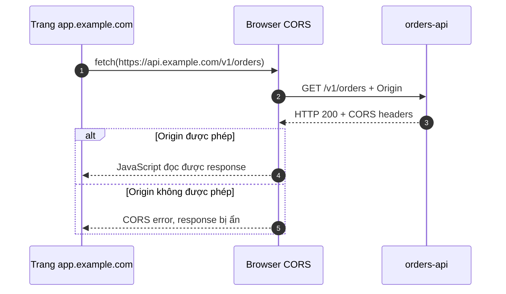
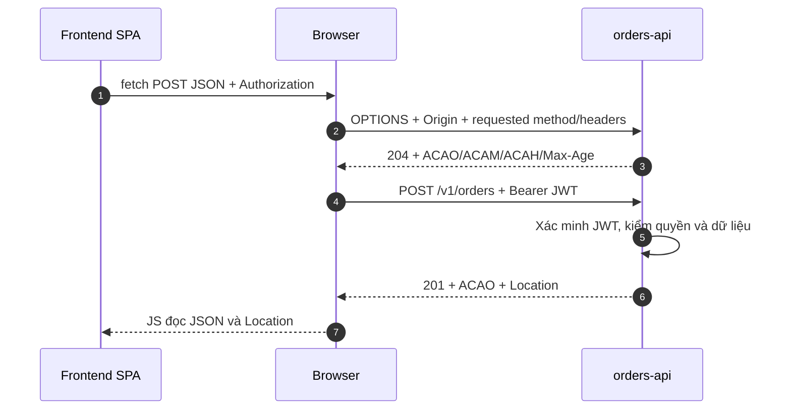

# Access-Control-Allow-Origin, Methods và Headers trong REST API

Một SPA chạy tại `https://app.example.com` gọi REST API ở `https://api.example.com` bằng `fetch()`. Dù hai hệ thống cùng thuộc một tổ chức, chúng có **origin khác nhau**, nên trình duyệt áp dụng cơ chế **Cross-Origin Resource Sharing (CORS)** để quyết định JavaScript có được đọc phản hồi từ API hay không. Server thể hiện chính sách CORS qua các response header, trong đó ba header cốt lõi là `Access-Control-Allow-Origin`, `Access-Control-Allow-Methods` và `Access-Control-Allow-Headers`.

Trong module `INTEGRATION_API_REST`, bài này liên kết hợp đồng HTTP/URI, mã trạng thái, kiểm thử và bảo mật với cách trình duyệt tiêu thụ API Java/Spring. Ví dụ xuyên suốt: `orders-api` nhận request từ ứng dụng web, xác minh Bearer access token rồi xử lý đơn hàng. Việc trình duyệt cho phép đọc response là một quyết định **khác** với xác thực JWT, scope và quyền sở hữu từng đơn hàng.

## 1. Mục tiêu học tập

Sau bài này, người học có thể:

1. Xác định hai URL có cùng origin hay không từ **scheme, hostname, port**; phân biệt origin với site.
2. Giải thích ba response header ACAO, ACAM, ACAH và vị trí áp dụng trong preflight/actual response.
3. Đọc một preflight `OPTIONS` với `Origin`, `Access-Control-Request-Method` và `Access-Control-Request-Headers`.
4. Cấu hình Spring Boot/Spring Security để CORS và JWT hoạt động đúng thứ tự, kiểm soát credential, cache và `Vary`.
5. Kiểm thử bằng `curl`, `MockMvc` và browser thật; chẩn đoán lỗi do Security, gateway hoặc CDN.

## 2. Origin, same-origin policy và CORS

Origin của một URL là bộ ba **scheme + hostname + port**. Cổng mặc định HTTPS là 443, HTTP là 80. Path, query và fragment không tạo origin mới.

| Trang hiện tại | URL được gọi | Cùng origin? | Vì sao |
|---|---|---|---|
| `https://app.example.com` | `https://app.example.com/v1/orders` | Có | Scheme, host và port trùng |
| `https://app.example.com` | `https://api.example.com/v1/orders` | Không | Host khác |
| `https://app.example.com` | `http://app.example.com/v1/orders` | Không | Scheme khác; còn có thể bị chặn mixed content |
| `https://app.example.com` | `https://app.example.com:8443/v1/orders` | Không | Port khác |
| `https://app.example.com/a` | `https://app.example.com/b?x=1` | Có | Path/query không quyết định origin |

**Cùng site không đồng nghĩa cùng origin.** `https://app.example.com` và `https://api.example.com` thường cùng site nhưng khác origin. Cookie SameSite và same-origin policy có các tiêu chí riêng.

Same-origin policy hạn chế JavaScript của một origin đọc tài nguyên ở origin khác. CORS là một cơ chế server cho phép **chia sẻ response với browser** từ các origin đã chọn. Khi browser thực hiện cross-origin `fetch()`, nó gửi `Origin` theo cơ chế Fetch/CORS và kiểm response header. Nếu server không cho phép, JavaScript không đọc được phản hồi, ngay cả khi backend đã nhận request và trả `200 OK`.

`curl`, Postman và Java `HttpClient` **không bị chính sách CORS của trình duyệt áp dụng**. Chúng có thể tự tạo `Origin` bất kỳ. Vì vậy CORS không chứng minh người gọi là frontend “chính thức” và không thể thay JWT signature validation, scope, tenant authorization hoặc kiểm soát chống CSRF.



## 3. Ý nghĩa ba header chính

| Header phản hồi | Vai trò | Thời điểm cần dùng |
|---|---|---|
| `Access-Control-Allow-Origin` (ACAO) | Chỉ định origin được phép đọc response CORS | Preflight hợp lệ và actual response cần chia sẻ |
| `Access-Control-Allow-Methods` (ACAM) | Cho biết HTTP method được browser phép thực hiện sau preflight | Phản hồi preflight |
| `Access-Control-Allow-Headers` (ACAH) | Cho biết **request header** không thuộc safelist mà browser được gửi | Phản hồi preflight |

### 3.1. Access-Control-Allow-Origin

```http
HTTP/1.1 200 OK
Content-Type: application/json
Access-Control-Allow-Origin: https://app.example.com
Vary: Origin

{"items":[{"id":"ord_42","status":"CONFIRMED"}]}
```

Response cho phép JavaScript từ `https://app.example.com` đọc dữ liệu, nhưng trang ở `https://other.example` không được đọc chỉ nhờ gọi URL đó. Khi server chọn ACAO theo request `Origin` từ allowlist, `Vary: Origin` giúp cache trung gian phân biệt các biến thể phản hồi. Nếu response đã có `Vary` khác, phải **gộp thêm** `Origin` thay vì xóa giá trị sẵn có.

Các giá trị cần hiểu:

- `Access-Control-Allow-Origin: https://app.example.com`: cho phép đúng **một origin cụ thể**, bao gồm scheme và port khi khác mặc định.
- `Access-Control-Allow-Origin: *`: chia sẻ response cho mọi origin trong trường hợp **không dùng credentials mode `include`**. Phù hợp hơn với tài nguyên công khai thực sự.
- `Access-Control-Allow-Origin: null`: khớp `Origin: null`, có thể đến từ sandboxed document hoặc opaque origin; không nên cấp quyền này cho dữ liệu nhạy cảm.
- `Access-Control-Allow-Origin: https://a.example, https://b.example`: **sai**; CORS không cho phép một danh sách origin phân tách bằng dấu phẩy. Server phải kiểm allowlist và trả **một origin khớp**.

`Origin` là đầu vào không tin cậy: không được trả lại mọi giá trị nhận được cùng credentials. Với origin bị từ chối, server có thể không thêm ACAO hoặc có response lỗi theo policy; không bao giờ vô tình “reflect” origin lạ.

### 3.2. Access-Control-Allow-Methods

```http
Access-Control-Allow-Methods: GET, POST, PATCH, DELETE
```

Header này trả lời câu hỏi **method thực** trong `Access-Control-Request-Method` có được phép theo CORS hay không. Preflight là HTTP `OPTIONS` nhưng có thể đang hỏi về một `POST`/`PATCH`; do đó không cần thêm `OPTIONS` vào ACAM chỉ để duyệt `POST`. Nên giới hạn method thực tế từng nhóm endpoint cần hỗ trợ.

Đừng nhầm ACAM với:

- `Allow` trong response `405 Method Not Allowed`: mô tả method mà tài nguyên HTTP hỗ trợ.
- `hasAuthority("SCOPE_orders:write")`: Spring Security kiểm người gọi có quyền nghiệp vụ.
- Kiểm điều kiện ở service như “chỉ chủ đơn hàng được sửa đơn này”: phân quyền object-level.

CORS cho phép `POST` chỉ khiến browser có thể gửi POST; backend vẫn có thể trả `401`, `403` hoặc lỗi validation bình thường.

### 3.3. Access-Control-Allow-Headers

```http
Access-Control-Allow-Headers: Authorization, Content-Type, If-Match, Idempotency-Key
```

Header này cho phép những **request header** đã được browser hỏi trong `Access-Control-Request-Headers`:

- `Authorization`: request JavaScript tự đặt Bearer token thường cần preflight.
- `Content-Type: application/json`: JSON không thuộc các MIME type safelisted; POST JSON thường preflight dù method POST có thể safelisted.
- `If-Match`: cập nhật có điều kiện theo ETag, thường đi cùng PATCH.
- `Idempotency-Key`: header ứng dụng giúp nhận diện retry tạo tài nguyên, nếu server có triển khai idempotency.

Tên HTTP header so khớp không phân biệt hoa/thường: request `authorization,content-type` có thể được duyệt bằng `Authorization, Content-Type`. Các header browser tự quản lý như `Origin`, `Cookie`, `Host` không phải thứ JavaScript được tự đặt tùy ý; không thêm chúng vào ACAH như “cách mở quyền”.

**ACAH không kiểm soát response header mà JavaScript được đọc.** Muốn frontend đọc `Location`, `ETag` hoặc header tùy chỉnh từ response, dùng `Access-Control-Expose-Headers`. Đây là một header khác.

## 4. Preflight OPTIONS và actual request

### 4.1. Trình duyệt gửi preflight

Với `POST /v1/orders` có Bearer JWT và JSON, browser thường gửi:

```http
OPTIONS /v1/orders HTTP/1.1
Host: api.example.com
Origin: https://app.example.com
Access-Control-Request-Method: POST
Access-Control-Request-Headers: authorization,content-type,idempotency-key
```

Ý nghĩa:

| Request header | Nội dung |
|---|---|
| `Origin` | Origin của trang tạo request |
| `Access-Control-Request-Method` | Method sẽ dùng cho **actual request**: `POST` |
| `Access-Control-Request-Headers` | Danh sách request header cần được duyệt |

Đây chỉ là kiểm tra chính sách. Preflight **không tạo đơn hàng, không làm thay đổi dữ liệu**. Thông thường nó không mang bearer token/cookie người dùng; nếu middleware yêu cầu JWT cho mọi `OPTIONS` trước khi xử lý CORS, browser sẽ bị chặn khi chưa kịp gửi request thực.

### 4.2. Server duyệt preflight

```http
HTTP/1.1 204 No Content
Access-Control-Allow-Origin: https://app.example.com
Access-Control-Allow-Methods: GET, POST, PATCH
Access-Control-Allow-Headers: Authorization, Content-Type, If-Match, Idempotency-Key
Access-Control-Max-Age: 600
Vary: Origin, Access-Control-Request-Method, Access-Control-Request-Headers
```

Browser đối chiếu origin, method và từng header rồi mới gửi request thực. Một số framework trả `200 OK` cho preflight hợp lệ thay vì `204 No Content`; cả hai có thể hợp lệ. `Access-Control-Max-Age` (đơn vị giây) hướng dẫn browser cache quyền preflight, song mỗi browser có thể áp trần/cách cache riêng.

**Preflight cache khác HTTP response cache**: `Access-Control-Max-Age` không thay thế `Cache-Control`, `ETag` hoặc cache key của CDN. Nếu cache trung gian lưu preflight response phụ thuộc origin, method, requested headers, `Vary` phải thể hiện các chiều biến thiên đó và cấu hình edge phải nhất quán.

### 4.3. Actual request và actual response

```http
POST /v1/orders HTTP/1.1
Host: api.example.com
Origin: https://app.example.com
Authorization: Bearer eyJ...
Content-Type: application/json
Idempotency-Key: 9060a0ef-...

{"items":[{"sku":"sku_42","quantity":1}]}
```

Sau khi backend xác minh JWT, scope, dữ liệu và xử lý nghiệp vụ, phản hồi:

```http
HTTP/1.1 201 Created
Location: /v1/orders/ord_42
Content-Type: application/json
Access-Control-Allow-Origin: https://app.example.com
Access-Control-Expose-Headers: Location, ETag
Vary: Origin

{"id":"ord_42","status":"PENDING"}
```

**ACAO vẫn cần có trên actual response** để browser chia sẻ nội dung với frontend. `Access-Control-Allow-Methods`/`Access-Control-Allow-Headers` là điều kiện preflight; chỉ thêm chúng vào response `POST` nhưng quên response `OPTIONS` không giải quyết được yêu cầu kiểm tra trước. Nếu frontend cần đọc `Location`, phải expose vì `Location` không thuộc CORS-safelisted response headers.



### 4.4. Request không preflight

`GET` hoặc một `POST` chỉ dùng method, content-type và header trong CORS safelist có thể được browser gửi **trực tiếp**. Browser vẫn kiểm ACAO ở actual response trước khi cho JavaScript đọc nội dung. Vì một request không qua preflight vẫn có thể gây tác dụng phụ, **CORS không phải cơ chế chống CSRF**.

Không phải mọi cross-origin request đều có OPTIONS; đừng ép frontend “tự gửi preflight” hay suy rằng thiếu OPTIONS là CORS bị tắt.

## 5. Credentials, wildcard và cookie

Với JavaScript tự gắn Bearer token:

```js
const response = await fetch("https://api.example.com/v1/orders", {
  method: "GET",
  headers: { "Authorization": "Bearer " + accessToken }
});
```

`Authorization` là request header không safelisted nên thường cần preflight; nó phải được duyệt bằng ACAH. **`Access-Control-Allow-Credentials: true` không phải công tắc “bật JWT”**. Header này liên quan tới quyền chia sẻ response khi request sử dụng Fetch `credentials: "include"` (ví dụ gửi cookie của browser sang origin khác).

Với cookie/session:

```js
const response = await fetch("https://api.example.com/v1/orders", {
  credentials: "include"
});
```

API cần một origin cụ thể và header cho phép credentials nếu muốn browser chia sẻ response:

```http
Access-Control-Allow-Origin: https://app.example.com
Access-Control-Allow-Credentials: true
Vary: Origin
```

Không thể dùng `Access-Control-Allow-Origin: *` cho request có credentials mode `include`. Không nên chữa lỗi bằng cách phản chiếu **mọi origin** và trả `Access-Control-Allow-Credentials: true`, vì như vậy các trang không tin cậy có thể đọc dữ liệu có cookie.

Nếu ứng dụng dùng cookie, phải xử lý **CSRF**, `SameSite`, `Secure`, `HttpOnly`, scope cookie và quyền người dùng. Các chính sách trình duyệt về third-party cookie có thể ngăn cookie được gửi ngay cả khi CORS cho phép. Đối với CORS có credentials, wildcard trong ACAM/ACAH không có ý nghĩa wildcard thông thường; đặc biệt `Authorization` phải liệt kê rõ trong ACAH. Nên dùng allowlist method và request header cụ thể.

## 6. CORS, authentication và authorization độc lập

| Lớp | Câu hỏi | Ví dụ |
|---|---|---|
| CORS | JavaScript từ origin nào được browser cho phép đọc response? | `ACAO: https://app.example.com` |
| Authentication | Token/session nào thực sự hợp lệ, danh tính nào? | Verify JWT signature, `iss`, `aud`, `exp` |
| Authorization | Danh tính này được phép làm gì với **resource cụ thể**? | `orders:read` và owner/tenant của order |

Một backend HTTP client có thể gọi API bất kể CORS; một browser từ origin không được cấp CORS vẫn có thể gửi vài request đơn giản, nhưng không đọc được response. Đừng cấp quyền bằng cách so `Origin`: nó không phải bằng chứng danh tính đáng tin cậy. Với `GET /v1/orders/{id}`, JWT hợp lệ và có scope `orders:read` vẫn **chưa đủ** nếu order thuộc tenant khác (BOLA/IDOR).

### Vì sao có lúc browser báo CORS nhưng thực tế API trả 401?

- **Preflight `OPTIONS` bị 401/403** vì đi qua authentication filter trước CORS: browser không gửi actual request.
- **Actual request trả 401/403** nhưng response lỗi không có ACAO cho origin hợp lệ: frontend chỉ thấy `TypeError`/CORS error, thay vì đọc được status và problem JSON.
- **Actual request trả 401/403 và có ACAO đúng**: frontend thấy status thật, có thể xử lý xác thực hoặc báo thiếu quyền.
- **Actual request đã tạo tài nguyên nhưng response bị CORS chặn**: server có thể đã ghi dữ liệu, client lại thấy lỗi giống network error. Với thao tác tạo resource, dùng `Idempotency-Key` và thiết kế retry có kiểm soát.

Việc browser từ chối chia sẻ response thường không có nghĩa API đã từ chối thực hiện request; muốn biết điều đó phải xem Network tab và server log.

## 7. Java/Spring Security: tích hợp CORS với Bearer JWT

Ví dụ Spring Boot 3 / Spring Security 6, API cho phép đúng hai origin của tổ chức. `orders-api` nhận access token qua `Authorization`; frontend không dùng cookie xuyên origin. CORS policy cho phép GET/POST/PATCH và những request header dùng trong hợp đồng đơn hàng.

### 7.1. Cấu hình một nguồn CORS tập trung

```java
package com.example.orders.security;

import java.util.List;
import org.springframework.context.annotation.Bean;
import org.springframework.context.annotation.Configuration;
import org.springframework.http.HttpMethod;
import org.springframework.security.config.Customizer;
import org.springframework.security.config.annotation.web.builders.HttpSecurity;
import org.springframework.security.web.SecurityFilterChain;
import org.springframework.web.cors.CorsConfiguration;
import org.springframework.web.cors.CorsConfigurationSource;
import org.springframework.web.cors.UrlBasedCorsConfigurationSource;

@Configuration
public class ApiSecurityConfiguration {

    @Bean
    CorsConfigurationSource corsConfigurationSource() {
        CorsConfiguration cors = new CorsConfiguration();
        cors.setAllowedOrigins(List.of(
                "https://app.example.com",
                "https://admin.example.com"));
        cors.setAllowedMethods(List.of("GET", "POST", "PATCH"));
        cors.setAllowedHeaders(List.of(
                "Authorization", "Content-Type", "If-Match",
                "Idempotency-Key", "X-Request-Id"));
        cors.setExposedHeaders(List.of(
                "Location", "ETag", "X-Request-Id"));
        cors.setAllowCredentials(false); // không dùng cookie cross-origin
        cors.setMaxAge(600L);

        UrlBasedCorsConfigurationSource source =
                new UrlBasedCorsConfigurationSource();
        source.registerCorsConfiguration("/v1/**", cors);
        return source;
    }

    @Bean
    SecurityFilterChain apiSecurity(HttpSecurity http) throws Exception {
        http
            .cors(Customizer.withDefaults())
            .authorizeHttpRequests(auth -> auth
                .requestMatchers(HttpMethod.GET, "/v1/orders/**")
                    .hasAuthority("SCOPE_orders:read")
                .requestMatchers(HttpMethod.POST, "/v1/orders")
                    .hasAuthority("SCOPE_orders:write")
                .requestMatchers(HttpMethod.PATCH, "/v1/orders/**")
                    .hasAuthority("SCOPE_orders:write")
                .anyRequest().authenticated())
            .oauth2ResourceServer(oauth2 ->
                oauth2.jwt(Customizer.withDefaults()));
        return http.build();
    }
}
```

Vì sao cấu hình này có ý nghĩa:

1. Bean `CorsConfigurationSource` xác định origin/method/header. Lời gọi `http.cors(...)` tích hợp CORS với Spring Security để **preflight được xử lý trước khi xác thực**, tránh `OPTIONS` không mang token bị chặn bởi filter JWT.
2. `setAllowedOrigins` khớp **toàn bộ origin** gồm scheme/host/port. Hai origin trong danh sách **không** xuất hiện đồng thời thành giá trị ACAO; Spring lựa chọn origin phù hợp với request.
3. `setAllowedMethods` và `setAllowedHeaders` dành cho preflight. Các rule `hasAuthority(...)` mới cấp quyền nghiệp vụ khi actual request có JWT hợp lệ. Service layer vẫn cần kiểm owner/tenant của từng order.
4. `setExposedHeaders` cho phép JavaScript đọc `ETag`, `Location` trên actual response; nó **không** cấp quyền gửi các header ấy trong request.
5. `setAllowCredentials(false)` phù hợp kịch bản chỉ gắn bearer token thủ công và không dùng `credentials: "include"`. Nếu chuyển sang cookie/session, đánh giá `true` với exact origin, cookie attributes, CSRF và session security trước khi thay đổi.
6. `registerCorsConfiguration("/v1/**", ...)` chỉ cấu hình cho API `/v1/`. Các endpoint khác, nhiều filter chain hoặc gateway cần được kiểm riêng.

Ví dụ cũng cần khai báo issuer tin cậy cho JWT:

```yaml
spring:
  security:
    oauth2:
      resourceserver:
        jwt:
          issuer-uri: https://id.example.com/realms/shop
```

Ở production, phải kiểm issuer/JWK, chữ ký, hạn token và audience phù hợp với `orders-api`; cấu hình `issuer-uri` là điểm bắt đầu và có thể cần **audience validator** riêng tùy cấu hình/phiên bản. CORS không tự thực hiện các kiểm tra này.

Trong các ứng dụng dùng cookie, đừng tùy tiện gọi `csrf.disable()` để sửa lỗi CORS; cookie có thể được browser gửi trong các ngữ cảnh nhất định ngay cả khi JavaScript ở origin ngoài không được đọc response. CSRF token hoặc cơ chế chống CSRF phù hợp với mô hình session là một lớp bảo vệ riêng.

### 7.2. Tránh cấu hình CORS chồng chéo

Spring cho phép CORS ở `CorsConfigurationSource`, `WebMvcConfigurer#addCorsMappings` hoặc `@CrossOrigin`. Khi có SecurityFilterChain, việc phối hợp các nguồn phải theo quy tắc của phiên bản framework; nếu mỗi controller tự đặt policy khác nhau sẽ khó kiểm soát. Nên có một chính sách được quản lý tập trung hoặc phân vùng rõ theo API, rồi xác nhận **response cuối cùng sau gateway/CDN** chỉ có giá trị ACAO hợp lệ.

Không cần tự thêm rule “permit all OPTIONS trên toàn API” chỉ để che một cấu hình CORS sai. Điều cần làm là xử lý **CORS preflight đúng thứ tự**. Tuy nhiên ingress/WAF/proxy phải cho request OPTIONS đi tới đúng CORS handler hoặc xử lý CORS nhất quán ở edge. Một gateway trả `401` sớm cho OPTIONS sẽ làm frontend lỗi dù cấu hình Spring bên trong đúng.

## 8. JavaScript fetch, HTTP status và response headers

Ví dụ tạo đơn hàng từ frontend:

```js
async function createOrder(accessToken, items) {
  const response = await fetch("https://api.example.com/v1/orders", {
    method: "POST",
    headers: {
      Authorization: "Bearer " + accessToken,
      "Content-Type": "application/json",
      "Idempotency-Key": crypto.randomUUID()
    },
    body: JSON.stringify({ items })
  });

  if (response.status === 401) {
    throw new Error("Token expired or invalid");
  }
  if (response.status === 403) {
    throw new Error("Permission denied");
  }
  if (!response.ok) {
    throw new Error("Order API returned " + response.status);
  }

  const location = response.headers.get("Location");
  const data = await response.json();
  return { data, location };
}
```

`Idempotency-Key` trong ví dụ chỉ có tác dụng chống tạo đơn hàng lặp khi server thực sự **lưu và áp dụng** khóa theo user/tenant, request fingerprint và khoảng thời gian. Để preflight thành công, nó phải nằm trong ACAH như cấu hình Spring ở mục 7. Nếu frontend thêm một custom header mới nhưng policy không bổ sung, browser có thể chặn ngay từ OPTIONS dù controller vẫn chạy tốt với Postman.

Ví dụ cập nhật tài nguyên qua ETag:

```http
PATCH /v1/orders/ord_42 HTTP/1.1
Host: api.example.com
Origin: https://app.example.com
Authorization: Bearer eyJ...
Content-Type: application/json
If-Match: "order-v7"

{"deliveryNote":"Call on arrival"}
```

`PATCH` không thuộc method safelist, còn `If-Match`/`Authorization` là request header cần được duyệt. Sau preflight, server vẫn phải kiểm quyền và điều kiện `If-Match`, có thể trả `412 Precondition Failed` khi version thay đổi. Nếu response 412 của origin hợp lệ thiếu ACAO, frontend không thể hiển thị lỗi xung đột một cách chính xác.

**Không lưu thông tin nhạy cảm vào log/browser console khi xử lý lỗi CORS.** Access token vẫn phải được bảo vệ khỏi XSS và lỗi lưu trữ client; có CORS đúng không ngăn script độc hại chạy trong chính origin được allowlist.

## 9. CORS với HTTP cache, gateway và CDN

Một response đúng ở backend có thể thành sai tại edge:

- Backend chọn ACAO dựa trên `Origin` nhưng CDN cache theo URL mà bỏ `Vary: Origin`, làm client A nhận header dành cho client B.
- Gateway **cũng** thêm ACAO lên response đã có từ Spring, khiến có hai header ACAO hoặc danh sách ngăn bằng dấu phẩy; browser có thể từ chối.
- Spring cấu hình tốt, nhưng proxy chặn OPTIONS bằng 401/403 hoặc loại bỏ `Access-Control-Request-Headers`.
- 401/403/500 từ lớp khác không có ACAO cho origin được cho phép, khiến frontend chỉ nhìn thấy “CORS error”.
- Preflight cache của browser còn hiệu lực khi quản trị viên vừa sửa danh sách origin; thay đổi chính sách có thể không tác động ngay đến mọi browser đã cache.

Khi ACAO phản ánh một origin được kiểm allowlist, response cần `Vary: Origin`. Nếu kết quả preflight thay đổi theo method/headers, `Vary` thích hợp gồm `Access-Control-Request-Method` và `Access-Control-Request-Headers`. Bảo đảm không ghi đè `Vary` do content negotiation hoặc các lớp khác đặt trước đó.

| Cache | Dữ liệu được lưu | Cơ chế kiểm soát |
|---|---|---|
| Browser preflight cache | Kết quả duyệt CORS của origin/method/headers | `Access-Control-Max-Age`, giới hạn do browser áp |
| HTTP browser/proxy/CDN cache | Response tài nguyên HTTP theo cache key | `Cache-Control`, `Vary`, `ETag` |
| Token/session | Thông tin xác thực theo vòng đời security | JWT `exp`, issuer/session policy |

`Access-Control-Max-Age` không thay `Cache-Control`; cũng không vì ACAO hợp lệ mà cache công khai dữ liệu đơn hàng hoặc thông tin cá nhân. Cần đánh giá `Cache-Control: private`/`no-store`, authorization, response variance và chính sách CDN riêng.

Ở REST API dùng phân trang/ETag, hãy thử cả các mã `200`, `201`, `204`, `304`, `400`, `401`, `403`, `404`, `409`, `412`, `422`, `429` và `500` phù hợp với endpoint; đường lỗi và conditional response thường đi qua filter/proxy khác. Các response cần chia sẻ phải giữ CORS headers đúng cho origin đã được phép.

## 10. Kiểm thử thực tế

### 10.1. Test preflight được phép bằng curl

```bash
curl -i -X OPTIONS 'https://api.example.com/v1/orders' \
  -H 'Origin: https://app.example.com' \
  -H 'Access-Control-Request-Method: POST' \
  -H 'Access-Control-Request-Headers: authorization,content-type,idempotency-key'
```

Kỳ vọng: HTTP `2xx` (thường 200 hoặc 204); ACAO đúng `https://app.example.com`; ACAM chứa `POST`; ACAH chứa `Authorization`, `Content-Type`, `Idempotency-Key`; `Vary` phù hợp. Request OPTIONS **không yêu cầu access token**.

### 10.2. Test origin lạ và header lạ

```bash
curl -i -X OPTIONS 'https://api.example.com/v1/orders' \
  -H 'Origin: https://untrusted.example' \
  -H 'Access-Control-Request-Method: POST' \
  -H 'Access-Control-Request-Headers: authorization,content-type'

curl -i -X OPTIONS 'https://api.example.com/v1/orders' \
  -H 'Origin: https://app.example.com' \
  -H 'Access-Control-Request-Method: POST' \
  -H 'Access-Control-Request-Headers: x-unsafe-header'
```

Kỳ vọng: không có quyết định CORS cho phép origin lạ hoặc header ngoài allowlist. Server có thể trả `403` hoặc response không có ACAO/ACAH phù hợp tùy framework; **browser phải từ chối actual request sau preflight thất bại**.

### 10.3. Actual response và HTTP error

```bash
curl -i 'https://api.example.com/v1/orders/ord_42' \
  -H 'Origin: https://app.example.com' \
  -H 'Authorization: Bearer <valid-access-token>'
```

Kiểm ACAO trên response và kiểm tiếp với access token hết hạn/thiếu scope để quan sát `401`/`403`. Dùng curl chỉ quan sát header: curl **không thực thi CORS** nên HTTP 200 không chứng minh browser cho phép đọc.

### 10.4. Bảng kiểm thử CORS/HTTP/JWT

| Kịch bản | Thiết lập | Kỳ vọng |
|---|---|---|
| GET từ origin được phép | `Origin: https://app.example.com` | Actual response có ACAO, browser đọc JSON |
| POST JSON + Bearer | `authorization`, `content-type` trong preflight | OPTIONS được duyệt, POST đi tiếp và token được kiểm |
| Origin ngoài danh sách | `Origin: https://untrusted.example` | Không phản chiếu ACAO cho origin lạ |
| Method không được duyệt | Preflight `DELETE` trong policy chỉ cho GET/POST/PATCH | Browser không gửi DELETE |
| Header lạ | `x-unsafe-header` trong requested headers | Không được ACAH chấp thuận |
| Cookie/session | `credentials: "include"` | Chỉ chia sẻ với exact ACAO + ACAC true và cookie policy đúng |
| Wildcard + credentials | ACAO `*` với credentialed request | Browser từ chối chia sẻ |
| Token sai/thiếu quyền | Actual request với origin hợp lệ | Backend trả 401/403, frontend đọc status nếu ACAO đúng |
| ETag và Location | Actual response có `ETag`/`Location` | JS đọc được nếu expose đúng |
| Gateway trả 401 cho OPTIONS | Preflight vào auth trước CORS | Phát hiện lỗi filter/gateway |
| CDN phục vụ ACAO của origin khác | Cache không xét `Vary` | Test phát hiện trả sai ACAO hoặc response nhạy cảm |
| Header ACAO lặp | Proxy và backend cùng viết ACAO | Browser có thể từ chối, sửa thành một policy |

### 10.5. Spring MockMvc và trình duyệt thật

Một bài test tích hợp với Spring context/`MockMvc` giúp phát hiện lỗi thứ tự filter:

```java
// Minh họa với @SpringBootTest + @AutoConfigureMockMvc;
// import static từ MockMvcRequestBuilders và MockMvcResultMatchers.
mockMvc.perform(options("/v1/orders")
        .header("Origin", "https://app.example.com")
        .header("Access-Control-Request-Method", "POST")
        .header("Access-Control-Request-Headers",
                "authorization,content-type,idempotency-key"))
    .andExpect(status().isOk())
    .andExpect(header().string(
            "Access-Control-Allow-Origin", "https://app.example.com"));

mockMvc.perform(options("/v1/orders")
        .header("Origin", "https://untrusted.example")
        .header("Access-Control-Request-Method", "POST"))
    .andExpect(header().doesNotExist("Access-Control-Allow-Origin"));
```

Nếu ứng dụng quy định preflight thành công trả `204` thay vì `200`, điều chỉnh test theo contract; kết quả quan trọng vẫn là origin/method/headers và actual request được xử lý độc lập. `MockMvc` không mô phỏng đầy đủ browser CORS engine. Dùng Playwright hoặc trang test chạy ở **hai origin khác nhau**, quan sát preflight và lỗi `fetch()` trong DevTools, thử cả credentials mode include nếu hệ thống thật dùng cookie.

Test cũng phải đi qua gateway/CDN giống production: chỉ test Spring app trực tiếp không phát hiện được proxy gắn trùng ACAO hay cache sai.

## 11. Chẩn đoán lỗi CORS

| Triệu chứng | Nguyên nhân thường gặp | Bước kiểm |
|---|---|---|
| OPTIONS trả 401/403 | Security/gateway đòi token ở preflight | Kiểm thứ tự CORS trước JWT auth, ingress/WAF |
| “No Access-Control-Allow-Origin header” | Preflight hoặc actual response thiếu ACAO | Kiểm allowlist, response lỗi và proxy |
| “Request header field ... is not allowed” | ACAH thiếu request header mới | So `Access-Control-Request-Headers` và allowlist |
| “Method ... is not allowed” | ACAM thiếu method | So `Access-Control-Request-Method` với policy |
| Credentials + wildcard bị từ chối | Dùng ACAO `*` và `credentials: include` | Exact origin, ACAC đúng nếu thực sự dùng cookie |
| Có hai ACAO hoặc giá trị chứa dấu phẩy | Nhiều lớp tự viết ACAO | Xem raw headers ở app/proxy/CDN |
| GET được, POST JSON lỗi | GET có thể không preflight; POST cần | Xem OPTIONS/`Content-Type`/`Authorization` |
| OPTIONS pass, POST 403 | Backend không cấp quyền resource/CSRF | Kiểm JWT scope, tenant, CSRF; giữ ACAO trên lỗi |
| Curl OK, browser fail | Curl không áp CORS | Reproduce bằng browser/Playwright |
| Chỉ lỗi qua CDN | `Vary`, cache key, gateway policy | So response khi gọi trực tiếp và qua edge |

Trình tự điều tra: xác định origin thực của frontend, method, headers, credential mode; xem OPTIONS có xuất hiện không; đọc response headers của OPTIONS và actual request; phân biệt lỗi JWT/authorization với lỗi browser chặn đọc; sau đó đối chiếu chính sách ở Spring → gateway → CDN. Không “sửa” vội bằng wildcard origin hoặc tắt kiểm tra JWT.

## 12. Bài tập thực hành

### Bài 1 — Viết preflight cho PATCH

Trang `https://shop.example.com` muốn `PATCH /v1/orders/42` với `Authorization`, `Content-Type: application/json` và `If-Match`. Hãy viết response preflight cho phép đúng origin đó, method GET/PATCH và ba header trên; dùng `Access-Control-Max-Age: 300` và `Vary` phù hợp. Giải thích vì sao sau preflight thành công backend vẫn có thể trả 403 hoặc 412.

*Gợi ý kiểm tra:* ACAO exact origin, ACAM có PATCH, ACAH có ba request headers. 403 do quyền, 412 do ETag/`If-Match`. Actual response lỗi cần ACAO cho origin hợp lệ.

### Bài 2 — Phát hiện cấu hình không an toàn

Một API tài khoản dựa trên cookie trả:

```http
Access-Control-Allow-Origin: *
Access-Control-Allow-Credentials: true
Access-Control-Allow-Methods: *
Access-Control-Allow-Headers: *
```

Phân tích ít nhất bốn vấn đề, đưa ra policy cụ thể hơn cho một frontend chính thức và giải thích yêu cầu CSRF/cookie còn thiếu.

*Gợi ý kiểm tra:* ACAO wildcard không được dùng với credentials include; method/header wildcard trong ngữ cảnh credentials không phải allowlist rõ ràng; phải kiểm origin chính xác; CORS không thay CSRF; kiểm SameSite/Secure/HttpOnly và quyền người gọi.

### Bài 3 — Thêm Idempotency-Key vào ứng dụng Spring

Frontend thêm `Idempotency-Key` vào `POST /v1/orders`. Hãy sửa `CorsConfigurationSource`, kiểm response OPTIONS bằng `MockMvc` và viết một test với origin lạ. Sau đó xây xử lý idempotency theo tenant/khóa ở service; test browser retry request tạo đơn hàng khi mất response.

*Tiêu chí đạt:* OPTIONS đúng method/header, origin lạ không được ACAO, create không chạy trong OPTIONS, retry cùng key không tạo hai đơn khi server đã ghi kết quả.

### Bài 4 — Gateway/CDN phá cấu hình CORS

Backend trả ACAO từ exact allowlist và `Vary: Origin`. Gateway thêm `Access-Control-Allow-Origin: *` vào tất cả response, CDN cache `GET /v1/profile` theo URL mà không xét người dùng. Hãy nêu lỗi browser có thể thấy, rủi ro cache dữ liệu cá nhân và phương án sửa.

*Gợi ý kiểm tra:* một response không nên có ACAO trùng/lẫn nhiều giá trị; cần một chủ quản lý CORS và cache key/`Cache-Control` đúng với dữ liệu đã xác thực; thử cả origin được phép/lạ và các status lỗi.

### Bài 5 — Phân biệt CORS với authorization

Browser từ một origin được phép gửi `GET /v1/orders/99` với JWT hợp lệ và `orders:read` nhưng order thuộc tenant khác. Thiết kế phản hồi HTTP, CORS và bài test xác nhận không lộ order. Giải thích vì sao cho phép ACAO không cho phép truy cập order.

*Tiêu chí đạt:* kiểm owner/tenant ở service, trả 403 hoặc 404 theo hợp đồng chống lộ tồn tại tài nguyên; với origin hợp lệ vẫn có ACAO để frontend đọc mã lỗi; server-to-server client không vượt được authorization dù không áp CORS.

## 13. Checklist production và tài liệu tham khảo

| Nhóm | Câu hỏi cần xác minh |
|---|---|
| Origin | Allowlist đủ scheme + host + port, không tự reflect mọi `Origin`/`null`? |
| Preflight | OPTIONS được xử lý trước authentication, không tạo tác dụng phụ? |
| Methods/Headers | ACAM/ACAH chỉ duyệt HTTP methods và request headers thật sự cần dùng? |
| Actual | ACAO có trên response thành công/lỗi cần chia sẻ? Expose `Location`/`ETag` nếu frontend phải đọc? |
| Credentials | Cookie có cần thiết không? Nếu có, exact origin + ACAC và CSRF/cookie policy đúng? |
| Cache | `Vary` và CDN key đủ chính xác? Không cache công khai dữ liệu cá nhân? |
| Security | JWT signature/issuer/audience/exp, scope và quyền từng order vẫn được kiểm độc lập? |
| Testing | Có test OPTIONS/actual, origin lạ, method/header lạ, HTTP errors, browser và gateway/CDN? |

Tài liệu chuẩn nên đọc:

- **Fetch Standard (WHATWG)** — thuật toán CORS và CORS-preflight, xử lý credentials, wildcard và cache.
- **MDN Web Docs — Cross-Origin Resource Sharing (CORS)** — ví dụ HTTP và lỗi browser thường gặp.
- **Spring Security Reference — CORS** — tích hợp xử lý CORS trước Security filter chain.
- **Spring Framework Reference — CORS** — `CorsConfiguration`, MVC CORS mappings, `@CrossOrigin`.
- **RFC 9110 — HTTP Semantics** và **RFC 9111 — HTTP Caching** — method, status, caching, `Vary`.
- **RFC 6750 — OAuth 2.0 Bearer Token Usage** — Bearer token trong HTTP; **RFC 9457 — Problem Details for HTTP APIs** — response lỗi có cấu trúc.

Điểm cốt lõi: **ACAO quyết định origin nào được browser chia sẻ response; ACAM và ACAH quyết định method/header nào được browser cho gửi sau preflight**. Cấu hình đúng ba header này cùng credentials, `Vary` và thứ tự xử lý Spring Security giúp frontend gọi REST API ổn định, còn việc xác thực và phân quyền từng tài nguyên luôn thuộc trách nhiệm backend.
