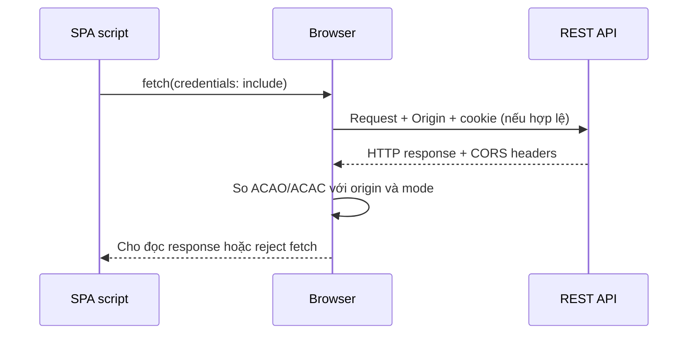

# Credentialed request và giới hạn dùng wildcard

## 1. Credentialed CORS: vì sao cookie đúng nhưng JS bị chặn?

SPA `https://app.example.test` gọi API `https://api.example.test` (khác origin):

```javascript
const res = await fetch("https://api.example.test/api/orders/o-42", {
  credentials: "include"
});
const order = await res.json();
```

Nếu API trả `Access-Control-Allow-Origin: *`, browser **chặn JavaScript đọc response** của request có credentials mode `include`, dù thêm `Access-Control-Allow-Credentials: true`. Server phải cho phép origin cụ thể:

```http
HTTP/1.1 200 OK
Access-Control-Allow-Origin: https://app.example.test
Access-Control-Allow-Credentials: true
Vary: Origin
Content-Type: application/json

{"id":"o-42","status":"PAID"}
```

**CORS không phải tường lửa:** request có thể đã đến server và gây side effect ngay cả khi JS bị chặn đọc. Authentication, authorization, CSRF và business validation vẫn phải thực thi.

Bài thuộc chương **API trên trình duyệt** của module **INTEGRATION_API_REST** (resource/URI, HTTP methods/status, cache, idempotency, OpenAPI, bảo mật và Java/Spring tests). Bạn sẽ hiểu Fetch credentials, giới hạn wildcard, preflight, cookie, CSRF, Spring Security và cách kiểm thử thực.

## 2. Origin khác site

**Origin = scheme + hostname + port.** CORS dùng origin; cookie `SameSite` dựa trên *site* (scheme và registrable domain trong trình duyệt hiện đại).

| Frontend → API | Cross-origin? |
|---|---|
| `https://app.example.test` → chính nó | Không |
| `https://app.example.test` → `https://api.example.test` | Có, **nhưng có thể same-site** |
| `https://app.example.test` → `http://app.example.test` | Có, khác scheme |
| `https://app.example.test` → `https://app.example.test:8443` | Có, khác port |
| `https://app.example.test` → `https://api.partner.test` | Có, thường cross-site |

`Origin: https://app.example.test` **không chứa path hoặc trailing slash**. `Origin: null` là opaque origin của một số sandbox/file contexts: không cho phép rộng vì các context không đáng tin cũng có thể mang `null`. Trong công cụ ngoài browser, Origin header có thể giả mạo; không dùng để nhận dạng người dùng.

## 3. CORS bảo vệ điều gì?



CORS quyết định **script ở origin khác có được đọc response** theo Same-Origin Policy. Nó **không** xác minh JWT/session, không kiểm tra owner/tenant, không chặn curl/Java/Postman và không ngăn mọi request đến server. **CORS không chống CSRF**: form hoặc simple request dùng cookie có thể gây side effect dù response không đọc được.

XSS trên frontend được allowlist cũng có thể khai thác quyền người dùng. Server phải enforce authentication + resource authorization và CSRF policy riêng.

## 4. Fetch credentials mode: omit, same-origin, include

| `credentials` | Browser-managed credentials ở cross-origin |
|---|---|
| `"omit"` | Không gửi/nhận theo chế độ credentials |
| `"same-origin"` (mặc định) | Không gửi cross-origin cookies |
| `"include"` | **Có thể** gửi/lưu cookie nếu Domain/Path/SameSite/Secure/browser policy cho phép |

```javascript
fetch("https://api.example.test/api/orders", {
  credentials: "same-origin" // mặc định, không gửi cross-origin session cookie
});
fetch("https://api.example.test/api/orders", {
  credentials: "include"     // cho phép browser-managed credentials
});
```

`include` **không bảo đảm cookie thực sự tồn tại hoặc được gửi**. Nó cũng khiến ACAO `*` bị từ chối **ngay cả khi request không có cookie**.

Header `Authorization: Bearer ...` do JavaScript **tự đặt** là tình huống khác với cookie tự đính kèm. Nó thường kích hoạt preflight vì không CORS-safelisted, **không tự có nghĩa phải dùng `credentials:"include"`**. Token ở JS chịu rủi ro XSS và cần bảo vệ riêng. XHR dùng `xhr.withCredentials = true` để cho browser gửi cross-origin credentials.

## 5. Access-Control-Allow-Origin và Allow-Credentials

Với request `credentials:"include"`, response được script đọc khi:

```http
Access-Control-Allow-Origin: https://app.example.test
Access-Control-Allow-Credentials: true
Vary: Origin
```

Quy tắc: ACAO là **một origin chính xác**, không `*` hoặc danh sách origins; ACAC phải là **`true` chữ thường**, không `yes`/`True`. Server không tự khiến browser gửi cookie; frontend phải chọn mode phù hợp.

| ACAO | ACAC | Browser với `include` |
|---|---|---|
| `*` | `true` | Chặn |
| Origin đúng | Thiếu | Chặn |
| Origin khác | `true` | Chặn |
| Origin đúng | `true` | Được đọc nếu các kiểm tra còn lại đạt |

`Vary: Origin` giúp HTTP cache không tái dùng ACAO cho nhầm origin. Với origin đã được phép, CORS headers nên có trên cả response thành công và lỗi 4xx/5xx để JS đọc được status/error theo contract.

## 6. Wildcard còn bị giới hạn ở Methods, Headers, Expose-Headers

Ngoài ACAO còn có `Access-Control-Allow-Methods` (ACAM), `Access-Control-Allow-Headers` (ACAH) và `Access-Control-Expose-Headers` (ACEH). Với credentials mode `include`, `*` **không được coi là wildcard** ở các header này: liệt kê tường minh những giá trị được phép.

```http
Access-Control-Allow-Origin: https://app.example.test
Access-Control-Allow-Credentials: true
Access-Control-Allow-Methods: GET, POST, PATCH, DELETE
Access-Control-Allow-Headers: Content-Type, X-CSRF-Token, Authorization
Access-Control-Expose-Headers: Location, ETag
```

`Authorization` cần được **liệt kê rõ** khi preflight yêu cầu; đừng dựa vào ACAH `*`. JavaScript muốn đọc `Location`/`ETag` cần ACEH thích hợp. `Set-Cookie` là **forbidden response header**, không thể đọc bằng `response.headers.get("Set-Cookie")` ngay cả khi đưa nó vào ACEH.

Một số Spring configurations thay wildcard bằng tên cụ thể trong response; kiểm thử header được gửi **thật**, không dựa vào cấu hình ban đầu.

## 7. Preflight OPTIONS: kiểm tra method và headers trước actual request

POST JSON kèm CSRF header thường cần preflight:

```javascript
fetch("https://api.example.test/api/orders", {
  method: "POST",
  credentials: "include",
  headers: {
    "Content-Type": "application/json",
    "X-CSRF-Token": csrfToken
  },
  body: JSON.stringify({sku: "SKU-1", quantity: 2})
});
```

Browser gửi **không có session cookie thông thường**:

```http
OPTIONS /api/orders HTTP/1.1
Origin: https://app.example.test
Access-Control-Request-Method: POST
Access-Control-Request-Headers: content-type,x-csrf-token
```

Server cho phép:

```http
HTTP/1.1 204 No Content
Access-Control-Allow-Origin: https://app.example.test
Access-Control-Allow-Credentials: true
Access-Control-Allow-Methods: POST
Access-Control-Allow-Headers: Content-Type, X-CSRF-Token
Access-Control-Max-Age: 600
Vary: Origin, Access-Control-Request-Method, Access-Control-Request-Headers
```

**Preflight không chứng minh user có quyền POST.** CORS phải được xử lý trước khi session/JWT authentication chặn OPTIONS; actual request vẫn cần auth/CSRF/authorization. `Max-Age` cache **quyền preflight của browser**, không cache quyền với đơn hàng.

## 8. Actual request vẫn phải có CORS headers

Sau OPTIONS được phép, browser gửi POST thực và có thể đính cookie:

```http
POST /api/orders HTTP/1.1
Origin: https://app.example.test
Content-Type: application/json
Cookie: session=opaque
X-CSRF-Token: valid-csrf-token

{"sku":"SKU-1","quantity":2}
```

Server kiểm tra session, CSRF, quyền, tenant và body. Response:

```http
HTTP/1.1 201 Created
Access-Control-Allow-Origin: https://app.example.test
Access-Control-Allow-Credentials: true
Access-Control-Expose-Headers: Location
Vary: Origin
Location: /api/orders/o-104
Cache-Control: no-store
Content-Type: application/json

{"id":"o-104","status":"CREATED"}
```

Frontend chỉ đọc được `Location` khi header được expose. **Chỉ thêm ACAO/ACAC cho OPTIONS là thiếu**: actual 201, 400, 401 và 403 từ origin tin cậy cũng cần CORS response headers theo policy. Cookie chỉ được gửi khi browser cho phép, không vì ví dụ hiển thị nó.

## 9. Cookie cross-site có chính sách độc lập

```http
Set-Cookie: session=opaque; Path=/; HttpOnly; Secure; SameSite=None
```

Với request **cross-site**, `SameSite=None; Secure` thường cần để cookie đủ điều kiện gửi, nhưng third-party cookie restrictions vẫn có thể chặn. Với **cross-origin nhưng same-site** (hai subdomain), `Lax/Strict` có thể phù hợp tùy flow.

- `HttpOnly` ngăn JS đọc cookie; browser vẫn có thể gửi cookie.
- `Secure` yêu cầu HTTPS trong tình huống thông thường.
- `Domain`/`Path` và expiry giới hạn nơi cookie hợp lệ; ưu tiên host-only cookie nếu được.
- ACAO/ACAC **không vượt qua** chính sách cookie/private browsing/anti-tracking.

Nếu luồng phụ thuộc third-party cookie nhưng browser chặn, xem xét mô hình BFF hoặc auth architecture phù hợp, không đổi sang wildcard ACAO.

## 10. CORS không thay CSRF protection

CORS giới hạn **script đọc response**. CSRF lợi dụng browser **tự gửi session cookie** đến endpoint thay đổi trạng thái. Một HTML form/simple request có thể đến server dù CORS không cho attacker đọc response; backend thiếu CSRF defense vẫn có thể thực thi thao tác.

Khi dùng cookie session, yêu cầu CSRF token hoặc biện pháp tương đương theo threat model; thêm `SameSite`, Origin/Referer validation khi phù hợp, không dùng GET gây side effects, và luôn kiểm tra owner/tenant.

Với API chỉ nhận bearer token **không tự động được browser gửi**, CSRF threat model khác; XSS/token theft vẫn quan trọng. **Không tắt CSRF vì “đây là REST”**, mà dựa trên cơ chế credential thực tế.

## 11. Wildcard chỉ phù hợp khi thực sự public/stateless

Một catalog không chứa dữ liệu riêng và **không dùng browser credentials** có thể trả:

```http
HTTP/1.1 200 OK
Access-Control-Allow-Origin: *
Content-Type: application/json

{"items":[...]}
```

Browser dùng `credentials:"omit"` (hoặc mode không bao gồm credentials cross-origin) có thể đọc response công khai theo các điều kiện Fetch. **Không sao chép config này sang API cookie/session**.

Không dùng `*` cho private multi-tenant resources, không reflect mọi Origin để “giả lập allowlist”, không cho phép `Origin: null` tùy tiện. Dù public, API vẫn cần rate limiting/validation và authorization nếu có tính năng không công khai.

## 12. Origin allowlist phải so khớp chính xác

Phản mẫu:

```java
response.setHeader("Access-Control-Allow-Origin",
                   request.getHeader("Origin"));
response.setHeader("Access-Control-Allow-Credentials", "true");
```

Echo **mọi** Origin cùng ACAC true khiến website bất kỳ có thể đọc dữ liệu cookie-auth khi cookie đủ điều kiện gửi — **không an toàn dù không có ký tự `*`**.

Ưu tiên exact allowlist như `https://app.example.test`, `https://admin.example.test`, so đủ scheme/hostname/port. Không dùng `endsWith("example.test")` hoặc regex mơ hồ. Tách origins dev/staging/prod; không cho phép `http://localhost:*` ở production. Với custom tenant domains, cần registry kiểm duyệt và revocation, không chấp nhận domain tự khai.

## 13. Spring MVC + Spring Security: cấu hình credentialed CORS

Trong Spring Boot 3.x/Spring Security 6.x, nên định nghĩa một **`CorsConfigurationSource`** thống nhất để Security xử lý CORS sớm, trước các quyết định authentication với actual request.

```java
import java.util.List;
import org.springframework.context.annotation.Bean;
import org.springframework.context.annotation.Configuration;
import org.springframework.security.config.Customizer;
import org.springframework.security.config.annotation.web.builders.HttpSecurity;
import org.springframework.security.web.SecurityFilterChain;
import org.springframework.web.cors.CorsConfiguration;
import org.springframework.web.cors.CorsConfigurationSource;
import org.springframework.web.cors.UrlBasedCorsConfigurationSource;

@Configuration
class ApiCorsSecurityConfig {

    @Bean
    CorsConfigurationSource corsConfigurationSource() {
        CorsConfiguration cors = new CorsConfiguration();
        cors.setAllowedOrigins(List.of(
            "https://app.example.test",
            "https://admin.example.test"
        ));
        cors.setAllowCredentials(true);
        cors.setAllowedMethods(List.of(
            "GET", "POST", "PATCH", "DELETE", "OPTIONS"
        ));
        cors.setAllowedHeaders(List.of(
            "Content-Type", "X-CSRF-Token", "Authorization"
        ));
        cors.setExposedHeaders(List.of(
            "Location", "ETag", "X-Request-Id"
        ));
        cors.setMaxAge(600L);

        UrlBasedCorsConfigurationSource source =
            new UrlBasedCorsConfigurationSource();
        source.registerCorsConfiguration("/api/**", cors);
        return source;
    }

    @Bean
    SecurityFilterChain securityFilterChain(HttpSecurity http)
            throws Exception {
        http
            .cors(Customizer.withDefaults())
            .csrf(Customizer.withDefaults())
            .authorizeHttpRequests(auth -> auth
                .requestMatchers("/api/**").authenticated()
                .anyRequest().denyAll());

        return http.build();
    }
}
```

**Giới hạn ví dụ:** đây là **cấu hình CORS và những lớp bảo vệ cơ bản**, chưa cấu hình cách login/session/JWT cụ thể, CSRF token endpoint hay quyền resource. Đối với session cookies, cần cơ chế authentication và cấp CSRF token an toàn. Nếu chọn API chỉ có bearer token, phải cấu hình OAuth2 Resource Server và đánh giá CSRF theo cơ chế cấp credential thực tế.

Các điểm quan trọng:

- `setAllowedOrigins(...)` là **allowlist origin cụ thể**; không đặt `"*"`.
- `setAllowCredentials(true)` cho phép phản hồi ACAC khi request từ origin được chấp nhận.
- `setAllowedHeaders(...)` chứa những headers browser cần trong preflight; không expose tùy tiện mọi header.
- `http.cors(...)` tích hợp xử lý CORS vào Spring Security filter chain, tránh việc OPTIONS bị trả 401/302 **trước** CORS.
- `.csrf(...)` không bị tắt chỉ để “CORS hoạt động”; yêu cầu CSRF token cho state-changing requests phải được frontend đáp ứng.

Không cấu hình CORS trùng ở gateway, Spring MVC và Spring Security với các allowlists khác nhau: header ACAO bị lặp hoặc mâu thuẫn có thể khiến browser từ chối.

## 14. allowedOrigins khác allowedOriginPatterns trong Spring

| Cấu hình với `allowCredentials=true` | Hành vi/rủi ro |
|---|---|
| `allowedOrigins(["https://app.example.test"])` | Hợp lệ, allowlist exact |
| `allowedOrigins(["*"])` | **Không hợp lệ**, Spring từ chối khi xác minh |
| `allowedOriginPatterns(["https://*.example.test"])` | Echo origin khớp thay vì `*` nhưng mở cho **mọi subdomain khớp** |
| `allowedOriginPatterns(["*"])` | Có thể echo **mọi origin**: nguy hiểm với cookies |

**Không có ký tự `*` trong response không đồng nghĩa policy an toàn.** Subdomain do khách hàng tạo hoặc bị takeover không nên được tự động tin cậy. Dùng origin registry/allowlist có phê duyệt và test header thực, không dựa vào wildcard methods/headers/expose cho credentialed requests.

## 15. WebFlux dùng cùng quy tắc CORS

Với WebFlux, có thể dùng `CorsWebFilter` hoặc một điểm tích hợp WebFlux Security tương ứng; tránh **cấu hình CORS trùng nhau**:

```java
import java.util.List;
import org.springframework.context.annotation.Bean;
import org.springframework.web.cors.CorsConfiguration;
import org.springframework.web.cors.reactive.*;

@Bean
CorsWebFilter corsWebFilter() {
    CorsConfiguration cors = new CorsConfiguration();
    cors.setAllowedOrigins(List.of("https://app.example.test"));
    cors.setAllowCredentials(true);
    cors.setAllowedMethods(List.of("GET", "POST", "OPTIONS"));
    cors.setAllowedHeaders(List.of(
        "Content-Type", "Authorization", "X-CSRF-Token"
    ));
    UrlBasedCorsConfigurationSource source =
        new UrlBasedCorsConfigurationSource();
    source.registerCorsConfiguration("/api/**", cors);
    return new CorsWebFilter(source);
}
```

Kiểm thử thứ tự CORS/Security filters và OPTIONS preflight. Trả `Mono`/`Flux` không làm browser bỏ qua ACAO/ACAC. Với SSE:

```javascript
const events = new EventSource(
  "https://api.example.test/api/orders/o-42/events",
  { withCredentials: true }
);
```

SSE cũng cần ACAO exact + ACAC true, object authorization, giới hạn streams và chính sách quyền bị thu hồi.

## 16. Frontend gửi credentials và xử lý status

```javascript
async function createOrder(data, csrfToken) {
  const response = await fetch("https://api.example.test/api/orders", {
    method: "POST",
    mode: "cors",
    credentials: "include",
    headers: {
      "Content-Type": "application/json",
      "X-CSRF-Token": csrfToken
    },
    body: JSON.stringify(data)
  });

  if (!response.ok) {
    const problem = await response.json();
    throw new Error(problem.code ?? "HTTP_ERROR");
  }
  return {
    body: await response.json(),
    location: response.headers.get("Location")
  };
}
```

Đây là fragment với giả định response JSON và token lấy từ **CSRF flow hợp lệ**; production phải xử lý riêng 204, non-JSON errors và abort/timeout. Muốn đọc Location cần ACEH. Nếu CORS fail, Fetch thường **reject như network error**, không tạo `Response` có `status===403` để JS xem.

**`mode:"no-cors"` không chữa CORS:** response bị *opaque*, script không đọc được body/status/headers và request bị hạn chế. Sửa allowlist/backend policy thay vì ép no-cors.

## 17. Vary và cache privacy

Với ACAO thay đổi theo Origin:

```http
Access-Control-Allow-Origin: https://app.example.test
Access-Control-Allow-Credentials: true
Vary: Origin
Cache-Control: private
```

`Vary: Origin` giúp cache phân biệt CORS responses. Dữ liệu riêng còn cần `private`/`no-store`, authorization và tenant-scoped cache key; **Vary không tự bảo vệ dữ liệu cookie-auth**.

Preflight có thể thêm `Vary: Origin, Access-Control-Request-Method, Access-Control-Request-Headers` và `Access-Control-Max-Age: 600`. Max-Age **cache preflight**, không cache quyền user hay dữ liệu Orders. Tránh CDN/gateway phát ACAO của origin A cho origin B.

## 18. Debug OPTIONS thành công nhưng POST lỗi

| Hiện tượng | Điều kiểm tra |
|---|---|
| OPTIONS 401/302 | Auth/login redirect đang chặn preflight |
| OPTIONS 403 | Origin, method hoặc headers không allow |
| OPTIONS 2xx, POST báo CORS | Actual response thiếu/sai ACAO/ACAC, header trùng |
| POST 401 | Không có cookie/token, session hết hạn |
| POST 403 | CSRF sai, thiếu scope/owner permission |
| Không gửi cookie | Credentials mode, Domain/Path/SameSite/Secure, browser policy |
| Không đọc được Location | Thiếu ACEH Location |
| Không đọc được Set-Cookie | Hành vi đúng của browser |
| Chỉ khi `credentials:include` mới fail | Thường là wildcard ACAO hoặc thiếu ACAC |

Dùng DevTools Network so **OPTIONS và actual request**, Origin/Access-Control-Request-Headers và CORS headers trên từng response. Với trusted origin, trả CORS headers trên error 4xx/5xx để frontend thấy lỗi thật; với untrusted origin, không tự phản chiếu ACAO.

## 19. MockMvc: kiểm tra CORS với Security filter chain

Test Spring MVC nên bao gồm CORS preflight và actual request. Ví dụ fragment trong test có `MockMvc` và security configuration thật:

```java
import static org.springframework.test.web.servlet.request.MockMvcRequestBuilders.*;
import static org.springframework.test.web.servlet.result.MockMvcResultMatchers.*;
import org.springframework.http.HttpHeaders;

@Test
void preflightAllowsTrustedOriginWithoutSession() throws Exception {
    mockMvc.perform(options("/api/orders")
            .header(HttpHeaders.ORIGIN, "https://app.example.test")
            .header(HttpHeaders.ACCESS_CONTROL_REQUEST_METHOD, "POST")
            .header(HttpHeaders.ACCESS_CONTROL_REQUEST_HEADERS,
                "content-type,x-csrf-token"))
        .andExpect(status().is2xxSuccessful())
        .andExpect(header().string(
            HttpHeaders.ACCESS_CONTROL_ALLOW_ORIGIN,
            "https://app.example.test"))
        .andExpect(header().string(
            HttpHeaders.ACCESS_CONTROL_ALLOW_CREDENTIALS, "true"));
}
```

Spring CORS processor có thể trả **200** mặc định thay vì **204** trong ví dụ HTTP; điều cốt lõi là **2xx + headers** đúng. Test thực tế phải dùng `@SpringBootTest`/`@AutoConfigureMockMvc` hoặc slice có CORS và security filters được nạp, không chỉ instantiate controller.

Kiểm thử actual POST có authentication/CSRF giả lập:

```java
import static org.springframework.security.test.web.servlet.request
    .SecurityMockMvcRequestPostProcessors.*;

mockMvc.perform(post("/api/orders")
        .with(user("alice"))
        .with(csrf())
        .header(HttpHeaders.ORIGIN, "https://app.example.test")
        .contentType("application/json")
        .content("{\"sku\":\"SKU-1\",\"quantity\":2}"))
    .andExpect(header().string(
        HttpHeaders.ACCESS_CONTROL_ALLOW_ORIGIN,
        "https://app.example.test"))
    .andExpect(header().string(
        HttpHeaders.ACCESS_CONTROL_ALLOW_CREDENTIALS, "true"));
```

`user("alice")` và `csrf()` **mock security context/token**, không chứng minh cookie đã được browser gửi hay session auth/CSRF token issuance hoạt động thật. Với policy production, thêm integration tests token/cookie thật và đối tượng đúng tenant. Không bỏ qua xác minh HTTP business status, `Location` và dữ liệu được trả.

## 20. Test matrix cho credentialed request

| Kiểm thử | Kỳ vọng |
|---|---|
| Trusted Origin + include + cookie đủ điều kiện | ACAO exact + ACAC true; JS được đọc |
| ACAO `*` + include, kể cả không có cookie | Browser chặn |
| ACAO đúng nhưng thiếu ACAC | Browser chặn |
| Origin không allow | Không cấp ACAO |
| Preflight JSON POST và X-CSRF-Token | 2xx, ACAM/ACAH đúng; **không cần cookie** |
| Header chưa allow | Preflight bị từ chối |
| POST cookie thiếu CSRF token | Server từ chối |
| User khác tenant | 403/404 đúng policy |
| Trusted Origin nhận lỗi 401/500 | Browser đọc được status/error theo CORS policy |
| `credentials:same-origin` cross-origin | Không tự gửi browser cookies |
| Cookie bị chặn third-party | ACAO/ACAC không thể vượt policy |
| ACEH chứa Set-Cookie | JS vẫn không đọc được Set-Cookie |
| Public stateless API + ACAO `*` | Có thể đọc khi không dùng credentials |

```bash
curl -i -X OPTIONS "https://api.example.test/api/orders" \
  -H "Origin: https://app.example.test" \
  -H "Access-Control-Request-Method: POST" \
  -H "Access-Control-Request-Headers: content-type,x-csrf-token"
```

Curl **không enforce CORS**; nó chỉ hiển thị headers. Kiểm tra thêm bằng browser/DevTools hoặc Playwright dùng **hai origins thật** và test cookies/session/CSRF.

## 21. Các phản mẫu cần tránh

| Phản mẫu | Sửa bằng |
|---|---|
| ACAO `*` cùng ACAC true | Exact origin allowlist |
| Echo mọi Origin với credentials | Kiểm tra allowlist phía server |
| ACAO chứa nhiều origins | Chỉ trả một origin khớp |
| `allowedOriginPatterns("*")` cho session API | Từ chối hoặc registry trusted origins |
| ACAM/ACAH/ACEH `*` trong include mode | Giá trị tường minh |
| Chỉ thêm CORS cho OPTIONS | Thêm cả actual success/error responses |
| Yêu cầu cookie cho OPTIONS | Cho CORS processor xử lý preflight trước auth |
| Tắt CSRF để tránh 403 | Thiết kế CSRF flow cho cookie auth |
| Nhầm same-site và same-origin | Xem hai chính sách độc lập |
| `mode:no-cors` để fix | Sửa CORS server-side |
| Không `Vary: Origin` khi cache | Vary và private/no-store |
| Chỉ thử Postman | Browser tests/MockMvc |
| Cho `Origin: null` rộng | Deny trừ case được thẩm định |

## 22. Bài tập: SPA Orders với cookie session

Frontend `https://app.example.test` gọi Spring MVC API `https://api.example.test`: GET list, POST tạo, DELETE theo ID. Session cookie, CSRF và quyền chủ đơn là bắt buộc. Backend đang cấu hình **sai**:

```java
cors.setAllowedOrigins(List.of("*"));
cors.setAllowCredentials(true);
```

Có đề xuất tắt CSRF và echo mọi Origin để “sửa CORS”.

**Nhiệm vụ:**

1. Chứng minh ACAO `*` thất bại với `credentials:include`, kể cả khi không có cookie.
2. Viết `CorsConfigurationSource` chỉ tin `https://app.example.test`; khai phương thức và request headers.
3. So sánh preflight OPTIONS **không có cookie** với actual POST dùng session.
4. Viết fetch POST có JSON, credentials include và X-CSRF-Token.
5. Chọn cookie SameSite/Secure/HttpOnly theo **cross-origin vs same-site** và browser policy.
6. Giải thích vì sao CSRF, object authorization và CORS là ba kiểm tra khác nhau.
7. Viết MockMvc tests cho trusted/untrusted Origin, OPTIONS, 401, 403, POST thiếu CSRF và Location.
8. Dùng browser kiểm cookie thực tế, đọc Location, không đọc Set-Cookie; kiểm tra 404 của đơn người khác.
9. Thiết kế public catalog có ACAO `*` nhưng **không yêu cầu credentials**, và kiểm thử không lẫn CORS config.
10. Nêu nguy cơ khi một subdomain tin cậy bị takeover và cách thu hồi quyền origin.

**Tiêu chí đạt:** trusted Origin có CORS headers ở cả preflight và actual error/success; actual POST bắt buộc session/CSRF/owner policy; origin khác không đọc private response.

## 23. Checklist trước release

- [ ] Phân biệt origin và site; allowlist đúng scheme/host/port.
- [ ] Với `credentials:include`, ACAO exact origin và ACAC `true`; **không dùng `*`**.
- [ ] ACAM/ACAH/ACEH cho credentialed flow liệt kê rõ, gồm Authorization khi cần.
- [ ] OPTIONS xử lý CORS trước authentication, không bắt browser cookie.
- [ ] Actual 2xx/4xx/5xx từ trusted Origin có CORS headers.
- [ ] Không echo mọi Origin hoặc dùng allowOriginPatterns rộng.
- [ ] Cookie SameSite/Secure/HttpOnly/Domain và third-party policy đã kiểm tra.
- [ ] CSRF và object-level authorization vẫn enforce thật.
- [ ] `Vary: Origin` và private/no-store cache policy phù hợp.
- [ ] `Set-Cookie` không JS-readable; expose Location khi cần.
- [ ] Không cấu hình CORS mâu thuẫn giữa gateway/Spring MVC/Security.
- [ ] MockMvc và browser tests cover cookie, wildcard, preflight, error/security.
- [ ] Routes public wildcard tách khỏi private cookie-auth APIs.

## 24. Kết luận

**Credentialed cross-origin request** chỉ được script đọc response khi browser chấp nhận ACAO của **origin cụ thể** và `Access-Control-Allow-Credentials: true`. **`Access-Control-Allow-Origin: *` không dùng được với Fetch `credentials:"include"`**; các wildcard methods/headers/exposed headers cũng có giới hạn tương ứng.

Để triển khai an toàn, phải phân biệt **origin và site**, preflight và actual request, browser credentials và bearer header; thiết lập allowlist, cookie/CSRF, cache policy và Spring Security đúng thứ tự. Cuối cùng, **CORS không phải authentication/authorization**: dù browser có đọc được response hay không, server vẫn phải kiểm tra user, tenant và object ở mọi request. Kiểm chứng bằng cả **MockMvc và trình duyệt thật** mới phát hiện đầy đủ lỗi wildcard, cookie và security.


