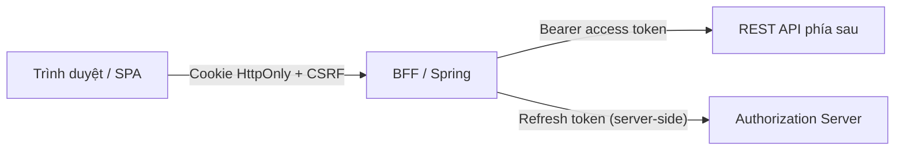

# XSS, lưu token và đánh đổi giữa bộ nhớ, cookie, localStorage

## Mục tiêu học tập

Sau bài này, bạn có thể:

- Giải thích vì sao **XSS (Cross-Site Scripting)** ảnh hưởng trực tiếp tới access token, refresh token và phiên đăng nhập của ứng dụng REST API chạy trong trình duyệt.
- So sánh lưu token trong **bộ nhớ JavaScript**, **`localStorage`** và **cookie** theo mức độ tồn tại, phạm vi truy cập, nguy cơ XSS/CSRF và trải nghiệm người dùng.
- Thiết kế một luồng đăng nhập cho SPA/REST API với **HttpOnly cookie**, hoặc **access token trong bộ nhớ** khi thực sự cần gửi Bearer token.
- Phân biệt CORS, SameSite, CSRF, HttpOnly và cơ chế xác thực/phân quyền ở backend Java/Spring.
- Thực hành chẩn đoán và kiểm thử các lỗi bảo mật phổ biến mà không xem một phương án lưu token là “an toàn tuyệt đối”.

## 1. Bối cảnh: một SPA gọi REST API

Giả sử có:

- Frontend: `https://app.example.com`, chạy React/Vue/JavaScript.
- REST API: `https://api.example.com`, chạy Java/Spring.
- Người dùng đã đăng nhập và có quyền tạo đơn hàng qua `POST /api/orders`.

Hai host này **khác origin**, nên request `fetch` chịu quy tắc CORS. Tuy nhiên, chúng thường là **cùng site** (cùng scheme và registrable domain `example.com`). Phân biệt này quan trọng vì **CORS dựa trên origin**, còn thuộc tính cookie `SameSite` dựa trên site. Hai cơ chế không thay thế nhau.

Sau khi đăng nhập, trình duyệt cần chứng minh danh tính trên các request sau. Có hai kiểu phổ biến:

1. Frontend đọc **access token** và tự gắn `Authorization: Bearer ...` vào request.
2. Backend tạo **session** hoặc lưu refresh token trong cookie; trình duyệt tự đính kèm cookie vào các request phù hợp, còn JavaScript không cần đọc giá trị bí mật.

**Câu hỏi thiết kế** là: ai có thể đọc credential, credential tồn tại bao lâu và chuyện gì xảy ra khi script độc hại chạy được trong origin của frontend?

## 2. Threat model: XSS có thể làm gì?

XSS xảy ra khi dữ liệu không tin cậy bị diễn giải như mã JavaScript hoặc HTML có khả năng thực thi trong trang. Có ba nhóm thường được nhắc tới:

| Nhóm | Tình huống điển hình |
| --- | --- |
| Reflected XSS | Dữ liệu từ URL/query được đưa ngay vào HTML mà không xử lý đúng ngữ cảnh |
| Stored XSS | Nội dung bình luận, hồ sơ hay mô tả sản phẩm chứa mã độc được lưu rồi hiển thị cho người khác |
| DOM-based XSS | JavaScript phía client chuyển dữ liệu không tin cậy vào một DOM sink nguy hiểm như `innerHTML` |

Ví dụ DOM-based XSS:

```javascript
// KHÔNG AN TOÀN: dữ liệu URL được phân tích như HTML.
const title = new URLSearchParams(location.search).get("title") ?? "";
document.querySelector("#product-title").innerHTML = title;

// An toàn hơn cho nội dung chỉ cần hiển thị như văn bản:
document.querySelector("#product-title").textContent = title;
```

Nếu cần hiển thị rich text do người dùng nhập, phải dùng **bộ lọc HTML theo allowlist** đã được duy trì và kiểm chứng, không tự thay thế ký tự thủ công rồi tin là đủ. Framework hiện đại thường tự escape khi bind text, nhưng các cơ chế chèn HTML trực tiếp (như `dangerouslySetInnerHTML`) vẫn là điểm cần kiểm soát.

Một khi script tấn công đã chạy **trong origin đáng tin của ứng dụng**, nó có thể:

- Đọc `localStorage` và `sessionStorage` của origin.
- Đọc các biến, DOM, kết quả API hoặc token mà mã cùng origin có khả năng tiếp cận; hook lời gọi `fetch` để quan sát thông tin được sử dụng sau đó.
- Gửi request theo quyền của người dùng và đọc response mà ứng dụng hợp lệ cũng đọc được.
- Đọc cookie **không** gắn `HttpOnly`, nhưng không đọc trực tiếp cookie **HttpOnly** qua `document.cookie`.

Điểm cuối rất quan trọng: **HttpOnly giảm khả năng lấy cắp giá trị cookie**, nhưng **không ngăn XSS thao tác thay người dùng** trong phiên hiện tại. Nếu attacker có thể chạy JavaScript trong trang, việc đổi chỗ lưu token không sửa được lỗ hổng XSS gốc.

## 3. So sánh các cách giữ credential

| Nơi lưu | Sống qua reload? | JavaScript đọc được? | Tác động khi có XSS | Nguy cơ CSRF khi xác thực bằng cơ chế này |
| --- | --- | --- | --- | --- |
| **Bộ nhớ JS** (biến/module/closure) | Thường không; mất khi reload/tab bị hủy | Có, trực tiếp hoặc gián tiếp khi script độc hại chạy | Có thể dùng token, chặn/intercept request hoặc đánh cắp trong lúc token còn sống; giảm thời gian bí mật tồn tại sau khi tab đóng | Bearer token tự đặt vào header thường **không tự phát sinh** trên cross-site form/request, nhưng XSS vẫn dùng được |
| **`localStorage`** | Có; giữ qua reload và đóng/mở trình duyệt cho tới khi bị xóa | Có với script cùng origin | Token dễ bị đọc rồi gửi ra ngoài; credential tồn tại lâu hơn phiên trang | Không tự động gắn token vào request, nhưng XSS vẫn có thể đọc và dùng |
| **`sessionStorage`** | Có qua reload trong tab; thường mất khi phiên tab kết thúc | Có với script cùng origin | Vẫn dễ bị lấy bởi XSS ở tab; thời hạn ngắn hơn localStorage không chữa được XSS | Tương tự localStorage |
| **Cookie `HttpOnly`** | Tùy `Max-Age`/`Expires` hoặc cookie phiên | **Không** qua `document.cookie`/JavaScript | Không đọc trực tiếp được giá trị cookie, nhưng XSS vẫn gửi request và đọc dữ liệu theo phiên | Cookie được browser tự đính kèm khi chính sách cookie cho phép; cần bảo vệ CSRF cho thao tác thay đổi trạng thái |
| **Cookie không `HttpOnly`** | Tùy thuộc tính hết hạn | Có | Có thể bị đọc như token trong localStorage | Có vì browser đính kèm tự động, tùy chính sách cookie |

**Không có nơi lưu nào loại bỏ nguy cơ từ XSS.** Cần nhìn cả hệ thống: loại credential, vòng đời, khả năng thu hồi, nội dung lộ được nếu XSS xảy ra, cơ chế xác thực và phòng vệ backend.

### 3.1. Access token chỉ giữ trong bộ nhớ

Ví dụ SPA nhận một access token thời hạn ngắn và giữ trong phạm vi một module:

```javascript
// auth-state.js — minh họa bộ nhớ tạm
let accessToken = null;

export function setAccessToken(token) {
  accessToken = token;
}

export function clearAccessToken() {
  accessToken = null;
}

export async function apiGet(path) {
  if (!accessToken) throw new Error("Chưa đăng nhập");

  return fetch("https://api.example.com" + path, {
    headers: { Authorization: "Bearer " + accessToken }
  });
}
```

**Ưu điểm:** bí mật không được chủ động ghi vào persistent browser storage; reload/tab đóng thường xóa state; dễ dùng `Authorization` cho API chấp nhận Bearer token.

**Đánh đổi:** reload có thể làm mất đăng nhập, nhiều tab không tự chia sẻ state; cần một phương án khôi phục phiên nếu muốn trải nghiệm đăng nhập liên tục. **XSS vẫn có thể sử dụng credential trong lúc trang đang hoạt động**, kể cả khi biến không nằm trên `window`. Closure/module scope chỉ giảm khả năng truy cập trực tiếp, không phải ranh giới bảo mật trước mã độc chạy trong cùng origin.

Mô hình thực tế thường dùng **access token ngắn hạn trong bộ nhớ + cơ chế refresh được bảo vệ tốt hơn**. Nếu endpoint refresh dựa trên HttpOnly cookie, cần xử lý CSRF và chính sách cookie, không mặc nhiên coi đó là giao thức an toàn hoàn chỉnh.

### 3.2. Token trong localStorage

Mã sau về mặt chức năng có thể hoạt động, nhưng tiềm ẩn rủi ro khi lưu credential:

```javascript
// Ví dụ để nhận diện rủi ro; không khuyến nghị lưu refresh token tại đây.
localStorage.setItem("access_token", token);
const saved = localStorage.getItem("access_token");

await fetch("https://api.example.com/api/me", {
  headers: { Authorization: "Bearer " + saved }
});
```

`localStorage` tiện vì tồn tại qua reload và dùng chung giữa các tab cùng origin. Nhưng chính tính bền vững đó khiến token có thể bị lấy cắp bởi **một lần XSS**, extension độc hại có quyền phù hợp, hoặc mã bên thứ ba bị xâm nhập chạy trên trang. Kẻ tấn công có thể dùng token từ máy khác cho tới khi token hết hạn hoặc bị thu hồi.

Không nên lưu **refresh token dài hạn**, session ID hoặc credential đặc quyền trong `localStorage` chỉ để tránh trạng thái “mất đăng nhập khi refresh trang”. Mã hóa token rồi lưu khóa giải mã cũng ở JavaScript/localStorage thường **không giúp chống XSS**: script độc hại có thể lấy khóa hoặc gọi luôn thao tác giải mã. `sessionStorage` giảm thời gian tồn tại giữa các phiên tab nhưng vẫn chịu cùng vấn đề JavaScript cùng origin có thể đọc.

### 3.3. HttpOnly cookie cho session hoặc refresh token

Ví dụ response sau khi backend xác thực thành công:

```http
HTTP/1.1 204 No Content
Set-Cookie: __Host-session=<opaque-random-id>; Path=/; Secure; HttpOnly; SameSite=Lax
Cache-Control: no-store
```

Ý nghĩa các thuộc tính:

| Thuộc tính | Tác dụng |
| --- | --- |
| `HttpOnly` | JavaScript không đọc/sửa giá trị cookie qua `document.cookie`; browser vẫn có thể gửi cookie trong HTTP request |
| `Secure` | Chỉ gửi qua kết nối an toàn (HTTPS; hành vi với localhost phục vụ phát triển có thể đặc biệt) |
| `SameSite=Lax` | Giảm nhiều kiểu gửi cookie cross-site; vẫn cho phép một số điều hướng top-level an toàn, nên không thay thế CSRF token |
| `SameSite=Strict` | Chặt hơn, nhưng có thể ảnh hưởng điều hướng từ site khác và các luồng đăng nhập |
| `SameSite=None; Secure` | Cho phép cookie được xét gửi trong ngữ cảnh cross-site; chịu giới hạn/chính sách chặn third-party cookie của trình duyệt |
| `Max-Age`/`Expires` | Quy định thời gian cookie tồn tại; cần đi kèm vòng đời session/token ở server |
| `__Host-` prefix | Yêu cầu `Secure`, `Path=/`, không có thuộc tính `Domain`; giới hạn việc cookie bị đặt cho toàn bộ domain |

Cookie `__Host-session` trên do `api.example.com` phát hành sẽ là **host-only** cho `api.example.com`, không phải cookie chia sẻ tùy ý cho các subdomain. `HttpOnly` không ẩn cookie khỏi DevTools của chính người dùng hoặc khỏi máy chủ nhận nó, chỉ giới hạn truy cập bằng JavaScript.

Với cookie phiên, backend giữ trạng thái phiên và có thể thu hồi session tập trung. Nếu dùng **JWT bên trong HttpOnly cookie** thay vì session ID opaque, rủi ro CSRF vẫn tồn tại vì cookie tự được gửi. JWT không tự động làm chính sách cookie an toàn hơn.

## 4. Cookie, CORS và CSRF: ba vấn đề khác nhau

Trong ví dụ `https://app.example.com` → `https://api.example.com`:

```javascript
const response = await fetch("https://api.example.com/api/me", {
  credentials: "include"
});
const profile = await response.json();
```

`credentials: "include"` yêu cầu trình duyệt xem xét gửi cookie phù hợp kể cả khi request **khác origin**. Nó không vượt qua các hạn chế `SameSite`, `Secure`, domain/path, third-party cookie hay chính sách người dùng. API cần trả CORS response tương ứng:

```http
Access-Control-Allow-Origin: https://app.example.com
Access-Control-Allow-Credentials: true
Vary: Origin
```

Với request dùng credentials mode `include`, **`Access-Control-Allow-Origin: *` không hợp lệ**. Nếu request có `Content-Type: application/json` hoặc header `X-CSRF-TOKEN`, trình duyệt thường gửi **CORS preflight OPTIONS**; preflight phải được xử lý trước yêu cầu xác thực của endpoint. Preflight không mang session cookie của request chính.

**CSRF (Cross-Site Request Forgery)** là nguy cơ một trang khác khiến browser gửi request thay đổi dữ liệu tới site đã đăng nhập bằng credential được gửi tự động, như cookie. Chặn JavaScript đọc response bằng CORS **không đủ** để ngăn server thực hiện request. `SameSite=Lax` giảm đáng kể một số trường hợp, nhưng vẫn cần cân nhắc CSRF token/kiểm tra Origin cho thao tác thay đổi trạng thái và mô hình ứng dụng cụ thể.

Ví dụ một API dùng session cookie và CSRF token:

```http
GET /api/csrf HTTP/1.1
Host: api.example.com
Origin: https://app.example.com
Cookie: __Host-session=<opaque-random-id>

HTTP/1.1 200 OK
Content-Type: application/json
Cache-Control: no-store
Access-Control-Allow-Origin: https://app.example.com
Access-Control-Allow-Credentials: true

{"token":"<csrf-token>"}
```

Sau đó frontend gửi:

```http
POST /api/orders HTTP/1.1
Host: api.example.com
Origin: https://app.example.com
Cookie: __Host-session=<opaque-random-id>
Content-Type: application/json
X-CSRF-TOKEN: <csrf-token>

{"productId":42,"quantity":2}
```

CSRF token được phát cho phiên và server kiểm tra ở các request nguy hiểm; API **không dùng GET để thay đổi trạng thái**. CSRF token có thể hiện diện trong bộ nhớ JavaScript để gửi header; nó **không phải session secret** và **không ngăn XSS**. Một XSS chạy trong frontend hợp lệ cũng có thể lấy CSRF token rồi thao tác thay người dùng.

> **Cần phân biệt:** CORS kiểm soát khả năng JavaScript đọc response khác origin; `SameSite` điều khiển điều kiện gửi cookie theo site; `HttpOnly` giới hạn đọc cookie qua JavaScript; xác thực/phân quyền quyết định người dùng được làm gì; CSRF protection kiểm soát request thay đổi trạng thái dựa trên credential tự động gửi.

## 5. Lựa chọn kiến trúc lưu token

### Phương án A — Session cookie + backend giữ trạng thái

Phù hợp với ứng dụng web first-party có backend của riêng mình:

1. Browser gửi thông tin đăng nhập tới backend qua HTTPS, sau khi lấy CSRF token nếu cơ chế xác thực dựa trên cookie yêu cầu.
2. Backend xác thực, tạo session ID **ngẫu nhiên, khó đoán**, lưu session ở server (có thể dùng Spring Session/Redis nếu cần chia sẻ giữa node).
3. Backend gửi cookie `Secure; HttpOnly; SameSite` với hạn dùng phù hợp.
4. Browser gửi cookie khi gọi API. Backend kiểm tra session, authorization theo tài nguyên và CSRF token cho thao tác thay đổi trạng thái.
5. Logout thu hồi session phía server và xóa cookie. Đăng nhập nhạy cảm nên có timeout/đổi session ID phù hợp để chống session fixation.

**Lợi ích:** JavaScript không cần nắm token dài hạn; backend dễ thu hồi phiên. **Chi phí:** cần quản lý session và CSRF, chú ý cookie trên các subdomain/cross-site và điều kiện mở rộng hạ tầng.

### Phương án B — Backend for Frontend (BFF)

Với frontend gọi nhiều downstream API hoặc tích hợp OAuth/OIDC, **BFF** là lựa chọn đáng xem xét: browser giữ session cookie tới backend cùng origin (hoặc cùng site đã được cấu hình chặt), BFF giữ access/refresh token trên server và gọi các API phía sau.



Điều này làm giảm số lượng credential OAuth mà JavaScript nhìn thấy và tránh phụ thuộc vào việc lưu refresh token trong trình duyệt. Tuy nhiên **BFF vẫn chịu nguy cơ hành động trái phép khi có XSS**; cần phòng ngừa XSS, authorization ở API và cơ chế chống CSRF.

### Phương án C — SPA trực tiếp dùng OAuth/OIDC Bearer token

Khi không có BFF và frontend là OAuth public client, dùng **Authorization Code flow với PKCE** và kiểm tra `state`, redirect URI theo yêu cầu của hệ thống định danh; **không** nhúng client secret vào mã JavaScript. Giữ access token **ngắn hạn trong bộ nhớ** khi khả thi.

Nếu cần refresh token cho public client, tuân thủ chính sách của authorization server (chẳng hạn rotation, ràng buộc token và hạn dùng phù hợp) và cân nhắc rằng refresh token tồn tại trong browser là mục tiêu hấp dẫn với XSS. Rotation/expiry giảm hậu quả của token bị đánh cắp nhưng **không chữa được XSS đang hoạt động**.

Không đưa access token vào URL/query string, `localStorage` lâu dài, log, công cụ analytics hay lỗi frontend. Khi có thể chọn lại kiến trúc, cân nhắc BFF/session để giảm phạm vi token lộ cho JavaScript.

## 6. Cấu hình minh họa với Java/Spring

### 6.1. Thiết lập session cookie

Với ứng dụng **Spring Boot** dùng HTTP session, có thể đặt trong `application.yml`:

```yaml
server:
  servlet:
    session:
      cookie:
        name: __Host-session
        path: /
        http-only: true
        secure: true
        same-site: lax
```

Trong triển khai production cần HTTPS, không cấu hình `Domain` cho cookie `__Host-` và đặt timeout session ở server theo chính sách. Reverse proxy phải chuyển tiếp đúng thông tin giao thức HTTPS nếu ứng dụng suy ra scheme từ request. `SameSite=Lax` phù hợp một số luồng cùng site; frontend và backend **khác site** cần đánh giá `SameSite=None; Secure`, CSRF và chính sách cookie bên thứ ba, thay vì đổi sang `None` một cách máy móc.

Với Spring Security, cấu hình minh họa:

```java
import org.springframework.context.annotation.Bean;
import org.springframework.security.config.Customizer;
import org.springframework.security.config.annotation.web.builders.HttpSecurity;
import org.springframework.security.web.SecurityFilterChain;

@Bean
SecurityFilterChain apiSecurity(HttpSecurity http) throws Exception {
    return http
        .cors(Customizer.withDefaults())
        .csrf(Customizer.withDefaults())
        .authorizeHttpRequests(auth -> auth
            .requestMatchers("/api/csrf", "/api/public/**").permitAll()
            .anyRequest().authenticated())
        .formLogin(Customizer.withDefaults())
        .build();
}
```

Đây là **khung cấu hình** sử dụng form login mặc định của Spring Security. SPA đăng nhập qua JSON sẽ cần endpoint/cơ chế authentication tương ứng; phần này không thay thế cấu hình xác thực thực tế. `csrf(Customizer.withDefaults())` giữ bảo vệ CSRF cho các method thay đổi trạng thái; ứng dụng SPA cần có cách **phát và gửi CSRF token** thích hợp, đồng thời kiểm thử login/logout theo cách Spring Security xử lý.

Ví dụ một endpoint phát CSRF token đang được Spring Security lưu trong request:

```java
import jakarta.servlet.http.HttpServletRequest;
import java.util.Map;
import org.springframework.http.CacheControl;
import org.springframework.http.ResponseEntity;
import org.springframework.security.web.csrf.CsrfToken;
import org.springframework.web.bind.annotation.GetMapping;
import org.springframework.web.bind.annotation.RestController;

@RestController
class CsrfApi {
    @GetMapping("/api/csrf")
    ResponseEntity<Map<String, String>> csrf(HttpServletRequest request) {
        CsrfToken token =
            (CsrfToken) request.getAttribute(CsrfToken.class.getName());
        return ResponseEntity.ok()
            .cacheControl(CacheControl.noStore())
            .body(Map.of("token", token.getToken()));
    }
}
```

Ví dụ dùng `CsrfToken` trong request do CSRF filter đặt; cần test với phiên bản Spring Security và cấu hình `CsrfTokenRequestHandler` thực tế. Nếu dùng `CookieCsrfTokenRepository` và SPA riêng, header mặc định có thể là `X-XSRF-TOKEN`, đồng thời cần xử lý cơ chế token được expose/rotate sau authentication. Không lấy giá trị của **session cookie HttpOnly** để dùng làm CSRF token.

### 6.2. CORS đúng khi frontend khác origin

```java
import org.springframework.context.annotation.Configuration;
import org.springframework.web.servlet.config.annotation.CorsRegistry;
import org.springframework.web.servlet.config.annotation.WebMvcConfigurer;

@Configuration
class ApiCorsConfig implements WebMvcConfigurer {
    @Override
    public void addCorsMappings(CorsRegistry registry) {
        registry.addMapping("/api/**")
            .allowedOrigins("https://app.example.com")
            .allowedMethods("GET", "POST", "PUT", "PATCH", "DELETE")
            .allowedHeaders("Content-Type", "X-CSRF-TOKEN")
            .allowCredentials(true)
            .maxAge(600);
    }
}
```

Khi backend kiểm tra CSRF token qua `X-CSRF-TOKEN` và nhận JSON, frontend có thể gọi:

```javascript
const base = "https://api.example.com";
const csrfResponse = await fetch(base + "/api/csrf", {
  credentials: "include"
});
if (!csrfResponse.ok) throw new Error("Không lấy được CSRF token");
const { token: csrfToken } = await csrfResponse.json();

const result = await fetch(base + "/api/orders", {
  method: "POST",
  credentials: "include",
  headers: {
    "Content-Type": "application/json",
    "X-CSRF-TOKEN": csrfToken
  },
  body: JSON.stringify({ productId: 42, quantity: 2 })
});
if (!result.ok) throw new Error("HTTP " + result.status);
```

Đây là ví dụ **sau khi đã đăng nhập thành công** và server sử dụng cơ chế CSRF tương thích. `Content-Type: application/json` và `X-CSRF-TOKEN` khiến browser cần preflight; OPTIONS được cấu hình CORS xử lý trước lớp authentication. Response thực tế cũng phải chứa CORS header phù hợp. Nếu frontend và backend được reverse proxy về **cùng origin**, thường giảm được độ phức tạp CORS.

## 7. Giảm nguy cơ XSS ngoài việc chọn chỗ lưu token

**Thứ tự ưu tiên nên bắt đầu từ chặn thực thi script độc hại:**

1. **Escape/output encoding theo ngữ cảnh:** dùng `textContent`/binding text, không đưa dữ liệu người dùng vào `innerHTML`, `eval` hoặc URL JavaScript. Dùng sanitization đáng tin cậy khi business bắt buộc cho phép HTML.
2. **Content Security Policy (CSP):** dùng script nonce/hash được tạo đúng cách, giới hạn nguồn script, `object-src 'none'`, `base-uri 'none'`. CSP giảm bề mặt tấn công, không thay thế việc loại bỏ XSS.
3. **Quản lý script bên thứ ba và dependency:** giảm số script thực thi trong origin ứng dụng; pin/đánh giá dependency, kiểm soát CSP/script loading.
4. **Nguyên tắc quyền tối thiểu:** access token có audience/scope phù hợp, TTL ngắn, kiểm tra authorization ở từng endpoint và từng resource.
5. **Vòng đời phiên:** logout thu hồi session/refresh token, có cơ chế xử lý token hết hạn, giám sát bất thường, không ghi credential vào log, URL hoặc analytics.

Ví dụ một CSP minh họa (nonce thực tế phải ngẫu nhiên theo từng response, không dùng giá trị cố định):

```http
Content-Security-Policy: default-src 'self'; script-src 'self' 'nonce-<random-per-response>'; object-src 'none'; base-uri 'none'
```

Có thể bổ sung **Trusted Types** trên các trình duyệt hỗ trợ để hạn chế DOM sink nguy hiểm. Không bật chính sách quá rộng như `unsafe-inline` chỉ vì một đoạn mã bị CSP chặn; hãy chỉnh cách nạp script và kiểm tra CSP bằng chế độ report-only trước khi cưỡng chế trên hệ thống lớn.

## 8. Kiểm thử và chẩn đoán trong browser/Spring

### 8.1. Checklist theo ranh giới bảo mật

| Kịch bản | Kết quả mong đợi |
| --- | --- |
| Sau đăng nhập, kiểm tra DevTools → Application → Cookies | Cookie session có `HttpOnly`, `Secure`, `SameSite`, phạm vi host/path và thời hạn đúng |
| Gõ `document.cookie` trên trang hợp lệ | Không xuất hiện giá trị session cookie `HttpOnly` |
| Mở DevTools → Application → Local Storage | Không có access/refresh token nếu kiến trúc đã chọn session/BFF |
| Gửi `POST` bằng session cookie nhưng thiếu/sai CSRF token | Backend từ chối (thường `403`), không ghi đơn hàng |
| Gửi request từ origin không được phép | Browser không cho đọc response; authorization phía server vẫn phải tự kiểm tra |
| Đăng xuất rồi phát lại session ID cũ | Server từ chối session đã bị hủy |
| Reload/tab đóng với token chỉ trong memory | State token mất; luồng khôi phục phiên nếu có phải được thiết kế rõ |
| Render dữ liệu chứa ký tự HTML đặc biệt | Hiển thị như văn bản, không thực thi script |

Để quan sát HTTP response của endpoint phát CSRF token (endpoint này có thể tạo session mới và gửi cookie, tùy cấu hình):

```bash
curl -i "https://api.example.com/api/csrf"
```

Lệnh trên chỉ kiểm tra HTTP response; `curl` không tự thực thi `HttpOnly`, `SameSite` hay CORS như browser. Kiểm tra header `Set-Cookie` trên response thực sự phát cookie (ví dụ khi tạo session/đăng nhập) tại Network; JavaScript không đọc được `Set-Cookie` qua `response.headers.get("set-cookie")`.

### 8.2. MockMvc: CSRF được kiểm tra ở backend

Giả sử endpoint `POST /api/orders` yêu cầu người dùng đã đăng nhập và trả `201 Created` khi tạo thành công. Với Spring Security Test:

```java
import static org.springframework.security.test.web.servlet.request.SecurityMockMvcRequestPostProcessors.csrf;
import static org.springframework.security.test.web.servlet.request.SecurityMockMvcRequestPostProcessors.user;
import static org.springframework.test.web.servlet.request.MockMvcRequestBuilders.post;
import static org.springframework.test.web.servlet.result.MockMvcResultMatchers.status;

@Test
void postWithoutCsrfIsRejected() throws Exception {
    mockMvc.perform(post("/api/orders")
            .with(user("alice"))
            .contentType("application/json")
            .content("{\"productId\":42,\"quantity\":2}"))
        .andExpect(status().isForbidden());
}

@Test
void postWithCsrfCanReachAuthorizedEndpoint() throws Exception {
    mockMvc.perform(post("/api/orders")
            .with(user("alice"))
            .with(csrf())
            .contentType("application/json")
            .content("{\"productId\":42,\"quantity\":2}"))
        .andExpect(status().isCreated());
}
```

Đây là **mẫu test**: cần `mockMvc` đã khởi tạo, `@Test`, security filter chain, controller và data/test setup cho `alice`. Trường hợp thứ hai có thể trả status khác tùy hợp đồng endpoint và quyền; mục tiêu là xác nhận request đã đi qua CSRF filter và authorization, không mặc định rằng `with(csrf())` cấp quyền tạo mọi tài nguyên.

Các kiểm thử bổ sung cần có:

- **Cookie:** assert `Set-Cookie` chứa `HttpOnly`/`Secure`/`SameSite`; thử cookie hết hạn và session đã revoke.
- **CORS:** origin hợp lệ nhận `Access-Control-Allow-Origin` cụ thể, không kết hợp wildcard với credentials; preflight không bị trả `401`.
- **XSS:** đưa chuỗi HTML kiểm thử vào tên sản phẩm/bình luận; xác nhận frontend render dạng text và không có mã thực thi. Kiểm thử ở browser thực bằng Playwright/Cypress, không dựa vào MockMvc để khẳng định DOM an toàn.
- **Authorization:** token hoặc session của tài khoản A phải bị từ chối khi truy cập tài nguyên riêng của B, kể cả khi frontend sửa URL.
- **Secrets:** token không xuất hiện trong URL, history, localStorage (nếu không chủ ý), response error, log và dịch vụ telemetry.

## 9. Bài tập tình huống

**Bài 1 — So sánh thiết kế.** Một SPA ngân hàng hiện lưu access token 15 phút và refresh token 30 ngày trong `localStorage`. Hãy chỉ ra rủi ro khi XSS xảy ra, thời gian credential còn dùng được, và đề xuất thiết kế BFF/session cookie hoặc refresh flow an toàn hơn. Nêu cả CSRF, logout và khả năng revoke.

**Bài 2 — Phân tích hành vi.** Trang có cookie `Secure; HttpOnly; SameSite=Lax`. Một script XSS được chèn từ bình luận. Script có đọc được chuỗi cookie bằng `document.cookie` không? Có thể gọi `POST /api/orders` thay người dùng không? Nếu API dùng CSRF token, script XSS cùng origin có thể lấy token đó không?

**Gợi ý:** Không đọc trực tiếp được giá trị cookie HttpOnly; nhưng script chạy cùng origin có thể gửi request bằng cookie và lấy CSRF token mà frontend hợp lệ cũng lấy được. Vì vậy vẫn phải khắc phục XSS và enforce authorization ở backend.

**Bài 3 — Debug.** Frontend ở `https://app.example.com` gọi API ở `https://api.example.com` bằng `credentials: "include"`. Preflight `OPTIONS` trả `204`, nhưng browser báo CORS error và không đọc được `GET /api/me`. API đang trả `Access-Control-Allow-Origin: *`. Hãy sửa CORS response và nêu điều kiện về `Access-Control-Allow-Credentials`, cookie, `SameSite` và `Secure`.

**Bài 4 — Thực hành Spring.** Thiết lập Spring Security session-based login, bật CSRF, trả endpoint `GET /api/csrf`, bảo vệ `POST /api/orders`. Tạo hai test MockMvc cho request thiếu/có CSRF token và một browser test kiểm tra cookie HttpOnly. Giải thích vì sao GET không được làm thao tác ghi dữ liệu.

### Câu hỏi tự đánh giá

Bạn có thể trả lời rõ: **Token cần được JavaScript đọc hay chỉ cần browser mang credential?** Nếu JavaScript không cần đọc, vì sao lại đưa refresh token vào `localStorage`? Nếu quyết định lưu access token trong memory, luồng reload/refresh sẽ hoạt động thế nào? Nếu dùng cookie, CSRF được kiểm tra ở đâu? Và nếu có XSS, những thao tác nào attacker vẫn thực hiện được?

## Tài liệu tham khảo

- [OWASP — HTML5 Security Cheat Sheet: Local Storage](https://cheatsheetseries.owasp.org/cheatsheets/HTML5_Security_Cheat_Sheet.html)
- [OWASP — Cross Site Scripting Prevention Cheat Sheet](https://cheatsheetseries.owasp.org/cheatsheets/Cross_Site_Scripting_Prevention_Cheat_Sheet.html)
- [OWASP — CSRF Prevention Cheat Sheet](https://cheatsheetseries.owasp.org/cheatsheets/Cross-Site_Request_Forgery_Prevention_Cheat_Sheet.html)
- [MDN — Set-Cookie](https://developer.mozilla.org/en-US/docs/Web/HTTP/Headers/Set-Cookie)
- [Spring Security — CSRF](https://docs.spring.io/spring-security/reference/servlet/exploits/csrf.html)
