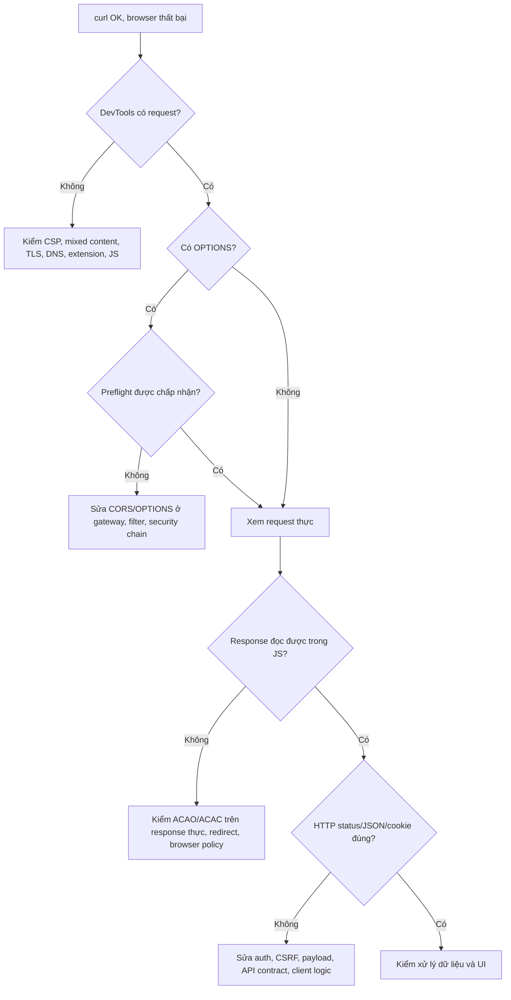

# Chẩn đoán trường hợp curl thành công nhưng trình duyệt thất bại

> **Chương:** API trên trình duyệt  
> **Module:** **INTEGRATION_API_REST** — học thiết kế REST API dựa trên resource, URI, phương thức và mã trạng thái HTTP, hợp đồng dữ liệu rõ ràng; thực hành xác thực, phân quyền, xử lý lỗi, kiểm thử với Java/Spring hoặc công nghệ tương đương.
>
> **Tình huống trung tâm:** Cùng một URL REST API trả kết quả tốt bằng `curl`, Postman hoặc test backend nhưng `fetch`/Axios trên trình duyệt báo lỗi. Muốn sửa đúng phải tìm xem lỗi xảy ra ở mạng, chính sách trình duyệt, cơ chế gửi credential, API server hay xử lý response.

## 1. Kết quả học tập và ví dụ xuyên suốt

Sau bài này, người học có thể:

1. Phân biệt **origin**, **site**, same-origin policy, CORS, preflight và xác thực API; giải thích vì sao `curl` không thực hiện những kiểm tra bảo mật của trình duyệt.
2. Đọc DevTools **Console + Network** để xác định request có được gửi, có `OPTIONS` preflight, response có tới browser và có bị chặn đọc hay không.
3. Dùng `curl` tái tạo **request preflight** và request thật với header `Origin`, đối chiếu chính xác headers HTTP cần thiết.
4. Chẩn đoán cookie, `SameSite`, `Secure`, `credentials`, CSRF, redirect đăng nhập, CSP, mixed content, TLS và proxy.
5. Cấu hình Spring Security CORS đúng thứ tự, đúng origin, method, header; thiết kế kiểm thử và quan sát để tránh sửa lỗi bằng cách mở CORS quá rộng.

### 1.1. Cùng endpoint, hai kết quả khác nhau

Giả sử frontend chạy tại:

```text
https://shop.example.test
```

Backend REST API chạy tại:

```text
https://api.partner.test
```

Chạy từ terminal:

```bash
curl -i 'https://api.partner.test/api/orders' \
  -H 'Authorization: Bearer <test-access-token>' \
  -H 'Accept: application/json'
```

Kết quả:

```http
HTTP/2 200
Content-Type: application/json

{"items":[{"id":"ord-1001","status":"PAID"}]}
```

Nhưng frontend:

```javascript
const response = await fetch("https://api.partner.test/api/orders", {
  headers: {
    Authorization: "Bearer " + accessToken,
    Accept: "application/json"
  }
});
const orders = await response.json();
```

Browser có thể báo:

```text
Access to fetch at 'https://api.partner.test/api/orders'
from origin 'https://shop.example.test' has been blocked by CORS policy.
Response to preflight request doesn't pass access control check.
```

**Chưa thể kết luận API trả sai JSON, token hết hạn hay server sập.** Browser có thể chưa gửi request `GET` thật vì preflight đã thất bại; `curl` gửi thẳng `GET` nên nhận `200`. Một số lỗi khác có triệu chứng tương tự nhưng nguyên nhân khác hẳn: cookie không được gửi, CSP chặn gọi, redirect sang trang login, TLS không đáng tin, service worker can thiệp hoặc JavaScript parse sai dữ liệu.

### 1.2. Các câu hỏi đầu tiên

- Trang hiện tại có **origin** gì (`scheme + host + port`)? URL API có origin gì?
- DevTools có dòng `OPTIONS` không? Nếu có, response status và headers của nó là gì?
- Request **GET/POST thực** có xuất hiện không? Có gửi `Authorization`/`Cookie` như dự kiến không?
- Server trả status nào (`200`/`204`/`302`/`401`/`403`/`500`) và header CORS nào? Console đang báo CORS, CSP, Mixed Content hay lỗi JS?
- Có proxy/CDN/gateway, redirect, cookie policy hoặc service worker nào nằm giữa không?

**Mục tiêu của chẩn đoán:** xác định thành phần nào đưa ra quyết định chặn và tầng nào chịu trách nhiệm sửa, trước khi thay cấu hình.

## 2. Cơ sở nền: origin, site và ranh giới trình duyệt

**Origin** là bộ ba **scheme + host + port**. Nếu không ghi port, trình duyệt dùng port mặc định của scheme. Thay một phần cũng có thể tạo origin mới:

| Trang đang mở | API được gọi | Cùng origin? | Giải thích |
|---|---|---|---|
| `https://shop.example.test` | `https://shop.example.test/api/orders` | Có | Cùng scheme, host, port. |
| `https://shop.example.test` | `https://api.example.test/api/orders` | Không | Host khác dù cùng site theo cách phân loại thông thường. |
| `http://localhost:5173` | `http://localhost:8080/api/orders` | Không | Port khác. |
| `http://localhost:5173` | `http://127.0.0.1:5173/api/orders` | Không | Host `localhost` khác `127.0.0.1`. |
| `https://shop.example.test` | `http://shop.example.test/api/orders` | Không | Scheme khác; còn có thể bị chặn mixed content. |

**Site** được dùng đặc biệt cho cookie `SameSite`; trong các trình duyệt hiện đại, mô hình *schemeful same-site* xét scheme và registrable domain. Hai subdomain thường **khác origin nhưng cùng site**. CORS và SameSite giải quyết **hai vấn đề khác nhau**: một bên điều tiết frontend có được đọc phản hồi cross-origin, một bên điều tiết cookie có được gửi theo ngữ cảnh site.

### 2.1. Same-origin policy là gì?

Browser áp dụng same-origin policy (SOP) để hạn chế script của website này **đọc** response từ origin khác nếu origin kia chưa cho phép. Điều này bảo vệ thông tin người dùng mà trình duyệt đang giữ, chẳng hạn session cookie của một trang khác.

CORS (*Cross-Origin Resource Sharing*) là cơ chế **server thông báo cho browser khi nào có thể cho phép JavaScript đọc response cross-origin**. Server có thể trả `200`, nhưng browser vẫn từ chối cung cấp dữ liệu cho JavaScript vì header CORS không đạt yêu cầu.

`curl` là HTTP client thông thường: không có “website đang mở” để áp SOP, không thực hiện CORS enforcement, không tự phát sinh preflight như Fetch. Cách dùng `curl -H 'Origin: ...'` chỉ giúp **kiểm tra server trả header gì**, không biến curl thành browser có SOP.

### 2.2. CORS không phải cơ chế xác thực hay chống CSRF

- `Access-Control-Allow-Origin` không chứng minh người gọi là website được ủy quyền. `Origin` do browser cung cấp trong ngữ cảnh web, nhưng client không phải browser có thể tự tạo header này.
- Dù CORS chặn JS đọc response, một số loại request cross-origin vẫn có thể **được gửi** đến server. Do đó CORS không thay xác thực, phân quyền, CSRF token, SameSite hoặc kiểm tra quyền theo tài nguyên.
- Không để browser tự quyết định quyền bằng dữ liệu client gửi (`userId`, `tenantId`). REST API vẫn phải xác thực access token/session và kiểm scope, owner, tenant tại server.
- Nếu API dùng cookie/session có tác động thay đổi dữ liệu, hãy thiết kế **CSRF protection**; cấu hình CORS chỉ là một lớp của kiến trúc.

## 3. Luồng preflight: vì sao GET chưa từng đến controller?

Browser đôi khi gửi **CORS preflight** trước request thật: request `OPTIONS` để hỏi server có cho phép method/header dự định hay không.

Điều kiện dễ gặp khiến request có preflight:

- Gửi `Authorization` header.
- Thêm custom header như `X-Request-ID`.
- `POST` với `Content-Type: application/json`.
- Dùng method như `PUT`, `PATCH`, `DELETE`.

Không phải **mọi request cross-origin** đều preflight. Một `GET` có các header CORS-safelisted phù hợp, hoặc `POST` với điều kiện “simple request” có thể được gửi trực tiếp; **response vẫn phải đáp ứng CORS** nếu JavaScript muốn đọc. Cơ chế còn chịu giới hạn cụ thể của Fetch standard.

### 3.1. Preflight do browser tự tạo

Với request `GET` có `Authorization` ở ví dụ, browser gửi trước:

```http
OPTIONS /api/orders HTTP/1.1
Host: api.partner.test
Origin: https://shop.example.test
Access-Control-Request-Method: GET
Access-Control-Request-Headers: authorization
```

Theo mô hình chuẩn, preflight không mang access token/cookie của request thật. Một cấu hình đòi `Authorization` cho **mọi OPTIONS** có thể làm preflight thất bại bằng `401` trước khi GET xuất hiện.

Phản hồi thành công (ví dụ):

```http
HTTP/1.1 204 No Content
Access-Control-Allow-Origin: https://shop.example.test
Access-Control-Allow-Methods: GET, POST, OPTIONS
Access-Control-Allow-Headers: Authorization, Content-Type, X-Request-ID
Access-Control-Max-Age: 600
Vary: Origin, Access-Control-Request-Method, Access-Control-Request-Headers
```

Khi preflight hợp lệ, browser mới có thể gửi request thật:

```http
GET /api/orders HTTP/1.1
Host: api.partner.test
Origin: https://shop.example.test
Authorization: Bearer <test-access-token>
Accept: application/json
```

Response thật cũng cần header phù hợp:

```http
HTTP/1.1 200 OK
Access-Control-Allow-Origin: https://shop.example.test
Vary: Origin
Content-Type: application/json

{"items":[{"id":"ord-1001","status":"PAID"}]}
```

**Lưu ý:** CORS là hai phép kiểm riêng khi có preflight: (1) response `OPTIONS` cho phép gửi request; (2) response **GET/POST thực** cho phép script đọc nội dung. Preflight thành công nhưng GET thiếu `Access-Control-Allow-Origin` vẫn khiến browser báo lỗi.

### 3.2. Ý nghĩa các header CORS

| Header | Dùng ở đâu? | Chẩn đoán |
|---|---|---|
| `Origin` | Browser gửi từ ngữ cảnh trang gọi. | Kiểm **chính xác** scheme/host/port, nhất là localhost và staging. |
| `Access-Control-Request-Method` | Preflight request. | Method thật mà browser muốn dùng. |
| `Access-Control-Request-Headers` | Preflight request. | Danh sách header không safelisted sẽ gửi ở request thật, ví dụ `authorization,content-type`. |
| `Access-Control-Allow-Origin` | Preflight và response thật nếu cần CORS. | Phải cho phép origin yêu cầu, theo quy tắc Fetch. |
| `Access-Control-Allow-Methods` | Preflight response. | Phải cho phép method request thật. |
| `Access-Control-Allow-Headers` | Preflight response. | Phải cho phép header request thật, gồm `Authorization` khi dùng Bearer. |
| `Access-Control-Allow-Credentials: true` | Response trong luồng dùng credentials cross-origin. | Cần khi `fetch` dùng `credentials: "include"`; không dùng `*` cho allow-origin của luồng đó. |
| `Access-Control-Expose-Headers` | Response thật. | Cho JS đọc các response header không được expose mặc định, ví dụ `X-Request-ID`. |
| `Access-Control-Max-Age` | Preflight response. | Browser có thể cache kết quả preflight trong giới hạn riêng của trình duyệt. |
| `Vary: Origin` | Response có allow-origin thay đổi theo origin. | Giúp shared cache/CDN không dùng nhầm header CORS của origin khác. |

Với response preflight thay đổi theo method/header, `Vary` có thể cần cả `Access-Control-Request-Method` và `Access-Control-Request-Headers` theo cách cache hoạt động. Các cache không phải browser có thể xử lý khác nhau; kiểm thực tế qua proxy/CDN.

**Không khắc phục preflight bằng cách thêm header CORS vào JavaScript request:** `Access-Control-Allow-Origin` là **response header** do phía API trả. Browser cũng kiểm soát các header như `Origin`, `Host` và `Cookie`; ứng dụng web không thể đặt chúng tùy ý từ `fetch` để lách chính sách.

### 3.3. Các lỗi CORS điển hình

- `OPTIONS -> 401/403`: middleware bảo mật hoặc API gateway chặn preflight.
- `OPTIONS -> 404/405`: router/gateway chưa xử lý OPTIONS/CORS; request GET có thể hoạt động bằng curl.
- `OPTIONS -> 301/302`: redirect sang login, HTTP->HTTPS hoặc slash mới; cần kiểm endpoint và chính sách redirect. Tránh đặt logic buộc browser theo redirect trong preflight.
- `OPTIONS -> 204` nhưng thiếu `Access-Control-Allow-Headers: Authorization`: request có Bearer header không được phép.
- `Access-Control-Allow-Origin: *` cùng `credentials: "include"`: browser từ chối cho script đọc; phải dùng origin cụ thể và `Access-Control-Allow-Credentials: true`.
- Response GET trả `200` nhưng không có CORS header: browser đã gọi API nhưng không cho script đọc.
- API chỉ gắn CORS header cho status `200`, bỏ `401`/`403`/`500`: browser che lỗi backend bằng thông báo CORS; sửa filter/gateway để phản hồi lỗi cũng đi qua chính sách phù hợp.

## 4. Quy trình chẩn đoán từ DevTools

**Bắt đầu ở browser thật** nơi tái hiện được lỗi. Mở DevTools (thường `F12`), chọn tab **Network**, bật **Preserve log**, tải lại trang, lọc `Fetch/XHR` và tìm endpoint. Giữ tab **Console** để đọc lỗi chính sách.

### Bước 1 — Có request đến mạng hay không?

- Không có request trong Network, Console báo `Refused to connect ... Content Security Policy`: kiểm `connect-src` CSP của trang. CORS phía API không thể sửa CSP của frontend.
- Console báo `Mixed Content` khi trang HTTPS gọi API HTTP: dùng HTTPS cho API, không tắt bảo mật browser.
- Console có `net::ERR_CERT_AUTHORITY_INVALID`, `ERR_NAME_NOT_RESOLVED`, `ERR_CONNECTION_REFUSED`, timeout: điều tra TLS, DNS, proxy, VPN, firewall, network. `curl -k` thành công không chứng minh chứng chỉ được browser tin cậy.
- `net::ERR_BLOCKED_BY_CLIENT`: có thể extension, policy máy hoặc công cụ chặn request; kiểm môi trường thật thay vì quy mọi lỗi vào CORS.
- Network thấy response đến từ `ServiceWorker` hoặc `(disk cache)`: kiểm service worker/cache trước khi kết luận request vừa đến backend.

### Bước 2 — Tìm `OPTIONS`

Nếu có dòng `OPTIONS`, mở **Headers**:

1. **Request URL/Origin** và `Access-Control-Request-Method/Headers` là gì?
2. **Status** của OPTIONS là `204/200` hay `301/401/403/404/405/5xx`?
3. **Response headers** có đủ `Access-Control-Allow-Origin/Methods/Headers` không?
4. Có thay đổi do reverse proxy, API gateway, CDN, WAF hay route config không?

Nếu `OPTIONS` thất bại, **không bắt đầu sửa controller GET**. Kiểm CORS filter và security chain của server/gateway, vì request thật có thể chưa tới controller.

Nếu **không có OPTIONS**, đây có thể là simple CORS request, preflight được cache, hoặc browser chặn ở bước khác. Không được suy luận “không có OPTIONS nghĩa CORS đúng”.

### Bước 3 — Xem request thật

Ở `GET`/`POST` thực, kiểm:

- Request URL sau redirect, method, status, `Origin` và các headers gửi thật.
- `Authorization` có được gửi? Session `Cookie` có được đính kèm? DevTools thường có giải thích vì sao cookie bị chặn.
- Response `Access-Control-Allow-Origin` có khớp origin thực, và credential policy có phù hợp?
- Có response body JSON thật hay HTML trang login được trả sau `302`? Có `Content-Type` đúng?
- API nhận `401` vì token thiếu/hết hạn, hay `403` do scope/CSRF/authorization? Khi CORS hợp lệ, JavaScript có thể đọc status, không cần giấu mọi lỗi dưới “Network Error”.

**Bảo mật trong debug:** Tránh sao chép bearer token, cookie phiên, authorization code hoặc dữ liệu cá nhân từ DevTools vào ticket/chat. Nếu cần chia sẻ HAR, phải lọc thông tin bí mật.

### Bước 4 — Phân biệt fetch bị từ chối và HTTP error

`fetch` **không reject Promise chỉ vì HTTP status 400/401/403/500**. Khi browser cho phép đọc response, `fetch` trả đối tượng `Response` với `ok === false`:

```javascript
async function loadOrders(accessToken) {
  try {
    const response = await fetch("https://api.partner.test/api/orders", {
      method: "GET",
      mode: "cors",
      headers: {
        Authorization: "Bearer " + accessToken,
        Accept: "application/json"
      }
    });

    if (!response.ok) {
      throw new Error("REST API returned HTTP " + response.status);
    }
    return await response.json();
  } catch (error) {
    // Có thể là CORS, TLS, mạng hoặc JSON parse error.
    // Dùng Network/Console để xác định, không mặc định "lỗi CORS".
    console.error("Load orders failed:", error);
    throw error;
  }
}
```

Ngược lại, nếu CORS thất bại, `fetch` thường reject với `TypeError: Failed to fetch` (thông báo có thể khác giữa browser) và JS **không được truy cập status/body bị chặn**. Nếu `response.json()` lỗi vì server trả HTML/JSON hỏng thì đó là vấn đề payload/contract, thường khác với lỗi CORS.

### Bước 5 — Xác định tầng cần sửa



Nhánh DevTools hiển thị request nhưng response bị chặn còn có thể liên quan COEP/CORP, Private Network Access hoặc browser-specific policy; đối chiếu **thông báo chính xác**, không gán mọi chặn truy cập cho CORS truyền thống.

## 5. Dùng curl kiểm server có trả đúng CORS

Sau khi biết `Origin` và `Access-Control-Request-*` trong browser, mô phỏng **hai request riêng** bằng `curl`. Chỉ dùng token giả hoặc token môi trường test.

### 5.1. Mô phỏng preflight

```bash
curl -i -X OPTIONS 'https://api.partner.test/api/orders' \
  -H 'Origin: https://shop.example.test' \
  -H 'Access-Control-Request-Method: GET' \
  -H 'Access-Control-Request-Headers: authorization'
```

Kiểm kỳ vọng:

- Response là mã thành công phù hợp preflight, ví dụ `204` hoặc `200`.
- `Access-Control-Allow-Origin` cho phép **đúng** `https://shop.example.test`.
- `Access-Control-Allow-Methods` chứa `GET`.
- `Access-Control-Allow-Headers` cho phép `authorization`.
- Không redirect đến login; không đòi Bearer token trên chính OPTIONS.

Nếu frontend gửi `Content-Type: application/json` và `X-Request-ID`, phải mô phỏng đúng:

```bash
curl -i -X OPTIONS 'https://api.partner.test/api/orders' \
  -H 'Origin: https://shop.example.test' \
  -H 'Access-Control-Request-Method: POST' \
  -H 'Access-Control-Request-Headers: content-type,x-request-id'
```

### 5.2. Mô phỏng request thật có Origin

```bash
curl -i 'https://api.partner.test/api/orders' \
  -H 'Origin: https://shop.example.test' \
  -H 'Authorization: Bearer <test-access-token>' \
  -H 'Accept: application/json'
```

Kiểm status/body **và CORS headers của response thật**; `curl` vẫn sẽ hiển thị body dù ACAO sai. Đây là lý do chạy mỗi `curl -i` không đủ để xác nhận JavaScript sẽ đọc được kết quả.

Khi so sánh phải giữ request **tương đương**: hostname, path, query, method, body, `Authorization`, `Content-Type`, redirect policy, cookie và môi trường mạng. Nếu curl chạy trên máy chủ backend nhưng browser chạy trên máy người dùng, còn có khác biệt DNS, proxy, chứng chỉ và đường mạng.

**Không** dùng `curl -k` rồi kết luận TLS hợp lệ cho browser; `-k` cố ý bỏ kiểm chứng chứng chỉ. `curl -L` có thể che một response 302 quan trọng trong chẩn đoán; trước tiên xem redirect từng bước. Công cụ API như Postman thường không thực thi SOP/CORS giống website, nên thành công ở đó có ý nghĩa giới hạn tương tự.

## 6. Cookie, session và credentials: CORS đúng vẫn chưa đăng nhập được

Browser mặc định `fetch` dùng `credentials: "same-origin"`. Một lời gọi cross-origin có thể **không gửi cookie** dù cookie đang có và CORS server đã trả đầy đủ.

Ví dụ frontend dùng session cookie do `https://api.partner.test` phát hành:

```javascript
const response = await fetch("https://api.partner.test/api/account", {
  method: "GET",
  credentials: "include",
  mode: "cors"
});
```

Server phải cho phép origin cụ thể và gửi:

```http
Access-Control-Allow-Origin: https://shop.example.test
Access-Control-Allow-Credentials: true
Vary: Origin
```

**Không** được kết hợp `Access-Control-Allow-Origin: *` với credentialed CORS request. Với luồng cookie, `credentials: "include"` chỉ là **điều kiện cần**, chưa bảo đảm cookie thực sự được gửi/ghi.

### 6.1. Chính sách cookie

| Thuộc tính/chính sách | Vì sao trình duyệt có thể bỏ cookie |
|---|---|
| `SameSite=Strict` | Không gửi trong nhiều ngữ cảnh cross-site. |
| `SameSite=Lax` | Thường không gửi trong cross-site `fetch`/XHR subresource; chính sách khác với top-level navigation. |
| `SameSite=None; Secure` | Thường cần khi muốn gửi cookie trong cross-site subresource; `Secure` cần HTTPS (ngoại lệ development riêng tùy browser). |
| `Domain`/`Path` | Cookie không khớp host/path request. |
| `Secure` | Cookie không gửi qua HTTP thông thường. |
| Hết hạn, chặn third-party cookies, partitioning/privacy policy | Cookie có thể không được nhận hoặc gửi dù CORS và `credentials` đúng. |

`SameSite` xét **site**, còn CORS xét **origin**. Ví dụ `http://localhost:5173` → `http://localhost:8080` là cross-origin nhưng thường cùng site; vẫn cần `credentials: "include"` cho `fetch` nếu muốn gửi cookie, trong khi quy tắc `SameSite` có thể không phải nguyên nhân.

Khi frontend và API thuộc các site khác nhau như `shop.example.test` và `api.partner.test`, cần thiết kế có tính đến trình duyệt hạn chế **third-party cookies**. Đừng giả định thêm `SameSite=None` sẽ luôn giải quyết được; kiểm tab **Cookies/Issues** trong DevTools và cân nhắc BFF/reverse proxy cùng origin hoặc mô hình đăng nhập phù hợp.

Cookie `HttpOnly` không đọc được bằng `document.cookie`, nhưng vẫn có thể được browser gửi trong request đúng ngữ cảnh. `Set-Cookie` là response header bị hạn chế truy cập từ JS; thêm `Access-Control-Expose-Headers: Set-Cookie` không khiến script đọc được nó.

### 6.2. CSRF, Authorization và 401/403

Với **session cookie**, request cập nhật dữ liệu có thể cần CSRF token:

```http
POST /api/orders HTTP/1.1
Origin: https://shop.example.test
Cookie: SESSION=<browser-managed>
Content-Type: application/json
X-CSRF-TOKEN: <csrf-token>

{"sku":"SKU-1008","quantity":1}
```

`X-CSRF-TOKEN` và JSON Content-Type có thể kích hoạt preflight; server phải cho phép các request header phù hợp và thực hiện **CSRF validation** ở request thực. Nếu preflight thành công nhưng POST trả `403`, hãy kiểm cả CSRF token lẫn authorization. Không tắt CSRF chỉ để xóa một thông báo CORS.

Với **Bearer token gửi qua header `Authorization`** trong một API stateless, preflight thường xuất hiện do header này; server cần `Access-Control-Allow-Headers: Authorization`. CORS không thay verify JWT/opaque token, issuer, audience, scope và object-level authorization.

**Đừng sửa lỗi 401 từ backend bằng cách mở `Access-Control-Allow-Origin: *`.** Phải nhìn request thực có credential đúng không và server thực sự báo gì. Lỗi token hết hạn là vấn đề xác thực, lỗi cookie bị browser chặn là vấn đề chính sách credential, còn preflight 401 là vấn đề thứ tự CORS/security.

### 6.3. Redirect tới trang login

Một endpoint cần đăng nhập có thể trả:

```http
HTTP/1.1 302 Found
Location: https://identity.example.test/login
```

Nếu `fetch` đi theo redirect tới trang login của nhà cung cấp danh tính, response HTML thường không có chính sách CORS cho origin ứng dụng, gây lỗi mà người dùng tưởng là “API CORS hỏng”. Trong SPA dùng OAuth 2.0 / OpenID Connect, khi cần đăng nhập, frontend nên khởi động **top-level navigation/authorization flow** đúng thiết kế (ví dụ Authorization Code + PKCE) thay vì coi login HTML là JSON API response. Endpoint API nên có hợp đồng trả `401` rõ ràng cho XHR/fetch.

## 7. Cấu hình đúng bằng Java/Spring Security

Ví dụ dùng **Spring Boot 3 / Spring Security 6**, API `/api/**` nhận JWT access token trong Bearer header; frontend được phép truy cập từ một origin đã thống nhất. Cấu hình này dành cho **API stateless không xác thực bằng session cookie**, nên CSRF được tắt có chủ đích cho tình huống này.

### 7.1. CORS tập trung tại SecurityFilterChain

```java
package example.orders.security;

import java.util.List;
import org.springframework.context.annotation.Bean;
import org.springframework.context.annotation.Configuration;
import org.springframework.http.HttpMethod;
import org.springframework.security.config.Customizer;
import org.springframework.security.config.annotation.web.builders.HttpSecurity;
import org.springframework.security.config.annotation.web.configurers.AbstractHttpConfigurer;
import org.springframework.security.config.http.SessionCreationPolicy;
import org.springframework.security.web.SecurityFilterChain;
import org.springframework.web.cors.CorsConfiguration;
import org.springframework.web.cors.CorsConfigurationSource;
import org.springframework.web.cors.UrlBasedCorsConfigurationSource;

@Configuration
public class ApiSecurityConfiguration {

    @Bean
    CorsConfigurationSource corsConfigurationSource() {
        CorsConfiguration cors = new CorsConfiguration();
        cors.setAllowedOrigins(List.of("https://shop.example.test"));
        cors.setAllowedMethods(List.of("GET", "POST", "PUT", "DELETE", "OPTIONS"));
        cors.setAllowedHeaders(List.of(
            "Authorization", "Content-Type", "X-Request-ID"));
        cors.setExposedHeaders(List.of("X-Request-ID"));
        cors.setAllowCredentials(false); // Dùng Bearer header, không dùng cookie
        cors.setMaxAge(600L);            // Cache preflight tối đa 10 phút theo policy

        UrlBasedCorsConfigurationSource source =
            new UrlBasedCorsConfigurationSource();
        source.registerCorsConfiguration("/api/**", cors);
        return source;
    }

    @Bean
    SecurityFilterChain apiSecurity(HttpSecurity http) throws Exception {
        return http
            .cors(Customizer.withDefaults())
            .csrf(AbstractHttpConfigurer::disable)
            .sessionManagement(session -> session.sessionCreationPolicy(
                SessionCreationPolicy.STATELESS))
            .authorizeHttpRequests(auth -> auth
                .requestMatchers(HttpMethod.GET, "/api/health").permitAll()
                .anyRequest().authenticated())
            .oauth2ResourceServer(oauth ->
                oauth.jwt(Customizer.withDefaults()))
            .build();
    }
}
```

Điểm cần nhớ:

1. `cors(Customizer.withDefaults())` tích hợp CORS vào Spring Security để preflight được xử lý **trước các kiểm tra xác thực gây 401/403**. Khi có nhiều `SecurityFilterChain`, kiểm chain thực sự áp dụng cho `/api/**` và CORS source tương ứng.
2. Origin `https://shop.example.test` phải khớp **chính xác** origin frontend. Dev `http://localhost:5173` là origin khác; thêm origin đó **chỉ trong cấu hình môi trường dev** nếu được phép, không tùy tiện cho mọi origin trên production.
3. Header `Authorization` phải được cho phép trong preflight. Chỉ expose `X-Request-ID` khi frontend cần đọc nó; header expose **không** cấp quyền gửi request header.
4. `setAllowCredentials(false)` phù hợp ví dụ không gửi cookie cross-origin. Với API dùng session cookie, cần **cấu hình riêng**: `setAllowCredentials(true)`, origin cụ thể, cookie attributes và **CSRF protection**. Không sao chép dòng disable CSRF từ ví dụ JWT sang luồng cookie.
5. CORS chỉ là cổng đọc response của browser; backend vẫn kiểm token và phân quyền theo scope/resource. Các yêu cầu `OPTIONS` không mang bearer token không được ép phải xác thực chỉ để tìm route.
6. Nếu API gateway hoặc Nginx đã quản lý CORS, tránh hai tầng độc lập trả **hai header `Access-Control-Allow-Origin`** gây lỗi. Thống nhất tầng chịu trách nhiệm, áp dụng chính sách trên cả response lỗi.

Đoạn Java chỉ trình bày CORS/SecurityFilterChain; cấu hình `JwtDecoder` kiểm issuer/audience, ánh xạ scope và policy object-level phải được bổ sung theo hợp đồng xác thực riêng. Không suy luận `oauth2ResourceServer().jwt()` mặc định đã đủ audience validation cho mọi authorization server.

### 7.2. Vì sao chỉ thêm `@CrossOrigin` có thể chưa giải quyết?

Controller có thể có:

```java
@CrossOrigin(origins = "https://shop.example.test")
@GetMapping("/api/orders")
public List<OrderDto> orders() {
    return orderService.findVisibleOrders();
}
```

Nhưng nếu preflight bị **Spring Security, reverse proxy, WAF hoặc API gateway** chặn trước khi request tới MVC controller, annotation không cứu được. Với API thực tế, nên quản lý CORS rõ ràng ở tầng tham gia vào preflight đầu tiên; tránh chồng cấu hình mâu thuẫn ở gateway, filter, MVC, controller.

Tương tự, khi server trả lỗi `401`/`403` từ filter bảo mật, header CORS chỉ gắn trong controller `200` là không đủ. Hãy kiểm đường response lỗi.

### 7.3. Nếu dùng cookie: thiết kế khác

Không áp dụng cấu hình JWT stateless ở trên cho session cookie. Trong hệ thống dùng cookie:

- CORS chỉ cho phép origin đáng tin, `Access-Control-Allow-Credentials: true` và frontend dùng `credentials: "include"`.
- Session cookie có `HttpOnly`/`Secure`/`SameSite`/`Path` và hạn dùng phù hợp; xem cookie policy của browser thực.
- Giữ CSRF protection cho các request thay đổi state; cấp/nhận CSRF token theo cơ chế cụ thể của ứng dụng, cho phép request header CSRF trong preflight nếu cần.
- Hạn chế XSS và kiểm object-level authorization; CORS không bảo vệ khỏi script độc hại chạy **trong origin đã được cho phép**.

Trong nhiều kiến trúc, **Backend For Frontend (BFF)** hoặc reverse proxy same-origin làm browser gọi `/api` trên chính origin frontend; server nội bộ mới gọi API khác. Cách này giảm bề mặt CORS và ràng buộc third-party cookie, nhưng BFF vẫn phải xác thực, chống CSRF nếu có cookie và bảo vệ token khi gọi backend.

## 8. Những nguyên nhân khác khi CORS không phải lỗi gốc

### 8.1. CSP `connect-src`

Frontend có thể trả:

```http
Content-Security-Policy: default-src 'self'; connect-src 'self'
```

Khi JavaScript gọi `https://api.partner.test`, CSP `connect-src 'self'` chặn trước hoặc trong quá trình fetch; dù API có CORS đúng, request vẫn thất bại. Cần thêm đúng API origin vào **CSP của trang frontend**, ví dụ:

```http
Content-Security-Policy: default-src 'self'; connect-src 'self' https://api.partner.test
```

Chỉ mở endpoint cần thiết; không dùng `connect-src *` để bỏ qua phân tích. CSP và CORS thuộc **hai cấu hình khác nhau**.

### 8.2. Mixed content và secure context

Trang `https://shop.example.test` gọi `http://api.partner.test` có thể bị chặn là mixed content. Phải cung cấp API qua HTTPS với chứng chỉ được browser tin cậy. Các ngoại lệ hoặc cách xử lý URL localhost có thể khác theo loại tài nguyên/browser; không coi là bảo đảm cho production.

Có những browser API còn đòi **secure context**, user gesture, permission và feature policy/Permissions-Policy (ví dụ camera, geolocation). `curl` tới backend thành công không chứng minh trình duyệt được phép dùng tính năng nền tảng; kiểm Console và browser permission.

### 8.3. Response redirect, cache và service worker

- `301/302/307/308` có thể đưa request từ API sang domain khác, từ HTTPS sang HTTP hoặc sang trang đăng nhập. CORS, credentials và method có thể thay đổi cách browser xử lý. Mở redirect chain trong Network, tránh chỉ nhìn URL cuối.
- CDN/cache có thể lưu phản hồi chứa ACAO cho origin A rồi trả cho origin B nếu cấu hình `Vary: Origin` sai. Kiểm qua response headers và cache status; không vô hiệu cache production chỉ để che lỗi.
- Service worker có thể phục vụ response cũ, sửa request hoặc làm offline fallback. Kiểm mục Service Workers/Application, tạm bypass trong môi trường debug để so sánh khi hợp lý; không xóa dữ liệu người dùng ngoài phạm vi kiểm thử.
- `304 Not Modified`, ETag và cache policy có thể tương tác với CORS; đối chiếu headers trong request/response thực thay vì chỉ thấy `304` là kết luận “server hỏng”.

### 8.4. Header đọc được và JSON parse

Response thành công chứa:

```http
HTTP/1.1 200 OK
Access-Control-Allow-Origin: https://shop.example.test
Content-Type: application/json
X-Request-ID: req-123
```

Có thể `await response.json()` thành công nhưng `response.headers.get("X-Request-ID")` trả `null` vì đây không phải header được expose mặc định. Nếu UI cần đọc, API trả:

```http
Access-Control-Expose-Headers: X-Request-ID
```

**Không nhầm expose response header với allow request header**. Nếu API trả body HTML (trang login/error) với `200` hoặc `302`, `response.json()` ném `SyntaxError`. Kiểm `Content-Type` và body ở Network; hợp đồng REST nên trả JSON/Error Problem Details nhất quán.

### 8.5. Private Network Access và chính sách trình duyệt khác

Trong một số browser/phiên bản, trang public gọi tới địa chỉ mạng private/local có thể gặp thêm kiểm tra **Private Network Access / Local Network Access** hoặc permission/policy riêng. Lỗi có thể xuất hiện ngay cả khi CORS truyền thống đã được cấu hình. Hành vi và rollout thay đổi theo browser; xem DevTools và tài liệu tương ứng với phiên bản được dùng trước khi điều chỉnh `Access-Control-Allow-Private-Network` hoặc thiết kế kết nối.

### 8.6. Khác biệt môi trường giữa curl và browser

`curl` có thể chạy trong container cùng VPC với API, còn browser nằm ngoài mạng; DNS split-horizon, VPN, firewall, IPv4/IPv6, proxy doanh nghiệp, HSTS và trust store TLS khác nhau. Browser dùng User-Agent, Accept-Encoding, Sec-Fetch-* headers, cookie, redirect policy và cache riêng; WAF có thể chặn dựa trên các yếu tố đó.

Đừng xem `Sec-Fetch-Site` hoặc `Origin` là xác thực đủ cho user. Có thể dùng Fetch Metadata policy như lớp phòng vệ bổ sung chống cross-site abuse, nhưng vẫn cần xác thực, phân quyền và CSRF phù hợp.

## 9. Bảng xử lý sự cố nhanh

| Triệu chứng trong browser | Nguyên nhân cần kiểm trước | Bước xác minh cụ thể |
|---|---|---|
| `Response to preflight ...` | `OPTIONS` bị 401/403/404/405, thiếu allow-headers/methods. | Network → OPTIONS; `curl -X OPTIONS` cùng `Origin` và `Access-Control-Request-*`. |
| `No 'Access-Control-Allow-Origin' header` | API/gateway thiếu ACAO trên preflight hoặc response thật. | Đọc status và header của **cả** OPTIONS và GET/POST. |
| `Credential is not supported if ACAO is '*'` | `credentials: include` với wildcard. | So `Request.credentials` và ACAO/ACAC; cấu hình allowlist origin cụ thể. |
| `Request header field authorization is not allowed` | Thiếu `Authorization` trong allowed headers. | Kiểm `Access-Control-Request-Headers` và `Access-Control-Allow-Headers`. |
| `Failed to fetch` không có status JS | CORS, mạng, TLS, CSP, extension hoặc redirect. | Console + Network; không suy luận từ mỗi message JS. |
| GET thành công, POST trả `403` | CSRF/authorization hoặc CORS preflight với JSON header. | Xác nhận OPTIONS trước POST, request thực và log server. |
| API trả `200` nhưng UI báo JSON parse error | HTML trang login, JSON sai hoặc code parse sai. | Kiểm `Content-Type` và body thực. |
| Đăng nhập được ở tab API nhưng `fetch` `401` | Cookie không gửi vì `credentials`, SameSite, domain/path, privacy policy. | Network → Cookies, Application → Cookies, request headers. |
| `Refused to connect ... CSP` | Frontend `connect-src` không cho API origin. | Xem CSP trong response tài liệu HTML, không sửa ACAO. |
| `Mixed Content` hoặc `ERR_CERT_*` | API HTTP từ trang HTTPS hoặc TLS trust lỗi. | Mở API HTTPS bằng browser và xem chứng chỉ/console. |
| Postman/curl chạy, browser không thấy request | Browser policy, JS, DNS, extension, CSP. | Network/Console trên thiết bị người dùng. |
| Error chỉ xảy ra sau deploy qua gateway | Gateway/CDN sửa header, block OPTIONS, redirect hoặc cache sai. | So direct origin và gateway bằng đường truy cập được phép. |

## 10. Kiểm thử tự động và quy trình kiểm chứng

Một **unit test controller** trả `200` không chứng minh browser có thể gọi API. Nên kiểm từ thấp lên cao:

### 10.1. MockMvc kiểm preflight và response thật

Với cấu hình Spring Security ở mục 7, ví dụ dùng `spring-security-test` và `MockMvc` trong integration test đã tải security chain:

```java
import static org.springframework.test.web.servlet.request.MockMvcRequestBuilders.*;
import static org.springframework.test.web.servlet.result.MockMvcResultMatchers.*;
import org.junit.jupiter.api.Test;
import org.springframework.beans.factory.annotation.Autowired;
import org.springframework.boot.test.autoconfigure.web.servlet.AutoConfigureMockMvc;
import org.springframework.boot.test.context.SpringBootTest;
import org.springframework.http.HttpHeaders;
import org.springframework.test.web.servlet.MockMvc;

@SpringBootTest
@AutoConfigureMockMvc
class CorsIntegrationTest {
    @Autowired MockMvc mvc;

    @Test
    void preflightAuthorizationHeaderIsAllowed() throws Exception {
        mvc.perform(options("/api/orders")
                .header(HttpHeaders.ORIGIN, "https://shop.example.test")
                .header(HttpHeaders.ACCESS_CONTROL_REQUEST_METHOD, "GET")
                .header(HttpHeaders.ACCESS_CONTROL_REQUEST_HEADERS, "authorization"))
            .andExpect(status().isOk())
            .andExpect(header().string(
                HttpHeaders.ACCESS_CONTROL_ALLOW_ORIGIN,
                "https://shop.example.test"));
    }

    @Test
    void untrustedOriginIsNotAllowed() throws Exception {
        mvc.perform(options("/api/orders")
                .header(HttpHeaders.ORIGIN, "https://evil.example.test")
                .header(HttpHeaders.ACCESS_CONTROL_REQUEST_METHOD, "GET")
                .header(HttpHeaders.ACCESS_CONTROL_REQUEST_HEADERS, "authorization"))
            .andExpect(header().doesNotExist(
                HttpHeaders.ACCESS_CONTROL_ALLOW_ORIGIN));
    }
}
```

Trong Spring, một preflight không hợp lệ thường bị từ chối bằng `403` và không trả `Access-Control-Allow-Origin`; test `untrustedOriginIsNotAllowed` chỉ khẳng định không có ACAO. Test preflight hợp lệ có thể trả `200` khi xử lý qua `CorsFilter`; nếu custom gateway trả `204` hợp lệ thì sửa assertion theo contract của tầng đang test. Test cần chạy với route/security chain phù hợp; nếu `/api/orders` chưa có handler, có thể thay bằng endpoint test thực.

Bổ sung test request thật được xác thực (ví dụ dùng `jwt()` của Spring Security test) và xác minh ACAO trên `200`, `401` và `403` theo policy. Lưu ý `with(jwt())` giả lập Authentication cho test policy, **không xác minh chữ ký JWT thật**; cần JWT decoder test riêng nếu muốn chứng minh auth boundary.

### 10.2. Browser end-to-end mới kiểm đủ chính sách

Sử dụng Playwright/Cypress hoặc browser automation tương đương trên **hai origin** đại diện frontend/backend để kiểm:

1. `GET` có `Authorization`: preflight thành công, GET thật tới API, JS đọc được JSON.
2. `POST application/json`: preflight cho phép content-type, request thật có scope/CSRF cần thiết.
3. Origin lạ bị CORS chặn **đọc** response; backend vẫn kiểm authorization, không dựa vào CORS để ngăn request nguy hiểm.
4. Luồng cookie: `credentials: include`, SameSite, Secure, third-party cookie policy và CSRF đúng trên browser mục tiêu.
5. Token hết hạn: response `401` với CORS headers hợp lệ; frontend xử lý HTTP status thay vì báo “mạng lỗi”.
6. API lỗi `500`/timeout/redirect login: quan sát được lỗi phù hợp; không echo secret.
7. CSP/mixed content/TLS và service worker/cache hoạt động đúng trong môi trường build thực.

Test từ `localhost` không thay thế kiểm staging/prod origin. Tạo test matrix với scheme, hostname, port, cookie mode và browser version thực tế. Nếu ứng dụng chạy trong WebView/embedded browser, chính sách có thể khác Chrome/Firefox/Safari desktop.

### 10.3. Quan sát vận hành

Ghi các thông tin ít nhạy cảm: `requestId`, method, path template, status, `Origin` đã rút gọn theo allowlist (tránh cardinality cao), preflight true/false, security denial reason, gateway stage và latency. Không log access token, cookie hoặc body chứa PII.

Khi tăng lỗi CORS trên production, đối chiếu deploy frontend origin mới, gateway rule mới, certificate renewal, security chain, CDN cache và thay đổi cookie policy. Nếu browser không gửi GET vì OPTIONS bị từ chối, access log controller GET sẽ không thấy request; log tại gateway/filter OPTIONS mới giúp tìm nguyên nhân.

## 11. Bài tập tình huống

### Bài 1 — Đọc lỗi preflight

Frontend `http://localhost:5173` gọi `http://localhost:8080/api/orders` bằng `fetch` với `Authorization`. `curl GET` trả `200`, Network cho thấy:

```http
OPTIONS /api/orders HTTP/1.1
Origin: http://localhost:5173
Access-Control-Request-Method: GET
Access-Control-Request-Headers: authorization

HTTP/1.1 401 Unauthorized
WWW-Authenticate: Bearer
```

Hãy xác định vì sao GET chưa vào controller, viết lệnh `curl` tái hiện preflight và sửa Spring Security/CORS để OPTIONS được xử lý đúng **mà không bỏ yêu cầu JWT cho GET thật**.

### Bài 2 — Phân biệt CORS và cookie

Một SPA `https://shop.example.test` gọi `https://api.partner.test/api/account`. OPTIONS và GET đều trả `Access-Control-Allow-Origin: https://shop.example.test`, nhưng request GET `401`. Server dùng session cookie `SameSite=Lax`; JS không đặt `credentials: "include"`. Hãy lập bảng hai nguyên nhân độc lập khiến cookie vắng mặt, cách kiểm tại DevTools, cấu hình cần thiết nếu ứng dụng **chủ động** chọn mô hình cookie cross-site, và cách CSRF phải được bảo vệ. Nêu vì sao browser vẫn có thể hạn chế third-party cookie sau khi sửa.

### Bài 3 — API trả lỗi nhưng frontend báo CORS

POST `/api/orders` bị `403` vì CSRF token sai; API gateway chỉ gắn `Access-Control-Allow-Origin` lên response `200`. Hãy sửa kiến trúc middleware/header để frontend có thể đọc `403`; đồng thời nêu cách fix CSRF mà **không tắt xác thực/phân quyền/CSRF**.

### Bài 4 — CSP và mixed content

Trang `https://shop.example.test` có `Content-Security-Policy: connect-src 'self'` và gọi `http://api.partner.test`. Dù server API trả `Access-Control-Allow-Origin` đúng, browser vẫn thất bại. Hãy giải thích các lớp chặn, thay đổi URL và CSP cần thiết, sau đó kiểm bằng Network/Console và kiểm TLS certificate.

### Bài 5 — Tự xây ma trận kiểm thử

Dựng frontend trên port 5173 và Spring REST API trên port 8080 trong môi trường local. Test năm tổ hợp: GET không header đặc biệt, GET có Bearer, POST JSON, POST có cookie + CSRF, và origin không được cho phép. Đối chiếu `curl` với DevTools/browser automation: request nào có OPTIONS, header nào cần, status thật và JS đọc response được hay không. Mô tả kết quả mong đợi với `401`, `403` và `200`.

### Câu hỏi tự kiểm tra

1. Vì sao `curl -i` nhận `200` chưa đủ chứng minh `fetch` hoạt động?
2. `http://localhost:5173` và `http://localhost:8080` là cùng site hay cùng origin?
3. Khi nào browser gửi OPTIONS preflight, và OPTIONS có mang Bearer token thật không?
4. Preflight trả `204` đúng nhưng GET thiếu `Access-Control-Allow-Origin` thì JS có đọc JSON được không?
5. Vì sao `Access-Control-Allow-Origin: *` không dùng với `credentials: include`?
6. CORS đúng nhưng API trả `401` có nghĩa là gì? Có thể do cookie không gửi không?
7. Vì sao `fetch` không reject Promise khi API trả HTTP `403` nếu CORS hợp lệ?
8. Tại sao CORS không đủ để ngăn CSRF hoặc thay kiểm quyền theo resource?
9. Nếu Console báo CSP, sửa header tại frontend hay response CORS tại API?
10. Kiểm thử MockMvc chứng minh điều gì và phần nào cần browser end-to-end?

**Tiêu chí đạt:** Học viên chỉ đúng điểm chặn (browser policy, OPTIONS, request thật, auth/CSRF hoặc parse), đưa bằng chứng từ Network/headers, sửa ở tầng chịu trách nhiệm và giữ nguyên ranh giới bảo mật của REST API.

## 12. Ghi nhớ và tài liệu tham khảo

- `curl` và Postman cho biết server có thể đáp ứng HTTP request; **browser còn áp SOP/CORS, cookie policy, CSP, mixed content và các giới hạn riêng**.
- Kiểm cả **OPTIONS preflight** và **response thật**. CORS cần đúng ở mọi response liên quan, gồm response lỗi.
- `Origin` và `credentials` là hai trục khác nhau; **same-origin**, **same-site** và **authorization** không đồng nghĩa.
- `401`/`403` là tín hiệu của API khi browser được phép đọc; `TypeError: Failed to fetch` yêu cầu xem Console + Network để xác định nguyên nhân.
- Spring Security cần CORS xử lý trước authentication cho preflight; với session cookie phải giữ CSRF và các bảo vệ phiên.
- Tối ưu nhất là có **bằng chứng tái hiện**: DevTools, curl mô phỏng preflight, test CORS tại gateway/Spring và browser E2E ở origin thực.

Tài liệu gốc nên tham khảo:

- [MDN — Cross-Origin Resource Sharing (CORS)](https://developer.mozilla.org/en-US/docs/Web/HTTP/Guides/CORS).
- [MDN — Same-origin policy](https://developer.mozilla.org/en-US/docs/Web/Security/Same-origin_policy).
- [MDN — Using Fetch](https://developer.mozilla.org/en-US/docs/Web/API/Fetch_API/Using_Fetch).
- [MDN — Set-Cookie, SameSite và Secure](https://developer.mozilla.org/en-US/docs/Web/HTTP/Headers/Set-Cookie).
- [MDN — Content-Security-Policy connect-src](https://developer.mozilla.org/en-US/docs/Web/HTTP/Headers/Content-Security-Policy/connect-src).
- [WHATWG Fetch Standard](https://fetch.spec.whatwg.org/) — quy tắc CORS, credentials và preflight.
- [RFC 9110 — HTTP Semantics](https://www.rfc-editor.org/rfc/rfc9110).
- [Spring Security — CORS](https://docs.spring.io/spring-security/reference/servlet/integrations/cors.html).
- [Spring Framework — CORS](https://docs.spring.io/spring-framework/reference/web/webmvc-cors.html).
