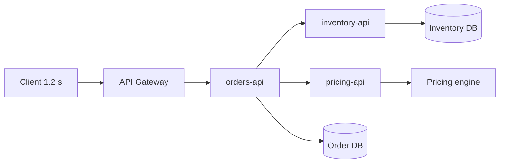

# Timeout budget và truyền thời hạn qua chuỗi phụ thuộc

Một REST API có thể trả lời chậm dù từng lời gọi HTTP downstream đều có `timeout = 1 giây`. Ví dụ, `orders-api` lần lượt hỏi `inventory-api`, `pricing-api` và cơ sở dữ liệu; mỗi bước đều “không quá một giây”, nhưng người dùng phải chờ gần ba giây trước khi nhận lỗi. Nếu mỗi dịch vụ lại gọi thêm dịch vụ khác hoặc retry, thời gian xử lý và lượng request tồn đọng tăng theo cấp số nhân. **Timeout budget** giải quyết vấn đề này bằng cách gắn **một giới hạn thời gian đầu cuối** cho toàn bộ công việc và truyền phần thời gian **còn lại** qua các phụ thuộc.

Bài học thuộc chương **Giới hạn và chống lỗi** của module `INTEGRATION_API_REST`: thiết kế REST API theo resource, URI, HTTP method/status và hợp đồng dữ liệu; đồng thời kết hợp timeout, retry, cache, idempotency, xác thực, phân quyền và kiểm thử với Java/Spring. Ví dụ xuyên suốt là API lấy báo giá đơn hàng, bắt đầu ở gateway, qua `orders-api`, rồi tới `inventory-api` và `pricing-api`. Mọi ví dụ thời gian là giả định để học cách thiết kế, không phải mức timeout áp dụng chung cho mọi hệ thống.

## 1. Mục tiêu học tập

Sau bài này, người học có thể:

1. Phân biệt **end-to-end deadline**, **remaining timeout budget**, **per-hop timeout**, **connect timeout**, **read/response timeout**, **queue timeout** và **cancellation**.
2. Tính lượng thời gian còn lại sau khi trừ thời gian đã dùng, chi phí dự phòng và giới hạn riêng của dependency; biết phân biệt chuỗi gọi tuần tự với gọi song song.
3. Truyền deadline qua HTTP/gateway/service mesh một cách rõ ràng, có ranh giới tin cậy; hiểu đánh đổi giữa timestamp tuyệt đối và thời lượng tương đối.
4. Cấu hình Java/Spring để kiểm tra budget trước mỗi lời gọi downstream, hạn chế retry, phân loại `504`/`503` và dừng xử lý vô ích.
5. Thiết kế metric, distributed tracing, test với fake clock/mock upstream, và bài tập mô phỏng timeout cascade.

## 2. Vấn đề: timeout ở từng hop không bảo vệ được thời gian đầu cuối

Xét đường đi:



Nếu client từ bỏ sau 1,2 giây nhưng gateway, `orders-api` và hai downstream đều đặt timeout riêng 2 giây, công việc có thể vẫn chạy khi kết quả không còn người nhận. Trên hệ thống nhiều request đồng thời, hệ quả là thread/connection pool đầy, hàng đợi dài, số request retry tăng, và ngay cả request khỏe cũng bị chậm theo.

| Khái niệm | Phạm vi | Điểm cần nhớ |
|---|---|---|
| **End-to-end deadline** | Thời điểm chót của toàn bộ request | Mọi hop cùng bị ràng buộc bởi cùng một mục tiêu thời gian |
| **Remaining budget** | Thời lượng còn từ *bây giờ* tới deadline | Giảm dần khi qua gateway, queue, auth, DB, HTTP, retry |
| **Per-attempt timeout** | Một lần kết nối/gọi downstream | Không được dài hơn budget còn lại; thường còn ngắn hơn để dành thời gian hoàn tất |
| **Connect timeout** | Thiết lập kết nối TCP/TLS ở một transport | Không bao trùm mọi công việc đọc response, parse, DB hoặc queue |
| **Response/read timeout** | Chờ response hoặc dữ liệu mạng | Semantics phụ thuộc client; có thể là timeout bất hoạt, không phải tổng thời lượng |
| **Queue timeout** | Thời gian đợi slot trong executor/bulkhead/connection pool | Phải được tính vào budget, không bắt đầu tính khi đã được xử lý |
| **Cancellation** | Phát tín hiệu không cần công việc nữa | Timeout ở caller **không bảo đảm** callee hoặc DB ngừng ngay lập tức |

**Sai lầm:** “`inventory-api` timeout 500 ms, `pricing-api` timeout 500 ms nên tổng tối đa 500 ms.” Với gọi **tuần tự**, chỉ riêng hai timeout đã có thể chiếm gần 1 giây, chưa kể queue, deserialize và response. Với gọi **song song**, thời gian nhánh có thể gần bằng giá trị lớn nhất của các nhánh, nhưng vẫn cần đếm chi phí lập lịch, kết hợp kết quả và tài nguyên đồng thời. Không cộng hoặc lấy max một cách máy móc khi chưa biết đồ thị thực thi.

Timeout chỉ là cơ chế **giới hạn thời gian chờ của một phần công việc**; deadline là hợp đồng tổng thể. Circuit breaker bảo vệ khi dependency lỗi liên tiếp; bulkhead cô lập concurrency; rate limiting hạn chế tải; các cơ chế này bổ sung cho timeout budget, không thay thế nó.

## 3. Tính toán budget trên đường đi

Định nghĩa:

```text
deadline = thời điểm chót đã ấn định cho request
remaining_budget(t) = max(0, deadline - now(t))
usable_for_downstream = remaining_budget - response_reserve - scheduling_guard
attempt_timeout = min(usable_for_downstream, dependency_attempt_cap)
```

`response_reserve` là phần thời gian để dịch vụ hiện tại tổng hợp kết quả, serialize, ghi response và để mạng đẩy kết quả ra ngoài; `scheduling_guard` dự phòng jitter, chi phí gọi, queue hoặc sai số đồng hồ. Nếu phần usable đã bằng 0 hoặc quá nhỏ, không khởi động một lời gọi downstream có khả năng thất bại chắc chắn.

### 3.1. Ví dụ phân bổ một request 1.200 ms

Giả sử request đồng bộ có SLO mục tiêu 1.200 ms ở gateway; không tính network ngoài phạm vi đo của gateway.

| Mốc | Thời gian đã dùng cộng dồn | Budget còn lại | Quyết định |
|---|---:|---:|---|
| Gateway nhận request | 0 ms | 1.200 ms | Gắn deadline đầu cuối |
| Gateway auth/routing | 100 ms | 1.100 ms | Forward deadline, không cấp mới 1.200 ms |
| `orders-api` auth/validate | 180 ms | 1.020 ms | Chỉ còn 1.020 ms |
| Dự phòng trả response + network | Giữ riêng 120 ms | 900 ms dùng được | Không cho downstream chiếm hết 1.020 ms |
| `inventory-api` (tuần tự) | Thực chi 230 ms | Còn 790 ms tại API | Lần kế tiếp lấy **giá trị còn lại thực tế** |
| `pricing-api` (tuần tự) | Thực chi 300 ms | Còn 490 ms tại API | Vẫn phải giữ khoảng 120 ms để trả response |
| Tổng hợp + trả response | Thực chi 90 ms | Còn 400 ms | Trả kết quả trước deadline |

Các số trên là **thời gian thực chi**, không phải timeout cấu hình. Khi triển khai, không giữ lại các ngân sách cố định rồi mặc định mỗi bước được dùng hết: sau mỗi bước, hãy tính `remaining()` từ một mốc thời gian duy nhất. Nếu inventory mất 500 ms thay vì 230 ms, pricing phải nhận ít thời gian hơn; nếu không còn tối thiểu để hoàn thành, dừng sớm.

Ở dịch vụ có nhiều nhánh song song, có thể chạy inventory và pricing cùng lúc với cùng deadline cha và giới hạn cục bộ riêng. Lúc đó thời gian nhánh gần `max(T_inventory, T_pricing)` cộng overhead, nhưng hai nhánh vẫn tiêu thụ connection/thread và có thể cùng nhân tải. Nếu một nhánh thất bại, cần policy rõ: bắt buộc cả hai, dùng cache/fallback hợp lệ, hay hủy nhánh còn lại.

### 3.2. Budget cho retry

Nếu một dependency có giới hạn **tối đa 250 ms mỗi attempt**, điều đó không có nghĩa được phép retry ba lần bất kể budget. Ví dụ:

```text
remaining = 360 ms
response_reserve = 80 ms
retry_backoff = 40 ms
attempt_1 = min(250 ms, 360 - 80) = 250 ms

Nếu attempt_1 dùng đủ 250 ms:
remaining ≈ 110 ms
usable = 110 - 80 = 30 ms

Không đủ 40 ms backoff và một attempt có ý nghĩa -> dừng retry.
```

Đặt thêm **retry budget** theo số lần và tải; khi nhiều tầng cùng retry hai lần, số request downstream có thể nhân lên đáng kể. Retry chỉ áp dụng cho lỗi có thể thử lại và operation an toàn theo ngữ nghĩa HTTP/idempotency. `POST` tạo đơn hàng hoặc thu tiền không được retry mù nếu chưa có cơ chế idempotency và xử lý kết quả “không biết upstream đã commit hay chưa”.

## 4. Truyền deadline qua HTTP: phải có hợp đồng và ranh giới tin cậy

HTTP thông thường **không có một header deadline đầu cuối chung được mọi client/proxy hiểu giống nhau**. Có thể định nghĩa hợp đồng nội bộ, ví dụ:

```http
GET /v1/quotes/SKU-42 HTTP/1.1
Host: orders.internal.example
X-Request-Deadline: 2026-11-18T13:00:01.200Z
Traceparent: 00-5fbba39385614b8ea06777af3c2a7f83-8ac0c47cb5adf77b-01
```

`X-Request-Deadline` ở đây là **header do hệ thống tự định nghĩa**, chứa một timestamp UTC tuyệt đối theo ISO-8601. `traceparent` dùng cho distributed tracing; trace context **không tự mang deadline hay quyền cấp thêm thời gian**. Với gRPC, cơ chế `grpc-timeout` là timeout tương đối theo định dạng riêng; không suy rằng HTTP REST `X-Request-Deadline` là header chuẩn của gRPC.

Một cách truyền khác là `X-Request-Timeout-Ms: 420` (thời lượng còn lại). Cả hai có đánh đổi:

| Cách truyền | Ưu điểm | Nhược điểm và xử lý |
|---|---|---|
| **Absolute deadline**: timestamp UTC | Các hop cùng hướng đến một thời điểm; thời gian di chuyển trên mạng và chờ queue tự trừ khi đọc lại | Phụ thuộc đồng hồ các máy; cần đồng bộ giờ, giới hạn sai số, margin và xử lý thời điểm đã quá hạn |
| **Relative remaining**: số ms còn | Dễ dùng trên máy không đồng bộ đồng hồ; phù hợp timeout tương đối như gRPC | Nếu mỗi hop bắt đầu lại thời lượng khi **nhận**, có thể cấp dư phần thời gian truyền/chờ; cần trừ thời gian đã dùng và tính transit/queue bằng hợp đồng rõ ràng |
| **Cả hai, dùng giới hạn chặt hơn** | Có thể thêm tính an toàn khi một nguồn sai lệch | Hợp đồng phức tạp; vẫn cần kiểm ranh giới tin cậy, đồng hồ và telemetry |

Một quy trình propagation đáng tin:

1. **Ingress gateway** nhận request công khai, đặt deadline từ SLA server và có thể cân nhắc client hint. Gateway phải **xóa hoặc ghi đè** header deadline do Internet gửi; không cho người lạ tự chọn một deadline hàng giờ hoặc gây tình trạng zero budget để làm nhiễu hệ thống.
2. Gateway lưu deadline hiệu lực, giới hạn bởi `serverMaxBudget`; gắn header nội bộ đã chuẩn hóa. Truyền qua mTLS/service identity, network policy và policy proxy để dịch vụ phía sau phân biệt nguồn header đáng tin.
3. Mỗi hop **nhận** deadline, quy đổi thành bộ đếm đơn điệu cục bộ, áp `min(incomingRemaining, localMaxBudget)`, trừ margin sai số. Nếu đã hết hạn, từ chối sớm theo hợp đồng.
4. Mỗi hop **gửi** không được cấp deadline mới dài hơn của chính nó. Per-call cap có thể làm deadline con **sớm hơn** deadline cha. Với timestamp tuyệt đối, gửi thời điểm ngắn hơn của global deadline và cap riêng.
5. Công việc đợi queue, database transaction, RPC, parse/serialize và retry đều phải kiểm tra cùng remaining budget. Khi hủy, truyền tín hiệu cancellation tới lớp hỗ trợ và ghi nhận nếu downstream vẫn còn chạy.

**Đồng hồ:** đo thời gian đã trôi qua **trong cùng tiến trình** bằng `System.nanoTime()` (monotonic). `System.currentTimeMillis()`/`Instant.now()` phục vụ chuyển đổi timestamp giữa các máy nhưng có thể nhảy vì chỉnh giờ và lệch đồng hồ. Khi nhận absolute deadline, dùng đồng hồ UTC để ước lượng remaining **một lần**, sau đó dùng monotonic clock tại tiến trình. Không liên tục dùng wall-clock để đo thời lượng nội bộ. NTP/PTP, skew guard, metric lệch thời gian và policy fail-safe là yêu cầu vận hành của absolute deadline.

### Đừng nhầm `Timeout` header với `Prefer: respond-async`

Một số hệ thống có header riêng như `X-Request-Timeout-Ms`, nhưng client/proxy khác có thể không hiểu; phải tài liệu hóa rõ trong hợp đồng nội bộ. `Prefer: respond-async` hay lựa chọn `202 Accepted` giải quyết bài toán **công việc dài** bằng cách đưa vào hàng đợi; không tự động chuyển thời hạn sang worker và cũng không thay việc kiểm quota/cancellation. Với job nền cần **job deadline** riêng, bền vững qua queue/restart, không sử dụng lại mốc 1.2 giây dành cho HTTP response nếu quy trình phải chạy nhiều phút.

## 5. HTTP response: thời hạn hết không có nghĩa luôn dùng 408

Timeout có thể xuất hiện ở nhiều vị trí. Mã phản hồi được chọn dựa trên **vai trò của server và nguyên nhân thật**, không phải mọi timeout đều trả cùng một mã.

| Tình huống | HTTP status thường hợp lý | Giải thích |
|---|---|---|
| Server đợi **client gửi đầy đủ HTTP request** nhưng quá thời hạn | `408 Request Timeout` | Không dùng 408 cho mọi nghiệp vụ chạy chậm |
| API đóng vai **gateway/proxy** gọi upstream và không nhận response kịp | `504 Gateway Timeout` | Phản ánh lỗi upstream timeout của gateway |
| API tạm thời không có khả năng phục vụ vì quá tải, pool/circuit breaker không có slot | `503 Service Unavailable` | Có thể kèm `Retry-After` khi có căn cứ |
| Upstream trả phản hồi không hợp lệ cho gateway | `502 Bad Gateway` | Khác trường hợp timeout hoàn toàn |
| Client vượt quota/rate limit | `429 Too Many Requests` | Có `Retry-After` khi xác định được khoảng chờ |
| Client đã hủy kết nối | Không có HTTP response đáng tin để gửi | Có thể ghi log “client aborted”; `499` là mã **không chuẩn** trong một số hệ thống proxy |
| Deadline xử lý nội bộ đã hết ở một REST service không đóng vai gateway | Phụ thuộc hợp đồng: thường báo lỗi phụ thuộc `503` hoặc mapper riêng | Không mặc nhiên gắn `504` nếu service không đóng vai trò gateway; thống nhất error contract |
| Job được chấp nhận và chạy bất đồng bộ | `202 Accepted` + resource trạng thái job | HTTP request kết thúc sớm, job có budget khác |

Ví dụ `orders-api` đang tổng hợp dữ liệu từ inventory/pricing và chủ động biểu diễn **upstream deadline exceeded** cho frontend; nếu nó đóng vai gateway của các dependency đó và hợp đồng cho phép, có thể chọn `504`:

```http
HTTP/1.1 504 Gateway Timeout
Content-Type: application/problem+json
Cache-Control: no-store
Retry-After: 2

{
  "type": "https://api.example.com/problems/upstream-timeout",
  "title": "Unable to complete request in time",
  "status": 504,
  "detail": "A required dependency did not respond in time"
}
```

`Retry-After` là gợi ý theo chính sách; không tự gắn “2 giây” cho mọi timeout vì có thể khiến client retry đồng loạt hoặc retry một thao tác không idempotent. Không đưa tên host nội bộ, token, request URL chứa secret hoặc stack trace vào `detail`. Cấu hình HTTP client cần phân biệt timeout kết nối, timeout đọc response, timeout chờ connection pool và lỗi hủy; telemetry phải giữ được **phase** của lỗi.

Nếu request là `POST` có tác dụng phụ, **timeout không chứng minh upstream chưa commit**. Việc retry nên dùng `Idempotency-Key` và API nghiệp vụ hỗ trợ truy vấn trạng thái hoặc đối soát. Một API thanh toán nên cân nhắc trả resource trạng thái giao dịch để tránh charge trùng khi người gọi nhận 504 nhưng upstream thực tế đã ghi thành công.

## 6. Java 17+: biểu diễn một budget dùng chung

Ví dụ sau áp dụng cho `orders-api` sau ingress gateway. Gateway **đã xóa header từ Internet và gắn lại `X-Request-Deadline` tin cậy**; chỉ những service nội bộ nhận header này qua đường mạng được bảo vệ mới dùng nó. Nếu chưa có ingress đáng tin cậy, phải tự đặt budget nội bộ an toàn và không được tin header tùy ý từ client.

Lựa chọn cho ví dụ: mỗi instance `orders-api` có `MAX_LOCAL_BUDGET = 900 ms`, `CLOCK_MARGIN = 20 ms` cho sai số đồng hồ khi nhận timestamp, và giữ lại một `reserve` trước khi gọi từng phụ thuộc. Khi đang chạy trong một tiến trình, thời gian trôi qua được tính bằng `System.nanoTime()`.

### 6.1. DeadlineBudget: kiểm tra một lần, lấy thời gian còn lại nhiều lần

```java
package com.example.orders.timeout;

import java.time.Duration;
import java.time.Instant;
import java.time.format.DateTimeParseException;

public final class DeadlineBudget {
    private static final Duration MAX_LOCAL_BUDGET =
            Duration.ofMillis(900);
    private static final Duration CLOCK_MARGIN =
            Duration.ofMillis(20);
    private static final Duration MIN_CHILD_TIMEOUT =
            Duration.ofMillis(25);

    private final long startNanos;
    private final long budgetNanos;
    private final Instant effectiveAbsoluteDeadline;

    private DeadlineBudget(long startNanos, long budgetNanos,
                           Instant effectiveAbsoluteDeadline) {
        this.startNanos = startNanos;
        this.budgetNanos = budgetNanos;
        this.effectiveAbsoluteDeadline = effectiveAbsoluteDeadline;
    }

    // raw chỉ được tin nếu gateway nội bộ đã ghi đè header
    // và đường kết nối giữa các service được bảo vệ.
    public static DeadlineBudget fromTrustedHeader(String raw) {
        Instant receivedAt = Instant.now();
        Duration incomingRemaining;

        if (raw == null || raw.isBlank()) {
            // Backstop nội bộ; không cấp một budget vô hạn.
            incomingRemaining = MAX_LOCAL_BUDGET;
        } else {
            if (raw.length() > 64) {
                throw new InvalidDeadlineException();
            }
            try {
                Instant absolute = Instant.parse(raw);
                incomingRemaining = Duration.between(
                        receivedAt, absolute).minus(CLOCK_MARGIN);
            } catch (DateTimeParseException | ArithmeticException ex) {
                throw new InvalidDeadlineException();
            }
        }

        if (incomingRemaining.isZero()
                || incomingRemaining.isNegative()) {
            throw new DeadlineExceededException();
        }

        Duration bounded = incomingRemaining.compareTo(
                MAX_LOCAL_BUDGET) < 0
                ? incomingRemaining : MAX_LOCAL_BUDGET;
        return new DeadlineBudget(
                System.nanoTime(), bounded.toNanos(),
                receivedAt.plus(bounded));
    }

    public Duration remaining() {
        long elapsed = Math.max(0L, System.nanoTime() - startNanos);
        long left = Math.max(0L, budgetNanos - elapsed);
        return Duration.ofNanos(left);
    }

    public ChildCall forChild(Duration attemptCap,
                              Duration responseReserve) {
        if (attemptCap.isZero() || attemptCap.isNegative()
                || responseReserve.isNegative()) {
            throw new IllegalArgumentException("Invalid timeout policy");
        }

        Duration available = remaining().minus(responseReserve);
        if (available.compareTo(MIN_CHILD_TIMEOUT) < 0) {
            throw new DeadlineExceededException();
        }

        Duration allowed = available.compareTo(attemptCap) < 0
                ? available : attemptCap;
        if (allowed.compareTo(MIN_CHILD_TIMEOUT) < 0) {
            throw new DeadlineExceededException();
        }
        // Chặn deadline con muộn hơn deadline hiệu lực của cha.
        Instant candidate = Instant.now().plus(allowed);
        Instant propagated = candidate.isBefore(effectiveAbsoluteDeadline)
                ? candidate : effectiveAbsoluteDeadline;
        return new ChildCall(allowed, propagated);
    }

    public record ChildCall(
            Duration timeout, Instant propagatedDeadline) {}

    public static final class InvalidDeadlineException
            extends RuntimeException {}

    public static final class DeadlineExceededException
            extends RuntimeException {}
}
```

Các bất biến quan trọng:

- `remaining()` luôn không âm và giảm theo đồng hồ monotonic, không tự **reset** sau mỗi downstream call.
- `forChild(...)` trừ phần thời gian cần để trả response, đồng thời áp cap riêng từng dependency; nếu budget quá nhỏ thì dừng trước khi mở kết nối.
- Timestamp gửi cho dependency được tạo từ **thời lượng còn được cấp thực tế**; không chuyển một deadline con muộn hơn giới hạn cha. Dịch vụ con lại có thể áp local cap nhỏ hơn.
- `CLOCK_MARGIN` là biên minh họa cho sai số đồng hồ; hạ tầng phải đo độ lệch đồng hồ thực và chọn margin phù hợp. Giá trị 20 ms không tự bảo đảm an toàn trong mọi môi trường.
- Trường hợp không có header dùng budget mặc định chỉ là **backstop nội bộ**. Nếu kiến trúc bắt buộc mọi lời gọi từ gateway phải có deadline, nên **từ chối** trường hợp thiếu header và cảnh báo lỗi tích hợp thay vì khởi tạo lại budget.

Lớp này minh họa chính sách deadline, không xử lý authentication của nguồn header, queue, cancellation và giới hạn tải. Có thể bọc `Clock`/`LongSupplier` để inject đồng hồ trong test thay vì phụ thuộc thời gian thật.

### 6.2. Java HttpClient: truyền deadline cho hai HTTP dependency tuần tự

`HttpClient` mặc định có thể tái sử dụng connection; tạo một instance dùng chung thay vì khởi tạo mới cho mỗi request. Ví dụ dưới đây dùng hostname **cố định** từ cấu hình server, validate `sku` để tránh đường URL do người dùng tự chọn và tránh biến chức năng thành SSRF.

```java
package com.example.orders.integration;

import com.example.orders.timeout.DeadlineBudget;
import java.io.IOException;
import java.net.URI;
import java.net.URLEncoder;
import java.net.http.HttpClient;
import java.net.http.HttpRequest;
import java.net.http.HttpResponse;
import java.net.http.HttpTimeoutException;
import java.nio.charset.StandardCharsets;
import java.time.Duration;
import org.springframework.stereotype.Service;

@Service
public final class QuoteService {
    private final HttpClient client = HttpClient.newBuilder()
            .connectTimeout(Duration.ofMillis(100))
            .followRedirects(HttpClient.Redirect.NEVER)
            .build();

    public record Quote(String availabilityJson, String priceJson) {}

    public Quote quote(String sku, DeadlineBudget budget) {
        if (sku == null || !sku.matches("[A-Za-z0-9_-]{1,48}")) {
            throw new IllegalArgumentException("Invalid SKU");
        }
        String encoded = URLEncoder.encode(
                sku, StandardCharsets.UTF_8);

        String stock = fetch(
                URI.create("https://inventory.internal.example/v1/availability"
                        + "?sku=" + encoded),
                Duration.ofMillis(250), budget);

        // Dùng lại budget gốc: 300 ms này chỉ là cap của attempt 2.
        String price = fetch(
                URI.create("https://pricing.internal.example/v1/prices"
                        + "?sku=" + encoded),
                Duration.ofMillis(300), budget);

        if (budget.remaining().compareTo(
                Duration.ofMillis(25)) < 0) {
            throw new DeadlineBudget.DeadlineExceededException();
        }
        // Sản phẩm thật nên parse, validate JSON và tính toán theo schema.
        return new Quote(stock, price);
    }

    private String fetch(URI uri,
                         Duration attemptCap,
                         DeadlineBudget budget) {
        DeadlineBudget.ChildCall child = budget.forChild(
                attemptCap, Duration.ofMillis(100));

        HttpRequest request = HttpRequest.newBuilder(uri)
                .GET()
                .timeout(child.timeout())
                .header("Accept", "application/json")
                .header("X-Request-Deadline",
                        child.propagatedDeadline().toString())
                .build();

        try {
            HttpResponse<String> response = client.send(
                    request, HttpResponse.BodyHandlers.ofString());
            if (response.statusCode() != 200) {
                throw new UpstreamResponseException(
                        response.statusCode());
            }
            return response.body();
        } catch (HttpTimeoutException ex) {
            throw new UpstreamTimeoutException(ex);
        } catch (InterruptedException ex) {
            Thread.currentThread().interrupt();
            throw new UpstreamTimeoutException(ex);
        } catch (IOException ex) {
            throw new UpstreamUnavailableException(ex);
        }
    }

    public static final class UpstreamTimeoutException
            extends RuntimeException {
        public UpstreamTimeoutException(Throwable cause) {
            super("Upstream timeout or interruption", cause);
        }
    }

    public static final class UpstreamUnavailableException
            extends RuntimeException {
        public UpstreamUnavailableException(Throwable cause) {
            super("Upstream I/O failure", cause);
        }
    }

    public static final class UpstreamResponseException
            extends RuntimeException {
        public final int status;
        public UpstreamResponseException(int status) {
            super("Unexpected upstream status");
            this.status = status;
        }
    }
}
```

Chỉ phần còn lại của budget được cấp cho lời gọi thứ hai. Ví dụ: inventory dùng 240 ms, sau đó pricing không được nhận một “budget request” mới 900 ms; `forChild` tự đọc lại `remaining()`. `HttpRequest.timeout` giới hạn thời gian request theo hợp đồng của Java HTTP client, nhưng **không bảo vệ toàn bộ công việc tổng hợp sau response**, thời gian chờ executor, xử lý DB riêng hoặc mọi hình thức stream kéo dài. Để chạy production, bổ sung giới hạn kích thước response, JSON schema validation, pool/concurrency limit, metrics và test hành vi timeout của **phiên bản JDK/HTTP transport** đang dùng.

Ví dụ đồng bộ trên cũng chưa hủy các tác vụ của remote server sau khi local timeout; dependency phải tôn trọng deadline nó nhận và kiểm tra trước các bước tốn kém. Mẫu này cố tình dùng request GET tới hai dependency để tránh phức tạp của retry side effect. Không chuyển Bearer token người dùng sang service khác trừ khi hợp đồng OAuth/token exchange và authorization thực sự yêu cầu.

### 6.3. Spring Controller và mã lỗi

```java
package com.example.orders.api;

import com.example.orders.integration.QuoteService;
import com.example.orders.timeout.DeadlineBudget;
import org.springframework.http.HttpStatus;
import org.springframework.http.ProblemDetail;
import org.springframework.http.ResponseEntity;
import org.springframework.web.bind.annotation.ExceptionHandler;
import org.springframework.web.bind.annotation.GetMapping;
import org.springframework.web.bind.annotation.PathVariable;
import org.springframework.web.bind.annotation.RequestHeader;
import org.springframework.web.bind.annotation.RestController;
import org.springframework.web.bind.annotation.RestControllerAdvice;

@RestController
class QuoteController {
    private final QuoteService quotes;

    QuoteController(QuoteService quotes) {
        this.quotes = quotes;
    }

    @GetMapping("/v1/quotes/{sku}")
    public QuoteService.Quote quote(
            @PathVariable String sku,
            @RequestHeader(value = "X-Request-Deadline",
                           required = false) String trustedDeadline) {
        // Chỉ an toàn nếu ingress đã gỡ/ghi đè header từ Internet.
        DeadlineBudget budget =
                DeadlineBudget.fromTrustedHeader(trustedDeadline);
        return quotes.quote(sku, budget);
    }
}

@RestControllerAdvice
class QuoteErrors {
    @ExceptionHandler(QuoteService.UpstreamTimeoutException.class)
    ResponseEntity<ProblemDetail> upstreamTimeout() {
        // 504: orders-api đóng vai gateway tới dependency bắt buộc.
        return problem(HttpStatus.GATEWAY_TIMEOUT,
                "A required dependency timed out");
    }

    @ExceptionHandler(DeadlineBudget.DeadlineExceededException.class)
    ResponseEntity<ProblemDetail> exhausted() {
        // Không còn đủ budget local để bắt đầu/hoàn tất xử lý.
        return problem(HttpStatus.SERVICE_UNAVAILABLE,
                "Request deadline exceeded");
    }

    @ExceptionHandler(QuoteService.UpstreamUnavailableException.class)
    ResponseEntity<ProblemDetail> unavailable() {
        return problem(HttpStatus.SERVICE_UNAVAILABLE,
                "A dependency is temporarily unavailable");
    }

    @ExceptionHandler(DeadlineBudget.InvalidDeadlineException.class)
    ResponseEntity<ProblemDetail> invalidDeadline() {
        return problem(HttpStatus.BAD_REQUEST,
                "Invalid internal deadline header");
    }

    private ResponseEntity<ProblemDetail> problem(
            HttpStatus status, String detail) {
        ProblemDetail body =
                ProblemDetail.forStatusAndDetail(status, detail);
        body.setTitle(status.getReasonPhrase());
        return ResponseEntity.status(status)
                .header("Cache-Control", "no-store")
                .body(body);
    }
}
```

`QuoteService.UpstreamResponseException` và `IllegalArgumentException` của SKU cần được ánh xạ theo hợp đồng lỗi thực tế (ví dụ `502` cho upstream response bất thường; `400` cho SKU sai). Chúng chưa được xử lý trong đoạn `@RestControllerAdvice` để tập trung vào timeout. Ứng dụng cũng phải bật Spring Security resource server và kiểm JWT (signature, issuer, audience, expiry, scope); ví dụ:

```java
http.authorizeHttpRequests(auth -> auth
        .requestMatchers(HttpMethod.GET, "/v1/quotes/**")
            .hasAuthority("SCOPE_quotes:read")
        .anyRequest().authenticated())
    .oauth2ResourceServer(oauth2 ->
        oauth2.jwt(Customizer.withDefaults()));
```

Khi tính năng trả báo giá dựa trên dữ liệu giá theo tenant, service cần kiểm quyền với tenant/item cụ thể; timeout policy không thay authentication/authorization. Nếu controller nhận từ client công khai mà **không có gateway chuẩn hóa deadline**, phải dùng server-side budget mặc định và bỏ qua header do client truyền, hoặc thực thi chính sách client hint riêng có validate/clamp. Đừng cho caller tự tạo thông tin “trusted” qua một tên header.

### 6.4. Dùng WebClient/Reactor: timeout pipeline khác responseTimeout

Trong ứng dụng reactive, `WebClient` có thể đặt giới hạn cho pipeline; Reactor Netty có thể đặt connect/response timeout ở transport. Ví dụ minh họa:

```java
Mono<String> loadPrice(DeadlineBudget budget, WebClient pricingClient) {
    DeadlineBudget.ChildCall child =
            budget.forChild(Duration.ofMillis(300),
                            Duration.ofMillis(100));
    return pricingClient.get()
            .uri("/v1/prices?sku={sku}", "SKU-42")
            .header("X-Request-Deadline",
                    child.propagatedDeadline().toString())
            .retrieve()
            .bodyToMono(String.class)
            .timeout(child.timeout());
}
```

`Mono.timeout(...)` áp timeout cho subscription/pipeline Reactor tại phạm vi operator, còn `HttpClient.responseTimeout(...)` của Reactor Netty kiểm thời gian chờ response/read theo hành vi của transport. Nếu handler gọi DB, chờ connection pool hoặc decode tiếp sau khi HTTP response xong, phải hiểu chính xác operator đang bao phần nào. Reactive cancellation được truyền xuống các operator/transport hỗ trợ, nhưng remote service/DB **không bảo đảm** đã dừng công việc. Ngoài ra, nếu dùng `retryWhen(...)`, phải đặt timeout **cho toàn bộ chuỗi gồm cả retry và backoff**, đồng thời giữ per-attempt cap; đặt timeout chỉ cho từng attempt sẽ vô tình làm tổng thời gian vượt budget.

## 7. Các lớp timeout khác phải cùng dùng budget

Một end-to-end deadline có thể bị tiêu tốn trước khi HTTP client bắt đầu gửi request:

| Lớp | Câu hỏi cần kiểm | Cách phòng tránh |
|---|---|---|
| Ingress/gateway | Có deadline từ lúc bắt đầu nhận request chưa? | Đặt tại điểm ingress được kiểm soát; không reset khi forward |
| Thread pool/queue | Request đợi slot bao lâu? | Deadline-aware queue, bounded queue/bulkhead; từ chối khi hết budget |
| DNS/TCP/TLS | Kết nối tốn bao lâu? | Connect timeout nhỏ hơn remaining, DNS/connection pool policy |
| HTTP response | Đợi upstream header/body bao lâu? | Per-attempt timeout và giới hạn kích thước/body |
| JDBC/transaction | Query/lock có kéo dài quá deadline không? | Query timeout/transaction timeout và hủy query khi được hỗ trợ |
| Cache/Redis | Timeout nhỏ có làm bỏ qua budget tổng không? | Cùng deadline, giới hạn retry và fallback có kiểm soát |
| Serialization | JSON lớn có ăn hết phần trả response không? | Payload/page limit; giữ response reserve, không serial hóa vô hạn |
| Logging/tracing | Export đồng bộ làm handler chậm? | Bất đồng bộ có giới hạn; không block request quan trọng vì telemetry |

JDBC `Statement.setQueryTimeout(int seconds)` dùng đơn vị giây và việc hủy query phụ thuộc driver/database; khó áp budget vài chục millisecond một cách chính xác. Có thể cần API timeout chi tiết hơn của driver/DB, hoặc transaction/query policy phù hợp. Một timeout ở JDBC client cũng không bảo đảm transaction trên database đã rollback ngay. Với thao tác có side effect, cần hiểu trạng thái commit, idempotency và cách đối soát.

**Đừng để request đứng mãi trong queue sau khi đã hết hạn.** Hệ thống nền nên lưu thời điểm enqueue và deadline, kiểm khi dequeue, khi lấy slot, trước mỗi call; request đã quá hạn thì giảm tải bằng cách bỏ/đánh dấu expired. Với job bất đồng bộ dài, có deadline nghiệp vụ riêng, thời gian tối đa trong queue và khả năng idempotent/recovery.

### 7.1. Retry + timeout + circuit breaker + bulkhead

Chính sách có thể thực hiện theo thứ tự:

1. Kiểm budget trước khi nhận công việc vào queue hoặc trước khi gọi dependency.
2. Dùng bulkhead/concurrency cap để không tạo hàng ngàn lời gọi cùng lúc; nếu không có slot mà budget rất ngắn, từ chối nhanh.
3. Nếu circuit breaker đang mở, không cố gọi dependency; cân nhắc fallback **đúng nghiệp vụ** như cache giá có TTL công bố, không trả dữ liệu cũ cho thao tác nhạy cảm khi không được phép.
4. Với retry, chỉ chọn lỗi retryable (ví dụ timeout kết nối trước khi request được gửi hoặc một số 5xx được thỏa thuận), giới hạn số lần và backoff có jitter. Recompute remaining **trước mỗi attempt**, trừ reserve và phí chờ.
5. Nếu budget hết, dừng và truyền cancellation signal tới các tác vụ có hỗ trợ; ghi nhận nếu downstream đã quá hạn nhưng vẫn đang chạy.

```text
attempt = 0
while remaining() > response_reserve + minimum_attempt:
    if circuit_open or bulkhead_unavailable:
        fail_fast()
    per_attempt = min(dependency_cap, remaining() - response_reserve)
    try request(timeout=per_attempt, deadline=now + per_attempt)
    on success: return result
    on non_retryable_error: fail()
    attempt += 1
    if attempt >= max_attempts: fail()
    backoff = jittered_exponential_backoff(attempt)
    if remaining() <= response_reserve + backoff + minimum_attempt:
        fail_without_retry()
    wait(backoff)  # có thể bị cancel; kiểm lại remaining sau wait
```

Đây là pseudocode chính sách: nếu dựa vào Resilience4j `TimeLimiter`, `Retry`, `Bulkhead` hoặc Reactor `timeout`/`retryWhen`, **thứ tự bọc decorator** ảnh hưởng timeout áp lên attempt riêng hay cả chuỗi. Hãy test cấu hình thật; timeout của future không bảo đảm task phía dưới dừng nếu task không hỗ trợ cancellation. Nên chọn **một tầng chịu trách nhiệm retry** cho cùng lời gọi hoặc đặt retry budget toàn tuyến để tránh retry storm.

### 7.2. Hedging và speculative requests

Một số dịch vụ đọc dữ liệu có thể gửi request thứ hai song song nếu request thứ nhất chậm (hedging). Cách này có thể giảm tail latency nhưng tăng tải đột biến. Chỉ sử dụng với tác vụ an toàn/idempotent, có rate/concurrency budget, cancel loser khi có kết quả, và bảo đảm cả hai request dùng cùng deadline cha. Không hedge thanh toán hoặc mutation nhạy cảm nếu chưa có giao thức xử lý trùng lặp và cơ chế idempotency đáng tin.

## 8. Cancellation và công việc tiếp tục chạy sau khi timeout

**Hết thời gian chờ của caller ≠ downstream chắc chắn đã dừng.** Ví dụ `orders-api` hủy một future nhưng `inventory-api` đã bắt đầu truy vấn DB, hoặc `payment-api` đã gửi lệnh thu tiền; công việc có thể đang tiếp tục hoặc đã commit. Đây là khác biệt then chốt giữa *độ trễ mà caller nhìn thấy* và *tài nguyên/hậu quả ở downstream*.

```mermaid
sequenceDiagram
    autonumber
    participant C as Client
    participant O as orders-api
    participant P as payment-api
    participant D as Payment DB
    C->>O: POST /v1/payments (idempotency key)
    O->>P: POST /internal/charge + deadline
    P->>D: BEGIN + ghi giao dịch
    Note over O: Hết budget; caller dừng chờ
    O-->>C: 504 hoặc kết nối bị hủy
    D-->>P: COMMIT thành công sau đó
    Note over P: Caller đã timeout nhưng side effect có thể đã xảy ra
```

Để giảm tác hại:

- Khi caller disconnect hoặc deadline hết, phát **cancellation signal** và ngừng tạo công việc mới. Với Java, lưu `InterruptedException` đúng cách (`Thread.currentThread().interrupt()`), hoặc hủy reactive subscription; đừng nuốt tín hiệu rồi tiếp tục retry.
- Mỗi downstream cần **tự kiểm deadline** khi nhận, trước khi xếp hàng, trước tác vụ đắt tiền và trước khi retry. Trường hợp deadline đã qua thì từ chối sớm.
- Dùng cancellation API thật của JDBC driver, RPC, scheduler hoặc HTTP client nếu có; test rằng tài nguyên có được giải phóng kịp không. Không khẳng định việc hủy Java `CompletableFuture`, `Mono` hay request TCP đương nhiên rollback DB transaction.
- Với thao tác có side effect, đảm bảo **idempotency và kiểm tra trạng thái giao dịch**. Có thể đã commit dù response thất bại; lưu transaction ID/job ID để đối soát.
- Nếu không hỗ trợ hủy tức thời, giới hạn concurrency/bulkhead và thời gian chạy tối đa; tránh để tác vụ zombie chiếm tất cả tài nguyên.

### 8.1. Chọn đồng bộ hay bất đồng bộ

Một HTTP request phục vụ UI cần kết quả trong vài trăm millisecond khác với một báo cáo phải chạy 10 phút. Nếu công việc không thể hoàn thành đáng tin trong budget đồng bộ, thiết kế API job là một lựa chọn phù hợp:

```http
POST /v1/report-jobs HTTP/1.1
Authorization: Bearer <token>
Content-Type: application/json
Idempotency-Key: 8b9a...

{"reportType":"SALES","period":"2026-11"}
```

```http
HTTP/1.1 202 Accepted
Location: /v1/report-jobs/job_42
Content-Type: application/json

{"id":"job_42","status":"QUEUED"}
```

Với kiểu này, `POST` ban đầu vẫn có HTTP deadline ngắn để xác nhận đã nhận job. Job có **deadline nghiệp vụ riêng** (ví dụ 5 phút từ khi được tạo), quota, TTL, retry policy và trạng thái `QUEUED/RUNNING/SUCCEEDED/FAILED/EXPIRED`. Khi worker lấy việc sau 30 giây, phải trừ cả thời gian trong queue; không cấp lại 5 phút nếu hợp đồng quy định deadline tính từ lúc tạo. API `GET /v1/report-jobs/{id}` cần phân quyền theo owner/tenant và có thể hỗ trợ ETag, phân trang ở danh sách job.

## 9. Quan sát timeout budget và SLO

Muốn điều chỉnh budget đúng, phải biết thời gian đi đâu. Chỉ đo “tổng response 504” là chưa đủ, vì timeout có thể xảy ra ở queue, DNS, TCP connect, TLS, pool, upstream read, DB lock, JSON parse hoặc lúc retry.

Nên thiết kế metric theo các dimension hữu hạn:

| Metric gợi ý | Ý nghĩa | Cách dùng |
|---|---|---|
| `http_server_duration_seconds` (histogram) | Latency đầu cuối theo route/method/status | Đo p50/p95/p99 và so SLO; tránh gắn URL có ID như label |
| `deadline_budget_remaining_ms` (histogram) | Budget còn ở ingress, sau auth, trước từng dependency | Phát hiện service nào tiêu tốn phần lớn budget |
| `deadline_exhausted_total{stage}` | Số request hết budget ở queue/before_call/in_call/response | Chỉ rõ nơi phải tối ưu |
| `dependency_attempt_duration_seconds{dependency,outcome}` | Thời gian mỗi attempt và nhóm lỗi | Phân biệt lỗi connect/read/timeout/5xx |
| `dependency_retry_total{dependency,reason}` | Số retry và nguyên nhân | Phát hiện retry storm |
| `client_disconnect_total` và `cancellation_total{outcome}` | Caller bỏ cuộc, tác vụ có dừng không | Đánh giá lượng công việc vô ích |
| `bulkhead_rejected_total`, `queue_wait_seconds` | Áp lực tài nguyên | Phân biệt nghẽn nội bộ với upstream chậm |

Không gắn raw JWT, user ID, SKU, order ID, full URI, client-supplied deadline hoặc giá trị millisecond tự do vào **metric label** vì cardinality cao và có thể lộ dữ liệu. Dùng tên service/route đã chuẩn hóa, nhóm lý do hữu hạn; giữ request ID/trace ID ở trace/log có kiểm soát để điều tra cụ thể.

Distributed tracing nên có span cho ingress, authentication, queue, từng attempt downstream, DB call và serialization. Thuộc tính hữu ích (ở dạng số đo thay vì label vô hạn) gồm `deadline.remaining_ms` lúc bắt đầu span, `timeout.attempt_ms`, `retry.attempt` và `cancelled`. Đặt trace status theo lỗi thực và giữ tương quan giữa caller/callee. **Traceparent** giúp nối span, nhưng muốn enforce deadline vẫn cần hợp đồng/header deadline riêng.

### 9.1. Đặt timeout dựa trên latency thực, không đoán

Một quy trình vận hành:

1. Xác định **SLO latency đầu cuối** cho từng loại endpoint (ví dụ GET danh mục khác POST tạo giao dịch), đo p95/p99 theo tải thực và thời điểm cao điểm.
2. Tách phần thời gian gateway, auth, queue, DB, từng dependency và response; quan sát tail latency và tỷ lệ timeout. Đừng cộng các percentile p99 của từng dịch vụ như thể đó là percentile p99 của cả chuỗi, vì phân bố và tương quan giữa các hop khác nhau.
3. Chọn deadline vừa đáp ứng trải nghiệm người dùng vừa tránh gây quá tải kéo dài. Đặt per-attempt cap dựa trên phân bố latency/lỗi của dependency, có reserve cho trả response và retry hữu ích.
4. Load test với mức concurrency mục tiêu và một dependency chậm để quan sát queueing/cascade. Tối ưu p99, pool và bulkhead cùng nhau; timeout chỉ “giấu” phần đuôi nếu công việc phía sau không bị dừng.
5. Theo dõi sau release: tỷ lệ request hết hạn, số call bị cắt sớm, retry amplification, p99, số worker active khi upstream lỗi. Điều chỉnh từng tham số và đo lại.

Một timeout quá ngắn có thể khiến lỗi giả tăng dù dependency bình thường; quá dài khiến request vô ích giữ tài nguyên, kích hoạt retry storm và kéo đuôi latency. Ngưỡng tốt là kết quả đo đạc, kết hợp mục tiêu người dùng và chi phí lỗi.

### 9.2. Runbook khi 504 tăng đột biến

1. Kiểm tra thời điểm bắt đầu tăng lỗi, route, region, release mới và dependency liên quan. Tách 504 của gateway với 503 của service và 429 do rate limit.
2. Xem trace của request có budget còn thấp ở ingress hay không; đối chiếu deadline header mà gateway phát hành và cách downstream clamp.
3. Phân tích thời gian queue, connection acquisition, DNS/TLS, HTTP response và DB lock; xác định **hop đầu tiên tiêu thụ budget bất thường**.
4. Kiểm retry count, total in-flight requests, saturation của thread/connection pool và bulkhead. Tạm giảm retry hoặc cô lập dependency khi có dấu hiệu amplification.
5. Nếu service chính cần trả kết quả tạm thời, áp fallback/cache **đã được nghiệp vụ phê duyệt** và phải đúng tenant/phân quyền; không dùng dữ liệu cũ cho thanh toán, hạn mức hoặc trạng thái nhạy cảm nếu không có hợp đồng.
6. Sau phục hồi, cập nhật metrics/test cho tình huống đã xảy ra, điều chỉnh cap/reserve và xác nhận client abort thật sự giảm tải.

## 10. Kiểm thử deadline xuyên chuỗi phụ thuộc

Unit test thời gian chỉ tốt khi **không dựa vào `Thread.sleep()` dài và scheduler thực**. Tách đồng hồ wall-clock và monotonic clock sau các interface có thể inject, dùng fake clock để điều khiển thời gian rồi kiểm bất biến. Code `DeadlineBudget` ở mục 6 minh họa logic sản xuất; khi viết test nghiêm ngặt, hãy refactor các lời gọi `Instant.now()`/`System.nanoTime()` sang `Clock` và `LongSupplier` được truyền qua constructor. Thử integration test với mock HTTP server để quan sát timeout/header thực; đừng chỉ test hàm tính toán.

### 10.1. Bất biến cần kiểm trong unit test

| Test | Thiết lập | Kết quả phải chứng minh |
|---|---|---|
| Deadline gần | Header tin cậy chỉ còn 150 ms | Local remaining không vượt 150 ms trừ margin |
| Deadline quá xa | Header trong 1 giờ | Local cap 900 ms được áp, không mở timeout 1 giờ |
| Deadline quá khứ | Header trước thời điểm nhận | Fail fast, không khởi động HTTP downstream |
| Header sai định dạng | `not-a-date` hoặc payload cực dài | Không parse tự do; lỗi được ánh xạ, không tạo request |
| Đồng hồ cục bộ tăng | Fake monotonic clock tiến 100 ms | `remaining()` giảm khoảng 100 ms |
| Chọn child cap | Remaining 700 ms, reserve 100, cap 250 | Child attempt tối đa 250 ms |
| Thiếu budget | Remaining 70 ms, reserve 60 ms | Từ chối child vì không đủ thời gian hữu ích |
| Tuần tự | Dependency A tiêu 250 ms | Lần gọi B nhận remaining đã giảm, không reset 900 ms |
| Retry/backoff | Remaining nhỏ hơn reserve + backoff + attempt tối thiểu | Không retry |
| Đồng hồ lệch | Fake wall clock chênh 50 ms giữa hai máy | Có margin hoặc chính sách fail-safe; không âm thầm nới deadline |

Một kiểm thử JUnit 5 nhỏ có thể xác nhận cap mà không cần ngủ, dù test điều khiển thời gian chính xác vẫn nên dùng fake clock:

```java
package com.example.orders.timeout;

import static org.junit.jupiter.api.Assertions.assertTrue;
import java.time.Duration;
import java.time.Instant;
import org.junit.jupiter.api.Test;

class DeadlineBudgetTest {
    @Test
    void neverGrantsMoreThanLocalOrChildCap() {
        var budget = DeadlineBudget.fromTrustedHeader(
                Instant.now().plusSeconds(30).toString());

        assertTrue(budget.remaining().compareTo(
                Duration.ofMillis(900)) <= 0);

        var child = budget.forChild(
                Duration.ofMillis(180), Duration.ofMillis(100));
        assertTrue(child.timeout().compareTo(
                Duration.ofMillis(180)) <= 0);
    }
}
```

Test trên chỉ chứng minh giới hạn trên tại thời điểm gọi, chưa chứng minh thời gian thực tại transport/callee. Test propagation cần dựng mock server, đọc `X-Request-Deadline` thực đã nhận và kiểm **child deadline không muộn hơn parent**, kể cả khi request B xuất hiện sau A.

### 10.2. Integration test có mock upstream và gateway

| Kịch bản | Thiết lập | Quan sát cần kiểm |
|---|---|---|
| Inventory nhanh, pricing chậm | Mock inventory 50 ms, pricing giữ response quá cap | API kết thúc trước deadline/được phép margin; timeout đúng dependency |
| Hai dependency tuần tự chậm | Inventory chiếm hầu hết budget | Pricing không được cấp một budget mới quá dài |
| Header bị client giả mạo | Client gửi `X-Request-Deadline` rất xa qua public gateway | Gateway ghi đè; backend chỉ nhận deadline chính sách |
| Gateway queue lâu | Gateway giữ request trước khi forward | Deadline ở backend còn ít; không reset khi service bắt đầu |
| Upstream không tôn trọng deadline | Fake service ngủ quá deadline | Caller timeout, không giữ thread/connection vô hạn; ghi metric |
| DNS/connect timeout | Chậm thiết lập kết nối, không có response | Bị giới hạn bởi attempt cap, lỗi phân loại connect |
| HTTP response nhỏ giọt | Upstream gửi từng byte rất chậm | Tổng thời gian vẫn bị giới hạn bởi policy thực tế, không dựa chỉ trên read-idle |
| Retry storm | Giả lập lỗi 5xx/timeout và nhiều request đồng thời | Số attempt/backoff bị giới hạn, tải downstream không nhân vô hạn |
| Circuit breaker mở | Dependency lỗi liên tiếp | Fail fast và kiểm remaining không bị kéo dài vô ích |
| Client disconnect | Hủy phía caller giữa chừng | Đo cancellation/tài nguyên được thu hồi và tình trạng job còn chạy |
| Thao tác POST có side effect | Upstream commit rồi cố tình làm mất response | Idempotency key không tạo giao dịch lặp khi retry |
| Job bất đồng bộ | POST trả 202, worker nhận trễ | Worker kiểm job deadline riêng, cập nhật trạng thái expired |
| Auth/tenant bị từ chối | JWT sai, scope thiếu, tenant khác | API trả 401/403 phù hợp trước khi gọi dependency tốn kém |

Khi dùng MockWebServer/WireMock, ghi lại số request và timestamp thực từ upstream giả, kèm header deadline của từng attempt. Đối với test toàn chuỗi có gateway, bật packet/trace kiểm đường đi thật; test controller đơn lẻ có thể không bắt được việc gateway xóa hoặc ghi đè header.

### 10.3. Test Spring Security và error contract

`MockMvc` giúp xác nhận authentication/authorization trước công việc downstream:

```java
// Minh họa trong dự án đã bật Spring Security Test,
// có controller /v1/quotes/{sku} và mock QuoteService.
mockMvc.perform(get("/v1/quotes/SKU-42")
        .with(jwt().authorities(
                new SimpleGrantedAuthority("SCOPE_profile"))))
    .andExpect(status().isForbidden());

mockMvc.perform(get("/v1/quotes/SKU-42"))
    .andExpect(status().isUnauthorized());
```

`jwt()` trong `spring-security-test` tạo Authentication giả; nó **không kiểm chữ ký JWT thật** hoặc chứng minh deadline được truyền. Test resource server JWT cần fixture token thật với signature/issuer/audience/expiry; test deadline cần mock upstream và gateway. Trường hợp `503`/`504` phải trả `application/problem+json` theo contract nếu ứng dụng dùng Problem Details, không để lộ địa chỉ nội bộ hoặc token trong body lỗi.

## 11. Bài tập thực hành

### Bài 1 — Phân bổ budget một chuỗi REST

Client yêu cầu `GET /v1/quotes/SKU-42` với ngân sách 1.000 ms tại gateway. Gateway mất 90 ms, `orders-api` xác thực + validate mất 60 ms; API giữ 100 ms để trả response. Inventory và pricing được gọi tuần tự, với cap riêng 320 ms và 350 ms. Inventory thực tế mất 280 ms.

Hãy tính: (a) budget còn ở đầu `orders-api` sau bước auth; (b) thời gian có thể dùng cho downstream trước khi gọi inventory; (c) budget còn và timeout tối đa cho pricing sau inventory; (d) điều kiện nào khiến API từ chối gọi pricing.

*Gợi ý kiểm tra:* sau gateway + auth, còn `1000 - 90 - 60 = 850 ms`; usable sau reserve 100 ms là `750 ms`; inventory được cap 320 ms nhưng thực chi 280 ms; còn 570 ms, usable 470 ms, nên pricing cap thực tế là `min(470, 350) = 350 ms` (trước scheduling guard bổ sung). Nếu remaining không vượt reserve cộng thời gian attempt tối thiểu, fail fast.

### Bài 2 — Deadline xuyên ba dịch vụ

Gateway phát header deadline tuyệt đối. `orders-api` đang giữ 600 ms remaining, `inventory-api` muốn giữ 100 ms response reserve và có attempt cap 250 ms. Inventory lại gọi `stock-db-proxy` với local cap 150 ms. Hãy thiết kế header gửi ở từng hop sao cho không hop nào tự cộng thêm 600 ms và mô tả cách tránh lệch đồng hồ làm deadline bị nới.

*Gợi ý kiểm tra:* orders cấp child tối đa 250 ms, truyền timestamp deadline con tương ứng; inventory lấy `min(receivedRemaining, localCap)` trừ reserve; DB proxy lấy phần còn lại tiếp theo. Dùng monotonic nội bộ; absolute header giữa máy cần đồng bộ thời gian, guard và policy khi skew vượt ngưỡng.

### Bài 3 — Debug retry amplification

Gateway retry 2 lần, `orders-api` retry 2 lần và `pricing-api` retry 3 lần cho cùng một lỗi 503; mọi tầng không chia sẻ deadline, mỗi attempt timeout 700 ms. Hãy tính số lần xử lý tối đa ở tầng pricing theo một request ban đầu nếu “retry 2 lần” có nghĩa **thêm 2 lần ngoài attempt đầu**. Đề xuất cách sửa và một metric phát hiện.

*Gợi ý kiểm tra:* số attempt tối đa là `(1 + 2) × (1 + 2) × (1 + 3) = 36`, chưa kể retry ở client. Cần một retry owner, global deadline, retry budget, backoff/jitter và stop khi remaining quá nhỏ; theo dõi attempt count và dependency RPS.

### Bài 4 — Timeout sau khi commit

Client tạo thanh toán qua `POST /v1/payments`, đặt timeout 800 ms. Upstream có lúc commit ở 790 ms nhưng response không về kịp, client nhận 504 rồi retry với payload tương tự. Thiết kế hợp đồng HTTP/idempotency và cách xác minh trạng thái giao dịch để không charge hai lần.

*Gợi ý kiểm tra:* khóa idempotency gắn tenant/người gọi + fingerprint request, khóa và kết quả được lưu atomically với thao tác nghiệp vụ; cùng key trả kết quả/status cũ, không tạo charge mới. Nếu trạng thái chưa chắc, trả hoặc cho truy vấn resource giao dịch thay vì tạo mới; phân biệt timeout quan sát được với trạng thái commit.

### Bài 5 — Triển khai và test Java/Spring

Từ `DeadlineBudget` và `QuoteService` ở mục 6, thêm dependency thứ ba và viết fake-clock unit tests. Tạo integration test với MockWebServer: lần gọi A tiêu 200 ms, lần gọi B timeout, ghi lại `X-Request-Deadline` ở từng request. Đảm bảo lỗi upstream được map thành `504` và request không bị gọi thêm nếu budget gần 0.

*Tiêu chí đạt:* budget không tăng giữa các call, child cap được áp, elapsed queue được trừ, response reserve được giữ, timeout/error body ổn định và không gửi raw exception cho client. Test nên đo **số lần gửi request thật** để xác minh không có retry ngoài ý muốn.

### Bài 6 — SLO, song song và bulkhead

Hai nguồn inventory và pricing độc lập, p95 lần lượt 180 ms và 230 ms, thỉnh thoảng một nguồn chậm tới 1 giây. `orders-api` có deadline 700 ms. Hãy so sánh gọi tuần tự và song song, đề xuất per-attempt cap, response reserve, concurrency cap và cách xử lý một nhánh thất bại.

*Gợi ý kiểm tra:* song song có thể giảm critical path, nhưng tăng sử dụng concurrency/connection. Không thể cộng hai p95 rồi tuyên bố p95 tổng; phải đo phân bố thực. Từ chối/fallback chỉ khi policy nghiệp vụ cho phép; cả hai nhánh đều nhận cùng budget cha, không có một deadline riêng 700 ms cho từng nhánh.

## 12. Checklist trước khi đưa vào production

| Nhóm | Câu hỏi bắt buộc |
|---|---|
| API contract | Endpoint nào đồng bộ, endpoint nào cần `202` job? Client timeout/retry/idempotency được mô tả trong OpenAPI? |
| End-to-end | Deadline đặt ở ingress, truyền tới mọi dependency và không reset tại hop mới? |
| Trust | Gateway đã xóa/ghi đè deadline header công khai? Đường truyền nội bộ có kiểm soát caller và mTLS/network policy? |
| Clock | Dùng monotonic clock đo elapsed local? Có đồng bộ thời gian, skew margin và test khi absolute timestamp lệch? |
| Resource | Queue, thread/connection pool, DB, HTTP transport, body processing đều bị giới hạn bởi remaining budget? |
| Retry | Có max attempts, backoff/jitter, minimum budget và retry owner? Không retry mutation khi chưa có idempotency? |
| Cancellation | Client abort/deadline exceeded có giảm công việc thừa? Có phân biệt caller timeout với upstream commit? |
| Resilience | Circuit breaker, bulkhead, quota/rate limiting, cache fallback đều có policy nhất quán? |
| HTTP errors | Phân biệt 408, 429, 502, 503, 504 và 202 theo vai trò thực? Không rò thông tin nội bộ? |
| Security | JWT issuer/audience/signature/scope, phân quyền tenant/resource vẫn được kiểm trước downstream đắt tiền? |
| Tests | Có unit test fake clock, integration test header propagation, slow upstream, retry storm, abort và idempotency? |
| Operations | Có SLO p95/p99, metric budget remaining/queue/retries, tracing và runbook cho 504/503? |

## 13. Tài liệu tham khảo

- **RFC 9110 — HTTP Semantics:** ý nghĩa `408 Request Timeout`, `429 Too Many Requests`, `502 Bad Gateway`, `503 Service Unavailable`, `504 Gateway Timeout`, `Retry-After` và `202 Accepted`.
- **RFC 9457 — Problem Details for HTTP APIs:** cấu trúc phản hồi lỗi `application/problem+json`.
- **RFC 9111 — HTTP Caching:** cache, `Cache-Control` và response freshness khi fallback dữ liệu đã lưu.
- **gRPC documentation — Deadlines / Timeouts:** deadline propagation và `grpc-timeout` đối với RPC gRPC; không tự động áp dụng cho REST HTTP.
- **Java 17+ API — `java.time.Duration`, `Instant`, `System.nanoTime`, `java.net.http.HttpClient`/`HttpRequest.timeout`:** cách quản lý thời gian cục bộ và giới hạn HTTP request.
- **Spring Framework / Spring WebFlux Reference:** `WebClient`, cancellation và cách quản lý request/response theo mô hình reactive.
- **Resilience4j documentation — Retry, TimeLimiter, CircuitBreaker, Bulkhead:** các cơ chế chống lỗi; thứ tự decorator ảnh hưởng thời gian tổng.
- **OpenTelemetry Specifications — Tracing and Context Propagation:** nối distributed spans và quan sát latency; trace context không thay deadline contract.

Nguyên tắc cần nhớ là **mỗi request có một mục tiêu thời hạn đầu cuối; mỗi hop chỉ được sử dụng phần thời gian còn lại, có giới hạn riêng và phần dự phòng**. Cấu hình timeout của HTTP client, retry, DB và gateway phải cùng tôn trọng hạn này. Khi kết hợp deadline propagation, cancellation, idempotency, phân quyền và quan sát theo từng phase, hệ thống có thể cắt sớm công việc vô ích và giảm lỗi dây chuyền lúc dependency chậm.
