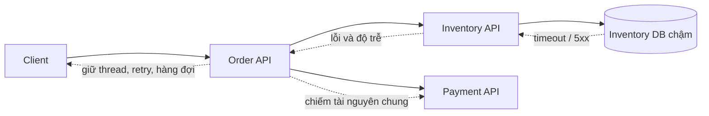
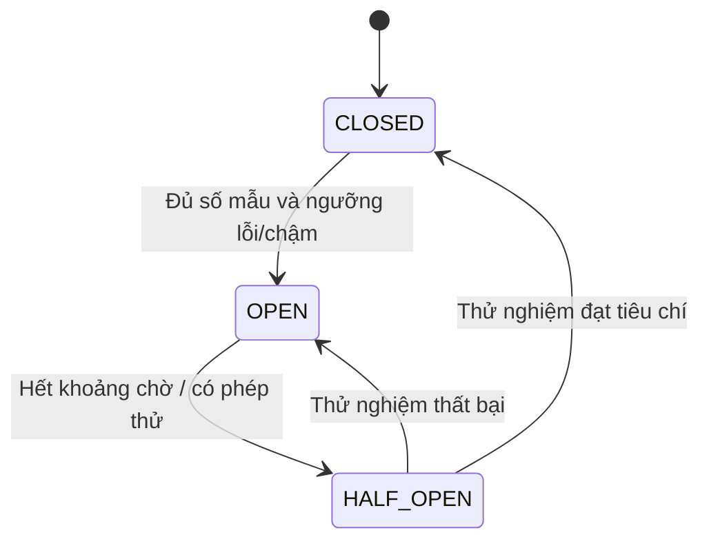

# Circuit breaker, bulkhead và tránh lỗi lan truyền trong REST API

## 1. Bài toán: một dịch vụ chậm làm cả hệ thống ngừng phục vụ

Giả sử `Order API` cần hỏi `Inventory API` trước khi xác nhận đơn hàng. Bình thường Inventory trả lời trong 80 ms. Khi cơ sở dữ liệu của Inventory quá tải, lời gọi bắt đầu mất 10–20 giây; Order API vẫn nhận request, tiếp tục mở kết nối, giữ thread và retry. Sau một thời gian, **Order API cũng hết thread, connection pool hoặc hàng đợi**, dù database của chính nó vẫn khỏe. Những endpoint không cần Inventory cũng có thể bị ảnh hưởng.



Lỗi lan truyền (*cascading failure*) xảy ra khi một thành phần không sẵn sàng kéo cạn tài nguyên của những thành phần vẫn đang hoạt động. Hai kỹ thuật quan trọng:

- **Circuit breaker**: ngừng gửi thêm yêu cầu tới một dependency đã có dấu hiệu lỗi nghiêm trọng; thử lại có kiểm soát khi dependency hồi phục.
- **Bulkhead**: cô lập và giới hạn **số lời gọi đồng thời** hoặc vùng tài nguyên dành cho một dependency, để dependency đó không chiếm hết năng lực của ứng dụng.

Chúng phải kết hợp **timeout/deadline**, **retry có ngân sách**, **backpressure**, hợp đồng HTTP và thiết kế fallback đúng ngữ nghĩa. Circuit breaker **không** thay thế connection pool; bulkhead **không** chữa lỗi của upstream; cả hai đều không tự tạo ra dữ liệu đúng khi dependency ngừng hoạt động.

Bài thuộc chương **Giới hạn và chống lỗi** của module **INTEGRATION_API_REST**: thiết kế API dựa trên resource/URI, phương thức, mã HTTP và hợp đồng dữ liệu rõ; thực hành phân trang, cache, idempotency, OpenAPI, xác thực/phân quyền, xử lý lỗi và kiểm thử bằng Java/Spring.

**Mục tiêu:** giải thích hai cơ chế và cách tránh retry storm; chọn chính sách theo dependency; triển khai Java/Spring với Resilience4j; thiết kế `503`, `429`, `Retry-After` và fallback đúng HTTP; kiểm thử circuit mở, bulkhead đầy, timeout, bảo mật và phục hồi.

## 2. Failure chain và ngân sách tài nguyên

### 2.1. Tại sao timeout đơn lẻ không đủ?

Giả sử mỗi request đặt read timeout 15 giây. Trong 15 giây ấy, **mỗi lời gọi blocking vẫn chiếm một servlet/worker thread**; nếu concurrency tăng nhanh hơn pool có thể xử lý, hàng đợi tích lũy. Thêm retry tại cả gateway, Order API và HTTP client có thể nhân số request đổ vào Inventory đúng lúc nó đang yếu.

```text
Client  -> Gateway -> Order API -> Inventory
           retry       retry         lỗi/độ trễ

Một request đầu vào có thể tạo nhiều lần thử ở mỗi tầng.
```

Một request HTTP timeout **không chứng minh** upstream chưa thực hiện tác động. Với `POST` giữ hàng hoặc thu tiền, retry chỉ an toàn khi có hợp đồng idempotency cụ thể và hệ thống lưu kết quả/operation theo key. Không chữa một lỗi tải bằng cách tăng vô hạn thread pool, max connections hay số lần retry.

### 2.2. Đặt chính sách theo đường gọi

| Control | Trả lời câu hỏi | Không giải quyết |
| --- | --- | --- |
| **Deadline/timeout** | Một request được chờ tối đa bao lâu? | Upstream sau timeout chắc chắn đã dừng hay chưa |
| **Circuit breaker** | Dependency có đủ khỏe để gửi thêm lời gọi? | Giới hạn concurrency của dependency khỏe nhưng chậm |
| **Bulkhead** | Bao nhiêu lời gọi được đi vào phần việc này cùng lúc? | Tỷ lệ lỗi và quá tải tại upstream |
| **Rate limit** | Một user/tenant/client được gửi bao nhiêu request trong cửa sổ? | Cô lập riêng một downstream trong service |
| **Retry budget** | Khi nào và được thử lại tối đa bao nhiêu lần? | Tính đúng một lần của side effect |
| **Fallback** | Có kết quả thay thế nào *đúng nghiệp vụ*? | Tạo ra tính đúng đắn khi không có nguồn dữ liệu tin cậy |

Với đường gọi đồng bộ `Order → Inventory`, cần đo arrival rate, p95/p99 upstream latency, số connection/threads, giới hạn DB và SLO của API. Số request đang xử lý trung bình có thể ước lượng theo **Little's Law**: `inFlight ≈ requestRate × serviceTime`. Khi thời gian chờ tăng gấp nhiều lần, số in-flight cũng tăng tương ứng nếu không đặt giới hạn.

### 2.3. Thiết kế khả năng chịu lỗi phải bảo toàn hợp đồng REST

`GET /api/inventory/sku-7` là thao tác đọc. Khi upstream không sẵn sàng, caller có thể nhận `503 Service Unavailable` hoặc dữ liệu cache được cho phép theo contract. Với `POST /api/reservations`, trả `200` cùng một số lượng tồn kho ước đoán **không** thể thay cho việc đã giữ hàng thành công. Nếu lệnh đã được tiếp nhận bền vững nhưng còn xử lý, `202 Accepted` + `Location` tới operation resource là một mô hình riêng; không trả `202` chỉ vì circuit breaker đang mở.

## 3. Circuit breaker: state machine chặn lỗi lặp lại

Circuit breaker quan sát những lời gọi hoàn tất qua nó và quyết định cho phép lời gọi kế tiếp hay không:



| State | Hành vi | Ý nghĩa |
| --- | --- | --- |
| **CLOSED** | Cho lời gọi đi qua; ghi nhận thành công, lỗi, độ trễ | Đang giám sát dependency |
| **OPEN** | Từ chối nhanh, **không** gọi upstream | Cho dependency thời gian hồi phục, bảo vệ caller |
| **HALF_OPEN** | Chỉ cho một số lời gọi thử nghiệm đi qua | Xác định có thể đóng lại hay cần mở tiếp |

Một breaker không đo “tổng lỗi từ trước đến nay”. Thường dùng **sliding window** theo số lời gọi hoặc thời gian, kết hợp `minimumNumberOfCalls`, ngưỡng **failure rate** và tùy cấu hình ngưỡng **slow-call rate**. Khi chưa có đủ mẫu, breaker chưa nhất thiết mở dù vài lần gọi đầu đã lỗi; điều này giúp tránh kết luận dựa trên một lần bất thường.

Ví dụ cấu hình học tập: cửa sổ 40 lời gọi, tối thiểu 20 mẫu, ngưỡng lỗi 50%, chờ 15 giây khi OPEN, chỉ thử 5 lời gọi HALF_OPEN. Các con số này **không phải quy tắc chung**: với dependency lưu lượng thấp, cửa sổ dựa theo thời gian có thể hợp lý hơn; với API ghi cực nhạy cảm, cần xem cả loại lỗi và hậu quả.

### 3.1. Lỗi nào nên làm breaker mở?

Không được đếm tất cả HTTP `4xx` như “Inventory đang hỏng”. Ví dụ:

- `404 Not Found` cho SKU không tồn tại và `400 Bad Request` do input sai thường là **kết quả nghiệp vụ/client**, không phản ánh sức khỏe dependency.
- `401`/`403` có thể là lỗi credential/cấu hình tích hợp; cần cảnh báo khẩn, nhưng retry/hồi phục breaker theo thời gian **không tự sửa** token/scope.
- Timeout, connection reset và nhiều `5xx` là tín hiệu dependency hoặc đường mạng không khỏe.
- `429 Too Many Requests` có thể chỉ ra quota bị vượt; chính sách breaker có thể coi là overload để giảm áp lực, nhưng phải phân biệt với quota của từng tenant.
- Bản thân `CallNotPermittedException` là **lời gọi bị chặn khi OPEN**, không phải một lỗi upstream mới cần tính vào failure rate.

Phân loại theo API contract, không đơn giản theo một regex status. `ignoreException` của Resilience4j có nghĩa **không tính** exception đó là thành công hay thất bại trong thống kê; vẫn phải ánh xạ HTTP kết quả cho caller.

### 3.2. Scope của breaker phải hợp lý

Thường dùng một circuit breaker **theo upstream hoặc nhóm operation có cùng failure domain**, ví dụ `inventory-read` tách `payment-charge`. Nếu dùng chung breaker cho mọi đối tác, một lỗi của Inventory có thể làm ngưng Payments dù Payments khỏe. Nếu tạo breaker mới cho từng request/user/ID, dữ liệu mẫu bị chia nhỏ và số lượng breaker/metrics tăng vô hạn.

Breaker là trạng thái **cục bộ của từng instance** khi dùng thư viện trong process; nhiều replica có thể mở/đóng vào các thời điểm khác nhau. Đây không tự động là lỗi. Nếu cần global traffic shed, thực hiện ở gateway/load-balancer hoặc một policy phối hợp có chủ đích, thay vì mặc định chia sẻ một trạng thái duy nhất qua network.

## 4. Bulkhead: chặn một dependency chiếm hết tài nguyên

Tên gọi lấy từ các khoang kín nước trên tàu: một khoang hỏng không làm ngập mọi khoang. Trong API, bulkhead phân chia năng lực để lời gọi tới một dependency xấu không chiếm hết thread, connection hay memory của ứng dụng.

### 4.1. Semaphore bulkhead

**Semaphore bulkhead** giới hạn số lời gọi đang thực thi:

```text
Incoming 50 requests
       |
       v
  Inventory bulkhead: maxConcurrentCalls = 12
       |             \ 
       |              \--> lời gọi vượt giới hạn: từ chối / chờ hữu hạn
       v
  <= 12 concurrent HTTP calls to Inventory
```

Nó không tạo worker threads riêng: nếu REST client đồng bộ đang chặn, tối đa 12 lời gọi đó vẫn giữ thread caller trong thời gian chạy. Khi hết slot, có thể **fail fast** (`maxWaitDuration=0`) hoặc chờ hữu hạn. Chờ quá lâu làm tăng tail latency; không “cứ xếp hàng là không mất request”.

### 4.2. Thread-pool bulkhead

**Thread-pool bulkhead** đưa việc xử lý blocking sang một executor có số thread và queue hữu hạn, cô lập workload khỏi thread pool khác. Điểm đánh đổi là chuyển ngữ cảnh, hàng đợi và chi phí bộ nhớ; nó **không làm JDBC hoặc HTTP blocking thành non-blocking**. Với Spring MVC, vẫn phải hiểu request thread, servlet async/`CompletableFuture` và cơ chế cancellation của công việc bên ngoài.

| Quyết định | Semaphore bulkhead | Thread-pool bulkhead |
| --- | --- | --- |
| Giới hạn | Lời gọi đồng thời | Worker threads + queue |
| Execution | Thường trên thread caller | Trên pool riêng |
| Hợp với | Client non-blocking hoặc blocking đã có executor phù hợp | Cách ly thư viện blocking khỏi nhóm công việc khác |
| Nguy cơ | Caller chờ và mất servlet threads | Queue phình, context propagation, overhead |

**Không đặt tất cả dependencies vào cùng một bulkhead.** Có thể đặt riêng `inventory`, `payments` và `notification`, đồng thời giữ một mức bảo vệ global cho CPU/DB/socket. Nếu Payments quan trọng hơn Notifications, cần quota tài nguyên và ưu tiên theo năng lực thực tế; bulkhead của một integration không ngăn mọi đường lỗi lan truyền khác.

## 5. Phối hợp timeout, circuit breaker, bulkhead và retry

### 5.1. Mỗi control quan sát một loại sự kiện

Một lời gọi đồng bộ có thể đi theo thứ tự:

```text
GET /api/orders/{id}
  |
  +-- Kiểm tra authentication / tenant / quyền trên resource
  |
  +-- Deadline còn đủ? ---------- không --> trả lỗi đúng contract
  |
  +-- Bulkhead: còn slot? ------- không --> từ chối nhanh (không gửi upstream)
        |
        +-- Circuit breaker: OPEN? -- có --> từ chối nhanh (không gửi upstream)
              |
              +-- HTTP client với connect/read timeout
                    |
                    +-- Inventory REST API
```

**Thứ tự có ý nghĩa.** Nếu breaker bọc ngoài bulkhead, một `BulkheadFullException` có thể bị tính là lỗi dependency nếu chưa cấu hình ignore; đây là **từ chối cục bộ**, không phải Inventory trả lỗi. Ví dụ Java bên dưới cố ý để `Bulkhead` bọc ngoài `CircuitBreaker`, vì vậy lời gọi bị bulkhead từ chối chưa đi vào bộ đếm của breaker. Khi dùng annotations/AOP, thứ tự aspect có thể khác và cần được xác minh từ phiên bản/configuration.

Timeout của HTTP client phải được cấu hình **bên trong** lời gọi mà breaker theo dõi. Nếu chỉ có timeout ở gateway sau khi worker đã gửi request, circuit breaker có thể chưa quan sát kết quả trong khoảng thời gian mong muốn. `slowCallDurationThreshold` của breaker chỉ **ghi nhận lời gọi chậm sau khi nó kết thúc**; không tự hủy socket đang chờ.

### 5.2. Không xếp retry vô hạn giữa các tầng

Ví dụ một client có hai lần retry và một service trung gian cũng retry có thể tạo nhiều lời gọi downstream cho cùng một ý định. Chỉ định **tầng sở hữu retry budget**, áp giới hạn số lần/tổng deadline, exponential backoff + jitter, và theo dõi attempts thay vì che retry trong từng library.

Các phép retry nên thỏa mãn:

1. Chỉ retry lỗi **tạm thời và phù hợp HTTP contract**, như connection failure, `502/503/504` hoặc `429` theo chính sách; không retry `400`, `401`, `403`, `409`, `412` như một sự cố mạng.
2. Có thời gian chờ và budget chung; nếu deadline chỉ còn rất ít, trả lời thay vì mở thêm attempt.
3. Khi breaker OPEN, **không retry liên tục `CallNotPermittedException`**. Một retry loop lúc này chỉ tăng tải cục bộ và log.
4. Với POST có side effect, giữ **cùng idempotency key và payload** nếu hợp đồng cho phép replay; nếu chưa có guarantee, tra cứu operation/status thay vì phát lệnh mới.
5. Tôn trọng `Retry-After` khi có ý nghĩa, nhưng không tin vào một giá trị quá lớn/không phù hợp ngân sách; server cũng phải chống retry storm từ nhiều callers đồng thời.

**Timeout không có nghĩa rollback.** Nếu Order API timeout khi gọi `POST /reservations`, Inventory có thể đã commit. Circuit breaker bảo vệ khả năng phục vụ, **không** bảo đảm exactly-once. Transactional outbox, idempotency record và reconciliation là những bài toán riêng.

## 6. Chọn HTTP status và fallback đúng ngữ nghĩa REST

Circuit breaker và bulkhead là **cơ chế nội bộ**; response vẫn phải mô tả kết quả mà client quan sát được.

| Tình huống | Kết quả gợi ý | Lưu ý |
| --- | --- | --- |
| Caller vượt quota request của chính mình | `429 Too Many Requests` | `Retry-After` hoặc rate-limit fields nếu policy dùng |
| Dependency không sẵn sàng / breaker OPEN | `503 Service Unavailable` | Có thể kèm `Retry-After`, không tiết lộ tên hạ tầng nội bộ |
| Bulkhead của một dependency đã đầy | `503 Service Unavailable` | Đây là **bảo vệ capacity**; không mặc định là quota của user |
| Gateway thực sự timeout chờ upstream | `504 Gateway Timeout` | Chỉ khi vai trò gateway/proxy và semantics phù hợp |
| Inventory báo không có SKU | `404 Not Found` theo API public | Không biến 404 thành failure-rate signal mặc định |
| Conflict khi giữ hàng, ETag sai | `409 Conflict` / `412 Precondition Failed` | Không retry như timeout; phải xử lý domain conflict |
| Đã tiếp nhận operation bền vững, chưa xử lý xong | `202 Accepted` + `Location` | Không trả 202 chỉ vì breaker OPEN |

Ví dụ khi Inventory chưa khả dụng và **không có fallback an toàn**:

```http
HTTP/1.1 503 Service Unavailable
Content-Type: application/problem+json
Cache-Control: no-store
Retry-After: 2

{
  "type": "https://api.example.test/problems/dependency-unavailable",
  "title": "Temporarily unavailable",
  "status": 503,
  "code": "DEPENDENCY_UNAVAILABLE"
}
```

`Retry-After: 2` chỉ là **gợi ý thời điểm có thể thử lại**, không phải bảo đảm breaker đã CLOSED sau đúng hai giây. Đừng để client tự retry vô hạn vì một header. Với dữ liệu có chứa tenant hoặc giá trị nhạy cảm, cân nhắc `Cache-Control: private, no-store` và bảo vệ các headers tương tự.

### 6.1. Khi nào fallback được phép?

Fallback có thể hợp lý với **GET dữ liệu tham khảo**: trả giá tồn kho cache **có TTL và dấu thời điểm** nếu client chấp nhận tính cũ; API contract phải nói rõ giá trị có thể stale, và cache phải cách ly theo tenant/quyền. Nó **không** phù hợp nếu dữ liệu đó dùng để bảo đảm giữ hàng chắc chắn, quyết định thanh toán hoặc kiểm tra quyền.

Không viết fallback:

```java
catch (Exception ignored) {
    return new InventoryView(sku, 9999); // Sai: tạo tồn kho giả.
}
```

Với `POST` thu tiền, giữ hàng, duyệt đơn, thay vì trả thành công giả khi upstream không rõ kết quả, hãy trả lỗi phù hợp hoặc **tạo operation resource bền vững** nếu kiến trúc hỗ trợ. Nếu phản hồi trả một phần dữ liệu, hợp đồng phải mô tả **partial/degraded** một cách tường minh; `206 Partial Content` không phải mã chung cho “nghiệp vụ chỉ trả được một nửa” (206 dành cho range requests).

### 6.2. OpenAPI cũng cần mô tả điều kiện quá tải

```yaml
paths:
  /api/inventory/{sku}:
    get:
      parameters:
        - in: path
          name: sku
          required: true
          schema: { type: string }
      responses:
        '200':
          description: Inventory snapshot
        '404':
          description: SKU not found
        '429':
          description: Caller exceeded quota
        '503':
          description: Dependency temporarily unavailable
          headers:
            Retry-After:
              description: Seconds or HTTP-date hint, when available
              schema: { type: string }
```

Đây là **đoạn OpenAPI minh họa**, cần ghép với `openapi`, `info`, `components`, response content schema và security scheme của API thực tế. Không cố khai báo một `CircuitBreaker` như HTTP status: client chỉ nên biết kết quả/contract, không phụ thuộc thư viện nội bộ.

## 7. Triển khai Java/Spring bằng Resilience4j

Ví dụ sử dụng **Java 17, Spring Boot 3.2+ / Spring Framework 6.1+, Spring MVC** và **Resilience4j 2.x**. Dùng `RestClient` để gọi Inventory; `CircuitBreaker` và `Bulkhead` là **singleton beans theo dependency**. Đoạn code cố ý ghép decorator tường minh để thấy rõ thứ tự, không cần AOP annotations.

Các dependency phù hợp gồm Spring Web MVC, Spring validation/test, `resilience4j-circuitbreaker` và `resilience4j-bulkhead`; nếu muốn dùng annotation `@CircuitBreaker`/`@Bulkhead`, bổ sung integration `resilience4j-spring-boot3`, Spring AOP và configuration tương ứng. Không trộn code ví dụ tường minh với annotation chồng nhiều lần khiến một lời gọi bị bảo vệ lặp.

### 7.1. Cấu hình RestClient, breaker và semaphore bulkhead

```java
package example.inventory;

import java.net.http.HttpClient;
import java.time.Duration;
import org.springframework.beans.factory.annotation.Value;
import org.springframework.context.annotation.Bean;
import org.springframework.context.annotation.Configuration;
import org.springframework.http.client.JdkClientHttpRequestFactory;
import org.springframework.web.client.RestClient;
import org.springframework.web.client.RestClientResponseException;
import io.github.resilience4j.circuitbreaker.CircuitBreaker;
import io.github.resilience4j.circuitbreaker.CircuitBreakerConfig;
import io.github.resilience4j.bulkhead.Bulkhead;
import io.github.resilience4j.bulkhead.BulkheadConfig;

@Configuration
class InventoryResilienceConfiguration {

    @Bean("inventoryRestClient")
    RestClient inventoryRestClient(RestClient.Builder builder,
            @Value("${clients.inventory.base-url}") String baseUrl) {
        HttpClient transport = HttpClient.newBuilder()
            .connectTimeout(Duration.ofMillis(700))
            .followRedirects(HttpClient.Redirect.NEVER)
            .build();
        JdkClientHttpRequestFactory factory =
            new JdkClientHttpRequestFactory(transport);
        factory.setReadTimeout(Duration.ofMillis(1500));
        return builder.baseUrl(baseUrl)
            .requestFactory(factory).build();
    }

    @Bean("inventoryCircuitBreaker")
    CircuitBreaker inventoryCircuitBreaker() {
        CircuitBreakerConfig config = CircuitBreakerConfig.custom()
            .slidingWindowType(CircuitBreakerConfig.SlidingWindowType.COUNT_BASED)
            .slidingWindowSize(40)
            .minimumNumberOfCalls(20)
            .failureRateThreshold(50f)
            .slowCallRateThreshold(80f)
            .slowCallDurationThreshold(Duration.ofSeconds(1))
            .waitDurationInOpenState(Duration.ofSeconds(15))
            .permittedNumberOfCallsInHalfOpenState(5)
            // 4xx nghiệp vụ không làm breaker mở; 429 có thể báo quá tải.
            .ignoreException(t -> t instanceof RestClientResponseException ex
                && ex.getStatusCode().is4xxClientError()
                && ex.getStatusCode().value() != 429)
            .build();
        return CircuitBreaker.of("inventory-read", config);
    }

    @Bean("inventoryBulkhead")
    Bulkhead inventoryBulkhead() {
        return Bulkhead.of("inventory-read", BulkheadConfig.custom()
            .maxConcurrentCalls(12)
            .maxWaitDuration(Duration.ZERO)
            .build());
    }
}
```

Các giá trị **700 ms, 1,5 s, 40 mẫu, 12 concurrent** chỉ để minh họa cách kết nối các controls; chọn thực tế bằng đo latency, traffic, khả năng của upstream, budget API và load tests. Read timeout của request factory không nhất thiết là **tổng deadline** cho mọi byte và retry; cần một deadline tổng nếu workflow gồm nhiều bước.

`ignoreException` phải được review theo **hợp đồng cụ thể**: ví dụ `404` cho SKU không tồn tại không làm breaker mở, còn `429` của Inventory là tín hiệu overload được tính trong bản mẫu. Một `401` do credential hết hạn không được xem là “Inventory đã chết”; tuy nhiên vẫn phải alert và sửa tích hợp, không tự bỏ qua lỗi. Đặc tính exception từ HTTP client/factory khác nhau theo phiên bản; cần test phân loại thật với mock server.

### 7.2. Bảo vệ một lời gọi outbound, không tạo breaker mỗi lần

```java
package example.inventory;

import java.util.function.Supplier;
import org.springframework.beans.factory.annotation.Qualifier;
import org.springframework.http.HttpStatus;
import org.springframework.http.MediaType;
import org.springframework.stereotype.Service;
import org.springframework.web.client.RestClient;
import org.springframework.web.client.RestClientResponseException;
import org.springframework.web.client.ResourceAccessException;
import org.springframework.web.server.ResponseStatusException;
import io.github.resilience4j.circuitbreaker.CircuitBreaker;
import io.github.resilience4j.bulkhead.Bulkhead;

record InventoryView(String sku, int available) {}

@Service
class InventoryHttpGateway {
    private final RestClient client;

    InventoryHttpGateway(@Qualifier("inventoryRestClient") RestClient client) {
        this.client = client;
    }

    InventoryView fetch(String sku) {
        InventoryView view = client.get()
            .uri("/api/inventory/{sku}", sku)
            .accept(MediaType.APPLICATION_JSON)
            .retrieve().body(InventoryView.class);
        if (view == null) throw new IllegalStateException(
            "Inventory response missing");
        return view;
    }
}

class InventoryDependencyException extends RuntimeException {
    InventoryDependencyException(Throwable cause) {
        super("Inventory dependency unavailable", cause);
    }
}

@Service
class ProtectedInventoryGateway {
    private final InventoryHttpGateway downstream;
    private final CircuitBreaker breaker;
    private final Bulkhead bulkhead;

    ProtectedInventoryGateway(InventoryHttpGateway downstream,
            @Qualifier("inventoryCircuitBreaker") CircuitBreaker breaker,
            @Qualifier("inventoryBulkhead") Bulkhead bulkhead) {
        this.downstream = downstream;
        this.breaker = breaker;
        this.bulkhead = bulkhead;
    }

    InventoryView get(String sku) {
        Supplier<InventoryView> call = () -> downstream.fetch(sku);
        Supplier<InventoryView> measured =
            CircuitBreaker.decorateSupplier(breaker, call);
        // Bulkhead chạy trước breaker: local reject không tính upstream fail.
        Supplier<InventoryView> guarded =
            Bulkhead.decorateSupplier(bulkhead, measured);
        try {
            return guarded.get();
        } catch (RestClientResponseException error) {
            if (error.getStatusCode().value() == 404) {
                throw new ResponseStatusException(HttpStatus.NOT_FOUND);
            }
            // 4xx từ upstream khác không tự chuyển thành 401/403 của caller.
            throw new InventoryDependencyException(error);
        } catch (ResourceAccessException error) {
            throw new InventoryDependencyException(error);
        }
    }
}
```

**Tại sao kiểm tra `404` sau decorator?** Breaker đã nhận exception từ HTTP client và bỏ qua lỗi 4xx theo `ignoreException`; ứng dụng tiếp đó chuyển tình huống không có SKU sang public `404`. Không chuyển upstream `401/403` thành public `401/403` nếu đó là **lỗi credential giữa hai service**: caller có thể đã xác thực hợp lệ, còn service đang gặp lỗi tích hợp. Trong trường hợp này phải log an toàn/alert và trả lỗi dependency tổng quát.

`BulkheadFullException` và `CallNotPermittedException` **không bị bắt** trong đoạn trên: chúng tiếp tục tới HTTP error handler. Mỗi lời gọi dùng một `Supplier` mới nhưng giữ cùng breaker/bulkhead beans; **không tạo `CircuitBreaker.of(...)` trong method `get`** vì làm mất số liệu thống kê và khả năng OPEN.

### 7.3. Chuyển từ lỗi nội bộ thành HTTP response ổn định

```java
package example.inventory;

import io.github.resilience4j.bulkhead.BulkheadFullException;
import io.github.resilience4j.circuitbreaker.CallNotPermittedException;
import org.springframework.http.CacheControl;
import org.springframework.http.HttpStatus;
import org.springframework.http.ProblemDetail;
import org.springframework.http.ResponseEntity;
import org.springframework.web.bind.annotation.ExceptionHandler;
import org.springframework.web.bind.annotation.RestControllerAdvice;

@RestControllerAdvice
class InventoryErrorAdvice {
    @ExceptionHandler({
        CallNotPermittedException.class,
        BulkheadFullException.class,
        InventoryDependencyException.class
    })
    ResponseEntity<ProblemDetail> dependencyUnavailable(Exception error) {
        ProblemDetail body =
            ProblemDetail.forStatus(HttpStatus.SERVICE_UNAVAILABLE);
        body.setTitle("Temporarily unavailable");
        body.setProperty("code", "DEPENDENCY_UNAVAILABLE");
        return ResponseEntity.status(HttpStatus.SERVICE_UNAVAILABLE)
            .header("Retry-After", "2")
            .cacheControl(CacheControl.noStore())
            .body(body);
    }
}
```

Khi làm API facade, controller có thể gọi `ProtectedInventoryGateway.get(sku)` rồi trả `200`/`404`/`503` theo hợp đồng. Đừng nhúng raw stack trace, host nội bộ, secrets hoặc token của downstream vào `ProblemDetail`; telemetry riêng có thể lưu nguyên nhân lỗi đã được lọc PII. `Retry-After` chỉ là gợi ý có giới hạn, không được công khai chính xác toàn bộ cấu hình breaker nếu policy không cho phép.

**Bảo mật:** controller vẫn cần xác thực/phân quyền cho caller trước khi gọi gateway. `InventoryHttpGateway` phải sử dụng **machine credential được cấp đúng audience/scope hoặc mTLS** theo chính sách của Inventory; không tự forward access token của người dùng tới một host bên thứ ba. Tách circuit/pool theo trust policy và không dùng cache fallback đa tenant chung khi chứa dữ liệu nhạy cảm.

## 8. Nếu ứng dụng dùng WebFlux hoặc ThreadPoolBulkhead

WebFlux có thể dùng Resilience4j thông qua module tích hợp Reactor (`resilience4j-reactor`). Pipeline reactive cần bảo vệ **tại subscription**, không chỉ tại lúc tạo `Mono`:

```java
import java.time.Duration;
import io.github.resilience4j.reactor.circuitbreaker.operator.CircuitBreakerOperator;
import io.github.resilience4j.reactor.bulkhead.operator.BulkheadOperator;
import reactor.core.publisher.Mono;

Mono<InventoryView> getStock(String sku) {
    return webClient.get().uri("/api/inventory/{sku}", sku)
        .retrieve().bodyToMono(InventoryView.class)
        .timeout(Duration.ofSeconds(2))
        .transformDeferred(CircuitBreakerOperator.of(breaker))
        .transformDeferred(BulkheadOperator.of(bulkhead));
}
```

Đây là **method minh họa** trong một service có `webClient`, `breaker`, `bulkhead` đã được inject. `BulkheadOperator` ở ngoài chiếm slot trước breaker; timeout xảy ra bên trong breaker để có thể được ghi nhận. **Không** gọi `.block()` trên event-loop thread để dùng bulkhead, và không cho một `Flux` vô hạn giữ mãi slot nếu policy yêu cầu giám sát theo stream. Khi dùng streaming/SSE, cần chính sách quota subscriber và cleanup on cancel riêng.

Với thư viện JDBC/HTTP blocking, một `ThreadPoolBulkhead` có thể cô lập worker threads, nhưng không xóa blocking I/O. `TimeLimiter` áp cho `CompletableFuture` có thể hoàn thành phía caller bằng timeout mà **không đảm bảo đã dừng** truy vấn/side effect đang chạy; backend vẫn cần connection timeout, read timeout, cancel/transaction deadline và shutdown logic. Không tạo pool riêng cho từng HTTP request.

## 9. Quan sát, bảo mật và kiểm soát khi triển khai

### 9.1. Metrics giúp phân biệt phục hồi và che giấu sự cố

Theo dõi các chỉ số theo **dependency/operation có cardinality hữu hạn**:

| Quan sát | Hướng hành động |
| --- | --- |
| `CLOSED → OPEN → HALF_OPEN` transitions | Điều tra dependency, thời gian phục hồi và flapping |
| Calls `successful`/`failed`/`ignored`/`not permitted` | Tách lỗi upstream khỏi lỗi policy và circuit đang OPEN |
| Failure rate, slow-call rate, thời gian chờ downstream | Đánh giá ngưỡng/window, timeout và SLO |
| Bulkhead available permits, rejected calls, wait duration | Kiểm tra concurrency, queue, nhu cầu ưu tiên |
| Connection pool active/idle/pending, thread count | Phát hiện queue và pool exhaustion |
| HTTP `429/503`, retry attempts, retry budget spent | Phát hiện retry storm hoặc throttling không cân đối |
| Fallback served + data age/TTL | Ngăn fallback stale bị hiểu là kết quả mới |

Đặt alert khi breaker OPEN quá lâu, tần suất OPEN/CLOSED lặp lại, rejection tăng hoặc dependency latency vượt ngân sách; **không chỉ alert dựa trên 5xx tổng** vì OPEN có thể giảm số lỗi upstream nhưng cũng giảm availability của API. Dashboard cần thể hiện request được chấp nhận, bị loại, được fallback và tác động đến nghiệp vụ.

Không đặt `userId`, raw `orderId`, full URL, bearer token hoặc idempotency key trong metric labels; dùng dependency name, route template, status group và tenant tier hữu hạn theo chính sách. Security logs có thể ghi event/trace ID đã được bảo vệ, không ghi payload thanh toán hoặc chứng chỉ riêng.

### 9.2. Tách lỗi tải khỏi lạm dụng của caller

**Rate limiting** kiểm soát tần suất gửi request theo identity/tenant/API key, còn **bulkhead** giới hạn công việc đồng thời theo dependency và **circuit breaker** phản ứng với sức khỏe dependency. Một user cố ý flood endpoint có thể tiêu tốn semaphore permit của các user khác dù breaker luôn CLOSED. Cần có ingress rate limit, per-tenant quota, authentication/authorization trước công việc tốn kém và các chính sách công bằng theo mức độ nhạy cảm.

Ví dụ request không có scope `orders:read` nên bị `403` trước khi gọi Inventory. Không dùng “fallback sang dữ liệu cache” để bỏ qua object-level authorization khi service policy không truy cập được. Nếu quyền đã bị thu hồi nhưng response cũ còn trong cache, cache key/TTL/invalidations phải tiếp tục tôn trọng tenant và quyền truy cập.

### 9.3. Test và rollout ngưỡng cấu hình

Ngưỡng của breaker và bulkhead là **chính sách vận hành có thể thay đổi**, không phải “đặt một lần là xong”. Cần quan sát traffic thật, mô phỏng degradation (slow, timeout, connection reset, 5xx, quota 429), đo tail latency và canary rollout. Khi quá ít request, `minimumNumberOfCalls` lớn khiến breaker không mở kịp; khi quá nhạy, breaker có thể OPEN vì lỗi thoáng qua rồi flapping.

Khi ứng dụng có nhiều replica, **mỗi replica có trạng thái breaker riêng**: dashboard có thể báo instance A OPEN và B CLOSED cùng lúc. Đừng ép dùng lock toàn cục cho mọi lời gọi chỉ để state thống nhất; quyết định có cần coordinated shed ở ingress hay không dựa trên failure domain.

## 10. Kiểm thử circuit breaker và bulkhead đúng hành vi

### 10.1. Circuit OPEN phải không gửi thêm HTTP request

Đây là integration-style test **Java 17, JUnit 5, Spring Test, Resilience4j**. Dùng `MockRestServiceServer` để đếm request thực do `RestClient` tạo; trong test tạo breaker/bulkhead riêng để không rò state sang test khác. Sử dụng các lớp `InventoryHttpGateway`, `ProtectedInventoryGateway` ở mục 7.

```java
package example.inventory;

import static org.junit.jupiter.api.Assertions.*;
import static org.springframework.test.web.client.match.MockRestRequestMatchers.*;
import static org.springframework.test.web.client.response.MockRestResponseCreators.*;

import java.time.Duration;
import org.junit.jupiter.api.Test;
import org.springframework.http.HttpStatus;
import org.springframework.test.web.client.ExpectedCount;
import org.springframework.test.web.client.MockRestServiceServer;
import org.springframework.web.client.RestClient;
import org.springframework.web.client.RestClientResponseException;
import io.github.resilience4j.circuitbreaker.*;
import io.github.resilience4j.bulkhead.*;

class InventoryResilienceTest {
    @Test
    void opensAfterFailuresAndSkipsThirdHttpCall() {
        RestClient.Builder builder = RestClient.builder()
            .baseUrl("https://inventory.example.test");
        MockRestServiceServer server =
            MockRestServiceServer.bindTo(builder).build();

        server.expect(ExpectedCount.times(2),
                requestTo("https://inventory.example.test/api/inventory/sku-7"))
            .andRespond(withStatus(HttpStatus.SERVICE_UNAVAILABLE));

        CircuitBreaker breaker = CircuitBreaker.of("inventory-test",
            CircuitBreakerConfig.custom()
                .slidingWindowSize(2)
                .minimumNumberOfCalls(2)
                .failureRateThreshold(50f)
                .waitDurationInOpenState(Duration.ofMinutes(1))
                .build());
        Bulkhead bulkhead = Bulkhead.of("inventory-test",
            BulkheadConfig.custom().maxConcurrentCalls(2)
                .maxWaitDuration(Duration.ZERO).build());
        ProtectedInventoryGateway gateway = new ProtectedInventoryGateway(
            new InventoryHttpGateway(builder.build()), breaker, bulkhead);

        assertThrows(InventoryDependencyException.class,
            () -> gateway.get("sku-7"));
        assertThrows(InventoryDependencyException.class,
            () -> gateway.get("sku-7"));
        assertEquals(CircuitBreaker.State.OPEN, breaker.getState());
        assertThrows(CallNotPermittedException.class,
            () -> gateway.get("sku-7"));
        server.verify(); // Hai HTTP calls, không có request thứ ba.
    }
}
```

**Điểm cần hiểu:** `MockRestServiceServer` xác minh request Spring gửi xuống request adapter; nó không thử TCP/TLS thật. Test này cũng không chứng minh HALF_OPEN tự hồi phục: nên có ca riêng với **clock hoặc chuyển state có kiểm soát**, cung cấp đủ các lời gọi thành công trong HALF_OPEN và xác minh breaker trở về CLOSED. Không dùng `Thread.sleep(15000)` trong CI để chờ breaker đổi state.

### 10.2. Semaphore bulkhead đầy phải từ chối mà không gửi việc thứ hai

Unit test dùng `CountDownLatch` để giữ lời gọi thứ nhất đang chiếm slot, không dựa vào sleep/race:

```java
import static org.junit.jupiter.api.Assertions.*;
import java.time.Duration;
import java.util.concurrent.*;
import java.util.function.Supplier;
import org.junit.jupiter.api.Test;
import io.github.resilience4j.bulkhead.*;

class SemaphoreBulkheadTest {
    @Test
    void rejectsWhenOnePermitIsAlreadyInUse() throws Exception {
        Bulkhead bulkhead = Bulkhead.of("test",
            BulkheadConfig.custom().maxConcurrentCalls(1)
                .maxWaitDuration(Duration.ZERO).build());
        CountDownLatch entered = new CountDownLatch(1);
        CountDownLatch release = new CountDownLatch(1);
        Supplier<String> protectedCall = Bulkhead.decorateSupplier(
            bulkhead, () -> {
                entered.countDown();
                try {
                    if (!release.await(3, TimeUnit.SECONDS)) {
                        throw new IllegalStateException("Test deadline");
                    }
                } catch (InterruptedException ex) {
                    Thread.currentThread().interrupt();
                    throw new IllegalStateException(ex);
                }
                return "OK";
            });

        ExecutorService worker = Executors.newSingleThreadExecutor();
        try {
            Future<String> first = worker.submit(protectedCall::get);
            assertTrue(entered.await(2, TimeUnit.SECONDS));
            assertThrows(BulkheadFullException.class, protectedCall::get);
            release.countDown();
            assertEquals("OK", first.get(2, TimeUnit.SECONDS));
        } finally {
            release.countDown();
            worker.shutdownNow();
        }
    }
}
```

Đây là test **số permit** của một semaphore bulkhead; không thử REST server. Kết hợp thêm HTTP test với mock server để xác minh request bị bulkhead từ chối không được gửi đến upstream. Trong production, kiểm tra executor/connection pool vẫn bị giới hạn và không tạo hàng nghìn requests đang chờ acquire permit.

### 10.3. Test matrix cho hệ thống hoàn chỉnh

| Tình huống | Điều phải chứng minh |
| --- | --- |
| 404/400 nghiệp vụ từ Inventory | Không mở breaker chỉ vì lỗi client; HTTP được ánh xạ đúng |
| Nhiều 5xx/connection timeout | Breaker OPEN theo ngưỡng/window; lời gọi tiếp theo fail fast |
| OPEN → HALF_OPEN với ít probe | Không mở flood; thành công phục hồi, thất bại quay OPEN |
| Bulkhead đã đạt `maxConcurrentCalls` | Lời gọi vượt giới hạn bị từ chối, số outbound không tăng |
| Gateway/client cùng bật retry | Retry budget không nhân lên; không retry OPEN liên tục |
| POST tạo reservation timeout sau khi server commit | Giữ idempotency key; không tạo hai reservation |
| Fallback cache dữ liệu của tenant A | Tenant B không nhận dữ liệu A, TTL/freshness rõ |
| Hết hạn token khi dependency đang lỗi | Không bypass auth, không log bearer token |
| Rolling deploy / restart instance | Breaker state mới được khởi tạo có chủ đích, alerts đúng |
| Dependency hồi phục / health probe | Traffic trở lại có giới hạn, không gây surge tức thời |

**Đừng chỉ assert `status().isServiceUnavailable()`:** phải chứng minh upstream **không nhận thêm request** khi breaker OPEN, không có side effect bị lặp sau timeout, và các requests độc lập vẫn hoạt động dưới tải. Cần kiểm thử HTTP trên loopback/WireMock hoặc môi trường integration với network fault injection để kiểm tra socket timeout thật; MockRestServiceServer đơn lẻ không làm được việc đó.

## 11. Các phản mẫu và quyết định thay thế

| Phản mẫu | Hệ quả | Hướng sửa |
| --- | --- | --- |
| Tạo `CircuitBreaker` trong mỗi request | State luôn mới; không có window đủ mẫu | Singleton registry/bean theo failure domain |
| Dùng chung một breaker cho Inventory và Payments | Một upstream lỗi chặn cả upstream khác | Tách breaker/bulkhead theo dependency và criticality |
| Đếm 400/404 thành lỗi dependency | OPEN dù API vận hành đúng | Phân loại exception theo contract |
| Bulkhead không có timeout hoặc queue vô hạn | Thay vì fail fast, request nghẽn ở hàng chờ | Bounded permits/queue và tổng deadline |
| Breaker OPEN nhưng retry mọi lỗi | Tăng công việc vô ích, retry storm | Không retry `CallNotPermittedException` |
| Chỉ đặt breaker, không đặt read timeout | Lời gọi chậm giữ permit/thread rất lâu | Timeout/deadline thực ở HTTP client |
| Fallback thành `available=9999` hoặc `success=true` | Tạo dữ liệu giả, sai nghiệp vụ | Chỉ fallback có nguồn, TTL và contract |
| Dùng `429` cho mọi lỗi dependency | Gán sai trách nhiệm cho caller | `503` cho service unavailable; `429` cho caller quota |
| Tắt auth khi upstream lỗi | Rò dữ liệu/leo thang quyền đúng lúc sự cố | Kiểm tra quyền trước fallback/cache |
| Chỉ kiểm tra HTTP status trong test | Không biết upstream còn bị flood hoặc side effect lặp | Đếm outbound calls, DB state, metrics |

**Quyết định quan trọng nhất:** nếu một tác vụ cần vài phút và có thể tiếp tục sau client disconnect, một HTTP request blocking với circuit/bulkhead **không phải** giải pháp duy nhất. Chuyển sang `202 Accepted` + operation resource, queue bền vững, idempotency và worker độc lập khi nghiệp vụ cho phép.

## 12. Bài tập: khoanh vùng lỗi và bảo vệ API đơn hàng

**Bối cảnh:** Order API nhận khoảng **100 request/giây** cần đọc tồn kho. Inventory thường hoàn tất sau **100 ms**, nhưng khi database bị nghẽn, thời gian xử lý tăng lên **2 giây**. Order API có 80 worker threads dùng chung với các endpoint thanh toán. Client gửi GET và POST tạo reservation; gateway và service hiện cùng tự retry khi timeout.

**Yêu cầu:**

1. Dùng `inFlight ≈ λ × W` ước lượng concurrency bình thường và khi Inventory chậm; giải thích vì sao các endpoint không dùng Inventory cũng bị ảnh hưởng.
2. Đề xuất semaphore bulkhead cho Inventory và circuit breaker theo dependency. Chỉ rõ trạng thái CLOSED/OPEN/HALF_OPEN và loại lỗi nào được tính; tại sao phải có `minimumNumberOfCalls`?
3. Chọn timeout, retry budget và HTTP response cho: caller vượt quota, Inventory timeout, breaker OPEN, SKU không có, reservation đã commit nhưng client mất kết nối.
4. Viết test để chứng minh 5xx liên tục mở breaker; khi OPEN không còn outbound call; bulkhead không dùng quá N slots; và retry POST không tạo hai reservations.
5. Nếu fallback lấy cache tồn kho, xác định điều kiện nào được trả `200` và điều kiện nào bắt buộc fail closed; nêu tác động đến authorization và dữ liệu theo tenant.

**Gợi ý lời giải:** với 100 req/s, 100 ms tương ứng khoảng **10 lời gọi in-flight** nếu ở trạng thái ổn định; với 2 giây là khoảng **200** nếu không giới hạn – vượt năng lực 80 worker. Chọn bulkhead theo khả năng downstream đã đo (ví dụ 12–16 slots ban đầu chỉ để thử tải), timeout nhỏ hơn ngân sách API, breaker có window/ngưỡng đủ mẫu và HALF_OPEN probes hữu hạn. `429` dành cho quota caller, `503` cho dependency unavailable, `404` cho SKU thực sự không tồn tại; timeout sau POST **không chứng minh** reservation thất bại. Với POST, giữ cùng idempotency key/payload và đối soát kết quả hoặc dùng operation resource. Cache chỉ được dùng nếu contract cho phép stale data và auth/tenant vẫn được kiểm tra, không dùng để khẳng định đã giữ hàng.

## 13. Kết luận và checklist triển khai

Circuit breaker **giảm lời gọi tới dependency đang lỗi**, bulkhead **giữ một lỗi không chiếm hết năng lực của hệ thống**. Hai kỹ thuật bổ trợ nhau nhưng cần timeout thực, retry budget, quota ở ranh giới và fallback đúng nghiệp vụ. Khi OPEN hoặc đầy bulkhead, trả HTTP response theo hợp đồng – thường `503` – thay vì tạo thành công giả; với side effect phải bảo vệ idempotency và kết quả không chắc chắn.

Checklist trước release: xác định failure domain và owner; timeout ở client/DB/gateway; breaker phân loại exceptions đúng; bulkhead/queue hữu hạn; `429/503` và `Retry-After` có ý nghĩa; quyền truy cập và cache không rò tenant; telemetry cảnh báo OPEN/rejection; test không gửi outbound khi fail fast; load/fault-injection xác minh endpoint độc lập vẫn hoạt động.

### Tham khảo

- [Resilience4j – CircuitBreaker](https://resilience4j.readme.io/docs/circuitbreaker) và [Bulkhead](https://resilience4j.readme.io/docs/bulkhead): state, sliding window và giới hạn đồng thời.
- [Resilience4j – Retry](https://resilience4j.readme.io/docs/retry): retry có điều kiện và ngân sách.
- [RFC 9110 – HTTP Semantics](https://www.rfc-editor.org/rfc/rfc9110) và [RFC 9457 – Problem Details](https://www.rfc-editor.org/rfc/rfc9457): ý nghĩa status và lỗi HTTP.

