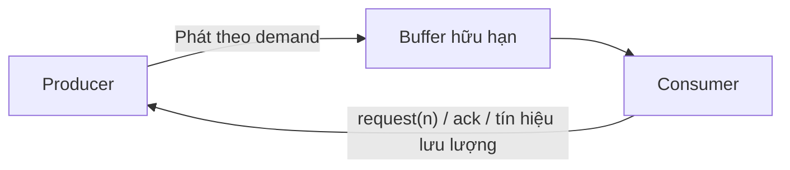
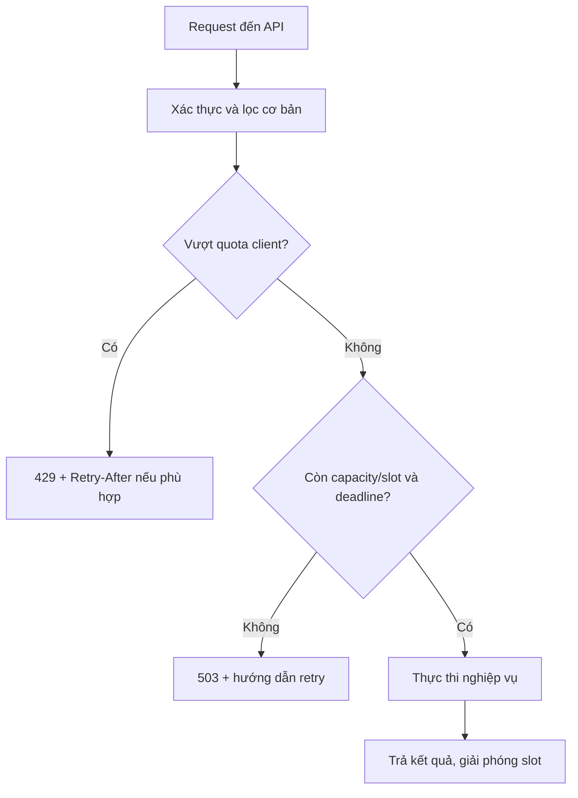

# Backpressure, hàng chờ hữu hạn và từ chối sớm

## Mục tiêu học tập

Sau bài này, bạn có thể:

- Giải thích **backpressure**, **admission control**, **bounded queue** và **load shedding** trong một REST API, đồng thời phân biệt chúng với rate limiting.
- Dùng tốc độ đến, năng lực xử lý, số request đang chạy, thời gian chờ và định luật Little để ước lượng vì sao hàng chờ dài làm tăng độ trễ.
- Thiết kế chính sách **từ chối sớm** trước khi hệ thống hết thread, connection, heap hoặc quota downstream; lựa chọn đúng `429`, `503` và `Retry-After`.
- Tạo giới hạn đồng thời và hàng chờ hữu hạn trong Java/Spring, hiểu sự khác nhau giữa Spring MVC và WebFlux.
- Kiểm thử quá tải, quan sát metric và phối hợp timeout, retry, idempotency để tránh hiệu ứng khuếch đại lỗi.

## 1. Bài toán: API vẫn nhận request nhưng không kịp xử lý

Giả sử một REST API đặt hàng có đường đi:

```text
Browser/mobile client
    → CDN/API Gateway
    → Spring REST API
    → Thread/connection pool
    → Database, payment service
```

Vào ngày bình thường, API xử lý được khoảng 100 request/giây. Khi chiến dịch quảng cáo bắt đầu, 250 request/giây đổ vào, trong khi database vẫn chỉ chịu được khoảng 100 request/giây. Nếu tiếp tục **nhận mọi request rồi đẩy vào hàng chờ không giới hạn**, hệ thống có thể gặp chuỗi sự cố:

1. Số request chờ tăng nhanh; latency ở `p95/p99` cao dù CPU chưa chắc luôn 100%.
2. Thread chờ connection, connection chờ database; các deadline của client hết hạn.
3. Client retry tạo thêm request, khiến hàng chờ lại dài hơn.
4. Heap, socket, thread hoặc pool cạn kiệt; cả request hợp lệ và health check đều bị ảnh hưởng.

**Mục tiêu của resilience không phải xử lý vô hạn request.** Mục tiêu là giữ hệ thống trong vùng có thể phục vụ với thời gian phản hồi dự đoán được, từ chối phần vượt khả năng **càng sớm càng tốt**, và báo cho client cách ứng xử hợp lý.

## 2. Bốn khái niệm dễ bị lẫn

| Khái niệm | Trả lời câu hỏi | Ví dụ |
| --- | --- | --- |
| **Backpressure** | Bên xử lý chậm làm cách nào báo ngược để bên phát giảm tốc hoặc tạm dừng? | Reactive Streams dùng tín hiệu `request(n)`; consumer đọc từng phần khi sẵn sàng |
| **Bounded queue** | Có bao nhiêu phần việc được phép chờ? | Executor có 8 worker và tối đa 32 task đang đợi |
| **Admission control / load shedding** | Khi nào từ chối request mới để giữ dịch vụ sống? | Khi 16 request đang chạy, trả `503` thay vì đợi vô hạn |
| **Rate limiting** | Mỗi client/tenant được sử dụng bao nhiêu lượt trong một khoảng thời gian? | Mỗi API key tối đa 60 request/phút; vượt hạn mức trả `429` |

Các cơ chế này có thể phối hợp. Một tenant dù **chưa vượt quota** vẫn có thể nhận `503` khi backend quá tải toàn hệ thống. Ngược lại, backend còn rảnh nhưng một client vượt quota thì vẫn trả `429`. **Rate limit theo thời gian không thay thế concurrency limit**, vì một request chậm có thể chiếm tài nguyên lâu bất thường.

Trong HTTP request/response truyền thống, server không có tín hiệu Reactive Streams `request(n)` để điều khiển trực tiếp mọi client ngoài Internet. Vì vậy backpressure ở ranh giới API thường là sự kết hợp của giới hạn kết nối/đồng thời, hàng chờ ngắn, phản hồi quá tải, timeout và hướng dẫn retry. TCP flow control chỉ điều tiết byte trên một kết nối; **không tự bảo vệ** số giao dịch nghiệp vụ đang chạy.

## 3. Mô hình tốc độ đến và năng lực xử lý

Ký hiệu:

- `λ` (lambda): tốc độ request đến, đơn vị request/giây.
- `μ` (mu): tốc độ hoàn thành tối đa bền vững, đơn vị request/giây.
- `L`: số request trung bình có mặt trong hệ thống (đang xử lý **và** đang chờ).
- `W`: thời gian trung bình một request ở trong hệ thống.

Với hệ thống ở **trạng thái ổn định**, định luật Little cho biết:

\[
L = \lambda \times W
\]

Ở trạng thái ổn định, `λ` trong công thức là **tốc độ thông lượng thực tế qua hệ thống**; không được dùng tốc độ request đến cao hơn năng lực hoàn thành khi hàng chờ vẫn đang tăng vô hạn.

Ví dụ khi hệ thống xử lý ổn định 80 request/giây và thời gian trong hệ thống trung bình 0,25 giây:

\[
L = 80 \times 0{,}25 = 20\ \text{request}
\]

Nếu 20 request đang chạy/chờ và muốn giảm thời gian lưu trú, cần giảm thời gian xử lý, giảm thời gian chờ hoặc giảm tải vào hệ thống. Chỉ tăng hàng chờ không tăng năng lực của database.

### Khi `λ > μ` trong một đợt đột biến

Giả sử API có năng lực thực tế `μ = 100` request/giây, còn tải đến `λ = 180` request/giây. Nếu nhận mọi việc, backlog tăng xấp xỉ:

\[
\Delta Q \approx (\lambda - \mu)\times t = 80t
\]

Sau 5 giây, khoảng 400 request có thể tích tụ thêm nếu không giới hạn hoặc từ chối. Với hàng chờ tối đa **40 request**, nó có thể đầy trong khoảng `40/80 = 0,5` giây tính từ lúc hàng chờ trống (ước tính bỏ qua biến động ngẫu nhiên và giới hạn tầng khác).

Nếu backlog đạt 40 và năng lực xử lý 100 request/giây, request cuối hàng chờ có thể phải đợi khoảng `40/100 = 0,4` giây **chỉ để bắt đầu được xử lý**, chưa tính service time và các pool downstream. Queue còn gây **head-of-line blocking**: một công việc rất chậm làm những công việc phía sau đợi lâu.

### Chọn queue từ ngân sách độ trễ

Nếu SLA đặt ngân sách chờ trong queue tối đa khoảng 200 ms và tốc độ rút hàng chờ bền vững chỉ 100 request/giây, một ước lượng ban đầu:

\[
B \lesssim \mu \times W_{\text{queue budget}}
  = 100 \times 0{,}2 = 20\ \text{request}
\]

Đây **không phải** công thức bảo đảm `p99` hay kích thước queue tối ưu. Thời gian xử lý, tải nhiều loại request, phân phối đuôi dài và burstiness đều làm kết quả thực tế thay đổi. Hãy bắt đầu với queue ngắn, đo queue wait và tail latency dưới tải thật, rồi điều chỉnh.

## 4. Hàng chờ nằm ở nhiều tầng

Một hệ thống có thể có nhiều queue dù nhóm phát triển “không tạo queue” trong code:

| Tầng | Ví dụ chỗ tích tụ | Rủi ro khi quá lớn |
| --- | --- | --- |
| Gateway/load balancer | Request chưa được chuyển tới backend | Client đợi lâu, deadline hết trước khi ứng dụng thấy request |
| Web server/Servlet container | Kết nối chờ và request chờ worker thread | Tomcat thread bận, request khác bị kẹt; backlog TCP không đồng nghĩa business queue |
| Executor trong ứng dụng | `BlockingQueue` của worker pool | Task xếp hàng lâu, tốn bộ nhớ, làm trễ hoặc hết hạn request |
| HTTP client tới downstream | Pending connection acquisition / connection pool | Thread giữ request nhưng chỉ đang chờ connection |
| Database/JDBC pool | Chờ kết nối và chờ lock/query | Chậm lan sang mọi endpoint dùng chung pool |
| Broker/job queue | Message pending/consumer lag | Dữ liệu cũ, chi phí lưu trữ và độ trễ xử lý tăng |

Các tham số như Tomcat `maxThreads`, `maxConnections`, `acceptCount` hoặc HikariCP `maximumPoolSize` có ý nghĩa riêng; **không tham số nào tự là giới hạn đồng thời cho toàn bộ nghiệp vụ**. Ví dụ tăng `maximumPoolSize` từ 20 lên 200 có thể khiến database quá tải mạnh hơn.

Với chuỗi nhiều tầng, cần đặt **ngân sách đồng thời, queue và deadline** cho từng đoạn. Một queue hữu hạn ở executor sẽ có ít tác dụng nếu gateway đã giữ hàng nghìn request trong vài chục giây trước khi chuyển tiếp.

## 5. Ba hành động khi sắp quá tải

### 5.1. Giảm tốc bằng backpressure khi bên phát hợp tác

Trong pipeline có khả năng hiểu nhu cầu tiêu thụ, producer giảm phát hoặc dừng đọc trong khi consumer chưa sẵn sàng. Mô hình này tự nhiên với Reactive Streams, nhiều consumer/message broker và một số giao thức streaming.



Điều kiện quan trọng: **tín hiệu điều tiết phải đi được tới nguồn sinh tải**. Nếu hệ thống gửi `429`/`503` nhưng client lập tức retry hàng loạt, đó chưa phải backpressure hiệu quả. Nếu upstream là nguồn phát sự kiện nóng không tuân theo demand, vẫn phải có giới hạn buffer và chính sách tràn phù hợp.

### 5.2. Hàng chờ hữu hạn cho burst nhỏ

Một queue **ngắn** có ích để hấp thụ burst thoáng qua khi thông lượng trung bình vẫn thấp hơn năng lực xử lý. Queue nên có:

- Kích thước tối đa và ranh giới sở hữu rõ ràng.
- Ngưỡng cảnh báo, metric queue length/queue wait.
- **Thời hạn chờ**: request đã hết deadline nên bị hủy/loại bỏ trước khi bắt đầu xử lý.
- Chính sách tràn: từ chối request mới, hoặc bỏ dữ liệu theo quy tắc nghiệp vụ đã được xác định (chỉ an toàn với một số loại stream có thể mất dữ liệu).

**Không dùng queue bộ nhớ như bằng chứng “đã tiếp nhận đơn hàng”.** Nếu nghiệp vụ cần chấp nhận lệnh bất đồng bộ, hãy ghi bền vững vào database/outbox/broker được bảo đảm phù hợp, rồi mới trả `202 Accepted`. Trả `202` trước khi lưu bền vững có thể làm mất tác vụ sau restart.

### 5.3. Từ chối sớm khi hết ngân sách

Khi đã dùng hết slot xử lý, queue hoặc deadline, tốt hơn nên trả thông báo quá tải **trước khi thực hiện side effect**, thay vì nhận request để chờ rồi thất bại muộn.



Thứ tự chính xác phụ thuộc kiến trúc: gateway có thể rate-limit trước khi chuyển tới backend để tránh chi phí xác thực nặng; ứng dụng vẫn phải **xác thực và phân quyền** request đã được nhận. Điều quan trọng là các bước tốn nhiều tài nguyên và side effect không chạy khi request đã được quyết định từ chối.

## 6. Thiết kế phản hồi HTTP khi quá tải

### `429 Too Many Requests`: vượt chính sách của client/tenant

`429` phù hợp khi client vượt số request cho phép theo API key, user, IP hoặc tenant:

```http
HTTP/1.1 429 Too Many Requests
Content-Type: application/problem+json
Retry-After: 5
Cache-Control: no-store

{
  "type": "https://api.example.com/problems/rate-limit",
  "title": "Too Many Requests",
  "status": 429,
  "detail": "Bạn đã vượt số lượt gọi API được phép."
}
```

`Retry-After` có thể là **số giây chờ** hoặc **ngày HTTP hợp lệ**. Client nên dùng exponential backoff có jitter và giới hạn tổng số lần thử; không dùng `Retry-After: 5` như lời hứa rằng request chắc chắn thành công sau đúng 5 giây.

### `503 Service Unavailable`: service đang quá tải hoặc tạm không sẵn sàng

`503` là lựa chọn phổ biến khi không còn capacity nhận request vì pool/downstream/queue bão hòa:

```http
HTTP/1.1 503 Service Unavailable
Content-Type: application/problem+json
Retry-After: 2
Cache-Control: no-store

{
  "type": "https://api.example.com/problems/overloaded",
  "title": "Service Unavailable",
  "status": 503,
  "detail": "Dịch vụ đang quá tải, hãy thử lại sau."
}
```

Không phải `503` nào cũng nên tự động retry: client phải tính **deadline**, độ idempotent và ngân sách retry. Header `Retry-After` là tùy chọn; nếu server không biết thời gian hồi phục, tránh đưa ra số giây giả chính xác. Đặc biệt, phản hồi overload phải đơn giản, ít tốn tài nguyên và không lộ cấu trúc hệ thống nội bộ.

### Các status không nên tráo đổi

| Mã | Dùng khi nào | Không nên dùng để |
| --- | --- | --- |
| `429` | Client/tenant vượt hạn mức | Thay cho mọi lỗi database chung |
| `503` | Server tạm không sẵn sàng do overload/bảo trì | Che giấu lỗi validation/authorization |
| `504` | Gateway/proxy không nhận được phản hồi upstream kịp hạn | Chủ động từ chối một request chưa được xếp xử lý |
| `408` | Server timeout khi nhận request từ client | Báo hàng chờ nghiệp vụ đầy |
| `202` | Tác vụ thực sự đã được **chấp nhận để xử lý sau** | Báo thành công khi task mới nằm trong RAM và có thể mất |

Nếu frontend cần thông tin lỗi có cấu trúc, nên áp dụng **Problem Details** (`application/problem+json`, RFC 9457) theo hợp đồng OpenAPI. Một `503` trả về bởi gateway cũng cần có CORS header thích hợp nếu browser hợp lệ phải đọc response; tránh để client chỉ thấy lỗi CORS mơ hồ.

## 7. Java/Spring MVC: giới hạn đồng thời và trả `503` ngay

Một cơ chế đơn giản để bảo vệ một endpoint blocking là **`Semaphore.tryAcquire()` không chờ**. Mỗi request đã được nhận chiếm một slot trong thời gian xử lý; hết slot thì trả `503`. Ví dụ Spring MVC:

```java
import java.util.concurrent.Semaphore;
import org.springframework.http.CacheControl;
import org.springframework.http.HttpHeaders;
import org.springframework.http.HttpStatus;
import org.springframework.http.ProblemDetail;
import org.springframework.http.ResponseEntity;
import org.springframework.web.bind.annotation.GetMapping;
import org.springframework.web.bind.annotation.PathVariable;
import org.springframework.web.bind.annotation.RequestMapping;
import org.springframework.web.bind.annotation.RestController;

@RestController
@RequestMapping("/api/reports")
public class ReportController {
    private final Semaphore slots = new Semaphore(16);
    private final ReportService reportService;

    public ReportController(ReportService reportService) {
        this.reportService = reportService;
    }

    @GetMapping("/{id}")
    public ResponseEntity<?> getReport(@PathVariable long id) {
        if (!slots.tryAcquire()) {
            ProblemDetail problem = ProblemDetail.forStatusAndDetail(
                HttpStatus.SERVICE_UNAVAILABLE,
                "Capacity xử lý báo cáo đã đầy."
            );
            problem.setTitle("Service Unavailable");

            return ResponseEntity.status(HttpStatus.SERVICE_UNAVAILABLE)
                .header(HttpHeaders.RETRY_AFTER, "2")
                .cacheControl(CacheControl.noStore())
                .body(problem);
        }

        try {
            ReportDto report = reportService.findById(id);
            return ResponseEntity.ok(report);
        } finally {
            slots.release();
        }
    }
}
```

Ví dụ giả định đã có `ReportService` và `ReportDto`, cùng Spring Boot/Spring Framework hỗ trợ `ProblemDetail`. Việc ánh xạ `404` nếu báo cáo không tồn tại vẫn cần xử lý theo hợp đồng endpoint. Thời gian `Retry-After: 2` chỉ là giá trị minh họa; nên dựa trên chính sách/cơ chế phục hồi thực tế.

**Vì sao dùng `tryAcquire()` thay vì `acquire()`?** `acquire()` chặn worker thread cho tới khi có slot; nhiều request mới vẫn có thể chất đống, làm cạn thread pool. `tryAcquire()` trả ngay nếu không còn năng lực; `finally` giúp trả slot cả khi nghiệp vụ ném exception.

**Giới hạn của ví dụ:**

- `Semaphore` là **trên một instance JVM/controller singleton**. Nếu chạy 5 replica, mỗi replica 16 slot thì tổng có thể đạt khoảng 80 request đồng thời. Muốn giới hạn toàn cụm hoặc theo tenant, cần cơ chế ở gateway/distributed limiter hoặc chia ngân sách theo replica.
- Slot chỉ kiểm soát công việc **sau khi request vào controller**; Tomcat, ingress hoặc connection pool có thể đã tích tụ request ở phía trước. Bảo vệ đầu vào còn cần cấu hình queue/connection ở những tầng đó.
- Với endpoint bất đồng bộ, không được giải phóng permit ngay khi trả `CompletableFuture` hoặc bắt đầu publisher: phải giải phóng **khi công việc thật hoàn tất/cancel**, đúng một lần. Mẫu `try/finally` ở trên dành cho xử lý blocking đồng bộ.
- Đặt limit theo tài nguyên đắt nhất: nếu phần lớn request chờ JDBC, concurrency budget phải xét `maximumPoolSize`, query time và downstream quota; 16 chỉ là số minh họa.
- Tiếp tục áp dụng authentication, authorization và idempotency; giới hạn đồng thời không phải cơ chế bảo mật thay thế.

### Hàng chờ hữu hạn trong executor Java

Với công việc có thể chờ ngắn, `ThreadPoolExecutor` cho phép đặt số worker và `BlockingQueue` giới hạn:

```java
import java.util.concurrent.ArrayBlockingQueue;
import java.util.concurrent.RejectedExecutionException;
import java.util.concurrent.ThreadPoolExecutor;
import java.util.concurrent.TimeUnit;

ThreadPoolExecutor pool = new ThreadPoolExecutor(
    8, 8, 0L, TimeUnit.MILLISECONDS,
    new ArrayBlockingQueue<>(32),
    new ThreadPoolExecutor.AbortPolicy()
);

try {
    pool.execute(() -> processJob());
} catch (RejectedExecutionException overloaded) {
    // Chuyển thành tín hiệu từ chối phù hợp ở ranh giới HTTP.
    // Không khẳng định job đã được chấp nhận khi submit thất bại.
}
```

`8` worker + `32` phần việc chờ nghĩa là tại một thời điểm pool này thường chứa tối đa khoảng 40 task được nhận (không tính lớp khác). `AbortPolicy` **ném `RejectedExecutionException`** khi pool đã hết chỗ hoặc bị shutdown. Handler phải chuyển lỗi này thành outcome có ý nghĩa; tránh để rơi thành `500` khó hiểu.

**Cảnh báo:** `Executors.newFixedThreadPool(8)` mặc định dùng queue **không giới hạn hữu hạn do ứng dụng đặt**, dễ khiến hàng chờ tăng lâu dài. `CallerRunsPolicy` khiến thread gửi việc tự chạy task khi pool đầy, đôi khi tạo backpressure trong pipeline nội bộ nhưng có thể chặn servlet thread và khiến toàn API bị kéo chậm. `DiscardPolicy`/`DiscardOldestPolicy` có thể âm thầm làm mất việc; chỉ dùng nếu nghiệp vụ cho phép bỏ dữ liệu và có khả năng quan sát rõ.

Khi dùng Spring `ThreadPoolTaskExecutor`, đặt `corePoolSize`, `maxPoolSize`, `queueCapacity` và rejected execution handler một cách chủ đích. Nếu dùng `@Async`, xử lý `TaskRejectedException` ở nơi nhận request, không trả `202` nếu task chưa được lưu bền vững. Hàng chờ hữu hạn trong JVM dùng cho công việc tạm có thể thất bại khi restart, vì vậy không thay thế broker/database cho tác vụ cần bảo đảm xử lý.

## 8. Reactive Streams/WebFlux: backpressure đến đâu?

Reactive Streams có thể truyền `demand` từ subscriber về publisher để nguồn phát **chỉ cấp thêm dữ liệu khi phía nhận còn khả năng tiêu thụ**. Với `Flux` hoặc `Mono` trên WebFlux, điều này hữu ích khi xử lý luồng sự kiện, streaming response hoặc downstream có hỗ trợ reactive.

Ví dụ với một nguồn sự kiện nhanh hơn người đọc:

```java
import reactor.core.publisher.Flux;

Flux<Event> bounded = eventSource
    .onBackpressureBuffer(128);
```

Ở đây `eventSource` là một `Flux<Event>` đã được định nghĩa. Bộ đệm có giới hạn **128 phần tử**; nếu producer phát vượt khả năng tiêu thụ và buffer đầy, toán tử có thể phát tín hiệu overflow error, **không** tạo bộ đệm vô hạn. `onBackpressureError()` là lựa chọn khác khi không muốn đệm thêm.

Nhưng cần hiểu ba ranh giới:

1. **Publisher hợp tác** với `request(n)` có thể tự giảm tốc; một “hot source” không tuân theo demand có thể gây overflow dù đã dùng reactive operator.
2. WebFlux **không tự giới hạn số HTTP request mới** chỉ vì bên trong dùng `Flux`; vẫn cần admission control, timeout, connection limit và ngân sách downstream.
3. Nếu gọi JPA/JDBC blocking bên trong event-loop WebFlux, backpressure của Flux không biến lời gọi đó thành non-blocking; phải dùng driver/phương pháp phù hợp hoặc tách blocking work sang scheduler có giới hạn.

Khi server đã bắt đầu streaming response, có thể không còn cơ hội trả một response HTTP `503` hoàn chỉnh. Hãy **kiểm tra capacity trước khi commit response**, và định nghĩa rõ cách kết thúc stream hoặc báo lỗi trong giao thức khi overflow xảy ra giữa chừng.

## 9. Deadline, retry và idempotency phải phối hợp

**Timeout** là giới hạn thời gian; **queue capacity** là giới hạn số công việc được phép chờ; **concurrency capacity** là giới hạn số công việc cùng xử lý. Ba giới hạn phục vụ các mục tiêu khác nhau và nên được phối hợp.

Ví dụ một request có deadline tổng 800 ms:

| Phần việc | Ngân sách minh họa |
| --- | ---: |
| Gateway, xác thực, routing | 80 ms |
| Chờ slot/queue ngắn | 100 ms |
| REST service + database/downstream | 550 ms |
| Dự phòng network/serialize | 70 ms |
| **Tổng** | **800 ms** |

Nếu request đã đợi 650 ms trong queue, tiếp tục xử lý một nghiệp vụ mất 500 ms thường vô ích đối với client có deadline 800 ms. Hệ thống nên loại bỏ request hết hạn trước side effect nếu có thể; khi phải hủy thao tác đang chạy, cần hiểu giới hạn cancellation của JDBC/HTTP client và ranh giới transaction.

### Retry storm

Giả sử 1.000 client cùng nhận `503 Retry-After: 2` rồi đồng loạt thử lại đúng 2 giây sau. Spike mới có thể tệ như spike cũ. Client cần:

- **Exponential backoff có jitter**, đồng thời tuân thủ hướng dẫn `Retry-After` khi được cung cấp.
- Số lần thử tối đa, **deadline tổng**, giới hạn lượng retry trên mỗi tầng.
- Chỉ retry khi method/operation an toàn hoặc đã có cơ chế **idempotency** được backend bảo đảm.
- Không retry ồ ạt ở cả gateway, service A và service B cho cùng một request.

Ví dụ `GET /api/products` là request an toàn theo chuẩn HTTP và thường có thể thử lại trong ngân sách hợp lý. Với `POST /api/orders`, timeout có thể xảy ra **sau khi đơn hàng được tạo nhưng trước khi response tới client**. Nếu retry không có khóa idempotency, server có thể tạo hai đơn.

```http
POST /api/orders HTTP/1.1
Content-Type: application/json
Idempotency-Key: 8a1b5db1-8e62-4d0b-9304-96cb8ca9dc40

{"productId":42,"quantity":1}
```

Backend cần quy định phạm vi khóa (user/tenant + key), thời hạn lưu, kiểm tra payload tương ứng và lưu kết quả atomically với side effect hoặc cơ chế tương đương. Header `Idempotency-Key` chỉ có tác dụng khi **API thực sự triển khai semantics** này. Ưu tiên từ chối sớm khi chưa thực hiện side effect; một khi nghiệp vụ đã bắt đầu, cần biết rõ kết quả/khả năng replay.

## 10. Quan sát, vận hành và xác minh

Giới hạn nào cũng cần metric và alert để phân biệt “đã bảo vệ thành công” với “không phục vụ đủ nhu cầu”:

| Metric | Ý nghĩa |
| --- | --- |
| Request arrival rate, completion rate | Biết tải đến có vượt thông lượng bền vững không |
| In-flight requests theo endpoint/tenant | Có gần hết concurrency budget không |
| Queue depth, queue wait `p50/p95/p99` | Độ trễ bị giấu ở hàng chờ bao lâu |
| Rejection count/rate `429`, `503` theo nguyên nhân | Thiếu quota của client hay overload thực |
| Request latency `p95/p99` theo cả thành công/thất bại | Đánh giá chất lượng trả lời, tránh chỉ nhìn trung bình |
| Pool active/idle/pending (HTTP/JDBC/executor) | Tìm nút thắt thực sự |
| Timeout, cancellation, retry attempts, downstream errors | Phát hiện hiệu ứng khuếch đại lỗi |
| Accepted async jobs, completed jobs, age/lag | Với `202`, biết hàng đợi công việc có được xử lý hay không |

Đừng chỉ tăng queue khi thấy `503` nhiều. Hãy kiểm tra throughput thực, nguyên nhân nghẽn (CPU, database, lock, third-party, connection pool) rồi chọn tăng capacity, giảm service time, áp dụng caching, chia tải, giảm lưu lượng hoặc giới hạn tenant. Nếu giới hạn quá thấp thì từ chối không cần thiết; nếu quá cao thì latency và lỗi dây chuyền tăng. Cần đo đường cong **latency - throughput - rejection** dưới tải có kiểm soát.

### Kịch bản kiểm thử HTTP và tải

1. **Tải dưới ngưỡng:** endpoint hoạt động bình thường, không phát `429/503` vô cớ, `p95` đạt mục tiêu.
2. **Burst ngắn:** queue không vượt kích thước đã đặt; latency tăng trong ngân sách, rồi phục hồi khi burst hết.
3. **Tải kéo dài > capacity:** in-flight và queue dừng tăng tại giới hạn, có phản hồi `503` sớm; không cạn heap/thread.
4. **Client vượt quota nhưng hệ thống rảnh:** trả `429` đúng đối tượng; tenant khác vẫn phục vụ.
5. **Downstream chậm hoặc không phản hồi:** timeout và circuit/bulkhead policy giới hạn ảnh hưởng; request hết deadline không tiếp tục chờ mãi.
6. **Retry và idempotency:** nhiều lần thử cùng `Idempotency-Key` không tạo side effect trùng; retry không vượt budget.
7. **Nhiều replica:** đo tổng concurrency thực và mức cân bằng; local semaphore không tự tạo hạn mức toàn cluster.

`curl` hữu ích để kiểm tra status và header nhưng **không phải công cụ đo tải đồng thời**. Hãy dùng k6/Gatling/JMeter hoặc công cụ tương đương với kịch bản có ramp-up, spike và soak; báo cáo cả tỉ lệ từ chối lẫn latency phía client. Không nhầm việc trả nhiều `503` nhanh với tăng thông lượng phục vụ thành công.

### Unit test: chứng minh queue hữu hạn từ chối task thứ ba

Ví dụ JUnit 5 sau kiểm tra hành vi thật của `ThreadPoolExecutor`: một task đang chạy, một task nằm trong queue có dung lượng 1, task thứ ba bị từ chối.

```java
import static org.junit.jupiter.api.Assertions.assertThrows;
import static org.junit.jupiter.api.Assertions.assertTrue;
import java.util.concurrent.ArrayBlockingQueue;
import java.util.concurrent.CountDownLatch;
import java.util.concurrent.RejectedExecutionException;
import java.util.concurrent.ThreadPoolExecutor;
import java.util.concurrent.TimeUnit;
import org.junit.jupiter.api.Test;

class BoundedQueueTest {
    @Test
    void rejectsWhenWorkerAndQueueAreFull() throws Exception {
        CountDownLatch started = new CountDownLatch(1);
        CountDownLatch release = new CountDownLatch(1);
        ThreadPoolExecutor pool = new ThreadPoolExecutor(
            1, 1, 0L, TimeUnit.MILLISECONDS,
            new ArrayBlockingQueue<>(1),
            new ThreadPoolExecutor.AbortPolicy()
        );

        try {
            pool.execute(() -> {
                started.countDown();
                try {
                    release.await();
                } catch (InterruptedException ex) {
                    Thread.currentThread().interrupt();
                }
            });
            assertTrue(started.await(5, TimeUnit.SECONDS));

            pool.execute(() -> { /* task thứ hai đang chờ */ });
            assertThrows(RejectedExecutionException.class,
                () -> pool.execute(() -> { /* task thứ ba */ }));
        } finally {
            release.countDown();
            pool.shutdownNow();
        }
    }
}
```

Test này chứng minh cơ chế bounded queue tại cấp JDK; nó **không** chứng minh API trả `503` hay nhanh dưới tải. Ở mức tích hợp Spring, cần kiểm tra handler chuyển rejection đúng thành `503`, không có side effect khi bị từ chối và không rò permit khi service ném lỗi. Nếu kiểm thử concurrency thực, dùng latch/controllable fake downstream để tạo tải có thể lặp lại thay vì chỉ `Thread.sleep()`.

## 11. Bài tập thực hành

**Bài 1 — Tính backlog.** Một endpoint hoàn thành bền vững 60 request/giây, nhưng tải đến là 150 request/giây liên tục trong 4 giây. Nếu nhận tất cả, backlog tăng xấp xỉ bao nhiêu? Nếu đặt queue tối đa 45, bao lâu queue đầy từ mức trống (bỏ qua biến động ngẫu nhiên)? Nếu ngân sách chờ là 300 ms, ước lượng queue budget theo tốc độ rút hàng chờ là bao nhiêu?

*Gợi ý đáp án:* Backlog tăng `(150 - 60) × 4 = 360` request; queue 45 đầy trong khoảng `45/90 = 0,5` giây; ngân sách chờ 300 ms gợi ý `B ≲ 60 × 0,3 = 18` request, cần kiểm chứng bằng load test.

**Bài 2 — Chọn HTTP status.** Hãy phân loại từng tình huống: (a) API key đã vượt 100 request/phút, (b) toàn bộ connection tới database đang bão hòa, (c) gateway không nhận phản hồi từ service phụ trợ trước timeout, (d) tác vụ export đã được ghi bền vững để chạy sau. Với mỗi trường hợp, xác định status, header quan trọng và hành vi client phù hợp.

*Gợi ý đáp án:* (a) `429`, (b) `503`, (c) `504`, (d) `202` kèm đường dẫn theo dõi trạng thái công việc nếu API thiết kế job resource.

**Bài 3 — Bảo vệ Spring REST API.** Dùng `Semaphore` giới hạn tối đa 8 request tạo báo cáo đồng thời. Request thứ chín trả `503` ngay khi không có slot; mọi đường đi thành công hoặc exception đều giải phóng slot đúng một lần. Viết test bao gồm downstream giả lập bị chặn và kiểm tra rằng request bị từ chối không gọi service.

**Bài 4 — Tránh retry storm.** Client gọi `POST /api/orders` qua gateway, đôi lúc nhận timeout và `503`. Đề xuất chính sách retry theo deadline, exponential backoff + jitter, `Retry-After` và `Idempotency-Key`. Nêu nơi lưu kết quả idempotency và xử lý khi payload khác nhau nhưng sử dụng cùng key.

**Tiêu chí tự đánh giá:** Bạn giải thích được vì sao **hàng chờ có giới hạn + từ chối sớm** thường bảo vệ trải nghiệm tốt hơn queue không giới hạn; chọn đúng status HTTP; đặt limit theo bottleneck thật; kiểm chứng bằng metric, load test và test idempotency.

## Tài liệu tham khảo

- [RFC 9110 — HTTP Semantics (503, Retry-After)](https://www.rfc-editor.org/rfc/rfc9110)
- [RFC 6585 — Additional HTTP Status Codes (429)](https://www.rfc-editor.org/rfc/rfc6585)
- [RFC 9457 — Problem Details for HTTP APIs](https://www.rfc-editor.org/rfc/rfc9457)
- [Reactive Streams Specification](https://www.reactive-streams.org/)
- [Project Reactor — Reference Guide](https://projectreactor.io/docs/core/release/reference/)
- [Java — ThreadPoolExecutor](https://docs.oracle.com/en/java/javase/21/docs/api/java.base/java/util/concurrent/ThreadPoolExecutor.html)
- [Spring Framework — Web MVC](https://docs.spring.io/spring-framework/reference/web/webmvc.html)
