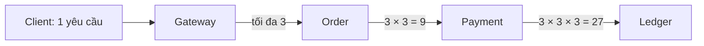

# Retry storm và nhân số lần thử lại giữa các tầng

Trong một hệ thống REST API, **retry** (thử lại) giúp vượt qua lỗi mạng ngắn hạn hoặc tình trạng dịch vụ tạm thời chưa sẵn sàng. Tuy nhiên, nếu API Gateway và nhiều microservice đều tự thử lại cùng một thao tác, một yêu cầu ban đầu có thể biến thành hàng chục hoặc hàng trăm lời gọi. Hiện tượng này gọi là **retry storm**: cơ chế phục hồi vô tình tạo thêm tải, khiến sự cố lan rộng và kéo dài.

Bài học thuộc chủ đề **Giới hạn và chống lỗi**, tập trung vào cách nhận diện hệ số nhân retry, đặt chính sách retry có giới hạn cho REST API và triển khai an toàn với Java/Spring.

## 1. Mục tiêu học tập

Sau bài học, bạn có thể:

1. Giải thích vì sao retry ở nhiều tầng tạo tải theo cấp số nhân và dẫn tới vòng phản hồi dương.
2. Tính số lần gọi tối đa xuống một dịch vụ khi các tầng đều có `maxAttempts`.
3. Chọn nơi sở hữu retry, giới hạn tổng thời gian, số lần thử và ngân sách retry.
4. Phân biệt lỗi HTTP có thể retry với lỗi không nên retry; xử lý `429`, `503`, `Retry-After` và thao tác không idempotent.
5. Thiết kế theo dõi, kiểm thử và quy trình ứng phó retry storm trong hệ thống Java/Spring.

## 2. Từ một lỗi tạm thời đến retry storm

Giả sử tuyến xử lý đồng bộ:

```text
Client → API Gateway → Order Service → Payment Service → Ledger Service
```

`Ledger Service` trả `503 Service Unavailable` trong vài giây. Mỗi tầng phía trên đều có chính sách "gặp `503` thì thử tối đa 3 lần". Những tầng này không biết tầng khác cũng đang retry.

- `Payment Service` thử gọi Ledger 3 lần cho một yêu cầu Payment.
- `Order Service` thử gọi Payment 3 lần; **mỗi** lần gọi Payment lại có thể tạo 3 lần gọi Ledger.
- `API Gateway` thử gọi Order 3 lần; **mỗi** lần gọi Order có thể tạo 9 lần gọi Ledger.

Do đó, **một yêu cầu đến Gateway có thể gây ra 27 lời gọi đến Ledger**, dù người dùng chỉ gửi một yêu cầu. Nếu chính Client cũng thử tối đa 3 lần, số lần gọi Ledger có thể lên tới **81**.



Các con số trên là **giới hạn trong tình huống xấu nhất**, khi lỗi khiến mọi tầng dùng hết số lần thử và mọi lần thử đều tiếp tục gọi tầng dưới. Số lần gọi thực tế còn phụ thuộc timeout, circuit breaker, thời gian chờ, logic xử lý và việc từng lần gọi đã đi xa đến đâu.

### Công thức hệ số nhân

Gọi `a_i` là số **lần thử tối đa, bao gồm lần đầu**, trên cạnh gọi thứ `i`. Với `h` tầng có retry:

```text
Số lần gọi tối đa đến tầng cuối:
A = a1 × a2 × ... × ah

Tổng số lời gọi HTTP phát sinh trên tất cả các cạnh:
T = a1 + (a1 × a2) + ... + (a1 × a2 × ... × ah)
```

Với ba cạnh cùng `maxAttempts = 3`:

| Vị trí đo | Số lần gọi tối đa cho 1 yêu cầu vào Gateway |
|---|---:|
| Gateway → Order | 3 |
| Order → Payment | 9 |
| Payment → Ledger | 27 |
| **Tổng lời gọi HTTP nội bộ** | **39** |

Nếu có **4 cạnh** cùng 3 lần thử, tầng sâu nhất có thể nhận `3^4 = 81` lời gọi; tổng trên bốn cạnh là `3 + 9 + 27 + 81 = 120`. Đừng nhầm `maxAttempts = 3` với "retry 3 lần": ba lần thử chỉ gồm **một lần đầu và hai lần retry**.

Ví dụ, lưu lượng đầu vào là 100 yêu cầu/giây, tầng Ledger có thể phải đối mặt với lưu lượng cao hơn nhiều khi retry nhân tầng. Không được mặc định rằng cả 2.700 lời gọi theo giới hạn lý thuyết sẽ cùng xuất hiện trong đúng một giây, vì các lần thử còn phân tán theo thời gian và bị giới hạn bởi concurrency; điều cần ghi nhớ là **hệ số khuếch đại tải có thể lớn hơn rất nhiều lưu lượng người dùng**.

### Vòng phản hồi dương

```text
Dịch vụ chậm hoặc trả lỗi
    ↓
Các tầng đồng loạt retry
    ↓
RPS, số kết nối và số request đang xử lý tăng
    ↓
Hàng đợi dài hơn, timeout xuất hiện nhiều hơn
    ↓
Các tầng lại retry nhiều hơn
    ↺
```

Theo nguyên lý Little, khi hệ thống ở trạng thái ổn định, lượng công việc đang xử lý xấp xỉ `L = λ × W`, với `λ` là tốc độ yêu cầu và `W` là thời gian xử lý trung bình. Retry vừa tăng `λ`, vừa có thể làm `W` tăng do nghẽn tài nguyên. Vì vậy, chỉ tăng timeout hoặc tăng số lần retry thường không giải quyết được nguyên nhân.

Retry storm càng nghiêm trọng khi nhiều client cùng dùng backoff cố định (ví dụ chờ đúng 200 ms): các đợt thử lại sẽ đồng pha, tạo những đỉnh tải tuần hoàn. Hiện tượng này thường được gọi là *thundering herd*.

## 3. Khi nào retry là hợp lý?

Retry chỉ nên xảy ra khi **lỗi có khả năng tạm thời**, **thao tác an toàn để thực hiện lại** và **còn đủ tài nguyên/thời gian** để thử.

| Tình huống | Chính sách khuyến nghị | Lý do |
|---|---|---|
| `502 Bad Gateway`, `503 Service Unavailable`, `504 Gateway Timeout` | Có thể retry có giới hạn nếu endpoint và deadline cho phép | Thường liên quan lỗi tạm thời ở upstream, nhưng không đảm bảo lần sau sẽ thành công |
| `429 Too Many Requests` | Tôn trọng `Retry-After` nếu có; nếu thời gian chờ vượt deadline thì dừng | Retry ngay sẽ chống lại chính cơ chế rate limiting |
| `408 Request Timeout` | Có thể cân nhắc với thao tác replay an toàn | Cần phân biệt timeout trước/sau khi server thực hiện tác vụ |
| `500 Internal Server Error` | Chỉ retry nếu tài liệu hợp đồng API xác nhận đây có thể là lỗi tạm thời | Lỗi lập trình thường không biến mất vì thử lại |
| `400`, `401`, `403`, `422` | Không retry nguyên trạng | Cần sửa request, thông tin xác thực hoặc quyền truy cập |
| `404 Not Found`, `409 Conflict` | Mặc định không retry; ngoại lệ phải được hợp đồng API mô tả rõ | Có thể là trạng thái nghiệp vụ hợp lệ, không phải lỗi tạm thời |
| Kết nối bị từ chối hoặc đứt mạng | Chỉ retry trong giới hạn, với thao tác có thể lặp lại an toàn | Không phải mọi lỗi mạng đều xác định được server đã xử lý hay chưa |
| Lỗi TLS/certificate, sai host, sai cấu hình | Không retry tự động | Retry không khắc phục lỗi cấu hình |

**Timeout không đồng nghĩa với thất bại nghiệp vụ.** Ví dụ, client gọi `POST /payments` rồi bị read timeout: Payment Service có thể đã ghi nhận thanh toán thành công nhưng phản hồi bị thất lạc. Thử lại bằng một request mới có thể tạo hai giao dịch.

### Idempotency là điều kiện cần cho retry thao tác ghi

- `GET` và `HEAD` theo hợp đồng HTTP là các phương thức an toàn; retry đọc thường dễ hơn, nhưng vẫn phải giới hạn tải.
- `PUT` và `DELETE` có ngữ nghĩa idempotent ở cấp HTTP khi triển khai đúng; ứng dụng vẫn cần kiểm tra các hiệu ứng phụ như gửi email, ghi nhận thu phí hoặc phát sự kiện.
- `POST` thường **không** idempotent. Muốn hỗ trợ retry cho tạo đơn hàng/thanh toán, cần hợp đồng rõ ràng với `Idempotency-Key` hoặc một mã yêu cầu nghiệp vụ duy nhất.

Ví dụ client gửi:

```http
POST /payments HTTP/1.1
Content-Type: application/json
Idempotency-Key: 8df0cfc3-1f38-4dbe-9c82-623e9d66d9e2

{"orderId":"O-123","amount":150000,"currency":"VND"}
```

Server phải lưu kết quả theo khóa đã ràng buộc với **chủ thể gọi, endpoint và fingerprint của payload**, bảo đảm kiểm tra/ghi nhận khóa một cách nguyên tử khi có request đồng thời. Gửi lại cùng khóa và cùng nội dung trả về kết quả đã quy định trong hợp đồng; cùng khóa nhưng payload khác phải bị từ chối. Cần có quy tắc rõ ràng về thời gian giữ khóa, trường hợp request đang xử lý và cách tra cứu trạng thái cuối cùng.

`Idempotency-Key` giúp chống thực thi trùng, nhưng **không giải quyết retry storm về tải**: request trùng vẫn chiếm kết nối, CPU, thao tác cache/database và tài nguyên ở gateway. Vì vậy luôn cần kết hợp cả idempotency lẫn giới hạn retry.

## 4. Thiết kế retry để không nhân tầng

### 4.1. Xác định một nơi sở hữu retry

Với một đường gọi đồng bộ, nên có **một tầng được chỉ định rõ ràng** chịu trách nhiệm retry cho cùng một thất bại. Ví dụ:

```text
Client ──1 lần──> Gateway ──tối đa 2 lần──> Catalog
```

Gateway có thể thử lại một lời gọi đọc Catalog đúng một lần; Catalog không tiếp tục retry mù quáng mọi lời gọi tới kho dữ liệu. Nếu một đường đi bắt buộc có retry tại nhiều nơi, cần một **ngân sách và deadline xuyên suốt**, đồng thời chứng minh giới hạn khuếch đại bằng sơ đồ cuộc gọi.

Một request có thể chứa fan-out hợp lệ (một order gọi ba dịch vụ khác nhau). Khi đánh giá độ khuếch đại, phải tách **số lời gọi nghiệp vụ cần thiết** khỏi **số lời gọi do retry**.

### 4.2. Giới hạn theo ba chiều

Một chính sách retry an toàn gồm đồng thời:

1. **Số lần thử:** chẳng hạn `maxAttempts = 2`, nghĩa là một lần đầu và tối đa một lần retry.
2. **Deadline tổng:** đặt từ khi tiếp nhận yêu cầu, kể cả thời gian đã qua tại các tầng, thời gian xử lý mỗi lần và backoff. Không tạo lại một deadline mới đầy đủ ở mỗi hop.
3. **Retry budget và giới hạn đồng thời:** giới hạn lượng retry bổ sung theo client/service hoặc tenant, đồng thời chặn số request đang chạy. Nếu hết budget, trả lỗi có kiểm soát thay vì cố "cứu" mọi request.

Ví dụ chính sách "không quá 10 retry phụ trên mỗi 100 yêu cầu gốc trong một cửa sổ đo" là một **ngưỡng minh họa**, cần hiệu chỉnh theo SLO, capacity và đặc tính lưu lượng. Retry budget đếm *lần thử bổ sung*, không tính lần đầu. Khi lưu lượng gốc giảm, cũng phải giới hạn việc tích lũy token để tránh bùng tải ngay sau đó.

Deadline mẫu:

```text
Deadline tổng: 800 ms
Lần 1:        tối đa 300 ms
Backoff:      khoảng 0–120 ms
Lần 2:        tối đa phần thời gian còn lại (không vượt 300 ms)
Hết deadline: dừng; không bắt đầu lần 3
```

Thời gian trên chỉ minh họa. Trong triển khai thực tế, nên chuyển `deadline` hoặc `remaining time` giữa các service bằng context nội bộ đáng tin cậy, đồng thời giới hạn giá trị do bên ngoài gửi vào để tránh client tự ép server mở deadline vô hạn.

### 4.3. Exponential backoff kèm jitter

Một chính sách phổ biến:

```text
backoff_cap(k) = min(maxDelay, baseDelay × 2^(k-1))
delay(k)       = random(0, backoff_cap(k))     # full jitter
```

Trong đó `k` là thứ tự retry, bắt đầu bằng 1. Ví dụ `baseDelay = 100 ms` và `maxDelay = 800 ms`:

| Lần retry | Trần chờ trước jitter |
|---|---:|
| 1 | 100 ms |
| 2 | 200 ms |
| 3 | 400 ms |
| 4 trở đi | Tối đa 800 ms |

*Full jitter* chọn ngẫu nhiên trong khoảng từ 0 tới trần chờ; các biến thể jitter khác cũng hữu ích nếu tạo được phân tán. Backoff làm giảm tốc độ dồn tải, còn jitter giúp tránh các client thức dậy cùng lúc. Cả hai **không thay thế retry budget**.

Với `Retry-After` (có thể là số giây hoặc ngày giờ HTTP), server đang đưa ra thời điểm nên thử tiếp. Nếu chờ đến thời điểm đó vượt deadline hoặc budget, **không thử lại sớm hơn**; hãy trả lỗi cho tầng gọi hoặc chuyển sang cơ chế xử lý bất đồng bộ nếu hợp đồng nghiệp vụ cho phép.

### 4.4. Phối hợp với các cơ chế chống lỗi khác

| Cơ chế | Vai trò khi có retry storm | Lưu ý |
|---|---|---|
| **Circuit breaker** | Ngắt sớm lời gọi khi downstream liên tục lỗi, cho phép phục hồi có kiểm soát | Tránh mọi tầng đồng loạt half-open và lại tạo đỉnh tải |
| **Bulkhead / giới hạn concurrency** | Cô lập số kết nối, luồng hoặc request đang xử lý theo downstream | Giảm nguy cơ một dịch vụ lỗi làm cạn tài nguyên toàn hệ thống |
| **Rate limiting** | Giới hạn yêu cầu từ client/tenant; bảo vệ tài nguyên đầu vào | Cần quan sát cả lưu lượng **nội bộ** do retry tạo ra |
| **Load shedding / backpressure** | Từ chối hoặc làm chậm công việc mới khi vượt capacity | Từ chối sớm thường tốt hơn để request tiếp tục chiếm hàng đợi |
| **Queue / async workflow** | Tách việc nhận request khỏi việc xử lý khi tác vụ không cần đồng bộ | Vẫn cần hạn mức consumer, deduplication và retry cho message |
| **Cache / fallback** | Giảm số lần truy cập dịch vụ đang lỗi đối với dữ liệu chấp nhận được độ trễ | Không dùng dữ liệu cũ cho nghiệp vụ đòi hỏi tính nhất quán chặt |

Retry ở gateway, service mesh, HTTP client, thư viện SDK và tầng message consumer có thể **đồng thời tồn tại**. Khi thiết kế phải kiểm kê cả retry "ẩn" trong các thành phần này, kể cả logic load balancer hoặc client SDK tự khởi động lại request.

## 5. Triển khai minh họa với Java/Spring

Ví dụ sau dùng Spring WebFlux `WebClient` và Reactor để gọi **GET** đến Catalog. Chính sách đặt tại client của một service được chỉ định sở hữu retry. Giả sử các tầng còn lại trên tuyến này không tự retry lời gọi tương ứng.

```java
import java.net.ConnectException;
import java.time.Duration;

import org.springframework.http.HttpHeaders;
import org.springframework.stereotype.Service;
import org.springframework.web.reactive.function.client.WebClient;
import org.springframework.web.reactive.function.client.WebClientRequestException;
import org.springframework.web.reactive.function.client.WebClientResponseException;

import reactor.core.publisher.Mono;
import reactor.util.retry.Retry;

@Service
public class CatalogReadClient {
    private final WebClient client;

    public CatalogReadClient(WebClient.Builder builder) {
        this.client = builder
                .baseUrl("http://catalog-service")
                .build();
    }

    public Mono<CatalogItem> findBySku(String sku) {
        return client.get()
                .uri("/items/{sku}", sku)
                .retrieve()
                .bodyToMono(CatalogItem.class)
                .retryWhen(
                        Retry.backoff(1, Duration.ofMillis(120))
                                .maxBackoff(Duration.ofMillis(300))
                                .jitter(1.0)
                                .filter(this::isRetryable)
                )
                .timeout(Duration.ofMillis(800));
    }

    private boolean isRetryable(Throwable error) {
        if (error instanceof WebClientResponseException response) {
            // Không retry sớm nếu upstream yêu cầu Retry-After.
            if (response.getHeaders().containsKey(HttpHeaders.RETRY_AFTER)) {
                return false;
            }

            int status = response.getStatusCode().value();
            return status == 502 || status == 503 || status == 504;
        }

        // Ví dụ tối giản: chỉ coi connection refused là lỗi kết nối
        // có thể thử lại. Chính sách thực tế cần phân loại theo transport.
        if (error instanceof WebClientRequestException request) {
            return request.getCause() instanceof ConnectException;
        }

        return false;
    }
}

record CatalogItem(String sku, String title) {}
```

**Ý nghĩa và giới hạn của ví dụ:**

- `Retry.backoff(1, ...)` nghĩa là **tối đa một lần retry**, không phải một lần gọi tổng cộng: tối đa hai HTTP attempts cho một lời gọi.
- `jitter(1.0)` tạo độ ngẫu nhiên trong backoff của Reactor để tránh các client đồng pha; không nên mặc định nó tương đương công thức *full jitter* ở trên.
- `timeout(800 ms)` áp lên **toàn bộ** chuỗi gọi và retry. Nó giới hạn thời gian quan sát của caller, nhưng việc hủy request từ client không bảo đảm server đã ngừng xử lý.
- `429` không được auto-retry. `503` có `Retry-After` cũng được trả về để tầng điều phối xử lý theo hợp đồng thay vì retry quá sớm. Nếu muốn tự chờ theo header, cần parse cả hai dạng số giây/ngày giờ và kiểm tra deadline trước khi lên lịch.
- Ví dụ chỉ minh họa **chính sách per-call**. Hệ thống thật cần cấu hình thêm connect/read/response timeout ở HTTP transport, deadline xuyên các hop, retry budget, giới hạn concurrency, circuit breaker và telemetry. Các tham số phải được kiểm chứng bằng test tải và thử lỗi.

Với Spring MVC sử dụng `RestClient` hoặc `RestTemplate`, nguyên tắc giống hệt: giới hạn attempts, timeout tổng, backoff+jitter và bộ lọc ngoại lệ/HTTP status. Nếu dùng `@Retryable` hoặc thư viện Resilience4j, hãy kiểm tra giá trị mặc định và phạm vi proxy/AOP; tránh để annotation retry chồng lên retry của gateway, SDK và service mesh.

### Chặn retry khi downstream đã rate limit

Downstream có thể phản hồi:

```http
HTTP/1.1 429 Too Many Requests
Content-Type: application/problem+json
Retry-After: 5

{"type":"about:blank","title":"Too Many Requests","status":429}
```

Client cần hiểu đây là tín hiệu **giảm tải trong ít nhất khoảng chờ đã chỉ định**. Nếu request đồng bộ chỉ còn 800 ms, không được bỏ qua `Retry-After: 5` rồi gửi lại sau 120 ms. Có thể trả phản hồi phù hợp cho caller; với công việc không đồng bộ, lên lịch sau khi đủ thời gian và giữ nguyên khóa idempotency nếu cần.

Ở phía Spring server, có thể trả header tương ứng khi chủ động từ chối tải:

```java
return ResponseEntity.status(429)
        .header(HttpHeaders.RETRY_AFTER, "5")
        .body(problemDetail);
```

`problemDetail` ở đây là đối tượng lỗi đã được ứng dụng tạo trước đó; ví dụ nhấn mạnh status và header, không phải một controller hoàn chỉnh. Giá trị chờ phải có cơ sở từ rate limiter/capacity thực tế, tránh hứa một thời điểm mà backend chưa thể phục vụ.

## 6. Quan sát và phát hiện retry storm

Nên thu thập số liệu theo **dịch vụ gọi → dịch vụ được gọi**, kèm phân biệt request gốc và attempt bổ sung:

| Metric / tín hiệu | Điều cần phát hiện |
|---|---|
| `http.client.requests` theo outcome/status | Tổng lưu lượng ra downstream và sự thay đổi khi có lỗi |
| `retry.attempts` và `retry.exhausted` | Lượng attempt phát sinh thêm, tỷ lệ dùng hết số lần thử |
| `retry.budget.exhausted` | Retry bị từ chối vì đã vượt ngân sách |
| `retry.success_after_retry` | Retry có thực sự khôi phục được request hay chỉ thêm tải |
| Latency p95/p99, timeout, in-flight, queue depth | Dịch vụ chậm dần và tích tụ công việc |
| Circuit breaker state, `429`, `503`, `Retry-After` | Dấu hiệu downstream đang bảo vệ chính nó |

Hai tỷ số đáng theo dõi:

```text
retry_ratio = extra_retry_attempts / original_attempts

observed_amplification =
    actual_downstream_calls / expected_downstream_calls_without_retry
```

Tỷ số thứ hai phải tính trên một luồng nghiệp vụ tương đương, vì fan-out hợp lệ và cache hit cũng làm thay đổi số lời gọi. Khi alert, kết hợp **mức lỗi**, **RPS downstream**, **retry_ratio** và **latency**, thay vì chỉ nhìn số request tăng.

Trong distributed tracing, mỗi attempt nên có span/thuộc tính phân biệt `retry.attempt`, `downstream.service`, `http.status_code` và `retry.reason`. Chúng phải thuộc cùng trace/operation để thấy rõ chuỗi gọi; không gắn `orderId`, access token hay `Idempotency-Key` thành nhãn metric có cardinality cao. Với dữ liệu nhạy cảm, chỉ lưu thuộc tính an toàn và tuân thủ quy tắc bảo vệ log.

## 7. Kiểm thử chính sách và thử lỗi có kiểm soát

Dùng WireMock, MockWebServer hoặc một upstream giả để trả lỗi có chủ đích; với WebFlux có thể dùng StepVerifier để xác minh kết quả. Đừng chỉ kiểm tra cuối cùng có `200`: phải **đếm số request upstream nhận được** và đo thời gian.

| Kịch bản | Kỳ vọng |
|---|---|
| `GET`: lần đầu `503` không có `Retry-After`, lần hai `200` | Thành công, upstream nhận đúng **2** lần gọi |
| `GET`: liên tiếp `503` | Dừng sau **2** lần gọi, trả lỗi phù hợp |
| `GET`: `503` có `Retry-After: 5` | Ví dụ WebClient trên **không** tự retry; upstream nhận 1 lần gọi |
| `GET`: `429` hoặc `400` | Không retry tự động |
| Downstream trả lời chậm hơn deadline 800 ms | Caller hết hạn; không khởi động attempt mới sau deadline |
| Kết nối bị từ chối rồi phục hồi | Có thể thử tối đa 1 lần bổ sung theo bộ lọc lỗi mạng |
| Hai tầng cấu hình retry 3 attempts mỗi tầng | Test phát hiện giới hạn xấu nhất 9 lời gọi ở tầng sâu; là cấu hình cần sửa |
| Nhiều request đồng thời, downstream liên tục `503` | Retry budget/concurrency cap phải chặn tốc độ tăng attempts |
| `POST /payments` timeout sau khi server đã ghi thành công | Gửi lại cùng idempotency key không tạo thêm giao dịch |

Để kiểm tra tính đồng pha, tạo vài trăm virtual clients gặp `503` cùng lúc. So sánh dạng sóng lưu lượng khi chờ cố định 100 ms với backoff có jitter; quan sát các đỉnh RPS và số request đang xử lý. Với clock giả hoặc scheduler kiểm soát được, kiểm tra sát biên deadline và `Retry-After` một cách ổn định.

### Bài tập 1 — Tính độ khuếch đại

Một request đi qua 4 cạnh REST nội bộ. Mỗi client được cấu hình `maxAttempts = 3`, tất cả tầng dưới liên tục `503`. Tính số lần gọi tối đa đến tầng sâu nhất và tổng lời gọi nội bộ.

*Đáp án đối chiếu:* `3^4 = 81` lần đến tầng sâu nhất; tổng `3 + 9 + 27 + 81 = 120`. Nếu chỉ Gateway được retry tối đa 2 attempts, ba tầng còn lại mỗi tầng 1 attempt, tổng lời gọi qua 4 cạnh là `2 + 2 + 2 + 2 = 8` và tầng sâu nhất chỉ nhận tối đa 2 lần.

### Bài tập 2 — Thiết kế policy

Hệ thống có `GET /inventory/{sku}`, `POST /orders` và `POST /payments`. Hãy lập bảng cho mỗi endpoint: lỗi được retry, nơi sở hữu retry, `maxAttempts`, deadline, dùng `Retry-After` ra sao, có cần `Idempotency-Key` hoặc API tra cứu trạng thái hay không. Giải thích rủi ro nếu cả Gateway và Order Service cùng retry Payment Service.

*Gợi ý kiểm tra:* GET thường có thể retry lỗi tạm thời với giới hạn nhỏ; hai POST cần hợp đồng idempotency rõ ràng và xử lý kết quả không xác định sau timeout. Với Payment, kiểm tra trạng thái giao dịch theo mã nghiệp vụ có thể an toàn hơn việc tạo request mới.

### Bài tập 3 — Diễn tập sự cố

Cấu hình một mock downstream trả `503` trong 30 giây. Tăng dần lưu lượng đầu vào và ghi lại original RPS, downstream RPS, extra retry, timeout và p95 latency. Bật lần lượt: retry một tầng, jitter, retry budget và circuit breaker. Hãy giải thích cơ chế nào làm giảm số attempts, cơ chế nào làm phẳng đỉnh tải và cơ chế nào giúp từ chối sớm.

## 8. Xử lý khi retry storm xảy ra trong production

Khi phát hiện downstream RPS tăng nhanh hơn traffic đầu vào cùng với `503`/timeout, trình tự xử lý thực dụng là:

1. Xác nhận tuyến nào đang nhân attempts bằng trace, metric và cấu hình thực tế của Gateway, client SDK, service mesh.
2. Giảm hoặc vô hiệu hóa retry ở các tầng trùng lặp; giới hạn `maxAttempts`, retry budget và concurrency tại nơi sở hữu retry.
3. Cho downstream cơ hội phục hồi bằng circuit breaker, load shedding hoặc rate limit phù hợp; tôn trọng `Retry-After`.
4. Xử lý nguyên nhân gốc như cạn connection pool, nghẽn database, dịch vụ phụ thuộc lỗi hoặc thay đổi cấu hình gần đây.
5. Khi phục hồi, mở tải có kiểm soát, quan sát error rate, p95 latency, số requests đang xử lý và retry ratio trước khi điều chỉnh chính sách.

Không nên mở thêm retry như biện pháp ứng cứu mặc định: khi lỗi có nguồn gốc từ quá tải, thao tác đó có thể khiến thời gian khôi phục lâu hơn.

## 9. Checklist trước khi đưa vào vận hành

- [ ] Mọi đường gọi quan trọng đều có sơ đồ các tầng/SDK có khả năng retry.
- [ ] Xác định rõ nơi sở hữu retry; giới hạn số attempts và đo hệ số nhân tối đa.
- [ ] Có deadline tổng, timeout theo attempt và cơ chế hủy/dừng khi hết hạn.
- [ ] Backoff có jitter, giới hạn retry budget và số lời gọi đồng thời.
- [ ] Bộ lọc HTTP/network chỉ retry lỗi tạm thời được xác định rõ; xử lý `429`/`503` có `Retry-After`.
- [ ] Thao tác ghi có hợp đồng idempotency hoặc quy trình tra cứu trạng thái khi kết quả không xác định.
- [ ] Metric, trace, cảnh báo và bài kiểm thử lỗi xác nhận số attempts thực tế.
- [ ] Circuit breaker, load shedding và rate limiting phối hợp để bảo vệ downstream.

**Nguyên tắc cần nhớ:** Retry là một khoản chi tiêu tài nguyên để nâng xác suất thành công. Khi nhiều tầng cùng chi tiêu không phối hợp, chi phí tăng theo tích số attempts, trong khi cơ hội thành công có thể không tăng tương ứng. Hãy thiết kế retry như một **ngân sách hữu hạn của toàn đường gọi REST**, gắn với idempotency, deadline và khả năng chịu tải của hệ thống.
