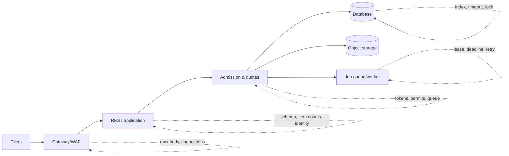
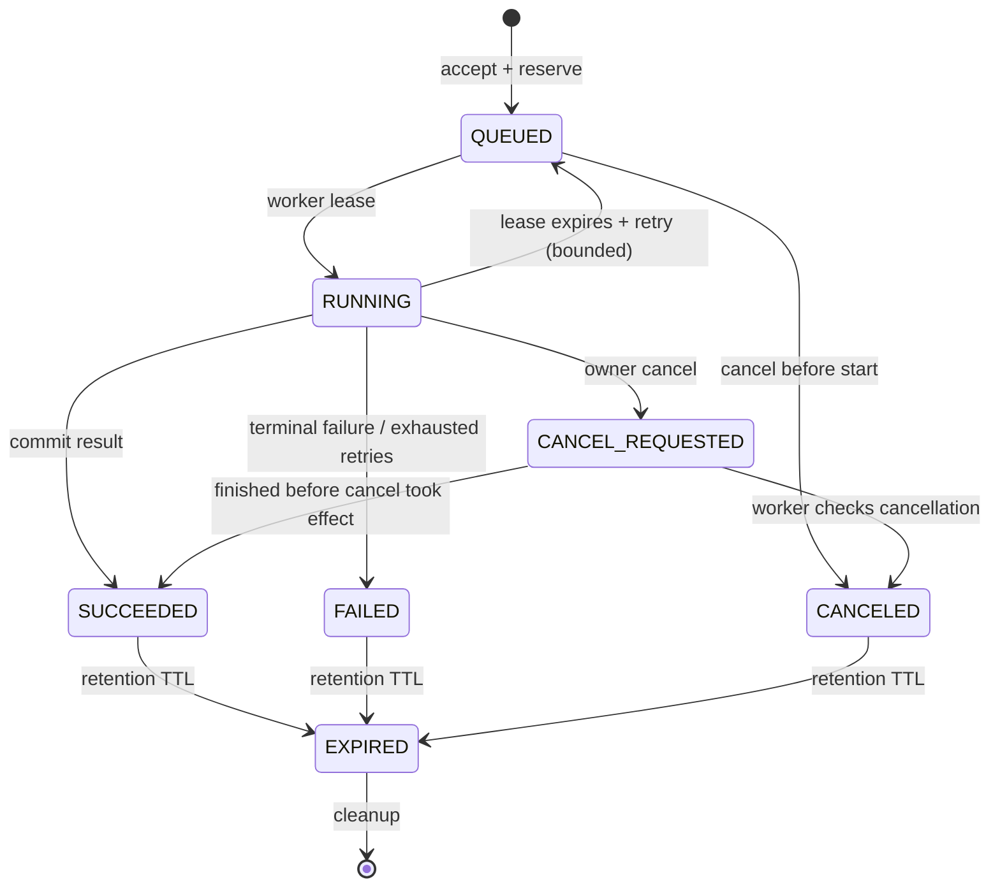

# Giới hạn tài nguyên cho truy vấn, batch, upload và job dài

> **Chương:** Giới hạn và chống lỗi  
> **Module:** **INTEGRATION_API_REST** — thiết kế REST API dựa trên resource, URI, phương thức và mã trạng thái HTTP, hợp đồng dữ liệu rõ ràng; thực hành giới hạn tải, xử lý lỗi, kiểm thử và triển khai với Java/Spring hoặc công nghệ tương đương.
>
> **Thông điệp chính:** `100 requests/giây` không có nghĩa hệ thống an toàn nếu một request có thể quét hàng triệu bản ghi, chứa hàng nghìn thao tác, tải lên nhiều gigabyte hoặc giữ worker trong nhiều giờ. REST API phải giới hạn **chi phí của từng request và lượng công việc đang tồn tại**, ngoài số lượt gọi.

## 1. Bối cảnh và mục tiêu

Giả sử một nền tảng thương mại có bốn endpoint:

- `GET /v1/orders?limit=...&filter=...`: tìm đơn hàng, lọc, sắp xếp, phân trang.
- `POST /v1/orders/batches`: áp dụng nhiều thay đổi vào các đơn hàng.
- `POST /v1/uploads`: nhận ảnh sản phẩm hoặc file dữ liệu.
- `POST /v1/report-jobs`: xuất báo cáo doanh thu trong vài phút.

Tất cả có thể bị lạm dụng dù người gọi **đã xác thực hợp lệ**:

- `limit=1000000`, `offset=9000000` hoặc filter phức tạp làm DB quét quá nhiều hàng.
- Batch gồm 50.000 item, mỗi item kích hoạt nhiều truy vấn và event.
- File nén nhỏ giải nén ra hàng chục gigabyte, lấp bộ nhớ/disk.
- 1.000 job được tạo rồi nằm trong queue, chiếm storage và worker; thao tác hủy/đọc trạng thái cũng gây tải.

Người học sau bài này có thể:

1. Phân biệt **rate limit**, **quota**, **admission control**, **concurrency limit**, **timeout/deadline**, **giới hạn kích thước và độ phức tạp**.
2. Đặt giới hạn rõ ràng cho query, batch, upload và job dài theo chi phí tài nguyên và đối tượng sử dụng.
3. Thiết kế HTTP status, hợp đồng lỗi, retry và idempotency để client phản ứng đúng khi vượt giới hạn.
4. Áp dụng ví dụ Java/Spring cho validation, upload, tạo job và ánh xạ lỗi; nhận biết giới hạn của từng lớp.
5. Kiểm thử quá tải, đua tranh, multitenancy, rollback, timeout, file độc hại và job xử lý lặp lại.

## 2. Từ số request sang ngân sách tài nguyên

Một request tiêu thụ nhiều loại tài nguyên:

| Tài nguyên | Ví dụ gây quá tải | Đơn vị/giới hạn điển hình |
|---|---|---|
| CPU | Parse JSON phức tạp, nén/giải nén, tính toán báo cáo. | CPU-seconds, độ phức tạp tối đa, số worker chạy. |
| Memory | Deserialize body lớn, giữ quá nhiều item, buffer response. | Giới hạn bytes, phần tử, độ sâu JSON, RAM/heap. |
| Database | Quét bảng, join lớn, lock lâu, query N+1. | Query timeout, số rows scan/return, statement/transaction budget. |
| Network | Tải lên/xuống, gọi downstream theo từng item. | Max body/response bytes, timeouts, bandwidth, fan-out. |
| Storage | Multipart tạm, file quarantine, kết quả job, logs. | Quota bytes, TTL/retention, số object, cleanup. |
| Concurrency | 500 báo cáo đồng thời dù request tạo job nhẹ. | Active jobs, active queries, queue depth, pool/partition. |
| Thời gian | Request giữ HTTP connection 15 phút. | Deadline end-to-end, execution timeout, lease. |
| Tài nguyên bên ngoài | API thanh toán tính phí theo lần gọi, email/SMS. | Budget theo item, tiền/chi phí, số downstream calls. |

**Giới hạn theo chiều nào?** Một thiết kế vận hành thường phải có đủ:

- **Per-request cap:** `limit <= 100`, tối đa 100 batch item, file tối đa 20 MiB, JSON nesting tối đa 20.
- **Per-identity quota:** ví dụ 600 đơn vị công việc/phút theo tenant, 5 job chờ và 2 job đang chạy mỗi tenant.
- **Global capacity guard:** tổng số query nặng, multipart sessions, workers, bytes tạm và queue depth được chặn ở toàn cụm.
- **Timeout/deadline:** không chấp nhận công việc kéo dài vô hạn chỉ vì còn quota.
- **Persistence lifecycle:** dữ liệu tạm/job/result hết hạn và bị thu dọn kể cả khi client ngắt kết nối.

Các con số trong bài là **minh họa để luyện thiết kế**, không phải ngưỡng chuẩn cho mọi API. Cần đo traffic, tải DB, kích thước file, SLA/SLO và thử nghiệm trước khi chốt production.

### 2.1. Rate limit khác resource limit

Giả sử mỗi khách được gọi 30 request/phút. Khách A gọi 30 lần `GET /orders?limit=20`, khách B gọi 1 lần `GET /orders?limit=1000000`. Rate limiter đếm request đơn thuần xem B “nhẹ” hơn, dù B có thể nặng hơn rất nhiều.

**Rate limit** giới hạn tần suất. **Resource limit** chặn độ lớn/độ phức tạp. **Concurrency limit** kiểm số thao tác đang giữ tài nguyên cùng lúc. **Quota** giới hạn mức sử dụng theo cửa sổ thời gian hoặc chu kỳ. Chúng hỗ trợ nhau.

Ví dụ một **cost model ước lượng** để admission:

```text
estimatedCost = baseCost
              + ceil(requestedItems / 20)
              + weightedFilterComplexity
              + downstreamCallEstimate

allow request only when:
  request is within per-request caps
  AND tenant budget has enough tokens
  AND concurrency slot is available
  AND global pool/queue is within capacity
```

Chi phí ước lượng **không đủ** để bảo vệ DB nếu dữ liệu bị skew hoặc query planner thay đổi. Cần thêm hard deadline, row/bytes cap, DB statement timeout, index và số liệu thực tế sau khi xử lý để hiệu chỉnh cost model.

### 2.2. Đặt giới hạn ở nhiều lớp



Gateway có thể chặn request body và số kết nối trước khi chiếm heap; ứng dụng hiểu tenant/role và business cost; DB/queue/storage có các rào cuối cùng. Đừng giao hết cho một rate limiter trên một instance nếu ứng dụng chạy nhiều replica.

## 3. Truy vấn và phân trang: giới hạn không chỉ ở `limit`

### 3.1. Ngân sách cho một truy vấn

Hợp đồng cho `GET /v1/orders` có thể đặt:

| Tham số/khía cạnh | Chính sách minh họa | Lý do |
|---|---|---|
| `limit` | Mặc định 25; chấp nhận từ 1 đến 100. | Chặn số row trả về và serialization. |
| `cursor` | Cursor ký/HMAC, giới hạn kích thước và thời hạn; gắn tenant/filter/sort. | Tránh client sửa trạng thái phân trang, chuyển trang giữa tenant. |
| `sort` | Chỉ `createdAt` hoặc `id`; luôn có tie-breaker ổn định. | Ngăn sort field không index, bảo đảm thứ tự. |
| `filter` | Allowlist field/operator; giá trị, số điều kiện, độ sâu AST có trần. | Tránh filter tùy ý biến thành truy vấn tốn tài nguyên. |
| Khoảng thời gian | Ví dụ tối đa 90 ngày cho interactive search. | Hạn chế scan và kích thước kết quả. |
| Response bytes | Ví dụ tối đa 1 MiB cho một page. | Không để field quá lớn phá limit rows. |
| DB timeout | Ví dụ 2 giây cho truy vấn đọc tương tác. | Giữ pool connections khi query xấu. |
| Tổng số page/scan | Có budget; yêu cầu export job nếu quá lớn. | Tránh “bẻ nhỏ” một truy vấn lớn thành 100.000 page. |

**Đặt `limit=100` vẫn chưa đủ** khi người dùng có thể chọn `offset=10_000_000`. Nhiều DB vẫn cần duyệt/bỏ qua số lượng bản ghi lớn; truy vấn COUNT(*) để trả `totalElements` cũng có thể tốn kém.

### 3.2. Keyset/cursor pagination giảm chi phí offset sâu

Với PostgreSQL và index phù hợp, phân trang theo cặp khóa ổn định:

```sql
-- Index minh họa:
CREATE INDEX idx_orders_tenant_created_id
    ON orders (tenant_id, created_at DESC, id DESC);

-- Trang sau, khi cursor mang last_created_at và last_id
SELECT id, created_at, status
FROM orders
WHERE tenant_id = :tenant_id
  AND (created_at, id) < (:last_created_at, :last_id)
ORDER BY created_at DESC, id DESC
LIMIT :page_limit_plus_one;
```

`:page_limit_plus_one` bằng `limit + 1` để xác định `hasNext` mà không COUNT toàn bảng; truy vấn trang đầu bỏ điều kiện cursor. Đây là ví dụ cú pháp PostgreSQL, cần xét collation/null và indexing phù hợp ở DB khác.

**Cursor phải ràng buộc ngữ cảnh.** Ví dụ payload cursor chứa `tenantId`, `filterHash`, `lastCreatedAt`, `lastId`, `expiresAt`, phiên bản schema; serialize rồi ký HMAC để chống sửa đổi. Không đặt thông tin nhạy cảm trong cursor đọc được nếu không mã hóa, và đừng tin tenant trong cursor thay cho identity của request. Kiểm cursor trùng filter/sort và tenant hiện tại.

Keyset không tự tạo snapshot nhất quán giữa các lần phân trang: dữ liệu mới/xóa/sửa có thể gây lệch trong quá trình duyệt. Nếu bài toán yêu cầu xuất dữ liệu nhất quán, cần snapshot/quy ước thời điểm hoặc **job export** thay vì giả định pagination đủ để làm giao dịch dài.

### 3.3. Giới hạn độ phức tạp filter

Một API tìm kiếm có thể cho filter như:

```http
GET /v1/orders?status=PAID&createdAfter=2026-10-01T00:00:00Z&limit=25
```

Nhưng nên từ chối filter tự do chứa 1.000 `OR`, regex không giới hạn, wildcard đầu chuỗi làm mất index, `IN` hàng chục nghìn ID hoặc join theo các quan hệ không được tối ưu.

Quy tắc thực tế:

1. Parse thành **cấu trúc filter có kiểu**, không nối điều kiện SQL từ chuỗi người dùng.
2. Allowlist trường, toán tử, chiều sâu, số node, số `IN` value, số ngày và điều kiện sort. Kiểm cả decoded query string, số tham số, URL length.
3. Dùng **prepared statement**/ORM parameters; hạn chế projection và N+1 calls.
4. Kiểm tenant/owner ở DB query, không lọc hậu kỳ sau khi đã tải toàn bộ dữ liệu.
5. Đặt `statement_timeout`, max rows/bytes và giám sát `EXPLAIN` trên mẫu dữ liệu đại diện.
6. Với tác vụ analytic trên dữ liệu lớn, chuyển sang job riêng với quota và không giữ HTTP connection dài.

### 3.4. Ví dụ controller Java/Spring cho `limit`

```java
package example.orders.api;

import jakarta.validation.constraints.Max;
import jakarta.validation.constraints.Min;
import org.springframework.security.core.Authentication;
import org.springframework.validation.annotation.Validated;
import org.springframework.web.bind.annotation.*;

@Validated
@RestController
@RequestMapping("/v1/orders")
class OrderQueryController {
    private final OrderQueryService service;

    OrderQueryController(OrderQueryService service) {
        this.service = service;
    }

    @GetMapping
    OrderPage list(
        @RequestParam(defaultValue = "25") @Min(1) @Max(100) int limit,
        @RequestParam(required = false) String cursor,
        Authentication authentication
    ) {
        // Service kiểm cursor, tenant/owner, filter, query deadline
        // và chỉ lấy limit + 1 bản ghi với index phù hợp.
        return service.listVisibleOrders(authentication, limit, cursor);
    }
}
```

`OrderQueryService`/`OrderPage` là các thành phần domain cần triển khai; đoạn trên minh họa **đường vào có giới hạn**. Annotation validation thường dẫn tới 400 khi query sai; cần xác minh cơ chế method validation/exception handling theo phiên bản Spring Boot đang dùng. Không tin `@Max` đủ bảo vệ DB: service/repository phải giới hạn độ phức tạp, tenant, query timeout và số byte trả về.

**Cache** (ETag, `If-None-Match`, response cache) có thể giảm băng thông, nhưng không bảo đảm giảm chi phí tính toán nếu server vẫn phải chạy query nặng để tạo ETag. Tính cache key phải phân tách user/tenant/scope, tránh rò dữ liệu.

## 4. Batch: giới hạn số item, tổng chi phí và mức độ nguyên tử

Batch làm giảm số round trip HTTP, nhưng một request có thể chuyển thành hàng nghìn DB writes và downstream calls. Ví dụ:

```http
POST /v1/orders/batches HTTP/1.1
Content-Type: application/json
Authorization: Bearer <access-token>
Idempotency-Key: c2e42f5f-f2a6-4cb6-8f7d-a0b6b1d0a908

{
  "operations": [
    {"orderId":"ord-1001","action":"CONFIRM"},
    {"orderId":"ord-1002","action":"CANCEL"}
  ]
}
```

### 4.1. Hợp đồng batch đủ chặt

| Quy tắc | Ví dụ chính sách | Giải thích |
|---|---|---|
| Tổng số item | 1–100. | Chặn CPU, memory, lock và N+1. |
| Tổng request bytes | Tối đa 256 KiB. | Không để item nhỏ nhưng payload/metadata khổng lồ. |
| Chi phí trên item | Có trọng số theo action, ví dụ CANCEL nặng hơn CHECK. | 100 item có thể không cùng cost. |
| ID duy nhất | Từ chối ID lặp hoặc định nghĩa rõ quy tắc gộp. | Tránh áp dụng hai thao tác xung đột. |
| Quyền | Kiểm **từng orderId** theo tenant/owner/scope. | Một token hợp lệ không cấp quyền tất cả đơn hàng. |
| Cạnh tranh | Giới hạn concurrent batches/tenant và lock duration. | Tránh contention, deadlock và noisy neighbor. |
| Thời hạn xử lý | Ví dụ tối đa 5 giây cho batch đồng bộ. | Không giữ HTTP request vô hạn. |
| Kết quả | Quy định atomic/all-or-nothing hoặc per-item rõ ràng. | Client biết retry an toàn và xem item nào đã áp dụng. |
| Idempotency | Khóa theo principal/tenant + request fingerprint + TTL. | Retry sau timeout không tạo tác động lặp. |

**Idempotency-Key** phải được kiểm atomically và gắn với fingerprint của request đã chuẩn hóa. Cùng key/cùng nội dung trả lại kết quả hoặc job ID cũ; cùng key/nội dung khác phải trả lỗi conflict theo contract, thường `409 Conflict`. Không dùng cache ở một instance đơn lẻ nếu nhiều replica có thể đồng thời nhận cùng key.

### 4.2. Hai chính sách kết quả khác nhau

**Atomic batch:** Tất cả item cùng transaction nếu thao tác nằm trong một DB và transaction có thời gian bounded.

```text
validate every item
  -> reserve budget & idempotency key
  -> start transaction
  -> authorize and apply all
  -> commit OR rollback all
  -> return one result
```

Nếu batch có dịch vụ ngoài (payment/email), **không thể mặc nhiên** coi một DB transaction bảo đảm tính nguyên tử qua mạng. Cần outbox, saga, bù trừ hoặc batch async theo thiết kế nghiệp vụ; không giữ transaction DB mở chờ API ngoài.

**Per-item results:** Chấp nhận thành công một phần theo hợp đồng rõ ràng; ví dụ HTTP `200 OK` với danh sách trạng thái:

```http
HTTP/1.1 200 OK
Content-Type: application/json

{
  "results": [
    {"orderId":"ord-1001","status":"APPLIED"},
    {"orderId":"ord-1002","status":"REJECTED","reason":"not_allowed"}
  ]
}
```

HTTP status cho **batch endpoint** không đủ nói thành công của từng item. Có thể dùng `207 Multi-Status` trong giao thức có chủ ý, nhưng đó là mã xuất phát từ WebDAV và không tự động phù hợp mọi REST API. Nếu dùng `200` với `results`, contract OpenAPI phải mô tả semantics thành công một phần và hành vi retry. **Không tự retry toàn bộ batch** khi một số item đã commit nếu chưa có idempotency theo item hoặc batch.

Khi tổng cost vượt ngân sách, có thể từ chối ngay hoặc trả `202 Accepted` và chuyển sang batch job được kiểm soát. Không chia ngầm thành hàng trăm request/DB transactions khiến client hiểu sai về tính nguyên tử.

### 4.3. Java Bean Validation cho số item

```java
package example.orders.api;

import jakarta.validation.Valid;
import jakarta.validation.constraints.NotBlank;
import jakarta.validation.constraints.NotEmpty;
import jakarta.validation.constraints.NotNull;
import jakarta.validation.constraints.Size;
import java.util.List;
import org.springframework.http.HttpStatus;
import org.springframework.web.bind.annotation.*;

record Operation(
    @NotBlank String orderId,
    @NotNull Action action
) { }

enum Action { CONFIRM, CANCEL }

record BatchRequest(
    @NotEmpty @Size(max = 100)
    List<@Valid Operation> operations
) { }

@RestController
class BatchController {
    private final BatchService batches;

    BatchController(BatchService batches) {
        this.batches = batches;
    }

    @PostMapping("/v1/orders/batches")
    @ResponseStatus(HttpStatus.OK)
    BatchResult apply(
        @Valid @RequestBody BatchRequest body,
        @RequestHeader("Idempotency-Key") String key
    ) {
        // Service phải kiểm identity/tenant, authz từng item,
        // request fingerprint, quota, deadline, atomicity và retries.
        return batches.apply(body, key);
    }
}
```

`BatchService`/`BatchResult` là giả định domain. `@Size(max=100)` chỉ chạy **sau khi request đã được đọc và deserialize**: vẫn cần body byte limit ở reverse proxy/HTTP server và parser nesting/depth limit để chống JSON bomb trước validation.

Nếu action có side effect lớn, dùng mỗi item một idempotency key hoặc định danh operation theo hợp đồng; DB unique constraint và outbox là lớp phòng vệ cuối khi worker chạy lại.

## 5. Upload: giới hạn trước, trong và sau khi đọc file

Upload không chỉ tốn băng thông. Nó có thể chiếm RAM, thư mục tạm, object storage, I/O, CPU cho virus scan, thumbnail/video transcoding và disk quota. File 10 MiB nén có thể giải nén ra hàng chục GiB; file JSON/CSV 10 MiB có thể có hàng triệu phần tử hoặc biểu thức gây hại.

### 5.1. Các lớp giới hạn bắt buộc

| Lớp | Cần kiểm | Vấn đề nếu bỏ qua |
|---|---|---|
| Gateway/load balancer | `Content-Length` sơ bộ, số bytes nhận thực tế, request timeout, concurrent uploads. | Body đã tới app và chiếm heap/disk trước khi app từ chối. |
| HTTP container/multipart parser | Multipart request/file size, số phần, memory threshold, temp directory. | Parser spool hàng GB tệp tạm trước controller. |
| Application | User/tenant quota, loại file, kích thước, checksum, giới hạn ảnh/CSV/ZIP đã giải mã. | File hợp lệ ở HTTP nhưng gây DoS khi xử lý. |
| Storage | Max object size, lifecycle/TTL, namespace, encryption, scan/quarantine. | Storage tăng vô hạn, file chưa quét được phát cho người dùng. |
| Post-processing | CPU/memory/time budget cho giải nén, decode, thumbnail, antivirus. | Một file nhỏ kéo sập worker. |
| Download/result | Authorization, signed URL TTL, response size, `Content-Disposition` an toàn. | Lộ tệp của tenant khác hoặc dữ liệu riêng tư. |

Giới hạn **`Content-Length` không đủ**: header có thể vắng mặt (chunked transfer) hoặc không phản ánh chính xác nội dung sau giải nén. Phải đo **số byte thực được đọc**; với nội dung nén phải đặt trần trên cả bytes đã giải nén và mức mở rộng. Nếu dùng parser/library tự động giải nén, kiểm giới hạn ở đúng tầng thấy dữ liệu **sau giải nén**.

Một chính sách minh họa cho ảnh sản phẩm:

- Mỗi file tối đa 20 MiB, mỗi multipart request tối đa 24 MiB, tối đa 2 file/request.
- File ảnh chấp nhận JPEG/PNG/WebP đã được nhận diện bằng **chữ ký/decoder thực tế**, không chỉ extension hoặc client `Content-Type`.
- Ảnh sau decode tối đa 40 megapixel và 100 MiB bộ nhớ làm việc; scan/quarantine trước khi publish.
- Tenant tối đa 5 upload đang diễn ra, 2 GiB storage đã chiếm; file tạm/quarantine tự dọn sau TTL.
- Upload hết hạn nếu không hoàn thành trong deadline; retry có checksum và session/idempotency, không tạo object nhân bản.

**Không dùng `MultipartFile.getOriginalFilename()` làm đường dẫn lưu trực tiếp.** Chống path traversal (`../`), dấu phân tách đường dẫn và ký tự điều khiển; tạo object key ngẫu nhiên hoặc ID nội bộ, giữ tên gốc chỉ làm metadata đã làm sạch.

### 5.2. Giới hạn multipart trong Spring Boot

```yaml
# application.yml, Spring Boot 3 / Spring MVC
spring:
  servlet:
    multipart:
      max-file-size: 20MB
      max-request-size: 24MB
      file-size-threshold: 0B
```

Cấu hình này điều khiển **multipart parser của Servlet**, không phải mọi dạng request (ví dụ `application/octet-stream` hay JSON). Proxy/ingress phải có giới hạn riêng để từ chối sớm hơn, và app cần quota theo user/tenant, kiểm content và deadline. `file-size-threshold: 0B` khiến multipart được spool ra disk sớm theo khả năng container: cần quản lý thư mục tạm/dung lượng. Tùy container, cách báo lỗi `MaxUploadSizeExceededException` và thời điểm từ chối khác nhau; nên kiểm trong môi trường deploy thực.

Controller nhận upload và chỉ tạo bản ghi **staging**:

```java
package example.uploads.api;

import java.io.IOException;
import org.springframework.http.*;
import org.springframework.security.core.Authentication;
import org.springframework.web.bind.annotation.*;
import org.springframework.web.multipart.MultipartFile;

@RestController
class UploadController {
    private final UploadService uploads;

    UploadController(UploadService uploads) {
        this.uploads = uploads;
    }

    @PostMapping(path = "/v1/uploads",
                 consumes = MediaType.MULTIPART_FORM_DATA_VALUE)
    ResponseEntity<UploadReceipt> create(
            @RequestPart("file") MultipartFile file,
            Authentication authentication) throws IOException {

        if (file.isEmpty() || file.getSize() > 20L * 1024 * 1024) {
            throw new UploadSizeViolation();
        }

        // Service kiểm quota atomically, stream vào quarantine,
        // kiểm bytes thực, scan nội dung và lưu metadata theo tenant.
        UploadReceipt receipt = uploads.stageAndScan(file, authentication);
        return ResponseEntity.status(HttpStatus.CREATED).body(receipt);
    }
}
```

`UploadService`, `UploadReceipt` và `UploadSizeViolation` là phần domain cần triển khai. `file.getSize()` chỉ là kiểm bổ sung **sau khi multipart parser đã chạy**; giới hạn phải có trước controller, và service phải kiểm bytes trong quá trình đọc, checksum/type, quota, authz và xử lý thất bại. Chỉ trả `201 Created` khi resource được tạo theo semantics đã cam kết; nếu xử lý scan bất đồng bộ, thường trả `202 Accepted` cùng resource theo dõi trạng thái thay vì nói file đã được publish.

### 5.3. Đọc stream có trần, không phụ thuộc kích thước khai báo

Một hàm copy giới hạn **bytes thực đọc** từ một stream. Đoạn này chỉ là primitive, cần đặt trong service quản lý đường dẫn tạm/quarantine, quyền truy cập và cleanup:

```java
package example.uploads.service;

import java.io.*;
import java.nio.file.*;

public final class BoundedCopy {
    private BoundedCopy() { }

    public static long copy(InputStream source, Path destination,
                            long maxBytes) throws IOException {
        if (maxBytes < 0) throw new IllegalArgumentException("maxBytes");
        long copied = 0;
        byte[] buffer = new byte[8192];
        boolean created = false;

        // CREATE_NEW: không ghi đè object đã có; caller cấp path an toàn.
        try (OutputStream out = Files.newOutputStream(
                destination, StandardOpenOption.CREATE_NEW)) {
            created = true;
            int read;
            while ((read = source.read(buffer)) != -1) {
                // Tránh cộng tràn long; dừng trước khi ghi vượt giới hạn.
                if (read > maxBytes - copied) {
                    throw new IOException("upload_limit_exceeded");
                }
                out.write(buffer, 0, read);
                copied += read;
            }
        } catch (IOException | RuntimeException ex) {
            // Chỉ xóa file do chính lần copy này đã mở thành công.
            // CREATE_NEW có thể thất bại vì đích đã tồn tại; không xóa nó.
            if (created) {
                try {
                    Files.deleteIfExists(destination);
                } catch (IOException cleanupFailure) {
                    ex.addSuppressed(cleanupFailure);
                }
            }
            throw ex;
        }
        return copied;
    }
}
```

Caller phải cấp path đã được tạo/kiểm soát trong thư mục riêng; giới hạn bytes nên áp ở tầng HTTP **trước khi stream vào bộ nhớ hoặc disk**. Hàm `copy` không tự giới hạn wall-clock duration, số upload đồng thời, scan độc hại, quota tenant hoặc độ nén; các rào này thuộc HTTP layer, scheduler và service.

### 5.4. Upload lớn và trực tiếp lên object storage

Đối với file rất lớn, API có thể tạo **upload session**, cấp presigned URL ngắn hạn để client gửi trực tiếp tới object storage:

1. `POST /v1/upload-sessions`: authz, reserve quota, xác định object key, tối đa bytes, loại file, checksum và TTL.
2. Client upload tới storage theo điều kiện/headers đã ký; chunk/part có kích thước và số lượng bounded.
3. `POST /v1/upload-sessions/{id}/complete`: backend xác minh object thật sự tồn tại, byte size/checksum/metadata, ownership, rồi quét/quarantine.
4. Chỉ khi scan và validation đạt mới chuyển trạng thái sang `AVAILABLE`; với lỗi/hết hạn phải abort multipart và dọn các phần chưa hoàn tất.

**Presigned URL không tự động áp mọi điều kiện**. Các ràng buộc size/type/checksum có thể khác giữa presigned PUT, POST policy và multipart upload của provider. Phải thiết kế theo khả năng của storage thực tế và **kiểm lại khi complete**; có thể cần policy/permission chặn client sửa hoặc ghi đè object sau khi xác minh. Không dùng URL do client cung cấp làm đường dẫn server tự tải nếu chưa xử lý SSRF.

## 6. Job dài: trả HTTP nhanh, quản lý vòng đời công việc

Một export mất 3 phút **không nên** giữ kết nối HTTP của người dùng trong 3 phút, chiếm thread/connection/transaction và phụ thuộc timeout proxy. Thiết kế phổ biến là tạo **resource đại diện job** và chạy bằng worker có ngân sách.

### 6.1. Hợp đồng REST cho job

Client gửi:

```http
POST /v1/report-jobs HTTP/1.1
Authorization: Bearer <access-token>
Idempotency-Key: 01935f4b-6a03-7f17-81f2-41a3503018b0
Content-Type: application/json

{
  "type": "ORDERS_EXPORT",
  "from": "2026-11-01",
  "to": "2026-11-15",
  "format": "CSV"
}
```

Nếu request đã được kiểm và **enqueue bền vững**, server trả:

```http
HTTP/1.1 202 Accepted
Location: /v1/report-jobs/job-72e4
Retry-After: 3
Content-Type: application/json
Cache-Control: no-store

{
  "id": "job-72e4",
  "state": "QUEUED",
  "statusUrl": "/v1/report-jobs/job-72e4"
}
```

`202 Accepted` cho biết đã nhận để xử lý, **không bảo đảm job sẽ thành công**. `Location` trỏ resource trạng thái, `Retry-After` chỉ gợi ý client thời gian nên chờ trước khi poll. Không viết `200 OK` với kết quả export giả khi chưa xong.

Client theo dõi:

```http
GET /v1/report-jobs/job-72e4 HTTP/1.1
Authorization: Bearer <access-token>
```

```http
HTTP/1.1 200 OK
Content-Type: application/json
Cache-Control: private, no-store

{
  "id": "job-72e4",
  "state": "SUCCEEDED",
  "createdAt": "2026-11-18T09:30:00Z",
  "finishedAt": "2026-11-18T09:31:42Z",
  "result": {
    "href": "/v1/report-jobs/job-72e4/result",
    "expiresAt": "2026-11-19T09:31:42Z"
  }
}
```

Endpoint kết quả phải xác thực/authorize **cùng tenant và quyền đọc dữ liệu** trước khi streaming hoặc cấp signed download URL. Không trả URL công khai tồn tại mãi. Nếu kết quả đã hết hạn, định nghĩa `404`/`410 Gone` theo chính sách retention; không dùng link cũ như bằng chứng chủ sở hữu.

### 6.2. State machine và quyền hủy



Với `POST /v1/report-jobs/{id}/cancel` hoặc `DELETE /v1/report-jobs/{id}`, chọn ngữ nghĩa hợp đồng rõ: **yêu cầu hủy** không đồng nghĩa worker đã dừng hay mọi side effect đã rollback. Hủy chỉ có hiệu quả khi worker kiểm cancellation và tác vụ hỗ trợ dừng an toàn. Dùng `409 Conflict` cho một số transition không hợp lệ nếu contract yêu cầu; retry idempotent của lệnh hủy phải được định nghĩa.

### 6.3. Ngân sách admission, queue và worker

Một policy minh họa:

| Phạm vi | Ngưỡng ví dụ |
|---|---|
| Mỗi tenant | Tối đa 5 job `QUEUED` và 2 job `RUNNING`. |
| Toàn hệ thống | Tối đa 500 job chờ, 40 job chạy song song. |
| Thời gian chờ | Hết hạn nếu chờ hơn 30 phút, thông báo thất bại có mã rõ. |
| Thời gian thực thi | Wall-clock deadline 10 phút và CPU/DB query budget riêng. |
| Kết quả | Tối đa 100 MiB, lưu 24 giờ, dọn bằng lifecycle. |
| Lỗi tạm thời | Bounded retry với exponential backoff + jitter, số lần và tổng deadline có trần. |
| Idempotency | Gắn job với key + request fingerprint + tenant/subject; trả cùng job khi retry tương đương. |

Kiểm quota và ghi job phải **atomic**: nếu hai request đồng thời đều nhìn thấy “tenant còn 1 slot”, không được cùng vượt quota. Có thể dùng transaction với row lock, atomic counter trong Redis/DB, hoặc queue hỗ trợ admission theo partition; đối chiếu consistency và phục hồi khi crash.

**Không trả `202` nếu job chưa được lưu/enqueue bền vững** mà API vẫn có thể mất việc ngay sau response. Nếu dùng outbox, transaction ghi job và outbox event cùng lúc, publisher chuyển event tới queue; worker idempotent vì delivery có thể lặp. Cần unique key ở storage để chống double side effect.

Worker nên có:

- **Lease/visibility timeout** có heartbeat và fencing token/attempt number để tránh hai worker cũ/mới cùng commit.
- **Retry phân loại:** lỗi mạng/`503` có thể retry bounded; dữ liệu sai/permission denied thường terminal, không retry vô hạn.
- **Per-step deadline, cancellation check, checkpoint** cho job lớn; không giữ DB transaction suốt nhiều phút.
- **Fair scheduling** theo tenant/priority và giới hạn đồng thời ở downstream, tránh một tenant chiếm toàn bộ worker.
- **Retention/cleanup** cho status, output, tempfile, multipart chưa hoàn tất và idempotency record.
- **Observability:** queue wait, active count, wall time, retry, cancel latency, bytes/result, tenant budget consumption (không log dữ liệu nhạy cảm).

Nếu queue đầy, client phải nhận **phản hồi từ chối** có mã và hướng retry, không tiếp tục nhận `202` rồi để công việc rơi vào queue vô hạn.

### 6.4. Java/Spring: endpoint tạo job

```java
package example.reports.api;

import jakarta.validation.Valid;
import jakarta.validation.constraints.NotNull;
import org.springframework.http.*;
import org.springframework.security.core.Authentication;
import org.springframework.web.bind.annotation.*;
import java.net.URI;
import java.time.LocalDate;

record ReportRequest(
    @NotNull LocalDate from,
    @NotNull LocalDate to,
    @NotNull String format
) { }

@RestController
@RequestMapping("/v1/report-jobs")
class ReportJobController {
    private final ReportJobService jobs;

    ReportJobController(ReportJobService jobs) {
        this.jobs = jobs;
    }

    @PostMapping
    ResponseEntity<JobAccepted> create(
            @Valid @RequestBody ReportRequest body,
            @RequestHeader("Idempotency-Key") String key,
            Authentication authentication) {

        // enqueue phải kiểm from<=to, max date range, format allowlist,
        // scope/tenant, cost quota, queue capacity, atomic idempotency
        // và bền vững trước khi trả kết quả.
        JobAccepted job = jobs.enqueue(authentication, key, body);

        return ResponseEntity.accepted()
            .location(URI.create("/v1/report-jobs/" + job.id()))
            .header(HttpHeaders.RETRY_AFTER, "3")
            .cacheControl(CacheControl.noStore())
            .body(job);
    }
}
```

`ReportJobService`/`JobAccepted` là domain interfaces cần triển khai; cách queue/transaction khác nhau theo hệ thống. Nếu chỉ gọi `@Async` trong process rồi trả `202`, job có thể mất khi instance restart và không có cơ chế idempotency/quota bền vững. `@Async` có thể hữu ích cho tác vụ nhẹ, nhưng **không tự là durable job queue**.

Kiểm date range trước khi reserve quota: một báo cáo 10 năm phải bị từ chối hoặc chuyển sang lớp job có budget phù hợp. Khi job tạo thành công, client có thể poll theo tốc độ được hướng dẫn; **polling status endpoint cũng cần rate limit** để không biến mỗi job thành hàng nghìn request/giây.

## 7. Backpressure và xử lý khi vượt giới hạn qua HTTP

Giới hạn muốn phát huy hiệu quả phải trả lỗi nhất quán để client biết **chỉnh request**, **thử sau**, hay **dừng hẳn**.

| Điều kiện | Mã HTTP thường phù hợp | Hành vi client |
|---|---|---|
| Query parameter/cursor sai cú pháp hoặc ngoài miền chấp nhận | `400 Bad Request` | Sửa request, không retry y nguyên. |
| Không xác thực/không đủ quyền tài nguyên | `401 Unauthorized` / `403 Forbidden` | Xử lý auth/permission, không “retry quota” để vượt quyền. |
| Body/upload lớn hơn giới hạn | `413 Content Too Large` | Giảm kích thước, chia theo protocol hợp lệ. |
| Loại media không hỗ trợ | `415 Unsupported Media Type` | Đổi media type/định dạng. |
| JSON hợp lệ nhưng nghiệp vụ không chấp nhận, ví dụ batch invalid | `422 Unprocessable Content` nếu contract chọn | Sửa dữ liệu/điều kiện nghiệp vụ. |
| Cùng idempotency key cho payload khác | `409 Conflict` | Không dùng lại key cho intent mới. |
| Vượt quota/rate theo user/tenant | `429 Too Many Requests` | Backoff theo `Retry-After` và lịch quota, không đổi key để né. |
| Hệ thống/queue toàn cụm quá tải tạm thời | `503 Service Unavailable` | Retry bounded sau thời gian gợi ý; circuit breaker. |
| Proxy/gateway hết thời gian chờ upstream | `504 Gateway Timeout` | Kiểm trạng thái/idempotency trước khi retry write. |
| Tạo job bất đồng bộ thành công | `202 Accepted` | Poll resource trạng thái; chưa coi là hoàn thành. |

Mã cụ thể phải khớp vai trò và API contract: ví dụ `408 Request Timeout` thường chỉ việc server không nhận đầy đủ request trong thời gian cho phép, **không** nên dùng cho mọi query DB bị timeout. `429` theo RFC 6585 phù hợp khi chính caller vượt mức cho phép; `503` thích hợp khi toàn hệ thống không đủ khả năng tiếp nhận. `413` có thể kèm `Retry-After` nếu giới hạn chỉ tạm thời, nhưng client không được mặc định “retry y nguyên” khi file quá lớn.

Ví dụ rate/quota response dùng Problem Details (RFC 9457):

```http
HTTP/1.1 429 Too Many Requests
Content-Type: application/problem+json
Retry-After: 30
Cache-Control: no-store

{
  "type": "https://api.example.test/problems/quota-exceeded",
  "title": "Đã vượt giới hạn công việc",
  "status": 429,
  "detail": "Vượt ngân sách truy vấn của tenant trong cửa sổ hiện tại.",
  "retryAfterSeconds": 30
}
```

`Retry-After: 30` là số giây (cũng có thể là HTTP-date); đây là **gợi ý chờ**, không phải bằng chứng chắc chắn request sẽ được chấp nhận sau đúng 30 giây khi còn cạnh tranh tải. Nếu cung cấp các header `RateLimit` theo đặc tả mà dự án chọn, định nghĩa đơn vị và cửa sổ rõ; **không** đưa token hay thông tin quota của tenant khác vào response.

### 7.1. Spring: ánh xạ lỗi giới hạn

Ví dụ dùng `ProblemDetail` của Spring Framework 6:

```java
package example.common.api;

import org.springframework.http.*;
import org.springframework.web.bind.annotation.*;

@RestControllerAdvice
class ResourceLimitAdvice {

    @ExceptionHandler(TenantQuotaExceeded.class)
    ResponseEntity<ProblemDetail> quota(TenantQuotaExceeded ex) {
        ProblemDetail p = ProblemDetail.forStatusAndDetail(
            HttpStatus.TOO_MANY_REQUESTS,
            "Tài nguyên tạm thời vượt ngân sách đã cấp");
        p.setTitle("Quota exceeded");
        return ResponseEntity.status(HttpStatus.TOO_MANY_REQUESTS)
            .header(HttpHeaders.RETRY_AFTER, "30")
            .cacheControl(CacheControl.noStore())
            .body(p);
    }

    @ExceptionHandler(QueueCapacityExceeded.class)
    ResponseEntity<ProblemDetail> queueFull(QueueCapacityExceeded ex) {
        ProblemDetail p = ProblemDetail.forStatusAndDetail(
            HttpStatus.SERVICE_UNAVAILABLE,
            "Hệ thống chưa thể nhận thêm công việc");
        p.setTitle("Capacity exhausted");
        return ResponseEntity.status(HttpStatus.SERVICE_UNAVAILABLE)
            .header(HttpHeaders.RETRY_AFTER, "10")
            .body(p);
    }
}
```

`TenantQuotaExceeded` và `QueueCapacityExceeded` là exception nội bộ cần định nghĩa; bộ mapping này chỉ minh họa. Các lỗi `413` ở gateway hoặc servlet multipart parser có thể xảy ra **trước controller/advice**, vì vậy phải cấu hình error handling ngay cả ở tầng gateway/container. Nếu response bị cắt do kết nối hoặc ingress, client có thể không nhận được Problem Details; vẫn cần giới hạn và log/metric tại biên.

### 7.2. Retry không được khuếch đại quá tải

Khi server trả `429`/`503`, client nên áp dụng **exponential backoff có jitter**, tôn trọng `Retry-After`, giới hạn số lần thử và tổng deadline. Với `POST` batch/job/upload, bảo toàn **Idempotency-Key**/upload session ID của cùng một intent. Sau timeout không thể khẳng định server chưa ghi dữ liệu: hãy đọc job/status/idempotency record trước khi gửi lại.

```text
request -> 503 -> wait with jitter -> retry at most N times
         \-> deadline exceeded -> surface a controlled failure

POST creates job -> client timeout -> GET known status / retry with SAME key
                                   -> same job id, never duplicate work
```

Phân biệt lỗi dữ liệu (`400`/`413`/`422`), thường không nên retry y nguyên, với lỗi tạm thời (`429`/`503`), có thể retry bounded. Không cho mọi tầng gateway, client và worker retry độc lập nhiều lần khiến một request thành hàng trăm call.

## 8. Multitenancy, bảo mật và công bằng tài nguyên

### 8.1. Chọn đúng đơn vị tính quota

API có thể phục vụ nhiều tenant, user, API key và plan:

- **Per-tenant** tránh một khách dùng quá nhiều tải, dù khách tạo nhiều token.
- **Per-user/client** tránh một user chiếm hết quota nội bộ tenant.
- **Per-IP** hữu ích để chống abuse chưa xác thực, nhưng có thể phạt NAT chung hoặc bị lách qua proxy; không dùng IP duy nhất để phân quyền hay tính quota.
- **Per-resource class** phân biệt GET nhẹ, batch write, upload và report job nặng.
- **Global pools** ngăn tổng tải vượt năng lực DB, queue, object storage.

Identity lấy từ **security context đã xác thực**, không tin `tenantId` từ body/query hay header tự khai. Khi gateway cung cấp identity header, phải chặn client ngoài giả mạo header đó và xác thực đường truyền/trust proxy. Quota phải được thực thi trên tất cả replica bằng trạng thái/atomic primitive phù hợp.

### 8.2. Không lách ngân sách bằng chia nhỏ request

Một khách có thể chia batch 10.000 item thành 100 batch 100 item. **Per-request limit vẫn cần per-window cost quota**. Tương tự, người dùng có thể phân trang đến trang thứ 100.000, tạo hàng nghìn jobs hoặc upload nhiều file nhỏ để lấp storage.

Áp chính sách “chi phí đã nhận + chi phí đang chờ + chi phí đang chạy” theo tenant và endpoint. Với job, **reserve** budget lúc enqueue, **release/settle** khi thành công/thất bại/hủy theo policy và có **reconciliation** khi worker crash hoặc message trùng. Nếu chỉ tăng counter khi hoàn thành, hàng nghìn job chờ sẽ vượt ngân sách.

### 8.3. Bảo vệ dữ liệu và tính toàn vẹn

- Mọi item trong batch, file upload, job status và result đều cần **object-level authorization** và tenant isolation.
- Không trả `403`/`404` tùy ý khiến attacker biết object của tenant khác tồn tại; chọn chính sách đồng nhất.
- Upload untrusted phải kiểm nội dung thực, loại file, malware, size sau decode; tránh zip slip, path traversal, CSV formula injection, XXE khi xử lý file phù hợp.
- Không để query filter/sort trở thành raw SQL, không để report job truy cập dữ liệu ngoài scope, không gửi private object qua public URL không giới hạn.
- Không log raw file, token, PII, private query parameters; metric label chỉ có cardinality thấp.
- Quota không thay thế authorization: request trong quota vẫn có thể bị `403`, và request vượt quota không được “thăng cấp” chỉ vì admin request đã được xác thực.

### 8.4. Deadline từ client tới downstream

Một ngân sách thời gian ví dụ:

```text
Client deadline:                  5.0 s
  Gateway ingress/TLS/dispatch:   0.5 s
  API validation/auth:            0.2 s
  DB query timeout:               2.0 s
  Downstream call timeout:        1.0 s
  Serialization + network slack:  1.3 s
```

Đây là minh họa không nhất thiết mọi thao tác diễn ra tuần tự; trong triển khai cần đặt các timeout phù hợp đường gọi thực và truyền **deadline còn lại** xuống downstream. Không nên đặt từng downstream timeout 30 giây khi client chỉ chờ 5 giây, vì các tác vụ thừa vẫn chiếm tài nguyên sau khi client hủy. Cancellation phải được truyền khi thư viện hỗ trợ, nhưng **không** giả định TCP disconnect tự rollback mọi DB transaction.

## 9. Kiểm thử thực tế: giới hạn phải chịu được cạnh tranh

Unit test `@Max(100)` không chứng minh app chống DoS. Cần kiểm từ gateway/parser tới database, distributed quota và worker.

### 9.1. Ma trận ca kiểm thử

| Nhóm | Input/tình huống | Kỳ vọng |
|---|---|---|
| Query | `limit=0`, `limit=101`, cursor giả mạo tenant/filter. | 400, không query DB nặng. |
| Query | `offset` rất sâu hoặc filter 1.000 `OR`. | Reject theo contract hoặc chuyển job; DB không bị full scan ngoài budget. |
| Query | `limit=100` nhưng field payload rất lớn. | Chặn response bytes/projection; không làm đầy heap. |
| Query | DB chậm hơn deadline, query thiếu index. | Timeout bounded, release connections, metric riêng. |
| Batch | 0, 100, 101 item; body vượt byte cap. | Validate số item và kích thước tại đúng tầng. |
| Batch | Cùng ID lặp, một item khác tenant. | Reject/partial theo contract, không side effect trái quyền. |
| Batch | Hai POST cùng Idempotency-Key đồng thời. | Một intent được áp dụng; trả cùng kết quả/job, không double charge. |
| Batch | Timeout sau DB commit trước response. | Retry cùng key không nhân đôi side effect. |
| Upload | Chunked upload không có `Content-Length`, dữ liệu >20 MiB. | Từ chối theo số bytes thực; dọn temp. |
| Upload | File nén 2 MiB giải ra 10 GiB, ảnh quá nhiều pixel. | Giới hạn sau decode, quarantine, không OOM. |
| Upload | Filename `../../secret`, MIME giả, virus. | Không traversal, không publish file chưa kiểm. |
| Upload | Nhiều upload bị bỏ giữa chừng. | Concurrent/storage quota và cleanup/TTL hoạt động. |
| Job | 6 job chờ/tenant, queue toàn cụm đầy. | 429/503 phù hợp; không trả `202` giả. |
| Job | Worker crash sau side effect, lease hết rồi retry. | Idempotent, fencing/checkpoint chống double commit. |
| Job | Cancel khi RUNNING và race với SUCCEEDED. | State transition xác định, không báo hủy đã xong khi chưa. |
| Job | Client poll mỗi 10 ms. | Poll quota/backoff, không đánh sập status DB. |
| Tenant | 20 replica cùng accept requests ở giới hạn cuối. | Atomic quota, không vượt budget vì race. |
| Resilience | DB pool hết, downstream 503, worker queue chậm. | Backpressure, bounded retry, không leak resources. |
| Security | Token hợp lệ nhưng đọc job/file tenant khác. | 403/404 theo policy, không tiết lộ kết quả. |

### 9.2. Ví dụ kiểm với MockMvc

Dùng Spring MVC + Bean Validation và test security chain thật, có thể kiểm chặn `limit`:

```java
// Ví dụ khung kiểm thử với @SpringBootTest + @AutoConfigureMockMvc.
// Giả định đã cấu hình người dùng test và OrderQueryService.
@Test
void rejectsOversizedPageBeforeRunningQuery() throws Exception {
    mockMvc.perform(get("/v1/orders")
            .param("limit", "101")
            .with(jwt()))
        .andExpect(status().isBadRequest());

    verifyNoInteractions(orderQueryService);
}
```

`jwt()` ở đây thuộc `spring-security-test`, chỉ dựng Authentication cho unit/integration test policy, **không kiểm chữ ký JWT thật**. Test validator/session/authorization độc lập bằng đúng cấu hình security thực. Với batch, dùng parallel requests và DB/Redis thật của môi trường test để xác nhận không vượt quota/idempotency khi race; mock counter trong RAM không chứng minh an toàn nhiều replica.

### 9.3. Performance và chaos tests

Tạo profile tải tách **GET nhẹ**, **filter nặng**, **batch write**, **upload**, **job enqueue**, **job execute** và **status poll**. Đo P50/P95/P99 latency, queue wait, số request bị reject, memory peak, CPU, DB rows scanned, lock wait, transaction duration, multipart temp bytes, storage và job retry. Một hệ thống đang tự bảo vệ tốt có thể tăng `429`/`503` khi quá tải nhưng **latency của request được chấp nhận vẫn trong budget**; không lấy tỷ lệ 2xx tối đa làm mục tiêu duy nhất.

Thử chaos: kill worker sau commit, tắt Redis quota store, cho object storage chậm, làm queue full, ngắt client giữa upload, gửi body chunked vô hạn, restart nhiều replica đồng thời. Kiểm không mất job đã nhận, không bị duplicate side effect, cleanup chạy và quota không âm/vượt trần. Quy định fail-closed cho các công việc nhạy cảm nếu không thể kiểm quota/authorization; có thể degradation riêng cho endpoint ít rủi ro nếu chính sách cho phép, nhưng **không mặc định cho phép** khi kho kiểm trạng thái lỗi.

## 10. Bài tập thiết kế và triển khai

### Bài 1 — Ngân sách API tìm kiếm

API `GET /v1/orders` cho filter theo ngày, trạng thái, customer và sắp xếp. Database có 50 triệu đơn, 200 tenant. Thiết kế OpenAPI parameters, default/max limit, cursor ký, allowlist filter/sort, index phù hợp và timeout. Giải thích vì sao `limit=100` chưa đủ khi offset/COUNT sâu. Lập test matrix cho cursor bị sửa và truy cập chéo tenant.

### Bài 2 — Batch có kết quả một phần

Thiết kế `POST /v1/orders/batches` với tối đa 100 thao tác và 256 KiB body. Nêu ranh giới atomic/per-item, mapping `200`/`202`/`409`/`413`/`429` và idempotency key behavior. Chứng minh hai request đồng thời cùng key không xử lý hai lần; đề xuất cách ghi trạng thái ở DB và xử lý timeout sau commit.

### Bài 3 — Upload an toàn

Thiết kế upload ảnh 20 MiB cho nhiều tenant, cho phép direct-to-object-storage. Nêu mọi rào: gateway bytes, multipart size, upload session TTL, presigned policy, checksum, MIME sniff, pixel cap, scan/quarantine, tenant storage quota, complete/abort, cleanup. Thử file ZIP nhỏ nhưng giải nén cực lớn; xác định tầng nào phải chặn.

### Bài 4 — Báo cáo chạy 10 phút

Thiết kế `POST /v1/report-jobs`, `GET /v1/report-jobs/{id}`, endpoint cancel và result download. Tenant tối đa 5 job chờ, 2 job chạy; toàn hệ thống 40 job chạy. Viết state machine, cách đảm bảo durable enqueue, lease, retry, backoff, cancellation và idempotency. Giải thích `202 Accepted` khác gì “đã hoàn thành”.

### Bài 5 — Thử tải và phản ứng quá tải

Cho 1.000 client đồng thời: 70% GET nhẹ, 20% batch và 10% job export. Định nghĩa ngân sách per-tenant và global, request cost model, 429/503/Retry-After, circuit breaker, và cách đo đạt SLO. Thêm ca Redis quota store lỗi và worker restart sau side effect để chứng minh không fail-open và không duplicate.

### Câu hỏi tự kiểm tra

1. Rate limit 100 request/phút có đủ bảo vệ query `limit=1_000_000` không? Vì sao?
2. Tại sao `Content-Length` không thể là giới hạn upload duy nhất?
3. Vì sao giới hạn 100 item batch vẫn cần tổng byte cap và tổng cost quota?
4. Có thể dùng DB transaction bao trùm email/payment service để đảm bảo batch atomic không?
5. `202 Accepted` có nghĩa job đã thực hiện thành công chưa?
6. Nếu worker crash sau commit và queue giao lại message, làm sao tránh side effect lặp?
7. Tại sao rate limit theo IP có thể phạt nhầm nhiều user cùng NAT?
8. Khi nào trả `429`, khi nào `503` và khi nào `413`?
9. Vì sao mỗi job phải giới hạn polling/status storage và TTL kết quả?
10. Một file upload hợp lệ về kích thước nhưng có ảnh 500 megapixel còn nguy cơ gì?

**Tiêu chí đạt:** Mỗi endpoint phải có **ngưỡng kích thước/độ phức tạp**, **quota theo identity**, **concurrency/deadline**, **HTTP error contract**, **idempotency và lifecycle dữ liệu**, **authorization**, cùng test vượt ngưỡng/race/failure. Không chỉ có một con số rate limit là đủ.

## 11. Tóm tắt và tài liệu tham khảo

Với **truy vấn**, giới hạn cả page size, filter cost, rows/bytes, offset và DB timeout; với **batch**, giới hạn item/bytes/cost và xác định atomicity/idempotency; với **upload**, chặn body từ gateway đến parser, scan/quarantine và quản lý storage/cleanup; với **job dài**, trả `202` sau durable enqueue, quản lý queue, worker, lease, cancel, retry và retention. Những giới hạn này phối hợp với authentication, authorization, OpenAPI contract, resilience và kiểm thử trong cùng REST API.

- [RFC 9110 — HTTP Semantics](https://www.rfc-editor.org/rfc/rfc9110) — 202, 400, 413, 503, 504, phương thức và headers.
- [RFC 6585 — Additional HTTP Status Codes](https://www.rfc-editor.org/rfc/rfc6585) — 429 Too Many Requests.
- [RFC 9457 — Problem Details for HTTP APIs](https://www.rfc-editor.org/rfc/rfc9457) — body lỗi chuẩn hóa.
- [OWASP API Security Top 10 (2023): Unrestricted Resource Consumption](https://owasp.org/API-Security/editions/2023/en/0xa4-unrestricted-resource-consumption/) — giới hạn chi phí API.
- [OWASP File Upload Cheat Sheet](https://cheatsheetseries.owasp.org/cheatsheets/File_Upload_Cheat_Sheet.html) — loại file, kích thước, lưu trữ và kiểm nội dung.
- [OWASP Denial of Service Cheat Sheet](https://cheatsheetseries.owasp.org/cheatsheets/Denial_of_Service_Cheat_Sheet.html) — bảo vệ trước cạn kiệt tài nguyên.
- [Spring Framework — Validation](https://docs.spring.io/spring-framework/reference/core/validation/beanvalidation.html) — Bean Validation.
- [Spring Boot — Multipart Support](https://docs.spring.io/spring-boot/reference/web/servlet.html) — multipart configuration trong Servlet.
- [Spring Framework — Error Responses](https://docs.spring.io/spring-framework/reference/web/webmvc/mvc-ann-rest-exceptions.html) — `ProblemDetail` và exception handling.
