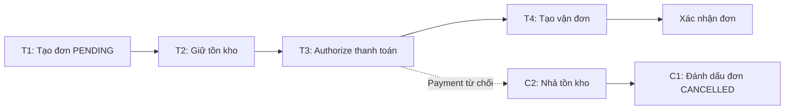
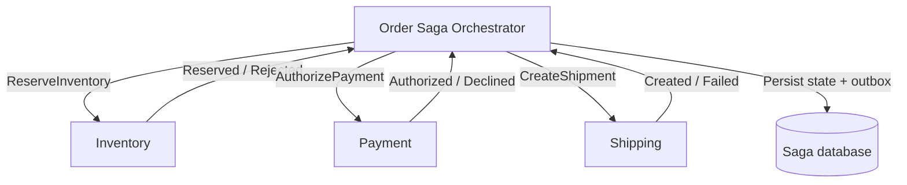
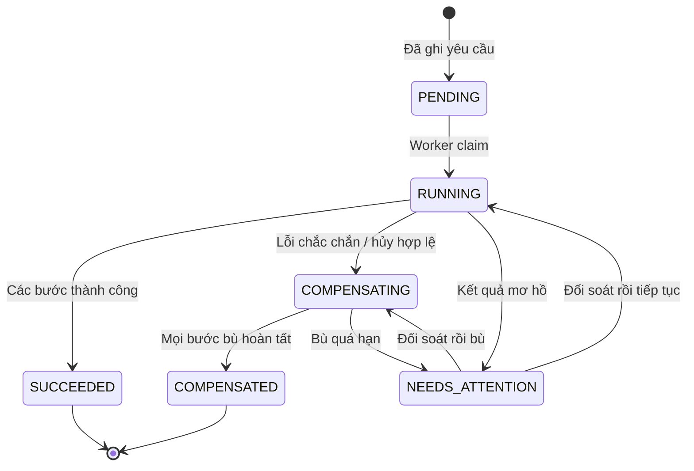

# Saga, xử lý bù và tài nguyên theo dõi tiến trình

## Mục tiêu học tập

Sau bài này, bạn có thể:

- Giải thích vì sao một REST API thực hiện nghiệp vụ qua nhiều dịch vụ cần cơ chế **nhất quán cuối cùng** thay vì giả định có một transaction ACID chung.
- Thiết kế **Saga** gồm những giao dịch cục bộ và hành động **compensation**; nhận biết trường hợp không thể hoàn tác hoàn toàn.
- Phân biệt **orchestration** và **choreography** về trách nhiệm điều phối, theo dõi và xử lý lỗi.
- Thiết kế tài nguyên REST theo dõi tiến trình qua `202 Accepted`, `Location`, `GET /api/operations/{id}` và trạng thái kết thúc.
- Áp dụng Java/Spring, transactional outbox, idempotency, retry, timeout và optimistic locking để hạn chế mất sự kiện, xử lý trùng và chuyển trạng thái sai.
- Kiểm thử failure injection, bù từng phần, crash/restart và quyền truy cập tài nguyên theo dõi.

## 1. Tình huống: tạo đơn hàng là quy trình nhiều bước

Giả sử một API đặt hàng có những bước:

1. **Order Service** tạo bản ghi đơn ở trạng thái `PENDING`.
2. **Inventory Service** giữ trước số lượng hàng, trả `reservationId`.
3. **Payment Service** cấp phép thanh toán (authorize), trả `authorizationId`.
4. **Shipping Service** tạo yêu cầu giao hàng.
5. Order Service xác nhận đơn `CONFIRMED`.

Mỗi service có database riêng. Nếu inventory giữ chỗ thành công nhưng payment từ chối, rollback transaction của Order Service **không tự động** nhả tồn kho ở Inventory Service. Nếu payment đã authorize nhưng kết nối tới Shipping Service bị ngắt, hệ thống phải xác minh vận đơn đã được tạo chưa.

Một transaction `@Transactional` trong Spring thường chỉ quản lý những tài nguyên tham gia cùng transaction manager. **Nó không biến các HTTP call tới service khác thành transaction ACID phân tán.** Khi chọn nhiều service và dữ liệu độc lập, đội phát triển phải thiết kế đường phục hồi ngay từ đầu.

### Vì sao không chỉ gọi tuần tự rồi trả `201`?

```java
// Mẫu dễ lỗi nếu coi toàn bộ chuỗi là nguyên tử.
orderRepository.save(pendingOrder);
inventoryClient.reserve(orderId, items);
paymentClient.authorize(orderId, amount);
shippingClient.createShipment(orderId);
return ResponseEntity.status(201).body(orderId);
```

Nếu controller mất kết nối sau khi authorize thành công, phía client thấy lỗi nhưng **side effect đã xảy ra**. Gọi lại chuỗi mà thiếu idempotency có thể tạo đơn, giữ tồn kho hoặc authorize thanh toán lần hai. Nếu process chết giữa hai bước, không có điểm tiếp tục được lưu bền vững thì không thể biết cần làm gì.

## 2. Saga là gì?

**Saga** là chuỗi các giao dịch cục bộ `T1, T2, ..., Tn`. Mỗi bước commit trong phạm vi tài nguyên của nó và phát kết quả để kích hoạt bước tiếp. Nếu bước sau thất bại, Saga thực hiện những hành động nghiệp vụ bù `Ck, ..., C1` cho các bước đã thành công, thường theo thứ tự ngược chiều.



Saga mang lại **nhất quán nghiệp vụ cuối cùng**, không phải rollback tức thì và cũng không bảo đảm isolation như một transaction trong database. Trong lúc Saga chạy, đơn có thể `PENDING`, kho đã giữ hàng nhưng payment chưa xong. Hợp đồng API và UI phải biểu diễn được trạng thái trung gian này.

| Thuộc tính | Transaction ACID cục bộ | Saga |
| --- | --- | --- |
| Phạm vi commit | Một DB/resource tham gia transaction | Nhiều giao dịch cục bộ commit riêng |
| Khi lỗi sau một bước | Rollback phần chưa commit | Compensation hoặc xử lý vận hành |
| Nhất quán nhìn từ client | Một giao dịch tương đối nguyên tử | Có trạng thái trung gian, kết quả đến sau |
| Isolation | Do DB/transaction level đảm bảo | Phải thiết kế chống race và oversell |
| Crash/restart | DB quản lý transaction đang mở | Cần state, event và quy trình resume bền vững |

Saga phù hợp với đặt hàng, đặt vé, provisioning, workflow phê duyệt và quy trình nhiều phút. Nó **không bắt buộc** cho nghiệp vụ có thể hoàn tất bằng một transaction duy nhất trên cùng database.

## 3. Thiết kế bước tiến và bước bù

Mỗi bước nên có **kết quả có thể nhận diện**, định nghĩa bù và yêu cầu idempotency rõ ràng:

| Bước tiến | Kết quả cần lưu | Compensation | Giới hạn |
| --- | --- | --- | --- |
| `T1: createPendingOrder` | `orderId`, trạng thái `PENDING` | `C1: cancelPendingOrder` | Đổi trạng thái, giữ audit, không xóa sạch lịch sử |
| `T2: reserveInventory` | `reservationId` | `C2: releaseReservation` | Reservation có thể đã tự hết hạn |
| `T3: authorizePayment` | `authorizationId` | `C3: voidAuthorization` | Nếu đã capture tiền, phải refund/đối soát |
| `T4: createShipment` | `shipmentId` | `C4: cancelShipment` | Có thể không hủy được khi đã bàn giao hàng |
| `T5: confirmOrder` | Đơn `CONFIRMED` | Có thể cần quy trình hủy/trả hàng riêng | Bước thành công cuối không phải lúc nào đảo ngược được |

Nếu `T4` chắc chắn thất bại sau khi `T2` và `T3` thành công, một đường bù thường là `C3 → C2 → C1`. Nếu `T4` có thể đã tạo vận đơn nhưng response bị mất, trước tiên phải xác minh kết quả để biết có cần `C4` không. **Timeout không đồng nghĩa với “chưa làm gì”.**

### Compensation không giống rollback dữ liệu

- `voidAuthorization` hủy một authorization **chưa capture**. Nếu tiền đã capture, một khoản **refund** thường là giao dịch mới, có thể mất thời gian và phí.
- `releaseReservation` phải idempotent. Không được tăng tồn kho lần hai nếu reservation đã được giải phóng.
- Email đã gửi, hàng đã giao, chuyển tiền đã settlement hoặc notification đã xem có thể **không thu hồi được**. Phải có nghiệp vụ khắc phục hoặc xử lý thủ công.
- Compensation cũng có thể timeout, chạy lặp hoặc thất bại. Saga phải ghi tiến độ bù và tiếp tục retry an toàn; không đánh dấu `COMPENSATED` chỉ vì đã **gửi** lệnh bù.

Nên xác định **pivot point**: sau mốc đó, bù theo flow cũ không còn hợp lệ. Ví dụ sau khi kiện hàng được hãng vận chuyển nhận, “hủy vận đơn” có thể phải thay bằng quy trình trả hàng.

## 4. Orchestration và choreography

### Orchestration: bộ điều phối giữ tiến trình

**Saga orchestrator** giữ trạng thái workflow, gửi command tới các service, nhận kết quả và quyết định bước tiếp hoặc bước bù:



Orchestration phù hợp khi cần luồng rõ ràng, có nhiều nhánh lỗi, timeout, hủy, reconciliation và endpoint theo dõi. Orchestrator cũng là thành phần phải vận hành tin cậy: trạng thái phải lưu bền vững và không để nhiều worker xử lý cùng một bước đồng thời.

### Choreography: các service phản ứng theo event

Không có bộ điều phối trung tâm quyết định toàn bộ flow. Inventory nghe `OrderPending`, giữ hàng rồi phát `InventoryReserved`; Payment nghe event đó và phát `PaymentAuthorized`; Shipping phản ứng sau đó. Khi lỗi, các service phát failure event kích hoạt hành động bù.

**Ưu điểm:** ít phụ thuộc trực tiếp vào một orchestrator, hữu ích với luồng sự kiện tương đối đơn giản. **Đánh đổi:** khó nhìn trạng thái tổng thể, dễ hình thành phụ thuộc/chu trình event ẩn, khó xác định ai chịu trách nhiệm khi nhiều compensation thất bại.

Với choreography, một **progress projector** vẫn có thể tổng hợp event theo `operationId` để phục vụ `GET /api/operations/{id}`. Event có thể trùng, đến muộn hoặc đảo thứ tự; projector cần version/sequence và lưu trạng thái bền vững.

| Tiêu chí | Orchestration | Choreography |
| --- | --- | --- |
| Ai quyết định bước tiếp | Orchestrator | Handler tại các service |
| Theo dõi tiến trình | Thường tập trung, dễ quan sát | Cần correlation và projection |
| Xử lý nhánh lỗi phức tạp | State machine rõ | Logic phân tán qua nhiều handler |
| Coupling | Orchestrator biết hợp đồng các bước | Các service phụ thuộc event semantics |
| Phù hợp | Order/payment/shipping có nhiều nhánh | Pipeline event tương đối đơn giản |

Không có lựa chọn đúng cho mọi hệ thống. Phần thực hành dùng **orchestration** để thấy rõ đường bù và trạng thái API; các nguyên tắc outbox, idempotency và tracking cũng áp dụng cho choreography.

## 5. State machine: Saga khác trạng thái đơn hàng

Hãy phân biệt ba lớp:

- **Order status**: `PENDING`, `CONFIRMED`, `CANCELLED`... — trạng thái tài nguyên nghiệp vụ.
- **Operation/Saga status**: `PENDING`, `RUNNING`, `COMPENSATING`, `SUCCEEDED`, `COMPENSATED`, `NEEDS_ATTENTION` — trạng thái một yêu cầu thực thi.
- **Step status**: `NOT_STARTED`, `IN_PROGRESS`, `SUCCEEDED`, `FAILED`, `COMPENSATING`, `COMPENSATED`, `UNKNOWN` khi kết quả downstream chưa xác minh.



`NEEDS_ATTENTION` trong ví dụ **chưa phải kết quả nghiệp vụ cuối cùng**. Nó biểu thị Saga cần đối soát hoặc xử lý thủ công. Nếu hệ thống định nghĩa trạng thái terminal `FAILED`, cần ghi rõ side effect còn tồn tại và cách phục hồi; đừng gọi `COMPENSATED` khi bước bù vẫn chưa hoàn thành.

Khi trả `202`, phải bảo đảm `GET /api/operations/{id}` có đường đọc nhất quán. Nếu đọc ngay từ replica chậm đồng bộ rồi trả `404`, client không thể theo dõi dù server đã tiếp nhận operation. Có thể đọc từ primary hoặc bảo đảm cơ chế read-your-write tương ứng.

## 6. Thiết kế tài nguyên REST để theo dõi tiến trình

### 6.1. Nhận lệnh tạo đơn

```http
POST /api/orders HTTP/1.1
Host: api.example.com
Authorization: Bearer <access-token>
Content-Type: application/json
Idempotency-Key: 2ca243f8-6bc8-4a73-ac2a-af0b5a273250

{
  "productId": "22222222-2222-2222-2222-222222222222",
  "quantity": 2
}
```

Ví dụ rút gọn giả định địa chỉ giao hàng và danh tính người mua được lấy từ hồ sơ đã xác thực ở backend; chúng không phải thông tin mà client có thể tự nhận quyền tùy ý.

Sau khi đã **commit operation cùng công việc/outbox bền vững**:

```http
HTTP/1.1 202 Accepted
Content-Type: application/json
Location: /api/operations/op-8a91
Cache-Control: no-store

{
  "id": "op-8a91",
  "kind": "CREATE_ORDER",
  "status": "PENDING",
  "submittedAt": "2026-11-18T13:00:00Z",
  "pollAfterSeconds": 2,
  "links": {"self": "/api/operations/op-8a91"}
}
```

`202` nghĩa là **đã nhận để xử lý**, không bảo đảm kết quả thành công. Chỉ đẩy task vào queue RAM rồi trả `202` có thể làm mất công việc khi process chết. Nếu thiết kế cho phép tạo sẵn order resource `PENDING` bằng `201`, phải nêu rõ semantics và khi nào resource đó được đọc.

**Idempotency-Key** bảo vệ client khi timeout sau lúc server đã nhận lệnh:

- Cùng tenant/principal, operation, key và **cùng payload nghiệp vụ** phải trả lại **cùng operation**.
- Cùng key nhưng payload khác phải nhận lỗi xung đột, ví dụ `409 Conflict` theo hợp đồng.
- Backend cần scope/TTL của key, payload fingerprint được chuẩn hóa và unique constraint **bền vững**.
- Client dùng lại đúng key cho **cùng một ý định**; không đổi key sau mỗi lần retry.

Header đơn lẻ không bảo đảm idempotency: server phải xử lý race khi hai request cùng key đến đồng thời.

### 6.2. Tra cứu khi đang chạy

```http
GET /api/operations/op-8a91 HTTP/1.1
Authorization: Bearer <access-token>
Accept: application/json

HTTP/1.1 200 OK
Content-Type: application/json
Cache-Control: private, no-store

{
  "id": "op-8a91",
  "kind": "CREATE_ORDER",
  "status": "RUNNING",
  "updatedAt": "2026-11-18T13:00:02Z",
  "currentStep": "AUTHORIZE_PAYMENT",
  "steps": [
    {"name": "CREATE_PENDING_ORDER", "status": "SUCCEEDED"},
    {"name": "RESERVE_INVENTORY", "status": "SUCCEEDED"},
    {"name": "AUTHORIZE_PAYMENT", "status": "IN_PROGRESS"},
    {"name": "CREATE_SHIPMENT", "status": "NOT_STARTED"}
  ],
  "pollAfterSeconds": 2
}
```

`GET` phải là thao tác đọc **không kích hoạt lại payment**. `200 OK` kèm field `RUNNING` là hợp lệ: mã HTTP mô tả việc **đọc operation thành công**, còn trường `status` mô tả **tiến trình nghiệp vụ**.

### 6.3. Thành công hoặc đã bù hoàn tất

```http
HTTP/1.1 200 OK
Content-Type: application/json
Cache-Control: private, no-store

{
  "id": "op-8a91",
  "status": "SUCCEEDED",
  "completedAt": "2026-11-18T13:00:04Z",
  "result": {
    "orderId": "ord-508",
    "url": "/api/orders/ord-508"
  }
}
```

Frontend có thể điều hướng tới `GET /api/orders/ord-508`. Nếu resource order đã tồn tại từ đầu ở `PENDING`, API vẫn phải mô tả rõ thời điểm chuyển sang `CONFIRMED`.

Nếu payment từ chối và mọi bước bù thành công:

```json
{
  "id": "op-8a91",
  "status": "COMPENSATED",
  "completedAt": "2026-11-18T13:00:06Z",
  "failure": {
    "code": "PAYMENT_DECLINED",
    "message": "Không thể xác nhận thanh toán.",
    "retryable": false
  }
}
```

Khi operation tồn tại và được đọc thành công, `GET` vẫn trả `200` dù **kết quả nghiệp vụ thất bại**. Đừng trả `500` mỗi lần người dùng xem tiến trình thất bại hợp lệ.

Khi kết quả chưa được đối soát:

```json
{
  "id": "op-8a91",
  "status": "NEEDS_ATTENTION",
  "failure": {
    "code": "PAYMENT_STATUS_UNKNOWN",
    "message": "Đang đối soát trạng thái thanh toán.",
    "retryable": false
  },
  "pollAfterSeconds": 10
}
```

Không để lộ stack trace, payment credential hay message nội bộ nhạy cảm. `retryable` trong response là **gợi ý client có thể tạo lại ý định hay không**, không đại diện cho retry kỹ thuật của worker. Khi trạng thái còn không chắc chắn, thường không nên để client tự tạo đơn mới.

### 6.4. Polling, hủy và thời gian lưu tài nguyên

Frontend có thể polling theo thời gian server gợi ý; dừng khi operation kết thúc hoặc người dùng rời màn hình:

```javascript
async function readUntilSettled(url, token, signal) {
  for (;;) {
    const response = await fetch(url, {
      headers: { Authorization: "Bearer " + token },
      signal
    });
    if (!response.ok) throw new Error("HTTP " + response.status);
    const op = await response.json();

    if (["SUCCEEDED", "COMPENSATED", "NEEDS_ATTENTION"]
        .includes(op.status)) return op;

    const delay = Math.max(1000, Math.min(
      10000, (op.pollAfterSeconds ?? 2) * 1000
    ));
    await new Promise((resolve) => setTimeout(resolve, delay));
  }
}
```

Mẫu minh họa cần bổ sung trong production: hủy cả timeout giữa các lượt poll khi `signal` abort, deadline tổng, backoff với lỗi mạng, điều chỉnh khi tab bị ẩn và không poll quá nhanh. Có thể dùng Server-Sent Events/WebSocket để giảm độ trễ, nhưng vẫn nên giữ `GET` bền vững để phục hồi sau mất kết nối.

Nếu hỗ trợ hủy, dùng hợp đồng **yêu cầu hủy bất đồng bộ** như `POST /api/operations/{id}/cancellation` và trả `202` khi chấp nhận yêu cầu. Hủy có thể chạy compensation và **không chắc** thành công nếu bước irreversible đã xảy ra. Theo policy, thao tác hủy không hợp lệ có thể trả `409`; không nên xem `DELETE /operations/{id}` như thao tác xóa lịch sử và tự đảo ngược giao dịch bên ngoài.

Operation resource cần retention policy: sau thời hạn có thể `404` hoặc `410 Gone` theo hợp đồng. Mọi `GET`, lệnh hủy và truy cập kết quả đều phải phân quyền theo tenant/chủ sở hữu; `404` đôi khi được dùng thay `403` để không lộ sự tồn tại. Với polling dày, cân nhắc `ETag`/conditional GET và rate limit.

## 7. Lưu tiến trình bền vững: transactional outbox và idempotency

Một nguyên tắc nền tảng là **ghi quyết định nhận lệnh và tín hiệu công việc trong cùng transaction cục bộ**. Ví dụ:

```text
BEGIN DB TRANSACTION
    INSERT operation(
        status='PENDING', idempotency_key, request_hash, ...)
    INSERT outbox(
        event_type='ORDER_SAGA_REQUESTED', operation_id, ...)
COMMIT

Outbox publisher -> broker/worker -> Saga orchestrator
```

Nếu server chết **sau commit, trước publish**, outbox vẫn còn để publisher tiếp tục. Nếu publisher đã gửi message nhưng chết trước khi đánh dấu `published`, cùng event có thể phát lại. Transactional outbox giải quyết việc ghi dữ liệu và ý định phát sự kiện **nguyên tử trong một DB**, nhưng thường đem lại **at-least-once delivery** tới consumer, không tự bảo đảm exactly-once business effect xuyên nhiều service.

Một lược đồ PostgreSQL minh họa:

```sql
CREATE TABLE api_operation (
    id UUID PRIMARY KEY,
    tenant_id UUID NOT NULL,
    actor_id TEXT NOT NULL,
    operation_kind TEXT NOT NULL,
    idempotency_key TEXT NOT NULL,
    request_hash CHAR(64) NOT NULL,
    status VARCHAR(32) NOT NULL,
    result_resource_id TEXT,
    failure_code TEXT,
    version BIGINT NOT NULL DEFAULT 0,
    created_at TIMESTAMPTZ NOT NULL DEFAULT now(),
    updated_at TIMESTAMPTZ NOT NULL DEFAULT now(),
    UNIQUE (tenant_id, actor_id, operation_kind, idempotency_key)
);

CREATE TABLE saga_step (
    operation_id UUID NOT NULL REFERENCES api_operation(id),
    step_name TEXT NOT NULL,
    status VARCHAR(32) NOT NULL,
    command_key TEXT NOT NULL UNIQUE,
    external_reference TEXT,
    attempts INT NOT NULL DEFAULT 0,
    updated_at TIMESTAMPTZ NOT NULL DEFAULT now(),
    PRIMARY KEY (operation_id, step_name)
);

CREATE TABLE outbox_event (
    event_id UUID PRIMARY KEY,
    operation_id UUID NOT NULL REFERENCES api_operation(id),
    event_type TEXT NOT NULL,
    payload JSONB NOT NULL,
    created_at TIMESTAMPTZ NOT NULL DEFAULT now(),
    published_at TIMESTAMPTZ
);
```

Đây là lược đồ định hướng. Production còn cần index cho dequeue, claim/lease, retention, phân vùng dữ liệu, kiểm soát truy cập và bảo vệ payload. Không đưa raw thẻ thanh toán, access token, bí mật đăng nhập vào outbox hoặc operation log.

### Chống hai worker cùng chuyển một bước

Hai worker có thể cùng nhận event `ORDER_SAGA_REQUESTED`. Hãy dùng row lock, claim/lease hoặc optimistic locking:

```sql
UPDATE api_operation
SET status = 'RUNNING',
    version = version + 1,
    updated_at = now()
WHERE id = :operation_id
  AND status = 'PENDING'
  AND version = :expected_version;
```

Chỉ worker thấy **1 row updated** mới được phép bắt đầu từ `PENDING`. Nhưng một CAS lúc khởi đầu **chưa đủ**: khi worker chết trong `RUNNING`, cần lease/heartbeat hoặc scheduler phục hồi; từng step transition cũng phải kiểm tra trạng thái hiện tại/version. Event đến muộn không được chuyển Saga đã bù xong trở lại `SUCCEEDED`.

### Idempotency ở ba ranh giới

1. **HTTP client → Order API:** cùng yêu cầu và `Idempotency-Key` trả cùng operation, không tạo đơn mới.
2. **Orchestrator → Inventory/Payment/Shipping:** mỗi step gửi command có khóa ổn định, retry cùng khóa để không thực hiện side effect lần hai.
3. **Event consumer → Saga state:** message trùng/đảo thứ tự không làm chuyển state hai lần hoặc phát command mới.

Ví dụ các command key lưu bền vững:

```text
op-8a91:reserve-inventory
op-8a91:authorize-payment
op-8a91:create-shipment
op-8a91:void-payment
op-8a91:release-reservation
```

Downstream phải ghi command key hoặc external reference với ràng buộc unique, kiểm tra payload và trả lại kết quả cũ khi lặp. Riêng provider bên ngoài cần dùng đúng contract idempotency của họ, gồm phạm vi và thời hạn lưu khóa; không giả định hai nhà cung cấp hỗ trợ hoàn toàn giống nhau.

## 8. Java/Spring: nhận lệnh nhanh, điều phối ở worker

Một controller Spring Boot có thể trả `202` sau khi application service đã lưu operation và outbox:

```java
import java.net.URI;
import java.util.UUID;
import jakarta.validation.Valid;
import jakarta.validation.constraints.Min;
import jakarta.validation.constraints.NotNull;
import org.springframework.http.CacheControl;
import org.springframework.http.ResponseEntity;
import org.springframework.security.core.Authentication;
import org.springframework.web.bind.annotation.*;

record CreateOrderRequest(@NotNull UUID productId, @Min(1) int quantity) {}
record OperationView(
    UUID id, String kind, String status, String statusUrl
) {}

@RestController
@RequestMapping("/api")
class OrderWorkflowController {
    private final OrderWorkflowService workflow;
    private final TenantResolver tenantResolver;

    OrderWorkflowController(
            OrderWorkflowService workflow, TenantResolver tenantResolver) {
        this.workflow = workflow;
        this.tenantResolver = tenantResolver;
    }

    @PostMapping("/orders")
    ResponseEntity<OperationView> create(
            @RequestHeader("Idempotency-Key") String key,
            @Valid @RequestBody CreateOrderRequest body,
            Authentication authentication) {

        UUID tenantId = tenantResolver.fromVerifiedIdentity(authentication);
        OperationView op = workflow.accept(
            tenantId, authentication.getName(), key, body);

        return ResponseEntity.accepted()
            .location(URI.create(op.statusUrl()))
            .cacheControl(CacheControl.noStore())
            .body(op);
    }

    @GetMapping("/operations/{id}")
    ResponseEntity<OperationView> get(
            @PathVariable UUID id,
            Authentication authentication) {

        UUID tenantId = tenantResolver.fromVerifiedIdentity(authentication);
        OperationView op = workflow.findVisibleTo(
            id, tenantId, authentication.getName());

        return ResponseEntity.ok()
            .cacheControl(CacheControl.noStore())
            .body(op);
    }
}
```

Đây là **khung code minh họa**, không phải source độc lập có thể compile ngay: `OrderWorkflowService` và `TenantResolver` là các thành phần ứng dụng cần triển khai; `statusUrl` là đường dẫn tương đối do server xây dựng. Spring Security phải xác thực token/session và suy ra tenant từ identity **đã kiểm chứng**, không lấy tenant tùy ý từ request body. Trường hợp `404/403`, `409` khi dùng lại key với payload khác hoặc `422` khi validation nghiệp vụ thất bại cần handler trả Problem Details (RFC 9457) theo hợp đồng.

### Transaction nhận lệnh và outbox

Application service có thể triển khai như sau:

```java
@Transactional
public OperationView accept(
        UUID tenantId, String actorId,
        String key, CreateOrderRequest request) {

    String fingerprint = canonicalRequestSha256(request);
    UUID proposedId = UUID.randomUUID();

    // Repository dùng INSERT ... ON CONFLICT DO NOTHING
    // với UNIQUE (tenant_id, actor_id, operation_kind, idempotency_key).
    int inserted = operationRepository.insertIfAbsent(
        proposedId, tenantId, actorId, "CREATE_ORDER",
        key, fingerprint, "PENDING");

    if (inserted == 1) {
        outboxRepository.enqueue(
            UUID.randomUUID(), proposedId, "ORDER_SAGA_REQUESTED",
            request);
    }

    OperationRecord stored =
        operationRepository.findByClientKey(
            tenantId, actorId, "CREATE_ORDER", key)
        .orElseThrow();

    if (!stored.requestHash().equals(fingerprint)) {
        throw new IdempotencyConflictException();
    }

    return toOperationView(stored);
}
```

Đây là **mã minh họa phần service**, các repository/kiểu/helper phải được triển khai. `insertIfAbsent` phải dựa trên unique constraint thật để chống race, không chỉ “SELECT rồi INSERT” thiếu lock. Outbox và operation phải dùng **cùng transaction**; nếu enqueue thất bại, toàn bộ thao tác nhận lệnh rollback. Với PostgreSQL `READ COMMITTED`, cần kiểm thử cạnh tranh cùng key và cách transaction xử lý conflict; không gán mặc định lỗi unique thành `500`.

Fingerprint cần được chuẩn hóa theo ngữ nghĩa dữ liệu (ví dụ thứ tự field JSON không làm khác payload), kèm quy tắc TTL/scope của key. Hash **không thay thế** validate input hay authorization.

### Worker không giữ transaction DB xuyên HTTP call

Sai lầm dễ gặp:

```java
// TRÁNH: DB transaction mở trong suốt các lời gọi mạng.
@Transactional
void executeSaga() {
    inventoryClient.reserve(...);
    paymentClient.authorize(...);
    shippingClient.createShipment(...);
    operationRepository.markSucceeded(...);
}
```

DB transaction dài giữ lock/connection, có thể rollback dữ liệu local nhưng không hoàn tác các side effect đã xảy ra ở downstream. Thay vào đó, chia thành các transaction **ngắn** để claim step, ghi kết quả, phát command/event bền vững và xử lý response:

```text
claim(operation, expectedStep/version)         # DB transaction ngắn
send reserveInventory(stableCommandKey)        # HTTP/event ngoài DB transaction
persist reservationId, step=SUCCEEDED          # DB transaction + outbox

claim(nextStep/version)                         # DB transaction ngắn
send authorizePayment(stableCommandKey)        # HTTP/event ngoài DB transaction
persist authorizationId, step=SUCCEEDED        # DB transaction + outbox

claim(nextStep/version)
send createShipment(stableCommandKey)
persist shipmentId, step=SUCCEEDED
mark order CONFIRMED + saga SUCCEEDED          # Theo transaction owner thực tế
```

Nếu worker chết **sau khi gửi command, trước khi lưu kết quả**, database local không biết side effect đã hoàn thành. Phải **gửi lại cùng idempotency key** hoặc **tra cứu external reference** để xác minh; không sinh key mới rồi mặc nhiên làm lại giao dịch. Với provider không hỗ trợ query/idempotency, bài toán phục hồi có thể cần đối soát thủ công và nghiệp vụ chấp nhận trạng thái không chắc chắn.

Nếu payment trả `DECLINED` rõ ràng, Saga có thể bắt đầu bù. Nếu payment **timeout** và không biết provider đã authorize chưa, Saga giữ `UNKNOWN` hoặc `NEEDS_ATTENTION` cho tới khi đối soát; không tự suy luận phải hủy kho ngay rồi bỏ qua giao dịch payment có thể tồn tại.

## 9. Retry, timeout, compensation và đối soát

### Phân biệt lỗi tạm thời, lỗi nghiệp vụ và kết quả mơ hồ

| Kịch bản | Xử lý phù hợp |
| --- | --- |
| Inventory trả rõ `OUT_OF_STOCK` | Dừng luồng tiến; bù các bước đã commit; báo kết quả nghiệp vụ |
| Payment trả `DECLINED` | Không retry mù; nhả inventory và hủy đơn |
| Payment trả `503`, có idempotency contract | Retry **cùng key**, backoff có jitter trong giới hạn |
| Payment timeout sau khi gửi request | Truy vấn trạng thái theo key/external reference hoặc retry idempotent; chưa biết outcome |
| Bù inventory tạm thời thất bại | Giữ `COMPENSATING`, retry bù với key ổn định |
| Vận đơn đã giao hãng hoặc bù vượt chính sách retry | `NEEDS_ATTENTION`, alert và đối soát theo quy trình |

**Retry cần ngân sách:** tổng deadline, số lần thử, exponential backoff + jitter, timeout kết nối/response và giới hạn concurrency. Không retry vô hạn khi lỗi do validation hoặc payment declined. Vận hành nên có **reconciliation job** định kỳ tìm Saga `RUNNING`/`COMPENSATING` quá hạn, tra cứu tình trạng bên ngoài và đưa quy trình về trạng thái phù hợp.

### Race giữa hoàn tất và yêu cầu hủy

Giả sử user yêu cầu hủy khi `CreateShipment` đã được gửi. Quy trình cần khóa/version:

1. Ghi `CANCELLATION_REQUESTED` bền vững.
2. Nếu shipment chưa tạo, dừng bước tiếp theo và chạy compensation.
3. Nếu shipment đã tạo nhưng còn hủy được, gửi `CancelShipment` với key ổn định và chờ xác nhận.
4. Nếu hàng đã giao hãng, dùng quy trình trả hàng hoặc từ chối yêu cầu hủy theo hợp đồng; không tự ghi `CANCELLED`.

Client nhìn thấy trạng thái trung gian; `cancel` không phải phép đảo ngược tức thì. Event đến muộn chỉ được chấp nhận khi phù hợp bước và version hiện tại. Audit log nên ghi actor, operationId, commandId, correlationId, thời điểm và state transition.

## 10. Bảo mật và quan sát tài nguyên tiến trình

Operation URL có thể chứa trạng thái thanh toán, dữ liệu đơn hàng hoặc chi tiết quy trình. Do đó:

- **Xác thực và phân quyền theo object/tenant** ở mọi `GET /api/operations/{id}`, yêu cầu hủy và truy cập kết quả; UUID khó đoán không phải phân quyền.
- Không đưa raw access token, chi tiết thẻ, PII không cần thiết, provider secret hay stack trace vào response hoặc outbox.
- Sử dụng `Cache-Control: private, no-store` khi dữ liệu nhạy cảm; theo dõi cache ở gateway/browser.
- Giới hạn polling và hủy lặp theo principal/operation; khi rate-limit trả `429` và hướng dẫn retry.
- Truyền trace/correlation ID xuyên service để điều tra, nhưng không coi chúng là idempotency key.

Những metric nên đo:

| Metric | Ý nghĩa vận hành |
| --- | --- |
| Saga started/succeeded/compensated/needs-attention | Tỷ lệ thành công, thất bại và quy trình cần người xử lý |
| Saga duration `p50/p95/p99` | Người dùng chờ bao lâu để có kết quả cuối |
| In-flight Saga theo trạng thái | Có bao nhiêu luồng kẹt `RUNNING`/`COMPENSATING` |
| Step latency/timeout/retry count | Bước nào kéo chậm hoặc tạo retry storm |
| Compensation attempts/oldest pending | Có hàng, tiền, shipment nào chưa bù xong |
| Outbox lag, publish failure, consumer redelivery | Đường sự kiện có chậm hoặc trùng |
| Operation GET/polling rate và unauthorized access | UI có poll quá nhanh, có truy cập vượt quyền |

`202` trả ngay không chứng minh quy trình sẽ hoàn thành. Hệ thống cần cảnh báo **Saga chưa terminal quá lâu**, bảng điều khiển đối soát và thao tác vận hành có audit để tiếp tục/bù an toàn.

## 11. Kiểm thử theo điểm lỗi

### 11.1. Ma trận failure injection

| Điểm lỗi | Điều cần xác nhận |
| --- | --- |
| Inventory từ chối | Không authorize payment, không confirm order |
| Payment declined sau khi reserve | Nhả đúng reservation và hủy order, không tạo side effect trùng |
| Shipping thất bại sau authorize | Void payment, nhả inventory, hủy đơn |
| Payment timeout nhưng provider đã authorize | Reconcile/retry cùng key, không authorize lần hai |
| Crash sau commit outbox nhưng trước publish | Publisher khôi phục và gửi event |
| Event `InventoryReserved` đến trùng | Không chuyển hai lần, không phát hai command payment khác nhau |
| Crash sau call downstream nhưng trước persist | Resume qua external reference/idempotency key |
| Compensation thất bại dài hạn | Trạng thái `COMPENSATING`/`NEEDS_ATTENTION`, alert, không công bố bù thành công |
| Hai `POST` cùng idempotency key | Một operation và outbox entry; payload khác gây conflict |
| Tenant B truy cập operation tenant A | Từ chối theo chính sách, không lộ dữ liệu |

### 11.2. MockMvc: xác nhận hợp đồng `202` và `Location`

Với controller bên trên và Spring Security Test:

```java
import static org.mockito.ArgumentMatchers.*;
import static org.mockito.Mockito.when;
import static org.springframework.security.test.web.servlet.request
    .SecurityMockMvcRequestPostProcessors.jwt;
import static org.springframework.test.web.servlet.request
    .MockMvcRequestBuilders.post;
import static org.springframework.test.web.servlet.result
    .MockMvcResultMatchers.*;

@Test
void createOrderReturnsTrackingResource() throws Exception {
    UUID opId = UUID.fromString(
        "11111111-1111-1111-1111-111111111111");

    when(workflow.accept(any(), anyString(), anyString(), any()))
        .thenReturn(new OperationView(
            opId, "CREATE_ORDER", "PENDING",
            "/api/operations/" + opId));

    mockMvc.perform(post("/api/orders")
            .with(jwt())
            .header("Idempotency-Key", "customer-command-1")
            .contentType("application/json")
            .content("""
                {"productId":"22222222-2222-2222-2222-222222222222",
                 "quantity":2}
                """))
        .andExpect(status().isAccepted())
        .andExpect(header().string(
            "Location", "/api/operations/" + opId))
        .andExpect(jsonPath("$.status").value("PENDING"));
}
```

Đây là **mẫu test**, cần bổ sung `@Test`, biến `mockMvc`, `workflow` mock, `TenantResolver` test setup, security filter chain và import từ codebase thực tế. `with(jwt())` chỉ phù hợp cấu hình Resource Server/JWT tương ứng. Nếu ứng dụng bảo vệ request bằng session cookie và CSRF, phải thêm token kiểm thử hợp lệ; không tắt CSRF chỉ để test pass.

Test controller chỉ kiểm tra HTTP contract. Integration test cần database thực và fake downstream có chủ đích:

1. Gửi hai `POST` cùng key đồng thời; unique constraint và transaction cho ra một operation/outbox.
2. Gây crash **sau commit**, **sau gửi command**, **sau nhận response**; restart worker và xác minh trạng thái có thể phục hồi.
3. Gửi event trùng và đảo thứ tự; assert state version/command key ngăn side effect lặp.
4. Gọi `GET` nhiều lần; assert không sinh command mới và chỉ actor có quyền đọc được.
5. Mô phỏng compensation thất bại dài hạn; kiểm tra alert, reconciliation và `NEEDS_ATTENTION`.

Nên dùng clock kiểm soát được, fake downstream hoặc latch thay vì chỉ `Thread.sleep()` để tạo race. Đảm bảo test kiểm tra **side effect ở downstream**, không chỉ số message nhận được.

## 12. Bài tập thực hành

**Bài 1 — Thiết kế Saga.** Một API cần giữ tồn kho, authorize payment, tạo vận đơn và confirm order. Vẽ state machine, liệt kê command, kết quả, external reference và compensation từng bước. Đánh dấu mốc mà vận đơn không còn hủy được.

**Bài 2 — Hợp đồng REST.** Viết HTTP request/response cho `POST /api/orders` với `Idempotency-Key`, phản hồi `202 + Location`; `GET /api/operations/{id}` đang `RUNNING`; kết quả `SUCCEEDED` có link order; và `COMPENSATED` với `PAYMENT_DECLINED`. Dự đoán điều gì xảy ra khi gửi lại cùng key/payload hoặc khác payload.

**Bài 3 — Timeout mơ hồ.** Payment Provider đã authorize 500.000 VND, nhưng response bị mất. Saga chưa ghi `authorizationId`. Đề xuất cách phục hồi qua command key và truy vấn đối soát; giải thích vì sao **không được tự tạo authorization mới** hoặc công bố đơn hủy sạch khi chưa rõ trạng thái payment.

**Bài 4 — Crash/restart.** Dùng Spring Boot, PostgreSQL, outbox và fake payment service có idempotency. Tạo tình huống worker chết ngay sau gửi authorize, trước lưu state. Sau restart, chứng minh chỉ một side effect thanh toán tồn tại, Saga tiếp tục và client vẫn tra cứu `GET /api/operations/{id}`.

**Bài 5 — Race tồn kho.** Hai Saga cùng đặt một sản phẩm chỉ còn 1 chiếc. Cả hai operation được tạo trước khi Inventory trả lời. Thiết kế reserve nguyên tử (conditional update/lock), giải thích vì sao Saga không tự bảo đảm isolation và Saga nào phải bù hoặc thất bại nghiệp vụ.

**Tiêu chí tự đánh giá:** Thiết kế phải có bước tiến, bước bù, kết quả chưa rõ, tài nguyên theo dõi và đường phục hồi khi worker chết. Một yêu cầu đã nhận `202` cần luôn có cách theo dõi/đối soát; retry hoặc event trùng không được tạo side effect ngoài ý định.

## Tài liệu tham khảo

- [RFC 9110 — HTTP Semantics](https://www.rfc-editor.org/rfc/rfc9110)
- [RFC 9457 — Problem Details for HTTP APIs](https://www.rfc-editor.org/rfc/rfc9457)
- [Spring Framework — Transaction Management](https://docs.spring.io/spring-framework/reference/data-access/transaction.html)
- [Spring Framework — Web MVC](https://docs.spring.io/spring-framework/reference/web/webmvc.html)
- [Microservices.io — Saga](https://microservices.io/patterns/data/saga.html)
- [Microservices.io — Transactional Outbox](https://microservices.io/patterns/data/transactional-outbox.html)
