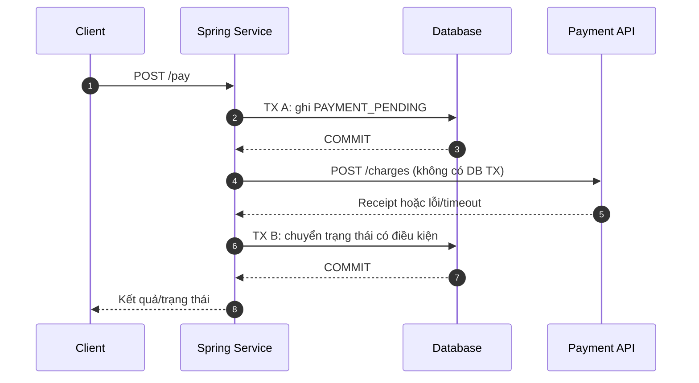
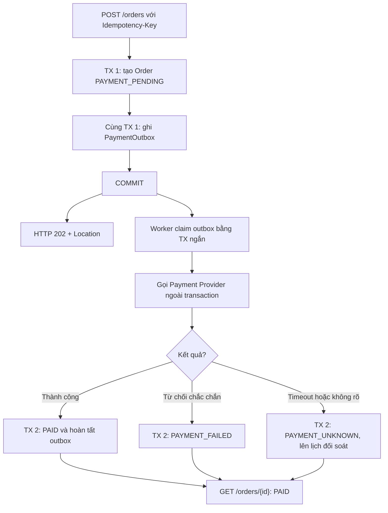

# Tránh giữ giao dịch cơ sở dữ liệu trong lúc chờ API ngoài

Một REST API thường vừa ghi dữ liệu nội bộ, vừa cần gọi hệ thống ngoài: cổng thanh toán, vận chuyển, xác minh danh tính, ERP hoặc dịch vụ gửi thông báo. Cách viết tưởng như thuận tiện là mở giao dịch cơ sở dữ liệu, cập nhật bản ghi, gọi API ngoài và cuối cùng mới `COMMIT`. Khi API ngoài chậm hoặc mất kết nối, giao dịch phải chờ một thao tác không thuộc quyền kiểm soát của database. Điều này làm giảm khả năng phục vụ, tăng tranh chấp khóa và khiến trạng thái nghiệp vụ khó khôi phục.

Trong chủ đề **Nhất quán nghiệp vụ** của module **INTEGRATION_API_REST**, bài học hướng dẫn cách đặt ranh giới giao dịch khi thiết kế REST API bằng Java/Spring: giữ transaction ngắn, công khai trạng thái xử lý, dùng idempotency và transactional outbox khi cần giao tiếp với hệ thống ngoài đáng tin cậy.

## 1. Mục tiêu học tập

Sau bài học, bạn có thể:

1. Nhận diện chỗ nào một `@Transactional` đang bao quanh lời gọi HTTP và phân tích ảnh hưởng đến kết nối, khóa, timeout, concurrency.
2. Thiết kế luồng **ghi trạng thái ngắn → kết thúc transaction → gọi API ngoài → ghi kết quả trong transaction mới**.
3. Giải thích vì sao hai transaction nội bộ vẫn **không** tạo ra một giao dịch ACID bao trùm hệ thống ngoài.
4. Sử dụng **trạng thái trung gian, idempotency key, transactional outbox, retry và reconciliation** để xử lý lỗi hoặc kết quả chưa xác định.
5. Áp dụng ranh giới transaction đúng cách với Spring `@Transactional` và kiểm thử trường hợp timeout, crash, retry, xử lý trùng.

## 2. Vấn đề: Một HTTP call kéo dài tuổi thọ transaction

Xét API thu tiền cho đơn hàng:

```http
POST /orders/6b4e.../pay HTTP/1.1
Authorization: Bearer <access-token>
Idempotency-Key: pay-req-862
Content-Type: application/json

{"paymentMethodId":"pm-123"}
```

Một cách triển khai có lỗi thiết kế:

```java
@Service
public class PaymentService {
    private final OrderRepository orders;
    private final ExternalPaymentClient paymentClient;

    public PaymentService(OrderRepository orders,
                          ExternalPaymentClient paymentClient) {
        this.orders = orders;
        this.paymentClient = paymentClient;
    }

    @Transactional
    public PaymentReceipt pay(UUID orderId) {
        Order order = orders.findByIdForUpdate(orderId); // khóa bản ghi
        order.setStatus(OrderStatus.PAYING);

        // SAI: lời gọi mạng diễn ra trước COMMIT.
        PaymentReceipt receipt = paymentClient.charge(
                order.getId(), order.getAmount());

        order.setPaymentReference(receipt.reference());
        order.setStatus(OrderStatus.PAID);
        return receipt; // COMMIT sau khi method kết thúc
    }
}
```

Giả sử cổng thanh toán phản hồi sau 2,5 giây. Trong thời gian đó:

- Giao dịch vẫn mở, bản ghi `orders` khóa bằng `SELECT ... FOR UPDATE` chưa được giải phóng.
- Kết nối JDBC phục vụ transaction có thể bị chiếm giữ; các request khác phải chờ connection pool.
- Các thao tác muốn cập nhật cùng đơn hàng có thể phải chờ khóa; thời gian chờ tích lũy tăng.
- Khi request bị timeout hoặc luồng ứng dụng hủy, trạng thái phía cổng thanh toán có thể **đã thành công**, dù transaction nội bộ bị rollback.

```mermaid
sequenceDiagram
    autonumber
    participant A as REST API
    participant DB as Database
    participant P as Payment API
    A->>DB: BEGIN; SELECT FOR UPDATE
    DB-->>A: Bản ghi đã khóa
    A->>P: POST /charges
    Note over A,DB: Transaction/khóa đang mở
    P-->>A: Phản hồi sau 2,5 giây
    A->>DB: UPDATE; COMMIT
    DB-->>A: Hoàn tất
```

Điểm cần phân biệt: **không phải mọi lệnh `SELECT` đều giữ row lock đến `COMMIT`**. Loại khóa và hành vi chặn phụ thuộc `SELECT FOR UPDATE`, thao tác `UPDATE`, isolation level và hệ quản trị dữ liệu. Tuy nhiên, chỉ riêng việc kéo dài transaction và giữ tài nguyên sau các thao tác SQL cũng đã có chi phí đáng kể. Một số driver/pool có thể lấy kết nối lười (lazy acquisition); không nên tuyên bố mọi transaction đều chiếm connection ngay từ thời điểm đi vào method. Trong ví dụ đã chạy SQL và khóa bản ghi, tài nguyên chắc chắn đã tham gia vào luồng chờ.

### 2.1. Tác động đến throughput

Giả sử connection pool có 40 kết nối, mỗi request giữ kết nối khoảng 2 giây vì chờ API ngoài. Giới hạn lý thuyết rất thô ở điều kiện bão hòa là khoảng:

```text
40 kết nối / 2 giây = 20 transaction/giây
```

Nếu công việc SQL thực tế chỉ tốn 30 ms và transaction kết thúc trước khi gọi API ngoài, trần này theo thời gian chiếm kết nối có thể cao hơn rất nhiều. Đây chỉ là minh họa định tính: throughput còn bị giới hạn bởi CPU, khóa, I/O, thời gian chờ khác, cấu hình pool và phân bố độ trễ. Nhưng sự khác biệt cho thấy vì sao giữ transaction xuyên qua I/O mạng dễ làm cả hệ thống nghẽn.

### 2.2. Timeout và rollback không đảo ngược API ngoài

`@Transactional(timeout = 3)` không biến một lời gọi HTTP thành thao tác database có thể rollback. Cơ chế timeout của Spring, JDBC, transaction manager và HTTP client có hiệu lực khác nhau; cấu hình timeout transaction **không bảo đảm** cắt ngay một network call đang chặn. Kể cả khi transaction rollback, cổng thanh toán, hãng vận chuyển hoặc API gửi email vẫn có thể đã thực hiện hành động.

Ví dụ nguy hiểm:

```text
Payment Provider ghi nhận charge thành công
    ↓
Ứng dụng bị read timeout, tưởng là thất bại
    ↓
DB rollback cập nhật trạng thái PAID
    ↓
Client retry POST; ứng dụng lại gọi charge
    ↓
Nguy cơ thu tiền hai lần
```

**ACID chỉ bảo vệ những thay đổi bên trong cùng tài nguyên giao dịch**. Cổng thanh toán được gọi qua HTTP thường không tham gia transaction của database. Việc tăng isolation level, thêm `REQUIRES_NEW` tùy tiện hay giữ khóa lâu hơn đều không biến hai hệ thống thành một giao dịch nguyên tử.

## 3. Đặt ranh giới giao dịch đúng chỗ

Nguyên tắc nền tảng:

> Giao dịch database chỉ bao quanh phần đọc/ghi dữ liệu cần nhất quán; không bao quanh thời gian chờ HTTP, RPC, message broker hay tác vụ chậm chưa rõ thời gian hoàn tất.

Một luồng tối thiểu có ba bước:

1. **Transaction A (ngắn):** xác minh điều kiện và ghi trạng thái trung gian như `PAYMENT_PENDING`; commit.
2. **Ngoài transaction:** gọi API thanh toán với timeout, mã yêu cầu ổn định và quy tắc idempotency.
3. **Transaction B (ngắn):** ghi kết quả theo điều kiện trạng thái hiện tại; commit.



Luồng này tránh giữ khóa trong lúc chờ provider nhưng xuất hiện **khoảng trống giữa hai lần commit**: tiến trình có thể dừng ngay sau khi ghi `PAYMENT_PENDING`, trước khi gọi provider; hoặc dừng sau khi provider đã thu tiền nhưng trước khi ghi `PAID`. Vì vậy hai transaction ngắn chỉ giải quyết vấn đề tài nguyên; để đảm bảo khả năng hoàn tất nghiệp vụ, cần thêm cơ chế phục hồi.

### 3.1. Trạng thái trung gian là một phần của hợp đồng nghiệp vụ

Thiết kế ví dụ:

| Trạng thái | Ý nghĩa | Hành động được phép |
|---|---|---|
| `PAYMENT_PENDING` | Đơn đã được chấp nhận và đang chờ yêu cầu thanh toán được xử lý | Worker được quyền nhận việc; client có thể xem trạng thái |
| `PAYMENT_PROCESSING` | Một worker đã nhận việc theo lease | Theo dõi lease; hạn chế phát nhiều charge song song |
| `PAID` | Đã xác thực giao dịch được provider chấp nhận thành công | Cho phép giao hàng hoặc bước tiếp theo |
| `PAYMENT_FAILED` | Provider xác nhận thất bại cuối cùng, không thu tiền | Trả lỗi nghiệp vụ, cho phép tạo thử thanh toán mới theo chính sách |
| `PAYMENT_UNKNOWN` | Kết quả không thể xác định, ví dụ read timeout sau khi gửi request | Tra cứu/reconcile trước khi quyết định retry hoặc hoàn tiền |
| `CANCELLED` | Đơn hủy theo quy tắc nghiệp vụ | Phải có xử lý cạnh tranh với charge đang xử lý |

Không tự động coi `timeout` là `PAYMENT_FAILED`. Timeout chỉ cho biết phía gọi chưa nhận được kết quả trong hạn định.

### 3.2. Chọn đồng bộ hay bất đồng bộ

| Tiêu chí | Gọi ngoài giữa hai transaction ngắn | Transactional outbox + worker |
|---|---|---|
| Client cần biết kết quả tức thì | Có thể trả ngay nếu provider phản hồi kịp | Thường trả trạng thái đang xử lý |
| Khả năng phục hồi khi ứng dụng crash | Phải bổ sung cơ chế tìm việc đang dang dở | Có event/work item bền vững trong DB để worker xử lý |
| Độ phức tạp | Ban đầu ít thành phần hơn | Cần outbox, worker, claim/lease và giám sát |
| Tính nhất quán | Vẫn nhất quán cuối cùng giữa DB và provider | Vẫn nhất quán cuối cùng; dễ điều phối retry/reconciliation |
| Trường hợp phù hợp | Tra cứu read-only, tác vụ ít rủi ro, xử lý nhanh có fallback rõ | Thanh toán, vận chuyển, ERP, sự kiện quan trọng cần không mất việc |

Nếu một thao tác bên ngoài chỉ **đọc** dữ liệu, có thể lấy snapshot/ID trong transaction ngắn, commit, gọi REST bên ngoài rồi mở transaction mới để kiểm tra phiên bản trước khi cập nhật. Nếu thao tác bên ngoài tạo **hiệu ứng không thể tự rollback** (thu tiền, tạo vận đơn), nên có bản ghi ý định bền vững và quy trình đối soát.

## 4. Mẫu chuẩn cho công việc quan trọng: Transactional outbox

Thay vì commit đơn hàng rồi cố gắng gửi ngay một HTTP request mà không có dấu vết, ghi **đơn hàng** và **ý định gọi API** vào cùng một transaction database. Worker đọc ý định đã commit, gọi provider ngoài transaction, rồi ghi trạng thái kết quả trong transaction ngắn khác.



Vì order và outbox được commit nguyên tử, sẽ không có order `PAYMENT_PENDING` đã commit mà thiếu hẳn thông tin công việc cần xử lý trong điều kiện thao tác ghi đúng. Tuy nhiên, worker có thể gửi HTTP lặp lại khi tiến trình crash, nên **outbox cung cấp khả năng gửi lại ít nhất một lần (at-least-once), không tự bảo đảm provider chỉ thực thi một lần**.

### 4.1. Ví dụ thiết kế bảng

Minh họa cho PostgreSQL:

```sql
CREATE TABLE orders (
    id                uuid PRIMARY KEY,
    tenant_id         uuid NOT NULL,
    client_request_id text NOT NULL,
    request_hash      text NOT NULL,
    amount            numeric(19, 2) NOT NULL,
    currency          char(3) NOT NULL,
    status            text NOT NULL,
    provider_charge_id text,
    version           bigint NOT NULL DEFAULT 0,
    created_at        timestamptz NOT NULL DEFAULT now(),
    updated_at        timestamptz NOT NULL DEFAULT now(),
    CONSTRAINT uq_order_request UNIQUE (tenant_id, client_request_id),
    CONSTRAINT ck_order_amount CHECK (amount > 0)
);

CREATE TABLE payment_outbox (
    id              uuid PRIMARY KEY,
    order_id        uuid NOT NULL REFERENCES orders(id),
    status          text NOT NULL,
    attempts        integer NOT NULL DEFAULT 0,
    next_attempt_at timestamptz NOT NULL DEFAULT now(),
    lease_until     timestamptz,
    lease_token     uuid,
    created_at      timestamptz NOT NULL DEFAULT now(),
    CONSTRAINT uq_payment_request UNIQUE (order_id)
);

CREATE INDEX idx_outbox_dispatch
    ON payment_outbox (status, next_attempt_at, created_at);
```

Khóa duy nhất `(tenant_id, client_request_id)` chống tạo hai order khi client gửi lại cùng một lệnh. `request_hash` giúp từ chối reuse cùng khóa nhưng khác payload. Khóa duy nhất trên `payment_outbox(order_id)` phù hợp với ví dụ **mỗi đơn chỉ phát sinh một yêu cầu charge chính**. Nếu nghiệp vụ cho phép nhiều lần thanh toán độc lập, cần mô hình thêm `payment_attempt` với ID riêng và unique constraint phù hợp, không ép mọi attempt vào một outbox.

Nên lưu mã giao dịch, khóa idempotency và dữ liệu nhạy cảm theo chính sách bảo vệ dữ liệu; không đưa access token, PAN/CVV hoặc thông tin xác thực provider vào log hay outbox dưới dạng rõ.

### 4.2. REST endpoint chấp nhận công việc

Ví dụ hợp đồng HTTP:

```http
POST /orders HTTP/1.1
Content-Type: application/json
Idempotency-Key: order-client-7b13

{"amount":150000,"currency":"VND"}
```

Server xác thực người dùng, chuẩn hóa dữ liệu, ràng buộc khóa với tenant/chủ thể gọi và payload. Trong cùng transaction, tạo order `PAYMENT_PENDING` và một outbox row. Khi commit thành công, API có thể phản hồi:

```http
HTTP/1.1 202 Accepted
Location: /orders/8d74bf44-e4ad-4c71-97f8-6f0bbde72818
Content-Type: application/json
Retry-After: 2

{
  "id": "8d74bf44-e4ad-4c71-97f8-6f0bbde72818",
  "status": "PAYMENT_PENDING",
  "statusUrl": "/orders/8d74bf44-e4ad-4c71-97f8-6f0bbde72818"
}
```

`202 Accepted` biểu thị yêu cầu đã được tiếp nhận để xử lý tiếp, **không** khẳng định thanh toán thành công. `Location` trỏ đến tài nguyên trạng thái có thể tra cứu. `Retry-After: 2` ở đây chỉ là gợi ý chờ trước khi polling, cần có cơ sở vận hành và không bắt buộc cho mọi `202`. Với REST API quản lý resource, nếu order đã được tạo hoàn chỉnh và hợp đồng coi đó là kết quả chính, cũng có thể trả `201 Created` cùng trạng thái `PAYMENT_PENDING`; tài liệu API cần nhất quán về ý nghĩa response.

Lệnh gửi lại với cùng tenant + `Idempotency-Key` và payload giống nhau phải trả về cùng resource theo hợp đồng. Cùng khóa nhưng payload khác phải bị từ chối rõ ràng (chẳng hạn `409 Conflict`). Phải dùng unique constraint/atomic insert ở database để xử lý hai request đồng thời, thay vì chỉ `SELECT` kiểm tra khóa rồi mới `INSERT`.

Client kiểm tra:

```http
GET /orders/8d74bf44-e4ad-4c71-97f8-6f0bbde72818 HTTP/1.1
Authorization: Bearer <access-token>
```

```http
HTTP/1.1 200 OK
Content-Type: application/json

{
  "id": "8d74bf44-e4ad-4c71-97f8-6f0bbde72818",
  "status": "PAID",
  "paymentReference": "ch_284"
}
```

GET phải kiểm tra **quyền truy cập theo owner/tenant**, không được cho phép đoán ID để đọc trạng thái thanh toán của người khác.

## 5. Spring: Tách thành phần quản lý transaction và thành phần gọi mạng

### 5.1. Tạo ý định nghiệp vụ trong một transaction ngắn

Ví dụ dưới đây tập trung vào ranh giới transaction. Các lớp repository và mapper là giao diện nghiệp vụ cần hiện thực bằng Spring Data JPA/JDBC; hàm `insertOrLoadEquivalent` phải thực thi nguyên tử theo unique constraint và kiểm tra `request_hash`.

```java
@Service
public class OrderCommandService {
    private final OrderStore orders;
    private final PaymentOutboxStore outbox;

    public OrderCommandService(OrderStore orders,
                               PaymentOutboxStore outbox) {
        this.orders = orders;
        this.outbox = outbox;
    }

    @Transactional
    public UUID accept(CreateOrderCommand command) {
        // Sử dụng UNIQUE (tenant_id, client_request_id);
        // cùng khóa và payload khác => từ chối.
        InsertOutcome result = orders.insertOrLoadEquivalent(command);

        if (result.created()) {
            // Ghi outbox trong CHÍNH transaction tạo order.
            outbox.insertPending(
                    UUID.randomUUID(),
                    result.orderId());
        }
        return result.orderId();
    }
}
```

Trong ví dụ, `CreateOrderCommand` chứa tenant, client request key, số tiền và currency đã validate; `InsertOutcome` chứa `orderId` và cờ `created`. Không có HTTP call trong method có `@Transactional`.

Lưu ý `@Transactional` trong Spring thông dụng hoạt động qua proxy. Nếu cùng một object gọi `this.markPaid()`, annotation trên method đó có thể **không kích hoạt transaction** do self-invocation. Vì vậy tách rõ `OrderCommandService`, `OutboxTxService` và worker thành những Spring bean khác nhau.

### 5.2. Worker claim việc, gọi provider, cập nhật kết quả

```java
@Component
public class PaymentWorker {
    private final OutboxTxService tx;
    private final ExternalPaymentClient paymentClient;

    public PaymentWorker(OutboxTxService tx,
                         ExternalPaymentClient paymentClient) {
        this.tx = tx;
        this.paymentClient = paymentClient;
    }

    @Scheduled(fixedDelay = 500)
    public void runBatch() {
        // claimBatch mở và commit transaction riêng, trả về danh sách job.
        for (ClaimedPayment job : tx.claimBatch(1)) {
            try {
                // KHÔNG có @Transactional trên runBatch hoặc charge().
                // Dùng cùng một key cho mọi lần gửi lại của job này.
                PaymentReceipt receipt = paymentClient.charge(
                        job.orderId(),
                        job.id().toString());

                tx.markPaid(job, receipt);  // transaction mới, ngắn
            } catch (UnknownPaymentOutcomeException e) {
                // Không tự kết luận thất bại sau read timeout.
                tx.scheduleReconciliation(job);
            } catch (TransientPaymentException e) {
                tx.rescheduleWithBackoff(job);
            } catch (DefinitivePaymentRejectedException e) {
                tx.markFailed(job, e.reasonCode());
            }
        }
    }
}
```

Các kiểu `ClaimedPayment` và exception trong ví dụ là kiểu miền minh họa. Worker phải được đăng ký scheduling (ví dụ `@EnableScheduling`). `ExternalPaymentClient` phải có timeout kết nối/đọc rõ ràng và ánh xạ đúng các lỗi HTTP/transport thành nhóm lỗi ở trên; một số API trả mã từ chối ở body dù HTTP `200`, cần đọc hợp đồng của provider.

`OutboxTxService` được tách thành Spring bean riêng:

```java
@Service
public class OutboxTxService {
    private final OutboxRepository outbox;
    private final OrderRepository orders;

    public OutboxTxService(OutboxRepository outbox,
                           OrderRepository orders) {
        this.outbox = outbox;
        this.orders = orders;
    }

    @Transactional
    public List<ClaimedPayment> claimBatch(int maxItems) {
        return outbox.claimWithLease(maxItems);
    }

    @Transactional
    public void markPaid(ClaimedPayment job, PaymentReceipt receipt) {
        // Kiểm tra lease_token để worker cũ không ghi đè worker mới.
        if (!outbox.lockIfLeaseCurrent(job.id(), job.leaseToken())) {
            return;
        }

        // UPDATE có điều kiện theo trạng thái nghiệp vụ.
        boolean moved = orders.markPaidIfPending(
                job.orderId(), receipt.reference());

        if (moved) {
            outbox.markCompleted(job.id(), job.leaseToken());
        } else {
            // Ví dụ đơn đã CANCELLED: vẫn cần đối soát/hoàn tiền
            // nếu phía provider đã charge thành công.
            outbox.flagForReconciliation(job.id(), job.leaseToken());
        }
    }

    @Transactional
    public void scheduleReconciliation(ClaimedPayment job) {
        outbox.markOutcomeUnknownIfLeaseCurrent(
                job.id(), job.leaseToken());
    }

    @Transactional
    public void rescheduleWithBackoff(ClaimedPayment job) {
        outbox.retryLaterIfLeaseCurrent(
                job.id(), job.leaseToken());
    }

    @Transactional
    public void markFailed(ClaimedPayment job, String reasonCode) {
        if (outbox.lockIfLeaseCurrent(job.id(), job.leaseToken())) {
            orders.markFailedIfPending(job.orderId(), reasonCode);
            outbox.markCompleted(job.id(), job.leaseToken());
        }
    }
}
```

Các method repository phía trên là **hợp đồng minh họa**, không phải API tích hợp sẵn trong Spring Data: cần viết SQL/repository implementation và kiểm thử tính nguyên tử. Chẳng hạn `markPaidIfPending` sử dụng `UPDATE orders SET ... WHERE id = :id AND status IN ('PAYMENT_PENDING', 'PAYMENT_PROCESSING', 'PAYMENT_UNKNOWN')` và kiểm tra số dòng cập nhật; nếu status đã `PAID` với cùng reference thì xử lý idempotent, nếu trạng thái xung đột thì chuyển đối soát. Việc kiểm tra lease, đổi trạng thái order và đánh dấu outbox phải nằm trong cùng transaction.

Mỗi lần gọi `paymentClient.charge(...)` diễn ra **sau khi** `tx.claimBatch(...)` đã commit, và **trước khi** `tx.markPaid(...)` bắt đầu transaction mới. Điều này mới bảo đảm không giữ transaction DB xuyên thời gian gọi HTTP. Đặt `@Transactional(propagation = REQUIRES_NEW)` ở method cập nhật không cứu được thiết kế nếu outer method vẫn giữ một transaction bao ngoài lời gọi provider; outer transaction có thể chỉ bị treo, cùng khóa và tài nguyên của nó chưa được commit.

### 5.3. Claim song song không giữ row lock khi gọi HTTP

Với PostgreSQL, có thể claim một batch bằng một câu SQL trong **transaction ngắn**:

```sql
WITH selected AS (
    SELECT id
    FROM payment_outbox
    WHERE (status = 'PENDING'
           AND next_attempt_at <= now())
       OR (status = 'PROCESSING'
           AND lease_until < now())
    ORDER BY created_at, id
    FOR UPDATE SKIP LOCKED
    LIMIT 1
)
UPDATE payment_outbox AS p
SET status = 'PROCESSING',
    attempts = attempts + 1,
    lease_until = now() + interval '30 seconds',
    lease_token = gen_random_uuid()
FROM selected
WHERE p.id = selected.id
RETURNING p.id, p.order_id, p.lease_token;
```

Sau khi statement và transaction claim kết thúc, worker mới gọi HTTP. `SKIP LOCKED` giúp nhiều worker không đợi nhau trên cùng hàng đã khóa. `lease_until` giúp hệ thống lấy lại việc của worker đã crash, còn `lease_token` đóng vai trò **fencing token** ngăn worker đã mất quyền ghi kết quả vào outbox; trong trường hợp yêu cầu thứ tự nghiêm ngặt qua nhiều lần claim, có thể dùng generation tăng đơn điệu thay vì UUID.

Ví dụ worker tuần tự chỉ claim một job mỗi lượt để tránh giữ lease của các job còn nằm chờ trong bộ nhớ. Khi mở rộng thành batch hoặc chạy song song, phải giới hạn concurrency, chọn lease đủ dài cho thời gian nằm trong hàng đợi nội bộ cộng timeout HTTP, hoặc gia hạn lease trong lúc xử lý. Nếu lease hết hạn trong khi lời gọi HTTP cũ vẫn đang chạy, hai worker có thể cùng gửi request. **Lease và fencing không chặn được tác động trùng tại provider**: cần gửi khóa idempotency cố định, ví dụ `payment_outbox.id`, ở mọi lần thử cùng ý định thanh toán.

Trên database khác PostgreSQL, cú pháp, lock mode và mức hỗ trợ `SKIP LOCKED` có thể khác; cần dùng cơ chế claim tương đương của hệ quản trị đang vận hành.

## 6. Kết quả ngoài không xác định: Idempotency và reconciliation

Hãy tách ba loại kết quả:

- **Thành công chắc chắn:** provider trả charge ID và xác nhận thành công; cập nhật `PAID` có điều kiện.
- **Thất bại chắc chắn:** provider từ chối vĩnh viễn theo hợp đồng, ví dụ thẻ bị từ chối và xác nhận không tạo charge; cập nhật `PAYMENT_FAILED`.
- **Chưa xác định:** timeout, kết nối rớt sau khi gửi body, tiến trình chết trước khi đọc response, hoặc provider phản hồi trạng thái xử lý; chuyển `PAYMENT_UNKNOWN` và tra cứu/đối soát.

### 6.1. Hai cấp idempotency khác nhau

| Cấp | Khóa | Chống trùng gì? |
|---|---|---|
| Client → REST API của mình | `Idempotency-Key` gắn với tenant và payload hash | Hai lần `POST /orders` không tạo hai order/outbox |
| Worker → Payment Provider | Khóa ổn định dựa trên payment intent hoặc outbox ID | Gửi lại sau crash/timeout không tạo hai charge nếu provider hỗ trợ đúng hợp đồng |

Không tạo một khóa ngẫu nhiên mới mỗi lần worker retry. Provider phải có hợp đồng về thời gian lưu khóa, payload khác khóa và cách trả kết quả cũ. Nếu provider **không có idempotency đáng tin cậy**, không được tự động retry charge sau kết quả không rõ; hãy ưu tiên API truy vấn trạng thái bằng mã nghiệp vụ, đối chiếu dữ liệu giao dịch hoặc quy trình xử lý thủ công trước khi gửi lại.

### 6.2. Phục hồi sau crash ở từng thời điểm

| Thời điểm crash | Trạng thái còn lại | Cách phục hồi |
|---|---|---|
| Trước `COMMIT` tạo order/outbox | Cả order và outbox cùng rollback | Client có thể gửi lại cùng request key |
| Sau `COMMIT`, trước worker claim | Outbox `PENDING` | Worker sau lấy việc |
| Sau claim, trước HTTP | Outbox `PROCESSING` có lease | Hết lease thì worker khác claim lại |
| Provider đã charge, trước ghi DB `PAID` | DB vẫn pending/processing; provider có thể đã hoàn tất | Tra cứu theo provider key/idempotency; ghi lại kết quả có điều kiện |
| Sau `PAID` nhưng trước phản hồi HTTP cho client | Order `PAID` đã commit | Client GET trạng thái hoặc retry cùng key, không tạo charge mới |

Đây là **eventual consistency**: trong một khoảng thời gian, DB và provider có thể chưa cùng thể hiện một trạng thái cuối. Hệ thống phải có mục tiêu thời gian đối soát, công việc dọn trạng thái treo, retry có giới hạn và cảnh báo khi quá ngưỡng.

### 6.3. Kiểm soát chuyển trạng thái cạnh tranh

Giả sử người dùng hủy đơn đúng lúc worker thu tiền. Nếu transaction hủy ghi `CANCELLED`, còn provider đã charge thành công, thao tác cập nhật `PAID` có điều kiện có thể trả `0 rows updated`. Không thể xem đó là một "lỗi vô hại".

Cần định nghĩa rõ quy tắc: khóa trạng thái hủy khi payment đang thực hiện, cho phép yêu cầu hủy chờ kết quả, hoặc thực hiện **compensating action** như hoàn tiền sau khi charge xác nhận thành công. Cơ chế so sánh phiên bản (`version`/optimistic locking) hay `UPDATE ... WHERE status = ...` ngăn mất cập nhật DB, nhưng **không tự rollback hành động tại provider**.

Một tiến trình Saga/compensation có thể mô hình hóa các bước này. Hãy ghi mỗi bước có thể chạy lại an toàn, kèm lịch sử trạng thái và mã tham chiếu bên ngoài để phục vụ tra soát.

## 7. Timeout, retry, rate limiting và chống bão thử lại

Bỏ transaction ra khỏi thời gian chờ API không có nghĩa có thể gọi vô hạn. Worker cần hạn mức:

- **HTTP connect/read/response timeout** rõ ràng, nhỏ hơn hoặc phù hợp lease/deadline xử lý.
- **Số lần thử tối đa và exponential backoff kèm jitter** cho lỗi tạm thời có thể lặp lại an toàn.
- **Retry budget và concurrency limit** theo provider/tenant để không làm cạn kết nối hoặc gây retry storm.
- **Circuit breaker** và xử lý `429 Too Many Requests`, `503 Service Unavailable`, `Retry-After` theo hợp đồng provider.
- **Dead-letter/reconciliation queue** hoặc cảnh báo khi hết hạn thử; không bỏ hàng outbox mà chưa có trạng thái nghiệp vụ cuối cùng.

Ví dụ provider trả:

```http
HTTP/1.1 429 Too Many Requests
Retry-After: 10
Content-Type: application/problem+json

{"type":"about:blank","title":"Too Many Requests","status":429}
```

Worker không nên thử lại ngay. Có thể ghi `next_attempt_at` trong transaction ngắn theo hướng dẫn của provider (sau khi parse đúng định dạng `Retry-After` và áp dụng chính sách giới hạn). Với provider không hỗ trợ idempotent charge, trường hợp đã gửi nhưng timeout vẫn phải đi vào nhánh đối soát trước khi phát lại, bất kể chính sách retry chung.

Đặt bộ giới hạn retry đúng ở tầng sở hữu lời gọi. Nếu API Gateway, service nội bộ và worker cùng retry một thao tác, số lần gọi có thể nhân theo tích số attempts; việc này cần được cấu hình và đo riêng, không chỉ dựa vào số request HTTP gốc.

## 8. Các kỹ thuật dễ nhầm khi sửa lỗi

| Cách làm | Vì sao chưa đủ / sai | Lựa chọn thích hợp |
|---|---|---|
| Tăng `@Transactional(timeout = 30)` | Transaction giữ tài nguyên lâu hơn, không khiến HTTP trở nên atomic | Đưa HTTP ra ngoài transaction; cấu hình timeout HTTP độc lập |
| Đặt `REQUIRES_NEW` quanh lệnh save sau HTTP, trong khi outer method có `@Transactional` | Outer transaction vẫn có thể giữ khóa/tài nguyên | Bỏ outer transaction bao ngoài HTTP; tách bean điều phối và bean transaction |
| Gửi HTTP trong `@TransactionalEventListener(AFTER_COMMIT)` | Callback sau commit không bền vững nếu process crash trước/lúc gửi | Outbox trong cùng transaction và worker có khả năng replay |
| Chỉ dùng `@Async` để gọi API ngoài | Bất đồng bộ về luồng nhưng không tạo hàng việc bền vững; crash có thể mất task | Outbox/queue có lưu ý định, retry/ack |
| Chỉ dùng message broker publish sau DB commit | Khoảng crash giữa commit DB và publish có thể làm mất event | Transactional outbox/CDC hoặc một giao thức dual-write được bảo đảm rõ ràng |
| Rollback khi provider timeout | Không thể rollback charge bên ngoài | `PAYMENT_UNKNOWN`, idempotency và tra cứu trạng thái |
| Chỉ dùng `SELECT FOR UPDATE` để chống gọi trùng | Khóa DB không bao trùm HTTP provider và dễ kéo dài transaction | Claim ngắn, lease/fencing và idempotency phía provider |
| Bọc toàn bộ Saga trong một transaction DB | Giao dịch dài, mất mục tiêu phân tách trạng thái | Nhiều transaction ngắn với trạng thái và bù trừ |

Trường hợp "gửi email sau commit" đôi khi chấp nhận mất sự kiện nếu chỉ là thông báo không quan trọng, nhưng với yêu cầu bảo đảm giao nhận, dùng `AFTER_COMMIT` như một tín hiệu kích hoạt tối ưu thời gian chỉ nên là **phần bổ trợ**; outbox bền vững mới là cơ sở phục hồi.

## 9. Quan sát và vận hành

Đo đồng thời **sức khỏe transaction DB** và **tiến độ nghiệp vụ**:

| Nhóm metric | Gợi ý chỉ số |
|---|---|
| Transaction/DB | Duration p95/p99, số transaction mở, lock-wait time, deadlock, số connection active/pending ở pool |
| API ngoài | Latency p95/p99, status/exception, connect/read timeout, `429`/`503`, circuit breaker, concurrency |
| Outbox | Số hàng `PENDING/PROCESSING/UNKNOWN`, tuổi hàng cũ nhất, claim rate, lease expired, retry attempts |
| Nghiệp vụ | Đơn chưa hoàn tất quá SLO, thanh toán bị trùng được chặn, lệch trạng thái provider/DB, số ca cần reconciliation |
| Tracing | Correlation ID, order ID nội bộ có kiểm soát, outbox/event ID, provider request reference, thời gian các span |

Span kết thúc transaction DB phải xuất hiện **trước** span gọi provider trong trace mong đợi. Nếu thấy khoảng transaction mở chồng lên 2 giây HTTP, cần kiểm tra annotation/service proxy, repository call, transaction interceptor và cơ chế chặn I/O thực tế.

Không dùng token, thông tin thẻ hay khóa định danh có cardinality rất cao làm nhãn metric; tham chiếu nghiệp vụ nên nằm trong trace/log có kiểm soát truy cập và được che khi cần.

Một runbook xử lý outbox bị kẹt nên trả lời được: job đang ở bước nào, lease của ai còn hạn, provider đã xử lý hay chưa, có thể retry an toàn không, khi nào cần chuyển đối soát thủ công, ai có quyền thực hiện refund/compensation.

## 10. Kiểm thử ranh giới transaction và nhất quán

### 10.1. Kiểm thử tài nguyên và concurrency

Thiết lập mock provider cố tình trả kết quả sau vài giây. Trong lúc mock đang chờ, mở một transaction khác ghi một bản ghi độc lập hoặc cập nhật đơn tương ứng theo policy. Đo lock wait và connections in-use trước/sau refactor:

- Với thiết kế lỗi `@Transactional` bao HTTP, transaction có khả năng chặn cập nhật cùng đơn trong suốt thời gian provider chậm.
- Với thiết kế tách transaction, hàng `PAYMENT_PENDING` được commit trước HTTP, worker không giữ DB transaction trong thời gian chờ. Quy tắc concurrency của trạng thái nghiệp vụ vẫn cần áp dụng.
- Nếu test cần kiểm chứng ranh giới transaction, dùng database thực hoặc Testcontainers phù hợp; H2/in-memory có thể khác PostgreSQL về lock/isolation.

### 10.2. Ma trận thử lỗi

| Kịch bản | Kết quả cần xác minh |
|---|---|
| Lỗi SQL khi ghi outbox trong Transaction A | Order cũng rollback; không xuất hiện order chờ thanh toán thiếu job |
| Hai client gửi lại cùng key/payload đồng thời | Chỉ một order và một job; client cùng nhận một resource |
| Client dùng cùng key nhưng đổi amount | Bị từ chối theo hợp đồng, không tạo charge mới |
| Worker crash ngay sau claim | Lease hết hạn; job có thể được nhận lại |
| Provider charge thành công nhưng ứng dụng mất response | Không tự kết luận FAILED; trạng thái được đối soát, không thu tiền lần hai |
| Worker crash sau provider success trước DB update | Replay với cùng provider idempotency key; order cuối cùng PAID một lần |
| Provider trả lỗi cuối cùng, không thu tiền | Order chuyển PAYMENT_FAILED và outbox kết thúc |
| Worker cũ hoàn tất sau khi lease đã chuyển cho worker khác | Fencing ngăn ghi đè; provider vẫn bảo vệ bằng idempotency |
| Hủy đơn đồng thời với thành công thanh toán | Không mất cập nhật; thực hiện reconciliation/compensation theo chính sách |
| Provider `429` kèm `Retry-After` | Lập lịch chờ phù hợp, không tạo retry storm |
| GET trạng thái thuộc tenant khác | Không tiết lộ dữ liệu, trả `403` hoặc `404` theo chính sách bảo mật |

Kiểm tra số lần **thực sự** provider nhận charge, không chỉ trạng thái trả về client. Nếu nhà cung cấp có sandbox hỗ trợ fault injection, mô phỏng "provider ghi thành công nhưng response timeout" đặc biệt quan trọng vì đây là trường hợp dễ gây thanh toán trùng.

### 10.3. Bài tập 1 — Nhận diện lỗi giao dịch dài

Xem đoạn code:

```java
@Transactional
public void ship(UUID orderId) {
    Shipment shipment = shipments.lock(orderId);
    shipment.setStatus("CREATING_LABEL");
    CarrierLabel label = carrierApi.createLabel(shipment);
    shipment.setTrackingNumber(label.trackingNumber());
}
```

Trả lời: khóa nào có thể bị giữ, điều gì xảy ra nếu `createLabel()` mất 8 giây, và tại sao rollback transaction không đảm bảo hãng vận chuyển hủy vận đơn? Hãy phác thảo hai transaction ngắn và trạng thái `LABEL_PENDING`, `LABEL_CREATED`, `LABEL_UNKNOWN`.

### 10.4. Bài tập 2 — Thiết kế REST + outbox

Thiết kế `POST /shipments` với idempotency key và `GET /shipments/{id}`. Viết schema tối thiểu cho shipment và outbox, định nghĩa response `202`, worker claim/lease, khóa duy nhất và cách xử lý khi hãng vận chuyển trả timeout sau khi đã tạo tracking number.

*Tiêu chí tự đánh giá:* request lặp lại không tạo shipment mới, outbox được ghi cùng transaction, không có HTTP trong transaction, provider key ổn định, có trạng thái chưa xác định và API tra cứu/đối soát.

### 10.5. Bài tập 3 — Crash matrix

Giả sử worker có 5 bước: claim job → gọi provider → nhận kết quả → ghi local state → ack outbox. Tại mỗi ranh giới, giả lập process crash rồi khởi động lại. Chứng minh bằng test rằng hệ thống không mất công việc đã commit, không kết luận thất bại khi kết quả chưa rõ và cuối cùng đưa giao dịch về trạng thái đúng hoặc hàng chờ đối soát.

## 11. Checklist thiết kế trước khi triển khai

- [ ] Mọi lời gọi HTTP/RPC ra hệ thống ngoài đều nằm ngoài transaction database đang mở.
- [ ] Transaction chỉ bao quanh các lệnh DB cần nguyên tử; việc chờ network không giữ `SELECT FOR UPDATE`/connection vô ích.
- [ ] Có trạng thái trung gian và điều kiện chuyển trạng thái hợp lệ cho các tình huống tranh chấp.
- [ ] Công việc có rủi ro mất khi crash được ghi bền vững bằng outbox hoặc cơ chế tương đương.
- [ ] Client request và provider call đều có chiến lược idempotency riêng; unique constraint được thực thi nguyên tử.
- [ ] Phân biệt provider success, failure chắc chắn và outcome unknown; có đối soát và bù trừ.
- [ ] Worker claim/lease có fencing, timeout, backoff, retry budget và giới hạn concurrency.
- [ ] HTTP `202`/`201`, `Location` và endpoint trạng thái diễn đạt đúng mức bảo đảm thực tế.
- [ ] Đã thử crash/retry/concurrency với số lần gọi provider được đếm và DB thực hoặc môi trường gần production.
- [ ] Có metric về thời gian transaction, tuổi outbox, tình trạng không rõ kết quả và cảnh báo reconciliation backlog.

**Điều cốt lõi:** Kết thúc transaction DB trước khi chờ API ngoài giúp giải phóng tài nguyên nhanh và giảm tranh chấp. Để không đánh đổi tính đúng đắn nghiệp vụ, cần **ghi ý định bền vững, sử dụng idempotency, xử lý trạng thái trung gian và đối soát kết quả chưa xác định**. Không có một `@Transactional` đơn lẻ nào biến hai hệ thống độc lập thành một thao tác nguyên tử.
