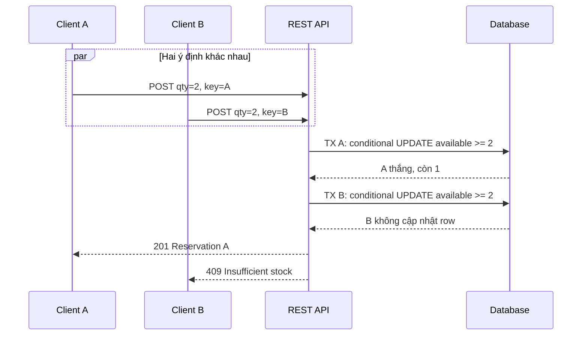
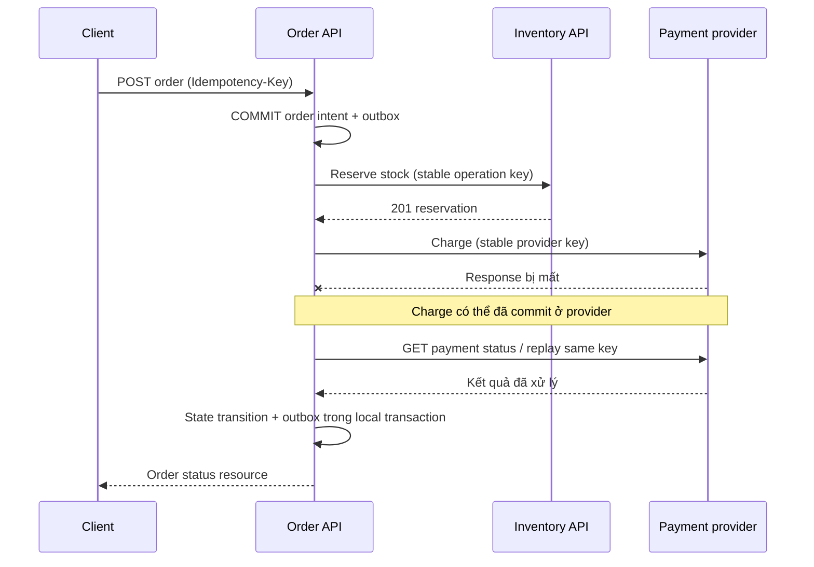

# Kiểm chứng bất biến nghiệp vụ khi có cạnh tranh và retry

## 1. Vì sao API trả mã HTTP đúng vẫn có thể làm sai dữ liệu?

`Inventory API` có 3 sản phẩm còn bán được. Hai client cùng gửi:

```http
POST /api/reservations HTTP/1.1
Authorization: Bearer <synthetic-token>
Idempotency-Key: intent-a
Content-Type: application/json

{"sku":"sku-7","quantity":2}
```

Client thứ hai dùng key `intent-b`, cũng muốn giữ 2 sản phẩm. Nếu hai luồng đều đọc `available=3` trước khi ghi, cả hai có thể trả `201 Created` và tạo tổng cộng 4 đơn vị giữ hàng, dù chỉ có 3 đơn vị thực. **Cả hai response riêng lẻ trông hợp lệ; trạng thái hệ thống thì sai.**

Một lỗi khác: client gửi `POST` giữ 2 sản phẩm; server đã commit, nhưng proxy làm mất response. Client retry **cùng ý định**. Nếu API tạo reservation mới, một người dùng đã giữ hàng hai lần dù chỉ bấm nút một lần. `Idempotency-Key` có xuất hiện trong header cũng không tự bảo đảm hệ thống đã deduplicate.

Hai nhóm lỗi liên quan nhưng khác nhau:

- **Race/concurrency:** nhiều ý định *khác nhau* cùng tranh chấp một tài nguyên; phải duy trì **bất biến nghiệp vụ** ở điểm cập nhật chung.
- **Retry/replay:** *cùng một ý định* có thể đến nhiều lần, kể cả đồng thời; phải trả kết quả nhất quán mà không thực thi side effect hai lần.

Bài thuộc chương **Nhất quán nghiệp vụ**, module **INTEGRATION_API_REST**: thiết kế REST API theo resource/URI, HTTP method/status, hợp đồng dữ liệu; thực hành phân trang, cache, idempotency, OpenAPI, xác thực/phân quyền, xử lý lỗi và kiểm thử với Java/Spring. Trọng tâm là **bằng chứng tính đúng đắn sau cạnh tranh và retry**, không chỉ cú pháp request.

**Mục tiêu:** định nghĩa và biến bất biến thành ràng buộc/transaction; chọn CAS, optimistic locking và idempotency record; hiểu retry khi kết quả chưa chắc chắn; kiểm thử đồng thời bằng DB thật, outbox và side effect; thiết kế status HTTP, bảo mật và kiểm tra vận hành.

## 2. Định nghĩa bất biến đủ chính xác để kiểm chứng

Trong ví dụ, hệ thống có `inventory(tenant, sku, available)`, `reservations` và một bản ghi ý định theo `Idempotency-Key`. Để test có thể chứng minh đúng/sai, cần phát biểu bằng các mệnh đề có thể truy vấn.

| Bất biến | Phát biểu cần giữ | Cách kiểm chứng |
| --- | --- | --- |
| **I1 – Không bán vượt kho** | `available >= 0` với mọi `(tenant, sku)` | DB `CHECK`, concurrent test và query sau commit |
| **I2 – Bảo toàn số lượng** | Nếu không nhập/hủy kho: `available + SUM(active reservation quantities) = stock ban đầu` | Query tổng dữ liệu dưới trạng thái ổn định |
| **I3 – Một ý định, một kết quả** | Cùng `(tenant, actor, endpoint, idempotencyKey)` và payload canonical có **tối đa một** reservation, một outcome cuối | Unique constraint, replay test sau mất response |
| **I4 – Không tráo payload** | Cùng key nhưng payload khác bị từ chối, không thực thi thêm | Fingerprint comparison, HTTP `409` |
| **I5 – State transition hợp lệ** | `PENDING → APPROVED/REJECTED`, không duyệt hai lần hoặc đảo trạng thái trái policy | Conditional update theo state/version |
| **I6 – Side effect nhất quán** | Reservation đã commit có outbox event tương ứng; rollback thì không có | Transaction test và outbox query |
| **I7 – Không vượt tenant/quyền** | Caller tenant A không sửa tài nguyên tenant B, kể cả khi cạnh tranh | Test đa tenant với principal thực |

**Phạm vi I2 phải nêu rõ:** không có nhập kho, hủy/expire reservation, adjustment hoặc shipment đang diễn ra. Trong hệ thống thật, cần phương trình có thêm các loại nghiệp vụ đó; không thể đòi `available + active = initial` khi đã giao hàng. Khi test có nhập/hủy, thêm **ledger movement** rồi kiểm tra phương trình mở rộng.

### 2.1. Invariant khác precondition, khác metric

- **Invariant** là mệnh đề phải đúng sau mọi transaction đã commit, ví dụ `available >= 0`.
- **Precondition** là yêu cầu trước một thao tác, ví dụ `quantity > 0`, `If-Match` hợp lệ, đơn ở trạng thái `PENDING`.
- **Metric/SLO** đo chất lượng phục vụ (p99 latency, retry rate), không chứng minh tính đúng đắn của stock.

Đừng chỉ kiểm tra mọi response là `201`: có thể cả 100 request đều trả thành công nhưng kho âm. Cũng không chỉ kiểm tra `available >= 0`: nếu code đọc 3, cả hai ghi `available=1` theo giá trị cũ, có thể có **hai reservations mỗi cái 2, nhưng available vẫn 1**; I1 qua, I2 thất bại. Vì vậy nên định nghĩa **tập bất biến**, không chỉ một con số.

## 3. Lập lịch cạnh tranh làm lộ lỗi đọc–sửa–ghi

### 3.1. Lost update và oversell

Giả sử tồn kho ban đầu 3:

| Thời điểm | Transaction T1 – giữ 2 | Transaction T2 – giữ 2 |
| --- | --- | --- |
| t1 | `SELECT available` → 3 | |
| t2 | | `SELECT available` → 3 |
| t3 | Tạo reservation A | |
| t4 | | Tạo reservation B |
| t5 | `UPDATE inventory SET available=1` | |
| t6 | | `UPDATE inventory SET available=1` |
| t7 | Commit | Commit |

Kết quả: `available=1`, nhưng hai reservation cùng thành công với tổng `4`, dẫn đến **bảo toàn số lượng sai**. Đặt `@Transactional` đơn thuần quanh hai lệnh SELECT/UPDATE không giải quyết mọi interleaving ở isolation mặc định; transaction chỉ định phạm vi commit/rollback, còn **nguyên tử hóa điều kiện cập nhật** mới chặn được race.

### 3.2. Atomic compare-and-swap (CAS) ở database

Với PostgreSQL, giảm tồn kho bằng **một statement có điều kiện**:

```sql
UPDATE inventory
SET available = available - :quantity
WHERE tenant_id = :tenant
  AND sku = :sku
  AND available >= :quantity
RETURNING available;
```

Nếu statement trả một row, database đã áp điều kiện và phép giảm dưới concurrency control của chính database. Nếu không trả row, kho không đủ hoặc SKU không tồn tại/phạm vi tenant không khớp; service phải xác định status theo policy, **không** tự trừ ở memory rồi ghi bù. Bản ghi reservation và update stock phải nằm **cùng transaction**; nếu insert reservation thất bại, update stock phải rollback.



Sơ đồ diễn tả **một lịch thực thi có thể xảy ra**, không cam kết A luôn thắng; trong thực tế B cũng có thể thắng, nhưng **không có lịch hợp lệ nào cho cả hai giữ 2 khi stock là 3**.

### 3.3. Version check cho trạng thái đơn

Với một workflow duyệt đơn, `version` và trạng thái có thể tham gia điểm ghi nguyên tử:

```sql
UPDATE orders
SET state = 'APPROVED', version = version + 1
WHERE id = :id
  AND tenant_id = :tenant
  AND version = :expectedVersion
  AND state = 'PENDING'
RETURNING version;
```

Không có row cập nhật không nhất thiết luôn là `412`: có thể do resource không tồn tại, tenant không hợp lệ, version cũ hoặc state không còn cho phép. Sau khi bảo vệ quyền/tenant, dịch vụ phân biệt theo policy: `412 Precondition Failed` cho `If-Match` sai, `409 Conflict` cho xung đột chuyển trạng thái, `404` cho tài nguyên không thấy/được che. Nếu API **yêu cầu** `If-Match` mà client bỏ header, có thể trả `428 Precondition Required`. `@Version` của JPA hỗ trợ optimistic locking, nhưng vẫn phải xử lý exception, transaction rollback và ánh xạ HTTP phù hợp.

### 3.4. Không đọc rồi mới kiểm quyền ở cuối

Điều kiện SQL phải có **tenant đã xác minh**; không lấy `tenant_id` tự do từ query/body. Nếu service gửi đối tượng cho user rồi mới kiểm ownership sau query, một side effect/log/cache khác có thể đã lộ dữ liệu. Khi object authorization phức tạp, thực hiện policy trước mutation và tái xác nhận điều kiện tại điểm ghi nguyên tử để tránh **time-of-check/time-of-use (TOCTOU)**.

## 4. Thiết kế persistence để database chặn vi phạm

Một thiết kế tốt không dựa hoàn toàn vào `synchronized`, mutex trong JVM hoặc lock theo session. Với nhiều replica, khóa JVM của instance A không có tác dụng ở instance B. Hãy để database sở hữu **điểm tuyến tính hóa (linearization point)** của mutation, và dùng ràng buộc làm lớp bảo vệ cuối.

### 4.1. Ví dụ PostgreSQL: stock, reservation, idempotency và outbox

```sql
CREATE TABLE inventory (
    tenant_id TEXT NOT NULL,
    sku TEXT NOT NULL,
    available BIGINT NOT NULL CHECK (available >= 0),
    PRIMARY KEY (tenant_id, sku)
);

-- Dành riêng cho operation POST /api/reservations.
CREATE TABLE reservation_intents (
    tenant_id TEXT NOT NULL,
    actor_subject TEXT NOT NULL,
    idem_key VARCHAR(128) NOT NULL,
    request_hash CHAR(64) NOT NULL,
    http_status INTEGER,
    response_body TEXT,
    location TEXT,
    created_at TIMESTAMPTZ NOT NULL DEFAULT now(),
    PRIMARY KEY (tenant_id, actor_subject, idem_key),
    CHECK (
        (http_status IS NULL AND response_body IS NULL)
        OR (http_status IS NOT NULL AND response_body IS NOT NULL)
    )
);

CREATE TABLE reservations (
    id UUID PRIMARY KEY,
    tenant_id TEXT NOT NULL,
    actor_subject TEXT NOT NULL,
    idem_key VARCHAR(128) NOT NULL,
    sku TEXT NOT NULL,
    quantity BIGINT NOT NULL CHECK (quantity > 0),
    status TEXT NOT NULL CHECK (
        status IN ('ACTIVE', 'CONFIRMED', 'RELEASED', 'EXPIRED')
    ),
    UNIQUE (tenant_id, actor_subject, idem_key),
    FOREIGN KEY (tenant_id, sku) REFERENCES inventory(tenant_id, sku)
);

CREATE TABLE outbox_events (
    id UUID PRIMARY KEY,
    reservation_id UUID NOT NULL REFERENCES reservations(id),
    event_type TEXT NOT NULL,
    payload_json JSONB NOT NULL,
    published_at TIMESTAMPTZ,
    UNIQUE (reservation_id, event_type)
);
```

Mọi SQL trong bài dùng **PostgreSQL**; `RETURNING`, `ON CONFLICT`, kiểu `JSONB` và hành vi khóa theo uniqueness không thể sao chép nguyên vẹn sang mọi database. Đây là **lược đồ minh họa**, chưa gồm indexes cho truy vấn phức tạp, phân vùng dữ liệu, retention hay audit. Nếu nhiều loại operation cùng dùng một kho idempotency chung, thêm `operation_name` vào key và contract; ở đây bảng đã dành riêng cho POST reservation.

Các lớp bảo vệ bổ sung nhau:

- `CHECK (available >= 0)` chặn một bản ghi kho âm; **không đủ để bảo toàn tổng stock và reservation**.
- `UPDATE ... WHERE available >= quantity` là phép giảm tồn kho **nguyên tử**.
- `PRIMARY KEY (tenant, actor, key)` buộc các replica cạnh tranh cho **cùng ý định** đi qua một khóa duy nhất.
- `UNIQUE` ở `reservations` bảo vệ thêm khỏi tạo trùng reservation theo key; không dựa vào một cache map trong RAM.
- `outbox_events` được insert **trong cùng transaction** với reservation; lỗi insert event phải rollback stock/reservation.

### 4.2. Một transaction bao trùm toàn bộ mutation

```text
BEGIN
  Claim (tenant, actor, Idempotency-Key) bằng UNIQUE constraint
  Nếu đã có key:
    so fingerprint, trả kết quả đã lưu hoặc báo key reuse conflict
  Nếu là owner mới:
    UPDATE inventory ... available >= quantity RETURNING ...
    Nếu hết hàng: lưu response 409 cho cùng ý định
    Nếu giữ được:
      INSERT reservation
      INSERT outbox event
      Lưu response 201 + Location cho idempotency key
COMMIT
```

Khi response 201 đến client, transaction đã commit **stock + reservation + outbox + idempotency outcome**. Nếu JVM chết trước `COMMIT`, database rollback (khi connection bị đóng/recovery), và retry có thể claim lại. Nếu JVM chết **sau COMMIT nhưng trước response**, retry đọc outcome đã commit thay vì tạo reservation mới.

Đừng trả `201` rồi mới ghi idempotency record hoặc outbox ở background: một lần mất điện giữa các bước ấy có thể phá I3/I6. Với các side effect **ngoài database**, transaction này không tự tạo atomicity xuyên hệ thống; xem mục 9.

### 4.3. Bất biến không tự đúng chỉ vì có một transaction

Điều kiện sau phải được review khi refactor:

1. Mọi đường ghi stock (API, batch job, admin tool, expiry worker) phải tuân cùng luật, không có “đường tắt” cập nhật trực tiếp.
2. Các thao tác reserve/release/ship cần state transition có điều kiện và ledger đúng; nếu một worker release hai lần thì cũng có thể làm kho tăng sai.
3. `SERIALIZABLE` hoặc row lock có thể là lựa chọn khác, nhưng cần retry transaction có kiểm soát khi serialization failure/deadlock; không được bỏ exception rồi coi như thành công.
4. Đối với bất biến liên quan **nhiều dòng**, phải chọn locking order, isolation, DB constraint hoặc chiến lược tuần tự hóa thích hợp. Một `CHECK` trên từng dòng không bảo vệ được mọi tổng hợp liên bảng.

## 5. Hợp đồng HTTP cho hai kiểu cạnh tranh

### 5.1. Hai ý định khác nhau: có thể có một bên thắng

Khi stock còn 3 và hai POST mỗi lệnh giữ 2 với **hai idempotency keys khác nhau**, hợp đồng có thể là:

```http
HTTP/1.1 201 Created
Location: /api/reservations/8c943060-2c19-42a5-a0c2-7dd0368bd931
Content-Type: application/json

{"id":"8c943060-2c19-42a5-a0c2-7dd0368bd931",
 "sku":"sku-7","quantity":2,"status":"ACTIVE"}
```

```http
HTTP/1.1 409 Conflict
Content-Type: application/problem+json
Cache-Control: no-store

{"type":"https://api.example.test/problems/insufficient-stock",
 "title":"Insufficient stock","status":409,"code":"INSUFFICIENT_STOCK"}
```

Hệ thống có quyền quyết định transaction nào thắng, nhưng **không** được xác nhận cả hai nếu số lượng không đủ. Mã `409` trong ví dụ là **hợp đồng nghiệp vụ**, không phải mã bắt buộc cho mọi thao tác hàng tồn kho; với input không hợp lệ như `quantity=0`, hãy trả lỗi validation (thường `400`) trước DB.

### 5.2. Cùng ý định bị gửi lại: trả outcome cũ

```http
POST /api/reservations HTTP/1.1
Idempotency-Key: intent-a
Content-Type: application/json

{"sku":"sku-7","quantity":2}
```

Nếu key + fingerprint đã có outcome 201, replay có thể trả lại **201 + cùng `Location` và cùng body**, theo contract được công bố; một số API chọn mã replay khác, nhưng phải **nhất quán và không tạo side effect thứ hai**. Header tùy chọn `Idempotency-Replayed: true` có thể giúp chẩn đoán, không phải chuẩn HTTP bắt buộc.

**Response replay là ảnh chụp kết quả lúc thao tác đầu commit**, không phải lời khẳng định trạng thái resource vẫn y nguyên. Nếu reservation sau đó đã `EXPIRED`/`CONFIRMED`, replay có thể vẫn mô tả response 201 ban đầu; client phải `GET` resource/operation hiện tại khi cần trạng thái mới. Phải bảo vệ quyền đọc cả khi replay và khi GET.

Nếu caller dùng **cùng key nhưng `quantity=3`**, đây không phải retry hợp lệ: trả `409` (key reused with different payload), **không sửa reservation cũ**. Nếu dùng key khác, đó là **ý định mới** và phải cạnh tranh stock như mọi yêu cầu khác.

### 5.3. Kết quả chưa chắc chắn và lifecycle của key

Lỗi socket/timeout/`502`/`504` sau POST không chứng minh server chưa commit. Client nên giữ key/payload, tra cứu resource/operation nếu có, hoặc retry có giới hạn **theo chính sách idempotency đã triển khai**. Phía server cần nói rõ:

- Key được scope theo tenant, actor và operation nào; ai được phép replay dữ liệu?
- Fingerprint dựa trên method/path, body **canonical** và những tham số làm đổi tác động gì?
- Thành công và lỗi nghiệp vụ nào được lưu lại; riêng lỗi hạ tầng `5xx` có rollback và được thử lại hay không?
- Khi request cùng key đang chạy, API chờ có giới hạn, trả `409`/`425` theo hợp đồng riêng, hay trả `202` cho operation bền vững?
- Key được giữ bao lâu, client cần làm gì khi hết retention, và chống replay từ bản ghi cũ bằng cách nào?

Trong ví dụ bên dưới, một transaction PostgreSQL **claim key → xử lý → lưu kết quả**; request trùng trong khi transaction đầu chưa commit có thể **chờ tại unique conflict** rồi đọc outcome sau commit. Hành vi này dựa trên isolation `READ COMMITTED` và cơ chế uniqueness của PostgreSQL; không áp mặc định cho mọi DB/driver hoặc khi có timeout khóa ngắn hơn thời gian xử lý.

## 6. Spring JDBC: một implementation kiểm chứng được

Ví dụ dùng **Java 17+, Spring Boot 3.x / Spring Framework 6, Spring JDBC `NamedParameterJdbcTemplate`, Jackson và PostgreSQL**. Lựa chọn JDBC ở đây giúp nhìn rõ statement nguyên tử; JPA `@Version` hoặc jOOQ cũng có thể làm đúng nếu giữ transaction, điều kiện và uniqueness tương đương.

### 6.1. Service: claim → CAS stock → reservation + outbox → persist outcome

```java
package example.inventory;

import com.fasterxml.jackson.core.JsonProcessingException;
import com.fasterxml.jackson.databind.ObjectMapper;
import java.nio.charset.StandardCharsets;
import java.security.MessageDigest;
import java.security.NoSuchAlgorithmException;
import java.util.HexFormat;
import java.util.List;
import java.util.Map;
import java.util.Objects;
import java.util.UUID;
import org.springframework.http.HttpStatus;
import org.springframework.jdbc.core.namedparam.MapSqlParameterSource;
import org.springframework.jdbc.core.namedparam.NamedParameterJdbcTemplate;
import org.springframework.stereotype.Service;
import org.springframework.transaction.annotation.Isolation;
import org.springframework.transaction.annotation.Transactional;
import org.springframework.web.server.ResponseStatusException;

record ReserveCommand(String sku, int quantity) {}
record SavedOutcome(
    int httpStatus, String body, String location, boolean replayed) {}

@Service
public class ReservationService {
    private final NamedParameterJdbcTemplate db;
    private final ObjectMapper mapper;

    public ReservationService(
            NamedParameterJdbcTemplate db, ObjectMapper mapper) {
        this.db = db;
        this.mapper = mapper;
    }

    @Transactional(isolation = Isolation.READ_COMMITTED)
    public SavedOutcome reserve(
            String tenant, String actor, String key, ReserveCommand cmd) {
        if (tenant == null || actor == null
                || tenant.isBlank() || actor.isBlank()) {
            throw new ResponseStatusException(
                HttpStatus.FORBIDDEN, "Missing identity");
        }
        if (cmd == null || cmd.sku() == null
                || cmd.quantity() < 1 || cmd.quantity() > 100
                || !cmd.sku().matches("[A-Za-z0-9_-]{1,64}")) {
            throw new ResponseStatusException(
                HttpStatus.BAD_REQUEST, "Invalid reservation request");
        }

        String hash = fingerprint(cmd);
        var args = new MapSqlParameterSource()
            .addValue("tenant", tenant)
            .addValue("actor", actor)
            .addValue("key", key)
            .addValue("hash", hash)
            .addValue("sku", cmd.sku())
            .addValue("qty", cmd.quantity());

        // PostgreSQL UNIQUE index là điểm phân xử các retry cùng key.
        List<Integer> claimed = db.query("""
            INSERT INTO reservation_intents
                (tenant_id, actor_subject, idem_key, request_hash)
            VALUES (:tenant, :actor, :key, :hash)
            ON CONFLICT (tenant_id, actor_subject, idem_key)
                DO NOTHING
            RETURNING 1
            """, args, (rs, row) -> rs.getInt(1));

        if (claimed.isEmpty()) {
            // Với READ COMMITTED, sau khi transaction chủ sở hữu commit,
            // SELECT này đọc được outcome cuối của key trùng.
            return Objects.requireNonNull(db.queryForObject("""
                SELECT request_hash, http_status, response_body, location
                FROM reservation_intents
                WHERE tenant_id = :tenant AND actor_subject = :actor
                  AND idem_key = :key
                """, args, (rs, row) -> {
                    if (!hash.equals(rs.getString("request_hash"))) {
                        throw new ResponseStatusException(HttpStatus.CONFLICT,
                            "Idempotency-Key reused with different request");
                    }
                    String body = rs.getString("response_body");
                    if (body == null) {
                        throw new IllegalStateException(
                            "Incomplete idempotency outcome");
                    }
                    return new SavedOutcome(
                        rs.getInt("http_status"), body,
                        rs.getString("location"), true);
                }));
        }

        // Mỗi statement giữ row lock/đánh giá lại WHERE dưới cạnh tranh.
        List<Long> remaining = db.query("""
            UPDATE inventory
            SET available = available - :qty
            WHERE tenant_id = :tenant AND sku = :sku
              AND available >= :qty
            RETURNING available
            """, args, (rs, row) -> rs.getLong(1));

        if (remaining.isEmpty()) {
            // Quy tắc của ví dụ: lỗi nghiệp vụ thiếu hàng được ghi nhớ.
            String problem = json(Map.of(
                "type", "https://api.example.test/problems/insufficient-stock",
                "title", "Insufficient stock",
                "status", 409,
                "code", "INSUFFICIENT_STOCK"));
            return finish(args, 409, problem, null, false);
        }

        UUID reservationId = UUID.randomUUID();
        args.addValue("rid", reservationId);
        db.update("""
            INSERT INTO reservations
                (id, tenant_id, actor_subject, idem_key,
                 sku, quantity, status)
            VALUES (:rid, :tenant, :actor, :key,
                    :sku, :qty, 'ACTIVE')
            """, args);

        args.addValue("eventId", UUID.randomUUID())
            .addValue("event", json(Map.of(
                "reservationId", reservationId.toString(),
                "sku", cmd.sku(),
                "quantity", cmd.quantity())));
        db.update("""
            INSERT INTO outbox_events
                (id, reservation_id, event_type, payload_json)
            VALUES (:eventId, :rid, 'ReservationCreated',
                    CAST(:event AS jsonb))
            """, args);

        String location = "/api/reservations/" + reservationId;
        String body = json(Map.of(
            "id", reservationId.toString(),
            "sku", cmd.sku(),
            "quantity", cmd.quantity(),
            "status", "ACTIVE"));
        return finish(args, 201, body, location, false);
    }

    private SavedOutcome finish(MapSqlParameterSource args, int status,
            String body, String location, boolean replayed) {
        args.addValue("code", status)
            .addValue("body", body)
            .addValue("location", location);
        int updated = db.update("""
            UPDATE reservation_intents
            SET http_status = :code,
                response_body = :body,
                location = :location
            WHERE tenant_id = :tenant AND actor_subject = :actor
              AND idem_key = :key
            """, args);
        if (updated != 1) throw new IllegalStateException(
            "Idempotency outcome not persisted");
        return new SavedOutcome(status, body, location, replayed);
    }

    private String json(Object value) {
        try {
            return mapper.writeValueAsString(value);
        } catch (JsonProcessingException ex) {
            throw new IllegalStateException("Cannot serialize outcome", ex);
        }
    }

    private static String fingerprint(ReserveCommand cmd) {
        // SKU được validate không chứa newline; method + path ở đây cố định.
        String canonical = "POST\n/api/reservations\n"
            + cmd.sku() + "\n" + cmd.quantity();
        try {
            byte[] hash = MessageDigest.getInstance("SHA-256")
                .digest(canonical.getBytes(StandardCharsets.UTF_8));
            return HexFormat.of().formatHex(hash);
        } catch (NoSuchAlgorithmException impossible) {
            throw new IllegalStateException(impossible);
        }
    }
}
```

Điểm quan trọng: tất cả đường `finish`, insert reservation và outbox đều chạy trong **một Spring-managed transaction**, được gọi qua bean proxy từ bên ngoài. Spring commit transaction **trước khi controller nhận giá trị return từ proxy** và phát response. Đừng tự gọi `new ReservationService(...)` trong controller hoặc gọi nội bộ một phương thức `@Transactional` rồi cho rằng interceptor luôn được áp dụng.

**Lựa chọn idempotency cụ thể của ví dụ:** status `409 INSUFFICIENT_STOCK` cũng được lưu và replay. Vì vậy, nếu kho được nhập thêm sau đó, retry **cùng key** vẫn trả `409` cũ; khách hàng muốn tạo **ý định mới** cần key mới. Những lỗi hạ tầng như DB timeout, serialization failure, process crash hoặc exception khi ghi outbox phải **rollback** và không lưu 201/409 chưa commit. Một hệ thống khác có thể chọn policy lỗi được cache khác, nhưng phải tài liệu hóa và kiểm chứng.

**Giới hạn:** điều kiện uniqueness ở bảng `reservation_intents` bảo vệ đồng thời trong một database PostgreSQL. Nếu hệ thống có nhiều database shards hoặc active-active multi-region, phải chứng minh key cùng scope luôn gặp **một authority có tính nhất quán đủ mạnh**; unique constraint riêng trên hai database không ngăn double commit liên vùng.

### 6.2. Controller: authentication, validation và status replay

```java
package example.inventory;

import java.util.regex.Pattern;
import org.springframework.http.HttpHeaders;
import org.springframework.http.HttpStatus;
import org.springframework.http.MediaType;
import org.springframework.http.ResponseEntity;
import org.springframework.security.core.annotation.AuthenticationPrincipal;
import org.springframework.security.oauth2.jwt.Jwt;
import org.springframework.web.bind.annotation.*;

@RestController
@RequestMapping("/api/reservations")
class ReservationController {
    private static final Pattern KEY =
        Pattern.compile("[A-Za-z0-9._:-]{1,128}");
    private final ReservationService service;

    ReservationController(ReservationService service) {
        this.service = service;
    }

    @PostMapping(consumes = "application/json")
    ResponseEntity<String> reserve(
            @RequestHeader("Idempotency-Key") String key,
            @RequestBody ReserveCommand body,
            @AuthenticationPrincipal Jwt jwt) {
        if (jwt == null || jwt.getSubject() == null) {
            throw new org.springframework.web.server.ResponseStatusException(
                HttpStatus.UNAUTHORIZED);
        }
        if (!KEY.matcher(key).matches()) {
            throw new org.springframework.web.server.ResponseStatusException(
                HttpStatus.BAD_REQUEST, "Invalid Idempotency-Key");
        }
        String tenant = jwt.getClaimAsString("tenant_id");
        SavedOutcome result =
            service.reserve(tenant, jwt.getSubject(), key, body);

        var response = ResponseEntity.status(result.httpStatus())
            .contentType(result.httpStatus() >= 400
                ? MediaType.valueOf("application/problem+json")
                : MediaType.APPLICATION_JSON)
            .header("Idempotency-Replayed",
                Boolean.toString(result.replayed()))
            .header(HttpHeaders.CACHE_CONTROL, "no-store");
        if (result.location() != null) {
            response.header(HttpHeaders.LOCATION, result.location());
        }
        return response.body(result.body());
    }
}
```

Trong ứng dụng production, security filter chain phải yêu cầu JWT access token có **audience phù hợp** và scope tạo reservation; `tenant_id`/`sub` lấy từ token **đã xác minh**, không từ body/header tự gửi. Mẫu controller dùng `String` JSON để trả **nguyên body đã lưu**, giữ replay byte-for-byte; một thiết kế khác có thể lưu DTO và trả body tương đương về nghĩa.

`@RequestBody` thiếu/null body và payload sai schema cần được chặn rõ trước mutation; ví dụ service có kiểm tra `sku` và `quantity` nhưng chưa mô tả toàn bộ Bean Validation, max body bytes và charset policy. Với `Content-Type` không hỗ trợ, Spring có thể trả `415`; body vượt giới hạn trả `413` theo cấu hình. Ở production, key nên có entropy đủ cao và không chứa dữ liệu nhạy cảm; **key không phải access token**, vẫn cần kiểm tra quyền của caller trên resource.

## 7. Kiểm thử đồng thời: chứng minh trạng thái, không chỉ status

Test concurrency có ý nghĩa phải cho **các lời gọi thật cạnh tranh trên cùng database**, mỗi lời gọi chạy qua service transaction riêng, rồi đọc **trạng thái đã commit**. `MockMvc` với repository mock không phát hiện race ở SQL; `@Transactional` trên chính test method có thể khiến các thread dùng transaction khác nhau nhưng fixture chưa commit, dẫn đến kiểm thử gây hiểu nhầm.

### 7.1. PostgreSQL thật bằng Testcontainers và JUnit 5

Ví dụ dùng Spring Boot Test, Spring JDBC, `org.testcontainers:postgresql`, `org.testcontainers:junit-jupiter`. Giả định DDL mục 4 được apply bằng **test migration/Flyway** trước `@BeforeEach`. Không dùng H2 thay PostgreSQL rồi suy ra `ON CONFLICT`/row locking giống nhau.

```java
package example.inventory;

import static org.junit.jupiter.api.Assertions.*;

import java.util.ArrayList;
import java.util.List;
import java.util.concurrent.*;
import org.junit.jupiter.api.BeforeEach;
import org.junit.jupiter.api.Test;
import org.springframework.beans.factory.annotation.Autowired;
import org.springframework.boot.test.context.SpringBootTest;
import org.springframework.jdbc.core.JdbcTemplate;
import org.springframework.test.context.DynamicPropertyRegistry;
import org.springframework.test.context.DynamicPropertySource;
import org.testcontainers.junit.jupiter.Container;
import org.testcontainers.junit.jupiter.Testcontainers;
import org.testcontainers.containers.PostgreSQLContainer;

@SpringBootTest
@Testcontainers
class ReservationConsistencyIT {
    @Container
    static final PostgreSQLContainer<?> PG =
        new PostgreSQLContainer<>("postgres:16-alpine");

    @DynamicPropertySource
    static void datasource(DynamicPropertyRegistry properties) {
        properties.add("spring.datasource.url", PG::getJdbcUrl);
        properties.add("spring.datasource.username", PG::getUsername);
        properties.add("spring.datasource.password", PG::getPassword);
    }

    @Autowired ReservationService service;
    @Autowired JdbcTemplate jdbc;

    @BeforeEach
    void resetStock() {
        // Test không đánh @Transactional: fixture phải được commit
        // trước khi các worker threads bắt đầu.
        jdbc.execute("""
            TRUNCATE TABLE outbox_events, reservations,
              reservation_intents, inventory
            """);
        jdbc.update("""
            INSERT INTO inventory(tenant_id, sku, available)
            VALUES ('tenant-A', 'sku-7', 3)
            """);
    }

    @Test
    void tenDifferentIntentsCannotOversellThreeUnits() throws Exception {
        ExecutorService pool = Executors.newFixedThreadPool(10);
        CountDownLatch start = new CountDownLatch(1);
        List<Future<SavedOutcome>> futures = new ArrayList<>();

        try {
            for (int i = 0; i < 10; i++) {
                final int n = i;
                futures.add(pool.submit(() -> {
                    start.await();
                    return service.reserve(
                        "tenant-A", "alice", "intent-" + n,
                        new ReserveCommand("sku-7", 1));
                }));
            }
            start.countDown();

            int created = 0;
            int conflicts = 0;
            for (Future<SavedOutcome> future : futures) {
                int status = future.get(15, TimeUnit.SECONDS).httpStatus();
                if (status == 201) created++;
                if (status == 409) conflicts++;
            }
            assertEquals(3, created);
            assertEquals(7, conflicts);
            assertEquals(0L, stock());
            assertEquals(3L, activeReserved());
            assertEquals(3L, count("reservations"));
            assertEquals(3L, count("outbox_events"));
            assertEquals(10L, count("reservation_intents"));
        } finally {
            start.countDown();
            pool.shutdownNow();
        }
    }

    private long stock() {
        return jdbc.queryForObject("""
            SELECT available FROM inventory
            WHERE tenant_id='tenant-A' AND sku='sku-7'
            """, Long.class);
    }

    private long activeReserved() {
        Number sum = jdbc.queryForObject("""
            SELECT COALESCE(SUM(quantity), 0) FROM reservations
            WHERE tenant_id='tenant-A' AND sku='sku-7'
              AND status='ACTIVE'
            """, Number.class);
        return sum.longValue();
    }

    private long count(String table) {
        // Chỉ gọi với tên bảng cố định nội bộ, không dùng input từ HTTP.
        return jdbc.queryForObject(
            "SELECT COUNT(*) FROM " + table, Long.class);
    }
}
```

`CountDownLatch` giúp các request **bắt đầu gần nhau**, nhưng không bảo đảm hai transaction dừng ở chính xác một điểm SQL. Đây là một **concurrent invariant test** hữu ích, không phải bằng chứng duy nhất cho mọi lịch race. Chạy lặp trong CI/stress, kết hợp test ở tầng repository với barrier/fault hook để ép các lịch quan trọng, và giữ **DB constraints** làm lớp bảo vệ cuối.

Lưu ý về DB fixture: `TRUNCATE` và `COUNT(*)` ở ví dụ không chạy đồng thời với test khác trên cùng container; cấu hình suite để isolation mỗi test được đảm bảo. Trong production không xây SQL động từ input người dùng giống helper `count(table)`.

### 7.2. Cùng key được gửi đồng thời: một logical reservation

Với stock ban đầu 3, gửi 8 requests có **cùng tenant/actor/key/payload**, thay vì 8 key như trên. Kết quả kỳ vọng theo hợp đồng mục 5:

- 8 responses đều mô tả **một** reservation có cùng ID/body/`Location` (trong ví dụ đều trả `201`; một kết quả gốc và bảy replay).
- `COUNT(reservations)=1`, `COUNT(outbox_events)=1`, `COUNT(reservation_intents)=1`, `available=1`, tổng active reserved `2`.
- Không có transaction ở trạng thái “claim PENDING vĩnh viễn” sau khi tất cả lời gọi đã hoàn tất.

Pseudo-code kiểm thử bên trong `ReservationConsistencyIT` với `start` và executor như mục 7.1:

```java
List<SavedOutcome> results = runConcurrently(8,
    () -> service.reserve("tenant-A", "alice", "same-key",
        new ReserveCommand("sku-7", 2)));

assertTrue(results.stream().allMatch(r -> r.httpStatus() == 201));
assertEquals(1,
    results.stream().map(SavedOutcome::body).distinct().count());
assertEquals(1L, count("reservations"));
assertEquals(1L, count("outbox_events"));
assertEquals(1L, count("reservation_intents"));
assertEquals(1L, stock());
assertEquals(2L, activeReserved());
```

`runConcurrently` không phải API của JUnit. Có thể thêm helper sau vào **chính class test** mục 7.1 để đoạn minh họa trên chạy được:

```java
private static List<SavedOutcome> runConcurrently(
        int n, Callable<SavedOutcome> work) throws Exception {
    ExecutorService pool = Executors.newFixedThreadPool(n);
    CountDownLatch start = new CountDownLatch(1);
    List<Future<SavedOutcome>> futures = new ArrayList<>();
    try {
        for (int i = 0; i < n; i++) {
            futures.add(pool.submit(() -> {
                start.await();
                return work.call();
            }));
        }
        start.countDown();
        List<SavedOutcome> results = new ArrayList<>();
        for (Future<SavedOutcome> f : futures) {
            results.add(f.get(15, TimeUnit.SECONDS));
        }
        return results;
    } finally {
        start.countDown();
        pool.shutdownNow();
    }
}
```

Không dùng `Thread.sleep` để “chứng minh” race. Nếu implementation thực tế commit trạng thái `IN_PROGRESS` riêng, test có thể nhận `409`/`202` theo hợp đồng, nhưng vẫn phải chứng minh **chỉ một side effect**.

### 7.3. Test trên nhiều replica và data partition

Một lock `synchronized` theo Java instance có thể khiến test một process qua, nhưng hai replica cùng gọi DB sẽ phá invariant. Hãy chạy integration test qua **hai service instances độc lập**, cùng trỏ đến database/partition authoritative, và xác minh cả unique key lẫn phép giảm kho. Nếu API multi-region dùng **multi-writer không có điều phối**, phải nêu rõ cơ chế chống double claim ở cấp global hoặc giới hạn một home region cho key/stock; test chỉ trên một PostgreSQL instance không chứng minh thiết kế multi-region.

## 8. Kiểm chứng retry: trả lại outcome sau khi response đầu tiên bị mất

### 8.1. Lost response sau commit không phải nghiệp vụ thất bại

Giả sử kết quả thật:

```text
Client POST (key=intent-42)
  └─ API claim key, giảm stock, tạo reservation/outbox, lưu 201, COMMIT
       └─ proxy làm mất response 201
Client không biết kết quả: UNKNOWN
Client POST lại cùng key + payload
  └─ API trả body/Location đã lưu; KHÔNG giảm stock lần thứ hai
```

Đây là điều kiện rất khác “server không thể kết nối tới DB nên transaction rollback”. Dù client thấy cùng một timeout, trạng thái đã commit **có thể khác**. Trách nhiệm của idempotency record là biến retry hợp lệ thành **quan sát của một logical operation**, không dùng `Thread.sleep` hoặc kiểm tra một flag trong memory để phỏng đoán.

Ví dụ unit/integration test bổ sung trong `ReservationConsistencyIT` mục 7, dùng database thật và fixture stock 3:

```java
@Test
void retryAfterLostResponseReplaysSameResult() {
    ReserveCommand body = new ReserveCommand("sku-7", 2);

    // Giả lập response bị mất: server đã commit nhưng test bỏ kết quả.
    SavedOutcome committed = service.reserve(
        "tenant-A", "alice", "intent-42", body);
    SavedOutcome replay = service.reserve(
        "tenant-A", "alice", "intent-42", body);

    assertEquals(201, committed.httpStatus());
    assertEquals(201, replay.httpStatus());
    assertFalse(committed.replayed());
    assertTrue(replay.replayed());
    assertEquals(committed.body(), replay.body());
    assertEquals(committed.location(), replay.location());
    assertEquals(1L, stock());
    assertEquals(2L, activeReserved());
    assertEquals(1L, count("reservations"));
    assertEquals(1L, count("outbox_events"));
}

@Test
void sameKeyWithDifferentPayloadIsNotAnotherOperation() {
    service.reserve("tenant-A", "alice", "intent-42",
        new ReserveCommand("sku-7", 2));

    var error = assertThrows(
        org.springframework.web.server.ResponseStatusException.class,
        () -> service.reserve("tenant-A", "alice", "intent-42",
            new ReserveCommand("sku-7", 1)));

    assertEquals(409, error.getStatusCode().value());
    assertEquals(1L, stock());
    assertEquals(1L, count("reservations"));
    assertEquals(1L, count("outbox_events"));
}
```

Test đầu **giả lập loss ở ranh giới HTTP**, sau khi service đã commit; muốn thử socket đóng thật, dùng HTTP mock proxy/WireMock hoặc test gateway cắt response **sau khi server đã xử lý**, rồi cho client retry cùng key. Test thứ hai chứng minh fingerprint không cho **đổi mục đích** của key cũ. Với payload có field mới, version schema khác hoặc khác giá trị chuẩn hóa, contract phải định nghĩa chính xác phần nào thuộc fingerprint; không tự hash raw JSON mà để whitespace/order quyết định một ý định mới nếu nghiệp vụ xem hai payload tương đương.

### 8.2. Crash trước commit phải rollback *tất cả*

Kịch bản fault injection trong transaction:

```text
Claim idempotency key
UPDATE inventory (available: 3 -> 1)
INSERT reservation
<fault: exception trước khi ghi outbox>
ROLLBACK
```

Sau rollback, test cần thấy `available=3`, `reservations=0`, `outbox_events=0`, `reservation_intents=0`. Retry **cùng key** sau khi lỗi hạ tầng đã được khắc phục có thể claim và tạo một reservation mới. Nếu một trong các bảng còn ghi dữ liệu sau rollback, transaction boundary hoặc transaction propagation đã sai.

Có thể thêm một **test-only failpoint** được inject qua interface (ví dụ `afterReservationPersisted()` ném `RuntimeException`) hoặc khiến insert outbox thất bại bằng constraint trong test. Không đưa lệnh “tạo lỗi ngẫu nhiên” vào production. Đặc biệt tránh `@Transactional(propagation = REQUIRES_NEW)` cho lưu idempotency outcome mà không có thiết kế recovery riêng: một bản ghi key đã commit tách khỏi business transaction có thể bị kẹt ở `PENDING`.

### 8.3. Cùng key khi request đầu còn xử lý

Trong PostgreSQL, `INSERT ... ON CONFLICT DO NOTHING` với unique index có thể phải **chờ transaction đang sở hữu key kết thúc**. Nếu thời gian xử lý lớn, request trùng sẽ giữ connection/thread chờ khóa. Đặt lock/query timeout và giới hạn concurrency; nếu không thể chờ, dùng một kiến trúc **operation resource có trạng thái `PENDING` bền vững**, sau đó xử lý qua worker và trả `202 + Location`.

Đừng dùng `202` cho một record idempotency `PENDING` được ghi tạm trong một transaction *chưa commit*: client chưa thể tra cứu nó. Cũng không trả `201` trước khi transaction chứa mutation + response snapshot đã commit. Với operation lâu dài, cần một **state machine tách** (`RECEIVED → PROCESSING → SUCCEEDED/FAILED`), lease/recovery job và endpoint GET trạng thái.

### 8.4. Công cụ kiểm chứng từ phía HTTP

Một test `MockMvc` có thể dùng `POST /api/reservations` với token fixture hợp lệ để kiểm tra mã `201`, `Location` và replay; nhưng test `MockMvc` chỉ hữu ích cho race khi **service/repository là thật và DB có transaction thật**. `MockMvc.with(jwt())` của Spring Security Test không kiểm chứng chữ ký/audience của JWT thật; để xác minh bảo mật cuối tuyến, cần HTTP integration test với test issuer/keys và resource-server decoder.

```http
POST /api/reservations HTTP/1.1
Authorization: Bearer <synthetic-valid-token>
Idempotency-Key: intent-42
Content-Type: application/json

{"sku":"sku-7","quantity":2}
```

Response lần hai theo chính sách của ví dụ:

```http
HTTP/1.1 201 Created
Location: /api/reservations/8c943060-2c19-42a5-a0c2-7dd0368bd931
Idempotency-Replayed: true
Content-Type: application/json
Cache-Control: no-store

{"id":"8c943060-2c19-42a5-a0c2-7dd0368bd931",
 "sku":"sku-7","quantity":2,"status":"ACTIVE"}
```

Không phụ thuộc chính tả hoặc thứ tự field JSON ở ví dụ HTTP để kết luận replay đúng. Hãy assert **cùng ID, status, `Location`, số bản ghi và lượng stock**.

## 9. Side effect: transactional outbox chưa có nghĩa gửi sự kiện đúng một lần

Với lược đồ mục 4, insert reservation và outbox **trong cùng transaction** giúp tránh tình trạng “stock đã giảm nhưng không có event để xử lý tiếp”. Tuy nhiên, giao sự kiện từ outbox sang Kafka/RabbitMQ/webhook vẫn có cửa sổ lỗi:

1. Worker đọc outbox event chưa gửi.
2. Worker publish message thành công.
3. Worker chết **trước khi ghi `published_at`**.
4. Worker khởi động lại và publish **cùng event lần nữa**.

Do đó, outbox thường cung cấp **at-least-once delivery**, không tự bảo đảm exactly-once end-to-end. Cần `eventId` ổn định cho mỗi outbox row và consumer idempotency:

```sql
CREATE TABLE inbox_consumed_events (
    consumer_name TEXT NOT NULL,
    event_id UUID NOT NULL,
    consumed_at TIMESTAMPTZ NOT NULL DEFAULT now(),
    PRIMARY KEY (consumer_name, event_id)
);
```

Consumer nên claim `(consumer_name,event_id)` và áp dụng state mutation **cùng transaction** tại database của chính consumer; nếu event trùng, không lặp side effect. Nếu consumer gọi provider ngoài, database inbox và external call **không cùng transaction**, nên vẫn cần idempotency key tại provider hoặc workflow đối soát. Không nhầm “consumer nhận hai message giống nhau” với “business operation phải xảy ra hai lần”.

### 9.1. Expire/release reservation cũng cần CAS

Giả sử reservation đang `ACTIVE`, một worker muốn expire và một request muốn confirm đồng thời. Không dùng:

```text
Worker A: SELECT status=ACTIVE
Worker B: SELECT status=ACTIVE
Worker A: UPDATE status=EXPIRED; cộng stock
Worker B: UPDATE status=CONFIRMED
```

Kết quả có thể vừa cộng stock vừa xác nhận đã bán. Thay bằng **conditional transition**:

```sql
UPDATE reservations
SET status = 'EXPIRED'
WHERE id = :reservationId
  AND tenant_id = :tenant
  AND status = 'ACTIVE'
RETURNING sku, quantity;
```

Chỉ transaction nào cập nhật được một row mới có quyền cộng lại stock, **cùng transaction**:

```sql
UPDATE inventory
SET available = available + :quantity
WHERE tenant_id = :tenant AND sku = :sku;
```

Transition `ACTIVE → CONFIRMED` cũng phải CAS theo `status='ACTIVE'`. Với nhiều concurrent expirers, chỉ một bên thắng và cộng stock **một lần**. Nếu cần kiểm soát thứ tự event, có thể bổ sung version monotonic, event sequence và kiểm tra state trước khi áp dụng. Test nên chạy **confirm vs expire** với barrier rồi assert trạng thái cuối hợp lệ và phương trình stock có xét hàng đã bán/đã giải phóng.

## 10. Nếu invariant dựa trên trạng thái và ETag, retry phải hiểu cả HTTP precondition

Một update tài nguyên hiện có có thể dùng **strong ETag** và `If-Match` để chống lost update:

```http
GET /api/orders/ord-42 HTTP/1.1
Authorization: Bearer <synthetic-token>
Accept: application/json
```

```http
HTTP/1.1 200 OK
ETag: "order-v7"
Content-Type: application/json

{"id":"ord-42","state":"PENDING","version":7}
```

Client gửi PATCH:

```http
PATCH /api/orders/ord-42 HTTP/1.1
Authorization: Bearer <synthetic-token>
If-Match: "order-v7"
Idempotency-Key: approve-intent-42
Content-Type: application/json

{"state":"APPROVED"}
```

Một `PATCH` mới với version cũ cần nhận `412` theo contract; có thể trả `428` nếu endpoint buộc precondition nhưng thiếu `If-Match`. **Không** dùng weak ETag (`W/"..."`) làm thỏa `If-Match`, vì `If-Match` yêu cầu strong comparison. ETag là validator của **representation mà client quan sát**, nên khi thiết kế API có nhiều representation khác nhau, phải xây validator đúng hợp đồng thay vì mặc định một version nội bộ là strong validator cho mọi media type.

### 10.1. Cùng HTTP precondition nhưng hai ý định cạnh tranh

Hai client đều đọc `"order-v7"`:

```text
T1: PATCH If-Match="order-v7" -> atomically UPDATE version 7 -> 8
T2: PATCH If-Match="order-v7" -> affected rows = 0
```

Với bất biến “chỉ một quyết định duyệt từ PENDING”, không được để T2 ghi đè trạng thái vừa commit. DB CAS theo `(tenant, id, expectedVersion, expectedState)` bảo vệ điểm ghi; test sau khi hai PATCH kết thúc phải thấy **chỉ một transition/event** và version tăng chính xác một lần.

### 10.2. Retry cùng ý định đã commit không phải PATCH mới

Giả sử T1 commit nhưng client mất response; retry **cùng Idempotency-Key và fingerprint có bao gồm `If-Match` ban đầu**. Nếu hệ thống đã lưu outcome, có thể trả lại thành công đã lưu sau khi xác minh đó đúng là request đã được thực hiện trước đó và caller còn quyền quan sát. Không được **chạy PATCH lần hai** rồi trả `412` chỉ vì ETag nay là `"order-v8"`, nếu idempotency contract đã cam kết replay outcome. HTTP cũng cho phép một số trường hợp xử lý precondition thất bại bằng 2xx **chỉ khi xác minh rằng cùng thay đổi của user agent đã thành công trước đó**; không suy đoán từ trạng thái trông giống nhau.

Nếu client dùng **key mới**, đó là yêu cầu mới với `If-Match` cũ và phải theo chính sách `412`. Nếu cùng key nhưng body/validator thay đổi, trả key-conflict; không hợp nhất hai ý định vì chúng cùng muốn trạng thái `APPROVED`.

### 10.3. Races trên nhiều dòng và isolation level

Không phải invariant nào cũng gói vào `UPDATE ... WHERE available >= qty`. Ví dụ “mỗi tenant chỉ có **một** approver chính đang active” có thể bị **write skew** khi hai transaction kiểm tra “chưa có approver” rồi insert hai dòng khác nhau. Biện pháp phù hợp có thể là:

```sql
CREATE UNIQUE INDEX one_active_primary_approver_per_tenant
ON approvers (tenant_id)
WHERE role = 'PRIMARY' AND active = true;
```

Hoặc lock một hàng aggregate root, dùng transaction isolation `SERIALIZABLE` và xử lý serialization failure đúng. Không coi `@Transactional` hoặc `READ_COMMITTED` là bằng chứng đủ cho mọi predicate xuyên dòng. Khi xuất hiện deadlock/serialization exception, retry **toàn transaction** trong ngân sách phù hợp, nhưng vẫn giữ business intent và idempotency key, không retry mỗi câu SQL một cách rời rạc.

## 11. Bất biến xuyên dịch vụ: không có một COMMIT chung

Với Order API, Inventory API và Payment Provider là **ba transaction authorities độc lập**, không thể bảo đảm atomicity xuyên hệ thống chỉ bằng `@Transactional` của Order Service.



Khi payment timeout sau lệnh charge, **không** tự trả tiền hoặc charge lại với key mới. Một Saga có thể chuyển trạng thái `PENDING → RESERVING → PAYMENT_PENDING → CONFIRMED` hoặc `FAILED/COMPENSATING`, có các bước retry/compensation rõ ràng và job reconciliation. *Compensation* (ví dụ release reservation) là một **nghiệp vụ mới** có thể thất bại, không phải rollback tuyệt đối của nhiều database.

### 11.1. Bất biến giao dịch và bất biến hội tụ

Phân biệt:

- **Safety invariant luôn phải giữ**: không charge hai lần cho cùng logical payment intent; không cho phép unowned tenant đặt reservation; không tạo stock âm ở DB authoritative.
- **Eventual invariant**: khi các hệ thống phục hồi và xử lý xong, order/payment/reservation phải hội tụ về một tổ hợp trạng thái được phép. Không yêu cầu dữ liệu replica tại thời điểm đang xử lý **luôn** bằng nhau; thay vào đó kiểm tra workflow eventually đạt trạng thái hợp lệ hoặc được đưa vào hàng đối soát.

Một Saga có thể trải qua `PAYMENT_PENDING`, không phải lỗi ngay vì Order chưa thành `CONFIRMED`. Nhưng nếu sau deadline đã cam kết, một charge thành công mãi không có order hoặc refund tương ứng, đó là **vi phạm nghĩa vụ hội tụ** và cần alert/reconciliation, không được che bằng status `202` vô hạn.

### 11.2. Verify side effect tại đúng authority

Test Order API chỉ thấy một bản ghi local **không chứng minh** payment provider không charge hai lần. Cần:

1. Provider sandbox/contract có idempotency key thực; thử timeout sau commit, retry cùng key và query trạng thái.
2. Outbox publisher bị kill sau publish trước ACK; consumer nhận event duplicate và phải dedup.
3. Event đến đảo thứ tự; business state machine không lùi từ `CONFIRMED` về `PENDING`.
4. Compensation thất bại và retry; không cộng stock hai lần, không refund hai lần.
5. Reconciliation job chạy lặp, phải **idempotent** theo khóa nghiệp vụ.

**Exactly-once** trong một layer cụ thể không tự suy ra exactly-once **business side effect** qua DB, broker và provider. Dùng keys, constraints, transaction boundaries và đối soát cho từng authority.

## 12. Bảo mật và vận hành cũng là một phần của tính nhất quán

### 12.1. Idempotency không phải quyền truy cập

Một caller biết `Idempotency-Key` **không** được quyền xem outcome của người khác. Bảng ví dụ scope key theo `(tenant_id, actor_subject, idem_key)` vì một key dùng chung vô điều kiện trong hệ thống đa tenant có thể vừa va chạm vừa làm lộ JSON response của user khác. Nếu nghiệp vụ cho phép một nhóm service cùng replay một operation, phải định nghĩa **service principal/authorization policy** rõ hơn, không đơn giản bỏ `actor_subject` khỏi key.

Quy trình bảo mật nên có thứ tự:

1. Xác thực token: chữ ký, issuer, thời hạn, **audience** và scope phù hợp operation.
2. Kiểm tra tenant/actor, quyền tạo reservation và quyền đọc resource **trước cả việc replay response đã lưu**.
3. Validate quantity, SKU, content type, độ dài/định dạng key; áp rate limit và quota theo principal.
4. Claim/replay key và mutation **ở transaction authoritative**.
5. Chỉ trả DTO/Problem Details được phép, không lộ database row, outbox payload, SQL, access token hoặc các key nhạy cảm trong log.

Khi quyền của actor bị thu hồi giữa request gốc và retry, idempotency record **không ghi đè được quyết định phân quyền hiện tại**. Với API có dữ liệu nhạy cảm, response replay có thể bị từ chối thay vì đưa lại body cũ; chính sách phải được công bố và test. Đừng cache response theo key toàn cục không có tenant/actor; dùng `Cache-Control: no-store` hoặc cache policy bảo vệ tương ứng.

### 12.2. Tấn công cạn key, retention và key hết hạn

Kẻ tấn công có token hợp lệ có thể tạo hàng triệu key khác nhau để lấp đầy `reservation_intents`, giữ DB locks hoặc kích hoạt repeated 409. Cần giới hạn request bytes, số in-flight per actor, rate/quota, lock wait và DB connection pool; có kế hoạch retention, partition/archive và metrics cho các bản ghi pending quá lâu.

**Xóa key sau TTL là quyết định nghiệp vụ**, không chỉ việc dọn storage. Nếu client có thể retry cùng key sau TTL, unique index không còn bảo vệ chống duplicate nữa. Hợp đồng phải quy định replay window và xử lý retry muộn (ví dụ tra cứu operation authoritative hoặc từ chối key hết hạn) theo rủi ro side effect. Không giữ key trong RAM và giả định nó sống qua restart/deploy.

### 12.3. Bất biến kiểm toán và dữ liệu nhạy cảm

Audit event hữu ích: `reservationId`, actor/tenant được chuẩn hóa, state transition, eventId, outcome `CREATED/CONFLICT/REPLAYED`, transaction/trace correlation và timestamps. Tránh log raw JWT, request body thanh toán, PII và full idempotency key; nếu cần correlation, dùng hash hoặc mã nội bộ có kiểm soát. Log và metric **không** được coi là dữ liệu authoritative để xác định stock.

Nếu dùng shadow reads/replica để trả GET, phải chấp nhận replica **có thể chưa thấy commit mới nhất** theo consistency model. Việc ghi chính phải đi tới authoritative database, còn client nên biết cách đọc operation/status sau POST; không kiểm chứng invariant bằng cách đọc từ replica lagging rồi suy rằng transaction mất.

## 13. Ma trận kiểm chứng và điều kiện chặn release

| Case | Fault / lịch cạnh tranh | Bằng chứng bắt buộc sau khi các transaction kết thúc |
| --- | --- | --- |
| **C1** | 10 keys khác nhau cùng giữ stock 3, quantity 1 | Đúng 3 reservations/3 outbox, 7 conflict, stock 0 |
| **C2** | 8 POST đồng thời cùng key/body | 1 reservation, 1 intent, 1 outbox, cùng logical result |
| **C3** | Cùng key khác quantity/SKU/If-Match | Key conflict, không cập nhật stock thêm |
| **C4** | COMMIT rồi proxy mất response | Retry cùng key trả outcome cũ, side effect không lặp |
| **C5** | Exception giữa stock update và outbox insert | Rollback **tất cả** stock/reservation/intent/outbox |
| **C6** | 2 expirers cạnh tranh release 1 reservation | Một transition và một lần cộng stock |
| **C7** | Confirm và expire cùng reservation | Chỉ một transition thắng; stock/ledger nhất quán |
| **C8** | Hai PATCH cùng strong ETag | Một update thành công; yêu cầu mới còn lại `412`/domain conflict |
| **C9** | User tenant A cố replay key/resource của B | Không đọc/ghi dữ liệu B, kể cả qua cached outcome |
| **C10** | Outbox publish rồi worker crash trước ACK | Có thể redeliver; consumer dedup, một logical side effect |
| **C11** | Provider charge xong nhưng socket timeout | Reconcile/retry cùng provider key, không double charge |
| **C12** | Khóa idempotency hết retention / replica restart | Không phát lại side effect ngoài chính sách đã công bố |

### 13.1. Assertion dữ liệu sau commit

Một test có thể kiểm tra conservation bằng một query (trong phạm vi fixture **không có nhập/xuất/expire**):

```sql
SELECT i.available,
       COALESCE(SUM(r.quantity)
           FILTER (WHERE r.status = 'ACTIVE'), 0) AS reserved
FROM inventory i
LEFT JOIN reservations r
  ON r.tenant_id = i.tenant_id AND r.sku = i.sku
WHERE i.tenant_id = 'tenant-A' AND i.sku = 'sku-7'
GROUP BY i.available;
```

Với `stock ban đầu = 3`, test phải assert `available >= 0` **và** `available + reserved = 3`. Nếu số lượng đang xử lý còn thay đổi, hãy đợi các futures/transactions kết thúc hoặc chốt một snapshot/transaction đọc thích hợp; không query giữa chừng rồi tưởng đó là kết quả cuối. Tương tự, kiểm tra **số row/outbox/event unique** để phát hiện double side effect mà một assertion status không nhìn thấy.

### 13.2. Các lỗi test giả dễ bỏ sót

- Mock `ReservationRepository.reserve(...)` trả 201 cho mọi luồng: không kiểm tra SQL locking, unique constraints hay transaction isolation.
- Test dùng một thread và gọi hai lần tuần tự: chứng minh replay cơ bản nhưng không chứng minh concurrent duplicate claim.
- Test chạy trên H2 rồi suy ra PostgreSQL, hoặc transaction fixture chưa commit trước khi worker threads chạy.
- Chỉ assert `available >= 0`: vẫn có thể sai tổng reservation (lost update).
- Chỉ assert `COUNT(reservations)=1`: outbox event có thể bị lặp hoặc idempotency record không lưu response.
- Cố gây race bằng `Thread.sleep(50)`: có thể chạy xanh hàng nghìn lần mà không ép đúng lịch.
- Bỏ qua các đường cập nhật từ background expiry, manual support tool, job compensation và message consumer.
- Chỉ có test `MockMvc.with(jwt())` nên tin rằng issuer/audience/signature validation đã được chứng minh.

**Release gate:** nếu test C1/C2/C4/C5/C6/C7/C9/C11 chưa có bằng chứng đủ ở tầng authoritative hoặc đang thất bại, không nên phát hành flow ghi dữ liệu có rủi ro cao chỉ vì happy-path API contract pass. Các trường hợp khác cần owner và quyết định residual risk rõ, không tắt test chỉ để pipeline xanh.

### 13.3. Metrics và cảnh báo tính nhất quán

Theo dõi `idempotency_claim_created/replayed/key_conflict`, DB unique conflicts, serialization/deadlock retries, stock CAS no-row, side-effect dedup, outbox backlog, event redelivery và reconciliation lag. Metric labels dùng operation/route template, outcome và tenant tier có cardinality hữu hạn; không gắn raw key hay body. Đặt cảnh báo khi xuất hiện **invariant violation** từ batch kiểm tra dữ liệu định kỳ, outbox stuck hoặc một logical payment có nhiều provider charges.

Một vi phạm invariant trong production cần **ngăn tạo thêm lỗi**, bảo toàn log/audit phù hợp, đối soát và sửa dữ liệu có kiểm soát. Đừng tự sửa bằng `UPDATE inventory SET available=0 WHERE available<0` để che triệu chứng; điều đó không khôi phục ledger/reservation correctness.

## 14. Bài tập tình huống: làm sao chứng minh hệ thống không giữ hàng hai lần?

**Đề bài:** kho `sku-7` của `tenant-A` có 5 sản phẩm. Alice gửi key `K-A` giữ 3; Bob gửi key `K-B` giữ 3 gần cùng lúc. Giả sử transaction của Alice thắng và **COMMIT**, nhưng response 201 bị mất. Sau đó Alice retry key `K-A` với cùng payload, rồi gửi **cùng key** với quantity 1. Một expiry worker nhận **hai event trùng** yêu cầu hết hạn reservation của Alice; cùng thời điểm, một worker khác muốn confirm reservation ấy.

Hãy thiết kế và kiểm chứng:

1. Các mã HTTP và trạng thái stock/reservations sau hai ý định cạnh tranh.
2. Kết quả retry sau response loss và sau khi cố thay payload của cùng key.
3. SQL CAS để expire/confirm chỉ một bên thắng; số lần cộng lại stock hợp lệ.
4. Test đa luồng dùng database thật, bao gồm expected DB state/outbox/inbox.
5. Khi Payment Provider đã charge nhưng response mất, dùng điều kiện gì để không thu tiền lần hai?
6. Một tình huống hai request đều có `200/201` nhưng invariant vẫn sai; bạn sẽ bắt bằng assertion nào?

**Gợi ý lời giải:** theo giả thiết Alice commit, còn `available=2`, một reservation `ACTIVE` quantity 3 và một outbox event; Bob không được giữ 3 nên nhận conflict theo contract. Retry `K-A` cùng body trả **outcome 201 cũ** cùng ID/Location mà không giảm stock; thay quantity 1 với `K-A` phải bị từ chối key-conflict `409`. Expire và confirm cùng `status='ACTIVE'` chỉ một CAS thắng: nếu expire thắng, cộng lại 3 và `available=5`; nếu confirm thắng, không release stock và phải tính 3 đơn vị đã được xác nhận vào phương trình tồn kho. Hai expiry events trùng không được cộng 6; consumer/inbox hoặc conditional transition bảo vệ việc đó. Với payment, dùng **provider idempotency key ổn định**, query payment status/reconciliation, không tự tạo charge mới từ timeout.

**Bài tự kiểm:** bạn có thể giải thích tại sao unique key chỉ chống duplicate **cùng ý định**, còn CAS stock chống hai **ý định khác nhau** tranh chấp số lượng? Nếu không tách được hai cơ chế này, rất dễ xây endpoint “idempotent” trên giấy nhưng vẫn oversell.

## 15. Kết luận và tài liệu tham khảo

**Kiểm chứng bất biến nghiệp vụ** nghĩa là chứng minh các mệnh đề về trạng thái **vẫn đúng sau mọi transaction đã commit**, kể cả khi requests cạnh tranh, client retry, socket mất response, worker crash hoặc event bị giao lại. HTTP status đúng là cần thiết nhưng không đủ: phải quan sát **database authoritative, outbox, external side effects và policy quyền**.

Các nguyên tắc cốt lõi là:

- **CAS/unique constraints/transaction** duy trì tính đúng đắn ở nguồn dữ liệu.
- **Idempotency key + fingerprint + outcome bền vững** gom các retry hợp lệ về một logical operation.
- **Outbox + consumer dedup + reconciliation** kiểm soát side effects vượt transaction boundary.
- **Concurrency/fault-injection tests** kiểm tra trạng thái và số side effects, không chỉ response code.
- **Authorization/tenant scoping** áp dụng cả với lần ghi đầu và replay sau này.

Tham khảo: [RFC 9110 – HTTP Semantics](https://www.rfc-editor.org/rfc/rfc9110) (preconditions, HTTP status và idempotent methods); [RFC 9457 – Problem Details](https://www.rfc-editor.org/rfc/rfc9457); [Spring Framework – Transaction Management](https://docs.spring.io/spring-framework/reference/data-access/transaction.html); [PostgreSQL – Transaction Isolation](https://www.postgresql.org/docs/current/transaction-iso.html) và [Constraints](https://www.postgresql.org/docs/current/ddl-constraints.html).

