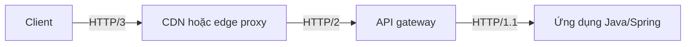

# Ngữ nghĩa HTTP độc lập với HTTP/1.1, HTTP/2, HTTP/3

Một yêu cầu đọc sách bằng `GET` vẫn là yêu cầu đọc sách khi kết nối chuyển từ HTTP/1.1 sang HTTP/2 hoặc HTTP/3. Ý nghĩa của thao tác không đổi chỉ vì header được mã hóa khác, các thông điệp được ghép trên một kết nối hay transport chuyển từ TCP sang QUIC.

Trong chương **Nền tảng HTTP** của module **INTEGRATION_API_REST**, bài học này tách phần **hợp đồng ứng dụng** khỏi phần **biểu diễn và truyền thông điệp trên mạng**. Sự phân biệt này giúp thiết kế REST API, đọc log, cấu hình proxy và kiểm thử với Java/Spring hoặc công nghệ tương đương mà không gắn quy tắc nghiệp vụ vào một phiên bản HTTP cụ thể.

Sau bài học, bạn cần có khả năng:

- Phân biệt ngữ nghĩa HTTP với cú pháp, framing và transport của từng phiên bản.
- Nhận ra cùng một request/response khi nó được biểu diễn theo HTTP/1.1, HTTP/2 hoặc HTTP/3.
- Giải thích vì sao đổi phiên bản HTTP không tự làm thao tác idempotent, không sửa lỗi phân quyền và không bảo đảm xử lý đúng một lần.
- Thiết kế kiểm thử hợp đồng và kiểm thử hạ tầng ở những ranh giới phù hợp.

## 1. Hai lớp quyết định khác nhau

### 1.1. Ngữ nghĩa trả lời “thông điệp có nghĩa gì?”

Ngữ nghĩa HTTP bao gồm ý nghĩa của phương thức, mã trạng thái, các trường điều khiển, biểu diễn và các điều kiện của yêu cầu. Phần dùng chung này được mô tả trong [RFC 9110 — HTTP Semantics](https://www.rfc-editor.org/rfc/rfc9110.html).

Ví dụ:

- `GET /books/b_42` yêu cầu lấy biểu diễn của tài nguyên đích.
- `201 Created` biểu đạt kết quả đã tạo tài nguyên, không chỉ “server đã nhận được vài byte”.
- `Content-Type: application/json` xác định kiểu nội dung được gửi.
- `If-None-Match` đặt điều kiện liên quan đến ETag, không phải một tham số riêng của HTTP/2.
- `Authorization` mang thông tin xác thực theo cơ chế đã chọn; máy chủ vẫn phải kiểm tra quyền nghiệp vụ.

Các ý nghĩa đó không xuất phát từ việc có một dòng chữ `HTTP/1.1` ở đầu thông điệp.

### 1.2. Cách truyền trả lời “thông điệp đi qua mạng như thế nào?”

Cú pháp, framing và transport xác định cách mã hóa thông tin, xác định ranh giới nội dung, tổ chức luồng và sử dụng kết nối.

| Câu hỏi | Thuộc phần nào? |
|---|---|
| Dùng `GET` hay `POST` để biểu đạt yêu cầu? | Ngữ nghĩa và hợp đồng HTTP |
| Trả `404` hay `403` theo chính sách truy cập? | Hợp đồng ứng dụng và ngữ nghĩa HTTP |
| Giá trị số tiền trong JSON tính bằng đơn vị nào? | Hợp đồng dữ liệu nghiệp vụ |
| Header được trình bày bằng dòng văn bản hay mã hóa trong frame? | Biểu diễn thông điệp của phiên bản |
| Nhiều request được ghép trên kết nối bằng cách nào? | Cơ chế luồng và kết nối |
| Dữ liệu được truyền qua TCP hay QUIC? | Transport |

Không nên đưa các quyết định như “khách dùng HTTP/3 thì được bỏ kiểm tra quyền” hoặc “HTTP/2 thì tạo đơn trả `200`, HTTP/1.1 thì trả `201`” vào API chỉ vì khác phiên bản truyền tải.

### 1.3. Độc lập về ngữ nghĩa không có nghĩa mọi chi tiết đều giống nhau

HTTP/2 và HTTP/3 có quy tắc biểu diễn thông điệp và quản lý kết nối riêng. Một số cơ chế dành cho một phiên bản, chẳng hạn các header điều khiển kết nối của HTTP/1.1, không được sao chép nguyên trạng sang phiên bản khác.

Vì vậy, cần giữ **ý nghĩa của thông điệp hợp lệ** khi ánh xạ giữa các phiên bản, đồng thời tuân theo quy tắc mã hóa và truyền tải của từng phiên bản. Không thể lấy một chuỗi byte HTTP/1.1 bất kỳ rồi gửi thẳng như một request HTTP/2.

## 2. Bắt đầu từ mô hình thông điệp chung

Ở mức ứng dụng, có thể xem request theo các thành phần:

```text
Request:
    phương thức
    URI đích
    các trường thông tin và điều khiển
    nội dung nếu có

Response:
    mã trạng thái
    các trường thông tin và điều khiển
    nội dung nếu được phép và có cung cấp
```

Mô hình trên cố ý chưa nói đến request line, stream ID hoặc QUIC packet. Đó là chi tiết của cách truyền mô hình này.

Giả sử danh mục sách công khai có tài nguyên:

```text
https://api.library.example/books/b_42
```

Hợp đồng cho phép đọc JSON, trả `200` khi tồn tại, có ETag và cho phép cache trong 60 giây. Biểu diễn minh họa là:

```json
{"id":"b_42","title":"HTTP Basics"}
```

Chuỗi JSON trên có 35 byte khi mã hóa UTF-8, không tính một ký tự xuống dòng được thêm sau nó. Các ví dụ framing bên dưới dùng đúng nội dung này để tránh nhầm số ký tự với số byte. Với tên sách tiếng Việt, hai con số có thể khác nhau.

Những giá trị động như `Date`, thời gian đáp ứng hoặc ETag sau một lần cập nhật có thể thay đổi theo lần gọi. “Cùng ngữ nghĩa” không yêu cầu mọi response của mọi lần gọi giống từng byte.

## 3. Một lượt đọc qua HTTP/1.1

### 3.1. Request và response thể hiện bằng dòng văn bản

Request HTTPS được trình bày ở mức HTTP như sau:

```http
GET /books/b_42 HTTP/1.1
Host: api.library.example
Accept: application/json

```

Trong một request trực tiếp dạng này, dòng đầu mang method và request target; `Host` xác định authority. Scheme `https` gắn với URI và kết nối được sử dụng, không xuất hiện trong request target dạng đường dẫn ở ví dụ.

Response:

```http
HTTP/1.1 200 OK
Content-Type: application/json
Content-Length: 35
Cache-Control: public, max-age=60
ETag: "book-b_42-v3"

{"id":"b_42","title":"HTTP Basics"}
```

Đây là cách trình bày dễ đọc của một message HTTP/1.1. Khi truyền thật, các dòng điều khiển dùng cách kết thúc dòng theo giao thức; dấu xuống dòng hiển thị của Markdown không phải một bản chụp byte chính xác để gửi lên socket.

`200` là mã trạng thái có ý nghĩa giao thức. Client không nên dùng chuỗi reason phrase `OK` để quyết định nghiệp vụ. Nó cũng không nên dựa vào vị trí của header hoặc cách viết hoa tên header để nhận diện kết quả.

### 3.2. Ranh giới body không phải ngữ nghĩa nghiệp vụ

HTTP/1.1 cần xác định body kết thúc ở đâu. Ví dụ dùng `Content-Length: 35`. Trong các trường hợp phù hợp khác, HTTP/1.1 có thể dùng cơ chế chunked hoặc kết thúc kết nối để xác định độ dài thông điệp; không được áp dụng tùy tiện bất chấp quy tắc của loại message.

Các quy tắc cú pháp và framing của phiên bản này nằm trong [RFC 9112 — HTTP/1.1](https://www.rfc-editor.org/rfc/rfc9112.html).

Một body được chia thành nhiều chunk vẫn có thể chứa cùng một JSON. Chunk không phải một phần tử mảng JSON, một bản ghi nghiệp vụ hay một ranh giới transaction. Ứng dụng xử lý nội dung theo định dạng của nó sau khi tầng HTTP đã xử lý framing phù hợp.

Tương tự, không thể kết luận mỗi lần đọc từ socket sẽ nhận đúng một request hoặc đúng một body đầy đủ. Ranh giới của lần đọc dữ liệu không thay thế bộ phân tích thông điệp HTTP.

## 4. Cùng lượt đọc qua HTTP/2 và HTTP/3

### 4.1. Các trường điều khiển được thể hiện khác

Ở mức đã giải mã, request HTTP/2 có thể được nhìn như danh sách sau:

```text
:method: GET
:scheme: https
:authority: api.library.example
:path: /books/b_42
accept: application/json
```

Đây là **bản xem logic sau giải mã**, không phải request văn bản để gửi trực tiếp. Các pseudo-header bắt đầu bằng `:` mang dữ liệu điều khiển mà HTTP/1.1 thường thể hiện ở request line và các thành phần liên quan.

| Thông tin | HTTP/1.1 trong ví dụ | HTTP/2 và HTTP/3 trong ví dụ |
|---|---|---|
| Phương thức | `GET` trong request line | `:method: GET` |
| Scheme | URI và ngữ cảnh kết nối HTTPS | `:scheme: https` |
| Authority | `Host: api.library.example` | `:authority: api.library.example` |
| Đường dẫn và query | Request target | `:path` |
| Mã trạng thái | Status line có `200` | `:status: 200` |

Bảng mô tả request thông thường của ví dụ, không bao quát các trường hợp đặc biệt như `CONNECT`. Pseudo-header không phải header ứng dụng thông thường và không phải trường JSON. Chúng có quy tắc vị trí và sử dụng riêng của phiên bản.

### 4.2. Header và nội dung đi trong cấu trúc frame

Response có các trường đã giải mã:

```text
:status: 200
content-type: application/json
content-length: 35
cache-control: public, max-age=60
etag: "book-b_42-v3"
```

Phần nội dung sau khi ghép dữ liệu phù hợp vẫn là:

```json
{"id":"b_42","title":"HTTP Basics"}
```

HTTP/2 và HTTP/3 đều có cách mã hóa phần header và truyền nội dung bằng frame, nhưng hai phiên bản không dùng chung một định dạng frame trên mạng. Việc một công cụ hiển thị các trường thành các dòng chữ không làm dữ liệu truyền trở lại thành cú pháp HTTP/1.1.

Với HTTP/2, có thể hình dung một trao đổi được đặt trong một stream và gồm phần header cùng các frame dữ liệu cần thiết. HTTP/3 ánh xạ trao đổi lên stream của QUIC và có framing riêng. Các mô tả này có tính sơ đồ; không giả định một header section luôn vừa đúng một frame hoặc body luôn nằm trong đúng một DATA frame.

Chi tiết ánh xạ được mô tả trong [RFC 9113, mục 8](https://www.rfc-editor.org/rfc/rfc9113.html#section-8) và [RFC 9114, mục 4](https://www.rfc-editor.org/rfc/rfc9114.html#section-4).

### 4.3. Đổi hình thức không đổi hợp đồng đọc

Ở cả ba trường hợp:

- Tài nguyên đích vẫn là sách `b_42` tại URI đã nêu.
- Method vẫn là `GET`, kết quả vẫn là `200`.
- Media type vẫn là JSON và dữ liệu nghiệp vụ vẫn có cùng ý nghĩa.
- Chính sách cache và ETag vẫn phải được hiểu theo hợp đồng HTTP.

HTTP/2 hoặc HTTP/3 không tự biến một response JSON sai schema thành hợp lệ, cũng không cho phép trả body ở một loại response vốn không được mang nội dung chỉ vì có sẵn DATA frame để truyền.

## 5. Ba phiên bản khác nhau ở đâu?

### 5.1. Cách tổ chức kết nối và dữ liệu

| Khía cạnh | HTTP/1.1 | HTTP/2 | HTTP/3 |
|---|---|---|---|
| Cách thể hiện message | Start line, các field line và body theo quy tắc framing | Frame nhị phân và các stream HTTP/2 | Frame HTTP/3 trên các stream QUIC |
| Transport thông dụng | TCP | TCP | QUIC, sử dụng UDP |
| Nhiều trao đổi trên một kết nối | Có thể tái sử dụng kết nối; không có multiplexing stream như HTTP/2 | Nhiều stream đồng thời trên một kết nối | Nhiều stream đồng thời do QUIC cung cấp |
| Nén phần header | Không dùng HPACK/QPACK của hai phiên bản sau | HPACK | QPACK |
| Dữ liệu điều khiển cơ bản | Request line, status line và các trường liên quan | Pseudo-header như `:method`, `:status` | Pseudo-header tương ứng trong ánh xạ HTTP/3 |
| Framing body | Chẳng hạn độ dài đã biết hoặc chunked, theo loại message | DATA và trạng thái kết thúc stream phù hợp | DATA và cơ chế kết thúc stream QUIC phù hợp |

Trong HTTP/1.1, một kết nối có thể xử lý nhiều request theo thời gian. Có cơ chế pipelining, nhưng response trên kết nối vẫn phải giữ thứ tự tương ứng; không nên đồng nhất “tái sử dụng kết nối” với “ghép các stream độc lập”.

HTTP/2 và HTTP/3 cho phép các trao đổi đồng thời tiến triển trên nhiều stream. Điều đó không làm hai thao tác nghiệp vụ trở thành một transaction, cũng không bảo đảm request do người dùng bấm sau sẽ được xử lý sau.

Nén header khác với nén nội dung. HPACK/QPACK không có nghĩa JSON body được gzip tự động. Nếu nội dung được mã hóa bằng `Content-Encoding`, đó là một quyết định khác cần được thương lượng và xử lý tương ứng.

### 5.2. Mất gói và head-of-line blocking

HTTP/2 có nhiều stream, nhưng các byte của kết nối TCP vẫn được bàn giao theo thứ tự. Khi một phần dữ liệu TCP bị thiếu, việc bàn giao dữ liệu phía sau có thể bị chặn, ảnh hưởng đến các trao đổi cùng dùng kết nối đó dù chúng thuộc những stream HTTP/2 khác nhau.

QUIC cung cấp các stream với cơ chế bàn giao dữ liệu theo stream, giúp tránh sự chặn giữa các stream do yêu cầu thứ tự byte của một kết nối TCP chung. HTTP/3 vẫn có thể bị chậm do mất gói trên stream liên quan, tắc nghẽn, giới hạn tài nguyên, phụ thuộc nén header hoặc nghiệp vụ ở máy chủ.

Vì vậy, nói “HTTP/3 không bao giờ bị blocking” là sai. Lợi ích nằm ở cơ chế tổ chức truyền tải cụ thể, không phải việc mọi phụ thuộc đều biến mất.

Để hiểu ánh xạ này, có thể đọc phần tổng quan transport trong [RFC 9114, mục 1](https://www.rfc-editor.org/rfc/rfc9114.html#section-1). Không cần đưa chiến lược khôi phục mất gói vào hợp đồng tạo hoặc đọc tài nguyên của API.

### 5.3. QUIC dùng UDP không có nghĩa HTTP/3 bỏ độ tin cậy

UDP tự nó không cung cấp giao tiếp byte stream tin cậy như TCP. QUIC xây dựng các cơ chế cần thiết, gồm stream, khôi phục mất dữ liệu và điều khiển truyền tải, ở tầng giao thức của nó. Nội dung HTTP thông thường trên stream QUIC không trở thành dữ liệu “mất cũng được” chỉ vì các packet nền là UDP.

Điều này cũng không có nghĩa nghiệp vụ sẽ chạy đúng một lần. Truyền dữ liệu tin cậy và xác định một ý định tạo đơn duy nhất là hai bài toán khác nhau.

### 5.4. HTTPS và phiên bản HTTP là những khái niệm liên quan nhưng riêng biệt

Trong triển khai HTTPS thường gặp:

```text
HTTP/1.1 → TLS → TCP
HTTP/2   → TLS → TCP
HTTP/3   → QUIC với cơ chế bảo mật dùng TLS → UDP
```

Sơ đồ giúp phân biệt các lớp, không phải mô tả byte hoặc toàn bộ quá trình bắt tay. HTTP/1.1 và HTTP/2 cũng có những cách sử dụng không qua TLS; với URI `https` đang xét, kênh bảo mật phải được đáp ứng đúng. HTTP/3 sử dụng bảo mật tích hợp trong QUIC, không phải ghép một kết nối TLS-over-TCP vào UDP.

Không suy ra `https://` đồng nghĩa với HTTP/2 hoặc HTTP/3. Một URL HTTPS có thể được truy cập bằng HTTP/1.1. Cách lựa chọn phiên bản phụ thuộc vào khả năng hai đầu, thương lượng và đường mạng, không phải tên endpoint nghiệp vụ.

Việc máy chủ hỗ trợ HTTP/3 cũng không bảo đảm mọi client đều dùng được. Chẳng hạn, đường mạng chặn UDP có thể khiến client cần thử một phiên bản HTTP trên TCP nếu cấu hình và khả năng của nó cho phép. Khi chuyển sang một phiên bản được hỗ trợ khác, hợp đồng API vẫn cần giữ nguyên ý nghĩa.

## 6. Những chi tiết không được sao chép nguyên xi

### 6.1. Không tự thêm header điều khiển kết nối của HTTP/1.1 vào HTTP/2 hoặc HTTP/3

Ví dụ, các trường có ngữ nghĩa riêng cho kết nối như `Connection`, `Keep-Alive`, `Upgrade` và `Transfer-Encoding` không được đưa nguyên trạng vào message HTTP/2 hoặc HTTP/3. Tầng giao thức và proxy cần chuyển đổi đúng, không chỉ đổi nhãn phiên bản.

Các quy tắc này được nêu tại [RFC 9113, mục 8.2.2](https://www.rfc-editor.org/rfc/rfc9113.html#section-8.2.2) và [RFC 9114, mục 4.2](https://www.rfc-editor.org/rfc/rfc9114.html#section-4.2).

`TE` là một trường khác với `Transfer-Encoding`: HTTP/2 và HTTP/3 có ngoại lệ cho request dùng `TE` với giá trị `trailers`. Không lấy ngoại lệ đó để cho rằng `Transfer-Encoding: chunked` hợp lệ trên HTTP/2 hoặc HTTP/3.

Trong code API, hãy để thư viện HTTP hoặc container xử lý framing phù hợp. Không tự đặt `Transfer-Encoding: chunked` chỉ để diễn đạt rằng một danh sách JSON có nhiều phần tử hoặc rằng service đang xử lý từng phần dữ liệu.

### 6.2. Không cần chunked để có streaming

HTTP/1.1 có chunked transfer coding; HTTP/2 và HTTP/3 dùng cách chia và kết thúc dữ liệu riêng của chúng. Cả ba đều có thể hỗ trợ việc nhận hoặc gửi nội dung từng phần khi thành phần triển khai và hợp đồng ứng dụng cho phép.

Ranh giới DATA frame, chunk hoặc packet không đồng nhất với ranh giới bản ghi trong một định dạng ứng dụng. Nếu ứng dụng cần xử lý từng bản ghi trước khi nhận hết body, phải chọn một định dạng và quy tắc phân tách phù hợp, rồi kiểm tra việc buffering ở client, proxy và máy chủ.

Tương tự, `Content-Length` không bị cấm chỉ vì kết nối dùng HTTP/2 hoặc HTTP/3. Nó có thể xuất hiện theo quy tắc tương ứng, nhưng không còn là cách duy nhất để xác định kết thúc body trên stream. Khi được gửi, giá trị phải nhất quán và hợp lệ với loại thông điệp.

Đừng áp dụng quy tắc đơn giản “thấy `Content-Length: N` thì mọi response luôn phải có đúng N byte body”. Ngữ nghĩa phương thức và status vẫn có vai trò: response cho `HEAD` không có nội dung, và các status như `204` hoặc `304` có quy tắc riêng. Đặc biệt, không gắn `Content-Length` tùy tiện vào `204`.

### 6.3. Tên trường, thứ tự và reason phrase không phải khóa nghiệp vụ

Tên trường HTTP có ngữ nghĩa không phân biệt hoa thường. HTTP/2 và HTTP/3 yêu cầu tên trường được mã hóa bằng chữ thường; client nên dùng API truy cập header của thư viện thay vì so sánh chuỗi byte tên trường đã trình bày trong log.

Không coi việc `Content-Type` được công cụ hiển thị thành `content-type` là mất header. Đồng thời, không được suy rộng rằng mọi **giá trị** header đều không phân biệt hoa thường; từng trường có quy tắc riêng.

Không phụ thuộc thứ tự header thông thường để xác định nghiệp vụ. Tuy nhiên, tầng giao thức vẫn có ràng buộc cấu trúc, chẳng hạn vị trí pseudo-header; “ứng dụng không dựa vào thứ tự” không cho phép sinh message vi phạm giao thức.

HTTP/2 và HTTP/3 không có status line chứa reason phrase như HTTP/1.1. Công cụ có thể dựng một dòng `HTTP/2 200` để người đọc theo dõi; đó không phải bằng chứng có nguyên dòng văn bản ấy trên mạng. Client xử lý mã `200`, `404`, `409` hoặc các mã liên quan, thay vì dò chuỗi `OK` hay `Not Found`.

## 7. Một request có thể đi qua nhiều phiên bản



Sơ đồ là một cấu hình có thể có, không khẳng định hệ thống nào cũng dùng chuỗi này. Mỗi chặng có kết nối và phiên bản được lựa chọn riêng.

Nếu client gửi `GET /books/b_42`, gateway không cần đổi nó thành một thao tác nghiệp vụ khác chỉ vì chặng phía sau dùng HTTP/1.1. Thành phần trung gian cần chuyển đổi message đúng phiên bản, định tuyến đúng tài nguyên và giữ ý nghĩa các trường áp dụng theo chính sách.

Một số lưu ý thực tế:

- Tên host kết nối upstream có thể khác host công khai; ánh xạ authority và route phải được cấu hình có chủ đích.
- Các trường riêng cho kết nối không được chuyển tiếp máy móc.
- Thông tin xác thực và danh tính được chuyển hoặc thay thế theo một chính sách tin cậy rõ ràng; không để chuyển phiên bản vô tình trở thành đường bỏ qua kiểm tra quyền.
- `Location`, chính sách cache và các điều kiện cần thiết phải còn có ý nghĩa với client bên ngoài.
- Bộ đệm, giới hạn kích thước và thời gian chờ ở từng chặng có thể làm thay đổi hành vi quan sát được, nhất là với body lớn hoặc streaming.

Nếu CDN trả kết quả từ cache, origin có thể không nhận request mới. Nếu gateway tự sinh `504` do upstream hết thời gian chờ, đó là response của gateway; không được kết luận controller đã tự trả `504` mà không đối chiếu log.

### 7.1. Log ở ứng dụng có thể chỉ phản ánh chặng gần nhất

Client có thể hiển thị HTTP/3 trong khi ứng dụng ghi nhận HTTP/1.1. Cả hai quan sát đều có thể đúng nếu proxy ở giữa chuyển phiên bản.

Khi điều tra, ghi rõ đang quan sát kết nối nào: client–edge hay gateway–origin. Nếu cần thu thập phiên bản từ một chặng khác, dùng telemetry hoặc metadata theo cấu hình tin cậy. Không tin một header do client tự đặt chỉ vì tên của nó nghe giống thông tin do proxy tạo.

Phiên bản không nên trở thành dữ liệu người dùng có thể tự khai để đổi quyền hoặc đổi kết quả nghiệp vụ.

## 8. Những bảo đảm nghiệp vụ không được sinh ra từ transport

### 8.1. Phương thức giữ nguyên tính chất ngữ nghĩa

Trong một API tuân thủ hợp đồng:

- `GET` vẫn là phương thức an toàn theo nghĩa client không yêu cầu thay đổi trạng thái nghiệp vụ. Ghi log khi đọc không làm `GET` trở thành thao tác tạo đơn.
- Tính idempotent của một phương thức nói về hiệu ứng dự kiến khi lặp lại cùng yêu cầu, không phải việc response luôn giống nhau.
- Một `DELETE` có thể trả `204` lần đầu và `404` lần sau mà không mâu thuẫn với tính idempotent của hiệu ứng xóa.
- `POST` không mặc nhiên có bảo đảm idempotent của phương thức chỉ vì được gửi trên HTTP/2 hoặc HTTP/3.

Việc multiplexing có thể khiến nhiều request cùng đến nơi xử lý, nên ứng dụng càng phải có ràng buộc nhất quán phù hợp. Stream ID không phải mã đơn hàng, khóa idempotency hoặc chứng cứ một giao dịch nghiệp vụ đã commit.

### 8.2. Mất response vẫn có thể để lại kết quả chưa biết chắc

Xét một tình huống tạo đơn:

```text
Client gửi POST /orders
Máy chủ tạo và commit đơn
Response không đến được client
Client hết thời gian chờ
```

Tình huống này có thể xảy ra qua bất kỳ phiên bản nào trong ba phiên bản đang học. Client chưa nhận response không có nghĩa máy chủ chưa tạo đơn.

Nếu client gửi một request tạo mới để thử lại, có thể phát sinh đơn thứ hai. HTTP/3 không cung cấp “exactly once” cho transaction của ứng dụng chỉ bằng việc truyền qua QUIC; HTTP/2 cũng không làm điều đó bằng stream.

Nếu nghiệp vụ cần thử lại an toàn, phải thiết kế cơ chế tương ứng, chẳng hạn khóa idempotency gắn với chủ thể, thao tác và nội dung. Lưu khóa và kết quả phải nhất quán với việc tạo tài nguyên. Cùng một ý định thử lại không nên đổi khóa chỉ vì kết nối sau dùng phiên bản HTTP khác.

Một số tín hiệu giao thức có thể cung cấp thông tin cụ thể hơn về việc request đã được xử lý hay chưa, và thư viện cần tuân theo quy tắc tương ứng. Tuy nhiên, không suy diễn từ một timeout hoặc reset chung thành khẳng định “chưa có tác động nghiệp vụ”.

### 8.3. Lỗi transport khác với response lỗi HTTP

| Quan sát ở client | Có thể kết luận gì? | Chưa thể kết luận gì? |
|---|---|---|
| Nhận `401` hợp lệ | Đã có một response HTTP yêu cầu xử lý xác thực theo hợp đồng | Không thể kết luận lỗi là do phiên bản HTTP |
| Nhận `422` và body validation | Máy chủ hoặc thành phần trả response đã từ chối dữ liệu theo hợp đồng đó | Không thể suy ra mọi cấu hình giao thức đều đã đúng |
| Không bắt tay được hoặc kết nối bị lỗi | Không hoàn tất được trao đổi như mong đợi | Không mặc nhiên có một status `500` hoặc body JSON để đọc |
| Response bị ngắt trước khi đầy đủ | Client không nhận được response hoàn chỉnh | Không mặc nhiên biết trạng thái commit của thao tác ghi |

Mã lỗi stream, lỗi kết nối và status HTTP thuộc các cơ chế khác nhau. Đừng coi tên lỗi giao thức có chữ “internal” là response `500 Internal Server Error` của controller.

### 8.4. Cache và điều kiện vẫn có cùng mục đích

Sau lượt đọc sách với ETag ở ví dụ, client có thể yêu cầu kiểm tra lại bằng điều kiện:

```text
method: GET
target: https://api.library.example/books/b_42
Accept: application/json
If-None-Match: "book-b_42-v3"
```

Đây là mô tả request ở mức ngữ nghĩa, không phải cú pháp socket của một phiên bản cụ thể. Nếu điều kiện và trạng thái tài nguyên phù hợp, máy chủ có thể trả `304 Not Modified` không có nội dung, cùng các thông tin cache cần thiết. Nếu biểu diễn đã đổi, kết quả có thể là `200` cùng biểu diễn mới.

Đổi kết nối sang HTTP/3 không tự làm ETag hết ý nghĩa và cũng không làm cache luôn đúng. Nếu contract chọn `no-store` cho dữ liệu đơn hàng, chỉ thị đó vẫn cần được tôn trọng. Nếu hệ thống thương lượng nhiều biến thể biểu diễn, chính sách phân biệt biến thể và cache phải được thiết kế đúng ở mọi đường truyền được hỗ trợ.

## 9. Áp dụng trong Java/Spring

### 9.1. Đặt quy tắc vào đúng tầng

| Phần hệ thống | Trách nhiệm |
|---|---|
| Service nghiệp vụ | Kiểm tra quyền nghiệp vụ, trạng thái tài nguyên, giao dịch và chống trùng theo hợp đồng |
| Controller và DTO | Ánh xạ method, URI, dữ liệu, status và header ứng dụng |
| HTTP server hoặc container | Phân tích và mã hóa message theo giao thức mà nó hỗ trợ |
| Proxy hoặc gateway | Thương lượng và chuyển tiếp theo từng chặng, TLS, route, giới hạn và chính sách liên quan |
| HTTP client | Sử dụng giao thức đã thương lượng, đọc response và xử lý lỗi kết nối đúng cơ chế |

Không đặt nhánh kiểu sau vào service chỉ vì muốn hỗ trợ thêm một phiên bản:

```text
nếu request dùng HTTP/3:
    bỏ kiểm tra idempotency
    trả 200 cho mọi kết quả
ngược lại:
    kiểm tra idempotency
    trả status theo nghiệp vụ
```

Thay vào đó, một luồng tạo tài nguyên cần giữ cùng các bước kiểm tra và kết quả theo contract. Việc có thêm một phương án truyền tải thuộc cấu hình và khả năng của hạ tầng HTTP, không phải lý do tự đổi quy tắc tạo tài nguyên.

Trong nhiều ứng dụng, controller làm việc với request đã được thư viện chuẩn hóa. Nó không tự giải mã HPACK/QPACK, không ghép frame và không trực tiếp điều khiển khôi phục packet QUIC. Không viết lại những phần đó trong controller REST.

### 9.2. Hỗ trợ ở edge không đồng nghĩa hỗ trợ ở origin

Một hệ thống có thể cung cấp HTTP/3 tại CDN trong khi ứng dụng Java chỉ nhận HTTP/1.1 phía sau proxy. Đó vẫn là cách cung cấp HTTP/3 cho chặng client–edge nếu chặng đó thực sự được thương lượng và phục vụ bằng HTTP/3.

Ngược lại, khai báo một cấu hình ở ứng dụng không chứng minh client bên ngoài đã dùng giao thức mong muốn. Cần kiểm tra khả năng client, server, thư viện nền, TLS/QUIC, proxy và đường mạng trong đúng môi trường triển khai.

Bài học không đưa một đoạn cấu hình bật HTTP/2 hoặc HTTP/3 dùng cho mọi phiên bản Spring, container và nhà cung cấp. Khi triển khai thực tế, phải đối chiếu tài liệu của các thành phần đang dùng và xác nhận giao thức được chọn trên từng chặng.

### 9.3. Không phụ thuộc chuỗi hiển thị thô của thư viện

Một test nghiệp vụ nên kiểm tra status số, header theo quy tắc tương ứng và dữ liệu đã phân tích. Không kiểm tra thành công bằng việc response bắt đầu đúng chuỗi `HTTP/1.1 200 OK`, vì một đường truyền hợp lệ khác có thể không có dòng đó trên mạng.

Tuy nhiên, không bỏ qua sai lệch có ý nghĩa: mất header bảo mật, sai `Location`, JSON mất trường bắt buộc hoặc body bị cắt đều cần được phát hiện. Chuẩn hóa cách so sánh phải giúp bỏ chi tiết trình bày không liên quan, không che lỗi hợp đồng.

## 10. Kiểm thử phần dùng chung và phần riêng

### 10.1. Ma trận hợp đồng cho các phiên bản được hỗ trợ

Giữ dữ liệu và điều kiện kiểm thử tương đương, rồi chạy các ca cần thiết qua từng đường truyền:

| Ca kiểm thử | Kết quả nghiệp vụ/HTTP cần giữ |
|---|---|
| Đọc sách đang tồn tại | `200`, JSON đúng schema, đúng dữ liệu và media type |
| Đọc sách không tồn tại | `404` theo hợp đồng, không đổi thành thành công vì khác phiên bản |
| Đọc với điều kiện ETag chưa thay đổi | `304`, không có body, metadata cache phù hợp |
| Gọi `HEAD` nếu API hỗ trợ | Trả metadata tương ứng và không gửi nội dung response |
| Tạo tài nguyên hợp lệ | `201`, URI trong `Location` dùng được, dữ liệu đã lưu |
| Validation thất bại | Status và cấu trúc lỗi đúng contract, không tạo dữ liệu ngoài ý muốn |
| Thiếu thông tin xác thực ở operation được bảo vệ | `401` cùng challenge phù hợp |
| Có xác thực nhưng thiếu quyền | `403` hoặc chính sách che tài nguyên đã công bố |
| Cùng ý định tạo được thử lại bằng phiên bản khác | Không nhân đôi nếu API đã cam kết cơ chế idempotency tương ứng |

Không yêu cầu các ca tạo riêng biệt ở ba phiên bản phải trả cùng một `id` hoặc cùng timestamp. Chúng có thể là ba yêu cầu tạo mới hợp lệ. Muốn kiểm tra cùng một ý định thử lại, phải kiểm soát đúng khóa, nội dung và trạng thái ban đầu theo hợp đồng.

Khi so sánh, có thể bỏ khác biệt không mang ý nghĩa như cách viết hoa tên header hoặc thứ tự thuộc tính object JSON. Không được tự ý bỏ khác biệt về thứ tự phần tử mảng nếu contract quy định thứ tự đó.

### 10.2. Kiểm thử giao thức và hạ tầng

Ngoài hợp đồng ứng dụng, kiểm tra những điều không thể chứng minh bằng test controller đơn thuần:

- Client thực sự đã thương lượng phiên bản nào ở chặng cần kiểm tra; phân biệt chế độ yêu cầu sử dụng một phiên bản với việc đã chọn được phiên bản đó.
- Proxy chuyển đổi authority, đường dẫn, trường hợp lệ và body đúng qua các chặng.
- Không sinh `Connection` hoặc `Transfer-Encoding` không hợp lệ trên HTTP/2 và HTTP/3.
- Body lớn, streaming và giới hạn header được xử lý đúng, không bị cắt hoặc buffering trái yêu cầu.
- Lỗi kết nối, reset và timeout được client nhận diện đúng, không bị giả thành một response JSON thành công.
- Khi một phiên bản không dùng được, cơ chế chuyển sang phiên bản khác có giữ hợp đồng, xác thực và chính sách thử lại đã chốt không.

Mock request hoặc test MVC có giá trị để kiểm tra ánh xạ HTTP và nghiệp vụ, nhưng không tạo ra kết nối QUIC thật hoặc chứng minh quá trình thương lượng ở CDN. Muốn kiểm chứng chặng nào thì cần quan sát và tác động đến đúng chặng đó.

### 10.3. Đo hiệu năng bằng điều kiện có thể so sánh

Không kết luận HTTP/3 luôn nhanh hơn sau một lần gọi. Kết quả phụ thuộc vào độ trễ mạng, mất gói, tái sử dụng kết nối, kích thước header/body, mức đồng thời và thời gian xử lý phía máy chủ.

Khi so sánh, ghi lại phiên bản thực dùng, dữ liệu, đường đi qua proxy/cache, điều kiện kết nối và phân bố độ trễ. Một request trúng cache tại edge không thể được xem là bằng chứng transport nhanh hơn một request phải truy cập database ở origin.

Mục tiêu tối ưu là phục vụ hợp đồng hiệu quả hơn trong môi trường thực tế. Việc schema, quyền truy cập hoặc cơ chế chống trùng sai vẫn cần được sửa ở tầng tương ứng, ngay cả khi độ trễ mạng đã giảm.

## 11. Phân biệt các loại “phiên bản”

| Khái niệm | Ví dụ | Điều được thay đổi |
|---|---|---|
| Phiên bản API | `/api/v2/books` hoặc một cơ chế versioning đã chọn | Hợp đồng hoặc khả năng của ứng dụng |
| Phiên bản HTTP | HTTP/1.1, HTTP/2, HTTP/3 | Cách biểu đạt, trao đổi và vận chuyển thông điệp HTTP |
| Phiên bản TLS | Một phiên bản TLS được thành phần liên quan hỗ trợ | Cơ chế bảo mật kết nối theo tiêu chuẩn và cấu hình |
| Phiên bản biểu diễn/tài nguyên | ETag của một biểu diễn sách | Trạng thái hoặc biến thể dùng cho điều kiện và cache |

Client có thể gọi API v2 qua HTTP/1.1, hoặc gọi cùng hợp đồng API qua HTTP/2 và HTTP/3. Không cần đổi đường dẫn thành `/http3/books` chỉ để dùng transport khác.

TLS, HTTP và QUIC có các điều kiện tương thích cụ thể; “khái niệm riêng biệt” không có nghĩa mọi tổ hợp phiên bản đều dùng được. Điểm cần giữ là không dùng tên một loại phiên bản để suy ra giá trị hoặc bảo đảm của loại khác.

## 12. Tự thực hành phân tích một sự cố

Một nhóm ghi nhận tình huống:

> Công cụ của client báo HTTP/3, log ứng dụng báo HTTP/1.1. Sau timeout ở thao tác tạo đơn, client đổi kết nối và gửi lại bằng HTTP/2. Hệ thống xuất hiện hai đơn.

Hãy trả lời:

1. Hai quan sát về phiên bản có nhất thiết mâu thuẫn không? Cần vẽ thêm những chặng nào?
2. Timeout có chứng minh request tạo đầu tiên chưa được xử lý không?
3. Việc đổi từ HTTP/3 sang HTTP/2 có phải một ý định tạo đơn mới của người dùng không?
4. Những thông tin nào cần có để đối chiếu hai request và kết quả commit?
5. Cơ chế nào cần được thiết kế để thử lại cùng một ý định mà không tạo trùng?
6. Kiểm thử controller có đủ chứng minh hành vi HTTP/3 ở client không?

Hướng phân tích là dựng lại chuỗi client–proxy–origin, xác nhận phiên bản ở từng chặng và đối chiếu request với dữ liệu đã lưu. Hai đơn cho thấy cần xem lại cách định danh ý định tạo, chính sách thử lại và bảo đảm nhất quán của cơ chế chống trùng; chỉ đổi transport sẽ không giải quyết được bài toán đó.

Khi thiết kế hoặc điều tra API, hãy luôn hỏi riêng hai câu: **thông điệp có ý nghĩa gì theo hợp đồng** và **thông điệp đã được mã hóa, truyền, chuyển tiếp như thế nào**. Trả lời đúng cả hai giúp giữ nghiệp vụ ổn định trong khi hạ tầng có thể tiến từ HTTP/1.1 sang HTTP/2 hoặc HTTP/3.
