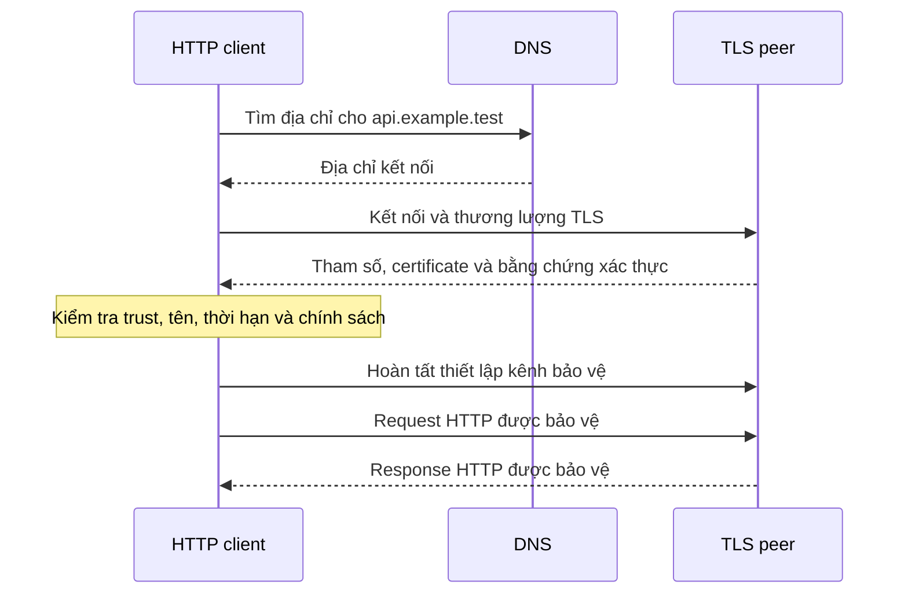

# HTTPS, định danh máy chủ và bảo vệ dữ liệu trên đường truyền

## Mục tiêu và phạm vi

Trong chương **Nền tảng HTTP** của module **INTEGRATION_API_REST**, bài học này giải thích HTTPS bảo vệ một tương tác API như thế nào, client biết mình đang nói chuyện với máy chủ nào và vì sao mã hóa đường truyền không thay thế xác thực hay phân quyền nghiệp vụ.

Module tập trung vào thiết kế REST API dựa trên resource, URI, phương thức và mã trạng thái HTTP, cùng hợp đồng dữ liệu rõ ràng. HTTPS là lớp bảo vệ cho các thông tin đó khi truyền giữa các đầu cuối TLS. Nó phối hợp với cache, idempotency, OpenAPI, xử lý lỗi và kiểm thử; không tự thực hiện các trách nhiệm này. Ví dụ triển khai được đặt trong bối cảnh Java/Spring hoặc công nghệ tương đương.

Sau bài học, bạn có thể:

- Phân biệt tính bí mật, tính toàn vẹn và xác thực máy chủ trong HTTPS.
- Giải thích vai trò của certificate, private key, CA, chuỗi tin cậy và hostname verification.
- Nhận ra dữ liệu nào được bảo vệ trên một chặng TLS và dữ liệu nào vẫn nằm ngoài bảo đảm đó.
- Đọc đúng ranh giới khi TLS kết thúc tại gateway, proxy hoặc ứng dụng.
- Phân biệt lỗi TLS với response lỗi HTTP và lựa chọn cách tích hợp Java giữ nguyên kiểm tra danh tính máy chủ.

## 1. HTTPS bảo vệ điều gì?

### 1.1. HTTP và HTTPS giữ cùng ngữ nghĩa ứng dụng

Một request HTTPS vẫn có phương thức, đích, header và nội dung. Response vẫn có mã trạng thái, header và nội dung theo hợp đồng API.

Ví dụ về mặt ngữ nghĩa:

```http
POST /orders HTTP/1.1
Host: api.example.test
Authorization: Bearer <access-token>
Content-Type: application/json

{"items":[{"productId":"prd-10","quantity":2}]}
```

Thông điệp trên được rút gọn để thể hiện dữ liệu ứng dụng, không mô tả đầy đủ framing trên wire. Khi dùng HTTPS, các byte HTTP tương ứng được truyền qua cơ chế bảo vệ của TLS thay vì xuất hiện như HTTP thuần trên chặng mạng đó.

HTTP/1.1 và HTTP/2 thường dùng TLS trên TCP cho HTTPS. HTTP/3 sử dụng QUIC với TLS tích hợp trong cơ chế thiết lập bảo mật của nó. Vì vậy, không nên định nghĩa HTTPS chỉ bằng một sơ đồ bắt buộc “HTTP trên TLS trên TCP” cho mọi phiên bản.

Scheme `https` không phải một phiên bản HTTP và cũng không tự nói dữ liệu có định dạng JSON hay không.

### 1.2. Ba bảo đảm cốt lõi

| Bảo đảm | Ý nghĩa khi được thiết lập và kiểm tra đúng |
| --- | --- |
| Tính bí mật | Bên quan sát mạng không có khóa thích hợp không đọc trực tiếp nội dung ứng dụng trên chặng được bảo vệ |
| Tính toàn vẹn | Các thay đổi hoặc giả mạo dữ liệu trên chặng truyền được phát hiện theo cơ chế mật mã của TLS |
| Xác thực máy chủ | Client kiểm tra đầu bên kia có danh tính phù hợp với đích dự kiến và chứng minh quyền sử dụng khóa tương ứng |

Ba bảo đảm phối hợp với nhau. Một kết nối “có mã hóa” nhưng chấp nhận mọi certificate và mọi hostname không còn bảo đảm client đang gửi dữ liệu cho đúng máy chủ dự kiến. Một bên trung gian có thể thiết lập một kết nối mã hóa riêng với client nếu client bỏ qua việc kiểm tra danh tính.

TLS cũng có thể xác thực phía client bằng certificate trong mô hình mutual TLS, nhưng điều đó không mặc nhiên xảy ra với mọi request HTTPS.

### 1.3. TLS bảo vệ một ranh giới cụ thể

```text
HTTP client  ===== chặng TLS được bảo vệ =====  TLS peer
```

Hai đầu TLS vẫn đọc được dữ liệu sau khi giải mã. Nếu TLS peer là gateway, gateway là một nơi có thể thấy request, bao gồm header và body. HTTPS không che nội dung với chính thành phần kết thúc TLS.

Cam kết bảo vệ phải được hiểu theo đường đi thực tế, không chỉ theo việc URL bắt đầu bằng `https://`.

## 2. Định danh máy chủ bắt đầu từ đích client muốn gọi

### 2.1. Host trong URL là danh tính cần kiểm tra

Giả sử client gọi:

```text
https://api.example.test:8443/orders/ord-123
```

Client cần kiểm tra danh tính máy chủ phù hợp với host `api.example.test`. Port `8443` xác định nơi kết nối nhưng không trở thành một phần của tên DNS cần khớp trong certificate. Path và query cũng không phải tên máy chủ.

| Thành phần | Vai trò liên quan tới HTTPS |
| --- | --- |
| Scheme `https` | Yêu cầu cách truy cập được bảo vệ theo HTTPS |
| Host `api.example.test` | Danh tính đích mà client cần đối chiếu |
| Port `8443` | Cổng kết nối được chỉ định |
| Path `/orders/ord-123` | Đích HTTP sau khi kết nối đã được thiết lập |

HTTPS có thể phục vụ ở cổng khác `443` khi hạ tầng được cấu hình phù hợp. Ngược lại, đặt port `443` vào một URL có scheme `http` không tự biến request thành HTTPS.

### 2.2. DNS không thay thế kiểm tra certificate

DNS giúp tìm địa chỉ kết nối cho một tên host. Địa chỉ IP có thể thay đổi, một host có thể dẫn tới nhiều instance, và nhiều host có thể dùng chung một IP.

Việc kết nối được tới một IP chưa chứng minh đó là máy chủ hợp lệ cho `api.example.test`. Client vẫn phải xác minh certificate và bằng chứng mật mã của peer theo danh tính dự kiến.

Tương tự, hai tên host cùng trỏ đến một IP không có nghĩa certificate của tên thứ nhất tự hợp lệ cho tên thứ hai. Danh tính cần kiểm tra là danh tính trong URL, không phải tên do ứng dụng tự suy ra từ reverse DNS.

### 2.3. SNI, certificate và Host không phải cùng một thứ

SNI, Server Name Indication, cho phép client chỉ ra tên máy chủ trong quá trình thiết lập TLS để hạ tầng chọn cấu hình hoặc certificate thích hợp. Điều này hữu ích khi nhiều tên miền dùng chung một điểm tiếp nhận kết nối.

Sau khi có kênh TLS, request HTTP mang authority đích qua `Host` trong HTTP/1.1 hoặc cơ chế tương ứng của phiên bản HTTP khác.

Ba phần có vai trò khác nhau:

- Tên đích trong URL là cơ sở cho danh tính client dự kiến.
- SNI giúp chọn máy chủ ảo hoặc certificate trong quá trình thiết lập TLS.
- `Host` hoặc authority của HTTP tham gia định tuyến request ở lớp HTTP.

SNI không phải bằng chứng xác thực. Client vẫn phải kiểm tra certificate được trả về. Chỉ sửa header `Host` cũng không phải cách chữa lỗi hostname verification, vì việc kiểm tra TLS diễn ra trước khi request HTTP được xử lý như bình thường.

## 3. Certificate, khóa và chuỗi tin cậy

### 3.1. Certificate không phải private key

Certificate máy chủ chứa các thông tin như public key, danh tính được khai báo, thời hạn, bên phát hành và chữ ký của bên phát hành theo cấu trúc certificate.

**Private key** tương ứng phải được máy chủ bảo vệ. Trong quá trình thiết lập TLS có xác thực bằng certificate, peer phải chứng minh khả năng sử dụng khóa phù hợp; việc chỉ gửi một bản sao certificate công khai không đủ để đóng giả máy chủ.

| Thành phần | Có bí mật không? | Vai trò |
| --- | --- | --- |
| Certificate | Không phải bí mật theo cách private key là bí mật | Gắn public key với danh tính và các thuộc tính được bên phát hành ký |
| Public key | Không | Tham gia kiểm tra bằng chứng mật mã theo cơ chế TLS |
| Private key | Có | Cho phép đầu cuối chứng minh quyền sử dụng danh tính tương ứng |
| Khóa bảo vệ phiên kết nối | Có | Bảo vệ dữ liệu truyền trong phiên theo thuật toán đã thiết lập |

Không nên giải thích rằng HTTPS đơn giản là “lấy public key trong certificate để mã hóa toàn bộ JSON”. TLS thiết lập vật liệu khóa và các khóa bảo vệ dữ liệu theo phiên bản, cơ chế trao đổi khóa và thuật toán được sử dụng.

### 3.2. CA và trust anchor

CA, Certificate Authority, ký certificate theo chính sách của nó. Client tin cậy một tập trust anchor đã được cấu hình, rồi kiểm tra chuỗi chữ ký và các điều kiện liên quan.

Một chuỗi thường gặp:

```text
Certificate máy chủ
        ↓ được phát hành bởi
Intermediate CA
        ↓ được phát hành bởi
Root CA mà client tin cậy
```

Server thường cần cung cấp certificate máy chủ và các intermediate cần thiết. Root được tin cậy phải xuất phát từ cấu hình tin cậy của client; không phải cứ server gửi kèm một root certificate thì client phải tin nó.

Một endpoint thiếu intermediate có thể hoạt động với một số client đã có dữ liệu hỗ trợ, nhưng thất bại với client khác. Do đó, cần kiểm tra chuỗi được phục vụ thực tế, không chỉ xem file certificate trên máy chủ.

### 3.3. Tin một CA không có nghĩa tin mọi đích

Ngay cả khi chuỗi kết thúc ở CA được tin cậy, certificate còn phải phù hợp với host mà client đang gọi và các ràng buộc áp dụng.

Ví dụ, certificate hợp lệ cho `billing.example.test` không tự hợp lệ cho `api.example.test`. CA trust và hostname verification là hai điều kiện phối hợp, không phải hai lựa chọn thay thế nhau.

Một certificate được tin cậy cũng không chứng minh mọi nội dung trên website là đúng, mọi request được phép hoặc tổ chức đứng sau đã được đánh giá toàn diện. Ý nghĩa danh tính và mức xác minh phụ thuộc loại certificate và chính sách phát hành; client vẫn cần dùng đúng địa chỉ dịch vụ của mình.

## 4. Client cần kiểm tra những gì?

### 4.1. Những điều kiện chính

| Điều kiện | Câu hỏi cần trả lời |
| --- | --- |
| Chuỗi tin cậy | Chữ ký và chuỗi có dẫn tới trust anchor được client chấp nhận không? |
| Danh tính | Certificate có phù hợp với hostname hoặc địa chỉ IP dự kiến không? |
| Thời hạn | Certificate có nằm trong khoảng thời gian hiệu lực theo đồng hồ được sử dụng không? |
| Mục đích và ràng buộc | Certificate, khóa và chuỗi có được phép dùng cho vai trò máy chủ theo chính sách không? |
| Bằng chứng khóa | Peer có hoàn tất bằng chứng mật mã tương ứng với khóa và handshake không? |
| Chính sách giao thức | Hai phía có thống nhất được cơ chế TLS mà cấu hình cho phép không? |

Việc kiểm tra trạng thái thu hồi và các chính sách bổ sung phụ thuộc khả năng, cấu hình và chính sách của HTTP/TLS stack. Không nên hứa rằng mọi client đều hỏi CA về mọi certificate ở mỗi request.

Một kết nối chỉ được tiếp tục khi các điều kiện bắt buộc của stack và chính sách đã được thỏa mãn. Nếu kiểm tra thất bại, hành vi đúng là không tự gửi tiếp dữ liệu nghiệp vụ qua một kênh đã bỏ xác minh.

### 4.2. Subject Alternative Name và hostname verification

Danh tính DNS hoặc IP dự kiến được đối chiếu với các danh tính phù hợp trong Subject Alternative Name, thường viết là SAN, theo quy tắc kiểm tra của giao thức và thư viện.

Ví dụ:

| Danh tính trong certificate | URL đích | Kết quả về tên cần kỳ vọng |
| --- | --- | --- |
| DNS `api.example.test` | `https://api.example.test/orders` | Tên có thể khớp; vẫn phải kiểm tra các điều kiện còn lại |
| DNS `api.example.test` | `https://admin.example.test/orders` | Không khớp tên |
| DNS `api.example.test` | `https://192.0.2.10/orders` | Không tự khớp chỉ vì IP đó phục vụ host này |
| IP `192.0.2.10` | `https://192.0.2.10/orders` | Cần SAN loại IP phù hợp và các kiểm tra còn lại |

Đừng chỉ đọc Common Name hiển thị trong một giao diện rồi kết luận certificate phù hợp với mọi client. SAN và quy tắc xác minh danh tính mới là phần cần được cấu hình đúng cho đích dự kiến.

Với wildcard DNS thông thường, `*.example.test` có thể khớp một nhãn như `api.example.test`; không mặc định nó khớp `example.test` hoặc `v1.api.example.test`. Không dùng wildcard như một cách bỏ qua thiết kế danh tính của dịch vụ.

### 4.3. Thời hạn và đồng hồ

Certificate có thời điểm bắt đầu và kết thúc hiệu lực. Lỗi đồng hồ có thể khiến certificate bị nhìn như chưa có hiệu lực hoặc đã hết hạn. Gia hạn certificate cần đi kèm việc phục vụ certificate mới và chuỗi phù hợp, không chỉ tạo một file mới rồi để tiến trình vẫn dùng bản cũ.

Các kết nối được tái sử dụng không đồng nghĩa mỗi request đều thực hiện một handshake mới. Khi kiểm tra thay đổi certificate, cần xem các kết nối hoặc phiên được dùng thực tế thay vì chỉ lặp request trên cùng một kết nối cũ rồi suy ra mọi client đã nhận cấu hình mới.

## 5. Luồng thiết lập một tương tác HTTPS

Sơ đồ dưới mô tả luồng khái niệm của một kết nối có xác thực bằng certificate, không phải bản mô tả từng message của mọi phiên bản TLS hoặc mọi cơ chế nối lại phiên:



Các bước cần hiểu:

1. Client có một URI đích hợp lệ và danh tính máy chủ dự kiến.
2. Hai phía thiết lập kết nối và thương lượng các tham số được hỗ trợ.
3. Client kiểm tra danh tính và các điều kiện TLS bắt buộc.
4. Hai phía có vật liệu khóa để bảo vệ trao đổi theo cơ chế của phiên.
5. Request và response HTTP đi qua kênh đó.

Trong luồng cơ bản này, nếu việc xác minh thất bại, client dừng thay vì gửi tiếp credential hoặc body nghiệp vụ bằng cách bỏ kiểm tra. Retry cũng không được biến thành cơ chế hạ từ HTTPS xuống HTTP.

Khi kết nối được tái sử dụng, nhiều request có thể đi qua cùng kênh. HTTPS không có nghĩa mỗi request đều xin một certificate mới, mở một kết nối mới hoặc dùng một private key máy chủ mới.

## 6. Dữ liệu nào được bảo vệ, dữ liệu nào vẫn quan sát được?

### 6.1. Nội dung HTTP nằm trong chặng được mã hóa

| Thông tin | Bên quan sát mạng trên chặng TLS có đọc trực tiếp như HTTP thuần không? |
| --- | --- |
| Phương thức như `POST` | Không, khi nằm trong trao đổi HTTP được TLS bảo vệ |
| Path `/orders/ord-123` | Không, trên chặng TLS đó |
| Query string | Không, trên chặng TLS đó |
| Header `Authorization`, `Cookie`, `Host` hoặc metadata HTTP tương ứng | Không, trên chặng TLS đó |
| Request body và response body | Không, trên chặng TLS đó |
| Mã trạng thái và header response | Không, trên chặng TLS đó |

Điều này không có nghĩa các đầu cuối không thấy dữ liệu. Client, TLS terminator và ứng dụng xử lý nội dung có thể thấy plaintext tại nơi tương ứng.

Fragment trong URL không được gửi trong request target HTTP thông thường. Nó không trở thành dữ liệu trên đường truyền chỉ vì URL dùng HTTPS; mã client vẫn có thể chủ động gửi dữ liệu lấy từ fragment bằng cách khác.

### 6.2. Metadata mạng không tự biến mất

Bên quan sát vẫn có thể thấy các thông tin như địa chỉ IP, cổng vận chuyển, thời điểm, số lượng kết nối và kích thước lưu lượng. Tên máy chủ hoặc thông tin phân giải tên cũng có thể bị quan sát tùy cách DNS và quá trình thiết lập kết nối được bảo vệ.

Vì vậy, không nên hứa “HTTPS giấu toàn bộ việc client đang kết nối đến dịch vụ nào”. Bảo vệ nội dung HTTP và che mọi metadata mạng là hai mục tiêu khác nhau.

### 6.3. Query được mã hóa trên đường truyền nhưng có thể xuất hiện trong log

Ví dụ:

```text
https://api.example.test/export?access_token=example-token
```

Query được bảo vệ trên chặng HTTPS, nhưng URL đầy đủ có thể được ghi tại client, gateway, access log hoặc công cụ giám sát. Đưa token vào query không trở nên phù hợp chỉ vì có HTTPS.

Credential cần được truyền theo cơ chế của hợp đồng, đồng thời được quản lý đúng tại các đầu cuối và trong log. Header xác thực cũng có thể bị ứng dụng ghi lại nếu logging không được kiểm soát; đổi vị trí dữ liệu không tự giải quyết mọi rủi ro.

### 6.4. Phân biệt bảo vệ đường truyền với các trách nhiệm khác

| HTTPS cung cấp hoặc hỗ trợ | Trách nhiệm vẫn cần cơ chế khác |
| --- | --- |
| Bảo vệ byte trên một chặng TLS | Bảo vệ database, file và log khi lưu trữ |
| Xác thực máy chủ theo danh tính dự kiến | Xác thực người dùng cuối |
| Phát hiện giả mạo dữ liệu trên chặng truyền | Validation và xử lý đầu vào nghiệp vụ |
| Có thể xác thực client bằng certificate khi cấu hình mTLS | Quyết định client được đọc hoặc sửa tài nguyên nào |
| Bảo vệ request khi đi qua mạng | Quy định cache được lưu và dùng lại response ra sao |

Một request có nội dung không hợp lệ vẫn có thể đi qua HTTPS nguyên vẹn. Một người dùng đã đăng nhập vẫn có thể yêu cầu đọc đơn của người khác; server phải kiểm tra quyền với đơn đó. HTTPS không sửa các lỗi nghiệp vụ này.

## 7. Xác thực người dùng, mTLS và phân quyền

### 7.1. TLS máy chủ không nhận diện người dùng thay cho ứng dụng

Trong HTTPS thông thường, client kiểm tra máy chủ. Server có thể vẫn cần một access token, session hoặc cơ chế xác thực khác để biết người dùng là ai.

```http
GET /orders/ord-123 HTTP/1.1
Host: api.example.test
Authorization: Bearer <access-token>
```

TLS bảo vệ header trên chặng truyền. Server vẫn phải xác minh token theo cơ chế đã chọn, xác định principal và kiểm tra principal có quyền đọc `ord-123` hay không.

Có một kết nối HTTPS hợp lệ không đồng nghĩa request đã có danh tính ứng dụng hợp lệ. Điều đó giải thích vì sao một client có thể hoàn tất TLS rồi nhận `401` hoặc `403` ở lớp HTTP.

### 7.2. Mutual TLS xác thực hai phía theo certificate

Trong mutual TLS, thường gọi là **mTLS**, server cũng yêu cầu và kiểm tra certificate phía client theo cấu hình. Hai phía đều có thể phải chứng minh quyền sử dụng khóa tương ứng.

Một trường hợp sử dụng là nhận diện service hoặc workload gọi đến một API nội bộ. Tuy vậy:

- Certificate client có thể đại diện cho một ứng dụng hoặc một máy, không phải người dùng cuối.
- Một danh tính client hợp lệ vẫn cần được ánh xạ tới quyền nghiệp vụ.
- Quy trình phát hành, thay thế và thu hồi certificate client cần được quản lý.
- mTLS không tự mã hóa dữ liệu sau khi nó đã được giải mã và lưu vào database hoặc log.

Nếu gateway kết thúc mTLS của client rồi mở kết nối mới tới backend, backend trực tiếp thấy peer của kết nối mới. Việc chuyển tiếp danh tính client gốc cần một cơ chế được bảo vệ và tin cậy; không thể coi một header do client bất kỳ tự điền là bằng chứng mTLS.

### 7.3. TLS không làm thao tác trở thành idempotent

Sau khi client gửi một request tạo đơn, kết nối có thể mất trước khi nhận response. Dữ liệu đã được bảo vệ trên đường truyền nhưng kết quả nghiệp vụ vẫn chưa chắc chắn từ góc nhìn client.

Gửi lại `POST /orders` có thể tạo thêm đơn nếu hợp đồng không có cơ chế chống xử lý lặp phù hợp. TLS không thay thế idempotency key, kiểm soát trùng lặp hoặc cách tra cứu kết quả sau timeout.

Đây là sự khác nhau giữa bảo vệ truyền thông và bảo đảm ngữ nghĩa thực thi của một thao tác.

## 8. TLS termination và các chặng sau gateway

### 8.1. Một URL HTTPS có thể đi qua nhiều chặng

Ví dụ:

```text
Client ===== TLS A =====> Gateway ----- HTTP -----> Spring application
```

Ở đây:

- Chặng từ client đến gateway được TLS bảo vệ.
- Gateway giải mã và có thể đọc request.
- Chặng từ gateway đến ứng dụng dùng HTTP thuần, không được TLS bảo vệ bởi kết nối TLS A.

Việc chặng sau nằm trong mạng nội bộ không biến nó thành một phần của chặng TLS trước. Mô hình bảo vệ phải mô tả rõ từng ranh giới và yêu cầu của mạng triển khai.

Một cách bố trí khác:

```text
Client ===== TLS A =====> Gateway ===== TLS B =====> Spring application
```

TLS A và TLS B là hai kết nối độc lập. Gateway cần xác minh danh tính backend cho TLS B theo cấu hình phù hợp. Certificate backend có thể dành cho tên nội bộ của backend; nó không nhất thiết là certificate công khai mà client thấy ở TLS A.

Nếu TLS B dùng mTLS, ứng dụng có thể nhận diện gateway ở lớp TLS. Điều đó vẫn khác với nhận diện người dùng cuối đang gọi qua gateway.

### 8.2. Mã hóa lại không che dữ liệu khỏi terminator

Gateway giải mã TLS A trước khi xử lý và truyền tiếp qua TLS B. Vì vậy, “cả hai chặng đều mã hóa” không có nghĩa gateway không đọc được nội dung.

Nếu hợp đồng yêu cầu một bên trung gian không được thấy một phần payload, cần xem xét cơ chế ở tầng nội dung và cách quản lý khóa tương ứng. Đó là yêu cầu khác với TLS giữa các chặng, không nên giả định HTTPS đã tự đáp ứng.

### 8.3. Scheme công khai và scheme mà ứng dụng nhìn thấy

Ứng dụng có thể nhận HTTP từ proxy trong khi người dùng truy cập bằng HTTPS. Điều này ảnh hưởng việc tạo `Location`, redirect, liên kết phân trang hoặc server URL trong tài liệu API.

Hạ tầng có thể truyền thông tin gốc qua `Forwarded` hoặc các header theo quy ước như `X-Forwarded-Proto`. Ứng dụng cần xử lý chúng theo cấu hình proxy tin cậy, thay vì tin mọi header của request bất kỳ.

Đặc biệt:

```http
X-Forwarded-Proto: https
```

không tự mã hóa kết nối đang nhận. Header chỉ mô tả thông tin được chuyển tiếp theo hợp đồng hạ tầng; mức bảo vệ thực tế phụ thuộc chặng kết nối và cấu hình TLS.

Trong Java/Spring, việc TLS kết thúc ở connector của ứng dụng hay ở gateway là một quyết định triển khai. Logic REST và phân quyền không được giả định sai ranh giới chỉ vì controller không trực tiếp cầm certificate.

## 9. Gọi HTTPS bằng Java và quản lý niềm tin

### 9.1. Dùng HTTP client giữ kiểm tra TLS mặc định

Ví dụ dùng `java.net.http.HttpClient`, có từ JDK 11. Domain `.test` là địa chỉ minh họa; khi thực hành cần đích HTTPS và certificate phù hợp.

```java
import java.io.IOException;
import java.net.URI;
import java.net.http.HttpClient;
import java.net.http.HttpRequest;
import java.net.http.HttpResponse;
import java.nio.charset.StandardCharsets;
import java.time.Duration;

public class HttpsApiClient {
    public static void main(String[] args)
            throws IOException, InterruptedException {
        HttpClient client = HttpClient.newBuilder()
                .connectTimeout(Duration.ofSeconds(5))
                .followRedirects(HttpClient.Redirect.NEVER)
                .build();

        HttpRequest request = HttpRequest.newBuilder()
                .uri(URI.create(
                        "https://api.example.test/products/prd-10"))
                .timeout(Duration.ofSeconds(10))
                .header("Accept", "application/json")
                .GET()
                .build();

        HttpResponse<String> response = client.send(
                request,
                HttpResponse.BodyHandlers.ofString(StandardCharsets.UTF_8));

        System.out.println(response.statusCode());
    }
}
```

Ví dụ không cung cấp trust manager chấp nhận mọi certificate và không tắt hostname verification. Client dùng cơ chế TLS, kiểm tra danh tính và cấu hình trust mặc định tương ứng của môi trường Java đang chạy.

Redirect được để ở chế độ không tự theo trong ví dụ, giúp ứng dụng xem status và quyết định về đích mới theo hợp đồng. Timeout giới hạn việc chờ theo API được dùng; nó không làm kết quả nghiệp vụ chắc chắn thất bại nếu hết thời gian chờ.

Ứng dụng phải xử lý riêng response HTTP và exception trao đổi. Không bắt lỗi TLS rồi tự gọi lại cùng API bằng HTTP hoặc bằng một client bỏ kiểm tra certificate.

### 9.2. Truststore và keystore là các vai trò khác nhau

| Vai trò | Nội dung điển hình | Dùng để làm gì? |
| --- | --- | --- |
| Truststore | Các certificate hoặc trust anchor được chấp nhận theo chính sách | Xác định bên phát hành hoặc danh tính nào được tin cậy khi xác minh peer |
| Kho danh tính, thường gọi là keystore trong cấu hình Java | Private key và chuỗi certificate tương ứng | Cung cấp danh tính của server hoặc client mTLS |

Một định dạng lưu như PKCS12 hay JKS không tự quyết định nó đang đóng vai trò truststore hay kho private key. Trong Java, khái niệm và API `KeyStore` còn có thể chứa các loại entry khác nhau; cần xem nội dung và cách cấu hình sử dụng.

HTTP client Java có thể dùng cấu hình trust khác với trình duyệt hoặc một công cụ dòng lệnh trên cùng máy. Việc trình duyệt mở được URL không chứng minh một tiến trình Java trong container cũng có đúng CA và intermediate cần thiết.

### 9.3. Khi dùng CA nội bộ

Một dịch vụ nội bộ có thể dùng certificate do CA riêng của tổ chức phát hành. Cách tích hợp là:

1. Xác định danh tính dịch vụ và CA được tổ chức chấp nhận.
2. Cấu hình vật liệu tin cậy phù hợp cho đúng client hoặc môi trường.
3. Bảo đảm server phục vụ chuỗi certificate cần thiết.
4. Giữ nguyên kiểm tra hostname, thời hạn và các ràng buộc liên quan.
5. Quản lý việc thay đổi và luân chuyển trust theo quy trình của hệ thống.

Không tải một certificate bất kỳ từ endpoint đang lỗi rồi mặc định coi đó là nguồn tin cậy. Nguồn trust cần được xác nhận qua kênh và quy trình phù hợp với môi trường triển khai.

Trong môi trường phát triển, một CA phát triển được quản lý có thể cấp certificate cho `localhost` hoặc tên dịch vụ thử nghiệm, rồi được tin cậy trong phạm vi cần thiết. Certificate vẫn phải có danh tính phù hợp với URL mà client sử dụng. Việc tự ký không có nghĩa client đương nhiên phải tin.

Tắt kiểm tra toàn cục có thể làm ví dụ chạy qua một lỗi cấu hình, nhưng làm mất chính điều bài học cần bảo đảm: client đang trao đổi với đúng máy chủ dự kiến.

## 10. HTTP redirect và HSTS có thay thế HTTPS từ đầu không?

### 10.1. Redirect không bảo vệ dữ liệu đã gửi qua HTTP

Giả sử client bắt đầu bằng:

```text
http://api.example.test/orders
```

rồi nhận redirect sang HTTPS. Những dữ liệu đã gửi qua kết nối HTTP ban đầu không được TLS bảo vệ ngược trở lại. Vì vậy, API client nên sử dụng đích HTTPS ngay từ đầu cho các tương tác cần bảo vệ.

Một redirect giữ nguyên method và body cũng không xóa việc request trước đó đã dùng một chặng không được bảo vệ. Hợp đồng cần công bố URI đúng, thay vì kỳ vọng mọi client sẽ tự thử HTTP rồi nâng cấp.

### 10.2. HSTS là chính sách cho user agent hỗ trợ

HSTS, HTTP Strict Transport Security, cho phép server công bố chính sách buộc dùng HTTPS cho host theo quy tắc của cơ chế này.

Một header minh họa:

```http
Strict-Transport-Security: max-age=31536000
```

`max-age` tính bằng giây. Khi nhận chính sách qua một kết nối HTTPS hợp lệ, user agent hỗ trợ có thể ghi nhớ và áp dụng nó cho các lần truy cập tiếp theo trong thời hạn tương ứng.

Cần phân biệt:

- Header HSTS nhận qua HTTP thuần không tạo ra chính sách tin cậy như khi nhận qua HTTPS hợp lệ.
- HSTS không thay thế kiểm tra certificate hoặc hostname.
- Một client chưa biết chính sách không được bảo vệ cho lần HTTP đầu chỉ nhờ việc server sẽ gửi header sau đó.
- Không mặc định mọi Java client hay mọi thư viện HTTP đều áp dụng HSTS như trình duyệt.
- Nếu dùng `includeSubDomains`, phạm vi ảnh hưởng gồm các subdomain theo chính sách; chỉ công bố khi việc triển khai đáp ứng phạm vi đó.

HSTS là một cơ chế phối hợp ở tầng sử dụng HTTP. Nó không biến một chặng backend HTTP thành TLS và không thay thế cấu hình certificate đúng tại terminator.

## 11. Phân biệt lỗi kết nối, lỗi TLS và lỗi HTTP

| Quan sát | Tầng cần xem xét trước | Ví dụ nguyên nhân |
| --- | --- | --- |
| Không kết nối được hoặc kết nối bị từ chối | Mạng, địa chỉ, port và dịch vụ tiếp nhận | Sai port, không có listener hoặc đường mạng không tới được |
| Handshake không hoàn tất | TLS | Không thống nhất cơ chế được phép, lỗi certificate hoặc yêu cầu client certificate chưa được đáp ứng |
| Lỗi xây dựng đường dẫn tin cậy | Xác minh certificate | Thiếu intermediate, trust anchor chưa được cấu hình hoặc chuỗi không hợp lệ |
| Lỗi tên máy chủ | Xác minh danh tính | URL dùng host không có danh tính phù hợp trong certificate |
| Lỗi thời hạn | Certificate và đồng hồ | Certificate hết hạn, chưa có hiệu lực hoặc đồng hồ sai |
| Nhận `401` sau khi TLS thành công | Xác thực HTTP hoặc ứng dụng | Thiếu hoặc không chấp nhận credential theo hợp đồng |
| Nhận `403` | Chính sách truy cập của thành phần trả response | Principal không có quyền hoặc bị chính sách từ chối |
| Nhận `502` từ gateway | Gateway và chặng upstream | Có thể có lỗi kết nối hoặc lỗi TLS tới backend, không nhất thiết lỗi TLS giữa client và gateway |

Thông điệp exception cụ thể phụ thuộc thư viện và cấu hình. Chẳng hạn một lỗi Java có nhắc tới việc xây dựng đường dẫn PKIX cần được điều tra từ chuỗi được phục vụ và trust của đúng tiến trình, không giải quyết bằng cách thêm mọi certificate vào danh sách tin cậy.

Một lỗi handshake khi client kết nối trực tiếp thường xảy ra trước khi có response HTTP ứng dụng. Không nên đòi một JSON lỗi chuẩn từ server trong mọi trường hợp đó. Nếu có gateway ở giữa, gateway có thể hoàn tất TLS với client rồi trả một response HTTP báo lỗi chặng sau.

Khi chẩn đoán, không ghi private key, mật khẩu kho khóa hoặc token vào log để “xem request có chạy không”. Những thông tin cần quan sát thường là đích kết nối, thời điểm, chuỗi certificate công khai, loại lỗi và cấu hình trust liên quan.

## 12. Kiểm tra bảo đảm HTTPS trong hợp đồng API

Các tình huống sau dùng để thiết kế kiểm thử và quan sát triển khai. Chúng không yêu cầu tắt bảo vệ ở client để biến lỗi thành thành công.

| Tình huống | Kỳ vọng cần xác minh |
| --- | --- |
| Certificate tin cậy, còn hiệu lực, tên khớp | Client có thể thiết lập TLS và tiếp tục tới bước HTTP theo chính sách |
| Chuỗi không dẫn tới trust anchor được chấp nhận | Client từ chối thay vì âm thầm tiếp tục |
| Certificate không khớp hostname đích | Client từ chối dù server trả cùng dữ liệu nghiệp vụ |
| Certificate hết hạn hoặc chưa có hiệu lực | Hành vi phù hợp việc kiểm tra thời gian và chính sách |
| Server thiếu intermediate | Phát hiện vấn đề với những client không có dữ liệu hỗ trợ từ trước |
| Client không có certificate khi server bắt buộc mTLS | Không được coi là đã có một kết nối client được xác thực hợp lệ |
| TLS hợp lệ nhưng token không hợp lệ | Xử lý ở lớp HTTP hoặc ứng dụng theo hợp đồng, không gọi đó là lỗi certificate |
| TLS kết thúc tại gateway | Xác định riêng mức bảo vệ và danh tính peer trên chặng backend |
| Gia hạn certificate | Endpoint thực tế phục vụ vật liệu mới và client trong môi trường triển khai xác minh được |
| Request tạo đơn bị timeout | Không tự suy ra chưa tạo đơn; áp dụng hợp đồng retry và chống trùng |
| Client nhận redirect | Kiểm tra đích và chính sách theo redirect, không tự hạ bảo vệ |

Kiểm thử cần được thực hiện từ môi trường sử dụng thực tế, chẳng hạn đúng JDK, container, gateway và truststore. Kiểm tra certificate trên một trình duyệt ở máy cá nhân chưa bao quát toàn bộ đường đi của API.

Đối với Spring, hãy phân biệt hai nhóm trách nhiệm: cấu hình connector hoặc gateway thiết lập TLS, còn controller và lớp nghiệp vụ xử lý HTTP, xác thực và quyền với tài nguyên. Các nhóm này phải phối hợp nhưng không thay thế nhau.

## 13. Các ngộ nhận cần tránh

| Ngộ nhận | Cách hiểu chính xác hơn |
| --- | --- |
| “Có mã hóa là đã kết nối đúng server.” | Cần kiểm tra trust, danh tính và bằng chứng khóa; mã hóa với một peer bất kỳ chưa đủ. |
| “Certificate hợp lệ cho một domain là hợp lệ cho mọi subdomain.” | Phải xét SAN và quy tắc khớp tên cụ thể. |
| “Đổi URL sang IP để tránh lỗi DNS vẫn xác minh như cũ.” | Khi đích là IP, danh tính cần được đối chiếu theo quy tắc IP phù hợp. |
| “HTTPS giấu dữ liệu khỏi gateway.” | Gateway kết thúc TLS có thể đọc dữ liệu tại đầu cuối đó. |
| “HTTPS bảo vệ cả database và log.” | Nó bảo vệ chặng truyền, không tự cấu hình bảo vệ dữ liệu khi lưu trữ. |
| “mTLS đã thay mọi kiểm tra quyền.” | Danh tính bằng certificate vẫn cần ánh xạ tới quyền nghiệp vụ. |
| “Header nói HTTPS thì chặng kết nối đã được mã hóa.” | Metadata chuyển tiếp không tự tạo TLS. |
| “Redirect sang HTTPS bảo vệ request ban đầu.” | Dữ liệu đã gửi qua HTTP không được bảo vệ ngược lại. |
| “Trình duyệt mở được thì Java chắc chắn gọi được.” | Các client có thể dùng trust, proxy và chính sách khác nhau. |
| “TLS thành công thì đơn hàng chắc chắn chỉ được tạo một lần.” | Tính đúng của retry và idempotency thuộc hợp đồng thực thi. |

## 14. Tự đọc một thiết kế HTTPS

Với một API mới, hãy xác định theo thứ tự:

1. **Đích dự kiến là gì?** Scheme, hostname và port nào được công bố cho client?
2. **Ai kết thúc TLS?** Ứng dụng, gateway hay một thành phần khác?
3. **Client tin gì?** Trust anchor đến từ đâu và có phù hợp môi trường triển khai không?
4. **Tên nào phải khớp?** Certificate có phù hợp hostname hoặc IP thật sự được dùng trong URL không?
5. **Chặng sau được bảo vệ thế nào?** Có kết nối TLS riêng, danh tính peer riêng và chính sách tin cậy tương ứng không?
6. **Ai là người gọi ở lớp ứng dụng?** Token, session hoặc certificate client được diễn giải và phân quyền ra sao?
7. **Khi lỗi thì sao?** Có dừng đúng ở lỗi TLS, phân biệt lỗi HTTP và xử lý timeout theo hợp đồng không?
8. **Dữ liệu còn ở đâu?** Endpoint, cache, log và nơi lưu trữ nào vẫn thấy hoặc giữ nội dung đã giải mã?

Với `https://api.example.test/orders/ord-123`, HTTPS được kiểm tra đúng giúp client trao đổi với peer có danh tính phù hợp và bảo vệ dữ liệu trên chặng TLS đó. Việc người gọi được đọc đơn nào, dữ liệu được cache bao lâu và yêu cầu gửi lại có gây trùng lặp hay không vẫn phải được quy định và thực thi trong hợp đồng REST API.
