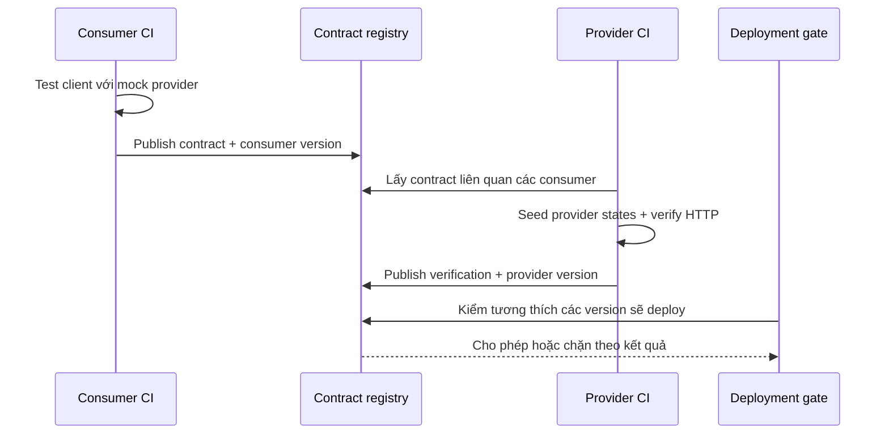

# Contract test giữa provider, consumer và OpenAPI

> **Chương:** Kiểm thử  
> **Module:** **INTEGRATION_API_REST** — thiết kế REST API theo resource, URI, phương thức và mã trạng thái HTTP, hợp đồng dữ liệu rõ ràng; học phân trang, cache, idempotency, OpenAPI, xác thực, phân quyền, xử lý lỗi và kiểm thử với Java/Spring hoặc công nghệ tương đương.
>
> **Ý chính:** Một endpoint trả HTTP `200` trong unit test chưa chứng minh client thật gọi được. **Contract test** kiểm các cam kết quan sát được qua HTTP giữa API cung cấp dịch vụ (**provider**) và ứng dụng sử dụng (**consumer**). **OpenAPI** là đặc tả chung, còn consumer contract ghi lại những hành vi consumer thực sự dựa vào. Provider phải kiểm chứng rằng phiên bản đang triển khai đáp ứng được những cam kết đó.

## 1. Vì sao cần contract test?

Giả sử `orders-api` cung cấp đơn hàng cho `storefront-web` và `billing-service`:

```http
GET /v1/orders/ord-1001 HTTP/1.1
Host: api.example.test
Authorization: Bearer <test-access-token>
Accept: application/json
```

Phản hồi mà consumer đã tích hợp:

```http
HTTP/1.1 200 OK
Content-Type: application/json
ETag: "order-1001-v3"

{
  "id": "ord-1001",
  "status": "PAID",
  "amountMinor": 12950,
  "currency": "USD",
  "createdAt": "2026-11-18T09:30:00Z"
}
```

Provider thay `amountMinor` thành `amount`, hoặc trả `status="SETTLED"` trong khi consumer chỉ hiểu `NEW`/`PAID`/`CANCELLED`. Provider có thể vẫn vượt qua các bài test của mình, nhưng `billing-service` có thể tính sai tiền hoặc vỡ khi deserialize.

Contract test giải quyết **sự lệch kỳ vọng** này. Người học cần đạt được các kết quả sau:

1. Phân biệt provider, consumer, OpenAPI specification, consumer-driven contract, contract artifact và provider verification.
2. Xác định phần nào của HTTP contract phải kiểm: method, path, query, headers, auth, status, content type, body schema, giá trị domain và lỗi.
3. Viết test consumer với mock provider có ràng buộc, test provider với Spring MVC và kết nối chúng bằng contract artifact có version.
4. Áp dụng compatibility gate khi thay schema/API, kể cả khi client và server được triển khai độc lập.
5. Giải thích giới hạn contract test và kết hợp đúng với unit, integration, security và end-to-end tests.

## 2. Thuật ngữ và ranh giới trách nhiệm

| Thuật ngữ | Trong ví dụ | Trách nhiệm |
|---|---|---|
| **Provider** | `orders-api` | Sở hữu implementation và công bố hành vi HTTP có thể sử dụng. |
| **Consumer** | `storefront-web`, `billing-service` | Gửi request và dựa vào một tập nhỏ hành vi từ provider. |
| **OpenAPI document** | `openapi.yaml` | Mô tả tài nguyên, operation, parameters, security schemes, status, schemas và examples. |
| **Consumer contract** | Pact interaction hoặc artifact tương đương | Ghi rõ một consumer cần gì và kỳ vọng gì trong một tình huống. |
| **Provider verification** | Test provider chạy trên contract | Chứng minh provider ở một revision cụ thể đáp ứng interaction đã công bố. |
| **Compatibility check** | Diff đặc tả hoặc verification của consumer đang dùng | Phát hiện thay đổi có thể phá ứng dụng khác trước khi triển khai. |
| **Contract broker/registry** | Pact Broker hoặc kho artifact có metadata | Lưu contract, consumer/provider versions, nhánh, môi trường và kết quả verify. |

**Provider không nhất thiết là một công ty bên ngoài.** Bất kỳ service nào expose API có consumer độc lập đều có ranh giới contract. Người dùng API qua browser cũng là consumer; tuy nhiên CORS/cookie/CSP thường cần test browser riêng vì OpenAPI schema không mô tả đầy đủ chính sách trình duyệt.

Một consumer có thể chỉ phụ thuộc vào `id`, `status` và `amountMinor`. Consumer khác có thể phụ thuộc `ETag`, phân trang hoặc mã lỗi `404`. Vì vậy:

- **OpenAPI** mô tả API *được công bố* và các khả năng mà provider hứa.
- **Consumer-driven contract (CDC)** mô tả *hành vi consumer thật sự cần* để hoạt động.
- **Provider verification** chạy các kỳ vọng đó trên provider ở một trạng thái dữ liệu có thể tái lập.
- **End-to-end test** xác minh luồng có nhiều thành phần thật; thường ít trường hợp hơn vì tốn kém và khó ổn định.

Một file OpenAPI chỉ nằm trong repository **chưa phải contract testing** nếu không có kiểm tra implementation hoặc hành vi consumer đối với nó.

### 2.1. Các loại hợp đồng cần phân biệt

**Wire contract:** method, URI, headers, status, encoding, media type, JSON shape.

**Schema contract:** trường nào bắt buộc, kiểu dữ liệu, format, enum, phạm vi giá trị, điều kiện nullable, unknown fields, cấu trúc phân trang.

**Semantic contract:** ý nghĩa của `status=PAID`, đơn vị `amountMinor`, ownership của đơn hàng, ý nghĩa `404`/`409`, idempotency và thời điểm request có tác dụng.

**Operational contract:** timeout, `429`, `Retry-After`, cache semantics, giới hạn kích thước, retry behavior, SLA; một số điều được mô tả trong OpenAPI, một số cần test resiliency/observability ngoài schema.

Contract test tập trung vào những gì consumer **quan sát và phụ thuộc**. Không khóa cứng các chi tiết triển khai như tên table, class controller, cấu trúc DB hoặc thứ tự trường JSON nếu consumer không cần.

## 3. Ba vai trò phối hợp như thế nào?



Một vòng thay đổi điển hình:

1. Consumer mô tả interaction quan trọng và chạy test trên mock provider. Test chứng minh **client gửi request đúng kỳ vọng và xử lý response hợp đồng**. Mock đã được lập trình để trả kết quả, nên bước này **không chứng minh provider thật đúng**.
2. Contract artifact được lưu kèm consumer name, version (thường là commit SHA), branch và metadata để tránh nhầm bản cũ.
3. Provider CI lấy những contract cần đáp ứng, chuẩn bị dữ liệu bằng **provider states**, chạy verification trên provider thực/test instance.
4. Registry lưu kết quả “provider revision P đã xác minh contract revision C”; deploy gate kiểm đúng cặp version và môi trường mục tiêu, tránh coi việc một phiên bản bất kỳ từng pass là đủ.
5. Provider và consumer triển khai theo thứ tự tương thích. Nếu consumer phụ thuộc field mới, provider thường được triển khai trước với field mới dạng backward-compatible; sau đó consumer mới dùng field đó.

**Quan trọng:** “Test của consumer pass” và “Provider verification pass” là hai bằng chứng khác nhau. Test xanh ở một phía không được dùng để thay kết quả của phía còn lại.

### 3.1. API-first và consumer-driven khác nhau thế nào?

Có hai chiều triển khai đều hợp lệ.

**API-first / schema-driven:**

```text
Thiết kế OpenAPI
    -> review và lint
    -> sinh client/server stub nếu cần
    -> implement
    -> validate provider request/response với OpenAPI
    -> consumer integration tests
```

**Consumer-driven:**

```text
Consumer viết interaction đang cần
    -> chạy mock provider & publish contract
    -> provider verify
    -> registry xác nhận các version tương thích
    -> deploy
```

Có thể dùng **cả hai**: OpenAPI là hợp đồng công khai rộng, consumer contract đo chính xác hành vi quan trọng theo từng consumer. Contract test không thay thế công việc thiết kế OpenAPI, còn OpenAPI lint/diff không chứng minh logic thực tế của provider.

## 4. Đặc tả OpenAPI mẫu: đơn hàng

Đây là ví dụ OpenAPI **3.1** cho `GET /v1/orders/{orderId}`. Mục tiêu là minh họa một hợp đồng có định nghĩa đủ rõ để test, không phải đặc tả production đầy đủ mọi operation.

```yaml
openapi: 3.1.0
info:
  title: Orders REST API
  version: 1.2.0
servers:
  - url: https://api.example.test

paths:
  /v1/orders/{orderId}:
    get:
      operationId: getOrder
      summary: Đọc đơn hàng thuộc quyền truy cập của caller
      description: >
        Yêu cầu quyền orders.read và quyền đọc object theo tenant/owner.
        amountMinor là đơn vị nhỏ nhất của currency; không phải số float.
      security:
        - bearerAuth: []
      parameters:
        - name: orderId
          in: path
          required: true
          schema:
            type: string
            pattern: "^ord-[0-9]+$"
      responses:
        "200":
          description: Đọc đơn hàng thành công
          headers:
            ETag:
              description: Entity tag cho conditional request
              schema:
                type: string
          content:
            application/json:
              schema:
                $ref: "#/components/schemas/Order"
              example:
                id: ord-1001
                status: PAID
                amountMinor: 12950
                currency: USD
                createdAt: "2026-11-18T09:30:00Z"
        "401":
          $ref: "#/components/responses/Unauthorized"
        "403":
          $ref: "#/components/responses/Forbidden"
        "404":
          $ref: "#/components/responses/NotFound"
        "429":
          $ref: "#/components/responses/RateLimited"

components:
  securitySchemes:
    bearerAuth:
      type: http
      scheme: bearer

  schemas:
    Order:
      type: object
      required: [id, status, amountMinor, currency, createdAt]
      properties:
        id:
          type: string
          pattern: "^ord-[0-9]+$"
        status:
          type: string
          enum: [NEW, PAID, CANCELLED]
        amountMinor:
          type: integer
          format: int64
          minimum: 0
        currency:
          type: string
          enum: [USD]
        createdAt:
          type: string
          format: date-time
      # Response có thể thêm property tương thích trong tương lai.
      additionalProperties: true

    Problem:
      type: object
      required: [type, title, status]
      properties:
        type:
          type: string
        title:
          type: string
        status:
          type: integer
        detail:
          type: string

  responses:
    Unauthorized:
      description: Thiếu hoặc token không hợp lệ
      headers:
        WWW-Authenticate:
          schema:
            type: string
      content:
        application/problem+json:
          schema:
            $ref: "#/components/schemas/Problem"
    Forbidden:
      description: Đã xác thực nhưng không được phép
      content:
        application/problem+json:
          schema:
            $ref: "#/components/schemas/Problem"
    NotFound:
      description: Không tìm thấy đơn hàng hoặc ẩn tài nguyên theo policy
      content:
        application/problem+json:
          schema:
            $ref: "#/components/schemas/Problem"
    RateLimited:
      description: Quá giới hạn gọi API
      headers:
        Retry-After:
          schema:
            type: string
      content:
        application/problem+json:
          schema:
            $ref: "#/components/schemas/Problem"
```

Những ràng buộc cần hiểu đúng:

- `operationId` giúp công cụ sinh client và định danh operation; đổi tên có thể làm **breaking change cho generated client** ngay cả khi HTTP path không đổi.
- `required` trong **response** yêu cầu provider trả đủ trường đó. `additionalProperties: true` cho phép thêm trường trong tương lai, nhưng consumer cũng phải có parser chịu được trường lạ.
- `amountMinor` là integer; consumer không được tự đoán đây là USD hay cent nếu hợp đồng không nói. Với từng currency, đơn vị nhỏ nhất được định nghĩa theo chính sách tiền tệ; không dùng `double` cho tiền bạc.
- `status` dùng enum đóng. Thêm `REFUNDED` vào response có thể làm client có switch exhaustive hoặc parser enum strict bị lỗi; **không tự coi thêm giá trị enum là backward-compatible**.
- `format: date-time` mô tả định dạng RFC 3339. Với OpenAPI 3.1/JSON Schema, kiểm `format` có thể là annotation nếu công cụ không bật assertion; phải xác minh behavior của validator.
- `bearerAuth` chỉ diễn tả cơ chế Bearer ở OpenAPI; kiểm issuer/audience/JWT signature/introspection, scope `orders.read` và owner/tenant phải do security implementation/test thực thi. Một số tổ chức dùng OAuth2 security scheme để khai báo scopes; chọn cách mô tả khớp kiến trúc thực.
- `ETag` có thể xuất hiện trên 200; nếu consumer dựa vào conditional request, cần thêm contract cho `If-None-Match` và `304 Not Modified`, cùng cache/security semantics.
- Header `Retry-After` là HTTP-date hoặc số giây. Contract phải nêu consumer xử lý cả hai định dạng nếu sử dụng, và giới hạn backoff.

### 4.1. Ví dụ lỗi vẫn thuộc contract

```http
GET /v1/orders/ord-9999 HTTP/1.1
Authorization: Bearer <test-access-token>
Accept: application/json
```

```http
HTTP/1.1 404 Not Found
Content-Type: application/problem+json
Cache-Control: no-store

{
  "type": "https://api.example.test/problems/order-not-found",
  "title": "Không tìm thấy đơn hàng",
  "status": 404
}
```

Nếu consumer dựa vào `404` để hiển thị “đơn hàng không tồn tại”, provider thay bằng `200` cùng `{"error":"not_found"}` là phá hợp đồng dù JSON vẫn hợp lệ. Nếu provider trả `401` cho mọi trường hợp không được phép, client có thể lặp lại đăng nhập dù token hợp lệ; phân biệt `401` (authentication) và `403` (authorization) trong hợp đồng và test.

Trong mô hình multitenant, server có thể trả `404` để tránh tiết lộ tồn tại object của tenant khác. Điều này phải là chính sách có chủ ý, được test nhất quán, không phải kết quả tùy hứng của controller.

## 5. Bắt đầu từ consumer: nó thật sự dựa vào những gì?

Giả sử `storefront-web` chỉ hiển thị ID, trạng thái, số tiền và thời điểm tạo. Consumer test phải chứng minh:

- Client gọi **đúng HTTP method/path/headers** và cách đưa access token.
- Client parse những trường bắt buộc theo hợp đồng, không tự đọc trường chưa được bảo đảm.
- Client xử lý `200`, `404`, `401` và `429` phù hợp.
- Client **không phụ thuộc** thứ tự key JSON hoặc những field không dùng.
- Client không giả định mọi 2xx đều mang cùng body, không nuốt lỗi thành một đơn hàng rỗng.

### 5.1. Java/Spring RestClient của consumer

Ví dụ Spring Framework 6.1+ với `RestClient`. Để ngắn gọn, Jackson/`Instant` được giả định đã cấu hình bởi ứng dụng Spring Boot có hỗ trợ Java Time. Trong một hệ khác, cấu hình serializer/deserializer tương ứng.

```java
package example.storefront.client;

import com.fasterxml.jackson.annotation.JsonIgnoreProperties;
import java.time.Instant;
import org.springframework.http.HttpHeaders;
import org.springframework.web.client.RestClient;

@JsonIgnoreProperties(ignoreUnknown = true)
record OrderView(
    String id,
    String status,
    Long amountMinor,
    String currency,
    Instant createdAt
) { }

public final class OrdersClient {
    private final RestClient http;

    public OrdersClient(RestClient http) {
        this.http = http;
    }

    public OrderView find(String id, String token) {
        OrderView result = http.get()
            .uri("/v1/orders/{id}", id)
            .headers(h -> h.setBearerAuth(token))
            .retrieve()
            .body(OrderView.class);

        if (result == null || !id.equals(result.id())
                || result.status() == null || result.status().isBlank()
                || result.amountMinor() == null || result.amountMinor() < 0
                || !"USD".equals(result.currency())
                || result.createdAt() == null) {
            throw new IllegalStateException("Invalid provider response");
        }
        return result;
    }
}
```

`OrderView` là cấu trúc consumer dùng. Trong production nên kiểm đầy đủ: `status` thuộc tập/chiến lược xử lý giá trị mới, `amountMinor >= 0`, `currency` hợp lệ, `createdAt` parse được và giới hạn response bytes. Ví dụ cho thấy **không thể mặc định provider response đáng tin** chỉ vì test hợp đồng xanh ở CI.

### 5.2. Test consumer không cần chạy provider thật

`MockRestServiceServer` của Spring Test có thể chặn request từ `RestClient` và trả response giả theo kỳ vọng:

```java
package example.storefront.client;

import static org.assertj.core.api.Assertions.assertThat;
import static org.junit.jupiter.api.Assertions.assertThrows;
import static org.springframework.test.web.client.match.MockRestRequestMatchers.*;
import static org.springframework.test.web.client.response.MockRestResponseCreators.*;

import org.junit.jupiter.api.Test;
import org.springframework.http.HttpHeaders;
import org.springframework.http.HttpMethod;
import org.springframework.http.HttpStatus;
import org.springframework.http.MediaType;
import org.springframework.test.web.client.MockRestServiceServer;
import org.springframework.web.client.HttpClientErrorException;
import org.springframework.web.client.RestClient;

class OrdersClientTest {

    @Test
    void sendsExpectedGetAndReadsDocumentedFields() {
        RestClient.Builder builder = RestClient.builder();
        MockRestServiceServer server =
            MockRestServiceServer.bindTo(builder).build();
        OrdersClient client = new OrdersClient(
            builder.baseUrl("https://api.example.test").build());

        server.expect(requestTo(
                "https://api.example.test/v1/orders/ord-1001"))
            .andExpect(method(HttpMethod.GET))
            .andExpect(header(
                HttpHeaders.AUTHORIZATION, "Bearer test-token"))
            .andRespond(withSuccess("""
                {
                  "id":"ord-1001",
                  "status":"PAID",
                  "amountMinor":12950,
                  "currency":"USD",
                  "createdAt":"2026-11-18T09:30:00Z",
                  "futureOptionalField":"ignored-by-consumer"
                }
                """, MediaType.APPLICATION_JSON));

        OrderView result = client.find("ord-1001", "test-token");
        assertThat(result.id()).isEqualTo("ord-1001");
        assertThat(result.status()).isEqualTo("PAID");
        assertThat(result.amountMinor()).isEqualTo(12950L);
        server.verify();
    }

    @Test
    void propagatesNotFoundWithoutPretendingSuccess() {
        RestClient.Builder builder = RestClient.builder();
        MockRestServiceServer server =
            MockRestServiceServer.bindTo(builder).build();
        OrdersClient client = new OrdersClient(
            builder.baseUrl("https://api.example.test").build());

        server.expect(requestTo(
                "https://api.example.test/v1/orders/ord-9999"))
            .andRespond(withStatus(HttpStatus.NOT_FOUND)
                .contentType(MediaType.valueOf("application/problem+json"))
                .body("""
                    {"type":"about:blank","title":"Not Found","status":404}
                    """));

        assertThrows(HttpClientErrorException.NotFound.class,
            () -> client.find("ord-9999", "test-token"));
        server.verify();
    }

    @Test
    void rejectsMissingRequiredAmountInsteadOfTreatingItAsZero() {
        RestClient.Builder builder = RestClient.builder();
        MockRestServiceServer server =
            MockRestServiceServer.bindTo(builder).build();
        OrdersClient client = new OrdersClient(
            builder.baseUrl("https://api.example.test").build());

        server.expect(requestTo(
                "https://api.example.test/v1/orders/ord-1001"))
            .andRespond(withSuccess("""
                {
                  "id":"ord-1001",
                  "status":"PAID",
                  "currency":"USD",
                  "createdAt":"2026-11-18T09:30:00Z"
                }
                """, MediaType.APPLICATION_JSON));

        assertThrows(IllegalStateException.class,
            () -> client.find("ord-1001", "test-token"));
        server.verify();
    }
}
```

**Ý nghĩa và giới hạn của test:**

- Đã kiểm đường request và cách consumer xử lý **một số** response đại diện.
- Test dùng response mà **chính consumer dựng**, nên provider vẫn có thể trả trường sai, status khác hoặc mất header mà test consumer vẫn xanh.
- `@JsonIgnoreProperties(ignoreUnknown = true)` trên `OrderView` cho phép bỏ qua `futureOptionalField` khi response được mở rộng. Nếu dùng mapper/SDK khác, phải kiểm riêng chính sách unknown properties. Không dựa vào “schema mở” nếu client không chịu trường lạ.
- `Long` cho `amountMinor` cho phép nhận biết field bị thiếu (`null`); nếu dùng primitive `long`, một số cấu hình deserializer có thể mặc định thành `0`, khiến response thiếu giá tiền trông giống giá bằng 0. Validation consumer phải chặn các field quan trọng bị thiếu hoặc sai kiểu.
- Lớp test này cần được nối với **contract artifact và provider verification**, hoặc được kết hợp với kiểm OpenAPI trên provider, để tạo bằng chứng hai phía.
- Trong thực tế, token test không được là credential production; test này không chứng minh OAuth/JWT verification đúng.

### 5.3. Consumer-driven contract bằng Pact: mô hình interaction

Với Pact, consumer test dùng Pact mock provider, khai báo interaction với **request matcher**, **response matcher** và **provider state**; sau đó framework sinh file contract phiên bản cụ thể. Một diễn tả *minh họa, không phải cú pháp Pact JSON chính thức*:

```yaml
consumer: storefront-web
provider: orders-api
given: "order ord-1001 exists and is visible to user-42"
uponReceiving: "GET an owned order"
request:
  method: GET
  path: /v1/orders/ord-1001
  headers:
    Authorization: "Bearer <test-token>"
response:
  status: 200
  headers:
    Content-Type: application/json
  body:
    id: ord-1001
    status: PAID
    amountMinor: 12950
    currency: USD
    createdAt: "2026-11-18T09:30:00Z"
matchers:
  id: "ord-[0-9]+"
  status: "enum NEW|PAID|CANCELLED"
  amountMinor: "integer >= 0"
```

Bản contract thật phải do Pact library sinh theo phiên bản Pact specification đang sử dụng; syntax ở trên chỉ giải thích các thành phần. Tránh dùng matcher **quá rộng** (“mọi string đều ổn”) khiến provider đổi `status` từ `PAID` sang `UNKNOWN` mà test vẫn pass. Ngược lại, tránh match cứng những dữ liệu không có ý nghĩa hợp đồng như timestamp chính xác nếu consumer chỉ yêu cầu “date-time hợp lệ”. Dùng matcher đúng mức độ: exact cho method/path/giá trị định danh cần tương quan, type/regex/format cho field có phép biến thiên.

**Provider state** là tiền điều kiện, ví dụ “ord-1001 tồn tại, thuộc tenant A và user-42”. Đây là **lệnh thiết lập fixture của provider trong môi trường test**, không phải endpoint công khai cho client production. Provider state có thể tạo record, fake downstream hoặc reset dữ liệu để verification deterministic.

Nếu nhiều consumer dùng provider, mỗi consumer xuất bản những interaction của mình. Provider cần verify các hợp đồng **còn liên quan tới các phiên bản consumer đang triển khai**, không chỉ contract mới nhất trên main branch.

## 6. Provider verification với Java/Spring

Ở phía `orders-api`, provider verification phải chứng minh endpoint thật đáp ứng các interaction. Có ba tầng kiểm tra cần kết hợp:

1. **Provider HTTP behavior:** test ứng dụng qua MockMvc/WebTestClient hoặc HTTP server với fixture, gồm filter/security/serialization tùy test scope.
2. **OpenAPI conformance:** dùng validator nhận OpenAPI và request/response thực để kiểm status, headers, media type, schema; không chỉ lặp lại assertion thủ công.
3. **Consumer contracts:** chạy verifier Pact/Spring Cloud Contract hoặc framework tương đương trên provider states; ghi kết quả theo provider version.

### 6.1. Ví dụ MockMvc kiểm response và quyền truy cập

Giả định có `orders-api` dùng Spring Boot 3, Spring Security, Spring MVC. Mẫu sau giả định database test được seed với `ord-1001` thuộc subject `user-42`. Tên file fixture là ví dụ cần tạo khi đưa vào project; không có file fixture trong bài này.

```java
package example.orders.contract;

import static org.springframework.security.test.web.servlet.request.SecurityMockMvcRequestPostProcessors.jwt;
import static org.springframework.test.web.servlet.request
    .MockMvcRequestBuilders.get;
import static org.springframework.test.web.servlet.result
    .MockMvcResultMatchers.*;

import org.junit.jupiter.api.Test;
import org.springframework.beans.factory.annotation.Autowired;
import org.springframework.boot.test.autoconfigure.web.servlet.AutoConfigureMockMvc;
import org.springframework.boot.test.context.SpringBootTest;
import org.springframework.http.HttpHeaders;
import org.springframework.http.MediaType;
import org.springframework.security.core.authority.SimpleGrantedAuthority;
import org.springframework.test.context.jdbc.Sql;
import org.springframework.test.web.servlet.MockMvc;

@SpringBootTest
@AutoConfigureMockMvc
class GetOrderProviderTest {

    @Autowired MockMvc mvc;

    @Test
    @Sql("/fixtures/owned-order.sql")
    void readsOwnOrderUsingPublishedContract() throws Exception {
        mvc.perform(get("/v1/orders/ord-1001")
                .with(jwt()
                    .jwt(j -> j.subject("user-42"))
                    .authorities(new SimpleGrantedAuthority(
                        "SCOPE_orders.read"))))
            .andExpect(status().isOk())
            .andExpect(content().contentTypeCompatibleWith(
                MediaType.APPLICATION_JSON))
            .andExpect(header().exists(HttpHeaders.ETAG))
            .andExpect(jsonPath("$.id").value("ord-1001"))
            .andExpect(jsonPath("$.status").value("PAID"))
            .andExpect(jsonPath("$.amountMinor").value(12950))
            .andExpect(jsonPath("$.currency").value("USD"))
            .andExpect(jsonPath("$.createdAt").exists());
    }

    @Test
    @Sql("/fixtures/owned-order.sql")
    void deniesReadingOrderWithoutScope() throws Exception {
        mvc.perform(get("/v1/orders/ord-1001")
                .with(jwt()
                    .jwt(j -> j.subject("user-42"))
                    .authorities()))
            .andExpect(status().isForbidden());
    }

    @Test
    @Sql("/fixtures/owned-order.sql")
    void hidesOtherTenantOrder() throws Exception {
        mvc.perform(get("/v1/orders/ord-1001")
                .with(jwt()
                    .jwt(j -> j.subject("user-from-other-tenant"))
                    .authorities(new SimpleGrantedAuthority(
                        "SCOPE_orders.read"))))
            // Chính sách ví dụ: không tiết lộ sự tồn tại đơn hàng.
            .andExpect(status().isNotFound());
    }
}
```

Ở test thứ hai, `jwt()` mặc định có thể bổ sung authority từ test claims, nên chỉ định danh sách authority rỗng để kiểm “thiếu scope” chắc chắn:

```java
.with(jwt()
    .jwt(j -> j.subject("user-42"))
    .authorities())
```

Một integration test phải có fixture thật, resource authorization thực, và cấu hình HTTP response của provider. Nếu controller đang trả sai `Content-Type` hoặc thiếu `ETag` mà contract có yêu cầu ETag, test phải thất bại.

**Điều quan trọng:** `with(jwt())` của `spring-security-test` giả lập Authentication; nó **không kiểm chữ ký JWT, JWKS hay audience thật**. Các yêu cầu bảo mật token phải được kiểm bằng integration test đưa Bearer token thực qua `JwtDecoder`/introspection hoặc test security riêng. Provider verification cũng phải kiểm owner/tenant theo dữ liệu thật, không mặc định `scope` đủ quyền trên mọi object.

### 6.2. Kiểm schema không trùng với một vài jsonPath assertion

MockMvc `jsonPath("$.id")` xác nhận một field của một response. Nó không tự kiểm:

- Tất cả trường trong `required` có mặt ở nhiều trường hợp.
- `amountMinor` luôn là integer không âm và không có lỗi overflow.
- `createdAt` tuân thủ date-time được validator cấu hình.
- Response `401`/`404`/`429` có `application/problem+json`.
- Các media type, status, header, request parameter được mô tả trong OpenAPI.
- Những path/operation khác cũng phù hợp đặc tả.

Hãy thêm bước **OpenAPI request/response validation** sử dụng validator tương thích phiên bản OpenAPI đã chọn (3.0 và 3.1 khác khả năng JSON Schema), chạy trên response thật ở test hoặc môi trường staging. Khi validator không thực thi `format` hoặc business constraint, viết assertion bổ sung. Không coi test generated stub thành provider behavior test: stub mô phỏng hợp đồng, còn test phải gọi implementation thực.

### 6.3. Provider states và kiểm đa consumer

Một provider state handler nên:

- Có tên rõ ràng và trạng thái tái lập (`"order ord-1001 exists for user-42"`, `"order does not exist"`).
- Chuẩn bị DB/test repository hoặc stub những dịch vụ ngoài cần thiết, **không thay thế chính endpoint đang được verify**.
- Cách ly giữa các test để tránh test pass/fail theo thứ tự chạy.
- Đặt clock cố định khi cần xét `createdAt`, `ETag`, token expiry hoặc idempotency TTL.
- Không gán token/quyền “admin cho tất cả” nếu interaction đang kiểm chính sách user.
- Làm sạch dữ liệu nhạy cảm, không đưa access token production vào contract artifact.

Nếu Pact verifier thực thi `GET /v1/orders/ord-1001`, nó phải nhận response từ ứng dụng provider ở trạng thái tương ứng. Verification pass được gắn với **provider version/commit** và contract version cụ thể. Nếu provider thay đổi code sau khi verify, kết quả cũ không còn chứng minh revision mới tương thích.

## 7. Kiểm HTTP contract sâu hơn JSON schema

### 7.1. URI, query và pagination

Ví dụ `GET /v1/orders?limit=20&cursor=...`. Contract phải nêu:

| Cam kết | Ví dụ cần test |
|---|---|
| URI/resource | `GET /v1/orders` là collection, `/v1/orders/{id}` là một resource. |
| Query params | `limit` default/max, `cursor` optional, filter/sort được allowlist. |
| Page envelope | `items[]`, `nextCursor`, có hoặc không có `total` theo contract. |
| Thứ tự | Sort ổn định và tie-breaker, không giả định thứ tự nếu API không hứa. |
| Cursor | Cursor của tenant/filter khác bị từ chối; không chứa dữ liệu nhạy cảm. |
| Không có dữ liệu | `200` với `items: []` hay `204`? Phải định nghĩa một cách và kiểm đúng. |

Contract test có thể dùng matcher để xem `nextCursor` là string/nullable hợp lệ; **tính ổn định của phân trang khi dữ liệu thay đổi** cần integration test DB hoặc scenario test nhiều request, vì một snapshot body đơn lẻ không chứng minh được.

### 7.2. Status và Problem Details

| Tình huống | HTTP status thường hợp lý | Điều cần kiểm |
|---|---|---|
| Đọc dữ liệu thành công | `200 OK` | Media type, body, cache headers nếu có. |
| Tạo resource | `201 Created` | `Location`, body ID, authorization và trạng thái lưu. |
| Chấp nhận job dài | `202 Accepted` | Job ID/status URL; chưa báo đã hoàn thành. |
| Xóa/cập nhật không trả body | `204 No Content` | Body rỗng thật, không có JSON `null` ngầm. |
| Thiếu/sai credential | `401 Unauthorized` | `WWW-Authenticate` đúng; không lộ token. |
| Có credential nhưng thiếu quyền | `403 Forbidden` | Không rò dữ liệu; phân biệt với 401. |
| Resource không tồn tại/ẩn | `404 Not Found` | Chính sách owner/tenant nhất quán. |
| ETag/phiên bản conflict | `409 Conflict` / `412 Precondition Failed` tùy trường hợp | Điều kiện cạnh tranh và version rõ. |
| Vượt quota | `429 Too Many Requests` | `Retry-After` nếu hứa; client backoff. |
| Phụ thuộc upstream lỗi | `502`/`503`/`504` tùy vai trò | Phân loại lỗi, không giả là 200. |

`application/problem+json` theo RFC 9457 là một cách biểu diễn lỗi. Không đưa stack trace, SQL, bearer token hoặc internal user IDs nhạy cảm vào `detail`. Nếu consumer phụ thuộc `type` cụ thể, đó là phần contract cần kiểm; thông điệp `title` có thể localization, tránh khóa cứng nếu consumer chỉ hiển thị.

### 7.3. Security contract và đối tượng tài nguyên

OpenAPI `security: bearerAuth` chỉ cho biết header/token scheme. Các cam kết như scope `orders.read`, tenant isolation, owner check, token audience/issuer và cấu hình public endpoint là **semantics phải test**.

Một consumer contract cho “GET đơn hàng thành công” không được phép sử dụng token có quyền admin giả chỉ để qua test rồi suy ra user thường cũng dùng được. Tối thiểu kiểm:

- **Unauthenticated:** thiếu/sai Bearer -> 401.
- **Authenticated, missing scope:** -> 403.
- **Correct scope, wrong object owner/tenant:** -> 403 hoặc 404 theo policy.
- **Correct scope + owner:** -> 200 đúng schema.
- **Wrong JWT audience/issuer, expired token:** -> 401 qua decoder thật ở lớp integration security.
- **Token chưa được phép đọc dữ liệu nhạy cảm:** không lộ trường/attachment của tenant khác.

**Không đưa raw access token thực vào Pact artifact**; có thể match header dạng `Bearer .+` ở test và dùng credential fixture. Đừng dùng regex bearer token như một hệ thống authentication thay cho verify thật.

### 7.4. Caching, conditional requests và idempotency

Một consumer dựa vào `ETag` cần các scenario:

```http
GET /v1/orders/ord-1001 HTTP/1.1
If-None-Match: "order-1001-v3"
Authorization: Bearer <test-access-token>
```

Khi chưa thay đổi, provider có thể trả:

```http
HTTP/1.1 304 Not Modified
ETag: "order-1001-v3"
```

Test phải kiểm cache policy, ETag có thay khi representation thay và authorization vẫn áp dụng; chỉ test response 200 không đủ chứng minh conditional semantics. Không cache response riêng tư theo khóa thiếu tenant/user.

Với `POST /v1/orders` có `Idempotency-Key`, contract cần nêu:

1. Request đầu tiên tạo đơn, ví dụ `201 Created` và `Location`.
2. Retry cùng key/cùng fingerprint không tạo đơn thứ hai, trả cùng kết quả theo policy.
3. Cùng key/payload khác dẫn tới `409 Conflict` hoặc lỗi đã công bố.
4. Hai request đồng thời và retry sau timeout cần kiểm với DB/transaction thật; **contract snapshot không thể chứng minh side effect chỉ xảy ra đúng một lần**.

Contract giúp consumer biết **cách gọi và đọc kết quả**; integration/concurrency tests chứng minh tính đúng của transaction và state.

### 7.5. Header và content negotiation

`Accept: application/json`, `Content-Type: application/json` và `application/problem+json` có vai trò khác nhau. Provider có thể trả `406 Not Acceptable` hoặc `415 Unsupported Media Type` theo hợp đồng. Test truyền header thật để tránh MVC mặc định chọn một format khác.

Response header `ETag`, `Location`, `Retry-After`, `Cache-Control`, `Link` có thể quan trọng ngang body. Với browser consumer, `Access-Control-Expose-Headers` có thể cần nếu JavaScript phải đọc header không được expose mặc định; CORS/preflight/cookie/CSP cần test trong browser vì contract HTTP ở server chưa chứng minh browser được phép đọc response.

## 8. Tương thích ngược: thay đổi nào gây vỡ hợp đồng?

Không dựa hoàn toàn vào số version `1.2.3` hoặc việc build thành công. Đánh giá thay đổi theo **hướng dữ liệu** và **consumer đang sử dụng**.

| Thay đổi ở provider/OpenAPI | Tác động thường gặp | Gợi ý |
|---|---|---|
| Thêm field response optional | Thường tương thích nếu consumer bỏ qua unknown fields. | Kiểm parser strict, generated client, `additionalProperties`. |
| Xóa/đổi tên field response đang dùng | **Breaking** cho consumer phụ thuộc field. | Giữ field cũ trong giai đoạn chuyển tiếp; contract verification. |
| Đổi `amountMinor` integer sang string hoặc float | **Breaking** về kiểu và semantics tiền. | Thêm field mới, migration rõ, deprecate field cũ. |
| Thêm giá trị enum response `REFUNDED` | Có thể breaking với parser/switch exhaustive. | Có unknown fallback hoặc version strategy, kiểm consumer cụ thể. |
| Thêm required request body field | **Breaking** cho client cũ chưa gửi field. | Cho optional/default trước, migrate consumer rồi mới siết khi an toàn. |
| Thêm optional request field | Thường tương thích nếu provider vẫn chấp nhận request cũ. | Đặt default và bảo đảm validation trước đó không đổi. |
| Thu hẹp giá trị request được chấp nhận | Breaking cho client gửi giá trị từng hợp lệ. | Contract test các request biên. |
| Thêm request value hợp lệ | Thường tương thích với client cũ; provider mở rộng behavior. | Không thay semantics cũ. |
| Đổi endpoint/path/method/status/media type | Thường breaking. | Hỗ trợ song song, deprecation/alias có thời hạn. |
| Đổi error `type` hoặc status | Breaking nếu consumer rẽ nhánh theo mã lỗi. | Version/chuyển tiếp, contract tests negative. |
| Đổi security requirements, scope, tenant policy | Có thể breaking và tác động an toàn. | Review security, kiểm quyền ở cả hai chiều. |
| Xóa header `Location`/`ETag` đang được dùng | Breaking cho client tạo resource/caching. | Test headers như first-class contract. |
| Đổi `operationId` | Không đổi HTTP nhưng có thể breaking với generated SDK. | Kiểm sinh SDK và consumer CI. |

**OpenAPI diff là bộ lọc ban đầu, không phải phán quyết cuối.** Một số công cụ phân loại “thêm enum response” là compatible hoặc incompatible tùy cấu hình; cần áp chính sách theo các consumer thực. Tương tự, “thêm required field vào response” có thể không phá consumer cũ nếu parser chịu trường mới, nhưng buộc provider bản mới phải **luôn** trả trường đó và có thể phá các client strict.

### 8.1. Tolerant reader và strong contract

Consumer nên đọc chính xác các trường cần thiết và bỏ qua trường response mới không liên quan; nhưng không được âm thầm nuốt thiếu field quan trọng hoặc đổi kiểu:

- **Tolerant:** bỏ qua `discountDescription` mới khi UI không dùng.
- **Strict:** từ chối `amountMinor="12950"` vì kiểu bị đổi, trừ khi contract cho phép rõ.
- **Explicit fallback:** khi `status` có giá trị mới, hiển thị “Trạng thái chưa hỗ trợ” và báo telemetry hoặc cập nhật client theo policy; không mặc định coi là `PAID`.
- **Conservative security:** không suy luận quyền/tenant từ field chưa được xác minh.

Không nên đặt `additionalProperties: false` trên mọi response chỉ để “siết chặt”, nếu mục tiêu là mở rộng response không phá consumer. Tuy vậy, request body có thể chọn policy strict để từ chối đầu vào lạ gây sai nghiệp vụ.

### 8.2. Trình tự triển khai an toàn

Thường dùng **expand → migrate → contract**:

1. **Expand provider:** giữ behavior cũ, bổ sung field/endpoint mới tương thích; verify contracts của consumer đang dùng.
2. **Migrate consumer:** các consumer chuyển sang dùng tính năng mới và phát hành contract version mới; xác nhận version tương thích ở môi trường đích.
3. **Contract/cleanup:** chỉ xóa đường cũ khi không còn consumer đang triển khai phụ thuộc nó, đã qua thời hạn deprecation và có bằng chứng registry/telemetry phù hợp.

Đừng xóa field ngay khi consumer trên main branch đã sửa. Có thể vẫn còn bản mobile app, worker hoặc service cũ trong production đang chạy.

## 9. Đưa contract test vào CI/CD

Một pipeline tốt phản hồi nhanh ở PR, còn bằng chứng deploy phải khớp **version của cả provider và consumer**.

### 9.1. Consumer pull request

```text
Change client code
 -> Unit tests & consumer tests against contract mock
 -> Build contract artifact (Pact or equivalent)
 -> Publish with consumer + commit SHA + branch
 -> Verify against candidate/provider version (khi có)
 -> Check deployment compatibility before release
```

Nếu consumer thêm expectation mới, ví dụ `GET` cần field `settledAt`, consumer mock test có thể xanh; provider verification sẽ đỏ cho đến khi provider thực hiện field đó. Đây là tín hiệu hợp tác thiết kế, không phải lý do tắt provider verification.

### 9.2. Provider pull request

```text
Change implementation and/or OpenAPI
 -> Lint/bundle OpenAPI and resolve $ref
 -> Breaking-change diff against released baseline
 -> Provider HTTP tests, schema validation, auth/security tests
 -> Fetch relevant consumer contracts
 -> Set provider states and verify interactions
 -> Publish verification with provider commit/version
 -> Deployment compatibility gate for target environment
```

Cấu hình contract registry có thể cung cấp thao tác kiểu `can-i-deploy` hoặc tương đương. Một kiểm tra có ý nghĩa phải xét cặp version ở **môi trường đích**, kể cả các consumer đang chạy ngoài main branch. Nếu không có broker, có thể lưu artifact theo immutable version và dựng ma trận tương thích trong CI, nhưng phải quản lý version/verification result cẩn thận.

**Không** publish “provider verified” khi verifier chỉ chạy trên stub hoặc chỉ kiểm file OpenAPI. Verification cần gắn tới provider code/test deployment đang xét.

### 9.3. Ma trận compatibility để ra quyết định

| Consumer version đang chạy | Provider version dự kiến | Kết quả verification | Triển khai provider mới? |
|---|---|---|---|
| `storefront@a1` | `orders@p8` | Pass | Có, xét thêm các gate khác. |
| `billing@b3` | `orders@p8` | Pass | Có, xét thêm các gate khác. |
| `mobile@c2` | `orders@p8` | Fail vì thiếu `amountMinor` | Chặn hoặc giữ behavior cũ. |
| `billing@b4` (chưa deploy) | `orders@p8` | Unknown, chưa verify | Chưa đủ bằng chứng để kết luận tương thích. |

Bảng minh họa cho thấy không được chỉ xem “provider CI xanh” mà bỏ qua một consumer version vẫn đang dùng. Một tiêu chí an toàn là: **mọi consumer version còn hoạt động và thuộc phạm vi tương tác phải có bằng chứng tương thích với provider version chuẩn bị deploy**, hoặc có quyết định rủi ro được quản lý rõ.

### 9.4. Chiến lược giảm flaky tests

- Provider states dùng dữ liệu tách biệt, thời gian cố định và cleanup; không phụ thuộc ngày hiện tại.
- Consumer contract không match timestamp/ID ngẫu nhiên quá chính xác nếu không cần.
- Stub các downstream **không thuộc contract đang kiểm**, tránh gọi sandbox lúc được lúc không.
- Test ở application boundary thật (controller, filter, serializer) để bắt status/header/JSON, nhưng tránh dùng production DB không kiểm soát.
- Chạy cùng version serializer/schema validator ở CI và staging; kiểm khác biệt OpenAPI 3.0/3.1, JSON Schema `format`, `nullable`.
- Mỗi contract artifact và verification result phải immutable và truy được version, tránh ghi đè khiến kết quả test xanh nhưng dựa vào artifact khác.

## 10. Test matrix từ một interaction đơn giản

Một test duy nhất `GET 200` chưa đủ. Ma trận sau tách “contract” khỏi kiểm integration/security sâu hơn:

| Tình huống | Tầng kiểm ưu tiên | Kỳ vọng |
|---|---|---|
| GET đơn hàng có quyền | CDC + provider verification + OpenAPI | `200`, JSON đúng fields/type, header cần thiết. |
| GET ID không tồn tại | CDC + provider verification | `404` với Problem Details. |
| Thiếu access token | Provider HTTP/security test | `401` + Bearer challenge. |
| Có token, thiếu `orders.read` | Provider authz test | `403` và không lộ order. |
| Đơn hàng tenant khác | Provider business/security test | `403`/`404` theo policy. |
| JWT sai chữ ký/issuer/audience, hết hạn | Security integration test | `401` qua decoder thật. |
| Trả sai `Content-Type` hoặc thiếu `amountMinor` | OpenAPI response validation | Phát hiện mismatch. |
| Provider thêm field optional mới | Consumer parser test + CDC | Consumer vẫn hoạt động nếu contract cho phép. |
| Provider thêm enum response mới | Consumer behavior test | Fallback rõ hoặc cảnh báo compatibility. |
| `If-None-Match` hợp lệ | Provider cache/HTTP integration test | `304` đúng ETag/policy. |
| POST trùng Idempotency-Key cùng payload | Integration/concurrency test | Không tạo side effect lặp, status theo contract. |
| `429` có `Retry-After` | CDC + client retry test | Backoff bounded, không tạo retry storm. |
| `202` tạo job | Contract + job lifecycle test | URL trạng thái hợp lệ; state chuyển đúng. |
| Browser cross-origin | Browser E2E | CORS/cookie/CSRF hoạt động; JS đọc response. |
| Provider timeout/`503` | Consumer resilience test | Không coi lỗi mạng là đơn hàng rỗng, retry có giới hạn. |

Nhiều test có thể được tạo từ OpenAPI hoặc contract DSL, nhưng cần **test thủ công có chủ đích** cho security, concurrency, authorization object, nghiệp vụ và sự cố hạ tầng. Hợp đồng chỉ ghi những gì tool có thể quan sát; mức bảo đảm không nên vượt quá bằng chứng.

### 10.1. Negative cases là phần của hợp đồng

Consumer thường chỉ viết interaction “đơn hàng tồn tại -> 200”, rồi provider thay cách xử lý `404`/`409` mà không bị phát hiện. Với API quan trọng, thêm interaction:

- `given("order does not exist")` -> `404 application/problem+json`.
- `given("order belongs to another tenant")` -> `404` hoặc `403` theo policy.
- `given("rate limit exceeded")` -> `429`, `Retry-After`.
- `given("order just updated")` -> `200` với ETag mới.
- `given("idempotent POST already processed")` -> response được replay theo contract.

Không thêm mọi exception nội bộ vào consumer contract; chọn các tình huống mà client **cần phân biệt để quyết định hành động**.

### 10.2. Phát hiện test xanh giả

Các nguyên nhân phổ biến:

1. **Mock trả đúng kỳ vọng do test tự tạo, provider chưa verify:** bổ sung provider verification và deploy gate.
2. **Match quá lỏng:** regex `.*` cho toàn bộ body hoặc chỉ kiểm HTTP 200; thêm type, required fields, domain boundary và status.
3. **Match quá chặt:** khóa thứ tự JSON fields, timestamp ngẫu nhiên hoặc id không ảnh hưởng consumer; dùng matcher có chủ đích.
4. **Provider tests chỉ mock controller/service:** không kiểm serializer, error handler, security filter, header; chạy lớp HTTP thật.
5. **Chỉ kiểm OpenAPI schema:** logic hoàn tiền, owner/tenant, idempotency vẫn sai; bổ sung domain/security/integration tests.
6. **Chạy trên một contract cũ:** publish/verify theo immutable version, đọc consumer versions ở môi trường đích.
7. **Dùng provider state có quyền admin toàn cục:** test bỏ qua authorization cho user bình thường; fixture đại diện quyền thật.
8. **Generated SDK build pass nhưng wire behavior thay:** chạy consumer tests với HTTP stub theo contract và provider verification.
9. **HTTP response đổi status nhưng body vẫn tương tự:** status là phần của contract; so đầy đủ status/content type.
10. **Provider chỉ trả header CORS ở 200:** browser đọc lỗi không được; cần browser test và CORS policy trên response lỗi.

## 11. Kịch bản thực hành với Spring và OpenAPI

### Bài 1 — Viết contract trước khi triển khai

`storefront-web` cần xem đơn hàng với `id`, `status`, `amountMinor` và `createdAt`. Hãy viết OpenAPI cho `GET /v1/orders/{id}`, bao gồm security, `200`, `401`, `403`, `404`, Problem Details và ví dụ JSON. Sau đó viết consumer interaction mô tả request với Bearer token và response 200. Quyết định field nào **exact** và field nào **type/regex/format matcher**.

**Tiêu chí:** Contract thể hiện đúng URL, method, auth scheme, required fields, money unit, error behavior; không đưa secret thực vào artifact.

### Bài 2 — Đưa hai bên vào cùng vòng kiểm

Viết `OrdersClient` sử dụng `RestClient` và test `MockRestServiceServer` cho 200/404/429. Tạo provider state “ord-1001 thuộc user-42”; provider MockMvc test trả 200 với JSON đúng. Nối consumer contract (Pact hoặc công cụ tương đương) để provider verify và xuất bản kết quả theo commit SHA.

**Tiêu chí:** Nếu provider đổi `amountMinor` sang `amount` hoặc đổi 404 thành 200, ít nhất một contract verification/consumer test fail trước triển khai; kết quả hiển thị đúng cặp version.

### Bài 3 — Đánh giá breaking changes

Provider dự kiến:

- Thêm `discountLabel` optional.
- Thêm `REFUNDED` vào `status`.
- Đổi `amountMinor` từ integer sang string.
- Bổ sung required field `locale` cho request tạo đơn hàng.
- Đổi `operationId` từ `getOrder` thành `fetchOrder`.

Hãy đánh giá từng thay đổi với `storefront-web`, `billing-service` và generated SDK. Nêu khi nào có thể tương thích, khi nào cần expand/migrate/contract, và test nào sẽ phát hiện.

**Tiêu chí:** Phân biệt chiều request/response, enum response và ảnh hưởng generated code; không kết luận từ mỗi nhãn “optional/required”.

### Bài 4 — Hợp đồng lỗi và phân quyền

Bổ sung provider verification cho: missing token -> 401; correct token thiếu scope -> 403; token đủ scope nhưng order thuộc tenant khác -> 404 theo chính sách. Chạy một test JWT thật qua decoder để đảm bảo issuer/audience và một test dùng `with(jwt())` chỉ tập trung policy. Mô tả khác biệt bằng chứng giữa hai test.

**Tiêu chí:** Không trả dữ liệu cho tenant khác, test có fixture cố định và không dùng quyền admin để “cho qua”.

### Bài 5 — Thiết kế CI/CD tương thích

Giả sử production đang chạy `storefront@a1`, `billing@b3` và `orders@p7`. Nhánh provider `p8` xóa `amountMinor`; consumer `billing@b3` vẫn dùng trường này. Vẽ pipeline publish contract, provider verification, deploy gate; xác định bước chặn. Đề xuất kế hoạch thay đổi có giai đoạn và chỉ xóa field khi nào.

**Tiêu chí:** Bảo vệ consumer đang **được triển khai**, không chỉ main; contract artifact/version/verification phải truy vết được.

### Câu hỏi tự kiểm tra

1. OpenAPI lint pass có chứng minh provider trả body hợp đồng không?
2. Vì sao consumer test với mock provider có thể pass trong khi provider thật sai?
3. Provider state làm gì? Nó có phải endpoint cho public client không?
4. Tại sao `with(jwt())` trong MockMvc chưa chứng minh chữ ký JWT được kiểm đúng?
5. Thêm enum value vào response có luôn backward-compatible không?
6. Thêm required field vào request gây vấn đề gì cho client phiên bản cũ?
7. Vì sao không nên match chính xác mọi timestamp/ID trong consumer contract?
8. API đổi `404` thành `200` với body `{"error":"not_found"}` ảnh hưởng consumer ra sao?
9. Tại sao kết quả verification phải gắn với consumer/provider version cụ thể?
10. Contract test có thay security integration, DB transaction test và browser E2E không?

## 12. Checklist áp dụng trước khi merge và deploy

- [ ] Có OpenAPI được review, lint và kiểm breaking changes so với baseline đã phát hành.
- [ ] Mỗi interaction có provider, consumer, method, path/query, headers, status, media type và body expectation được xác định.
- [ ] Consumer test chứng minh **client gửi request và xử lý response**; contract artifact được sinh/publish từ test.
- [ ] Provider verification chạy trên **implementation** với provider states tái lập, không chỉ trên stub.
- [ ] Mọi contract và verification result có version/commit/branch/environment rõ ràng.
- [ ] Có test cho response 200 và các lỗi consumer phụ thuộc, đặc biệt `401`/`403`/`404`/`409`/`429`.
- [ ] Có validator OpenAPI phù hợp phiên bản schema, bao gồm headers/content type/required fields.
- [ ] Kiểm money unit, date-time, enum evolution, nullability và fields người dùng thực sự phụ thuộc.
- [ ] Có security integration tests cho token thật, scope và object-level authorization.
- [ ] Có integration/concurrency tests cho pagination, ETag, idempotency và job lifecycle nếu API có các tính năng đó.
- [ ] Generated client và consumer parsers xử lý unknown response fields/enum theo chiến lược đã thống nhất.
- [ ] Deploy gate xét **consumer versions đang chạy** và provider version dự kiến, tránh dùng kết quả verify cũ.
- [ ] Dữ liệu test/contract/log không chứa bearer token, refresh token, PII hoặc secret production.
- [ ] Đã có kế hoạch expand/migrate/contract cho thay đổi không tương thích.

## 13. Ghi nhớ và tài liệu tham khảo

**Contract test** bảo vệ thỏa thuận giữa các thành phần triển khai độc lập. OpenAPI giúp mô tả bề mặt API có cấu trúc; consumer contract thể hiện các kỳ vọng thực sự của consumer; provider verification nối hai bên bằng hành vi HTTP của implementation. Mỗi công cụ chỉ bảo đảm đúng phần nó kiểm được, vì vậy phải kết hợp với security, domain, resilience và end-to-end testing theo rủi ro.

Tài liệu để thực hành:

- [OpenAPI Specification](https://spec.openapis.org/oas/latest.html) — operations, parameters, media types, security schemes, schemas, versions.
- [JSON Schema](https://json-schema.org/specification) — kiểu, required, constraints và hành vi của `format`.
- [Pact Documentation](https://docs.pact.io/) — consumer-driven contracts, broker, provider verification và deployment checks.
- [Spring Cloud Contract](https://docs.spring.io/spring-cloud-contract/reference/) — contract DSL, stub và verification cho Java/Spring.
- [Spring Framework: MockMvc](https://docs.spring.io/spring-framework/reference/testing/spring-mvc-test-framework.html) — test HTTP Spring MVC.
- [Spring Framework: REST Clients](https://docs.spring.io/spring-framework/reference/integration/rest-clients.html) — `RestClient` và test client.
- [Spring Security Testing](https://docs.spring.io/spring-security/reference/servlet/test/index.html) — test filter chain và mock authentication.
- [RFC 9110 — HTTP Semantics](https://www.rfc-editor.org/rfc/rfc9110) — status, methods, conditional requests và headers.
- [RFC 9457 — Problem Details for HTTP APIs](https://www.rfc-editor.org/rfc/rfc9457) — định dạng thông tin lỗi.
