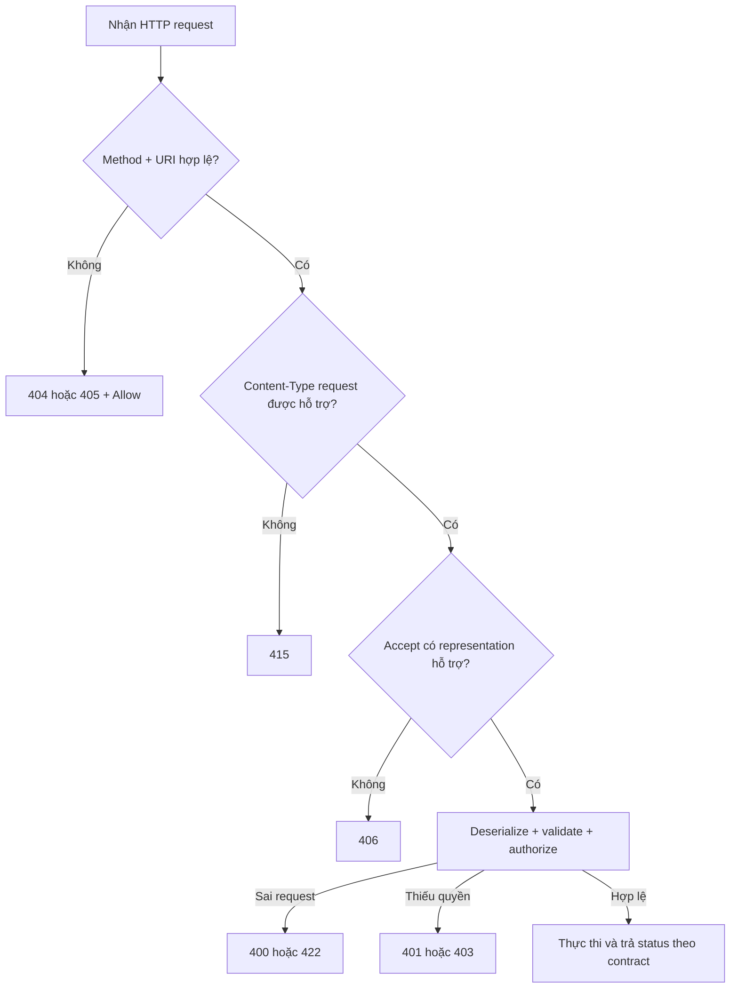

# Kiểm tra phương thức, status, header và media type trong REST API

Một endpoint REST có thể trả JSON chứa đúng dữ liệu nhưng vẫn vi phạm hợp đồng HTTP: `POST` trả `200 OK` thay vì `201 Created` dù đã tạo resource; `DELETE` trả `204 No Content` nhưng lại gửi body; `PATCH` chấp nhận sai media type; API trả `401` nhưng thiếu `WWW-Authenticate`; hoặc frontend không đọc được `Location` qua CORS. Những sai lệch này ảnh hưởng client, cache, retry, bảo mật và khả năng tích hợp dù unit test của service vẫn xanh.

Bài học thuộc chương **Kiểm thử** của module `INTEGRATION_API_REST`, nơi người học thực hành thiết kế REST theo resource/URI, HTTP method/status, phân trang, cache, idempotency, OpenAPI, xác thực và phân quyền bằng Java/Spring hoặc công nghệ tương đương. Mục tiêu là biến **hợp đồng HTTP quan sát được từ bên ngoài** thành những kiểm thử có thể lặp lại: request đi đúng phương thức, response có đúng mã trạng thái, header quan trọng và media type, cả ở đường thành công lẫn đường lỗi.

Ví dụ xuyên suốt là `orders-api` với `GET /v1/orders/{id}`, `POST /v1/orders`, `PATCH /v1/orders/{id}` và `DELETE /v1/orders/{id}`. API dùng JSON, Bearer access token, `ETag` cho cập nhật có điều kiện và `application/problem+json` cho lỗi. Các đoạn code là mẫu thiết kế/test; khi tích hợp vào dự án, cần nối với repository, validator và resource server của phiên bản Spring đang dùng.

## 1. Kết quả học tập

Sau bài này, người học có thể:

1. Thiết kế ma trận test dựa trên **method + URI + request headers/body + response status/headers/body**, không chỉ so sánh JSON.
2. Kiểm tra ngữ nghĩa của `GET`, `HEAD`, `POST`, `PUT`, `PATCH`, `DELETE`, `OPTIONS` và phản hồi `405 Method Not Allowed`/`Allow` phù hợp.
3. Phân biệt `200`, `201`, `202`, `204`, `304`, `400`, `401`, `403`, `404`, `405`, `406`, `409`, `412`, `415`, `422`, `428`, `429` và `5xx` theo **hợp đồng**.
4. Kiểm tra `Content-Type`, `Accept`, `Location`, `ETag`, `If-Match`, `Cache-Control`, `Vary`, `WWW-Authenticate`, `Retry-After` và CORS khi có liên quan.
5. Viết test `MockMvc` và test tích hợp có HTTP server thực; nhận biết giới hạn của việc mock Security, HTTP codec, filter và gateway.

## 2. Kiểm thử hợp đồng HTTP là gì?

Trong một REST API, hợp đồng không chỉ là cấu trúc DTO. Một hành vi có thể mô tả bằng:

```text
Đầu vào:
  METHOD + URI + path/query
  Authorization + Accept + Content-Type + conditional headers
  Body (nếu method hỗ trợ), schema và các điều kiện nghiệp vụ

Đầu ra:
  HTTP status + response headers + media type
  Body phù hợp status và schema
  Thay đổi trạng thái resource, quyền truy cập, cache và side effects
```

Test `POST /v1/orders` không nên chỉ có `jsonPath("$.id")`; cần kiểm server tạo resource mới, trả `201 Created`, có `Location` tới resource được tạo, body là JSON hợp đồng, và retry cùng idempotency key không tạo bản ghi thứ hai nếu API đã cam kết hỗ trợ.

| Tầng kiểm thử | Phạm vi | Lỗi dễ phát hiện | Giới hạn |
|---|---|---|---|
| Unit test service | Quy tắc nghiệp vụ trong Java | Validate trạng thái, quyền sở hữu, tính toán | Không chứng minh HTTP method/status/headers |
| MVC contract test (`MockMvc`) | Spring handler mapping, validation, serialization, exception advice, filter nếu bật | `405/406/415`, `Content-Type`, `Location`, body lỗi, quyền HTTP | Không mở socket hoặc kiểm gateway/TLS |
| Integration test HTTP thực | Web server + JSON codec + Security + database/test container | Response cuối trên HTTP, header, content negotiation, transaction | Có thể chưa đi qua CDN/proxy production |
| End-to-end/gateway test | Ingress, CORS, auth, caching, routing, CDN theo môi trường | Header bị gateway sửa, caching sai, auth tại edge | Chậm và dễ phụ thuộc hạ tầng; chỉ chọn đường quan trọng |
| Contract consumer/provider | Kỳ vọng giữa producer và client hoặc hợp đồng OpenAPI | Phá tương thích API trước release | Không thay kiểm thử bảo mật/side effect |

Mỗi test phải trả lời một câu hỏi có ý nghĩa: “Nếu client gửi **đúng request này**, nó có nhận **đúng hành vi HTTP này** không?” Không nên kiểm chi tiết nội bộ như tên method Java hoặc số lần gọi repository trừ khi hành vi thực sự đòi hỏi.

### Cách lập ma trận contract

1. Xuất phát từ resource, phương thức và business rule: URL nào tồn tại, ai được phép gọi, có side effect hay không?
2. Ghi **happy path** cho mỗi method: status, header bắt buộc, media type, body, trạng thái resource sau call.
3. Ghi **negative path**: thiếu authentication, thiếu quyền, body không hợp lệ, sai method, `Accept`/`Content-Type` không hỗ trợ, resource thiếu, precondition thất bại, vượt quota.
4. Ghi điều kiện khó: `HEAD` không body, `204` không body, `304` theo ETag, retry có idempotency, lỗi khi đi qua gateway.
5. Chọn tầng test đủ gần HTTP để bắt được lỗi. Một vài testcase sẽ xuất hiện ở nhiều tầng do mục tiêu khác nhau; tránh sao chép toàn bộ ma trận ở mọi tầng.

## 3. Kiểm tra phương thức HTTP (method)

Method là một phần của ngữ nghĩa resource, không chỉ là một chuỗi route. Khi kiểm, phải xác minh method **được hỗ trợ đúng hành vi**, method không hỗ trợ bị từ chối, và middleware không vô tình làm biến đổi request.

| Method | Tình huống REST điển hình | Điều kiện cần kiểm |
|---|---|---|
| `GET` | Lấy resource hoặc danh sách | Không làm thay đổi trạng thái nghiệp vụ; có status/body/media type, hỗ trợ cache khi hợp đồng yêu cầu |
| `HEAD` | Lấy metadata của resource | Tương ứng ngữ nghĩa GET nhưng **không có response body**; headers phù hợp theo quy định HTTP |
| `POST` | Tạo đơn hàng hoặc gửi command | Status `201` cùng `Location` nếu tạo resource; `202` nếu chỉ chấp nhận job; phân biệt retry/idempotency |
| `PUT` | Tạo/thay thế representation tại URI đã biết | Hợp đồng rõ về replace và idempotency; status `200/204` hoặc `201` nếu tạo |
| `PATCH` | Thay đổi một phần resource | Media type của patch được hỗ trợ; precondition như `If-Match`, quyền và xung đột |
| `DELETE` | Xóa resource | Thường `204` không body; gọi lặp lại có thể trả `204` hoặc `404` mà vẫn idempotent về **hiệu ứng** |
| `OPTIONS` | Khám phá phương thức hoặc CORS preflight | Phân biệt OPTIONS thông thường và preflight có `Origin`/`Access-Control-Request-Method` |

**Safe vs idempotent:** `GET`/`HEAD` được thiết kế là *safe* về mặt ngữ nghĩa (không yêu cầu side effect do người gọi), còn `PUT`/`DELETE` là *idempotent* về hiệu ứng dự định; gọi lặp có thể trả status khác nhau. `POST`/`PATCH` không mặc nhiên idempotent; chúng có thể được làm idempotent bằng hợp đồng riêng. Việc service ghi access log hay counter cho GET không tự làm GET thành method nghiệp vụ không an toàn.

Ví dụ kiểm method không cho phép:

```http
PUT /v1/orders/ord_42 HTTP/1.1
Host: api.example.com
Authorization: Bearer <access_token>
Content-Type: application/json

{"status":"PAID"}
```

Nếu resource chỉ hỗ trợ GET, HEAD, PATCH và DELETE thì API có thể trả:

```http
HTTP/1.1 405 Method Not Allowed
Allow: GET, HEAD, PATCH, DELETE
Content-Type: application/problem+json

{
  "type": "about:blank",
  "title": "Method Not Allowed",
  "status": 405
}
```

`Allow` trong 405 là yêu cầu quan trọng của HTTP: liệt kê những method được resource đích hiện hỗ trợ. Framework có thể tự bổ sung `OPTIONS`/`HEAD` theo handler mapping, nên test nên kiểm **tập method đúng với hợp đồng của deployment**, thay vì chốt thứ tự văn bản header. `405` nghĩa là server **nhận biết method** nhưng không cho dùng trên target resource; `501 Not Implemented` dành cho method mà server không hỗ trợ nói chung, không phải mặc định cho mọi URL thiếu mapping.

Một lưu ý thực tế với Spring MVC: `@GetMapping` có hỗ trợ HEAD theo cơ chế framework; tests nên kiểm body HEAD thực sự rỗng và header thích hợp. `OPTIONS` có thể được xử lý bởi Spring MVC, Spring Security CORS, gateway hoặc proxy; test đúng đường đi thực tế, đặc biệt khi preflight không mang Bearer token.

## 4. Kiểm tra mã trạng thái theo tình huống

Đừng viết test kiểu “response là một mã 2xx bất kỳ” khi hợp đồng đã quy định `201` hoặc `204`. Mã trạng thái tác động trực tiếp tới hành vi client, cache, polling và retry.

### 4.1. Thành công và điều kiện HTTP

| Tình huống | Status kỳ vọng | Kiểm thêm |
|---|---:|---|
| `GET /v1/orders/{id}` tìm thấy | `200 OK` | Body JSON, `Content-Type`, `ETag` hoặc cache policy nếu có |
| `POST /v1/orders` tạo resource ngay | `201 Created` | `Location`, representation/ETag theo contract, resource đọc lại được |
| `POST /v1/report-jobs` đưa vào hàng đợi | `202 Accepted` | `Location` đến job/status endpoint; request chưa đảm bảo job đã hoàn thành |
| `DELETE /v1/orders/{id}` hoàn thành không trả representation | `204 No Content` | Không body; không xuất JSON `null` hoặc `{}` |
| `PUT`/`PATCH` cập nhật và trả representation | `200 OK` | Body/version/ETag mới |
| `PUT`/`PATCH` cập nhật nhưng không trả representation | `204 No Content` | Không body, header version theo hợp đồng |
| Conditional `GET` và ETag vẫn khớp | `304 Not Modified` | Không body; header cần thiết cho cache/validator |

`201` không bắt buộc mọi hệ thống phải trả body representation, nhưng trong hợp đồng bài này, endpoint tạo đơn hàng trả body JSON và `Location`. `204` là response kết thúc ở phần header: không có message body. Với `304`, không gửi body; phải giữ validator và các header được phép, không xem 304 như 200 có body trống ngẫu nhiên.

### 4.2. Client error, bảo mật và dependency error

| Điều kiện | Status điển hình | Cần phân biệt |
|---|---:|---|
| JSON hỏng hoặc tham số sai cú pháp | `400 Bad Request` | Không parse/validate được request đúng hợp đồng |
| Không gửi token, token hết hạn hoặc không hợp lệ | `401 Unauthorized` | `WWW-Authenticate` phù hợp với Bearer |
| Đã xác thực nhưng thiếu scope/quyền của order | `403 Forbidden` | Không nhầm với 401; có thể chọn 404 để che tồn tại resource theo policy |
| Resource không tồn tại | `404 Not Found` | Không tiết lộ dữ liệu người khác qua lỗi |
| Method không hợp lệ trên resource | `405 Method Not Allowed` | Cần `Allow` |
| `Accept` yêu cầu representation không hỗ trợ | `406 Not Acceptable` | Phản ánh response media negotiation |
| Trạng thái resource xung đột business rule | `409 Conflict` | Không đồng nhất với sai version của điều kiện HTTP |
| `If-Match` không khớp ETag hiện tại | `412 Precondition Failed` | Cập nhật có điều kiện không được thực hiện |
| Request `Content-Type` không được endpoint hỗ trợ | `415 Unsupported Media Type` | Khác `406` |
| JSON đúng cú pháp/schema nhưng vi phạm rule nghiệp vụ | `422 Unprocessable Content` theo contract | Bean Validation trong Spring thường trả 400 mặc định nếu chưa map riêng |
| API yêu cầu điều kiện `If-Match` nhưng client không gửi | `428 Precondition Required` nếu API có chính sách này | Không phải cùng lý do với 412 |
| Quá quota/rate limit | `429 Too Many Requests` | Có thể có `Retry-After`/rate limit headers |
| Dependency timeout khi API đóng vai gateway | `504 Gateway Timeout` | Không phải 408, vốn liên quan thời gian server đợi client gửi request |
| Dịch vụ tạm không khả dụng | `503 Service Unavailable` | Retry-After nếu có khoảng thời gian hợp lý |

`409` và `412` đặc biệt cần tách: một order đã thanh toán thì không thể sửa do nghiệp vụ có thể trả `409`; một `PATCH If-Match: "v6"` khi ETag hiện là `"v7"` phải trả `412`, không thực hiện mutation. Nếu hợp đồng không dùng `If-Match`, cần cơ chế concurrency tương đương và test riêng.

`401` có quy tắc HTTP đặc biệt với `WWW-Authenticate`. Với Bearer authentication, ví dụ:

```http
HTTP/1.1 401 Unauthorized
WWW-Authenticate: Bearer realm="orders-api", error="invalid_token"
Content-Type: application/problem+json
Cache-Control: no-store

{"type":"about:blank","title":"Unauthorized","status":401}
```

`403` dành cho credential hợp lệ nhưng không đủ quyền; error contract có thể dùng `application/problem+json` mà không phát lộ thông tin nội bộ. Khi test qua `MockMvc` với JWT giả, cần thêm integration test JWT thật để xác minh chữ ký, issuer, audience, expiry và khóa công khai. `jwt()` của `spring-security-test` không chứng minh khả năng giải mã JWT thực.

## 5. Kiểm tra header: nhìn đúng chiều và đúng ngữ nghĩa

Một số header là **request headers** do client gửi, một số là **response headers** do server trả. Test chỉ kiểm body sẽ bỏ qua phần hợp đồng quan trọng này.

| Header | Chiều | Khi nào cần kiểm | Bẫy thường gặp |
|---|---|---|---|
| `Authorization` | Request | Bearer token, 401/403 theo bảo mật | Dựa vào `Origin` thay xác thực |
| `Accept` | Request | Content negotiation | Nhầm với `Content-Type` |
| `Content-Type` | Hai chiều | Request body type, response representation type | So toàn chuỗi chứa charset hoặc parameter thay vì media type |
| `Location` | Response | 201 Created, 202 job | URI tương đối vẫn hợp lệ; không hard-code domain của môi trường |
| `ETag` | Response | Version/cache/conditional request | Không có dấu ngoặc kép; dùng weak ETag sai với `If-Match` |
| `If-Match` | Request | PATCH/PUT/DELETE có điều kiện | Không kiểm precondition atomically tại lúc ghi |
| `If-None-Match` | Request | Conditional GET/HEAD | Trả 200 khi đáng ra 304 |
| `Cache-Control` | Response | Tránh cache dữ liệu nhạy cảm, định nghĩa freshness | Dùng cache công khai cho dữ liệu đơn hàng |
| `Vary` | Response | Response phụ thuộc `Accept`/`Origin`/các request headers khác | CDN dùng nhầm cached representation |
| `WWW-Authenticate` | Response | 401 authentication challenge | Trả 401 mà không có challenge |
| `Retry-After` | Response | 429/503 khi biết thời điểm thử lại | Retry ồ ạt hoặc áp cho mutation không idempotent |
| `Access-Control-Allow-Origin` | Response | Browser cross-origin | CORS không thay authentication; phải có trên actual response cần chia sẻ |
| `Access-Control-Allow-Methods/Headers` | Response preflight | OPTIONS trước custom header/method | Khác `Allow` của HTTP 405 |
| `Access-Control-Expose-Headers` | Response | JavaScript cần đọc `Location`/`ETag` | Nhầm với Allow-Headers |

### 5.1. Location và URI tài nguyên

```http
HTTP/1.1 201 Created
Location: /v1/orders/ord_42
Content-Type: application/json

{"id":"ord_42","status":"PENDING"}
```

`Location` có thể là URI reference tương đối; client resolve dựa trên request URL. Test nên kiểm URI đúng với resource vừa tạo và có thể `GET` lại được, không nhất thiết đòi tuyệt đối nếu hợp đồng cho phép tương đối. Không kết luận 201 chỉ từ việc service repository trả một entity.

### 5.2. ETag và điều kiện cập nhật

```http
GET /v1/orders/ord_42 HTTP/1.1
Accept: application/json
Authorization: Bearer <token>
```

```http
HTTP/1.1 200 OK
ETag: "7"
Content-Type: application/json
Cache-Control: private, no-store

{"id":"ord_42","status":"PENDING","version":7}
```

Client sau đó gửi `PATCH`:

```http
PATCH /v1/orders/ord_42 HTTP/1.1
If-Match: "7"
Content-Type: application/json
Authorization: Bearer <token>

{"deliveryNote":"Leave at reception"}
```

Nếu order đã sang version 8, server trả `412 Precondition Failed` và **không ghi thay đổi**. `If-Match` sử dụng **strong comparison** theo HTTP; không tự so chuỗi thô nếu muốn hỗ trợ đầy đủ cú pháp danh sách entity tags/`*`. Việc kiểm version cần nằm trong cùng thao tác nhất quán (conditional update/transaction), tránh TOCTOU. `ETag` có thể là opaque validator, không nhất thiết lộ version DB; ví dụ `"7"` chỉ để minh họa.

Để kiểm cache, `GET` với `If-None-Match` khớp có thể trả `304 Not Modified` không body và vẫn có headers thích hợp cho cache. Dữ liệu đơn hàng nhạy cảm có thể dùng `Cache-Control: no-store` ngay cả khi server cung cấp ETag để quản lý concurrency; ETag không tự yêu cầu cache công khai.

### 5.3. So sánh header trong test

Tên header không phân biệt hoa/thường; giá trị lại có ngữ nghĩa riêng. Đừng:

- Khẳng định thứ tự các mục trong `Allow` khi framework có thể bổ sung HEAD/OPTIONS đúng nghĩa.
- Kiểm `Content-Type` bằng đúng chuỗi `application/json` nếu response có parameter `charset=UTF-8` hợp lệ; nên dùng kiểm tương thích media type.
- Khẳng định `Content-Length` bằng một con số cụ thể khi HTTP server có thể dùng chunked transfer hoặc compression.
- Giả định `Retry-After` chỉ có số nguyên: HTTP cho phép delta-seconds hoặc HTTP-date.
- So `Vary` bằng chuỗi duy nhất nếu nhiều thành phần đã đóng góp các request header khác nhau.

Ngược lại, **có những header phải kiểm khá chính xác**: `Location` phải trỏ đúng resource, `WWW-Authenticate` phải có scheme phù hợp, `ETag` phải là validator nhất quán, `Cache-Control` không được mâu thuẫn với dữ liệu nhạy cảm.

## 6. Media type: Accept khác Content-Type

`Content-Type` của **request** nói body mà client gửi có định dạng gì; `Accept` nói client muốn server trả dạng nào. `Content-Type` của **response** nói body thực tế server trả ở dạng gì.

| Request | Contract endpoint | Kết quả kỳ vọng |
|---|---|---|
| POST có `Content-Type: application/json` và JSON hợp lệ | Endpoint `consumes=application/json` | Body được parse; status theo nghiệp vụ |
| POST có `Content-Type: text/plain` | Endpoint chỉ nhận JSON | `415 Unsupported Media Type` |
| GET có `Accept: application/json` | Endpoint `produces=application/json` | `200` và response `Content-Type: application/json` |
| GET có `Accept: application/xml` | Endpoint chỉ trả JSON, không có representation phù hợp | `406 Not Acceptable` |
| POST có Content-Type JSON nhưng body hỏng | Server nhận media type nhưng không parse được JSON | `400 Bad Request`, không phải 415 |
| Lỗi trả Problem Details | Hợp đồng lỗi dùng RFC 9457 | `Content-Type: application/problem+json` và body có `type/title/status` phù hợp |

`application/json` và `application/problem+json` là **hai media type khác nhau**. Một endpoint có thể trả JSON bình thường khi thành công, nhưng Problem Details khi lỗi; test không nên buộc response lỗi phải có `application/json` chỉ vì request body là JSON. `application/*+json` có quy tắc content negotiation riêng; hỗ trợ hay không phụ thuộc endpoint/framework.

**Media type có parameters:** `application/json;charset=UTF-8` vẫn có media type JSON. Không hard-code raw header khi ý định là kiểm representation có tương thích JSON; trong `MockMvc` dùng `content().contentTypeCompatibleWith(MediaType.APPLICATION_JSON)`. Nếu hợp đồng bắt buộc profile/charset/version cụ thể, kiểm riêng những parameters đó.

Ví dụ API hỗ trợ `application/merge-patch+json` hoặc `application/json-patch+json` phải khai đúng `consumes` cho PATCH và test cú pháp/semantics của dạng patch đó. Chỉ dùng `@PatchMapping` không có nghĩa server mặc nhiên hiểu JSON Merge Patch hoặc JSON Patch.



Sơ đồ mô tả các loại kết quả cần test, **không quy định thứ tự tuyệt đối** mọi framework phải phát hiện lỗi. Trong ứng dụng thật, authentication filter có thể trả 401 trước khi MVC kiểm 415/406; đừng viết test giả định một request vừa sai token vừa sai media type chắc chắn trả 415. Muốn kiểm từng điều kiện, cố định các yếu tố còn lại là hợp lệ.

## 7. Ví dụ Java/Spring MVC: công khai hợp đồng để kiểm thử

Xây một controller nhỏ có đủ GET, POST, PATCH, DELETE để kiểm được các trạng thái thành công và lỗi HTTP. Ví dụ dùng Java 17, Spring Boot 3, Spring MVC và Jakarta Validation. Business logic nằm sau `OrderService`; những kiểm tra concurrency phải được service/repository thực hiện **nguyên tử tại lúc ghi**, controller chỉ chuyển request và dựng response.

### 7.1. Resource và request DTO

```java
package com.example.orders.api;

import jakarta.validation.constraints.Min;
import jakarta.validation.constraints.NotBlank;

record CreateOrderRequest(
        @NotBlank String sku,
        @Min(1) int quantity) {}

record UpdateOrderRequest(@NotBlank String deliveryNote) {}

record OrderView(String id, String status, long version) {}

interface OrderService {
    OrderView find(String id);
    OrderView create(CreateOrderRequest request);
    // Service phải kiểm If-Match bằng strong comparison tại lúc ghi.
    OrderView updateNote(String id, UpdateOrderRequest change,
                         String ifMatch);
    void delete(String id);
}

final class OrderNotFoundException extends RuntimeException {}
final class VersionMismatchException extends RuntimeException {}
final class MissingPreconditionException extends RuntimeException {}
```

Chọn một representation JSON đơn giản cho ví dụ. `version` chỉ minh họa ETag; production có thể dùng validator opaque không chứa số version. Để test chức năng GET/POST/PATCH, `OrderService` sẽ được mock ở tầng MVC, nhưng integration test phải kiểm kết quả lưu thực và cạnh tranh cập nhật.

### 7.2. Controller trả status/header theo hợp đồng

```java
package com.example.orders.api;

import jakarta.validation.Valid;
import java.net.URI;
import org.springframework.http.CacheControl;
import org.springframework.http.HttpHeaders;
import org.springframework.http.MediaType;
import org.springframework.http.ResponseEntity;
import org.springframework.web.bind.annotation.DeleteMapping;
import org.springframework.web.bind.annotation.GetMapping;
import org.springframework.web.bind.annotation.PatchMapping;
import org.springframework.web.bind.annotation.PathVariable;
import org.springframework.web.bind.annotation.PostMapping;
import org.springframework.web.bind.annotation.RequestBody;
import org.springframework.web.bind.annotation.RequestHeader;
import org.springframework.web.bind.annotation.RequestMapping;
import org.springframework.web.bind.annotation.RestController;

@RestController
@RequestMapping("/v1/orders")
public class OrderController {
    private final OrderService orders;

    public OrderController(OrderService orders) {
        this.orders = orders;
    }

    private static String etag(OrderView view) {
        return "\"" + view.version() + "\""; // strong ETag minh họa
    }

    @GetMapping(value = "/{id}",
                produces = MediaType.APPLICATION_JSON_VALUE)
    public ResponseEntity<OrderView> get(@PathVariable String id) {
        OrderView view = orders.find(id);
        return ResponseEntity.ok()
                .eTag(etag(view))
                .cacheControl(CacheControl.noStore())
                .body(view);
    }

    @PostMapping(consumes = MediaType.APPLICATION_JSON_VALUE,
                 produces = MediaType.APPLICATION_JSON_VALUE)
    public ResponseEntity<OrderView> create(
            @Valid @RequestBody CreateOrderRequest input) {
        OrderView created = orders.create(input);
        URI resource = URI.create("/v1/orders/" + created.id());
        return ResponseEntity.created(resource)
                .eTag(etag(created))
                .cacheControl(CacheControl.noStore())
                .body(created);
    }

    @PatchMapping(value = "/{id}",
                  consumes = MediaType.APPLICATION_JSON_VALUE,
                  produces = MediaType.APPLICATION_JSON_VALUE)
    public ResponseEntity<OrderView> updateNote(
            @PathVariable String id,
            @RequestHeader(name = HttpHeaders.IF_MATCH, required = false)
            String ifMatch,
            @Valid @RequestBody UpdateOrderRequest change) {
        if (ifMatch == null || ifMatch.isBlank()) {
            throw new MissingPreconditionException();
        }
        OrderView changed = orders.updateNote(id, change, ifMatch);
        return ResponseEntity.ok()
                .eTag(etag(changed))
                .cacheControl(CacheControl.noStore())
                .body(changed);
    }

    @DeleteMapping("/{id}")
    public ResponseEntity<Void> delete(@PathVariable String id) {
        orders.delete(id);
        return ResponseEntity.noContent().build();
    }
}
```

Hành vi rõ ràng để test: `GET` trả `200` JSON kèm ETag; `POST` trả `201` và `Location`; `PATCH` yêu cầu `If-Match`, trả `200` JSON và ETag mới; `DELETE` trả `204` không body. Trong ví dụ, PATCH dùng JSON chứa thuộc tính `deliveryNote` theo hợp đồng riêng, **không phải** bộ máy `JSON Patch`/`JSON Merge Patch`. Nếu production hỗ trợ hai tiêu chuẩn đó, phải dùng media type và xử lý riêng.

Controller chỉ khai báo `Cache-Control: no-store` với response dữ liệu đơn hàng, vì dữ liệu này nhạy cảm; không suy rằng có ETag thì phải cache ở CDN. `Location` là URI reference tương đối hợp lệ với contract ví dụ; nếu hệ thống dùng reverse proxy, test cần xác nhận URI public client nhìn thấy sau gateway.

### 7.3. Ánh xạ lỗi miền thành Problem Details

```java
package com.example.orders.api;

import org.springframework.http.CacheControl;
import org.springframework.http.HttpStatus;
import org.springframework.http.MediaType;
import org.springframework.http.ProblemDetail;
import org.springframework.http.ResponseEntity;
import org.springframework.web.bind.annotation.ExceptionHandler;
import org.springframework.web.bind.annotation.RestControllerAdvice;

@RestControllerAdvice
public class OrderErrors {
    @ExceptionHandler(OrderNotFoundException.class)
    ResponseEntity<ProblemDetail> notFound() {
        return error(HttpStatus.NOT_FOUND, "Order not found");
    }

    @ExceptionHandler(VersionMismatchException.class)
    ResponseEntity<ProblemDetail> preconditionFailed() {
        return error(HttpStatus.PRECONDITION_FAILED,
                     "Order version changed");
    }

    @ExceptionHandler(MissingPreconditionException.class)
    ResponseEntity<ProblemDetail> preconditionRequired() {
        return error(HttpStatus.PRECONDITION_REQUIRED,
                     "If-Match is required");
    }

    private static ResponseEntity<ProblemDetail> error(
            HttpStatus status, String detail) {
        ProblemDetail body =
                ProblemDetail.forStatusAndDetail(status, detail);
        body.setTitle(status.getReasonPhrase());
        return ResponseEntity.status(status)
                .contentType(MediaType.parseMediaType(
                        "application/problem+json"))
                .cacheControl(CacheControl.noStore())
                .body(body);
    }
}
```

Các lỗi do MVC phát sinh trước controller như sai JSON, validation, 405, 406, 415 có thể đi qua exception resolver của Spring với cấu trúc body khác nếu chưa cấu hình thống nhất. Spring Boot có hỗ trợ Problem Details theo cấu hình/phiên bản, hoặc có thể mở rộng `ResponseEntityExceptionHandler`. **Test phải xác nhận response lỗi thực tế**; đừng giả định mọi exception đều tự có `application/problem+json` chỉ vì đã viết ba handler trên.

Một ứng dụng đầy đủ cũng cần `SecurityFilterChain` xác thực Bearer JWT, kiểm issuer/audience/expiry và scope; service phải phân quyền đơn hàng theo tenant. Nếu hiện tại chưa bật Spring Security, các test 401/403 không có ý nghĩa. Các ví dụ bên dưới cố ý tách kiểm thử hợp đồng HTTP ở MVC khỏi kiểm thử security thật để xác định lỗi chính xác.

## 8. Kiểm thử Spring MockMvc theo từng đặc tính HTTP

Ví dụ test dùng **Spring Boot 3.4+ / Spring Framework 6.2+** với `@MockitoBean`. Dự án dùng Spring Boot 3 cũ hơn có thể dùng `@MockBean` theo API phiên bản đó. Khi dùng `@WebMvcTest`, bean `OrderService` được mock; tắt Security filters chỉ **trong nhóm test chuyên kiểm MVC contract** và có **nhóm test Security riêng với filter thật**.

### 8.1. Setup test MVC

```java
package com.example.orders.api;

import static org.hamcrest.Matchers.containsString;
import static org.mockito.ArgumentMatchers.any;
import static org.mockito.ArgumentMatchers.eq;
import static org.mockito.Mockito.verifyNoInteractions;
import static org.mockito.Mockito.when;
import static org.springframework.test.web.servlet.request.MockMvcRequestBuilders.*;
import static org.springframework.test.web.servlet.result.MockMvcResultMatchers.*;

import org.junit.jupiter.api.Test;
import org.springframework.beans.factory.annotation.Autowired;
import org.springframework.boot.test.autoconfigure.web.servlet.AutoConfigureMockMvc;
import org.springframework.boot.test.autoconfigure.web.servlet.WebMvcTest;
import org.springframework.http.HttpHeaders;
import org.springframework.http.MediaType;
import org.springframework.test.context.bean.override.mockito.MockitoBean;
import org.springframework.test.web.servlet.MockMvc;

@WebMvcTest(OrderController.class)
@AutoConfigureMockMvc(addFilters = false)
class OrderHttpContractTest {
    @Autowired MockMvc mvc;
    @MockitoBean OrderService orders;

    @Test
    void getReturns200JsonEtagAndCachePolicy() throws Exception {
        when(orders.find("ord_42"))
                .thenReturn(new OrderView("ord_42", "PENDING", 7));

        mvc.perform(get("/v1/orders/ord_42")
                .accept(MediaType.APPLICATION_JSON))
            .andExpect(status().isOk())
            .andExpect(content().contentTypeCompatibleWith(
                    MediaType.APPLICATION_JSON))
            .andExpect(header().string(HttpHeaders.ETAG, "\"7\""))
            .andExpect(header().string(HttpHeaders.CACHE_CONTROL,
                    containsString("no-store")))
            .andExpect(jsonPath("$.id").value("ord_42"))
            .andExpect(jsonPath("$.version").value(7));
    }

    @Test
    void postReturns201LocationAndJson() throws Exception {
        when(orders.create(any(CreateOrderRequest.class)))
                .thenReturn(new OrderView("ord_43", "PENDING", 1));

        mvc.perform(post("/v1/orders")
                .contentType(MediaType.APPLICATION_JSON)
                .accept(MediaType.APPLICATION_JSON)
                .content("{\"sku\":\"SKU-42\",\"quantity\":2}"))
            .andExpect(status().isCreated())
            .andExpect(header().string(HttpHeaders.LOCATION,
                    "/v1/orders/ord_43"))
            .andExpect(header().string(HttpHeaders.ETAG, "\"1\""))
            .andExpect(content().contentTypeCompatibleWith(
                    MediaType.APPLICATION_JSON))
            .andExpect(jsonPath("$.id").value("ord_43"));
    }

    @Test
    void deleteReturns204WithNoBody() throws Exception {
        mvc.perform(delete("/v1/orders/ord_42"))
            .andExpect(status().isNoContent())
            .andExpect(content().string(""));
    }
}
```

Đoạn test này cần dependency `spring-boot-starter-test` và `spring-boot-starter-validation`, cùng phần service/controller/advice ở trên. Thực tế nên tách import với ký tự wildcard theo convention của dự án; ở đây gộp để tập trung vào assertion. Khi response `Content-Type` có parameter như `charset=UTF-8`, `contentTypeCompatibleWith` kiểm đúng media type.

Lưu ý: `@AutoConfigureMockMvc(addFilters = false)` chỉ thích hợp cho test handler mapping, validation, media negotiation **không nhằm kiểm security**. Không sử dụng kết quả của nhóm test này để kết luận JWT/CSRF/CORS hoặc audit filter đã đúng.

### 8.2. Test 405, Allow, 406 và 415

Thêm các test vào cùng lớp `OrderHttpContractTest`:

```java
@Test
void unsupportedMethodReturns405WithAllow() throws Exception {
    mvc.perform(put("/v1/orders/ord_42")
            .contentType(MediaType.APPLICATION_JSON)
            .content("{\"status\":\"PAID\"}"))
        .andExpect(status().isMethodNotAllowed())
        .andExpect(header().string(HttpHeaders.ALLOW,
                containsString("GET")));
    // Trong test contract đầy đủ, parse Allow thành tập method
    // và đối chiếu với policy thực tế, không phụ thuộc thứ tự.
}

@Test
void postTextPlainReturns415() throws Exception {
    mvc.perform(post("/v1/orders")
            .contentType(MediaType.TEXT_PLAIN)
            .content("SKU-42"))
        .andExpect(status().isUnsupportedMediaType());
}

@Test
void unsupportedAcceptReturns406() throws Exception {
    mvc.perform(get("/v1/orders/ord_42")
            .accept(MediaType.APPLICATION_XML))
        .andExpect(status().isNotAcceptable());
}

@Test
void invalidJsonShapeReturns400() throws Exception {
    mvc.perform(post("/v1/orders")
            .contentType(MediaType.APPLICATION_JSON)
            .content("{\"sku\":\"\",\"quantity\":0}"))
        .andExpect(status().isBadRequest());
    verifyNoInteractions(orders);
}
```

Với `406`, MVC có thể quyết định không có handler với representation phù hợp trước khi gọi `orders.find`; test không cần stub trả dữ liệu nếu chỉ nhắm vào negotiation. Cần chạy trên đúng MVC setup của dự án: middleware/proxy có thể thay status khi bật thêm Security hoặc cache. Test `415` cô lập request Content-Type sai, không trộn lỗi authentication; `400` dùng JSON đúng cú pháp nhưng vi phạm validation (`@NotBlank`, `@Min`). Muốn test JSON malformed riêng, gửi body thiếu dấu ngoặc hoặc sai loại dữ liệu.

### 8.3. Test PATCH có điều kiện, 412 và 428

```java
@Test
void patchReturns200AndNewEtag() throws Exception {
    when(orders.updateNote(eq("ord_42"),
            any(UpdateOrderRequest.class), eq("\"7\"")))
        .thenReturn(new OrderView("ord_42", "PENDING", 8));

    mvc.perform(patch("/v1/orders/ord_42")
            .header(HttpHeaders.IF_MATCH, "\"7\"")
            .contentType(MediaType.APPLICATION_JSON)
            .content("{\"deliveryNote\":\"Gate 2\"}"))
        .andExpect(status().isOk())
        .andExpect(header().string(HttpHeaders.ETAG, "\"8\""))
        .andExpect(jsonPath("$.version").value(8));
}

@Test
void missingIfMatchReturns428Problem() throws Exception {
    mvc.perform(patch("/v1/orders/ord_42")
            .contentType(MediaType.APPLICATION_JSON)
            .content("{\"deliveryNote\":\"Gate 2\"}"))
        .andExpect(status().isPreconditionRequired())
        .andExpect(content().contentTypeCompatibleWith(
                MediaType.parseMediaType("application/problem+json")))
        .andExpect(jsonPath("$.status").value(428));
    verifyNoInteractions(orders);
}

@Test
void staleIfMatchReturns412AndProblemBody() throws Exception {
    when(orders.updateNote(eq("ord_42"),
            any(UpdateOrderRequest.class), eq("\"6\"")))
        .thenThrow(new VersionMismatchException());

    mvc.perform(patch("/v1/orders/ord_42")
            .header(HttpHeaders.IF_MATCH, "\"6\"")
            .contentType(MediaType.APPLICATION_JSON)
            .content("{\"deliveryNote\":\"Gate 2\"}"))
        .andExpect(status().isPreconditionFailed())
        .andExpect(content().contentTypeCompatibleWith(
                MediaType.parseMediaType("application/problem+json")))
        .andExpect(jsonPath("$.status").value(412));
}
```

Chú ý: `status().isPreconditionRequired()` có trong các phiên bản Spring Test tương ứng; nếu API assertion khác ở phiên bản dự án, dùng `status().is(428)`. Quan trọng hơn, các test MockMvc này **chưa chứng minh** việc so ETag và ghi DB nguyên tử. Cần integration test hai update cạnh tranh cùng version: một request thành công, request còn lại trả 412 và dữ liệu không bị ghi đè.

### 8.4. Kiểm thử không có body khi HEAD/204/304

Hãy dùng assertions khác nhau tùy status:

```java
// Với controller hỗ trợ GET, Spring MVC có thể hỗ trợ HEAD tự động.
mockMvc.perform(head("/v1/orders/ord_42"))
    .andExpect(status().isOk())
    .andExpect(content().string(""));

mockMvc.perform(delete("/v1/orders/ord_42"))
    .andExpect(status().isNoContent())
    .andExpect(content().string(""));
```

Khi dùng `@WebMvcTest` với service mock, cần stub dữ liệu cho `HEAD` theo cách framework gọi handler GET. Trong test 304, cấu hình ứng dụng để xử lý `If-None-Match` và trả `304` thực sự rồi kiểm body rỗng, ETag và cache headers. Controller ví dụ ở mục 7 **chưa chủ động triển khai conditional GET/304**, vì vậy không được yêu cầu nó tự trả 304 nếu chưa kiểm chứng cơ chế xử lý conditional response của Spring và bản triển khai thực tế.

## 9. Kiểm thử authentication, authorization và header bảo mật

Một response đúng status/body trong test `addFilters=false` có thể vẫn thất bại ở production khi bật Spring Security. Phải có bộ test khác **đi qua filter chain thật**. Ví dụ cấu hình cho API dùng Bearer JWT:

```java
@Bean
SecurityFilterChain apiSecurity(HttpSecurity http) throws Exception {
    http.authorizeHttpRequests(auth -> auth
            .requestMatchers(HttpMethod.GET, "/v1/orders/**")
                .hasAuthority("SCOPE_orders:read")
            .requestMatchers(HttpMethod.POST, "/v1/orders")
                .hasAuthority("SCOPE_orders:write")
            .requestMatchers(HttpMethod.PATCH, "/v1/orders/**")
                .hasAuthority("SCOPE_orders:write")
            .requestMatchers(HttpMethod.DELETE, "/v1/orders/**")
                .hasAuthority("SCOPE_orders:write")
            .anyRequest().authenticated())
        .oauth2ResourceServer(oauth2 ->
                oauth2.jwt(Customizer.withDefaults()));
    return http.build();
}
```

Đây là đoạn trong `@Configuration` với các import Spring Security thông thường. Ứng dụng phải có `JwtDecoder` kiểm chữ ký và cấu hình issuer/audience phù hợp; ở test dùng `jwt()` để cô lập việc xác thực scope. Mọi kiểm tra quyền sở hữu đơn hàng theo tenant/owner vẫn phải làm ở service.

### 9.1. Bật filter, kiểm 401 và 403 theo nghĩa thật

```java
// Ví dụ trong lớp @SpringBootTest + @AutoConfigureMockMvc
// với SecurityFilterChain ở trên, JwtDecoder test bean và OrderService mock.

@Test
void missingTokenReturns401WithBearerChallenge() throws Exception {
    mockMvc.perform(get("/v1/orders/ord_42"))
        .andExpect(status().isUnauthorized())
        .andExpect(header().string(HttpHeaders.WWW_AUTHENTICATE,
                startsWith("Bearer")));
}

@Test
void tokenWithoutRequiredScopeReturns403() throws Exception {
    mockMvc.perform(get("/v1/orders/ord_42")
            .with(jwt().authorities(
                new SimpleGrantedAuthority("SCOPE_profile"))))
        .andExpect(status().isForbidden());
}

@Test
void tokenWithReadScopeCanReadOrder() throws Exception {
    when(orders.find("ord_42"))
        .thenReturn(new OrderView("ord_42", "PENDING", 7));

    mockMvc.perform(get("/v1/orders/ord_42")
            .with(jwt().authorities(
                new SimpleGrantedAuthority("SCOPE_orders:read"))))
        .andExpect(status().isOk())
        .andExpect(jsonPath("$.id").value("ord_42"));
}
```

Các snippet này giả định `mockMvc`, `orders` được inject như `@Autowired MockMvc` và `@MockitoBean OrderService`, `JwtDecoder` được cung cấp bởi test configuration. Các static import cần thiết gồm `jwt()` từ `SecurityMockMvcRequestPostProcessors`, `SimpleGrantedAuthority`, `startsWith`, Mockito và MockMvc matchers. Khi dùng `@SpringBootTest`, không tắt filter và không nới quy tắc security để test dễ hơn.

**Hai giới hạn:** (1) `jwt()` chèn một Authentication giả lập, không giải mã token thật; cần integration test với RSA/EC keypair, JWKS mock và token thật để kiểm signature/issuer/audience/expiry. (2) Mock service trả order không chứng minh phân quyền tenant/object; cần test service hoặc integration với dữ liệu thuộc hai tenant để bảo đảm người gọi không đọc/sửa order của người khác.

### 9.2. CORS preflight cũng là contract method/header

Nếu SPA ở `https://app.example.com` gọi API bằng `POST` và `Authorization`, preflight của browser có dạng:

```http
OPTIONS /v1/orders HTTP/1.1
Origin: https://app.example.com
Access-Control-Request-Method: POST
Access-Control-Request-Headers: authorization,content-type
```

Phản hồi CORS preflight hợp lệ có thể là:

```http
HTTP/1.1 204 No Content
Access-Control-Allow-Origin: https://app.example.com
Access-Control-Allow-Methods: GET, POST, PATCH, DELETE
Access-Control-Allow-Headers: Authorization, Content-Type, If-Match
Vary: Origin, Access-Control-Request-Method, Access-Control-Request-Headers
```

Test đúng **origin + requested method + requested headers**, đồng thời bảo đảm OPTIONS preflight không yêu cầu token và không gọi business service. Header `Access-Control-Allow-Methods` dành cho CORS, **khác `Allow` của 405**; `Access-Control-Allow-Headers` chỉ request header browser được phép gửi. Actual response vẫn cần `Access-Control-Allow-Origin` đúng để JavaScript đọc kết quả. `curl` có thể nhìn header nhưng **không thực thi CORS**; cần test bằng browser thật khi xác minh quyền đọc response.

## 10. Kiểm thử HTTP thực, OpenAPI và hợp đồng tương thích

`MockMvc` kiểm rất tốt Spring MVC nhưng không mở socket, nên chưa kiểm status/header bị thay ở Tomcat/Jetty/Undertow, ingress, reverse proxy, HTTP/2 hoặc CDN. Các endpoint chủ chốt nên có một số **integration test** chạy server thực bằng `@SpringBootTest(webEnvironment = RANDOM_PORT)` kết hợp `RestClient`/`WebTestClient`/RestAssured hoặc bộ test tương đương.

Ưu tiên kiểm ở HTTP thật:

- `Location` xuất hiện đúng sau reverse proxy, không lộ host hoặc cổng nội bộ; response `201` có thể được `GET` lại.
- `HEAD` và `204/304` không gửi body; response code/header không bị proxy sửa.
- CORS, `Vary`, `Cache-Control`, `ETag`, conditional requests và response lỗi 401/403/429/5xx đúng cả khi qua gateway.
- `Content-Encoding`, chunked transfer, compression, JSON charset và cookie/header multiple values hoạt động đúng; không test một `Content-Length` cố định khi transport thay đổi.
- Không ghi dữ liệu hoặc phát sự kiện khi method bị từ chối, validation lỗi, sai quyền hoặc precondition thất bại.

### 10.1. Kiểm thủ công bằng curl để chẩn đoán

Các lệnh dưới đây chỉ dùng token test, không ghi credential thật vào log/issue:

```bash
# 200 + JSON + ETag
curl -i 'https://api.example.com/v1/orders/ord_42' \
  -H 'Accept: application/json' \
  -H 'Authorization: Bearer <test-token>'

# 406 nếu endpoint không hỗ trợ response XML
curl -i 'https://api.example.com/v1/orders/ord_42' \
  -H 'Accept: application/xml' \
  -H 'Authorization: Bearer <test-token>'

# 415 nếu endpoint POST chỉ nhận application/json
curl -i -X POST 'https://api.example.com/v1/orders' \
  -H 'Authorization: Bearer <test-token>' \
  -H 'Content-Type: text/plain' \
  --data 'not-json'

# 405 + Allow khi PUT không được hỗ trợ trên resource
curl -i -X PUT 'https://api.example.com/v1/orders/ord_42' \
  -H 'Authorization: Bearer <test-token>' \
  -H 'Content-Type: application/json' \
  --data '{"status":"PAID"}'
```

Đừng dùng `curl --fail` nếu đang cần quan sát response lỗi 4xx/5xx vì nó có thể che đầu ra hoặc làm quy trình kiểm thử khó đọc tùy option. `curl -i` chỉ in response và không kiểm CORS policy; cần assertions hoặc test browser cho hành vi end-to-end. Nếu gateway trả 401 trước khi method/media type được kiểm, hãy dùng token hợp lệ có quyền phù hợp để **cô lập** case 405/406/415.

### 10.2. Đồng bộ test với OpenAPI

Một đoạn hợp đồng OpenAPI 3.1 minh họa status/headers cho POST:

```yaml
openapi: 3.1.0
info:
  title: Orders API
  version: 1.0.0
paths:
  /v1/orders:
    post:
      operationId: createOrder
      requestBody:
        required: true
        content:
          application/json:
            schema:
              type: object
              required: [sku, quantity]
              properties:
                sku:
                  type: string
                  minLength: 1
                quantity:
                  type: integer
                  minimum: 1
      responses:
        "201":
          description: Order created
          headers:
            Location:
              description: URI of the new order
              schema:
                type: string
            ETag:
              description: Current representation validator
              schema:
                type: string
          content:
            application/json:
              schema:
                type: object
                required: [id, status, version]
                properties:
                  id: { type: string }
                  status: { type: string }
                  version: { type: integer }
        "400":
          description: Malformed or invalid request
          content:
            application/problem+json:
              schema:
                type: object
        "401":
          description: Missing or invalid bearer token
        "403":
          description: Insufficient permission
        "415":
          description: Unsupported request media type
```

Đây là bản rút gọn để học phần response contract; production cần `components.schemas` tái sử dụng, `securitySchemes` cho Bearer JWT, schema Problem Details đầy đủ, examples và response khác theo endpoint. Test không nên chép tay cấu trúc OpenAPI rời rạc rồi để drift: có thể chạy validation spec, sinh contract test/provider test hoặc test chọn mẫu từ OpenAPI, đồng thời duy trì test thủ công cho nghiệp vụ bảo mật và concurrency.

**Tương thích ngược:** thêm một property optional vào JSON thường dễ tương thích hơn đổi status `201` thành `200`, xóa `Location`, thu hẹp media type hoặc đổi `ETag` khiến client hiện tại hỏng. Một refactor framework có thể làm 405 thiếu Allow, 401 thiếu challenge hoặc JSON lỗi đổi từ Problem Details sang HTML. Contract test phải phát hiện các thay đổi có ảnh hưởng client ngay trong CI.

### 10.3. Ma trận tối thiểu trong CI

| Nhóm | Ca dương tính | Ca âm tính/biên |
|---|---|---|
| Method + resource | GET, POST, PATCH, DELETE đúng URI | PUT bị 405/Allow, route không tồn tại 404, HEAD/OPTIONS theo policy |
| Success status | 200 GET, 201 POST, 204 DELETE | Không trả body cho 204; 202 nếu async |
| Request format | JSON đúng, `Accept` hỗ trợ | JSON lỗi 400, sai Content-Type 415, Accept không hỗ trợ 406 |
| Validation/business | Tạo/cập nhật đúng rule | 400/422 theo contract; 409 khi state xung đột |
| Conditional | ETag, If-Match đúng version | 412 stale, 428 thiếu header nếu bắt buộc, 304 conditional GET nếu hỗ trợ |
| Header | Location/ETag/Cache-Control/WWW-Authenticate/Retry-After | Header thiếu/sai, cache response nhạy cảm, status 401 sai challenge |
| Security | JWT hợp lệ/scope đúng/tenant đúng | 401 token sai, 403 thiếu quyền, 404/403 object khác tenant |
| Resilience | 429 có policy retry, 503/504 khi dependency lỗi | Không retry mutation mù; Problem JSON không rò internal details |
| Browser/gateway | Origin được phép, CORS preflight hợp lệ | Origin lạ, response 401/403 mất ACAO, CDN trùng ACAO |

Không nhất thiết đưa mọi tổ hợp vào một test class. Test MVC kiểm mapping/serialization, test service kiểm business rule, integration kiểm database/security và smoke/E2E kiểm vài đường HTTP qua gateway. Ma trận là **bản đồ coverage**, giúp tránh những lỗ hổng hợp đồng mà JSON assertion không thể nhận ra.

## 11. Bài tập thực hành

### Bài 1 — Lập ma trận cho CRUD

Thiết kế API `/v1/products` với `GET /v1/products/{id}`, `POST /v1/products`, `PUT /v1/products/{id}`, `DELETE /v1/products/{id}`. Viết bảng gồm ít nhất 12 kịch bản, ghi method, URI, `Accept`/`Content-Type`, status, headers và side effects cần kiểm.

*Gợi ý:* Có 200 GET JSON, 201 POST Location, PUT thay thế resource (200/204 hoặc 201 theo trường hợp), 204 DELETE không body, 405 Allow, 406/415, 400 validation, 401/403, 404 và 412 nếu dùng ETag. Phân biệt ý nghĩa idempotency của PUT/DELETE với status trả về ở lần gọi lặp.

### Bài 2 — Phân tích HTTP response sai hợp đồng

Ứng dụng tạo order trả:

```http
HTTP/1.1 200 OK
Content-Type: text/plain
Cache-Control: public, max-age=3600

{"id":"ord_91","status":"PENDING"}
```

Trong khi OpenAPI quy định `201`, `application/json`, `Location` và dữ liệu theo tenant. Nêu ít nhất bốn lỗi và viết test `MockMvc` hoặc assertion tương đương để phát hiện. Giải thích vì sao `Cache-Control: public` nguy hiểm với thông tin order cá nhân.

*Gợi ý:* status, media type, thiếu Location và cache public đều sai; có thể còn thiếu ETag nếu contract yêu cầu. Cần kiểm resource được tạo và chỉ chủ sở hữu có quyền GET.

### Bài 3 — Viết test cho PATCH với ETag

Một `PATCH /v1/orders/{id}` yêu cầu strong `If-Match`. Viết test: cập nhật hợp lệ trả 200 với ETag mới; thiếu If-Match trả 428; ETag cũ trả 412; thiếu quyền trả 403; body sai media type trả 415. Bổ sung một integration test với hai yêu cầu cạnh tranh cùng ETag để bảo đảm chỉ một mutation thành công.

*Gợi ý:* phải kiểm side effect và version DB, không chỉ status; precondition được kiểm atomically. Nếu có nhiều lỗi cùng lúc, phân lập từng điều kiện test để kết quả rõ ràng.

### Bài 4 — Kiểm tra media type và Problem Details

Một API chỉ nhận `application/json` và trả JSON. Hãy thiết kế test với `Accept: application/xml`, `Content-Type: text/plain`, JSON hỏng, JSON đúng cú pháp nhưng vi phạm rule nghiệp vụ, và lỗi `404` trả Problem Details. Phân biệt 400/406/415/422 theo hợp đồng.

*Gợi ý:* 406 kiểm representation **phản hồi** theo Accept; 415 kiểm body **đầu vào** theo Content-Type; 400 kiểm parse/validation; 422 chỉ dùng khi API định nghĩa ánh xạ business semantic. Lỗi cần media type `application/problem+json` nếu contract đã yêu cầu.

### Bài 5 — Phát hiện lỗi do gateway/CORS

Spring trả 401 có `WWW-Authenticate` và ACAO hợp lệ cho `https://app.example.com`. Gateway loại bỏ ACAO trên lỗi, CDN lại thêm `Access-Control-Allow-Origin: *` vào GET response. Hãy thiết kế test ở backend và test sau gateway; giải thích vì sao `MockMvc` xanh nhưng browser vẫn báo CORS error.

*Gợi ý:* cần test actual response lẫn preflight OPTIONS, origin lạ và credentials. CORS chỉ chi phối browser đọc response; 401/403 vẫn do API xác thực/phân quyền. Không dùng wildcard để sửa lỗi gateway.

### Bài 6 — Bộ kiểm thử hợp đồng dùng trong CI

Tạo suite theo ma trận mục 10 gồm test MVC nhanh, test HTTP thật với `RANDOM_PORT`, test JWT thật và kiểm thử contract OpenAPI. Định nghĩa tiêu chí pass, thời điểm chạy mỗi nhóm trong CI và cách báo lỗi để người sửa biết thuộc method, status, header hay media type.

*Tiêu chí đạt:* test ổn định, không phụ thuộc dữ liệu production hoặc token thật; dữ liệu seed độc lập; kiểm lỗi 401/403/405/406/415/412; body rỗng cho 204; version/ETag nhất quán; không lạm dụng thời gian sleep. Khi thay đổi OpenAPI, suite phát hiện breaking change có ảnh hưởng client.

## 12. Checklist trước khi công bố API

| Câu hỏi | Đã kiểm? |
|---|---|
| Mỗi URI hỗ trợ đúng method; 405 có `Allow`? GET/HEAD/OPTIONS có hành vi đúng? | □ |
| `201` có `Location` và resource mới đọc lại được? `202` đại diện job? | □ |
| `204`/`304` không có response body? | □ |
| `Accept` và `Content-Type` được phân biệt, 406/415 có test? | □ |
| JSON request được validation; lỗi đúng 400/409/412/422/428 tùy contract? | □ |
| `Content-Type` response đúng `application/json` hoặc `application/problem+json`, không kiểm sai charset? | □ |
| `ETag`/`If-Match` dùng strong comparison phù hợp, concurrency update có test atomically? | □ |
| `Cache-Control`/`Vary` phù hợp với dữ liệu cá nhân và CDN? | □ |
| `401` có Bearer challenge, `403` có kiểm scope/tenant/resource; token/JWKS thật được test riêng? | □ |
| Header CORS đúng trên preflight và actual response, không trùng ACAO ở gateway? | □ |
| `429`/`503`/`504` được trả đúng ý nghĩa và retry/idempotency được test? | □ |
| Test đi qua MVC, HTTP server thật và gateway ở những đường nghiệp vụ quan trọng? | □ |
| OpenAPI mô tả method, statuses, headers, request/response media types nhất quán với test? | □ |

## 13. Tài liệu chuẩn để đọc thêm

- **RFC 9110 — HTTP Semantics:** phương thức, status, `Allow`, `Location`, `Content-Type`, `Accept`, `ETag`, các điều kiện `If-Match`/`If-None-Match` và response không có body.
- **RFC 9111 — HTTP Caching:** `Cache-Control`, `Vary`, validator và conditional request.
- **RFC 9457 — Problem Details for HTTP APIs:** `application/problem+json`, `type`, `title`, `status`, `detail`, `instance`.
- **RFC 6750 — OAuth 2.0 Bearer Token Usage:** `Authorization: Bearer`, `WWW-Authenticate`, `invalid_token` và `insufficient_scope`.
- **OpenAPI Specification 3.1:** mô tả `paths`, requestBody, responses, headers, media types và security schemes.
- **Spring Framework Reference — Testing / MockMvc / HTTP Message Conversion:** kiểm route, validation, JSON và response headers trong MVC.
- **Spring Security Reference — Testing:** `spring-security-test`, `jwt()`, filter chain và authorization trong kiểm thử.
- **Spring Boot Reference — Testing Spring Applications:** `@WebMvcTest`, `@SpringBootTest` và HTTP integration tests.

**Nguyên tắc tổng quát:** kiểm thử REST API phải khớp **phương thức, URI, status, header, media type, body và side effect** với hợp đồng đã công bố. Một test chỉ nhìn JSON không phát hiện được 405 thiếu `Allow`, POST thiếu `Location`, `401` thiếu challenge, `204` có body hoặc `415/406` bị trả sai. Phân tầng unit/MVC/HTTP thật, kết hợp kiểm thử bảo mật và OpenAPI, giúp API Java/Spring giữ được ngữ nghĩa HTTP và tính tương thích khi hệ thống thay đổi.
