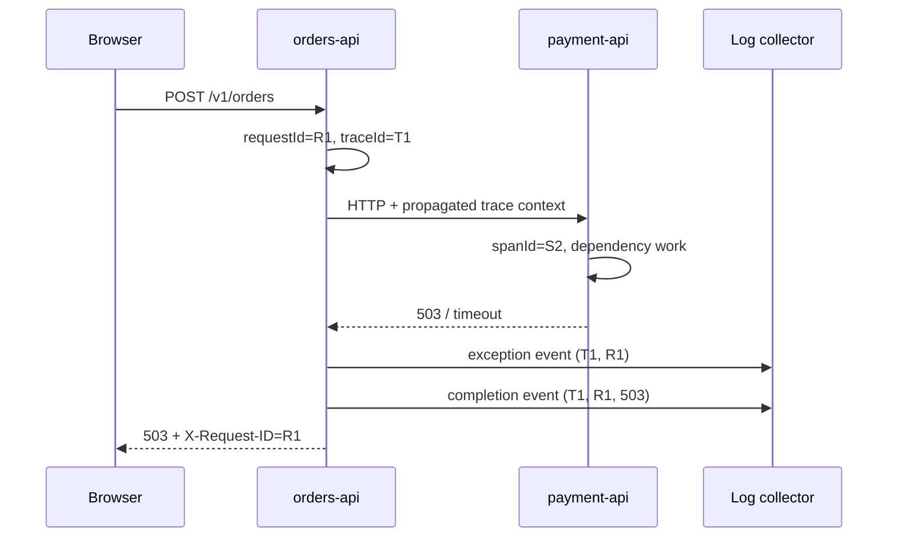
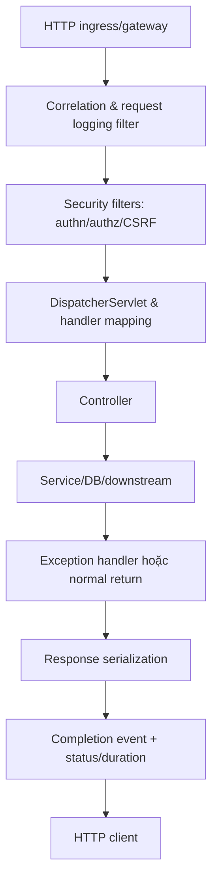

# Log có cấu trúc cho request, response và lỗi

> **Chương:** Quan sát hệ thống  
> **Module:** **INTEGRATION_API_REST** — học thiết kế REST API theo resource, URI, HTTP method và status; làm rõ hợp đồng dữ liệu, phân trang, cache, idempotency, OpenAPI, xác thực, phân quyền và xử lý lỗi, với thực hành Java/Spring hoặc công nghệ tương đương.
>
> **Nguyên tắc:** Mỗi lần xử lý HTTP cần để lại bằng chứng có thể tìm kiếm và liên kết được, **đúng sự thật về kết quả xử lý**, nhưng không tiết lộ dữ liệu bí mật. Log có cấu trúc là một phần của khả năng quan sát hệ thống; nó không thay thế metrics, tracing hay kiểm thử.

## 1. Bài toán: request thất bại nhưng không biết vì sao

Giả sử frontend gửi:

```http
POST /v1/orders HTTP/1.1
Host: api.example.test
Authorization: Bearer <access-token>
Idempotency-Key: 8032e886-585f-475e-8dc0-8adf7c0f6875
Content-Type: application/json

{"sku":"SKU-1008","quantity":2}
```

API trả:

```http
HTTP/1.1 503 Service Unavailable
Content-Type: application/problem+json
X-Request-ID: 8c5f1789-7d59-46ef-83a1-6e43db6d45e6

{
  "type": "https://api.example.test/problems/dependency-unavailable",
  "title": "Tạm thời không thể xử lý đơn hàng",
  "status": 503,
  "requestId": "8c5f1789-7d59-46ef-83a1-6e43db6d45e6"
}
```

Nếu log chỉ có:

```text
Error while creating order
```

thì người trực vận hành không biết request nào lỗi, upstream nào hỏng, 503 xuất hiện trước hay sau khi ghi DB, thời gian xử lý bao lâu, retry có tạo đơn trùng hay không. Cũng không nên “bổ sung thông tin” bằng cách ghi nguyên `Authorization`, JSON đơn hàng và stack trace chứa dữ liệu khách hàng.

Thay vào đó, sự kiện log có cấu trúc có thể là:

```json
{
  "@timestamp": "2026-11-18T14:32:11.421Z",
  "level": "INFO",
  "service.name": "orders-api",
  "service.version": "2.8.1",
  "deployment.environment": "production",
  "event.name": "http.server.request.completed",
  "request.id": "8c5f1789-7d59-46ef-83a1-6e43db6d45e6",
  "trace.id": "d8eaa2bb6ccf4f04a3452ab118cdf711",
  "span.id": "3d57ac035c1bb5e7",
  "http.request.method": "POST",
  "http.route": "/v1/orders",
  "http.response.status_code": 503,
  "duration_ms": 187,
  "outcome": "failure",
  "error.code": "DEPENDENCY_UNAVAILABLE"
}
```

Đây là **mẫu schema do nhóm API chọn**, không có nghĩa mọi encoder tự tạo ra các tên field này. Các phiên bản SDK/collector thường sử dụng `traceId`/`spanId` hoặc ánh xạ sang quy ước OpenTelemetry; cần chuẩn hóa trong pipeline để truy vấn nhất quán.

Sau bài học, người học có thể:

1. Phân biệt log văn bản tự do và log sự kiện có schema; xác định trường cho request, response và lỗi.
2. Thiết kế `requestId`, `traceId`, `spanId`, event name và mã lỗi để liên kết một request xuyên controller, security filter, downstream và worker.
3. Ghi đúng HTTP method, route template, status và duration, kể cả lỗi `401`, `403`, `404`, `429`, `5xx`; hiểu các tình huống async/streaming khiến status chưa chắc chắn.
4. Tạo JSON log bằng Java/Spring Boot, sử dụng SLF4J/MDC có kiểm soát, `@RestControllerAdvice` và Problem Details.
5. Kiểm thử tính đầy đủ của log, khả năng ẩn bí mật, số lần ghi sự kiện, hiệu năng và ranh giới quyền riêng tư.

## 2. Log có cấu trúc là gì?

Log văn bản tự do:

```text
2026-11-18 21:32:11 ERROR Failed request POST /v1/orders in 187ms: user=alice, error=timeout
```

Log có cấu trúc:

```json
{
  "timestamp": "2026-11-18T14:32:11.421Z",
  "severity": "ERROR",
  "service": "orders-api",
  "event": "http.server.exception",
  "route": "/v1/orders",
  "method": "POST",
  "elapsed_ms": 187,
  "request_id": "8c5f1789-7d59-46ef-83a1-6e43db6d45e6",
  "error_type": "UpstreamTimeoutException",
  "error_code": "DEPENDENCY_TIMEOUT"
}
```

Log có cấu trúc biến thông tin thành **cặp khóa–giá trị có kiểu và nghĩa nhất quán**. Backend ghi JSON hoặc logging framework gửi sự kiện với attributes tới collector; công cụ tìm kiếm có thể lọc `route=/v1/orders`, nhóm theo `error_code`, so sánh thời gian, liên kết trace và tạo dashboard.

### 2.1. Một schema có ích cần đặc điểm gì?

- **Ổn định:** cùng ý nghĩa dùng cùng tên field trên các service, ví dụ `duration_ms` luôn là thời gian theo mili-giây.
- **Có kiểu:** status là số nguyên, duration là số, timestamp là ISO 8601 UTC; không lúc string, lúc number.
- **Có ngữ cảnh:** service, environment, route, method, request ID hoặc trace ID.
- **Có phân loại:** event name, outcome, error code; không buộc máy phải parse tiếng Việt trong `message`.
- **Có giới hạn:** field nằm trong allowlist, string có chiều dài hợp lý, không sao chép nguyên request/body.
- **Có vòng đời:** retention, kiểm soát người xem, xóa/ẩn theo chính sách và cơ chế điều tra sự cố.

**Structured logging khác logging mọi thứ.** Việc ghép toàn bộ JSON body vào một trường `payload` vẫn là JSON log về mặt hình thức nhưng thường tốn dung lượng, lộ PII, gây cardinality cao và có thể phá giới hạn của collector.

### 2.2. Log, metric và trace bổ sung cho nhau

| Tín hiệu | Trả lời tốt nhất | Ví dụ |
|---|---|---|
| **Logs** | Sự kiện nào đã xảy ra, lý do cụ thể là gì? | Request `req-123` bị từ chối vì `ORDER_NOT_OWNED`. |
| **Metrics** | Xu hướng/tỷ lệ và độ trễ tổng thể ra sao? | Số request/s, tỷ lệ 5xx, p95 duration. |
| **Traces** | Thời gian được sử dụng ở những bước/dịch vụ nào? | API 50ms, DB 20ms, payment 350ms. |

Đừng tạo một metric label theo `request.id`/`orderId`/`userId`: cardinality sẽ bùng nổ. Metrics dùng các chiều hữu hạn như route template, status class, method. Logs và traces được tìm theo định danh cụ thể trong khuôn khổ quyền truy cập phù hợp.

## 3. Thiết kế ba loại sự kiện: request, response và lỗi

Không có một schema duy nhất bắt buộc. Có thể dùng OpenTelemetry Semantic Conventions, Elastic Common Schema hoặc quy ước nội bộ; quan trọng là **được thống nhất, mô tả và kiểm thử**. Dưới đây là một contract tham khảo.

### 3.1. Bảng trường log tối thiểu

| Field | Kiểu | Ví dụ | Quy tắc |
|---|---|---|---|
| `@timestamp` | string timestamp UTC | `2026-11-18T14:32:11.421Z` | Sự kiện xảy ra lúc nào. |
| `level` | enum | `INFO`, `WARN`, `ERROR` | Theo severity, không theo status một cách máy móc. |
| `service.name` | string thuộc config | `orders-api` | Tên deployment/service, không từ client. |
| `service.version` | string thuộc build | `2.8.1` | Liên kết log với phiên bản triển khai. |
| `deployment.environment` | enum | `production` | Không chứa cấu hình bí mật. |
| `event.name` | string hữu hạn | `http.server.request.completed` | Định danh sự kiện phục vụ query và cảnh báo. |
| `request.id` | string ID hợp lệ | UUID | Liên kết HTTP request với log và phản hồi. |
| `trace.id`/`span.id` | string theo trace format | Hex 32/16 ký tự | Có khi instrumentation tracing được cấu hình. |
| `http.request.method` | string | `GET`, `POST` | Method đã nhận; xử lý method lạ an toàn. |
| `http.route` | route pattern | `/v1/orders/{id}` | Không dùng URI raw chứa ID hoặc query. |
| `http.response.status_code` | integer | `201`, `404`, `503` | **Chỉ ghi khi status thực sự xác định.** |
| `duration_ms` | number | `187` | Dùng đồng hồ monotonic để đo elapsed. |
| `outcome` | enum | `success`, `rejected`, `failure`, `unknown` | Phân loại theo contract, không suy từ message. |
| `error.code` | mã ứng dụng hữu hạn | `DEPENDENCY_TIMEOUT` | Dùng ổn định giữa các release. |
| `error.type` | tên loại lỗi | `UpstreamTimeoutException` | Không đưa raw message người dùng vào đây. |

Các trường tùy chọn khi thật sự cần: `http.request.body.size` (số byte, không phải body), `network.protocol.name`, client class đã được phân loại, downstream service, retry attempt, idempotency fingerprint **đã băm/HMAC**, record count đã kiểm, job ID ngẫu nhiên không chứa PII. Không buộc mọi request đều có đủ tất cả field; sự kiện nên phân biệt field không có nghĩa và field bị mất do lỗi instrumentation.

### 3.2. Khi nào log request nhận vào?

Một ứng dụng có thể phát sự kiện `http.server.request.started` ngay lúc nhận để biết request đang chạy lâu:

```json
{
  "event.name": "http.server.request.started",
  "request.id": "req-123",
  "http.request.method": "GET",
  "http.route": "unmatched",
  "service.name": "orders-api"
}
```

**Chú ý:** Route template có thể chưa được framework match ở thời điểm request vào; `http.route=unmatched` hoặc bỏ field là trung thực hơn việc ghi raw `/v1/orders/ord-1001?token=...`. Với hệ thống khối lượng lớn, không nhất thiết ghi cả start và complete vì nhân đôi số sự kiện. Có thể đo in-flight bằng metric và chỉ ghi **một completion event** cho mỗi request.

### 3.3. Response/completion event

Khi HTTP pipeline hoàn tất và đã biết status, log một sự kiện kết thúc:

```json
{
  "event.name": "http.server.request.completed",
  "request.id": "req-123",
  "http.request.method": "GET",
  "http.route": "/v1/orders/{id}",
  "http.response.status_code": 200,
  "duration_ms": 32,
  "outcome": "success",
  "response.body.bytes": 527
}
```

`response.body.bytes` chỉ thêm nếu server đo được số byte thực xuất ra; `Content-Length` header không luôn phản ánh số byte đã truyền, nhất là stream/chunked/compression. Nếu không đo, **không bịa giá trị 0**.

**Một completion event trên mỗi request** giúp đếm và điều tra. Tuy nhiên một số framework có ERROR dispatch, ASYNC dispatch hoặc filter trùng; nếu gắn logging không đúng chỗ có thể đếm request hai lần. Với long polling, streaming hoặc client ngắt kết nối, phải định nghĩa “hoàn tất” là lúc server xử lý xong hay lúc response thực đã flush/đóng; không khẳng định `200` đã đến client khi chỉ mới set status.

### 3.4. Error event và Problem Details

Error event cần phân loại **loại lỗi** và **khả năng phục hồi**, không phải copy mọi exception message:

```json
{
  "event.name": "http.server.exception",
  "level": "ERROR",
  "request.id": "8c5f1789-7d59-46ef-83a1-6e43db6d45e6",
  "http.route": "/v1/orders",
  "error.code": "PAYMENT_PROVIDER_TIMEOUT",
  "error.type": "PaymentProviderTimeoutException",
  "dependency.name": "payment-api",
  "retryable": true
}
```

Response client dùng Problem Details (RFC 9457), không chứa tên class Java hay stack trace:

```http
HTTP/1.1 503 Service Unavailable
Content-Type: application/problem+json
Cache-Control: no-store
X-Request-ID: 8c5f1789-7d59-46ef-83a1-6e43db6d45e6

{
  "type": "https://api.example.test/problems/dependency-unavailable",
  "title": "Dịch vụ tạm thời không sẵn sàng",
  "status": 503,
  "requestId": "8c5f1789-7d59-46ef-83a1-6e43db6d45e6"
}
```

Người hỗ trợ có thể dùng `requestId` để tra log. **Request ID không phải thông tin xác thực hoặc một secret đảm bảo quyền truy cập**; luôn kiểm quyền khi truy vấn log/job/error details. Không log toàn bộ payment response hay dữ liệu thẻ để “debug 503”.

## 4. Request ID, trace ID, span ID: giống và khác nhau

### 4.1. Ba định danh phục vụ ba phạm vi

| ID | Phạm vi | Tạo/lan truyền |
|---|---|---|
| `request.id` | Một lần gọi HTTP tại biên hoặc một transaction hỗ trợ khách hàng theo chính sách. | API/gateway phát sinh; trả cho client qua `X-Request-ID` nếu cần. |
| `trace.id` | Chuỗi gọi xuyên dịch vụ tham gia một distributed trace. | Tracing instrumentation tạo/đọc theo W3C Trace Context khi đáng tin. |
| `span.id` | Một thao tác con trong trace (HTTP server, DB, upstream call). | Tracing instrumentation. |
| `job.id` | Resource công việc bất đồng bộ, có thể sống nhiều giờ. | Job service lưu bền, kiểm tenant khi truy vấn. |

Không đồng nhất `Idempotency-Key` với request ID: cùng một ý định POST có thể retry ba lần, tạo ba request ID nhưng **chung một idempotency key**. Không log raw key nếu nó có thể bị dùng để suy luận/chống replay; thay bằng fingerprint có kiểm soát hoặc chỉ ghi kết quả `idempotency.replayed=true`.

`traceparent` là header chuẩn W3C có thể giúp lan truyền trace; nó do instrumentation quản lý và chứa version, trace ID, span ID và trace flags. Không tự parse tùy tiện rồi coi mọi `traceparent` do client gửi là bằng chứng đáng tin về danh tính. Một hệ thống có thể tiếp tục trace context hợp lệ khi tiếp nhận request công khai, nhưng phải có trust/sampling policy, không nhận baggage tùy ý như quyền hạn hay dữ liệu có thẩm quyền.

### 4.2. Luồng xuyên hai service



Khi có cấu hình Micrometer Tracing/OpenTelemetry, log của các span trong cùng trace có thể chứa chung `traceId` và các `spanId` khác nhau. Request ID `R1` hữu ích để hỗ trợ khách hàng ngay cả khi trace bị sampling bỏ hoặc collector không sẵn sàng.

### 4.3. Nguồn cấp request ID phải được kiểm soát

Client có thể gửi:

```http
X-Request-ID: hello%0AERROR%20fake-log
```

Không đưa giá trị này nguyên trạng vào log hoặc response. Có hai chiến lược:

1. **Tạo UUID/ULID mới tại gateway/API** bất kể header từ caller; nếu cần liên kết upstream ID, giữ nguồn đáng tin riêng.
2. **Chỉ giữ incoming ID từ gateway tin cậy**, validate định dạng, chiều dài, character set và chống spoofing; nếu sai, tạo ID mới.

Trong bài này, mã Spring ở phần sau dùng **UUID mới** cho mỗi request, dễ kiểm soát và tránh log injection/collision do caller. Ở production nhiều gateway, hãy quyết định rõ **ai là nguồn tạo ID** và bảo đảm không nhân đôi định danh thiếu chủ đích.

## 5. Ranh giới riêng tư và bảo mật khi ghi log

Logging là nơi tập trung dữ liệu, nên một thiết kế log “càng nhiều càng tốt” có thể tạo ra kho thông tin nhạy cảm rất lớn.

### 5.1. Mặc định không log các dữ liệu sau

| Nguồn | Ví dụ cần tránh | Thay bằng |
|---|---|---|
| Header | `Authorization`, `Cookie`, `Set-Cookie`, API key, session ID | `auth.type=Bearer`, `auth.result=invalid` nếu cần, không có raw token. |
| Query string | `?token=...`, `?email=...`, `?code=...` | `http.route` và tên tham số trong allowlist nếu thật sự hữu ích. |
| Request/response body | Mật khẩu, payment details, địa chỉ, số điện thoại, dữ liệu hồ sơ | Kích thước, schema version, số item, mã lỗi được chuẩn hóa. |
| URL raw | `/users/alice@example.com/orders/...` | `/users/{userId}/orders/{id}`. |
| Stack trace/exception | Exception message có SQL, token, provider body | `error.code` và `error.type`; stack chỉ ở sink được bảo vệ sau rà soát. |
| User, tenant, IP | Email, ID cá nhân, IP đầy đủ | Phân loại, ID đã pseudonymize/HMAC khi có mục đích rõ và quyền phù hợp. |
| Baggage/tracing attributes | Chuỗi do client tự thêm | Allowlist, không coi là dữ liệu tin cậy. |
| Tệp tải lên | Tên file/path nhạy cảm, nội dung upload | File type đã kiểm, byte count, scan result, object ID vô danh. |

Ẩn một vài từ bằng regex sau khi đã serialize toàn body **không đủ**. Một body JSON có key `accessToken`, `access_token`, `secret`, nested field, chuỗi escape hoặc file nhị phân; bộ lọc chuỗi có thể bỏ sót hoặc vô tình làm hỏng dữ liệu. Hướng an toàn là **allowlist field từ đầu** và chỉ log metadata được thiết kế.

### 5.2. Log injection và dữ liệu do client điều khiển

Ví dụ client gửi `User-Agent` chứa newline hoặc một message có HTML/JSON đặc biệt. Không ghép thành nhiều dòng text kiểu:

```java
// Anti-pattern: có thể chèn newline, lộ dữ liệu và phá format.
log.info("Request: " + request.getRequestURI()
    + ", Authorization: " + request.getHeader("Authorization"));
```

Dùng structured encoder sẽ escape ký tự điều khiển trong **giá trị** JSON, nhưng vẫn phải giới hạn độ dài và loại bỏ trường không cần. Đừng đặt `userAgent`, `path`, `userId`, `orderId` làm metric label; log fields chứa nguồn chưa tin cậy phải được phân loại, tránh tốn dung lượng không kiểm soát.

### 5.3. Stack trace và độ nhạy cảm

Stack trace rất hữu ích khi lỗi 5xx khó điều tra. Tuy vậy, exception message từ thư viện DB/HTTP có thể kèm SQL parameters, URL chứa token hoặc response đối tác. Có thể:

- Ghi sự kiện lỗi **có mã ổn định** (`error.code`) ở mọi môi trường.
- Ghi stack trace ở sink có kiểm soát quyền/retention và không có dữ liệu nhạy cảm; cân nhắc sampling khi lỗi lặp.
- Chỉ gắn cause vào log khi đã có chính sách xử lý dữ liệu exception; không echo cause vào Problem Details.
- Ghi **một lần tại nơi xử lý lỗi có thẩm quyền**, không để controller, service, gateway và advice cùng log stack trace cho một lỗi.

Nếu 404 là tình huống hợp đồng bình thường, không log mỗi 404 thành `ERROR` với stack trace. Nếu tỷ lệ 404 tăng bất thường, metrics và cảnh báo mới xác định đó là dấu hiệu abuse hay deployment lỗi.

## 6. Thời điểm ghi log đúng với vòng đời HTTP

Một HTTP request đi qua nhiều tầng:



Vị trí instrument quyết định phần nào được nhìn thấy:

- **Log trong controller:** bỏ lỡ 401/403 từ security filter, 404 không match handler, lỗi parse xảy ra trước khi vào method.
- **Log trong service:** biết business context nhưng chưa biết status HTTP cuối cùng, có thể log trùng một transaction.
- **Servlet filter ở biên:** thấy phần lớn request đến app, có thể log method, response status và thời gian ở mức HTTP; nhưng cần xử lý async/error dispatch, filter order và trường hợp response chưa commit.
- **Gateway/ingress:** thấy request trước app, status do gateway trả và thông tin mạng; có thể khác status của service bên trong.
- **HTTP client instrumentation:** log cuộc gọi outbound với route/host đã kiểm, latency, status của dependency; tránh log raw URL/query/header có credential.

### 6.1. Đừng ghi status 200 giả khi có exception chưa xử lý

Một filter đơn giản:

```java
try {
    chain.doFilter(request, response);
} finally {
    log.info("status={}", response.getStatus());
}
```

có thể ghi `status=200` mặc định nếu exception thoát ra và container **chưa** đổi status thành 500. Đây là lỗi quan sát nghiêm trọng: dashboard log báo request thành công trong khi client nhận 500.

Với exception **đã được `@RestControllerAdvice` xử lý**, filter gọi tiếp và nhìn thấy status đã được đặt; có thể ghi 500/503 đúng. Với exception **thoát khỏi filter chain**, nên đánh dấu `outcome=unhandled` và không xác quyết status khi chưa biết; đo status cuối cùng qua container/ingress hoặc hooks error dispatch tương ứng.

### 6.2. Async, streaming và client disconnect

- `Callable`, `DeferredResult` hoặc Servlet async có thể khiến `doFilter` trở về **trước khi** response hoàn tất.
- `SseEmitter`, streaming response, file download có thể giữ kết nối dài; `status=200` ở lúc set header không chứng minh client đã nhận đủ bytes.
- Worker xử lý sau `202 Accepted` là **job riêng**; cần log `job.accepted`, `job.started`, `job.failed/succeeded` liên kết bằng job ID và trace/link thích hợp.
- Client ngắt kết nối có thể gây `IOException` khi stream; log mức phù hợp, không nhầm với bug 500 do business.
- Khi sử dụng WebFlux/Reactive, không đặt MDC thread-local kiểu Servlet rồi kỳ vọng tồn tại qua mọi scheduler; cần Reactor Context/tracing instrumentation phù hợp.

Bài thực hành dưới đây minh họa một filter **cho Servlet request đồng bộ**. Khi có async/streaming, mở rộng bằng `AsyncListener`/container hooks hoặc dùng instrumentation có hỗ trợ đúng lifecycle và kiểm chứng trong test. Không dùng ví dụ đồng bộ làm kết luận rằng mọi response stream đã gửi xong.

## 7. Thực hành Spring Boot: tạo JSON log và correlation

Ví dụ dựa trên **Java 17+**, **Spring Boot 3.4+**, Spring MVC/Servlet, SLF4J 2 và Logback. Nếu dùng Boot 3.0–3.3, cấu hình JSON encoder/Logback khác và phải điều chỉnh phiên bản. Mẫu dùng API sync; phần job/async cần lifecycle logging riêng.

### 7.1. Cấu hình format và service identity

Trong Spring Boot 3.4+, có thể dùng structured logging tích hợp:

```yaml
spring:
  application:
    name: orders-api

logging:
  structured:
    format:
      console: logstash
  level:
    root: INFO
    example.orders: INFO
```

Đây là một cách xuất JSON lên stdout; nơi triển khai (container runtime, collector, log backend) cần parse, quản lý timestamp, retention, access control và redaction. Dạng tên key/bao nhiêu thuộc tính được xuất phụ thuộc formatter/encoder và cấu hình SLF4J/Logback thực. **Phải kiểm JSON thực xuất ra**, không mặc định mọi `addKeyValue` được index ở root với tên nguyên vẹn.

Nếu ứng dụng chạy Boot 3.0–3.3, có thể dùng encoder JSON tương thích thay vì property `logging.structured.format.console`; không copy property trên rồi kết luận đã có structured log khi formatter chưa hỗ trợ.

### 7.2. Filter tạo request ID và completion event

`OncePerRequestFilter` dùng SLF4J fluent key–value API (2.x). Mã sau chỉ chạm metadata đã được allowlist, không đọc body hay nguyên path/query:

```java
package example.orders.observability;

import jakarta.servlet.FilterChain;
import jakarta.servlet.ServletException;
import jakarta.servlet.http.HttpServletRequest;
import jakarta.servlet.http.HttpServletResponse;
import java.io.IOException;
import java.util.UUID;
import java.util.concurrent.TimeUnit;
import org.slf4j.Logger;
import org.slf4j.LoggerFactory;
import org.slf4j.MDC;
import org.springframework.core.Ordered;
import org.springframework.core.annotation.Order;
import org.springframework.stereotype.Component;
import org.springframework.web.filter.OncePerRequestFilter;
import org.springframework.web.servlet.HandlerMapping;

@Component
@Order(Ordered.HIGHEST_PRECEDENCE)
public final class RequestCompletionLogFilter extends OncePerRequestFilter {
    public static final String REQUEST_ID_ATTR = "observability.requestId";
    private static final Logger LOG =
        LoggerFactory.getLogger(RequestCompletionLogFilter.class);

    @Override
    protected void doFilterInternal(HttpServletRequest request,
                                    HttpServletResponse response,
                                    FilterChain chain)
            throws ServletException, IOException {

        long startNanos = System.nanoTime();
        String requestId = UUID.randomUUID().toString();
        request.setAttribute(REQUEST_ID_ATTR, requestId);
        response.setHeader("X-Request-ID", requestId);
        MDC.put("requestId", requestId);

        boolean returnedNormally = false;
        try {
            chain.doFilter(request, response);
            returnedNormally = true;
        } finally {
            try {
                if (!request.isAsyncStarted()) {
                    long durationMs = TimeUnit.NANOSECONDS.toMillis(
                        System.nanoTime() - startNanos);

                    Object routeAttr = request.getAttribute(
                        HandlerMapping.BEST_MATCHING_PATTERN_ATTRIBUTE);
                    String route = routeAttr instanceof String value
                        ? value : "unmatched";

                    var event = LOG.atInfo()
                        .addKeyValue("event.name",
                            "http.server.request.completed")
                        .addKeyValue("request.id", requestId)
                        .addKeyValue("http.request.method", request.getMethod())
                        .addKeyValue("http.route", route)
                        .addKeyValue("duration_ms", durationMs);

                    if (returnedNormally) {
                        int status = response.getStatus();
                        String outcome = status >= 500 ? "failure"
                            : status >= 400 ? "rejected" : "success";
                        event.addKeyValue("http.response.status_code", status)
                             .addKeyValue("outcome", outcome);
                    } else {
                        // Container có thể chưa chuyển mặc định 200 sang 500.
                        event.addKeyValue("outcome", "unhandled");
                    }
                    event.log("HTTP request processing finished");
                }
            } finally {
                MDC.remove("requestId");
            }
        }
    }
}
```

**Giải thích theo từng quyết định:**

1. **`System.nanoTime()`** dùng đo elapsed monotonic; JSON logger tự ghi wall-clock timestamp từ logging event, không dùng `System.currentTimeMillis()` để tính duration khi đồng hồ hệ thống đổi.
2. **UUID tự phát sinh** tránh tin `X-Request-ID` do client đưa. `X-Request-ID` trong response cho phép hỗ trợ khách hàng tra cứu. Nếu gateway đang phát ID đáng tin, cần thống nhất chính sách để không tạo hai ID không liên kết.
3. **`MDC.put`/`remove`** gắn ngữ cảnh với thread khi xử lý sync; `remove` trong `finally` rất quan trọng vì servlet threads được tái sử dụng. Không gọi `MDC.clear()` tùy tiện vì có thể xóa trace context hoặc dữ liệu của framework khác.
4. **`HandlerMapping.BEST_MATCHING_PATTERN_ATTRIBUTE`** lấy template `/v1/orders/{id}` khi MVC đã match. Khi security chặn trước MVC, route có thể là `unmatched`. Đây là lựa chọn riêng tư có chủ ý; nếu cần route chính xác cho 401, hãy có mapping từ gateway/security route có kiểm soát.
5. **`returnedNormally`** không có nghĩa status 2xx: `@RestControllerAdvice` hoặc SecurityFilter có thể tạo 4xx/5xx rồi return bình thường. Khi exception thoát chain, mẫu không ghi status giả.
6. **`response.getStatus()`** có ý nghĩa khi response đã được xử lý trong filter chain đồng bộ; với async/streaming mẫu **không ghi completion event**, vì thời điểm này chưa thực sự kết thúc. Phải bổ sung `AsyncListener`/instrumentation thích hợp, nếu không sẽ thiếu log cho request async.
7. SLF4J `addKeyValue` tạo **structured key–value attributes**; JSON encoder cần được cấu hình để xuất attributes. Nếu dùng formatter văn bản thông thường, đầu ra có thể vẫn là text.

Ở môi trường nhiều filter, kiểm `@Order` và dispatcher types để ghi một event cho mỗi request; không chỉ dựa vào tên `OncePerRequestFilter` để suy ra không bao giờ xảy ra trùng event khi có redispatch. Để đo kết quả đầy đủ qua async, cần lắng nghe `AsyncListener#onComplete`, `onTimeout`, `onError` và khi khởi động chu kỳ async mới (`onStartAsync`); callback chạy ở thread khác nên truyền các trường theo đối số/tracing context, không tin MDC cũ.

### 7.3. Error handler: Problem Details và error code

Tạo domain exception có mã lỗi ổn định. Không đưa request body hoặc upstream response vào exception message:

```java
package example.orders.api;

public final class PaymentProviderUnavailable extends RuntimeException {
    public PaymentProviderUnavailable() {
        super("payment_provider_unavailable");
    }
}
```

Xử lý tại `@RestControllerAdvice`; một exception được chuyển thành HTTP `503` và một sự kiện lỗi đã phân loại:

```java
package example.orders.api;

import example.orders.observability.RequestCompletionLogFilter;
import jakarta.servlet.http.HttpServletRequest;
import java.net.URI;
import org.slf4j.Logger;
import org.slf4j.LoggerFactory;
import org.springframework.http.CacheControl;
import org.springframework.http.HttpStatus;
import org.springframework.http.ProblemDetail;
import org.springframework.http.ResponseEntity;
import org.springframework.web.bind.annotation.ExceptionHandler;
import org.springframework.web.bind.annotation.RestControllerAdvice;

@RestControllerAdvice
public class OrderErrorAdvice {
    private static final Logger LOG =
        LoggerFactory.getLogger(OrderErrorAdvice.class);

    @ExceptionHandler(PaymentProviderUnavailable.class)
    ResponseEntity<ProblemDetail> unavailable(
            PaymentProviderUnavailable ex,
            HttpServletRequest request) {

        Object attr = request.getAttribute(
            RequestCompletionLogFilter.REQUEST_ID_ATTR);
        String requestId = attr instanceof String s ? s : "unavailable";

        LOG.atError()
            .addKeyValue("event.name", "http.server.exception")
            .addKeyValue("request.id", requestId)
            .addKeyValue("error.code", "DEPENDENCY_UNAVAILABLE")
            .addKeyValue("error.type", ex.getClass().getSimpleName())
            .addKeyValue("dependency.name", "payment-api")
            .log("Dependency request failed");

        ProblemDetail problem = ProblemDetail.forStatusAndDetail(
            HttpStatus.SERVICE_UNAVAILABLE,
            "Tạm thời không thể xử lý đơn hàng");
        problem.setTitle("Dịch vụ phụ thuộc không sẵn sàng");
        problem.setType(URI.create(
            "https://api.example.test/problems/dependency-unavailable"));
        problem.setProperty("requestId", requestId);

        return ResponseEntity.status(HttpStatus.SERVICE_UNAVAILABLE)
            .cacheControl(CacheControl.noStore())
            .body(problem);
    }
}
```

Filter ghi **completion event** có status 503; advice ghi **một error event** với mã nguyên nhân, tạo hai loại thông tin khác nhau. Nếu hạ tầng đã có handler 5xx tập trung, hãy ghi lỗi tại **một** tầng có thẩm quyền và tránh lặp ở mỗi service method.

Đây là **một exception handler có chủ đích**, không phải handler bắt tất cả `Exception` rồi đổi mọi tình huống thành 500/503. Trong hệ thống thật phải giữ semantics `400` validation, `401` authentication, `403` authorization, `404` resource, `409` idempotency/concurrency, `429` rate limit, và xử lý lỗi có thể phát sinh từ gateway/security filter ngoài MVC. Không phải tất cả đi qua `@RestControllerAdvice`.

### 7.4. Log lỗi 4xx vừa đủ

Một số tình huống không cần stack trace:

| Trường hợp | Response | Logging khuyến nghị |
|---|---|---|
| Thiếu/expired token | `401` | Completion event, security reason code hữu hạn khi cần; không log token. |
| Có token, thiếu scope | `403` | Completion event; có thể thêm security audit event đã kiểm quyền. |
| Không có resource | `404` | Completion event ở INFO; tránh spam ERROR. |
| Body JSON sai | `400` | Validation failure code; không log body có PII. |
| Idempotency key xung đột | `409` | Contract/business code; không log raw key. |
| Vượt rate limit | `429` | Completion event và metric counter; sampling/throttle log nếu bị flood. |
| DB/downstream unavailable | `503` | Completion + error event, nguyên nhân đã phân loại. |
| Lỗi lập trình không mong đợi | `500` | Error event phù hợp với stack trace đã được bảo vệ, alert theo rate. |

Đừng coi `4xx` từ một client là incident server mặc định. Với 403 do **phân quyền trên từng object**, log không được tiết lộ tenant/owner khác cho người không có quyền xem log.

### 7.5. Correlation với Micrometer Tracing/OpenTelemetry

Nếu ứng dụng cần liên kết log với distributed trace, có thể sử dụng Micrometer Tracing và bridge OpenTelemetry do Spring Boot quản lý dependency versions:

```kotlin
// build.gradle.kts (Spring Boot Gradle plugin và dependency management)
dependencies {
    implementation("org.springframework.boot:spring-boot-starter-actuator")
    implementation("io.micrometer:micrometer-tracing-bridge-otel")
    runtimeOnly("io.opentelemetry:opentelemetry-exporter-otlp")
}
```

Ví dụ cấu hình:

```yaml
management:
  tracing:
    sampling:
      probability: 0.10
  otlp:
    tracing:
      endpoint: http://otel-collector:4318/v1/traces
```

Khi instrumentation được cấu hình đúng, log trong phạm vi span có thể có `traceId`/`spanId` qua MDC; tên trường JSON phụ thuộc encoder. Mức sampling 10% là **ví dụ**, không phải mặc định khuyến nghị; chọn theo khối lượng và nhu cầu điều tra. Trace không được export hoặc bị sampling bỏ có thể vẫn để lại request ID trong log. Không tự tạo MDC `traceId` bằng cách đọc header bất kỳ; dùng tracer/propagator để kiểm cấu trúc và quản lý context.

**Quan sát outbound:** HTTP client instrumentation có thể sinh span cho lời gọi dependency, nhưng structured logs của ứng dụng vẫn nên ghi event code/business decision nếu cần. Với OAuth Bearer hoặc cookie, không log raw request/response body và header từ downstream. Nếu dùng `WebClient`/CompletableFuture/@Async`, bảo đảm trace context được truyền qua scheduler/executor phù hợp; MDC truyền tay chỉ là giải pháp tạm và dễ rò giữa thread.

### 7.6. Ghi log khi response lớn hoặc stream

Không dùng `ContentCachingRequestWrapper`/`ContentCachingResponseWrapper` trên mọi request chỉ để “log body”; wrapper có thể sao chép dữ liệu lớn, tăng RAM, phá streaming và đòi `copyBodyToResponse()` để client vẫn nhận dữ liệu. Nếu buộc debug payload một endpoint:

- Chỉ bật tạm bằng feature flag trong môi trường/khu vực được kiểm soát.
- Chỉ ghi field đã allowlist, hạn chế byte/record count, không cache body lớn.
- Không ghi file upload, token, password, dữ liệu thanh toán hoặc response cá nhân.
- Hết thời hạn debug phải tắt và xóa dữ liệu theo retention.
- Có test chứng minh client vẫn nhận **đúng** response body, status và headers.

Với upload/download và SSE, tốt hơn dùng metadata: `bytes_read`, `bytes_written`, `file_type` được kiểm, `duration_ms`, `stream.outcome`, `client_disconnected`, thay vì body. Nếu đo bytes bằng wrapper thì đo bytes **thực**, không tự suy từ `Content-Length`.

## 8. Logging xuyên service, retry và job bất đồng bộ

### 8.1. Outbound HTTP client

Một service gọi `inventory-api` nên có log phân loại riêng:

```json
{
  "event.name": "http.client.request.completed",
  "service.name": "orders-api",
  "dependency.name": "inventory-api",
  "http.request.method": "GET",
  "http.route": "/v1/stock/{sku}",
  "http.response.status_code": 504,
  "duration_ms": 801,
  "attempt": 2,
  "error.code": "UPSTREAM_TIMEOUT",
  "request.id": "req-123"
}
```

Đừng dùng raw URL có `?api_key=...` hoặc SKU nhạy cảm làm `http.route`. Nếu client retry nhiều lần, phân biệt **mỗi attempt** với **logical operation** để biết vì sao một request inbound tạo năm HTTP calls; log ở mức attempt có thể cần sampling để tránh quá nhiều sự kiện.

Trong OpenAPI/REST contract, timeout/`429`/`503`/`Retry-After` quy định cách retry. Logging giúp phân tích retry amplification nhưng không quyết định idempotency. Với POST thay đổi trạng thái, phải dùng idempotency key/transaction phù hợp để ngăn tác động lặp khi client retry sau timeout.

### 8.2. Job dài và tách HTTP request khỏi tác vụ

`POST /v1/report-jobs` trả `202 Accepted` sau khi enqueue bền vững. HTTP request có completion event:

```json
{
  "event.name": "http.server.request.completed",
  "http.route": "/v1/report-jobs",
  "http.response.status_code": 202,
  "request.id": "req-123",
  "job.id": "job-72e4",
  "outcome": "success"
}
```

Worker sau đó log riêng:

```json
{
  "event.name": "job.failed",
  "job.id": "job-72e4",
  "job.type": "ORDERS_EXPORT",
  "attempt": 3,
  "duration_ms": 72000,
  "error.code": "EXPORT_STORAGE_UNAVAILABLE",
  "outcome": "failure"
}
```

Không sửa log của request `202` thành lỗi chỉ vì job thất bại sau đó; `202` phản ánh **đã nhận công việc**, không hứa thành công. Liên kết job với request đầu bằng `job.id` hoặc trace link/context theo thiết kế; status API của job phải dùng xác thực/ủy quyền tenant, không coi job ID trong log là quyền đọc dữ liệu.

### 8.3. Ứng dụng nhiều instance

Mỗi replica ghi stdout JSON, collector tập hợp vào hệ thống tập trung; lưu `service.instance.id`/`pod` nếu có nhưng không dựa duy nhất vào hostname để correlation. Không dùng in-memory queue làm nơi duy nhất giữ log quan trọng vì instance crash có thể mất sự kiện. Với security/compliance audit cần độ bền và bảo đảm ghi phù hợp quy định; **application logs thường là best effort**, không được xem là audit ledger bất biến hay hệ thống giao dịch chính.

Nếu collector mất kết nối, ứng dụng cần backpressure/buffer bounded, tránh để log pipeline làm cạn heap/disk hoặc chặn mọi request. Quyết định rõ chế độ fail-safe cho audit sự kiện bắt buộc khác với application debug log.

## 9. Đưa logging vào kiểm thử

Test HTTP status/JSON chưa đủ để biết log có thể dùng để chẩn đoán. Trái lại, kiểm log chỉ tìm chuỗi `"error"` không chứng minh schema hay tính bảo mật. Cần test ở đúng lớp.

### 9.1. Test request ID tại HTTP boundary

Giả sử ứng dụng đã đăng ký `RequestCompletionLogFilter` và có endpoint test `GET /v1/health` công khai. Dùng Spring Boot + MockMvc:

```java
package example.orders.observability;

import static org.assertj.core.api.Assertions.assertThat;
import static org.springframework.test.web.servlet.request.MockMvcRequestBuilders.get;
import org.junit.jupiter.api.Test;
import org.springframework.beans.factory.annotation.Autowired;
import org.springframework.boot.test.autoconfigure.web.servlet.AutoConfigureMockMvc;
import org.springframework.boot.test.context.SpringBootTest;
import org.springframework.test.web.servlet.MockMvc;

@SpringBootTest
@AutoConfigureMockMvc
class RequestIdIntegrationTest {
    @Autowired MockMvc mvc;

    @Test
    void generatesDistinctIdsAndReturnsOneToCaller() throws Exception {
        var first = mvc.perform(get("/v1/health")).andReturn();
        var second = mvc.perform(get("/v1/health")).andReturn();

        String a = first.getResponse().getHeader("X-Request-ID");
        String b = second.getResponse().getHeader("X-Request-ID");

        assertThat(a).isNotBlank();
        assertThat(b).isNotBlank().isNotEqualTo(a);
        assertThat(a).matches(
            "[0-9a-f]{8}-[0-9a-f]{4}-[0-9a-f]{4}-[0-9a-f]{4}-[0-9a-f]{12}");
    }
}
```

Đoạn test kiểm header và generation; không khẳng định log JSON có đủ trường. Khi route có Spring Security, test phải cấu hình endpoint `/v1/health` public hoặc cấp principal test đúng. Sự kiện completion có thể được kiểm riêng bằng Logback `ListAppender`/test appender hoặc capture stdout JSON: parse từng dòng bằng Jackson, tìm `event.name`/`request.id`/`http.response.status_code` và so với HTTP response. Test nên tìm **sự kiện theo request ID**, không phụ thuộc thứ tự log bất kỳ của application context.

### 9.2. Test error mapping và không rò dữ liệu

Tạo fixture service ném `PaymentProviderUnavailable`, gọi `POST /v1/orders`. Kiểm:

1. HTTP response là `503` với `application/problem+json`, không có stack trace, token hay upstream body.
2. `X-Request-ID` bằng `requestId` trong Problem Details.
3. Có đúng một `http.server.request.completed` với `status_code=503`, `duration_ms>=0`; có một `http.server.exception` với `error.code=DEPENDENCY_UNAVAILABLE`.
4. Không có log raw `Authorization`, `Cookie`, request/response body hay query chứa secret.
5. Status `401`/`403` do security filter **cũng** có completion event, không bị log thành `200`.
6. Validation `400` và resource `404` được ghi với level/policy tương ứng, không tự động có stack trace ERROR.

Ví dụ một assertion ý tưởng (cần test appender lưu danh sách event có field key-value):

```java
// Pseudocode: events là các sự kiện đã parse từ JSON formatter.
// Đặt status theo HTTP response thực, so request.id để tránh test lẫn log.
var complete = events.stream()
    .filter(e -> "http.server.request.completed".equals(e.name()))
    .filter(e -> expectedRequestId.equals(e.requestId()))
    .findFirst().orElseThrow();

assertThat(complete.statusCode()).isEqualTo(503);
assertThat(complete.durationMs()).isGreaterThanOrEqualTo(0);
assertThat(events).noneMatch(e -> e.serialized().contains("Bearer secret"));
```

Đây là pseudocode hướng dẫn, **không phải API của Jackson/Logback**. Khi triển khai, dùng `ListAppender<ILoggingEvent>` hoặc captured JSON để truy cập event và kiểm đúng schema/encoder theo phiên bản thư viện thực tế.

### 9.3. Test các tình huống dễ bị bỏ sót

| Tình huống | Cần chứng minh |
|---|---|
| 200, 201, 204 | Một completion event/request; không ghi body. |
| 400 JSON invalid | Filter ghi status thật; không lưu raw JSON. |
| 401 JWT thiếu/hết hạn | Security filter vẫn được quan sát, không log Bearer. |
| 403 scope/owner/tenant | Không lộ người sở hữu/tenant của object bị từ chối. |
| 404 resource/unmatched route | Route không chứa raw ID/secret query. |
| 409 idempotency conflict | Không log raw idempotency key hoặc nhân đôi side effect. |
| 429 do gateway | Log gateway có trạng thái và correlation; app có thể chưa thấy request. |
| 500 exception trước khi set status | Không ghi `status=200` giả; container/gateway log status cuối. |
| 503 do downstream timeout | Error code, dependency name, duration đúng; không log body đối tác. |
| Async `Callable`/`DeferredResult` | Completion khi async kết thúc, không log ngay lúc filter return. |
| Streaming/SSE/file | Ghi lifecycle/bytes được đo, handle client disconnect; không buffer toàn body. |
| Retry/duplicate request | Phân biệt request ID với idempotency key và attempt. |
| Header/query chứa newline | JSON encoder escape, field nguy hiểm không đi vào log. |
| Lưu lượng lớn | Log không gây chặn request, disk/collector không vượt quota. |
| Thread pool tái sử dụng | MDC request ID được dọn, không lẫn request kế tiếp. |
| Một request qua 3 service | Trace context liên kết được, IDs và version đủ tra cứu. |

### 9.4. Kiểm thử tải và quan sát vận hành

Tạo tải có các nhóm: `GET` nhanh, `POST` xử lý nghiệp vụ, `401` spam, `429`, dependency timeout, upload và job. So sánh latency/p95, CPU, bytes log mỗi request, throughput collector, tỷ lệ drop và độ trễ ingestion **trước/sau** bật JSON logging. Một event có cấu trúc vẫn có chi phí serialize, I/O và lưu trữ.

SLO cho pipeline log phải tách với SLO của API: **API error rate** không nhất thiết tăng khi collector hỏng, nhưng mất log là vấn đề khả năng điều tra. Kiểm logging policy khi backend log không sẵn sàng: buffer bounded, giảm sampling hợp lý, ưu tiên error/security events và cảnh báo tỉ lệ drop.

## 10. Quy tắc truy vấn, retention và dashboard

### 10.1. Tìm một request thất bại

Người dùng gửi `X-Request-ID=req-123` cho support. Một câu truy vấn log minh họa (pseudo filter DSL):

```text
service.name = "orders-api"
AND request.id = "req-123"
ORDER BY @timestamp ASC
```

Kết quả lý tưởng có completion event, optional error event, outbound dependency events và trace ID để mở trace. Không cấp support quyền tìm log của mọi tenant nếu không cần; dùng access control, audit truy cập và chỉ trích xuất dữ liệu theo mục đích hỗ trợ.

### 10.2. Dashboard hữu ích

- Tỷ lệ HTTP `5xx`/`4xx` theo `http.route` và `service.version`.
- `p95`/`p99` request duration từ metrics/traces; nếu tính từ logs, phải xét sampling và dữ liệu mất.
- Top `error.code`, phụ thuộc nào gây nhiều `503` nhất, timeout rate.
- Tỷ lệ `401`/`403`/`429` theo route/security policy trong giới hạn riêng tư.
- Số lần log dropped, ingestion lag, kích thước log/ngày, collector saturation.
- Tỷ lệ request có `request.id` và `trace.id`; correlation coverage sau deploy.
- Lỗi có tăng ngay khi thay `service.version` hay cấu hình gateway không?

**Cardinality:** `route=/v1/orders/{id}` tốt hơn `/v1/orders/ord-1001` cho aggregation. Error codes nên là enum hữu hạn; không đưa exception message thô vào nhóm dashboard vì mỗi message có thể riêng.

### 10.3. Retention và chống rò

- Phân tầng retention: debug ngắn, application log theo mục đích điều tra, security audit theo nghĩa vụ tổ chức. Không tự mặc định tất cả log giữ vô hạn.
- Mã hóa đường truyền tới collector và dữ liệu lưu trữ theo môi trường, IAM/RBAC hạn chế người xem.
- Có chính sách xóa/giảm dữ liệu, mask/pseudonymization nếu thật sự phải lưu user identifier; kiểm khả năng suy ngược.
- Tách audit log cần độ tin cậy/pháp lý cao khỏi application debug log và DB business record.
- Thiết lập cảnh báo nếu logging pipeline bắt đầu ghi `Authorization`, `Cookie` hoặc dữ liệu định danh ngoài allowlist.
- Không thay logging contract mà không cập nhật dashboards/alerts và kiểm truy vấn downstream.

## 11. Các sai lầm phổ biến và cách sửa

| Sai lầm | Hậu quả | Cách sửa |
|---|---|---|
| `log.info("request: {}", request)` | `toString()` có thể thiếu dữ liệu hoặc lộ thông tin; khó parse. | Chỉ field allowlist, định dạng JSON cố định. |
| Ghi raw URI/query | Rò ID/token và tăng cardinality. | Route template + correlation ID. |
| Ghi `Authorization`/cookies/body | Lộ credential/PII vào log backend. | Không ghi mặc định; dùng loại sự kiện/mã lỗi. |
| Mọi 4xx đều ERROR + stack | Spam, tốn chi phí, che lỗi server thật. | Completion INFO; error/security audit theo policy. |
| Ghi stack ở mọi tầng | Một lỗi nhân 5–10 stack, khó phân tích. | Một handler chính ghi cause đã kiểm soát. |
| Dùng `Date.now()`/wall clock tính elapsed | Đồng hồ đồng bộ có thể khiến thời gian âm hoặc nhảy. | `System.nanoTime()`/monotonic timer. |
| Filter `finally` ghi 200 khi exception chưa handle | Dashboard báo thành công sai sự thật. | Ghi `outcome=unhandled`, chỉ ghi status khi xác định. |
| Kết thúc log ngay sau `doFilter` cho async | Log sớm hoặc thiếu final status. | AsyncListener/hooks/tracing. |
| Không dọn MDC | Lẫn request ID sang thread/request khác. | `remove` trong finally, truyền context đúng. |
| Tin client gửi `X-Request-ID` bất kỳ | Log injection, giả mạo correlation, ID quá dài. | Generate hoặc validate từ trusted gateway. |
| Match route bằng raw path | Mỗi order/user thành một “endpoint” riêng. | Framework route template, fallback an toàn. |
| JSON chỉ là một chuỗi trong `message` | Collector khó index/truy vấn theo field. | Structured encoder và kiểm output thực. |
| Bật body capture toàn cục | OOM, phá streaming, rò PII. | Metadata-only và debug allowlist có TTL. |
| Log theo “mỗi retry” nhưng không ghi attempt | Không biết retry storm hay request logic. | `attempt`, trace/span, logical operation ID. |
| Coi log là sổ giao dịch chính | Log có thể drop khi collector lỗi. | DB/outbox/audit ledger cho dữ liệu bắt buộc. |

## 12. Bài tập thực hành

### Bài 1 — Thiết kế event schema

Thiết kế schema log cho `GET /v1/orders/{id}`, `POST /v1/orders` và `POST /v1/report-jobs`. Với mỗi endpoint, xác định field bắt buộc và tùy chọn, enum `outcome`, status, error code, request/trace ID, version, route, duration và điều tuyệt đối không ghi. Trả lời vì sao `orderId` và toàn bộ `?filter=...` không nên là metric label.

**Đầu ra mong đợi:** ít nhất ba JSON event hợp lệ, một bảng mô tả field/kiểu/ý nghĩa và bộ quy tắc mask.

### Bài 2 — Xử lý một request 503

Client nhận `503` và `X-Request-ID=req-501`. Logs có:

```text
http.server.request.completed: req-501, POST /v1/orders, 503, 987ms
http.client.request.completed: req-501, payment-api, 504, 900ms
http.server.exception: req-501, PAYMENT_PROVIDER_TIMEOUT
```

Hãy tái dựng timeline, phân biệt lỗi provider timeout với lỗi input client, thiết kế Problem Details trả về và giải thích tại sao **không** gửi nội dung exception/payment body cho client. Thêm retry policy idempotent cho POST để tránh trùng đơn.

### Bài 3 — Sửa logging filter

Cho đoạn mã:

```java
try {
    chain.doFilter(req, res);
} finally {
    log.info("uri={}, token={}, status={}",
        req.getRequestURI(),
        req.getHeader("Authorization"),
        res.getStatus());
}
```

Hãy xác định tối thiểu **sáu** vấn đề: raw URL, credential, status có thể giả, không có duration, route template, request ID, async lifecycle, duplicate dispatch, không có structured format. Viết lại bằng filter ở mục 7, thêm test 200, 401, exception chưa handle và request dùng thread pool tái sử dụng.

### Bài 4 — Kiểm chứng JSON formatter

Bật JSON logging ở Spring Boot phù hợp phiên bản. Gửi hai request có request IDs và trạng thái khác nhau. Capture stdout hoặc test appender, parse từng dòng thành JSON, xác nhận field có **kiểu** đúng (status integer, duration numeric), route không chứa ID/raw query, request ID match response, token không xuất hiện. Nêu cách phát hiện nếu `addKeyValue` không được encoder xuất ra.

### Bài 5 — Async và job

Thiết kế `POST /v1/report-jobs` trả `202`, worker thất bại sau 30 giây và client poll `GET /v1/report-jobs/{id}`. Viết ít nhất bốn event thuộc hai vòng đời HTTP và job, nêu `job.id` liên kết thế nào và vì sao status 202 ban đầu **không chuyển thành 500** sau khi job thất bại. Với streaming response, xác định hook nào sẽ ghi log cuối và phân biệt client disconnect.

### Bài 6 — Chính sách privacy và storage

Nhóm hệ thống muốn log toàn bộ request/response body để hỗ trợ lỗi thanh toán. Hãy phản biện bằng threat model và đề xuất schema thay thế: endpoint template, operation ID, field count, payload byte size, error code, dependency status, request ID. Đưa ra retention, IAM/RBAC, kiểm tra tự động token leak, cost/quota và cơ chế debug có TTL.

### Câu hỏi tự kiểm tra

1. Vì sao JSON log có trường `payload` chứa toàn body vẫn có thể là thiết kế không an toàn?
2. `request.id` và `trace.id` giống và khác ở phạm vi nào?
3. Tại sao phải log route template thay vì raw URI chứa ID?
4. Khi `chain.doFilter` ném exception trước khi container đổi status, điều gì sai nếu filter ghi 200?
5. `@RestControllerAdvice` có xử lý được mọi lỗi từ Spring Security/gateway không?
6. Tại sao `MDC.remove()` phải nằm trong `finally`?
7. `202 Accepted` của request tạo job liên hệ thế nào với event `job.failed` sau đó?
8. Có nên ghi mọi `401` với stack trace ERROR không? Khi nào cần audit event riêng?
9. `Content-Length` có chứng minh số bytes response thực được truyền không?
10. Vì sao một client có thể cung cấp request ID nhưng server không nên tin vô điều kiện?
11. Structured logging có thay metrics và distributed tracing không?
12. Làm sao test encoder xuất JSON đúng schema thay vì chỉ test nội dung message?

**Tiêu chí đánh giá:** Thiết kế thành công phải phát ra event dùng được để điều tra sự cố; có correlation và HTTP status chính xác; không lộ credential/PII; xử lý đúng 4xx/5xx/async; đo được chi phí logging và có test tự động.

## 13. Checklist trước khi vận hành

- [ ] Có schema event được quản lý version; field names/types nhất quán trong các service.
- [ ] Có request ID trả về client và liên kết log; trace context được lan truyền bằng instrumentation tin cậy.
- [ ] Completion event ghi HTTP method, route template, status **khi đã xác định**, duration monotonic.
- [ ] Lỗi có code/type hữu hạn; HTTP Problem Details dùng thông điệp an toàn và request ID.
- [ ] Security 401/403, validation 400, rate 429, lỗi 5xx được quan sát ở đúng tầng.
- [ ] Không ghi Authorization/Cookie/Set-Cookie, secrets, raw body, raw URI/query có token.
- [ ] Không log exception stack nhiều lần; stack cần được bảo vệ khỏi PII/token trong message.
- [ ] Không tạo metric labels từ request ID, user ID, order ID hoặc message tự do.
- [ ] MDC được dọn; async/reactive/stream lifecycle có hooks tương ứng và test riêng.
- [ ] JSON encoder được test bằng output thực, correlation qua gateway/downstream có thể truy vấn.
- [ ] Đã test request và response với 2xx/4xx/5xx, exception trước status, retry và client disconnect.
- [ ] Có giới hạn bytes/log, sampling/throttling hợp lý, monitoring drop/ingestion lag.
- [ ] Retention, mã hóa, RBAC/audit truy cập và cơ chế xóa được xác định.
- [ ] Dashboard và alert theo route/status/error code, không dựa vào việc parse text message.

## 14. Kết luận và nguồn tham khảo

Trong REST API, log có cấu trúc giúp trả lời **request nào, ở đâu, trả HTTP status nào, mất bao lâu và thất bại vì loại nguyên nhân nào**. Việc đo đúng vòng đời HTTP, dùng correlation qua request/trace ID và lọc bỏ credential/PII quan trọng ngang khả năng ghi JSON. Công cụ logging phải được kiểm cùng security filter, exception handling, distributed calls, async và payload lớn; nếu không log có thể “đẹp” nhưng phản ánh sai sự thật.

Tài liệu hữu ích để đối chiếu khi triển khai:

- [OpenTelemetry — Semantic Conventions](https://opentelemetry.io/docs/specs/semconv/) — định nghĩa attributes và event names cho HTTP/tracing.
- [OpenTelemetry — Logs Data Model](https://opentelemetry.io/docs/specs/otel/logs/data-model/) — log records, severity, resource và trace correlation.
- [W3C Trace Context](https://www.w3.org/TR/trace-context/) — `traceparent`, `tracestate` và lan truyền context.
- [SLF4J Manual](https://www.slf4j.org/manual.html) — fluent logging, key–value và MDC.
- [Spring Boot — Logging](https://docs.spring.io/spring-boot/reference/features/logging.html) — logging configuration và structured logging theo phiên bản.
- [Spring Boot — Observability](https://docs.spring.io/spring-boot/reference/actuator/observability.html) — Micrometer Tracing, metrics, instrumentation.
- [Spring Framework — Servlet Filters](https://docs.spring.io/spring-framework/reference/web/webmvc/filters.html) — `OncePerRequestFilter` và xử lý request qua filter.
- [Spring Framework — Error Responses](https://docs.spring.io/spring-framework/reference/web/webmvc/mvc-ann-rest-exceptions.html) — `ProblemDetail`, exception handling.
- [RFC 9110 — HTTP Semantics](https://www.rfc-editor.org/rfc/rfc9110) — status/method và semantics response.
- [RFC 9457 — Problem Details for HTTP APIs](https://www.rfc-editor.org/rfc/rfc9457) — định dạng lỗi HTTP.
- [OWASP Logging Cheat Sheet](https://cheatsheetseries.owasp.org/cheatsheets/Logging_Cheat_Sheet.html) — events, log injection, dữ liệu cần tránh và operational security.
