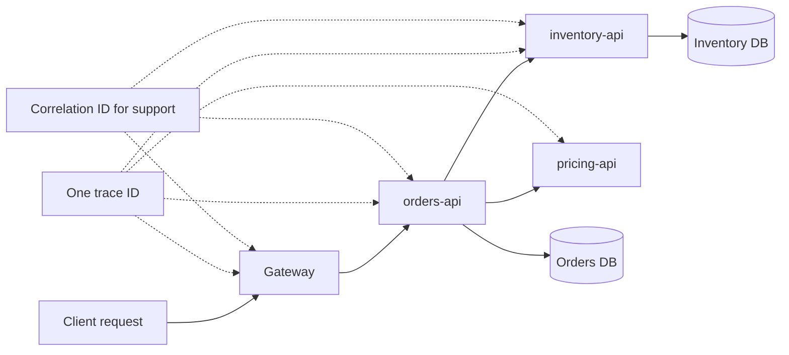

# Correlation ID, trace ID và truyền ngữ cảnh qua HTTP

Một người dùng báo: “Tôi gọi `POST /v1/orders` lúc 10:03, ứng dụng trả `504 Gateway Timeout` nhưng sau đó đơn hàng lại xuất hiện”. Trong kiến trúc nhiều dịch vụ, request có thể đi qua API gateway, `orders-api`, `inventory-api`, `payment-api`, cơ sở dữ liệu và message broker. Nếu mỗi thành phần ghi log bằng một mã riêng, kỹ sư rất khó chứng minh những bản ghi nào thuộc **cùng lần gọi** hoặc bước nào đã tiêu tốn thời gian.

**Correlation ID** giúp tìm các sự kiện liên quan bằng một nhãn định danh chung. **Trace ID** định danh một distributed trace, còn **span ID** định danh từng công việc trong trace; các thành phần truyền ngữ cảnh qua HTTP để công cụ tracing nối các bước thành đồ thị quan hệ và thời gian. Chúng giải quyết các khía cạnh khác nhau của cùng một bài toán quan sát.

Bài học thuộc chương **Quan sát hệ thống** của module `INTEGRATION_API_REST`, nơi ta thiết kế REST API dựa trên resource, URI, HTTP method và status, kết hợp xử lý lỗi, phân trang, cache, idempotency, xác thực, phân quyền và kiểm thử bằng Java/Spring. Ví dụ xuyên suốt là `orders-api` gọi `inventory-api` qua HTTP khi người dùng tạo đơn hàng. Mục tiêu không phải chỉ thêm một UUID vào log, mà là xây **hợp đồng truyền ngữ cảnh có ranh giới tin cậy**, bảo toàn tính liên kết qua gateway, async task và các dependency.

## 1. Mục tiêu học tập

Sau bài này, người học có thể:

1. Phân biệt `X-Request-ID`/`X-Correlation-ID`, `trace-id`, `span-id`, `traceparent`, `tracestate`, `baggage` và `Idempotency-Key`.
2. Theo dõi đường đi của một REST request qua gateway và ít nhất hai service bằng header, structured log và distributed spans.
3. Hiểu cấu trúc W3C Trace Context, quan hệ parent–child, quy tắc chọn/sinh trace ID mới, và khác biệt giữa sampling với tạo context.
4. Cấu hình Java/Spring Boot + Micrometer Tracing/OpenTelemetry để tự truyền `traceparent` qua HTTP client được instrument và log correlation ID có kiểm soát.
5. Bảo vệ dữ liệu/ngữ cảnh khỏi spoofing, log injection, rò rỉ thông tin qua `baggage`/`tracestate`, lẫn tenant và metric có cardinality cao.
6. Viết kiểm thử HTTP, MockMvc và integration tests cho response header, MDC cleanup, trace propagation, bất đồng bộ và cả response lỗi.

## 2. Các định danh khác nhau giải quyết câu hỏi khác nhau

Giả sử một request tạo đơn hàng gọi inventory và pricing, rồi retry inventory một lần:

| Định danh/khái niệm | Câu hỏi nó trả lời | Scope và vòng đời | Chuẩn hay quy ước? |
|---|---|---|---|
| **Correlation ID** | Những log/event nào cùng thuộc một giao dịch hoặc request cần đối chiếu? | Theo quy ước của hệ thống: một HTTP request, workflow hoặc business transaction | Thường là header **tự định nghĩa**, ví dụ `X-Correlation-ID` |
| **Request ID** | Lần HTTP request tại edge này là lần nào? | Thường một request qua ingress; retry có thể tạo request ID mới | Thường là header **tự định nghĩa**, ví dụ `X-Request-ID` |
| **Trace ID** | Những spans nào cùng thuộc một distributed trace? | Toàn trace, có thể qua nhiều dịch vụ và nhánh | W3C Trace Context: `trace-id` 16 byte |
| **Span ID** | Công việc cụ thể nào được instrument? | Một span, ví dụ HTTP server, HTTP client, JDBC query | W3C Trace Context: `parent-id` 8 byte trong header `traceparent` |
| **Trace flags** | Có gợi ý sampling/debug đặc biệt không? | Thuộc trace context, có thể truyền qua các hop | W3C trace flags, không thay authorization |
| **Idempotency-Key** | Hai request mutation có phải cùng ý định thao tác để chống trùng lặp? | Phụ thuộc hợp đồng và TTL lưu idempotency của API | Hợp đồng ứng dụng; **không** đồng nhất với correlation/trace ID |
| **Business ID** (order ID, payment ID) | Tài nguyên nghiệp vụ nào bị ảnh hưởng? | Theo vòng đời resource | Định danh miền nghiệp vụ; phải kiểm phân quyền khi tra cứu |

Đừng ép **một ID đảm nhiệm tất cả**. Ví dụ một client retry `POST` vì timeout: hệ thống có thể có **hai request ID** và **hai trace ID** khác nhau nhưng cùng `Idempotency-Key`; cả hai cùng liên quan đến một `orderId`. Trong một số hệ thống, correlation ID được giữ qua retry hoặc event nền để dễ đối chiếu workflow. Hợp đồng phải nói rõ ý nghĩa của ID và quan hệ giữa chúng.



Một trace ID không phải “mã giao dịch” theo nghĩa nghiệp vụ. Traces có thể bị sampling, mất span vì lỗi collector hoặc bị tách ở ranh giới hệ thống; correlation ID trong log giúp tra cứu bổ sung. Ngược lại, một correlation ID chung không cho biết quan hệ cha–con hay đường critical path, nên không thay distributed tracing.

### Ví dụ structured log dùng các ID

```json
{
  "timestamp": "2026-11-18T03:03:12.541Z",
  "level": "ERROR",
  "service": "orders-api",
  "route": "POST /v1/orders",
  "status": 504,
  "correlationId": "d71c102a-e92f-4c1b-8f83-669046b18f80",
  "traceId": "4bf92f3577b34da6a3ce929d0e0e4736",
  "spanId": "00f067aa0ba902b7",
  "errorCode": "INVENTORY_TIMEOUT",
  "durationMs": 835
}
```

Các trường là ví dụ, không phải schema bắt buộc cho mọi logger. `route` nên là template đã chuẩn hóa, không phải URI chứa token/PII. Không ghi `Authorization`, `Cookie`, full query string hoặc nội dung đơn hàng vào log chỉ để làm tracing. `traceId`/`spanId` giúp mở trace; `correlationId` giúp hỗ trợ người dùng tra cứu khi không có trace được lưu.

## 3. Hợp đồng HTTP cho Correlation ID

Không có một header correlation ID HTTP duy nhất được mọi gateway/framework tự hiểu như nhau. Hai tên phổ biến là `X-Request-ID` và `X-Correlation-ID`. Chọn **một tên và một ý nghĩa rõ ràng**, document trong OpenAPI và ở các gateway/service; tránh phát sinh mỗi nơi một tên khác nhau.

Giả sử hợp đồng của hệ thống:

- `X-Correlation-ID` là UUID v4 dạng chuỗi canonical 36 ký tự; gateway công khai luôn sinh mới cho request mới và gửi về client.
- `X-Request-ID` (nếu sử dụng) riêng cho từng HTTP attempt, không tái sử dụng như business ID.
- Mỗi service nội bộ chấp nhận correlation ID do **gateway/trusted upstream** truyền qua kết nối xác thực, dùng nó trong log và tiếp tục forward tới downstream.
- Nếu header bị thiếu hoặc sai ở ranh giới được quản lý, áp policy: tạo ID mới cùng warning telemetry hoặc từ chối theo quy ước internal API. Không âm thầm cho một giá trị hàng megabyte thành metric label/log.

Ví dụ client gọi API công khai:

```http
POST /v1/orders HTTP/1.1
Host: api.example.com
Authorization: Bearer <access_token>
Content-Type: application/json
Idempotency-Key: idem-20261118-42

{"items":[{"sku":"SKU-42","quantity":1}]}
```

Gateway gắn correlation ID vào request nội bộ và phản hồi cuối:

```http
HTTP/1.1 201 Created
Location: /v1/orders/ord_731
Content-Type: application/json
X-Correlation-ID: d71c102a-e92f-4c1b-8f83-669046b18f80
Cache-Control: no-store

{"id":"ord_731","status":"PENDING"}
```

Client có thể cung cấp correlation ID khi báo lỗi với hỗ trợ kỹ thuật, nhưng API không nên cho phép một người chỉ dùng ID để tra cứu log hoặc dữ liệu của tenant khác. Correlation ID **không phải credential** hay bằng chứng ownership. Nếu giao diện web chạy **cross-origin**, JavaScript chỉ đọc được header `X-Correlation-ID` khi API expose nó qua `Access-Control-Expose-Headers: X-Correlation-ID` và CORS origin/credentials policy phù hợp.

Lỗi `4xx/5xx` cũng nên có correlation ID, kể cả lỗi do authentication filter, rate limiter hoặc gateway tạo ra, để người dùng có thể cung cấp ID mà không phải gửi access token hay ảnh chụp toàn bộ request.

### 3.1. Sinh ID và không để người gọi công khai giả mạo

Một client có thể tự gửi `X-Correlation-ID: admin-login` hoặc một chuỗi chứa ký tự xuống dòng để làm nhiễu log. Validation format/length giảm lỗi format nhưng **không chứng minh nguồn header đáng tin**. Có hai mô hình:

1. **Ingress sinh mới và ghi đè** correlation ID nhận từ Internet (mô hình đơn giản, dễ kiểm): người gọi không quyết định ID dùng trong log nội bộ. Nếu cần liên kết với ID của client, lưu một `clientRequestId` riêng sau khi validate và áp quy tắc dữ liệu rõ ràng.
2. **Ingress cho phép client đề xuất ID** để debug liên hệ, nhưng phải kiểm format/độ dài, rate-limit, tách trust label và không dùng ID làm quyền tra cứu. Có thể gắn `ingressRequestId` riêng để giữ căn cứ audit không bị spoof.

Trong nội bộ, chỉ tin header từ proxy/service đã xác thực bằng service identity/mTLS/network controls. Đừng tin chuỗi chỉ vì tên header bắt đầu bằng `X-`, hay vì request chứa JWT người dùng hợp lệ. Tránh các biến thể chỉ khác hoa/thường, nhiều header trùng, khoảng trắng hoặc dấu phân cách không được xử lý nhất quán giữa gateway và ứng dụng.

## 4. W3C Trace Context: traceparent và tracestate

W3C Trace Context xác định cách một bên gửi **trace context** sang bên kia qua HTTP. Hai header chính là `traceparent` và `tracestate`.

### 4.1. Cấu trúc traceparent

Header phiên bản `00` có dạng:

```text
traceparent: 00-4bf92f3577b34da6a3ce929d0e0e4736-00f067aa0ba902b7-01
             │  │                                │                │
             │  └── trace-id: 32 hex             │                └─ flags: 2 hex
             │                                   └────────────────── parent-id: 16 hex
             └── version: 2 hex
```

Theo định dạng `00`:

| Trường | Dung lượng và yêu cầu | Ý nghĩa |
|---|---|---|
| `version` | 2 chữ số hex, ví dụ `00` | Phiên bản của định dạng. Parser cần tuân thủ rule version/compatibility của chuẩn |
| `trace-id` | 32 ký tự hex thường; **không được toàn số 0** | Định danh trace, 16 byte |
| `parent-id` | 16 ký tự hex thường; **không được toàn số 0** | Span ID của bên phát header, 8 byte |
| `trace-flags` | 2 ký tự hex | Bit sampling thường được dùng trong instrumentation; không phải quyết định quyền truy cập |

Ở request tới `inventory-api`, `parent-id` là span ID của **HTTP client span** ở `orders-api` nếu instrumentation sinh client span. Khi inventory tạo server span, nó dùng context này làm remote parent, giữ `trace-id` nhưng có **span ID mới** cho công việc của nó. Không được giữ nguyên một span ID cho mọi service.

Ví dụ:

```http
GET /internal/v1/availability?sku=SKU-42 HTTP/1.1
Host: inventory.internal.example
Accept: application/json
traceparent: 00-4bf92f3577b34da6a3ce929d0e0e4736-00f067aa0ba902b7-01
tracestate: vendora=opaque-state
X-Correlation-ID: d71c102a-e92f-4c1b-8f83-669046b18f80
```

`tracestate` mang thông tin tracing theo vendor hoặc hệ thống, theo cú pháp và giới hạn do chuẩn quy định. Nó **không** dành cho access token, username, email hoặc dữ liệu nghiệp vụ tùy ý. Nếu bị thiếu/trống, traceparent vẫn có thể truyền trace context; instrumentor quyết định cách xử lý theo chuẩn. Tránh tự parse hoặc tự tạo `traceparent` bằng cách ghép chuỗi nếu thư viện tracing đã được cài.

### 4.2. Baggage khác với Trace Context

W3C **Baggage** là cơ chế truyền các cặp key–value ngữ cảnh qua ranh giới dịch vụ; nó dùng header `baggage` riêng, không thay `traceparent` hoặc `tracestate`. Ví dụ trong môi trường **đã kiểm soát** có thể dùng một business segment công khai như `release_channel=beta`. Nhưng baggage dễ bị forward xa hơn dự đoán, kể cả đến dịch vụ đối tác nếu client instrumentation tự truyền header.

**Không đưa vào baggage:** JWT, API key, session ID, email, số điện thoại, địa chỉ, payload đơn hàng, mã khách hàng nhạy cảm hoặc tenant ID chưa được chính sách cho phép. Cần allowlist key, giới hạn kích thước, TTL/phạm vi propagation, xóa baggage không cần thiết trước khi gọi bên thứ ba; nếu cần tenant context cho **authorization**, gửi qua cơ chế xác thực/ủy quyền riêng, không tin baggage do client tự đặt.

### 4.3. Sampling không phải mất context

Bit sampling trong `trace-flags` thể hiện ý định/gợi ý sampling. Instrumentation có thể giữ trace context và log `traceId` dù **không xuất mọi span** lên collector. Sampling policy có thể thay đổi theo ingress, loại route hoặc quyết định của collector. Một trace thiếu span không chứng minh request không thực hiện bước đó; một request không được lưu trace cũng có thể vẫn có correlation ID để tìm log.

Không dùng `trace-flags` để bật chế độ debug, bỏ authentication hoặc cho phép thu thập payload nhạy cảm theo ý client. Một remote caller có thể gửi traceparent với cờ sampled; hệ thống phải giới hạn chi phí tracing bằng chính sách tin cậy và sampling/budget của mình.

## 5. Truyền context qua chuỗi HTTP: một trace, nhiều span

Với một request thành công, các thành phần thường tạo spans:

```text
Trace ID: 4bf92f3577b34da6a3ce929d0e0e4736

gateway SERVER span                          [0.................450 ms]
  └─ orders-api SERVER span                    [20.............430 ms]
       ├─ orders-api CLIENT -> inventory      [35.....240 ms]
       │    └─ inventory-api SERVER span        [45...230 ms]
       │         └─ inventory DB span           [55..180 ms]
       ├─ orders-api CLIENT -> pricing         [245...325 ms]
       │    └─ pricing-api SERVER span           [255..315 ms]
       └─ orders DB span                       [335..405 ms]
```

Đây là sơ đồ thời gian minh họa, không phải hình dạng span bắt buộc của mọi instrumentation. Mỗi service có thể thêm span nội bộ hoặc nối các span khác nhau tùy HTTP framework/tracing library. **Thứ tự và quan hệ parent** quan trọng hơn việc tất cả span phải có cùng tên.

```mermaid
sequenceDiagram
    autonumber
    participant B as Browser/client
    participant G as Gateway
    participant O as orders-api
    participant I as inventory-api
    participant P as pricing-api
    B->>G: POST /v1/orders + JWT
    G->>G: Sinh/kiểm ID; tạo server span
    G->>O: HTTP + X-Correlation-ID + traceparent
    O->>O: Tạo server span (remote parent)
    O->>I: GET /availability + traceparent mới
    I->>I: Server span, cùng trace ID
    I-->>O: 200 availability
    O->>P: GET /price + traceparent mới
    P-->>O: 200 price
    O-->>G: 201 Created + Location
    G-->>B: 201 Created + X-Correlation-ID
```

Hai request `orders-api → inventory-api` và `orders-api → pricing-api` thường có **parent-id khác nhau**, bởi chúng là hai HTTP client spans khác nhau. Trace ID không đổi để collector nối tất cả trong cùng trace. Nếu gateway tạo trace mới khi nhận request, edge là trace root; nếu có trace context hợp lệ từ caller, gateway có thể tiếp tục trace đó hoặc bắt đầu trace nội bộ mới tùy trust policy. Cả hai cách đều phải được thiết kế có chủ ý.

### 5.1. Hợp đồng HTTP cho từng hop

| Hop | Header được nhận | Việc cần làm | Header chuyển tiếp |
|---|---|---|---|
| Public client → gateway | Có thể có `traceparent`, `X-Correlation-ID` không tin cậy | Xác thực người dùng, kiểm header, giới hạn hoặc thay context theo trust policy | Trusted correlation ID + trace context hợp lệ do SDK phát |
| Gateway → orders-api | Trusted correlation ID và W3C context | Tạo HTTP server span, đặt log context trong phạm vi xử lý | Context đang active cho client span kế tiếp |
| Orders → inventory | Context trong tracing scope | HTTP client instrumentation inject `traceparent` và có thể `tracestate`/`baggage` đã lọc | Giữ trace ID, parent-id = client span ID |
| Inventory → DB | Context hoạt động trong server span | JDBC/DB instrumentation tạo child span (nếu bật) | Không tự đưa traceparent vào SQL string |
| Orders → pricing (retry) | Cùng request cha | Mỗi HTTP attempt có thể có client span riêng; ghi attempt number | Không reset trace ID chỉ vì retry |
| Orders → event/job | Trace/baggage policy cho async boundary | Tùy nghiệp vụ: tạo span link hoặc child context và truyền theo carrier có hỗ trợ | Không giả định HTTP headers tự đi qua broker |

Truyền context có thể sử dụng HTTP/1.1 hoặc HTTP/2; tên header case-insensitive trong HTTP. Reverse proxy có thể xóa, chuẩn hóa hoặc ghi đè header, nên cần kiểm raw request cuối tuyến. Nếu có gRPC, gRPC metadata và deadline propagation là hợp đồng khác; không trộn deadline với `traceparent`.

### 5.2. Context qua thời gian, retry, redirect và sự cố

- **Timeout/504:** caller có thể hết thời gian trước khi callee hoàn thành. Trace có thể cho thấy span caller kết thúc lỗi trong khi span callee tiếp tục; log phải có correlation ID để đối chiếu công việc bị “orphan”. Traceparent không tự truyền deadline hoặc hủy công việc.
- **Retry:** một HTTP request ban đầu có thể sinh nhiều client spans/attempts trong cùng trace; không giả định “một trace có đúng một call tới inventory”. Cần record status/retry count và idempotency key theo chính sách để phân tích trùng side effect.
- **Redirect:** HTTP client có thể theo redirect sang origin khác. Không vô tình chuyển baggage, correlation ID, `Authorization` hoặc tracestate nhạy cảm sang bên thứ ba; đặt redirect/cross-origin header policy cho client/gateway.
- **CORS:** trình duyệt muốn đọc `X-Correlation-ID` cần `Access-Control-Expose-Headers`. Header `traceparent` do trình duyệt gửi thủ công có thể làm preflight tùy cách client dựng request, nhưng thường nên để tracing SDK/instrumentation xử lý; đừng thay đổi CORS để cho phép arbitrary tracing header khi không cần.
- **Cache:** cached response có thể không thực thi lại business handler; trace server side của cache miss khác cache hit. Correlation ID trên response cần được sinh/thiết lập theo **từng request**, không cache lại header correlation ID của một người dùng khác. Với dữ liệu nhạy cảm, tuân thủ `Cache-Control`, `Vary` và cache key.

## 6. Truyền ngữ cảnh không được làm yếu ranh giới bảo mật

Truyền trace context là một dạng **dữ liệu do bên ngoài cung cấp đi qua nhiều hệ thống**. Nó không phải authentication và cũng có thể chứa thông tin phải bảo vệ.

| Rủi ro | Mẫu lỗi | Cách phòng vệ |
|---|---|---|
| Spoof correlation ID | Client đặt ID của giao dịch khác hoặc log chứa chuỗi lạ | Sinh ở edge; validate length/format; giữ ID công khai tách ID audit nội bộ |
| Header quá dài/trùng/không hợp lệ | Caller gửi `traceparent`/`tracestate`/`baggage` bất thường | Dùng propagator chuẩn, áp hạn mức tại gateway, reject/ignore theo policy, không tự parser lỏng |
| Log injection | Dữ liệu client được ghép thẳng vào log một dòng | Structured JSON logging, sanitize dữ liệu đầu vào, không log raw header |
| Rò PII qua baggage/tracestate | Gắn email, tenant secret, JWT, token vào baggage | Allowlist key và retention; strip trước khi gọi đối tác; không dùng baggage cho quyền |
| Forged sampled flag | Client cố ép collector lưu mọi span | Sampling/rate budget tại edge; không xem sampled flag là lệnh tin cậy |
| Nhầm trace ID với quyền | Endpoint `/debug/traces/{id}` ai biết ID cũng đọc được | AuthN/AuthZ và tenant isolation cho hệ thống log/tracing |
| Metrics cardinality | Gắn `traceId`, `orderId`, URL đầy đủ làm label | Chỉ dùng route/method/status/service/dependency với tập giá trị hữu hạn |
| Bypass middleware | Exception/auth filter trả lỗi trước khi gắn correlation ID | Đặt filter phù hợp trong chuỗi và test 401/403/5xx |
| Tenant crossing | Hai tenant cùng correlation/trace ID | Truy vấn log/trace phải lọc theo quyền; ID không chứng minh tenant |

**Trace ID và correlation ID thường không phải secret**, nhưng chúng có thể là đầu mối tìm dữ liệu vận hành. Hạn chế quyền truy cập hệ thống quan sát, áp retention, audit truy vấn và redaction. Đừng đưa raw JWT, session cookie, email, request body, số thẻ hoặc giá trị nhạy cảm vào span attributes; một SDK có thể xuất dữ liệu đó sang backend ngoài mạng nội bộ.

**Trace context từ Internet** có hai chiến lược hợp lệ tùy hệ thống:

1. **Continue external trace:** dùng propagator W3C chuẩn đọc remote parent sau khi validate; nối trace với đối tác/mobile/web để nhìn đường end-to-end. Cần kiểm soát sampling, trust, data residency và khả năng bị chọn trace ID do người dùng cung cấp.
2. **Start trusted trace at edge:** bỏ remote parent do Internet đưa, tạo trace mới trong hệ thống; nếu nghiệp vụ cần liên kết tới client trace, lưu liên kết có kiểm soát (ví dụ Span Link trong OTel) thay vì tin remote parent. Phù hợp hệ thống có ranh giới tin cậy nghiêm ngặt.

Không có quy tắc “luôn trust” hay “luôn reject” đúng cho mọi hệ thống. Điều bất biến là **không dùng trace context để cấp quyền**, không cho người gọi ép chính sách thu thập dữ liệu và không chuyển thông tin nhạy cảm tùy ý ra bên ngoài.

### 6.1. Correlation ID khác Idempotency-Key và error contract

Ví dụ frontend gửi `POST /v1/payments`, backend commit nhưng client timeout. Client retry cùng `Idempotency-Key`. Mỗi HTTP attempt có thể có correlation ID mới, trace ID mới, nhưng **backend phải dựa vào idempotency store** (với scope tenant/người gọi và fingerprint của request) để tránh thanh toán hai lần. Nếu sử dụng correlation ID như khóa chống trùng, kẻ gọi có thể làm thay đổi semantics chỉ bằng cách đặt header log, còn TTL và quyền không rõ ràng.

Hợp đồng lỗi nên gửi một public correlation ID không nhạy cảm:

```http
HTTP/1.1 504 Gateway Timeout
Content-Type: application/problem+json
Cache-Control: no-store
X-Correlation-ID: d71c102a-e92f-4c1b-8f83-669046b18f80

{
  "type": "https://api.example.com/problems/dependency-timeout",
  "title": "Dependency timed out",
  "status": 504,
  "detail": "The order operation could not be confirmed in time"
}
```

Mã `504` phù hợp khi thành phần đang đóng vai gateway không nhận response từ upstream đúng hạn. `401`/`403` vẫn phải dựa trên xác thực/phân quyền, `429` dựa rate limit, `503` cho service tạm không khả dụng. Correlation ID phải có thể tra cứu ở log gateway và service mà **không cần tiết lộ địa chỉ nội bộ, stack trace hoặc access token** trong Problem Details.

## 7. Spring Boot, Micrometer Tracing và OpenTelemetry

Trong Spring Boot 3.x, hệ sinh thái observability dùng **Micrometer Observation/Tracing** để tạo/ghi nhận spans và **OpenTelemetry** cho context/exporter. Các API/thư viện cụ thể phụ thuộc phiên bản. Ví dụ dưới đây giả định Spring Boot 3.2+ với `RestClient.Builder` do Spring quản lý, actuator và tracing bridge. Khi chuyển phiên bản, kiểm tài liệu phiên bản đó và test header outbound thực tế.

### 7.1. Dependencies và cấu hình

Ví dụ Gradle Kotlin DSL (chỉ minh họa dependency, không chạy build trong bài):

```kotlin
dependencies {
    implementation("org.springframework.boot:spring-boot-starter-web")
    implementation("org.springframework.boot:spring-boot-starter-actuator")
    implementation("io.micrometer:micrometer-tracing-bridge-otel")
    runtimeOnly("io.opentelemetry:opentelemetry-exporter-otlp")
}
```

Trong ứng dụng Boot quản lý phiên bản bằng dependency management/BOM, không tự gán thư viện không tương thích. Với tracing bridge OpenTelemetry và OTLP/HTTP, cấu hình minh họa:

```yaml
spring:
  application:
    name: orders-api

management:
  tracing:
    sampling:
      probability: 0.10
  otlp:
    tracing:
      endpoint: http://otel-collector.internal:4318/v1/traces

logging:
  pattern:
    level: "%5p [${spring.application.name:application},traceId=%X{traceId:-},spanId=%X{spanId:-},correlationId=%X{correlationId:-}]"
```

`probability: 0.10` là ví dụ sampling 10%, **không** là tỉ lệ mặc định tối ưu. Test propagation nên chọn sampling đủ để quan sát; production chọn theo RPS, chi phí và SLO. Endpoint cổng 4318/path `/v1/traces` là ví dụ OTLP/HTTP của collector nội bộ; TLS, xác thực exporter và URL thực phải được cấu hình theo deployment. OTLP/gRPC dùng cấu hình/protocol khác.

Micrometer Tracing có thể đưa `traceId`/`spanId` vào MDC trong lúc span active để log pattern hiển thị. Tuy nhiên, chỉ cấu hình pattern **không tự tạo trace** hay bảo đảm MDC qua mọi thread. Cần bật và kiểm tracing bridge, ObservationRegistry, exporter, và instrument các HTTP client/server thực tế.

### 7.2. Servlet filter cho Correlation ID

Ví dụ sau chỉ quản lý **correlation ID**, không tự parse/viết `traceparent`. Ở public ingress, `app.observability.trust-internal-correlation-id=false` (mặc định): sinh ID v4 mới, bỏ qua giá trị do Internet đưa. Ở service chỉ nhận request từ gateway đáng tin cậy, có thể bật `true` sau khi đã chặn đường kết nối trực tiếp từ bên ngoài và gateway đã ghi đè header từ Internet.

```java
package com.example.orders.observability;

import jakarta.servlet.FilterChain;
import jakarta.servlet.ServletException;
import jakarta.servlet.http.HttpServletRequest;
import jakarta.servlet.http.HttpServletResponse;
import java.io.IOException;
import java.util.Enumeration;
import java.util.UUID;
import java.util.regex.Pattern;
import org.slf4j.MDC;
import org.springframework.beans.factory.annotation.Value;
import org.springframework.core.Ordered;
import org.springframework.core.annotation.Order;
import org.springframework.stereotype.Component;
import org.springframework.web.filter.OncePerRequestFilter;

@Component
@Order(Ordered.HIGHEST_PRECEDENCE)
public final class CorrelationIdFilter extends OncePerRequestFilter {
    public static final String HEADER = "X-Correlation-ID";
    public static final String ATTRIBUTE = "correlationId";
    private static final Pattern UUID_V4 = Pattern.compile(
            "^[0-9a-f]{8}-[0-9a-f]{4}-4[0-9a-f]{3}-" +
            "[89ab][0-9a-f]{3}-[0-9a-f]{12}$");

    private final boolean trustInternalCorrelationId;

    public CorrelationIdFilter(
            @Value("${app.observability.trust-internal-correlation-id:false}")
            boolean trustInternalCorrelationId) {
        this.trustInternalCorrelationId = trustInternalCorrelationId;
    }

    @Override
    protected void doFilterInternal(
            HttpServletRequest request,
            HttpServletResponse response,
            FilterChain chain) throws ServletException, IOException {

        String id = trustInternalCorrelationId
                ? readTrustedId(request) : null;
        if (id == null) {
            id = UUID.randomUUID().toString();
        }

        String previous = MDC.get(ATTRIBUTE);
        MDC.put(ATTRIBUTE, id);
        request.setAttribute(ATTRIBUTE, id);
        response.setHeader(HEADER, id);
        try {
            chain.doFilter(request, response);
        } finally {
            // Thread pool tái sử dụng thread; không làm rò ID sang request khác.
            if (previous == null) {
                MDC.remove(ATTRIBUTE);
            } else {
                MDC.put(ATTRIBUTE, previous);
            }
        }
    }

    private static String readTrustedId(HttpServletRequest request) {
        Enumeration<String> values = request.getHeaders(HEADER);
        if (!values.hasMoreElements()) {
            return null;
        }
        String first = values.nextElement();
        // Nhiều header trùng hoặc giá trị không đúng định dạng:
        // không xem là correlation ID tin cậy.
        if (values.hasMoreElements() ||
                !UUID_V4.matcher(first).matches()) {
            return null;
        }
        return first;
    }
}
```

**Giới hạn và yêu cầu vận hành:**

1. `@Order(Ordered.HIGHEST_PRECEDENCE)` giúp filter xử lý sớm ở Servlet chain, để cả lỗi `401`/`403` của Security có correlation ID. Nếu gateway tự trả lỗi, gateway cũng phải sinh/gắn ID. Test thứ tự filter với cấu hình thực, không chỉ dựa trên annotation.
2. `trust-internal-correlation-id` là cấu hình deployment, **không phải request parameter**. Không bật trên public API dù caller có JWT. Chỉ bật nếu đường mạng và service identity thật sự bảo vệ nguồn gửi.
3. `UUID.randomUUID()` tạo UUID v4; regex nhận dạng canonical lower-case v4. Nếu hệ thống dùng ULID/hex ID, thay đổi hợp đồng và validation đồng bộ.
4. Phần `MDC` được restore trong `finally`. Đối với `@Async`, Servlet async dispatch, Reactor và custom executor, cần thêm context propagation; MDC của một thread **không tự đi** sang thread khác.
5. `response.setHeader` trước khi gọi chain giúp header có ở response trong pipeline kể cả lỗi; response của proxy/filter đứng trước hoặc kết nối bị hủy vẫn cần kiểm thực tế. Không dùng ID này làm credential hoặc điều kiện phân quyền.

### 7.3. Outbound HTTP: tự động truyền traceparent, chủ động truyền correlation ID

Trên Spring Boot 3.2+, dùng `RestClient.Builder` được Spring inject để builder tham gia auto-configured observations. Khi Micrometer Tracing và propagator được cấu hình đúng, instrumentation HTTP có thể tự tạo client span và inject `traceparent`. Không nên tạo một `RestClient`/JDK `HttpClient` thủ công rồi **giả định** Spring tự instrument nó.

```java
package com.example.orders.integration;

import org.slf4j.MDC;
import org.springframework.context.annotation.Bean;
import org.springframework.context.annotation.Configuration;
import org.springframework.web.client.RestClient;

@Configuration
public class InventoryClientConfiguration {
    @Bean
    RestClient inventoryRestClient(RestClient.Builder builder) {
        return builder
                .baseUrl("https://inventory.internal.example")
                .requestInterceptor((request, body, execution) -> {
                    String id = MDC.get("correlationId");
                    if (id != null) {
                        request.getHeaders().set(
                                "X-Correlation-ID", id);
                    }
                    // Active trace context được SDK inject riêng.
                    return execution.execute(request, body);
                })
                .build();
    }
}
```

Ví dụ gọi dịch vụ:

```java
package com.example.orders.integration;

import org.springframework.stereotype.Service;
import org.springframework.web.client.RestClient;

record Availability(boolean available, int units) {}

@Service
public final class InventoryGateway {
    private final RestClient inventoryRestClient;

    public InventoryGateway(RestClient inventoryRestClient) {
        this.inventoryRestClient = inventoryRestClient;
    }

    public Availability availability(String sku) {
        // SKU đã được validate/encode; base URL cố định từ server.
        // User/tenant authorization thuộc về service trước khi gọi.
        return inventoryRestClient.get()
                .uri(uriBuilder -> uriBuilder
                        .path("/v1/availability")
                        .queryParam("sku", sku)
                        .build())
                .retrieve()
                .body(Availability.class);
    }
}
```

Interceptor trên dùng `MDC.get("correlationId")` tại thời điểm request được thực thi. Nó phù hợp cho ví dụ servlet **đồng bộ** với scope MDC đang active; ở task async hoặc Reactive, phải truyền context đúng trước khi gọi, không dùng một biến static/global làm ID. Không copy nguyên `Authorization` từ request public sang downstream nếu hợp đồng OAuth/token exchange không yêu cầu; trace/correlation không cấp phép truy cập.

Hành vi cần **đo thực tế**: inbound `orders-api` có server span; outbound request có `traceparent` với cùng trace ID và span ID của HTTP client, cùng `X-Correlation-ID`; `inventory-api` tạo server span với remote parent đúng. Nếu thiếu, kiểm RestClient builder từ Spring, ObservationRegistry, tracing bridge/propagator, active scope, interception order và network proxy. Tỉ lệ sampling ảnh hưởng span được xuất, không nên dùng sự có mặt trong tracing UI làm bằng chứng duy nhất của propagation.

### 7.4. Ghi sự kiện nghiệp vụ vào span hiện tại

Khi cần đánh dấu bước kiểm kho, có thể thêm tag/event có cardinality thấp vào current span, tránh tạo lại HTTP server span vốn đã được instrumentation quản lý:

```java
import io.micrometer.tracing.Span;
import io.micrometer.tracing.Tracer;
import org.springframework.stereotype.Service;

@Service
class OrderTraceEvents {
    private final Tracer tracer;

    OrderTraceEvents(Tracer tracer) {
        this.tracer = tracer;
    }

    void markInventoryResult(String outcome) {
        Span span = tracer.currentSpan();
        if (span != null) {
            // outcome thuộc tập hữu hạn: "available", "missing", "timeout".
            span.tag("inventory.outcome", outcome);
            span.event("inventory.checked");
        }
    }
}
```

Không gắn raw order ID/sku/email/token vào span name hoặc tag nếu không có lý do và chính sách riêng. Nếu cần tìm theo business ID trong hệ thống tracing nội bộ, áp giới hạn truy cập, retention và đánh giá chi phí; không biến business ID thành metric label vô hạn.

### 7.5. Correlation ID trong CORS response

Khi SPA khác origin cần đọc correlation ID trong browser:

```http
Access-Control-Allow-Origin: https://app.example.com
Access-Control-Expose-Headers: X-Correlation-ID, Location
Vary: Origin
```

`Access-Control-Expose-Headers` cho **response headers** mà JavaScript được phép đọc; `Access-Control-Allow-Headers` là danh sách **request headers** của preflight, không thay thế nó. Với mô hình gateway **tự sinh** correlation ID, frontend không cần gửi `X-Correlation-ID` từ JavaScript. CORS không thay JWT, scope hoặc kiểm quyền từng order/tenant.

## 8. Truyền context qua async/Reactive và message queue

Một trong các lỗi quan sát thường gặp là HTTP server span có trace ID đúng, nhưng log trong `@Async` hoặc `CompletableFuture.supplyAsync` lại không có `traceId`/`correlationId`. Nguyên nhân: **MDC và current span thường được gắn với execution context**, ví dụ ThreadLocal, trong khi task chuyển thread hoặc sang Reactor scheduler. Copy một chuỗi correlation ID không tương đương với chuyển full tracing context.

### 8.1. Spring task executor với context propagation

Spring Framework 6.1+ cung cấp `ContextPropagatingTaskDecorator` (dựa trên Micrometer Context Propagation) để capture/restore các context đã đăng ký khi submit task:

```java
package com.example.orders.config;

import org.springframework.context.annotation.Bean;
import org.springframework.context.annotation.Configuration;
import org.springframework.core.task.support.ContextPropagatingTaskDecorator;
import org.springframework.scheduling.concurrent.ThreadPoolTaskExecutor;

@Configuration
class ExecutorConfiguration {
    @Bean(name = "applicationTaskExecutor")
    ThreadPoolTaskExecutor applicationTaskExecutor() {
        ThreadPoolTaskExecutor executor = new ThreadPoolTaskExecutor();
        executor.setCorePoolSize(4);
        executor.setMaxPoolSize(16);
        executor.setQueueCapacity(100);
        executor.setThreadNamePrefix("orders-worker-");
        executor.setTaskDecorator(new ContextPropagatingTaskDecorator());
        executor.initialize();
        return executor;
    }
}
```

Điều kiện: dependency `io.micrometer:context-propagation` phải có trong classpath và các `ThreadLocalAccessor`/tracing context accessors cần được đăng ký tương thích với phiên bản. Decorator giúp **capture context tại lúc submit** và khôi phục khi chạy, nhưng cần test để bảo đảm cả custom `correlationId` trong MDC và current span đều đến nơi: các accessor không tự bảo vệ mọi loại dữ liệu tùy ý. Cũng cần quan sát cleanup sau task; thread được tái sử dụng có thể làm rò ID nếu scope không được đóng đúng.

Không giữ lại request object hay `SecurityContext` toàn phần trong queue chỉ vì muốn có correlation ID. Đối với xử lý nền dài, truyền metadata tối thiểu phù hợp qua message/job và xác thực quyền của worker riêng.

### 8.2. WebFlux/Reactor

Ở pipeline Reactive, một request có thể đổi thread nhiều lần. Dựa vào `MDC.put` ở controller và mong mọi `map/flatMap` sau đó thấy cùng giá trị là không đáng tin. Ưu tiên **Reactor Context** cùng cơ chế automatic context propagation tương ứng (Micrometer/Spring version), và dùng `WebClient.Builder` do Spring cấu hình để HTTP client instrumentation inject trace context. Với trace context, propagator và scope do framework quản lý; với correlation ID custom, cần thống nhất nó nằm trong Reactor Context, Observation/Context registry hay một carrier được truyền rõ ràng.

Ví dụ logic:

```text
HTTP request được instrument -> Reactor Context có trace context
  -> reactive service
     -> WebClient GET inventory (instrumented)
     -> WebClient GET pricing (instrumented)
  -> response

Không được:
  MDC.put("traceId", incomingHeader);
  publishOn(otherScheduler); // rồi giả định ThreadLocal vẫn hiện diện
```

Sampling, cancellation, context propagation và MDC log correlation phải được test dưới tải đồng thời, với nhiều scheduler/parallelism. Nếu dùng `CompletableFuture` cùng custom `ExecutorService` hoặc virtual threads, cấu hình propagation tương ứng thay vì dựa vào decorator của executor khác.

### 8.3. Event-driven workflow không còn là một chuỗi HTTP đơn giản

Sau `POST /v1/orders`, hệ thống có thể phát `OrderCreated` vào Kafka/RabbitMQ rồi worker xử lý sau 30 phút. Không nên giữ parent span synchronous còn mở suốt 30 phút chỉ để tạo “một trace dài”. Thường có hai lựa chọn có ý nghĩa:

| Kiểu liên hệ | Khi nào phù hợp | Cần làm |
|---|---|---|
| **Parent–child context** | Task ngắn, tiếp nối gần như tức thì với một request và context vẫn có ý nghĩa | Truyền trace context qua message headers/protocol carrier bằng propagator |
| **Span Link / workflow correlation** | Queue lâu, fan-out/fan-in, batch hoặc nhiều sự kiện độc lập | Tạo trace mới cho job; dùng Span Links và correlation/workflow ID để nối |

Với message queue, cần instrument producer/consumer hoặc encode carrier theo thư viện tracing. HTTP `traceparent` **không tự xuất hiện** trong message headers; phải có propagation tương ứng. Event body chỉ nên chứa business ID cần thiết, không nhét access token/secret để worker có thể “tiếp tục” security context của request cũ. Job phải có owner/tenant, quota, idempotency và deadline riêng theo nghiệp vụ.

### 8.4. Context qua retry/fallback

Khi `orders-api` retry inventory:

- Mỗi attempt có thể sinh client span riêng nhưng vẫn thuộc trace hiện hành.
- Log retry cần có cùng correlation ID cùng số attempt, outcome và delay, nhưng không đưa số attempt hoặc trace ID làm **metric label với giá trị tùy ý**.
- Fallback cache phải ghi nguồn kết quả (ví dụ `source=cache`) bằng tag có tập hữu hạn và tuân theo phân quyền/cache policy; trace ID không cho phép bỏ qua kiểm tenant.
- Nếu caller timeout hoặc disconnect, dịch vụ con có thể tiếp tục commit. Trace/span time cho biết quan sát một phần đường đi; cần idempotency store/business audit để xác minh trạng thái nghiệp vụ.

## 9. Thiết kế logs, metrics, traces để dùng được khi sự cố

Ba tín hiệu observability bổ trợ nhau:

| Tín hiệu | Mục đích chính | Vai trò của ID |
|---|---|---|
| **Logs** | Sự kiện chi tiết, quyết định nghiệp vụ, lý do lỗi, audit | `correlationId` tra các dòng liên quan; `traceId`/`spanId` nối về trace |
| **Metrics** | Tổng thể RPS, latency, error rate, saturation, SLO, alert | **Không** dùng correlation/trace ID làm nhãn metric; dùng exemplars nếu stack hỗ trợ |
| **Traces** | Đường đi, thời gian, quan hệ parent–child, critical path | `traceId` nhóm spans; `spanId`/parent xác định quan hệ |

Một bộ metric gợi ý cho `orders-api`:

| Metric/measurement | Các dimension nên dùng | Vì sao |
|---|---|---|
| `http.server.requests` (timer; tên export tùy backend) | `method`, `uri` template, `status`, `outcome` | Đo traffic, error rate, p95/p99 theo endpoint |
| `http.client.requests` | `client.name`, method, uri template, status | Phân biệt inventory chậm hay pricing chậm |
| `orders.created.total` | Kênh hoặc kết quả trong tập hữu hạn | Theo dõi kết quả nghiệp vụ không lộ order ID |
| `dependency.timeout.total` | `dependency`, `phase` (connect/read/overall), `result` | Xác định timeout do hop nào |
| `thread.pool.queue.wait` / `connection.pool.pending` | Pool/dependency được cấu hình | Phát hiện saturation và queueing |
| `trace.export.failures` | Exporter/collector, nhóm lỗi hữu hạn | Phát hiện mất dữ liệu tracing |

`uri` phải là template như `/v1/orders/{id}`, **không** là `/v1/orders/ord_42` có nhiều giá trị khác nhau. Không đưa `traceId`, `spanId`, correlation ID, user ID, JWT `sub`, IP tùy ý, request URL hoặc session ID vào metric labels: số chuỗi khác nhau tăng không giới hạn, làm tốn bộ nhớ và chi phí, thậm chí lộ dữ liệu. Có thể dùng **exemplars** liên kết một mẫu đo metric đến trace ID ở backend hỗ trợ, nhưng đó không phải label thông thường của mọi chuỗi thời gian.

### 9.1. Structured logging và MDC

Một log khi inventory timeout nên có:

```json
{
  "timestamp": "2026-11-18T03:03:12.541Z",
  "level": "WARN",
  "service": "orders-api",
  "event": "dependency.timeout",
  "route": "POST /v1/orders",
  "dependency": "inventory-api",
  "attempt": 2,
  "elapsedMs": 230,
  "correlationId": "d71c102a-e92f-4c1b-8f83-669046b18f80",
  "traceId": "4bf92f3577b34da6a3ce929d0e0e4736",
  "spanId": "00f067aa0ba902b7"
}
```

Không log raw `Authorization`, cookie, webhook secret, full body hoặc hostname hạ tầng riêng vì debugging. Nếu phải giữ business ID để audit, tuân thủ retention, masking và quyền truy cập; ID là dữ liệu tìm kiếm có giá trị, không mặc nhiên được phép đưa ra bên ngoài. Log nên ghi **lỗi theo phase và result code hữu hạn**; không in stack trace của mọi retry timeout ở mức ERROR nếu gây flood và che dữ liệu quan trọng.

### 9.2. Trace sampling và tính không đầy đủ

Collector/backend có thể không lưu tất cả traces vì head-based sampling, tail-based sampling, rate limit hoặc lỗi exporter. Khi support nhận correlation ID nhưng không thấy trace, hãy:

1. Tìm **gateway/access log** bằng correlation ID và khoảng thời gian.
2. Tìm `traceId` được ghi trong log cùng request; kiểm việc collector có lưu trace đó không.
3. Kiểm sampler/collector/exporter và thời gian tồn tại dữ liệu; đừng kết luận “request không tới orders-api” chỉ vì UI tracing trống.
4. Dùng status, route, dependency, retry count, job/order ID trong audit **có phân quyền** để phục hồi đường đi nghiệp vụ nếu trace không đầy đủ.

Không dùng sampling policy làm một cách bỏ qua yêu cầu audit bắt buộc. Audit nghiệp vụ có lưu trữ/retention/ủy quyền riêng; tracing là công cụ chẩn đoán performance và quan hệ phân tán, không tự thay chứng cứ giao dịch.

### 9.3. Gợi ý SLO và cảnh báo

Với API tạo đơn hàng, alert nên dựa trên **tỷ lệ HTTP lỗi, latency theo p95/p99, saturation và SLO burn rate**. Ví dụ khi 5xx tăng đồng thời với p99 của `inventory-api`, dùng trace để xác nhận critical path. Số lượng correlation ID mới không phải chỉ số lỗi; có hàng triệu request hợp lệ thì cũng sẽ có hàng triệu ID.

Giám sát **sức khỏe hệ thống quan sát**: collector queue, dropped spans, exporter errors, log ingestion lag và cardinality metrics. Khi tracing mất dữ liệu, ứng dụng vẫn phải vận hành an toàn; instrumentation không được kéo chậm hoặc làm lỗi request nghiệp vụ khi backend observability ngừng hoạt động.

## 10. Kiểm thử Correlation ID và propagation

Test việc “trả một UUID trong response” chỉ chứng minh tầng HTTP edge; muốn bảo đảm distributed trace liên tục cần kiểm cả inbound context extraction, outbound context injection, log cleanup và async propagation.

### 10.1. Test filter bằng MockMvc

Với `CorrelationIdFilter` ở mục 7, có thể test riêng logic servlet mà không bật JWT hay exporter:

```java
package com.example.orders.observability;

import static org.junit.jupiter.api.Assertions.*;
import static org.springframework.test.web.servlet.request.MockMvcRequestBuilders.get;
import static org.springframework.test.web.servlet.result.MockMvcResultMatchers.status;

import org.junit.jupiter.api.BeforeEach;
import org.junit.jupiter.api.Test;
import org.slf4j.MDC;
import org.springframework.test.web.servlet.MockMvc;
import org.springframework.test.web.servlet.setup.MockMvcBuilders;
import org.springframework.web.bind.annotation.GetMapping;
import org.springframework.web.bind.annotation.RestController;

class CorrelationIdFilterTest {
    private MockMvc mvc;

    @RestController
    static class ProbeController {
        @GetMapping("/probe")
        String probe() {
            return MDC.get("correlationId");
        }
    }

    @BeforeEach
    void setup() {
        // false: public ingress luôn sinh mới, không tin incoming ID.
        mvc = MockMvcBuilders.standaloneSetup(new ProbeController())
                .addFilters(new CorrelationIdFilter(false))
                .build();
    }

    @Test
    void generatesOneIdVisibleInResponseAndWithinRequest()
            throws Exception {
        var result = mvc.perform(get("/probe"))
                .andExpect(status().isOk())
                .andReturn();

        String id = result.getResponse()
                .getHeader("X-Correlation-ID");
        assertNotNull(id);
        assertEquals(36, id.length());
        assertEquals(id, result.getResponse().getContentAsString());
        assertNull(MDC.get("correlationId")); // không rò qua request
    }

    @Test
    void ignoresClientSuppliedIdAtPublicIngress() throws Exception {
        String forged = "11111111-1111-4111-8111-111111111111";
        var result = mvc.perform(get("/probe")
                        .header("X-Correlation-ID", forged))
                .andExpect(status().isOk())
                .andReturn();

        assertNotEquals(forged, result.getResponse()
                .getHeader("X-Correlation-ID"));
    }
}
```

Test riêng với `new CorrelationIdFilter(true)` cho internal ingress: một UUID v4 hợp lệ được giữ và invalid/duplicated header phải bị bỏ/tạo lại theo contract. Test thêm `401/403` qua **Spring Security filter chain thật** và `500` từ exception handler để xác nhận error response cũng có header; standalone MockMvc không chứng minh thứ tự filter với proxy/security. Trong trường hợp `MDC` của test thread đã có giá trị trước, filter phải restore giá trị trước đó thay vì luôn xóa.

### 10.2. Kiểm cấu trúc traceparent

Ví dụ matcher chỉ minh họa kiểm cấu trúc **version 00** trong test:

```java
import java.util.regex.Pattern;

private static final Pattern V00_TRACEPARENT = Pattern.compile(
        "^00-([0-9a-f]{32})-([0-9a-f]{16})-([0-9a-f]{2})$");

// String outbound = capturedRequest.getHeader("traceparent");
// assertTrue(V00_TRACEPARENT.matcher(outbound).matches());
// assertFalse(traceId.equals("00000000000000000000000000000000"));
// assertFalse(parentId.equals("0000000000000000"));
```

Matcher trong test không thay parser W3C của tracing SDK, và chưa bao quát các phiên bản tương lai. Điều cần test không phải “hai request có **chuỗi `traceparent` giống hệt**”, vì parent-id đúng ra thay đổi khi sang client span; hãy kiểm:

- Cùng **trace ID** giữa inbound request đã được SDK chấp nhận và outbound HTTP call.
- **Span ID khác nhau** theo từng hop; server span của callee có parent đúng là client span của caller.
- Header không hợp lệ/all-zero bị xử lý theo chính sách propagator, không làm exception lộ ra client hoặc tăng metrics cardinality.
- Baggage/tracestate chỉ chứa những key được phép và không chuyển sang domain ngoài allowlist; không so exact order các phần tử khi chuẩn cho phép thứ tự khác nhau.
- Sampling off có thể làm exporter không có span; test propagation cần chọn test configuration phù hợp thay vì suy đoán từ UI collector.

### 10.3. Integration test với mock downstream và tracing exporter

Khuyến nghị dựng `orders-api` trên HTTP server thật, mock `inventory-api` bằng MockWebServer/WireMock và sử dụng test tracing backend hoặc OpenTelemetry in-memory exporter (tùy bộ thư viện của project). Kiểm chuỗi:

```text
Test client
  -> orders-api: GET /v1/orders/ord_42, traceparent hợp lệ tùy trust policy
  -> inventory-api mock: ghi lại traceparent + X-Correlation-ID
  <- inventory mock trả 200 application/json
  <- orders-api trả status/header/body đúng contract

Assertions:
  A. Correlation ID do gateway/ingress phát được giữ tới inventory.
  B. Trace ID của outbound khớp trace đang active ở orders-api.
  C. Parent-id của outbound khác span ID của inbound server span.
  D. Collector nhận server/client spans có quan hệ parent–child đúng.
  E. Không gửi JWT người dùng, PII hoặc baggage nhạy cảm theo URL.
```

Điều kiện C là kiểm kiểu span và quan hệ cụ thể, không phải yêu cầu hai span ID luôn phải khác trong mọi phép lấy context thủ công; với HTTP client được instrument, mỗi client span có ID của nó. Test bộ tracing *thực* phải kiểm B/C/D bằng exporter và context thu được; đừng giả định nó đúng chỉ vì mã có `micrometer-tracing-bridge-otel`.

### 10.4. Ma trận regression cần chạy

| Kịch bản | Thiết lập | Điều kiện đạt |
|---|---|---|
| Request thành công | `GET`/`POST` hợp lệ qua ingress | Response có correlation ID, log cùng ID, spans liên kết |
| Lỗi authentication | Không có token hoặc JWT invalid | `401 + WWW-Authenticate`, response vẫn có correlation ID ở tầng phục vụ |
| Lỗi authorization | Scope/tenant không đủ | `403` hoặc `404` theo policy; không lộ log/trace tenant khác |
| Validation lỗi | JSON sai hoặc 422 theo contract | Correlation ID có ở response lỗi và structured log |
| Gateway timeout | Mock downstream chậm, 504 | Trace chỉ đúng dependency chậm; caller/callee có thể kết thúc lệch nhau |
| Inbound header giả | Client gửi UUID giả, chuỗi dài, nhiều header | Edge ghi đè hoặc reject theo policy, không dùng raw giá trị làm log |
| Invalid traceparent | Version 00 sai độ dài/zero ID | SDK xử lý an toàn, không tạo quyền hay exception trả cho client |
| Đồng thời | Gửi nhiều request song song trên pool | MDC/trace ID không trộn giữa request |
| Async | Submit `@Async`/executor rồi log/gọi downstream | Context cần thiết được truyền, dọn sạch khi task kết thúc |
| Reactive | `WebFlux` chuyển scheduler nhiều lần | Spans vẫn liên tục; không dựa ThreadLocal MDC thiếu propagation |
| Retry | Inventory fail rồi retry | Correlation giữ cùng request; các attempt spans có quan hệ hợp lệ |
| Broker/event | Job queue xử lý muộn | Context/Span Link hoặc workflow ID nối đúng theo policy |
| Sampling thấp | Collector chỉ lưu một phần traces | Correlation ID vẫn giúp tìm logs; không kết luận request bị mất |
| Third-party call | Redirect/outbound tới external origin | Không chuyển baggage/secret nội bộ tùy tiện |
| CORS | SPA cần đọc correlation ID | `Access-Control-Expose-Headers` hoạt động, không mở wildcard origin sai policy |
| CDN cache | Cached GET trả nhiều lần | Correlation ID trả cho client là của request hiện tại, không dùng ID cũ trong cache |

Với test Security, `jwt()` từ `spring-security-test` tạo Authentication giả, **không** xác minh chữ ký, issuer, audience hay JWKS; cần integration test JWT thật riêng. Và `curl` có thể đọc header HTTP nhưng không thực thi CORS của browser; dùng Playwright/browser test cho luồng UI.

## 11. Vận hành: tra một request lỗi từ correlation ID

Giả sử phía frontend gửi cho hỗ trợ:

```text
Endpoint: POST /v1/orders
HTTP: 504
Time: 2026-11-18T03:03:12Z
X-Correlation-ID: d71c102a-e92f-4c1b-8f83-669046b18f80
Order ID: chưa nhận được trong response
```

Quy trình điều tra không cần xin người dùng gửi JWT/cookie:

1. **Tra gateway access log** bằng correlation ID và khoảng thời gian. Xác nhận route, HTTP method/status, request duration, upstream target theo danh mục dịch vụ và request/trace ID đã ghi, không in request body nhạy cảm.
2. **Lấy trace ID từ log gateway** (nếu có); mở trace theo trace ID ở backend. Nếu trace không tồn tại, kiểm sampling, retention, collector export, clock skew và tìm các log cùng correlation ID.
3. **Đọc cây spans:** HTTP server ở `orders-api` có mất 800 ms? Span client tới inventory có timeout? Có hai attempts do retry? Khoảng đợi DB/queue ở đâu?
4. **Đối chiếu business audit/idempotency:** Nếu `POST` có thể đã commit sau khi caller timeout, tìm transaction/order theo khóa idempotency và quyền truy cập đúng tenant. Không suy rằng response 504 đồng nghĩa không có order.
5. **Kiểm biên an toàn:** không dùng correlation/trace ID để cho support truy cập log của tenant khác. Truy vấn log/trace phải có RBAC, masking và audit.
6. **Phân loại nguyên nhân:** dependency chậm, retry storm, gateway timeout budget nhỏ hơn service, context bị ngắt ở async hop, exporter lỗi hay response cache sai ID. Khắc phục nguyên nhân và thêm regression test.

Nếu trace cho thấy `gateway → orders-api` có trace ID A, nhưng `orders-api → inventory-api` lại có trace ID B, kiểm tuần tự: HTTP client có dùng Spring-injected builder/OTel instrumentation không; active span có mất khi đổi thread không; proxy có strip `traceparent` không; service con có vô tình bắt đầu trace root mới không. Đừng sửa bằng cách đặt `MDC.put("traceId", inboundHeader)`: **ghi một chuỗi vào log không tạo quan hệ distributed tracing thực**.

### 11.1. Runbook khi ID bị lặp hoặc nhầm tenant

Khi hai request không liên quan bị ghi cùng `correlationId`:

- Kiểm gateway có sinh mới per request hay giữ giá trị do Internet cung cấp.
- Kiểm dùng biến static, singleton mutable hoặc ThreadLocal/MDC không cleanup trên thread pool.
- Kiểm batch job có chủ ý dùng cùng workflow ID nhưng thiếu request/attempt ID riêng.
- Kiểm CDN cache có lưu lại header `X-Correlation-ID` của request cũ hay không.
- Kiểm log aggregation có trộn labels/metadata, đặc biệt khi nhiều deployment cùng ghi cùng service name.

Nếu có bằng chứng dữ liệu tenant khác bị lộ trong log/trace, xử lý theo quy trình sự cố bảo mật: hạn chế quyền truy cập, xác định thời điểm/phạm vi, kiểm retention/exporter và loại bỏ dữ liệu nhạy cảm khỏi instrumentation. Việc “đổi tên trace ID” không giải quyết rò rỉ đã xảy ra.

### 11.2. Mô tả header trong OpenAPI

Correlation ID phản hồi là một phần của **hợp đồng HTTP công khai** nếu frontend hoặc bộ phận hỗ trợ dựa vào nó. Có thể mô tả trong OpenAPI:

```yaml
openapi: 3.1.0
info:
  title: Orders API
  version: 1.0.0
paths:
  /v1/orders:
    post:
      operationId: createOrder
      responses:
        "201":
          description: Order created
          headers:
            X-Correlation-ID:
              description: Opaque support correlation ID generated at ingress
              schema:
                type: string
                format: uuid
            Location:
              description: URI of created order
              schema:
                type: string
          content:
            application/json:
              schema:
                type: object
        "401":
          description: Missing or invalid bearer token
          headers:
            X-Correlation-ID:
              schema:
                type: string
                format: uuid
        "504":
          description: Required upstream dependency timed out
          headers:
            X-Correlation-ID:
              schema:
                type: string
                format: uuid
          content:
            application/problem+json:
              schema:
                type: object
```

Đây là bản **rút gọn** cho response header; production còn cần schemas, security schemes, examples và các status khác. Không bắt client phải gửi `traceparent` để gọi API; tracing chỉ nên là cơ chế hỗ trợ, không là điều kiện bắt buộc để nghiệp vụ chạy đúng. Nếu API chấp nhận correlation ID do client đề xuất, tài liệu phải nói rõ cách validate/trust và không hứa đây là khóa tra cứu dữ liệu cá nhân.

## 12. Bài tập thực hành

### Bài 1 — Phân biệt ID trong một giao dịch retry

Client gửi `POST /v1/orders`; request đầu timeout, client gửi lại cùng `Idempotency-Key`. Lần đầu có request ID `req-A`, trace ID `trace-A`, lần hai `req-B` và `trace-B`. Cả hai liên quan đến cùng order `ord_731`.

Yêu cầu: vẽ bảng mối quan hệ giữa request ID, correlation ID, trace ID, span ID, order ID và idempotency key. Giải thích ID nào có thể đổi giữa hai HTTP attempts, ID nào phải dùng để chống ghi trùng và ID nào chỉ phục vụ điều tra.

*Gợi ý kiểm tra:* request/trace ID thường khác; correlation ID có thể theo attempt hoặc workflow tùy contract; `Idempotency-Key` mới là đầu vào chống trùng với scope/TTL server; order ID là business resource; span ID khác theo từng work unit.

### Bài 2 — Đọc traceparent và phát hiện lỗi

Cho ba header:

```http
traceparent: 00-4bf92f3577b34da6a3ce929d0e0e4736-00f067aa0ba902b7-01
traceparent: 00-00000000000000000000000000000000-00f067aa0ba902b7-01
traceparent: 00-4bf92f3577b34da6a3ce929d0e0e4736-0000000000000000-00
```

Yêu cầu: chỉ ra header hợp lệ cho định dạng version 00; giải thích các trường, tại sao trace-id và parent-id không được toàn số 0; khi inventory tạo server span và orders tạo client span tiếp theo thì trường nào giữ nguyên, trường nào thay đổi.

*Gợi ý kiểm tra:* header thứ nhất hợp lệ về cú pháp; hai header còn lại có ID all-zero bị cấm. Cùng trace ID qua các hop; parent-id của request HTTP kế tiếp phải tương ứng span ID ở bên phát request, không sao chép nguyên mọi hop.

### Bài 3 — Hoàn thiện filter Spring và test

Dùng `CorrelationIdFilter` ở mục 7, viết test với `MockMvc` cho public ingress, trusted ingress, header thiếu, UUID giả, 2 header trùng, concurrent requests và service exception. Kiểm `MDC` sau request không còn ID của request trước.

*Tiêu chí đạt:* public ingress sinh UUID v4 mới; trusted ingress giữ duy nhất UUID v4 hợp lệ; response có header tương ứng; không có log injection, không trộn ID giữa request; lỗi 401/403/500 có ID nếu đi qua filter.

### Bài 4 — Debug trace bị đứt ở HTTP client

`orders-api` dùng Spring MVC và có `traceId` trên log inbound. Dependency call được tạo bằng `HttpClient.newHttpClient()` và downstream log xuất hiện trace ID hoàn toàn khác. Hãy nêu nguyên nhân khả dĩ và đề xuất sửa, kèm integration test.

*Gợi ý kiểm tra:* JDK HTTP client tạo thủ công không nhất thiết được Micrometer instrument; dùng Spring-managed `RestClient.Builder`/`WebClient.Builder` hoặc instrument JDK client bằng OpenTelemetry agent/API thích hợp. Test phải capture `traceparent` thật, so trace ID và parent relation, không chỉ xem MDC string.

### Bài 5 — Bảo vệ baggage và metric cardinality

Một developer thêm `baggage: email=user@example.com,tenant=tenant-42` vào mọi outbound request và dùng `traceId` làm label Prometheus `http_requests_total`. Đánh giá rủi ro, đề xuất thay đổi và cách giữ khả năng debug.

*Gợi ý kiểm tra:* dữ liệu có thể đi ra ngoài, vi phạm privacy/tenant boundary; metric sẽ có hàng triệu series; dùng baggage allowlist không chứa PII, truyền tenant identity qua authorization context đã xác thực, route/status labels hữu hạn; log/trace ID chỉ để search hoặc exemplar có kiểm soát.

### Bài 6 — Truyền context qua async và queue

Sau `POST /v1/report-jobs`, API trả `202`, đẩy một job vào queue và worker hoàn tất sau vài phút. Hiện logs worker không có correlation ID, trace child được tạo như root không có liên hệ tới request.

Yêu cầu: chọn cách thiết kế context cho queue, thời hạn lưu và quyền truy cập; giải thích khi nào dùng parent–child và khi nào dùng Span Link, đồng thời làm sao giữ job ID để người dùng tra cứu an toàn.

*Gợi ý kiểm tra:* dùng message carrier hoặc metadata job đã validate, propagation phù hợp và Span Link cho async dài; job ID/owner/tenant là dữ liệu nghiệp vụ có quyền riêng; không giữ span synchronous mở nhiều phút, không gửi JWT người dùng trong job payload.

### Bài 7 — Điều tra sự cố 504 nhưng order đã được tạo

Viết runbook từ `X-Correlation-ID` trong response `504` tới log gateway, trace spans, inventory retries và order database. Định nghĩa các chỉ số chứng minh timeout cascade, đồng thời giải thích tại sao trace thiếu một nhánh không đủ để kết luận không có commit.

*Tiêu chí đạt:* tra correlation ID theo thời gian, tìm trace ID và spans, đối chiếu idempotency/business audit, kiểm sampling và exporter, tránh lộ order của tenant khác, bổ sung regression test sau sự cố.

## 13. Checklist trước production

| Hạng mục | Câu hỏi cần xác minh |
|---|---|
| ID contract | Đã phân biệt correlation ID, request ID, trace ID, span ID, business ID và idempotency key? |
| Ingress | Public gateway sinh/chuẩn hóa ID? Header không tin cậy được validate/ghi đè? Có chặn bypass nội bộ? |
| Traceparent | Dùng W3C propagator chuẩn, không ghép header thủ công; trace-id/span-id hợp lệ? |
| Tracestate/Baggage | Có giới hạn, allowlist key, không có JWT/PII và không forward tùy tiện sang đối tác? |
| Java/Spring | Actuator + Micrometer bridge/OTel exporter hoạt động với phiên bản Boot đang dùng? HTTP clients được instrument? |
| Logging | Structured log có correlation/trace/span ID, route template, status/phase; MDC cleanup sau mọi request/task? |
| Async | TaskExecutor/Reactor/message queue có propagation đúng và test song song? |
| Security | Correlation/trace ID không là credential; RBAC/tenant isolation áp cho log, trace và business resource? |
| HTTP/CORS | Correlation ID có trên 2xx/4xx/5xx; browser đọc được nếu cần; cache không trả ID của request cũ? |
| Observability | Metric label có cardinality thấp; sampler, collector, exporter và retention có monitoring? |
| Testing | MockMvc filter, HTTP capture W3C headers, trace parent relation, async/retry/timeout/error và invalid headers đều được kiểm? |
| Operations | Có runbook từ correlation ID → logs → trace → business audit, xử lý khi trace bị sampling/lost? |

## 14. Tài liệu chuẩn để đọc thêm

- **W3C Trace Context Recommendation:** định dạng `traceparent`, `tracestate`, xử lý version, validation và propagation qua HTTP.
- **W3C Baggage Recommendation:** carrier `baggage` và các hệ quả khi truyền metadata xuyên ranh giới.
- **OpenTelemetry Specification — Context, Propagators, Tracing và Semantic Conventions:** cách tạo span, parent–child/span links, thuộc tính và exporter.
- **Micrometer Tracing Reference:** abstraction `Tracer`, span, MDC correlation và bridges với OpenTelemetry.
- **Spring Boot Reference — Observability:** actuator, `management.tracing`, tracing/exporter và HTTP client instrumentation.
- **Spring Framework Reference — HTTP Client Observability / Context Propagation:** `RestClient`, `WebClient`, `ContextPropagatingTaskDecorator` trong các phiên bản tương ứng.
- **RFC 9110 — HTTP Semantics:** request/response headers, method/status, `201`/`401`/`403`/`504` và cache liên quan.
- **RFC 9457 — Problem Details for HTTP APIs:** body lỗi `application/problem+json`; không rò dữ liệu vận hành trong error message.
- **OpenAPI Specification 3.1:** mô tả response headers để client biết cách lấy correlation ID.

**Kết luận:** Correlation ID giúp **tra các bản ghi cùng request/workflow**; trace ID và span ID giúp **dựng quan hệ và thời gian của các bước xử lý phân tán**. Truyền `traceparent` đúng chuẩn qua HTTP client được instrument, gắn correlation ID ở ranh giới đáng tin, xử lý async context có kiểm soát, và kiểm thử cả success/error paths sẽ biến các ID thành công cụ chẩn đoán thực sự. Chúng chỉ là metadata quan sát, không thay xác thực, phân quyền resource, kiểm soát retry/idempotency hay bảo vệ dữ liệu nhạy cảm.
