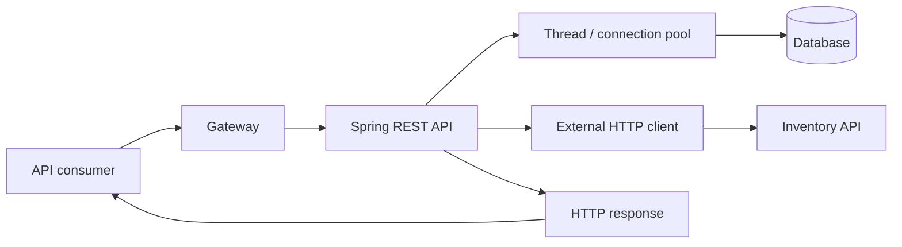

# Đo throughput, error rate, saturation và latency p95, p99

## 1. Quan sát REST API phải trả lời được câu hỏi gì?

Một API `GET /api/orders/{id}` vẫn trả lời được phần lớn request nhưng người dùng than phiền “thỉnh thoảng rất chậm”. Dashboard chỉ hiện **latency trung bình 95 ms** và CPU khoảng 35%, nên nhóm vận hành kết luận dịch vụ khỏe. Trên thực tế, 1% request có thể mất vài giây vì phải chờ connection từ database pool; hệ thống đang gần ngưỡng chịu tải vào giờ cao điểm.

Để phát hiện và giải thích vấn đề đó, cần quan sát ít nhất bốn tín hiệu:

1. **Throughput**: bao nhiêu request/giây được hệ thống phục vụ?
2. **Error rate**: tỷ lệ request thất bại theo định nghĩa hợp đồng và mục tiêu dịch vụ là bao nhiêu?
3. **Saturation**: tài nguyên nào sắp hoặc đang cạn, khiến request phải chờ hay bị từ chối?
4. **Latency p95/p99**: phần đuôi phân phối thời gian phản hồi có chậm bất thường hay không?

Đây là cách vận dụng *four golden signals* (latency, traffic, errors, saturation), có liên hệ với **RED** (*Rate, Errors, Duration*) ở tầng request và **USE** (*Utilization, Saturation, Errors*) ở tầng tài nguyên. Không có một con số nào đủ chứng minh API đang khỏe: throughput cao có thể nhờ lượng traffic tăng nhưng error rate cũng cao; error rate thấp có thể vì circuit breaker từ chối request trước khi đến dependency; CPU thấp vẫn có thể đi cùng DB connection pool cạn.

Bài thuộc chương **Quan sát hệ thống** trong module **INTEGRATION_API_REST**: học thiết kế REST API dựa trên resource, URI, HTTP method/status, hợp đồng dữ liệu, phân trang, cache, idempotency, OpenAPI, xác thực/phân quyền, xử lý lỗi và kiểm thử bằng Java/Spring hoặc công nghệ tương đương. Mục tiêu của quan sát là **chứng minh trải nghiệm HTTP và sức khỏe hệ thống**, không sửa lỗi bằng cách thay đổi semantics REST tùy tiện.

**Sau bài học, bạn có thể:** phân biệt định nghĩa và mẫu số của từng metric; thiết kế nhãn/cardinality; đo histogram và tính p95/p99; triển khai Micrometer + Spring Boot Actuator/Prometheus; viết truy vấn PromQL, alert theo SLO và saturation; kiểm thử instrumentation, bảo mật endpoint metrics và phân tích một sự cố dưới tải.

### 1.1. Một request đi qua những điểm có thể chậm



Một request có thể chờ ở gateway, chờ thread, chờ connection, chạy SQL, gọi upstream, serialize JSON rồi mới gửi body. Vì vậy **latency tại server**, **latency của một lời gọi outbound** và **latency người dùng quan sát** là các phép đo khác nhau. Không cộng bừa p99 của từng bước để suy ra p99 tổng, vì các percentile không cộng tuyến tính.

## 2. Bốn tín hiệu: định nghĩa, đơn vị và giới hạn

| Tín hiệu | Ví dụ metric hoặc phép đo | Câu hỏi trực tiếp |
| --- | --- | --- |
| **Throughput / traffic** | Requests/s trên `GET /api/orders/{id}` | API đang nhận/xử lý lưu lượng thế nào, theo route nào? |
| **Error rate** | Failed requests / all eligible requests | Bao nhiêu request không đáp ứng cam kết của API? |
| **Saturation** | Active connections / max, pending requests, rejected calls | Tài nguyên có đang đầy hoặc tạo hàng đợi? |
| **Latency** | Duration histogram, p50/p95/p99, SLO buckets | Bao nhiêu phần trăm request hoàn tất trong ngưỡng thời gian? |

**Quy ước trước khi mở dashboard:** ghi rõ nguồn đo, đơn vị, khoảng thời gian, các route nằm trong mẫu, phương thức HTTP, loại traffic có loại trừ, status nào được coi là lỗi, và cách xử lý request bị cancel/timeout. Hai dashboard cùng ghi “error rate” nhưng một cái tính mọi `4xx`, cái khác chỉ tính `5xx`, không thể dùng để so sánh trực tiếp.

### 2.1. Throughput: tốc độ hoàn tất không phải tổng số request

Một **counter** tăng khi một request HTTP được ghi nhận. Throughput thường được tính là **độ tăng của counter trong một khoảng thời gian**, ví dụ:

\[
\text{request rate (req/s)} \approx \frac{\Delta \text{completed requests}}{\Delta t}.
\]

Ví dụ 12.000 request được ghi nhận trong 5 phút thì thông lượng trung bình là `12000 / 300 = 40 req/s`. Con số này **không nói** có bao nhiêu request đang chờ hay bao nhiêu client đã bỏ cuộc. Nếu đo ở server, request có thể đã thất bại tại gateway trước khi tới service; đo ở ingress và ứng dụng giúp thấy sự khác biệt.

Counter là **đơn điệu trong vòng đời một process**, có thể về 0 sau restart. Với hệ thống Prometheus, dùng `rate()`/`increase()` thay vì trừ hai lần `sum(counter)` thủ công qua các lần restart. Nên xem cả biến động theo route/operation, không chỉ tổng RPS; một route nặng tăng đột biến thường quan trọng hơn trung bình toàn cụm.

### 2.2. Error rate: “lỗi” phải là một quyết định có chủ ý

Một định nghĩa vận hành phổ biến là:

\[
\text{5xx rate}=\frac{\text{HTTP responses 5xx}}{\text{all eligible HTTP responses}}.
\]

Nhưng **5xx rate không luôn bằng tỷ lệ thất bại nghiệp vụ**. Với `GET /api/orders/{id}`, `404` có thể là kết quả hợp lệ cho một ID không tồn tại; với POST tạo đơn, `409 Conflict` có thể là trạng thái cạnh tranh đúng. Ngược lại, API trả `200` kèm `{"success":false}` do lỗi hệ thống sẽ khiến metric 5xx trông xanh nhưng người dùng vẫn thất bại — contract cũng cần được sửa cho rõ.

Nên theo dõi riêng:

- **HTTP 5xx**: thất bại phía service/gateway theo vai trò đo.
- **HTTP 429**: throttling theo quota; không phải mặc định là “server hỏng”, nhưng có thể làm giảm thành công của client và phản ánh saturation.
- **HTTP 401/403**: xác thực/phân quyền bị từ chối; thường loại khỏi availability SLI nếu traffic không hợp lệ, nhưng phải quan sát riêng để phát hiện bất thường bảo mật.
- **Business outcome**: thanh toán thất bại, giữ hàng bị từ chối, lệnh đã nhận nhưng cuối cùng thất bại; cần metric theo **ý định nghiệp vụ** nếu SLO là operation success, không chỉ một HTTP response.

Quyết định **mẫu số** rất quan trọng: nếu `404` hợp lệ nhưng loại nó khỏi mẫu số trong khi vẫn giữ 5xx ở tử số, metric đã đổi ý nghĩa; phải ghi lại trong SLI spec. Đặc biệt đừng tự tính `100% - 5xx rate` rồi tuyên bố đó là availability của người dùng nếu gateway timeouts, canceled requests và async operations không nằm trong bộ đo.

### 2.3. Saturation: tín hiệu xếp hàng và bị từ chối

**Utilization** cho biết tài nguyên đang được dùng bao nhiêu phần trăm; **saturation** cho biết nó **không theo kịp nhu cầu**, ví dụ xuất hiện backlog, chờ acquire pool hay rejected work. CPU 40% không loại trừ saturation ở **DB pool 100%**, outbound connection pool, executor queue, file descriptors hoặc rate limiter.

Các cặp đo nên đi cùng nhau:

| Tài nguyên | Utilization | Saturation / hậu quả |
| --- | --- | --- |
| HikariCP | Active connections / max connections | Pending connections, acquire latency, timeout |
| Servlet executor | Busy threads / max threads | Pending queue, rejected tasks, request wait |
| HTTP client pool | Leased connections / limit | Pending acquire, timeout và retries |
| Circuit breaker/bulkhead | In-flight calls / permits | Rejected calls, not-permitted calls |
| Database | CPU/IO, active sessions | Lock waits, slow queries, deadlocks |
| Streaming/SSE | Active subscriptions | Pending send buffers, disconnects, exhaustion |

**Không có một mức 80% dùng được cho mọi hệ thống.** Một pool đạt 90% mà không có hàng đợi và latency vẫn ổn có thể còn xử lý được; một dependency 50% busy nhưng single-threaded lock đang kẹt vẫn có saturation thực tế. Kết hợp utilization, queue/rejection và tail latency trước khi quyết định tăng capacity.

### 2.4. Latency: đo tại đâu, bắt đầu và kết thúc khi nào?

Một HTTP server timer thường đo thời gian xử lý request từ lúc instrumentation bắt đầu đến khi response được hoàn tất theo phạm vi framework. Hãy xác nhận behavior thực tế của **servlet async, streaming, exception và client disconnect** theo stack/version. Metrics của proxy/CDN, server request và database **không** có cùng ranh giới đo.

Với REST API, cần ít nhất:

- **Inbound**: latency người gọi quan sát ở gateway hoặc API layer.
- **Outbound**: latency của `RestClient`/`WebClient` tới dependency.
- **Internal**: DB acquire/query/transaction, executor queue và serialization nếu có thể đo.

Không tạo thêm timer thủ công cho mọi HTTP request nếu Spring Boot đã tự đo `http.server.requests`: dễ tạo **hai nguồn dữ liệu không cùng định nghĩa**. Custom timers phù hợp cho **đoạn nghiệp vụ hoặc dependency riêng**, có tên và tài liệu rõ.

## 3. Latency p95, p99: nhìn phân phối thay vì chỉ trung bình

### 3.1. Đọc một percentile đúng nghĩa

Sắp xếp 100 thời gian request từ nhỏ đến lớn:

- 95 request hoàn tất trong **100 ms hoặc ít hơn**.
- 4 request tiếp theo mất **700 ms**.
- 1 request cuối mất **3.000 ms**.

Theo quy ước *nearest-rank* cho tập 100 mẫu, **p95 là thời gian ở vị trí 95** (không quá 100 ms), **p99 là vị trí 99** (700 ms), còn **max là 3.000 ms**. Trung bình có thể thấp trong khi người dùng ở đuôi phân phối phải chờ rất lâu.

Một số thư viện dùng nội suy hoặc thuật toán ước lượng nên giá trị hiển thị không khớp đúng vị trí trong ví dụ. Điều cốt lõi: p95 là một ngưỡng mà khoảng 95% observation không vượt qua; p99 là ngưỡng cho khoảng 99% observation. **p99 không phải tốc độ của 99% request chậm nhất**, và p99 không phải giá trị lớn nhất.

| Metric | Cách diễn giải | Hạn chế |
| --- | --- | --- |
| Mean | Tổng thời gian / số request | Bị các outlier kéo lệch, che phân phối |
| p50 | Một nửa request không chậm hơn ngưỡng này | Không thấy tail latency |
| p95 | Khoảng 5% request chậm hơn ngưỡng | Cần đủ mẫu và phạm vi rõ |
| p99 | Khoảng 1% request chậm hơn ngưỡng | Rất nhiễu nếu mỗi cửa sổ có ít request |
| Max | Lời gọi chậm nhất đã quan sát | Không phản ánh tần suất |

Nếu một route chỉ có **20 request trong 5 phút**, p99 của nó gần như phản ánh phần tử chậm nhất và có sai số lớn; đừng đặt alert p99 cứng nhắc mà không xét **sample count**, lưu lượng và khoảng thời gian. Ngược lại, nếu 10.000 req/s thì 1% tail vẫn tương đương khoảng 100 req/s — quan trọng về tác động người dùng.

### 3.2. Histogram, bucket và cách tổng hợp

**Timer** trong Micrometer ghi số lần (`count`), tổng thời gian (`totalTime`) và có thể xuất histogram nếu được bật. Với Prometheus **classic histogram**, có các dãy tích lũy `_bucket{le="..."}`, `_sum` và `_count`. Ví dụ:

```text
http_server_requests_seconds_bucket{uri="/api/orders/{id}",le="0.1"}  8500
http_server_requests_seconds_bucket{uri="/api/orders/{id}",le="0.3"}  9400
http_server_requests_seconds_bucket{uri="/api/orders/{id}",le="1.0"}  9900
http_server_requests_seconds_bucket{uri="/api/orders/{id}",le="+Inf"} 10000
http_server_requests_seconds_count{uri="/api/orders/{id}"}           10000
```

Đây là **số liệu minh họa** cho một snapshot/cửa sổ tương thích, không phải ví dụ đầy đủ nhãn Prometheus. Bucket `le="0.3"` chứa **tất cả** observation có latency không quá 0,3 giây; các bucket là tích lũy, không được cộng chúng thành tổng số request. `+Inf` chứa mọi observation và thường bằng `_count`.

Prometheus tính p95/p99 gần đúng bằng `histogram_quantile(...)` trên **tốc độ tăng các bucket**. Giá trị trả về có đơn vị **giây**. Kết quả bị ảnh hưởng bởi ranh giới bucket và phép nội suy, nên cần đặt bucket/SLO phù hợp với latency thực tế.

**Sai lầm lớn:** lấy p99 trên từng pod rồi tính trung bình. Quantile **không cộng/trung bình tuyến tính**: pod A có 100.000 request, pod B có 20 request, p99 của chúng không thể cho trọng số bằng nhau. Muốn p99 toàn dịch vụ, phải **cộng histogram buckets theo `le`** trước, rồi mới tính quantile. Prometheus Summary quantiles từ từng instance không có tính chất tổng hợp đó; histogram có thể tổng hợp theo request counts.

### 3.3. Thành công nhanh không được che lỗi chậm

Nên tách p95/p99 theo **route template, method, status/outcome nhóm** khi lưu lượng đủ lớn. Nếu 98% request `200` nhanh nhưng 2% `503` fail fast, p99 toàn bộ có thể **giảm** sau khi circuit breaker mở — dashboard latency đẹp hơn nhưng availability tệ hơn. Đọc tail latency **cùng error rate, throughput và rejected calls**.

Không dùng dynamic URI `/api/orders/ord-123` làm label. Dùng route template `/api/orders/{id}` để nhóm mẫu vào một phân phối có ý nghĩa. Các route rất khác nhau (`GET` tra cứu và `POST` export) nên có SLO riêng, không bắt mọi thứ dùng chung một p99.

## 4. Dựng đường đo Spring Boot Actuator + Micrometer + Prometheus

Với **Java 17+, Spring Boot 3.x**, có thể dùng `spring-boot-starter-actuator` và `micrometer-registry-prometheus` để quan sát HTTP server. Đối với Spring MVC, instrumentation tiêu chuẩn ghi metric/timer tên logic thường là **`http.server.requests`**, các nhãn phổ biến gồm `method`, `uri` (route template), `status`, `outcome`, `exception`. Với Prometheus registry, tên có thể được chuẩn hóa thành `http_server_requests_seconds_count`, `_sum` và, khi bật histogram, `_bucket`.

**Không hardcode assumption theo phiên bản:** Spring Framework/Boot, Micrometer, Prometheus registry và OpenTelemetry bridge có thể thay đổi naming, attribute hoặc export format. Hãy xem output thực của `/actuator/metrics` và `/actuator/prometheus` trong đúng build đang chạy trước khi viết alert lâu dài.

### 4.1. Dependencies và cấu hình

Ví dụ với Maven, thêm dependencies vào project có Spring Web MVC và Spring Security:

```xml
<dependencies>
    <dependency>
        <groupId>org.springframework.boot</groupId>
        <artifactId>spring-boot-starter-actuator</artifactId>
    </dependency>
    <dependency>
        <groupId>io.micrometer</groupId>
        <artifactId>micrometer-registry-prometheus</artifactId>
    </dependency>
</dependencies>
```

Dùng BOM/dependency management của Spring Boot để thống nhất phiên bản. Ví dụ `application.yml`:

```yaml
management:
  endpoints:
    web:
      exposure:
        include: health,prometheus
  endpoint:
    health:
      show-details: never
  metrics:
    tags:
      application: orders-api
    distribution:
      percentiles-histogram:
        http.server.requests: true
      slo:
        http.server.requests: 100ms,300ms,1s,3s
```

Cấu hình này chọn histogram và các ranh giới phục vụ mục tiêu latency, **không** buộc server “luôn xử lý trong 300 ms”. Bật histogram cho nhiều metric/labels có thể tăng số time series và chi phí lưu trữ; nên đo cardinality và retention. Một số phiên bản/kiểu export có native histograms hoặc thay đổi cách expose buckets; truy vấn ở mục 5 giả định **classic `_bucket`** thực sự tồn tại.

`health`/`prometheus` được expose về mặt web **không đồng nghĩa được phép mở Internet**. Phải giới hạn network, xác thực và phân quyền theo thiết kế bảo mật ở mục 8. Cấu hình này là **mảnh cấu hình minh họa**: cần kết hợp với management port, security filter, ServiceMonitor/scrape config phù hợp hạ tầng.

### 4.2. Kiểm tra HTTP và raw metrics

Ví dụ gọi endpoint nghiệp vụ:

```http
GET /api/orders/ord-42 HTTP/1.1
Host: orders.example.test
Authorization: Bearer <synthetic-valid-token>
Accept: application/json
```

Kết quả hợp lệ:

```http
HTTP/1.1 200 OK
Content-Type: application/json
Cache-Control: private, no-store

{"id":"ord-42","status":"CREATED"}
```

Sau các lời gọi, scrape endpoint monitoring qua **kênh/identity được cấp quyền**, chẳng hạn:

```bash
curl --fail --header "Authorization: Bearer ${METRICS_TEST_TOKEN}" \
  https://orders-metrics.example.test/actuator/prometheus
```

`METRICS_TEST_TOKEN` là test token của monitoring identity; không dùng bearer token của khách hàng để scrape. URL trên chỉ là ví dụ. Output cần quan sát (không cam kết đúng số liệu):

```text
# HELP http_server_requests_seconds ...
http_server_requests_seconds_bucket{application="orders-api",
  method="GET",uri="/api/orders/{id}",status="200",le="0.3"} 42
http_server_requests_seconds_count{application="orders-api",
  method="GET",uri="/api/orders/{id}",status="200"} 44
```

Các dòng trên được **ngắt để dễ đọc**, trong output Prometheus thật một mẫu metric thường nằm trên **một dòng** với đầy đủ nhãn. Nội dung thực còn có các labels khác và histogram buckets khác.

### 4.3. Inbound, outbound và tracing không phải một loại metric

Khi server trả chậm, xem thêm số đo của client HTTP tới Inventory/Payment, DB connection acquire và query duration. Spring Boot/Micrometer Observation có thể instrument một phần các client như `RestClient`/`WebClient` nếu sử dụng **builder đã được auto-configure**; client tự `new` không được bảo đảm có observation, tracing và headers propagation tương tự.

Trace (`traceparent`, span tree) giúp tìm **request cụ thể** nào chậm ở đâu; metrics giúp biết **bao nhiêu request** bị ảnh hưởng. Log có correlation ID giúp diễn giải lỗi. Không dùng span traces lấy mẫu như nguồn duy nhất để tính chính xác request rate/SLO nếu sampling không được hiệu chỉnh; timer/counter đo đầy đủ phù hợp hơn.

## 5. PromQL: từ metric thô thành câu hỏi vận hành

Ví dụ bên dưới giả định **classic Prometheus histogram** và nhãn `application="orders-api"`, `uri="/api/orders/{id}"`, `method="GET"` đúng như output đo được. Cửa sổ `[5m]` phù hợp cho dashboard ngắn hạn, nhưng phải chọn cửa sổ phù hợp scrape interval, traffic và thời gian mong muốn để phát hiện sự cố; 5 phút không phải lựa chọn bắt buộc.

### 5.1. Throughput theo endpoint

```promql
sum(
  rate(http_server_requests_seconds_count{
    application="orders-api",
    uri="/api/orders/{id}",
    method="GET"
  }[5m])
)
```

Kết quả có đơn vị **request/giây**, cộng trên các pod/instance và status. Nếu tính throughput toàn API bằng cách loại bỏ nhãn `uri` thì nên **phân tách health/metrics endpoints** để không vô tình đếm traffic scrape thành business requests.

Để so request của nhiều route theo biểu đồ, có thể giữ nhãn route template:

```promql
sum by (uri, method) (
  rate(http_server_requests_seconds_count{
    application="orders-api",
    uri=~"/api/.*"
  }[5m])
)
```

Đếm ở tầng Spring server chỉ thấy request đã đi tới ứng dụng và được observation ghi nhận. Khi gateway trả `429/502/504` **trước khi forward**, request ấy có thể không hiện trong `http.server.requests` của Orders; cần thêm metric tại ingress/gateway nếu muốn SLI người dùng cuối.

### 5.2. Error rate 5xx

```promql
sum(
  rate(http_server_requests_seconds_count{
    application="orders-api",
    uri=~"/api/.*",
    status=~"5.."
  }[5m])
)
/
clamp_min(
  sum(
    rate(http_server_requests_seconds_count{
      application="orders-api",
      uri=~"/api/.*"
    }[5m])
  ),
  1e-9
)
```

Kết quả là **tỷ lệ từ 0 đến 1**; dashboard muốn phần trăm thì nhân 100. Tử số và mẫu số phải dùng **cùng bộ lọc route, method, environment và population**. `clamp_min` tránh chia cho 0 trong công thức nhưng **không có traffic không có nghĩa chất lượng bằng 100%**; nên hiển thị riêng `no traffic` hoặc có điều kiện về tổng số mẫu để không tạo alert sai.

Kiểm tra `429` riêng:

```promql
sum by (uri) (
  rate(http_server_requests_seconds_count{
    application="orders-api",
    status="429"
  }[5m])
)
```

Nếu policy định nghĩa error SLI theo *good events / eligible events*, hãy đưa logic của SLI vào **recording rules** và dùng một định nghĩa thống nhất giữa dashboard, alert và báo cáo SLO. Không tự gán mọi `404/409` là lỗi hệ thống mà không xét REST contract.

### 5.3. P95/P99 trên nhiều instance

```promql
histogram_quantile(
  0.95,
  sum by (le) (
    rate(http_server_requests_seconds_bucket{
      application="orders-api",
      uri="/api/orders/{id}",
      method="GET"
    }[5m])
  )
)
```

```promql
histogram_quantile(
  0.99,
  sum by (le) (
    rate(http_server_requests_seconds_bucket{
      application="orders-api",
      uri="/api/orders/{id}",
      method="GET"
    }[5m])
  )
)
```

Kết quả là **giây**, ví dụ `0.42` nghĩa là 420 ms. `sum by (le)` giữ ranh giới bucket nhưng cộng các instances/status của cùng route và method. Để so nhiều routes cùng lúc, có thể dùng `sum by (le, uri, method)` rồi tính histogram quantile cho từng nhóm; với SLO của một status cụ thể, thêm filter theo status **cả lúc chọn bucket**.

Đừng truy vấn `_bucket` nếu metrics chưa được cấu hình xuất histogram; cũng không dùng `avg(http_server_requests_seconds{quantile="0.99"})` giữa pods. Nếu dùng **Prometheus native histogram**, cú pháp và biểu diễn dữ liệu khác classic buckets, phải chọn truy vấn phù hợp registry/server đang triển khai.

### 5.4. Tỷ lệ request dưới ngưỡng 300 ms: thường ổn định hơn p99

Nếu histogram có bucket `le="0.3"`:

```promql
sum(rate(http_server_requests_seconds_bucket{
  application="orders-api",
  uri="/api/orders/{id}",
  method="GET",
  le="0.3"
}[5m]))
/
clamp_min(
  sum(rate(http_server_requests_seconds_count{
    application="orders-api",
    uri="/api/orders/{id}",
    method="GET"
  }[5m])),
  1e-9
)
```

Ví dụ kết quả `0.98` nghĩa là khoảng **98% request được đo hoàn tất trong 300 ms**, bao gồm các status chưa bị filter. Nếu yêu cầu là “98% **request thành công** dưới 300 ms”, phải định nghĩa `good` gắn **cả status và duration** trong cùng numerator và chọn denominator phù hợp, không chỉ thay tên dashboard. Bucket SLO ở 300 ms cần **thực sự được xuất**; nếu chỉ có `le="0.25"` và `le="0.5"`, không thể suy chính xác tỷ lệ dưới 300 ms bằng truy vấn ở trên.

### 5.5. Saturation của HikariCP và tín hiệu chờ

Nếu service dùng HikariCP và Micrometer đã export gauges:

```promql
hikaricp_connections_active{pool="HikariPool-1"}
/
clamp_min(hikaricp_connections_max{pool="HikariPool-1"}, 1)
```

```promql
hikaricp_connections_pending{pool="HikariPool-1"}
```

Hai truy vấn là **cho từng instance/pool**, không tự cộng gauge active của nhiều pods rồi chia cho max một pod. Tên pool thực có thể khác và có thêm nhãn `application`, `instance`. Active/max cao cộng với pending tăng và SQL latency cao là dấu hiệu nghẽn kết nối. Có thể đo thêm `hikaricp_connections_timeout_total` nếu phiên bản registry xuất metric tương ứng; **luôn kiểm chứng tên và labels từ output thực**.

Một alert tốt hiếm khi chỉ viết `active/max > 0.8`; ví dụ cân nhắc **pending > 0 trong vài phút**, **p95 latency tăng** và **5xx/timeout tăng**, có điều kiện minimum traffic. Cần xem Hikari pool và database cùng lúc: tăng max pool trong ứng dụng có thể làm database nghẽn hơn.

## 6. Java/Spring: đo dependency và mức sử dụng bulkhead mà không sinh nhãn vô hạn

Spring Boot đã đo inbound HTTP; khi một endpoint chậm do `Inventory API`, muốn quan sát **đúng lời gọi Inventory** và **in-flight/rejection**, có thể thêm một lớp instrumentation nhỏ tại integration boundary. Ví dụ dùng Java 17, Micrometer, Spring Framework 6.1+/Boot 3.2+; code không giả lập kết quả thành công khi downstream lỗi.

### 6.1. Một component đo duration, in-flight và rejection

```java
package example.orders.observability;

import io.micrometer.core.instrument.Counter;
import io.micrometer.core.instrument.Gauge;
import io.micrometer.core.instrument.MeterRegistry;
import io.micrometer.core.instrument.Timer;
import java.util.concurrent.Semaphore;
import java.util.concurrent.atomic.AtomicInteger;
import java.util.function.Supplier;
import org.springframework.beans.factory.annotation.Value;
import org.springframework.stereotype.Component;
import org.springframework.web.client.ResourceAccessException;
import org.springframework.web.client.RestClientResponseException;

class InventoryCapacityExceeded extends RuntimeException {
    InventoryCapacityExceeded() {
        super("Inventory capacity exhausted");
    }
}

@Component
public final class InventoryCallMeter {
    private final MeterRegistry registry;
    private final Semaphore slots;
    private final AtomicInteger inFlight = new AtomicInteger();
    private final Counter rejected;
    private final int capacity;

    public InventoryCallMeter(
            MeterRegistry registry,
            @Value("${integrations.inventory.max-concurrent:16}")
            int capacity) {
        if (capacity < 1) throw new IllegalArgumentException("capacity");
        this.registry = registry;
        this.capacity = capacity;
        this.slots = new Semaphore(capacity);

        Gauge.builder("integration.inventory.inflight",
                inFlight, AtomicInteger::get)
            .description("Accepted Inventory calls currently running")
            .register(registry);
        Gauge.builder("integration.inventory.capacity",
                this, value -> value.capacity)
            .register(registry);
        rejected = Counter.builder("integration.inventory.rejected")
            .description("Inventory calls rejected before outbound I/O")
            .register(registry);
    }

    public <T> T call(Supplier<T> action) {
        if (!slots.tryAcquire()) {
            rejected.increment();
            throw new InventoryCapacityExceeded();
        }

        inFlight.incrementAndGet();
        Timer.Sample start = Timer.start(registry);
        String outcome = "internal_error";
        try {
            T result = action.get();
            outcome = "ok";
            return result;
        } catch (RestClientResponseException e) {
            // 4xx chưa chắc là thất bại nghiệp vụ của API public.
            outcome = e.getStatusCode().is5xxServerError()
                ? "upstream_5xx" : "upstream_4xx";
            throw e;
        } catch (ResourceAccessException e) {
            outcome = "network_error";
            throw e;
        } finally {
            start.stop(Timer.builder("integration.inventory.duration")
                .description("Duration of accepted Inventory calls")
                .tag("outcome", outcome)
                .register(registry));
            inFlight.decrementAndGet();
            slots.release();
        }
    }
}
```

Phép đo ở đây có một **phạm vi rõ**:

- `integration.inventory.inflight`: **gauge**, số lời gọi được chấp nhận và đang chạy; gần với saturation nhưng chưa phải toàn bộ queue của HTTP client.
- `integration.inventory.capacity`: **gauge**, số permit được cấu hình; có thể so in-flight/capacity, đồng thời đọc rejected counter.
- `integration.inventory.rejected`: **counter**, số request không có permit, không gửi downstream. Nó **không** nằm trong timer của các lời gọi đã được chấp nhận.
- `integration.inventory.duration`: **timer** cho những lời gọi thực sự được chấp nhận, gắn `outcome` thuộc một tập hữu hạn (`ok`, `upstream_4xx`, `upstream_5xx`, `network_error`, `internal_error`).

`Semaphore.tryAcquire()` là bulkhead fail-fast minh họa. Chính sách HTTP có thể chuyển `InventoryCapacityExceeded` thành `503 Service Unavailable` và `application/problem+json`, nhưng **không** coi đây mặc định là quota của user (`429`). Nếu tồn tại Resilience4j bulkhead sẵn, nên **dùng metrics của chính bulkhead đó** thay vì đặt thêm một lớp semaphore độc lập. Đừng thêm một bộ đếm thủ công trùng với meter mà framework đã ghi.

Ví dụ ánh xạ lỗi quá tải nội bộ thành HTTP mà **không lộ tên pool hoặc stack trace**:

```java
@RestControllerAdvice
class InventoryCapacityAdvice {
    @ExceptionHandler(InventoryCapacityExceeded.class)
    ResponseEntity<ProblemDetail> overloaded() {
        ProblemDetail error = ProblemDetail.forStatus(503);
        error.setTitle("Temporarily unavailable");
        error.setProperty("code", "DEPENDENCY_CAPACITY_EXHAUSTED");
        return ResponseEntity.status(503)
            .header("Retry-After", "2")
            .header("Cache-Control", "no-store")
            .body(error);
    }
}
```

Đây là method/class minh họa với các imports Spring Web (`@RestControllerAdvice`, `@ExceptionHandler`, `ResponseEntity`, `ProblemDetail`). `Retry-After` là gợi ý theo chính sách, không phải bảo đảm retry sẽ thành công. Lỗi đã được ghi vào counter `integration.inventory.rejected` **và** HTTP `503` ở server nếu request đến từ endpoint công khai; đó là **hai góc nhìn khác nhau của cùng một sự kiện**, không cộng chúng thành hai lần thất bại của người dùng.

Mỗi call làm thay đổi trạng thái gauge đúng một lần. `finally` đảm bảo in-flight giảm và permit được trả cả khi `RestClient` ném exception. Với streaming hoặc async `Mono`/`CompletableFuture`, **không** copy nguyên pattern này: timer và permit phải sống cho đến tín hiệu *complete/error/cancel*, không được giải phóng ngay lúc tạo publisher/future.

### 6.2. Dùng lớp đo trong một HTTP gateway Spring

```java
package example.orders.integration;

import example.orders.observability.InventoryCallMeter;
import org.springframework.beans.factory.annotation.Value;
import org.springframework.stereotype.Service;
import org.springframework.web.client.RestClient;

record InventoryView(String sku, int available) {}

@Service
public class InventoryGateway {
    private final RestClient client;
    private final InventoryCallMeter measurements;

    public InventoryGateway(
            RestClient.Builder builder,
            InventoryCallMeter measurements,
            @Value("${integrations.inventory.base-url}") String baseUrl) {
        this.client = builder.baseUrl(baseUrl).build();
        this.measurements = measurements;
    }

    public InventoryView find(String sku) {
        return measurements.call(() -> {
            InventoryView view = client.get()
                .uri("/api/inventory/{sku}", sku)
                .retrieve().body(InventoryView.class);
            if (view == null) throw new IllegalStateException(
                "Inventory returned no body");
            return view;
        });
    }
}
```

Sử dụng `RestClient.Builder` do Spring Boot quản lý giúp các customizers/observations có cơ hội được áp dụng; base URL phải đến từ **cấu hình đáng tin**, không nhận URL do người dùng điều khiển. Đặt **connect/read/total timeout** trên transport và workflow; timer không tự áp deadline. Cần xác thực service-to-service (OAuth scope/mTLS) theo integration policy, không forward bearer token của người dùng sang host không được phép.

**Giới hạn của ví dụ:** `InventoryCallMeter` đo **công việc outbound đã được gọi**, không tự đếm HTTP requests inbound. Nếu endpoint cũng được instrument bởi Spring Actuator, hai meter có ý nghĩa khác nhau, **không cộng số lần của chúng** như cùng một traffic counter. Không gắn `sku`, `orderId`, raw URL, exception message hoặc bearer token làm metric tags. Với các trạng thái retry, quyết định đo từng **attempt** hay một **logical operation** và đặt tên metric khác nhau; tổng attempt rate có thể lớn hơn request rate do retry.

## 7. Từ dashboard đến SLI, SLO và cảnh báo có thể hành động

### 7.1. SLI là phép đo; SLO là mục tiêu được cam kết

Một SLI (*service level indicator*) phải định nghĩa **rõ population và good event**. Ví dụ:

> Trong 30 ngày, ít nhất **99,9%** request hợp lệ tới `GET /api/orders/{id}` không nhận lỗi 5xx do service/gateway; đồng thời ít nhất **99% request thành công** được hoàn tất trong 300 ms đo tại ingress.

Đây là **một ví dụ**, không phải SLO mặc định cho mọi API. Nó gồm hai chỉ tiêu khác nhau: availability và latency. Mỗi chỉ tiêu cần:

- **Điểm đo:** ingress hay application? Có tính lỗi gateway trả trước khi gọi app không?
- **Tập request:** chỉ traffic hợp lệ? Có tính `401/403`, endpoint health, batch jobs, probe, retry không?
- **Good event:** `2xx`, `3xx`, `404` hợp lệ, hay tập business outcomes được phê duyệt?
- **Cửa sổ đo:** rolling 30 ngày, theo tháng lịch hay thời gian bảo trì loại trừ theo policy?
- **Dữ liệu đầu vào:** counter/histogram từ toàn bộ instances, scrape gap và reset có được xử lý?

Nếu availability SLO là **99,9% request good**, error budget là **0,1% số request đủ điều kiện** trong cửa sổ đo. Không đổi ngay thành “43,2 phút downtime/tháng”: quy đổi ra phút chỉ đúng với cách định nghĩa uptime theo thời gian hoặc lưu lượng đều và giả định bổ sung.

Đặt **burn rate** là:

\[
\text{burn rate} =
\frac{\text{tỷ lệ bad events quan sát được}}{\text{tỷ lệ bad events được phép theo SLO}}.
\]

Ví dụ cho SLO 99,9%, nếu 2% request hiện đang thất bại, burn rate là `0.02 / 0.001 = 20`: đang tiêu thụ error budget nhanh gấp **20 lần** tốc độ cho phép nếu mức này kéo dài. Alert tốt có thể dùng **nhiều cửa sổ** (ngắn để nhận biết sự cố nhanh, dài để tránh nhiễu), có điều kiện số mẫu đủ lớn và tách cảnh báo “không có traffic/không scrape được”.

### 7.2. P95/p99 là chỉ báo phân tích, không phải lúc nào cũng là SLO trực tiếp

Một SLO kiểu “99% thành công dưới 300 ms” thích hợp dùng **tỷ lệ good requests** từ buckets/counters đã định nghĩa. P99 vẫn rất hữu ích để phát hiện phần đuôi bị xấu đi nhưng không nên thay trực tiếp numerator/denominator của SLO bằng một giá trị p99 không rõ mẫu. Khi traffic thấp, cảnh báo p99 đơn lẻ dễ nhiễu; khi có 5xx fail-fast, p99 có thể giảm dù availability đang xấu đi.

Một bộ alert thực tiễn:

| Alert | Kết hợp tín hiệu | Hành động điều tra |
| --- | --- | --- |
| **High error-budget burn** | Tỷ lệ bad events tăng trên hai cửa sổ, có đủ mẫu | Kiểm tra ingress, status, deploy và dependency |
| **Tail latency regression** | p95/p99 tăng, RPS đủ, slow-event ratio tăng | Phân tách DB/query, HTTP client và queue |
| **Pool saturation** | Active gần capacity, pending/timeout tăng | Kiểm tra SQL chậm, connection leak, transaction duration |
| **Overload shed** | `429/503` và rejected calls tăng | So per-tenant quota, bulkhead/circuit state |
| **Telemetry gap** | Target scrape down, counter ngừng tăng khi có ingress traffic | Sửa monitoring trước khi kết luận hệ thống khỏe |

Không lập alert kiểu “p99 vượt 500 ms một lần là page trực đêm” mà không xét nguyên nhân, thời gian kéo dài và số người dùng bị tác động. Gắn **runbook** với owner, route, dashboards, traces và cách rollback/cắt tải an toàn; ưu tiên triệu chứng người dùng trước metric nội bộ ít ảnh hưởng.

### 7.3. Throughput thay đổi có thể che lỗi lan truyền

Quan sát bốn trạng thái khác nhau:

1. **RPS tăng, error tăng, saturation tăng:** traffic surge hoặc dependency quá tải.
2. **RPS giảm, pending tăng:** server không còn hoàn tất request nhanh dù ingress vẫn nhận nhiều.
3. **RPS ổn, p99 tăng, CPU thấp:** cần kiểm tra DB locks/pool, DNS, downstream I/O và các hàng đợi ngoài CPU.
4. **p99 giảm, 503/rejection tăng:** fail-fast do circuit breaker/bulkhead có thể đã bảo vệ worker threads nhưng trải nghiệm/API availability vẫn bị suy giảm.

Muốn phân biệt, hãy đặt trên cùng timeline: ingress attempted RPS, application completed RPS, status distribution, in-flight, pending/active pool, outbound durations, 429/503, deployment và tỷ lệ retry. Không suy nguyên nhân chỉ từ sự trùng thời gian; dùng traces/logs và fault tests để xác minh.

## 8. Bảo mật, cardinality và chất lượng telemetry

### 8.1. Metrics endpoint là tài sản nội bộ

`/actuator/prometheus` có thể lộ tên route, tên service, lỗi, library và mẫu tải; một số actuator endpoints khác nhạy cảm hơn nhiều. Không mở cả `/actuator/**` công khai chỉ để Prometheus scrape. Giới hạn qua network policy, TLS/mTLS hoặc bearer scope của monitoring identity; chỉ expose những endpoint thật sự cần.

Ví dụ một Spring Security chain **riêng cho Prometheus**, giả định ứng dụng có OAuth2 Resource Server và một chain khác bảo vệ business API:

```java
package example.orders.security;

import org.springframework.boot.actuate.autoconfigure.security.servlet.EndpointRequest;
import org.springframework.context.annotation.Bean;
import org.springframework.context.annotation.Configuration;
import org.springframework.core.annotation.Order;
import org.springframework.security.config.Customizer;
import org.springframework.security.config.annotation.web.builders.HttpSecurity;
import org.springframework.security.web.SecurityFilterChain;

@Configuration
class MetricsSecurityConfiguration {
    @Bean
    @Order(1)
    SecurityFilterChain prometheusSecurity(HttpSecurity http)
            throws Exception {
        return http
            .securityMatcher(EndpointRequest.to("prometheus"))
            .authorizeHttpRequests(auth -> auth
                .anyRequest().hasAuthority("SCOPE_metrics:read"))
            .oauth2ResourceServer(o -> o.jwt(Customizer.withDefaults()))
            .build();
    }
}
```

Đây **không** phải toàn bộ security configuration. Những routes còn lại phải có `SecurityFilterChain` riêng với mặc định **deny by default**; nếu management chạy trên port/context độc lập, cần bảo đảm chain/network policy thực sự được áp trên management listener. Hạn chế quyền của monitoring principal và bảo vệ token/credentials trong secret store; với Prometheus scrape qua mTLS/sidecar có thể dùng cách xác thực khác nhưng vẫn phải kiểm soát quyền.

Test an toàn: anonymous không lấy được raw metrics (`401/403` theo cấu hình), monitoring identity có scope hợp lệ đọc được, caller thông thường không lấy được, và endpoint không bị expose qua gateway public. Không dựa vào “đường dẫn khó đoán” để bảo vệ actuator.

### 8.2. Nhãn metric: hữu ích nhưng không được chứa định danh nhạy cảm

**Nhãn tốt, cardinality hữu hạn:** `application`, `environment`, `route template`, `method`, `status`, `outcome`, `dependency`, `region`, `version` theo tập giá trị kiểm soát.

**Nhãn nguy hiểm:** raw URI `/orders/ord-<unique>`, `userId`, `tenantId` tự do, email, IP người dùng, `Authorization`, JWT claim, `Idempotency-Key`, trace ID, request ID, SQL text, exception message. Chỉ 1.000 users × 100 routes × 5 statuses đã có thể tạo rất nhiều time series, chưa kể pods/methods/histogram buckets; chi phí và memory có thể tăng không kiểm soát.

Nếu cần điều tra một request, dùng **trace ID trong log/trace** có policy retention/redaction; không đưa trace ID vào Prometheus labels. Dữ liệu đa tenant phải được phân quyền ở dashboard/query datasource, tránh cho người không có quyền xem dữ liệu/traffic của tenant khác. Tên route chung và tổng counts vẫn có thể nhạy cảm trong hệ thống tài chính/y tế; phân loại và giới hạn truy cập theo chính sách tổ chức.

### 8.3. Metrics phải có ranh giới đo và dữ liệu đáng tin

Những tình huống cần ghi vào dashboard annotation/quality checks:

- **Process restart/pod replacement:** counter reset; dùng `rate()`/`increase()` trên time series phù hợp.
- **Scrape failure:** metric bị thiếu, không được hiểu thành “0 lỗi”.
- **High-cardinality cardinality cap:** có thể khiến series bị drop/coalesce; dashboard route “UNKNOWN” cần được điều tra.
- **Client canceled/streaming request:** chỉ đo complete events có thể bỏ qua in-flight đang kéo dài; thêm gauge/long-task timer nếu phù hợp.
- **Retry/fan-out:** mỗi request inbound có thể phát nhiều downstream attempts; không so hai counter như cùng một tập.
- **Clock/sampling mismatch:** traces có thể được lấy mẫu, histogram buckets có xấp xỉ; tránh kết luận bằng số đo không cùng phạm vi.

`traceparent` theo chuẩn W3C là **tín hiệu tương quan**, không phải credential. Không tin các trường `traceId`/baggage do caller gửi như nguồn tenant/role; không đưa dữ liệu cá nhân nhạy cảm vào baggage được truyền qua dịch vụ.

## 9. Kiểm thử số đo: không chỉ xác nhận API trả 200

### 9.1. JUnit 5 + SimpleMeterRegistry: success, error và in-flight

Unit test instrumentation dễ làm **không cần Prometheus server**. `SimpleMeterRegistry` ghi counters, gauges và timers trong memory, phù hợp kiểm tra rằng code tăng/giảm số đo ở những đường quan trọng:

```java
package example.orders.observability;

import static org.junit.jupiter.api.Assertions.*;

import io.micrometer.core.instrument.simple.SimpleMeterRegistry;
import java.util.concurrent.*;
import org.junit.jupiter.api.Test;

class InventoryCallMeterTest {
    @Test
    void recordsSuccessfulAndFailedCalls() {
        SimpleMeterRegistry registry = new SimpleMeterRegistry();
        try {
            InventoryCallMeter meter = new InventoryCallMeter(registry, 2);

            assertEquals("ok", meter.call(() -> "ok"));
            assertThrows(IllegalStateException.class,
                () -> meter.call(() -> {
                    throw new IllegalStateException("synthetic error");
                }));

            assertEquals(1L, registry.get("integration.inventory.duration")
                .tag("outcome", "ok").timer().count());
            assertEquals(1L, registry.get("integration.inventory.duration")
                .tag("outcome", "internal_error").timer().count());
            assertEquals(0.0, registry.get("integration.inventory.inflight")
                .gauge().value());
        } finally {
            registry.close();
        }
    }

    @Test
    void rejectsAtCapacityAndReleasesPermit() throws Exception {
        SimpleMeterRegistry registry = new SimpleMeterRegistry();
        ExecutorService executor = Executors.newSingleThreadExecutor();
        CountDownLatch entered = new CountDownLatch(1);
        CountDownLatch release = new CountDownLatch(1);
        try {
            InventoryCallMeter meter = new InventoryCallMeter(registry, 1);
            Future<String> first = executor.submit(() -> meter.call(() -> {
                entered.countDown();
                try {
                    if (!release.await(3, TimeUnit.SECONDS)) {
                        throw new IllegalStateException("test deadline");
                    }
                } catch (InterruptedException e) {
                    Thread.currentThread().interrupt();
                    throw new IllegalStateException(e);
                }
                return "first-done";
            }));

            assertTrue(entered.await(2, TimeUnit.SECONDS));
            assertEquals(1.0, registry.get("integration.inventory.inflight")
                .gauge().value());
            assertThrows(InventoryCapacityExceeded.class,
                () -> meter.call(() -> "should-not-run"));
            assertEquals(1.0, registry.get("integration.inventory.rejected")
                .counter().count());

            release.countDown();
            assertEquals("first-done", first.get(2, TimeUnit.SECONDS));
            assertEquals(0.0, registry.get("integration.inventory.inflight")
                .gauge().value());
        } finally {
            release.countDown();
            executor.shutdownNow();
            registry.close();
        }
    }
}
```

Test dùng `CountDownLatch` để kiểm soát trạng thái **một lời gọi đang giữ permit**, không dựa vào `Thread.sleep(...)` gây flaky. Nó chứng minh gauge và rejection counter phản ánh flow của component này; **không** chứng minh HTTP transport, timer histogram bucket Prometheus hoặc Spring instrumentation inbound đã xuất đúng.

### 9.2. Test HTTP metrics ở đúng tầng

Một bài kiểm thử end-to-end nên:

1. Khởi động Spring Boot qua **real HTTP port** (ví dụ `@SpringBootTest(webEnvironment = RANDOM_PORT)`), cấu hình test resource server và metrics exporter riêng; không phải mọi cấu hình `MockMvc` đều tạo ra chính xác lifecycle metrics như request qua socket.
2. Gửi `GET /api/orders/{id}` với test principal hợp lệ để tạo `200`, `404` và một lỗi kiểm soát `503`; bảo đảm HTTP status/body đúng REST contract.
3. Truy cập `GET /actuator/prometheus` bằng **monitoring identity** đã được cho phép; xác minh counter/bucket có `uri` template, `method`, `status` phù hợp và **không có user ID/ID của đơn** trong labels.
4. Gửi nhiều request qua đủ các latency buckets và kiểm tra bucket **tích lũy, monotonic** cùng `_count`; không assert exact p99 từ vài mẫu vì percentile/Prometheus interpolation có sai số và thay đổi theo registry.
5. Kiểm tra anonymous không đọc được `/actuator/prometheus`, endpoint khác (ví dụ `/actuator/env`) không được expose ngoài policy.

Chú ý: metrics registry trong test có thể có **traffic từ framework, management requests, health probes hoặc lần test khác**. Dùng context isolation, metric filters theo `method/uri/status`, hoặc kiểm tra **chênh lệch** count thay vì `count == 1` tuyệt đối nếu không kiểm soát toàn bộ traffic.

### 9.3. Load/fault test để liên kết bốn tín hiệu

Dùng WireMock/MockWebServer hoặc một dependency stub có delay/timeout điều khiển được:

| Thử nghiệm | Kiểm chứng bắt buộc |
| --- | --- |
| Tăng RPS từng bậc | Throughput, p95/p99, in-flight và pending thay đổi có thể giải thích |
| Stub Inventory chậm hơn timeout | Outbound duration/error rate tăng; HTTP public trả lỗi theo policy |
| Hikari pool thấp/SQL giữ lock | Pending connection tăng dù CPU chưa cao; p99 tăng |
| Đẩy đồng thời vượt bulkhead | `integration.inventory.rejected` tăng, không gửi thêm outbound |
| 1% request bị delay 2 giây | Tail latency/histogram phản ánh tail, không chỉ mean |
| Gateway trả 429 trước service | Ingress counter tăng nhưng server count có thể không tăng |
| Dependency trả 503 rồi circuit breaker OPEN | HTTP public có thể fail fast; latency giảm không đồng nghĩa thành công tăng |
| Restart pod giữa tải | PromQL `rate()` vẫn xử lý counter reset; targets và instances có thể quan sát |
| Response streaming bị hủy | In-flight/long-task metrics được cleanup theo thiết kế async |

Không kiểm thử quá tải trên production trái chính sách. Dùng dữ liệu tổng hợp và workload được cho phép, giới hạn thời gian/traffic của fault injection, có rollback. Một load test tốt kiểm tra **request status, business side effects và saturation** đồng thời; phép đo đẹp không được che việc trả sai số tồn kho hoặc bỏ qua phân quyền.

## 10. Phân tích sự cố: p99 tăng nhưng CPU không cao

Tình huống trong 5 phút:

| Metric | Trước thay đổi | Trong sự cố |
| --- | ---: | ---: |
| Ingress traffic | 180 req/s | 320 req/s |
| Orders completed throughput | 178 req/s | 240 req/s |
| HTTP 5xx | 0,2% | 3% |
| GET order p95 | 130 ms | 650 ms |
| GET order p99 | 300 ms | 2.500 ms |
| JVM CPU | 32% | 39% |
| Hikari active / max | 10 / 30 | 30 / 30 |
| Hikari pending | 0 | 85 |
| Inventory call p95 | 90 ms | 100 ms |

**Nhận định ban đầu:** chênh lệch giữa ingress và completed throughput tăng, Hikari đã chạm max và pending tăng, trong khi Inventory p95 ít đổi. DB connection acquire/transaction duration là hướng điều tra ưu tiên hơn CPU hoặc Inventory. **Chưa thể khẳng định root cause** chỉ bằng bảng này: có thể SQL chậm, transaction giữ connection quá lâu, lock contention, connection leak hoặc một thay đổi cấu hình pool.

Quy trình kiểm chứng:

1. **Khoanh vùng:** xem p99 và error theo route/method/status, phân biệt một route nặng với cả ứng dụng; so thời gian deploy và traffic spike.
2. **Tìm điểm chờ:** đối chiếu Hikari pending/acquire time, active/max, DB sessions/locks/slow query logs, trace spans của những request chậm.
3. **Đánh giá side effects:** xác minh request ghi có idempotency/transaction đúng; đừng retry POST vô hạn khi timeout sau commit.
4. **Giảm tác động:** giới hạn concurrency, cắt workload không thiết yếu, rollback thay đổi xấu hoặc tối ưu SQL; tăng pool **chỉ khi DB còn năng lực** và đã thử tải.
5. **Kiểm chứng phục hồi:** pending tiến về 0, p95/p99 và 5xx về mức SLO, ingress/completed throughput hội tụ; tiếp tục quan sát sau rollout.

**Không** giảm mức cảnh báo chỉ vì response p99 đã hạ khi server bắt đầu từ chối request. Nếu tỷ lệ 503 tăng, hãy tiếp tục báo cáo số bad events và error-budget burn.

## 11. Bài tập tự thực hành và đáp án gợi ý

### 11.1. Bài tập 1 — tính bốn tín hiệu từ dữ liệu thô

Trong một cửa sổ đúng **5 phút**, API hoàn tất 24.000 request hợp lệ tới route `GET /api/orders/{id}`. Có 600 response `5xx`; 120 response `429` được theo dõi riêng. Histogram latency (giây) của **cùng population** có:

| Bucket `le` | Số request tích lũy |
| --- | ---: |
| `0.1` | 5.800 |
| `0.3` | 22.800 |
| `1.0` | 23.760 |
| `+Inf` | 24.000 |

Hikari connection pool có `active=20`, `max=20`, `pending=45` trong một khoảng đáng kể. SLO availability đặt ở **99,9% request không bị 5xx**.

Hãy tính: throughput req/s, tỷ lệ 5xx, tỷ lệ request có latency không quá 300 ms, tỷ lệ vượt 1 giây, error-budget burn rate nếu tỷ lệ lỗi giữ nguyên, và mô tả vì sao không thể đọc chính xác p99 từ bảng bucket thô khi không biết phân phối bên trong mỗi bucket.

**Đáp án gợi ý:**

- Throughput = `24.000 / 300 = 80 req/s` trung bình trên cửa sổ.
- 5xx rate = `600 / 24.000 = 2,5%`; `429` có tỷ lệ `0,5%` và không tự động được cộng vào 5xx SLI.
- Tỷ lệ hoàn tất trong 300 ms = `22.800 / 24.000 = 95%`.
- Tỷ lệ vượt 1 giây = `(24.000 - 23.760) / 24.000 = 1%`.
- Error budget fraction của SLO 99,9% là `0,1%`; burn rate hiện tại = `2,5 / 0,1 = 25 lần`.
- Bucket cho biết p95 nằm gần ranh giới **300 ms**, p99 gần ranh giới **1 giây** theo histogram interpolation, nhưng không xác nhận từng latency chính xác; cần bucket đủ dày ở vùng mục tiêu và đủ mẫu. Hikari active/max `100%` **kèm pending** báo saturation cần điều tra.

### 11.2. Bài tập 2 — thiết kế dashboard và alert cho ba REST operations

Thiết kế một dashboard cho:

```text
GET  /api/orders/{id}
POST /api/orders
POST /api/orders/{id}/approve
```

Trong đó `GET` có SLO latency p95 300 ms theo quy ước đo của nhóm; POST tạo đơn có tính idempotent nhờ key; POST approve yêu cầu quyền chức năng và precondition `If-Match`. Hãy quyết định:

1. Mỗi route cần **throughput/error/latency/saturation** nào? Có nên so p99 của tất cả routes trong một biểu đồ gộp?
2. `404`, `409`, `412`, `428`, `429`, `503` nên được tính vào SLI nào; mã nào là tín hiệu abuse, conflict, outage?
3. Khi POST timeout sau commit rồi client retry cùng key, đo **attempts** và **logical operations** bằng metric nào để không thổi phồng business throughput?
4. Nhãn nào an toàn, nhãn nào khiến cardinality tăng vô hạn hoặc làm lộ dữ liệu? Bạn sẽ bảo vệ `/actuator/prometheus` ra sao?
5. Viết một PromQL cho p99 của GET trên tất cả pods và một PromQL cho Hikari pending; giải thích vì sao phải kiểm tra `_bucket` có tồn tại trước khi áp query.

**Hướng giải:** tách route và method, không trộn latency đọc/ghi. Theo dõi HTTP status distribution riêng và quyết định success/bad events dựa trên hợp đồng; `409/412` có thể là conflict hợp lệ, `428` thiếu precondition, `429` là quota, `503` là unavailable. Dùng `orders.operations.created_total` cho logical commits và `http.server.requests` cho attempts, không suy rằng mọi POST là một order mới. Labels là route template, method, status, bounded outcome; không có raw ID/token/key. Protect metrics qua monitoring identity/network. PromQL p99 dùng `histogram_quantile(0.99, sum by (le)(rate(..._bucket[5m])))`; saturation dùng `hikaricp_connections_pending` theo pool và instance.

### 11.3. Bài tập 3 — kiểm thử một sự cố không báo 5xx

Một phiên bản API mới nhận 200 req/s, `5xx=0%`, nhưng trả `200` với body `{"status":"PENDING"}` cho mọi lệnh thanh toán dù 30% mãi không hoàn tất. Hãy giải thích vì sao HTTP 5xx rate vẫn xanh; thiết kế một **business SLI** dựa trên `payment operation` đã đạt trạng thái cuối trong thời hạn cam kết, kèm metric outbox backlog/reconciliation lag. SLI này đo trên **operation IDs duy nhất**, không đếm lại các retry. Thêm alert khi tỷ lệ `PENDING` vượt deadline hoặc số pending lâu ngày tăng.

## 12. Checklist triển khai và kết luận

**Checklist thực hành trước release:**

- [ ] Tài liệu hóa vị trí đo, đơn vị, route population, outcome, mẫu số và cửa sổ thời gian của bốn tín hiệu.
- [ ] `http.server.requests`/HTTP client metrics có nhãn hữu hạn và không lộ secrets/PII.
- [ ] Histogram/buckets được cấu hình; p95/p99 tính bằng cách **cộng buckets trước**, không trung bình percentiles các pod.
- [ ] Quan sát latency cùng throughput, 5xx/429, in-flight và pending/rejected resources.
- [ ] Error SLI phân biệt trạng thái HTTP hợp lệ với lỗi hệ thống; với async operation có thêm business SLI.
- [ ] SLO/burn-rate alerts xét traffic tối thiểu, multi-window và scrape gaps; có owner/runbook.
- [ ] `/actuator/prometheus` chỉ được scrape qua identity/kênh được cấp quyền.
- [ ] Unit/integration/load/fault tests chứng minh metrics tăng, hạ và gắn nhãn đúng trong các ca success, error, timeout, reject.
- [ ] Khi metrics báo tốt mà khách hàng vẫn gặp lỗi, kiểm tra gateway, traces, trạng thái nghiệp vụ và nguồn dữ liệu bị bỏ sót.

**Kết luận:** throughput cho biết lưu lượng, error rate cho biết mức thất bại theo **định nghĩa rõ ràng**, saturation chỉ ra điểm nghẽn tài nguyên, còn p95/p99 phơi bày phần đuôi trải nghiệm mà số trung bình thường che giấu. Trong REST API Java/Spring, đo chúng bằng instrumentation có ranh giới rõ, histogram tổng hợp đúng, nhãn an toàn và test đáng tin; sau đó liên kết với SLO và bất biến nghiệp vụ để ưu tiên xử lý đúng sự cố.

### Tài liệu tham khảo

- [Spring Boot Actuator – Metrics](https://docs.spring.io/spring-boot/reference/actuator/metrics.html) – các meter HTTP, cấu hình distribution và management endpoints.
- [Micrometer – Timers](https://docs.micrometer.io/micrometer/reference/concepts/timers.html) và [Histograms and Percentiles](https://docs.micrometer.io/micrometer/reference/concepts/histogram-quantiles.html) – timer, buckets và phép ước lượng.
- [Prometheus – Histograms and Summaries](https://prometheus.io/docs/practices/histograms/) và [PromQL Functions](https://prometheus.io/docs/prometheus/latest/querying/functions/) – `rate()`, `histogram_quantile()` và cách tổng hợp.
- [Google SRE Book – Monitoring Distributed Systems](https://sre.google/sre-book/monitoring-distributed-systems/) – traffic, errors, saturation và latency.
- [RFC 9110 – HTTP Semantics](https://www.rfc-editor.org/rfc/rfc9110) và [RFC 9457 – Problem Details](https://www.rfc-editor.org/rfc/rfc9457) – mã HTTP và representation lỗi.

