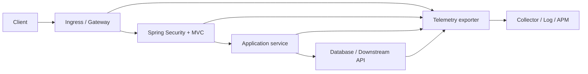

# Che Authorization, cookie, dữ liệu cá nhân và payload nhạy cảm

## Mục tiêu học tập

Sau bài này, bạn có thể:

- Chỉ ra các nơi REST API vô tình làm lộ **Authorization**, **Cookie**, token, thông tin cá nhân và payload nhạy cảm qua log, trace, metric, lỗi HTTP và hệ thống quan sát.
- Phân biệt **không thu thập**, **redaction/masking**, **pseudonymization** và **ẩn danh thực sự**; chọn cách phù hợp theo mục tiêu điều tra sự cố.
- Thiết kế **allowlist trường được ghi nhận** với route template, status, latency, mã lỗi và trace ID thay vì ghi toàn bộ request/response.
- Cấu hình log an toàn ở Java/Spring, reverse proxy và tầng observability; hiểu giới hạn của filter, interceptor, APM và OpenTelemetry.
- Kiểm thử bằng dữ liệu canary để phát hiện bí mật trong log, trace, metric, response và bản xuất dữ liệu từ hệ thống giám sát.
- Thiết lập giới hạn quyền truy cập, thời gian lưu và quy trình xử lý sự cố khi telemetry đã chứa thông tin nhạy cảm.

## 1. Vì sao quan sát hệ thống có thể làm lộ dữ liệu?

Một REST API cần log, metric và distributed tracing để trả lời câu hỏi: request nào thất bại, tầng nào chậm, lỗi xảy ra ở đâu và mức độ ảnh hưởng ra sao. Nhưng cùng một request có thể mang **dữ liệu xác thực, thông tin cá nhân và nội dung nghiệp vụ** mà người vận hành không cần xem.

Ví dụ frontend gọi backend:

```http
POST /api/orders?campaign=fall-sale HTTP/1.1
Host: api.example.com
Authorization: Bearer <ACCESS_TOKEN>
Cookie: __Host-session=<SESSION_SECRET>; preferences=light
Content-Type: application/json
X-Request-Id: req-8a91

{
  "recipientName": "Nguyen Van A",
  "phone": "0900000000",
  "shippingAddress": "Địa chỉ minh họa",
  "items": [{"sku": "keyboard-01", "quantity": 2}],
  "payment": {"cardNumber": "4111111111111111", "cvv": "123"}
}
```

Đây là **dữ liệu giả để minh họa**; trong hệ thống thực, không nên để backend thương mại thông thường nhận hoặc ghi số thẻ/CVV nếu có thể dùng tokenization/payment provider. Một câu lệnh ghi log toàn bộ header/body có thể gửi những giá trị này đến log collector, APM, vendor, dashboard, bản sao lưu và hệ thống cảnh báo. Phạm vi người có quyền xem telemetry thường **khác** phạm vi được phép xem dữ liệu đơn hàng.

Một lỗi điển hình:

```java
// NGUY HIỂM — chỉ minh họa anti-pattern, không dùng trong hệ thống thật.
log.info("Request headers={}, body={}", headers, requestBody);
```

Tương tự, ghi `request.getQueryString()`, `request.getRequestURI()`, `exception.getMessage()` hay `HttpRequest.toString()` có thể vô tình lộ PII/token. **Đặt tên biến `debug` không làm dữ liệu bớt nhạy cảm**; log mức DEBUG vẫn có thể bật trong production hoặc bị thu thập bởi agent.

### Ranh giới thông tin cần giữ

Để phát hiện API đặt hàng đang chậm, thường chỉ cần:

```json
{
  "event": "http.server.request.completed",
  "method": "POST",
  "route": "/api/orders",
  "status": 201,
  "duration_ms": 138,
  "trace_id": "9f3d92af207a47dc8020f15e39c6a81e",
  "error_code": null
}
```

Các trường này hỗ trợ đo độ trễ, tỷ lệ lỗi và liên kết giữa service mà **không cần** lưu bearer token, cookie, họ tên, số điện thoại, địa chỉ hoặc body. Trace ID là mã tương quan kỹ thuật, nhưng vẫn phải quản lý việc liên kết trace với hồ sơ người dùng ở hệ thống khác.

## 2. Nhận diện dữ liệu cần bảo vệ

Không chỉ có `Authorization` và `Cookie`. Dữ liệu nhạy cảm có thể nằm ở request/response, URL, exception, message broker và metadata do thư viện tự thu thập.

| Nguồn | Ví dụ dữ liệu nhạy cảm | Cách xử lý mặc định |
| --- | --- | --- |
| Request headers | `Authorization`, `Proxy-Authorization`, `Cookie`, `X-API-Key`, `X-Auth-Token`, custom secret header | **Không thu thập giá trị**; chỉ ghi sự hiện diện nếu thật cần |
| Response headers | `Set-Cookie`, API token trong header custom, URL đăng nhập có secret | Không thu thập hoặc mask trước khi xuất |
| URL/path/query | Email, số điện thoại, mã phục hồi, OAuth `code`, `access_token`, URL ký sẵn | Log **route template**, bỏ query/fragment; tránh raw path |
| Request body | Mật khẩu, OTP, PIN, địa chỉ, tài khoản ngân hàng, thẻ, token, nội dung chat, tài liệu tải lên | Không log body theo mặc định |
| Response body | JWT/token, PII, dữ liệu hồ sơ, kết quả thanh toán, bí mật reset | Không log body theo mặc định |
| Error/exception | SQL parameters, validation rejected value, thông báo từ provider chứa dữ liệu | Ghi **error code chuẩn hóa** và vị trí code; thận trọng với message |
| Trace/span | HTTP header attributes, URL đầy đủ, DB statement, message payload, baggage | Chỉ giữ attribute theo allowlist |
| Metric label | `userId`, email, `orderId`, raw URL, token, session ID | Chỉ dùng label **ít cardinality, không nhận diện cá nhân** |
| Audit/security event | Account, hành vi truy cập, thay đổi quyền, nguồn truy cập | Thiết kế schema tối thiểu, kênh bảo vệ riêng, retention rõ |

Các trường `User-Agent`, `Referer`, `X-Forwarded-For`, địa chỉ IP và device identifier có thể là dữ liệu nhận diện hoặc mang URL/token. Không được coi chúng là vô hại chỉ vì không xuất hiện trong payload JSON.

### Phân loại theo mức độ cần thiết

- **Secret xác thực**: bearer token, refresh token, cookie session, API key, OTP, mật khẩu, khóa riêng, signed URL; thường phải **loại khỏi telemetry hoàn toàn**.
- **Dữ liệu cá nhân và nghiệp vụ**: email, điện thoại, địa chỉ, tên, tài khoản, dữ liệu sức khỏe/tài chính, nội dung tài liệu; chỉ lưu nếu có mục đích, quyền và thời hạn cụ thể.
- **Định danh liên kết được**: user ID, customer ID, order ID, IP, hash email, fingerprint thiết bị; dù không nhìn ra tên ngay, vẫn có thể liên kết về cá nhân.
- **Tín hiệu vận hành đã chuẩn hóa**: HTTP method, route template, status, duration, error enum, dependency name, trace ID; thường đủ cho dashboard và incident triage.

Phân loại theo **ngữ cảnh và khả năng liên kết**, không chỉ theo tên trường. Một ID đơn hàng trong hệ thống có thể trở thành dữ liệu cá nhân nếu người có quyền log truy vấn ngược được khách hàng.

## 3. Bốn cách xử lý dữ liệu

| Cách | Mô tả | Khi nào dùng |
| --- | --- | --- |
| **Data minimization / omission** | Không ghi nhận giá trị ngay từ nguồn | Mặc định cho Authorization, Cookie, body và trường không cần quan sát |
| **Redaction** | Thay toàn bộ giá trị bằng `[REDACTED]` | Khi cần biết trường có xuất hiện nhưng không cần giá trị |
| **Masking** | Che phần lớn, đôi khi giữ một phần như 4 chữ số cuối | Chỉ khi phần còn lại có giá trị nghiệp vụ và đã đánh giá rủi ro liên kết |
| **Pseudonymization** | Thay định danh bằng mã có thể liên kết có kiểm soát | Khi điều tra cần nối các event, với khóa/bảng ánh xạ được bảo vệ |

Ví dụ:

```json
{
  "authorization_present": true,
  "authorization": "[REDACTED]",
  "cookie": "[REDACTED]",
  "phone": "[REDACTED]",
  "error_code": "ORDER_VALIDATION_FAILED"
}
```

Thông thường **bỏ hẳn field** còn tốt hơn ghi `[REDACTED]` lên mọi event. Nếu không có mục đích sử dụng, sự xuất hiện của header xác thực cũng không cần ghi.

**Hash thuần không đồng nghĩa ẩn danh.** Ví dụ SHA-256(email) vẫn có thể bị tra từ danh sách email thường gặp và tạo định danh liên kết dài hạn. Nếu thực sự cần một mã ổn định để so khớp sự kiện, có thể dùng **HMAC có secret quản lý riêng**, scope/rotation phù hợp và vẫn coi kết quả là dữ liệu có khả năng liên kết. Tránh biến user ID/HMAC thành label metric có cardinality cao.

### Tại sao allowlist an toàn hơn blacklist?

Một blacklist `password|token|secret` dễ bỏ sót `sessionKey`, `refreshJwt`, `clientAssertion`, dữ liệu nested, tên field thay đổi, mảng, GraphQL variables và payload multipart. Dùng regex để tìm chuỗi trông giống JWT cũng không đủ: không phải token nào cũng có dạng ba đoạn dấu chấm; dữ liệu PII có nhiều định dạng.

Thiết kế tốt hơn là **xác định từ trước các trường telemetry được phép**:

```text
INPUT HTTP request (có headers, path, query, body)
       |
       v
Xác thực/định tuyến/xử lý nghiệp vụ
       |
       +--> Tạo telemetry event từ allowlist:
       |       method, route template, status,
       |       elapsed time, trace ID, error code
       |
       v
Exporter / Collector / Log backend
```

Không xây log event bằng cách serialize cả request rồi xóa một số key. **Điểm scrub an toàn nhất là trước khi giá trị nhạy cảm được thêm vào log/span/metric**, không phải chỉ xóa ở dashboard sau khi dữ liệu đã được xuất ra.

Trong trường hợp buộc phải theo dõi một field nghiệp vụ, hãy tạo **DTO observability riêng** với các trường được duyệt, thay vì annotate `@ToString` cho entity, serialize `HttpServletRequest` hoặc log toàn bộ `Map<String, Object>` chứa request body.

## 4. Các điểm rò rỉ theo đường đi của REST API

Một request đi qua nhiều lớp, mỗi lớp có thể tự tạo log:



Các điểm cần kiểm tra độc lập:

1. **Gateway/reverse proxy**: access log mặc định có thể chứa request line với query string, hoặc cấu hình log toàn bộ headers; WAF có thể giữ body để điều tra.
2. **Spring Security**: debug filter chain, lỗi authentication, token parser, thông báo từ identity provider; không log raw credentials.
3. **Controller và exception handler**: `@RequestBody`, `@Valid`, lỗi binding/validation có thể chứa `rejectedValue`; `@ControllerAdvice` không nên echo request body.
4. **HTTP client**: interceptors dùng để debug có thể log Authorization/Cookie và body khi gọi payment, email hoặc OAuth server.
5. **Database**: SQL trace log cùng bind parameters có thể chứa email, số tài khoản, khóa giao dịch, token.
6. **Message broker**: consumer logging, dead-letter messages, retry logs có thể ghi toàn bộ payload nhạy cảm.
7. **OpenTelemetry/APM**: auto-instrumentation có thể thu URL đầy đủ, statement, header khi bật capture; custom span có thể thêm `user.email` hoặc payload.
8. **Bên xuất dữ liệu**: exporter, collector, SIEM, ticket, Slack alert, screenshot dashboard, support bundle, backup và hệ thống vendor.

Một config an toàn ở Spring **không sửa được** access log của Nginx hoặc cấu hình capture header ở Java agent bên ngoài JVM. Cần xác định owner và kiểm tra dữ liệu tại **đầu ra của từng tầng**.

### URL: route template thay vì path thật

Giả sử request:

```http
GET /api/customers/nguyen@example.com/orders?access_token=CANARY_TOKEN HTTP/1.1
```

**Không ghi** raw URL, `requestURI`, `queryString` hay request line. Một event an toàn hơn:

```json
{
  "method": "GET",
  "route": "/api/customers/{customerId}/orders",
  "status": 400
}
```

Tên route template là thuộc tính **do ứng dụng định nghĩa**, không phải giá trị lấy từ client. Với request chưa match route, ghi `unmatched` hoặc một route nhóm cố định; đừng fallback sang raw path vì đúng những trường hợp 404 này dễ chứa token/query nhạy cảm.

## 5. Hợp đồng logging an toàn cho một REST API

Một schema cho event vận hành có thể gồm:

| Trường | Ví dụ | Ghi chú |
| --- | --- | --- |
| `event` | `http.server.request.completed` | Tên event cố định |
| `service` | `integration-api-rest` | Tên service từ cấu hình, không phải dữ liệu user |
| `method` | `POST` | Giá trị HTTP method |
| `route` | `/api/orders/{orderId}` | Template có cardinality thấp |
| `status` | `503` | HTTP response status |
| `duration_ms` | `127` | Số đo |
| `trace_id` | ID ngẫu nhiên theo tracing | Dùng liên kết trace; không encode PII vào ID |
| `error_code` | `DOWNSTREAM_TIMEOUT` | Enum/coded value đã duyệt, có thể rỗng |
| `dependency` | `payment-service` | Giá trị từ danh mục service cho phép |

Đừng ghi `Authorization`, `Cookie`, `Set-Cookie`, toàn body, email, điện thoại, IP, URI thô hoặc `exception.getMessage()` trong event này. Kết hợp trace ID với ứng dụng nghiệp vụ thông qua quyền hạn có kiểm soát khi cần hỗ trợ người dùng.

### Khi trả lỗi cho client

Ví dụ một response theo Problem Details:

```http
HTTP/1.1 422 Unprocessable Content
Content-Type: application/problem+json
Cache-Control: no-store

{
  "type": "https://api.example.com/problems/invalid-order",
  "title": "Invalid order",
  "status": 422,
  "detail": "Thông tin đơn hàng không hợp lệ.",
  "code": "ORDER_VALIDATION_FAILED",
  "traceId": "9f3d92af207a47dc8020f15e39c6a81e"
}
```

Không echo trường nhận lỗi nếu đó là mật khẩu, số thẻ, email, payload request hoặc thông báo exception chưa kiểm soát. Cũng không nên trả stack trace, SQL statement hay request headers trong Problem Details. `traceId` giúp đội vận hành tìm log/trace tương ứng mà không cần khách hàng gửi token.

Trong OpenAPI, mô tả `code` là enum và `traceId` là mã chẩn đoán tùy chọn. Với `400`, `401`, `403`, `422`, `429` hay `500`, nguyên tắc bảo vệ dữ liệu trên error response vẫn giống nhau.

## 6. Java/Spring MVC: log method, route, status và latency

Trong ứng dụng Java/Spring, một cách đơn giản là dùng `HandlerInterceptor` để tạo event riêng từ những trường an toàn. Interceptor không cần đọc request body, query string hoặc giá trị header.

```java
import jakarta.servlet.http.HttpServletRequest;
import jakarta.servlet.http.HttpServletResponse;
import java.util.concurrent.TimeUnit;
import org.slf4j.Logger;
import org.slf4j.LoggerFactory;
import org.slf4j.MDC;
import org.springframework.stereotype.Component;
import org.springframework.web.servlet.HandlerInterceptor;
import org.springframework.web.servlet.HandlerMapping;

@Component
public class SafeHttpLoggingInterceptor implements HandlerInterceptor {
    private static final Logger log =
        LoggerFactory.getLogger(SafeHttpLoggingInterceptor.class);
    private static final String START_NANOS =
        SafeHttpLoggingInterceptor.class.getName() + ".start";

    @Override
    public boolean preHandle(
            HttpServletRequest request,
            HttpServletResponse response,
            Object handler) {
        request.setAttribute(START_NANOS, System.nanoTime());
        return true;
    }

    @Override
    public void afterCompletion(
            HttpServletRequest request,
            HttpServletResponse response,
            Object handler,
            Exception ex) {
        Object start = request.getAttribute(START_NANOS);
        if (!(start instanceof Long startNanos)) return;

        long durationMs = TimeUnit.NANOSECONDS.toMillis(
            System.nanoTime() - startNanos);
        Object matched = request.getAttribute(
            HandlerMapping.BEST_MATCHING_PATTERN_ATTRIBUTE);
        String route = matched instanceof String pattern
            ? pattern : "unmatched";
        String method = safeMethod(request.getMethod());
        String traceId = MDC.get("traceId");

        log.info(
            "http_request method={} route={} status={} duration_ms={} trace_id={}",
            method, route, response.getStatus(),
            durationMs, traceId == null ? "unavailable" : traceId
        );
    }

    private static String safeMethod(String raw) {
        return switch (raw) {
            case "GET", "HEAD", "POST", "PUT", "PATCH",
                 "DELETE", "OPTIONS", "TRACE" -> raw;
            default -> "OTHER";
        };
    }
}
```

Đăng ký interceptor:

```java
import org.springframework.context.annotation.Configuration;
import org.springframework.web.servlet.config.annotation.InterceptorRegistry;
import org.springframework.web.servlet.config.annotation.WebMvcConfigurer;

@Configuration
class SafeHttpLoggingConfig implements WebMvcConfigurer {
    private final SafeHttpLoggingInterceptor interceptor;

    SafeHttpLoggingConfig(SafeHttpLoggingInterceptor interceptor) {
        this.interceptor = interceptor;
    }

    @Override
    public void addInterceptors(InterceptorRegistry registry) {
        registry.addInterceptor(interceptor)
            .addPathPatterns("/api/**");
    }
}
```

Đoạn code minh họa yêu cầu Java 17+, Spring MVC và logger SLF4J. Nó tuân thủ những nguyên tắc sau:

- Lấy `route` từ **mapping pattern do server định nghĩa**, không từ `getRequestURI()`. Nếu interceptor được gọi nhưng không có pattern, ghi `unmatched`; không fallback sang raw URI. Request `404` không match handler có thể không đi qua interceptor này.
- Chỉ lấy `traceId` đã được hệ thống tracing gán trong MDC (chẳng hạn nhờ Micrometer Tracing). Nếu không có, không cố tạo trace ID từ giá trị header không kiểm chứng.
- Giới hạn `method` theo tập giá trị đã biết để ngăn giá trị bất thường do client gửi xuất hiện nguyên văn trong log.
- Không đọc `Authorization`, `Cookie`, `Set-Cookie`, `X-Forwarded-For`, body, query, principal name, validation rejected value hoặc exception message.

**Giới hạn kỹ thuật:** MVC interceptor hoạt động trong luồng Spring MVC đã match handler. Request bị chặn tại gateway/Spring Security trước đó có thể không đi vào interceptor; request 404, async dispatch hoặc exception chưa được xử lý có thể cần instrumentation khác để đo status cuối cùng chính xác. `response.getStatus()` ở thời điểm `afterCompletion` không phải lúc nào cũng là status cuối cùng do container/proxy gửi khi còn error dispatch. Khi cần metric toàn bộ request, dùng server HTTP observations/metric chuẩn, tùy chỉnh attribute theo allowlist và kiểm tra kết quả thực tế.

### Xử lý exception và validation an toàn

Một `@RestControllerAdvice` không nên đưa `BindingResult`, `FieldError.getRejectedValue()`, nội dung request hoặc `ex.getMessage()` trực tiếp vào log/response:

```java
import org.slf4j.Logger;
import org.slf4j.LoggerFactory;
import org.springframework.http.HttpStatus;
import org.springframework.http.ProblemDetail;
import org.springframework.http.ResponseEntity;
import org.springframework.web.bind.MethodArgumentNotValidException;
import org.springframework.web.bind.annotation.ExceptionHandler;
import org.springframework.web.bind.annotation.RestControllerAdvice;

@RestControllerAdvice
class SafeApiErrorHandler {
    private static final Logger log =
        LoggerFactory.getLogger(SafeApiErrorHandler.class);

    @ExceptionHandler(MethodArgumentNotValidException.class)
    ResponseEntity<ProblemDetail> invalid(
            MethodArgumentNotValidException ignored) {

        log.warn("api_error code={}", "REQUEST_VALIDATION_FAILED");
        ProblemDetail body = ProblemDetail.forStatusAndDetail(
            HttpStatus.BAD_REQUEST, "Yêu cầu có dữ liệu không hợp lệ.");
        body.setTitle("Invalid request");
        body.setProperty("code", "REQUEST_VALIDATION_FAILED");
        return ResponseEntity.badRequest().body(body);
    }
}
```

Điều này cố ý không ghi field name hay giá trị bị từ chối. Nếu hợp đồng cần danh sách lỗi theo field, **chỉ** trả những tên field cho phép và **mã validation** đã chuẩn hóa; với trường nhạy cảm như mật khẩu/OTP/CCV, không echo input. Lỗi hệ thống nội bộ có thể cần stack trace để điều tra, nhưng phải kiểm soát dữ liệu chứa trong message/stack, sink truy cập và retention trước khi bật; không giả định `log.error("...", ex)` luôn vô hại.

Đừng dùng `ContentCachingRequestWrapper` chỉ nhằm log payload: wrapper có thể giữ cả body nhạy cảm trong memory và tạo thêm rủi ro khi ai đó in nó ra. Nếu một endpoint có yêu cầu audit đặc biệt, hãy tạo event **sau khi validate**, chỉ từ field được duyệt trong domain service, tránh chụp request raw tại filter.

### Khi nào cần log một số thông tin nghiệp vụ?

Giả sử cần đo số lượng đơn bị từ chối vì hết hàng. Thay vì log khách hàng, địa chỉ và toàn bộ giỏ hàng:

```java
enum OrderFailureCode {
    OUT_OF_STOCK,
    INVALID_QUANTITY,
    PAYMENT_DECLINED,
    DOWNSTREAM_TIMEOUT
}

void recordOrderFailure(OrderFailureCode code, String operationId) {
    // operationId chỉ được dùng khi chính sách logging cho phép
    // liên kết nội bộ; không thêm request body hay dữ liệu khách hàng.
    log.warn("order_failed code={} operation_ref={}", code, operationId);
}
```

Ngay cả `operationId` có thể cho phép truy ngược tới đơn hàng. Nếu nhóm vận hành chỉ cần thống kê tổng số lỗi, hãy **bỏ operationId** khỏi event/metric; nếu cần điều tra từng case, bảo vệ log và giới hạn quyền truy cập tương ứng.

## 7. Cấu hình an toàn ở proxy, client và thư viện

### Ingress/reverse proxy

Ví dụ Nginx access log tối thiểu:

```nginx
log_format safe_api escape=json
  '{"time":"$time_iso8601",'
  '"method":"$request_method",'
  '"status":$status,'
  '"request_time_s":$request_time}';

access_log /var/log/nginx/api_access.log safe_api;
```

Mẫu này **cố ý không ghi** `$request`, `$request_uri`, `$args`, `$http_authorization`, `$http_cookie`, `$sent_http_set_cookie` hoặc `$request_body`. Ngay cả `$uri` không có query vẫn có thể chứa email/ID trong path, nên route template do ứng dụng tạo thường phù hợp hơn cho breakdown theo endpoint. Đoạn cấu hình chỉ minh họa access log Nginx; WAF, debug log và những proxy khác có thể có cơ chế capture riêng.

Nếu dùng Tomcat access log trong Spring Boot, cần kiểm tra **effective pattern**: request line có thể chứa URL/query, và các token pattern cho phép log header. Không đưa headers xác thực hoặc request line thô vào pattern. Các thư viện HTTP client (ví dụ wiretap, request/response logging interceptor) cũng cần được kiểm soát riêng ở cả outbound request và response.

### Không để secret lọt vào exception hay logging tùy biến

Những hành vi cần tránh:

```java
// Anti-pattern: các object này có thể chứa credential/PII.
log.debug("outbound request: {}", httpRequest);
log.error("payment failed: " + exception.getMessage());
log.info("request body={}", jsonMapper.writeValueAsString(body));
```

Một thông điệp thay thế:

```java
log.warn("payment_call_failed dependency={} code={}",
    "payment-service", "DOWNSTREAM_TIMEOUT");
```

Việc có hay không ghi stack trace là **quyết định riêng dựa trên nội dung exception và quyền truy cập**. Nếu exception đến từ SDK bên ngoài, message có thể chứa request URL, query, response body hoặc token đã bị nối vào chuỗi; chỉ thay `INFO` thành `DEBUG` không xử lý nguồn rò rỉ.

Đặc biệt với SQL/JPA/Hibernate, đừng bật log bind parameter trên dữ liệu production nhạy cảm chỉ để tìm một truy vấn chậm. Dùng metric thời gian query, query fingerprint đã chuẩn hóa, query plan và công cụ giám sát hạn chế dữ liệu. Đừng ghi toàn bộ `SQLException` vào kênh log có thể được xem rộng rãi nếu message chứa câu SQL có literal dữ liệu.

## 8. OpenTelemetry, distributed tracing và metric

**Trace** liên kết các span của một request xuyên qua gateway, Java/Spring, database và downstream. **Metric** tổng hợp số lượng và độ trễ; **log** ghi event rời rạc. Mỗi kênh có cách bị lộ dữ liệu khác nhau.

### Tracing: giữ route và các thuộc tính hữu ích

Một span server có thể giữ:

```json
{
  "name": "POST /api/orders",
  "attributes": {
    "http.request.method": "POST",
    "http.route": "/api/orders",
    "http.response.status_code": 503,
    "server.address": "api.example.com"
  }
}
```

Ví dụ sử dụng tên thuộc tính thuộc OpenTelemetry HTTP semantic conventions; tên cụ thể phụ thuộc phiên bản instrumentation/SDK. Các thông tin **không nên đưa** vào span thông thường:

- Header `Authorization`, `Cookie`, `Set-Cookie` hoặc custom secret headers.
- Raw `url.full` nếu có query nhạy cảm; body request/response, file upload.
- Email, số điện thoại, tên, địa chỉ, thông tin thẻ, OTP, token, claim JWT nhạy cảm.
- Raw SQL statement chứa literal/bind values hoặc payload của message.
- `baggage` mang user email, access token, session ID hay thông tin nghiệp vụ nhạy cảm: baggage có thể truyền qua nhiều service.

Các cấu hình “capture request headers”, “capture response body”, “record exception message”, “capture DB statement/bind” thường là **tùy chọn riêng theo agent/SDK/phiên bản**. Không nên giả định rằng một cấu hình tắt capture ở app sẽ tự tắt mọi thư viện khác. Xác minh chính xác trên phiên bản instrumentation được triển khai, kể cả auto-instrumentation, exporters và collector processors.

**Sampling không phải redaction.** Chỉ lấy mẫu 1% trace vẫn có thể lưu nguyên token hoặc PII trong 1% đó. Redaction ở collector là **lớp phòng vệ bổ sung**; nếu dữ liệu đã đi qua agent hoặc được ghi ở log trước collector, nó đã vượt qua ranh giới ban đầu.

### Metric: bí mật cũng có thể lọt qua label

Metric cần nhãn ít cardinality và được kiểm soát:

| Metric | Nhãn nên dùng | Nhãn nên tránh |
| --- | --- | --- |
| HTTP request count | `method`, `route`, `status` | `url.full`, email, IP, user ID |
| Latency histogram | `route`, `status_class`, `dependency` | `orderId`, raw query, request body |
| Authentication failures | `reason_code` trong enum, `client_type` trong enum | Token, raw username, mật khẩu |
| Outbound calls | Tên dependency đã duyệt, outcome code | URL signed, Authorization, customer account |

Ngoài bảo mật, nhãn biến thiên theo người dùng/ID làm **bùng nổ time series** và chi phí giám sát. Để tìm một request cụ thể, dùng trace ID và quyền truy cập có kiểm soát thay vì gắn thông tin cá nhân vào label.

### Tương quan trace và log

Một trace ID do hệ thống tracing tạo có thể đưa vào log ở những vị trí đã duyệt. Không tạo correlation ID bằng email, số điện thoại hoặc token. Nếu nhận `X-Request-Id` từ client, phải coi đó là **input không tin cậy**; giới hạn độ dài, tập ký tự và tốt nhất sinh ID nội bộ theo chính sách để tránh log injection hoặc truyền PII không mong muốn.

Khi một service bị lỗi, event có thể được viết:

```json
{
  "event": "dependency.request.failed",
  "dependency": "payment-service",
  "code": "TIMEOUT",
  "duration_ms": 800,
  "trace_id": "9f3d92af207a47dc8020f15e39c6a81e"
}
```

Nó đủ giúp nối span outbound, metric timeout và log lỗi mà không cần serialize HTTP request/response của payment provider.

## 9. Quan sát sự kiện bảo mật và audit mà vẫn bảo vệ dữ liệu

Ghi nhận sự kiện bảo mật vẫn cần thiết: đăng nhập thất bại liên tục, token hết hạn, phân quyền thất bại, thay đổi quyền, phát hiện truy cập bất thường. Nhưng **audit log không tự được miễn trừ khỏi nguyên tắc bảo vệ dữ liệu**.

Ví dụ không nên log:

```text
login failed username=<raw-email> password=<raw-password>
authorization failed token=<raw-bearer-token>
permission denied for payload=<raw-json>
```

Event đã chuẩn hóa tốt hơn:

```json
{
  "event": "authentication.failed",
  "method": "bearer",
  "reason_code": "TOKEN_EXPIRED",
  "route": "/api/orders",
  "trace_id": "9f3d92af207a47dc8020f15e39c6a81e"
}
```

Lưu ý: `reason_code` nên là **enum hữu hạn** được hệ thống định nghĩa; không dùng nguyên `exception.getMessage()` hay chuỗi lỗi do provider gửi. Nếu đội an ninh thực sự cần liên kết một sự kiện với principal, hãy thiết kế mã tham chiếu, quyền truy cập và retention riêng. Không dùng username/email thô làm tên metric hay field log phổ thông.

Một số audit event phục vụ điều tra pháp lý hoặc tuân thủ phải lưu actor/resource và chứng cứ; chúng nên có **schema, kho lưu, ACL, thời gian lưu và quy trình truy xuất riêng**, không tự động đưa vào pipeline log debug dành cho mọi developer. “Không thu thập body” không có nghĩa bỏ qua audit nghiệp vụ bắt buộc; thay vào đó, ghi **sự kiện đã chọn từ dữ liệu hợp lệ** và bảo vệ nó đúng cấp độ.

### Đặc biệt thận trọng với authentication/authorization

- Khi `401 Unauthorized`: ghi reason code như `MISSING_CREDENTIAL`, `TOKEN_EXPIRED` hoặc `INVALID_SIGNATURE`; không ghi `Authorization` hay toàn JWT.
- Khi `403 Forbidden`: không log toàn quyền/role claim hay response body chứa thông tin quyền riêng; chỉ có thể ghi route, action code và mã lý do đã duyệt.
- Khi đổi mật khẩu, reset tài khoản, OTP/MFA: không ghi mã OTP, reset link, mật khẩu mới/cũ, câu trả lời khôi phục hoặc secret TOTP.
- Khi OAuth/OIDC callback: `code`, `state` và các parameter có thể nhạy cảm; không log raw query string hoặc full redirect URL. `state` cũng không phải mã tùy ý để đưa vào metric label.
- Khi session hết hạn hoặc logout: ghi event theo enum, không ghi nguyên session ID/cookie trong audit hoặc trace.

## 10. Kiểm thử chống lộ dữ liệu bằng canary

Không nên chỉ kiểm tra config bằng mắt. Hãy đưa **giá trị giả có dấu hiệu riêng** vào các vị trí nhạy cảm rồi tìm trên log/trace/metric mà request tạo ra. Không dùng secret thật hoặc PII thật làm dữ liệu thử nghiệm.

### 10.1. Unit/MockMvc test cho log ở Spring MVC

Ví dụ dùng Spring Boot Test, JUnit 5, Spring MVC Test và AssertJ. Đoạn dưới giả định `SafeHttpLoggingInterceptor` ở phần 6 đã có trong classpath:

```java
import static org.assertj.core.api.Assertions.assertThat;
import static org.springframework.test.web.servlet.request
    .MockMvcRequestBuilders.post;
import static org.springframework.test.web.servlet.result
    .MockMvcResultMatchers.status;
import java.util.Map;
import org.junit.jupiter.api.Test;
import org.junit.jupiter.api.extension.ExtendWith;
import org.springframework.boot.test.system.CapturedOutput;
import org.springframework.boot.test.system.OutputCaptureExtension;
import org.springframework.http.HttpStatus;
import org.springframework.http.MediaType;
import org.springframework.http.ResponseEntity;
import org.springframework.test.web.servlet.MockMvc;
import org.springframework.test.web.servlet.setup.MockMvcBuilders;
import org.springframework.web.bind.annotation.PostMapping;
import org.springframework.web.bind.annotation.RequestBody;
import org.springframework.web.bind.annotation.RestController;

@ExtendWith(OutputCaptureExtension.class)
class SafeHttpLoggingTest {
    @RestController
    static class TestApi {
        @PostMapping("/api/orders")
        ResponseEntity<Void> create(
                @RequestBody Map<String, Object> ignored) {
            return ResponseEntity.status(HttpStatus.CREATED).build();
        }
    }

    @Test
    void secretCanariesNeverAppearInRequestLog(
            CapturedOutput output) throws Exception {
        String authCanary = "CANARY_BEARER_82Y";
        String cookieCanary = "CANARY_COOKIE_5LQ";
        String emailCanary = "CANARY_EMAIL_6MQ@example.test";
        String queryCanary = "CANARY_QUERY_9FR";

        MockMvc mvc = MockMvcBuilders
            .standaloneSetup(new TestApi())
            .addInterceptors(new SafeHttpLoggingInterceptor())
            .build();

        mvc.perform(post("/api/orders")
                .queryParam("source", queryCanary)
                .header("Authorization", "Bearer " + authCanary)
                .header("Cookie", "session=" + cookieCanary)
                .contentType(MediaType.APPLICATION_JSON)
                .content("{\"email\":\"" + emailCanary + "\"}"))
            .andExpect(status().isCreated());

        String logs = output.getOut();
        assertThat(logs).contains(
            "route=/api/orders", "status=201");
        assertThat(logs).doesNotContain(
            authCanary, cookieCanary, emailCanary, queryCanary);
    }
}
```

Test kiểm tra rằng **interceptor đang phát event hữu ích** (assert positive) và các canary không có trong kênh stdout đã capture (assert negative). Nếu cấu hình logger ghi vào file/async appender thay vì console, phải dùng **test appender hoặc test sink tương ứng**; không coi `output.getOut()` rỗng là đã an toàn. `MockMvc` standalone không kiểm chứng proxy, security filter, outbound client hay exporter; mục đích của test này là kiểm tra chính interceptor.

### 10.2. Integration test toàn bộ telemetry pipeline

Để xác nhận dữ liệu không đến vendor/log backend, tạo môi trường kiểm thử với collector và backend telemetry có thể truy vấn:

1. Gửi request hợp lệ qua **đúng ingress/gateway**, đi qua Spring Security, controller, service và một outbound client giả lập. Đặt canary riêng vào `Authorization`, `Cookie`, `Set-Cookie`, query, path parameter, body nested, response body, exception message và custom header.
2. Bảo đảm các request tạo **log, span và metric thật**. Bật sampling đủ để quan sát trong môi trường kiểm thử cô lập; ghi lại trace ID và khoảng thời gian cho từng case.
3. Thu artifact từ **Nginx/gateway access log**, application log, outgoing HTTP instrumentation, trace collector, metric backend, SIEM/alert và error-reporting service nếu có.
4. Tìm toàn bộ giá trị canary. Dùng assert positive để xác nhận telemetry đã đến sink (ví dụ method, status, route, trace ID), rồi assert negative rằng mọi canary nhạy cảm **không xuất hiện**.
5. Chạy thêm case lỗi: `400` validation, `401` thiếu/invalid token, `403`, `404` chứa raw path, `429`, `500`, timeout downstream, upload multipart và JSON có mảng/nested object.
6. Khởi động lại service, bật/tắt logger ở các mức đã duyệt, thử phiên bản instrumentation mới để phát hiện regression khi cập nhật dependency hoặc agent.

Ví dụ bảng kỳ vọng:

| Vị trí đặt canary | Đường rò cần bắt | Kỳ vọng |
| --- | --- | --- |
| `Authorization: Bearer CANARY_AUTH` | Gateway log, debug filter, HTTP client span | Không xuất hiện giá trị |
| `Cookie: session=CANARY_COOKIE` | Servlet logger, proxy, trace header capture | Không xuất hiện giá trị |
| `Set-Cookie: session=CANARY_SET_COOKIE` | Response logger, APM response attributes | Không xuất hiện giá trị |
| `GET /api/users/CANARY_PATH?email=CANARY_QUERY` | Request line, `url.full`, 404 error | Chỉ route template hoặc `unmatched` |
| JSON `{"password":"CANARY_BODY"}` | Body log, validation errors, exception | Không xuất hiện giá trị |
| Nested JSON/array có `CANARY_NESTED` | Bộ lọc trường theo regex nông | Không xuất hiện giá trị |
| `X-Request-Id: CANARY_CLIENT_ID` | Correlation log/baggage | Không xuất hiện nguyên văn nếu chưa được kiểm chứng |
| Error message chứa `CANARY_EXCEPTION` | `log.error`, error-reporting, Problem Details | Không xuất hiện giá trị |

**Test nên thất bại khi không có telemetry**: nếu span bị sampling bỏ qua, sink chưa nhận dữ liệu hoặc exporter ngắt kết nối, kết quả “không tìm thấy canary” **chưa đủ** chứng minh an toàn. Hãy đồng thời chứng minh event tương ứng đã được thu thập, rồi mới kiểm tra redaction.

### 10.3. Kiểm tra độ đúng và hiệu năng

- **Functionality:** Logging policy không được xóa `Authorization` hoặc `Cookie` khỏi **request thực gửi vào authentication**; chỉ không ghi chúng vào telemetry. Xóa header thật sẽ làm request hợp lệ thành `401`.
- **Latency:** Bộ lọc không được serialize/đọc toàn body chỉ để sau đó redaction; chi phí CPU/heap có thể tăng với payload lớn, upload hoặc stream.
- **Structured logs:** Các giá trị ghi nhận phải được mã hóa đúng cách; đừng nối chuỗi input vào dòng log để tạo log injection/giả mạo event.
- **Nested schemas:** Kiểm tra object, list, map động, multipart, binary, JSON chứa key viết hoa/thường và những trường do SDK thêm tự động.
- **Failure paths:** Kiểm tra lỗi ngay tại proxy/security filter, trước controller, và lỗi khi exporter/collector không sẵn sàng.

## 11. Quản trị log, trace và sự cố đã lộ dữ liệu

Biện pháp bảo vệ cần trải dài cả vòng đời telemetry:

| Giai đoạn | Kiểm soát cần có |
| --- | --- |
| **Thiết kế** | Data inventory, mục đích của từng trường, schema allowlist, review khi API thêm field |
| **Thu thập** | Không capture secret/body mặc định; logger và instrumentation được kiểm tra phiên bản |
| **Truyền tải** | Kênh mã hóa, exporter được xác thực, hạn chế gửi sang vendor không được duyệt |
| **Lưu trữ** | Quyền đọc/ghi theo vai trò, audit truy cập, mã hóa và tách môi trường phù hợp |
| **Sử dụng** | Dashboard/alert chỉ hiển thị dữ liệu cần thiết, tránh dán log vào ticket/chat công khai |
| **Lưu giữ** | Retention theo nhu cầu vận hành và nghĩa vụ áp dụng, không giữ vô hạn |
| **Xóa/khắc phục** | Quy trình xử lý bản sao ở index, archive, backup, vendor và screenshot |

### Khi phát hiện token hoặc dữ liệu cá nhân trong log

1. **Dừng nguồn ghi**: sửa instrumentation/logger hoặc tắt capture nhạy cảm có kiểm soát; xác minh request bình thường vẫn được phục vụ.
2. **Xác định phạm vi**: event nào, khoảng thời gian, những sink nào nhận, ai có quyền truy cập, bản sao đã được xuất đi đâu.
3. **Ứng phó credential**: với secret thực sự bị lộ, đánh giá thu hồi/rotate token, session, API key hoặc credential khác theo loại và khả năng sử dụng; không chỉ thay chuỗi hiển thị.
4. **Giảm tiếp xúc dữ liệu**: hạn chế truy cập và thực hiện quy trình purge/redact trên hệ thống log/trace/backup/vendor khi được phép và khả thi; lưu dấu vết xử lý.
5. **Đánh giá nghĩa vụ thông báo và cải tiến**: phối hợp nhóm bảo mật/quyền riêng tư theo chính sách áp dụng, thêm canary regression test và cập nhật runbook.

Không chỉ “xóa khỏi dashboard”: dữ liệu có thể đã tồn tại ở collector queue, object storage, exported archive, alert, ticket hoặc snapshot. Việc redaction sau lưu trữ không tự thu hồi token còn hiệu lực.

### Debug production khi thiếu thông tin

Nếu log tối thiểu chưa đủ điều tra, tăng **tín hiệu được phép** thay vì mở tất cả body/header: thêm error code có cấu trúc, dependency outcome, query fingerprint, trace/span không nhạy cảm, latency từng giai đoạn. Một chế độ chẩn đoán đặc biệt phải được duyệt theo case, giới hạn thời gian và người truy cập, có audit và tắt tự động. Tránh bật raw HTTP body/header capture toàn cụm chỉ vì một lỗi hiếm.

## 12. Bài tập thực hành

**Bài 1 — Nhận diện rò rỉ.** Cho đoạn mã:

```java
log.info("user={} request={} result={}",
    authentication.getName(), request, responseBody);
log.error("failed: {}", exception.getMessage());
```

Hãy liệt kê dữ liệu có thể lộ qua `authentication.getName()`, `request`, `responseBody` và exception message. Viết lại dưới dạng event chỉ gồm method, route, status, duration, code và trace ID. Giải thích vì sao mã xử lý lỗi không nên echo body trong `application/problem+json`.

**Bài 2 — Phân loại thông tin.** Với các trường `Authorization`, `Set-Cookie`, `userEmail`, `userId`, `orderId`, `http.route`, `http.status_code`, `duration_ms`, `db.statement` có bind value, `trace_id`, hãy quyết định trường nào bỏ, trường nào có thể ghi và trường nào chỉ được ghi ở audit sink có kiểm soát. Nêu lý do cùng bề mặt liên kết dữ liệu.

**Bài 3 — Spring MVC và dữ liệu canary.** Cài `SafeHttpLoggingInterceptor`, tạo endpoint `POST /api/orders` nhận JSON có email và số điện thoại. Kiểm thử happy path, `400`, `401` và `500` với các canary riêng cho header/query/body. Xác nhận route template thay raw URL và tất cả bí mật vắng mặt trong log. Bổ sung test qua security filter hoặc gateway để bắt request bị chặn trước MVC.

**Bài 4 — OpenTelemetry/metric.** Một team đang dùng `http.request.header.authorization` và `user.email` làm span attribute, `orderId` làm metric label. Thiết kế lại semantic attributes/labels chỉ với method, route, status, dependency, error enum và latency. Giải thích vì sao sampling 1% không chữa rò dữ liệu và vì sao label theo user/order gây cardinality cao.

**Bài 5 — Sự cố thực tế.** Sau một lần nâng cấp HTTP client logging, API key của payment provider xuất hiện trong trace và alert. Hãy đề xuất trình tự ngăn capture tiếp, tìm phạm vi ảnh hưởng, rotate key, xử lý bản sao ở log backend/vendor và thêm kiểm thử regression. Nêu ranh giới giữa việc “che trên dashboard” và dữ liệu đã xuất khỏi ứng dụng.

### Tiêu chí tự đánh giá

Bạn hoàn thành khi có thể chứng minh bằng test rằng: (1) API vẫn xác thực và xử lý request hợp lệ; (2) log/trace/metric có đủ **method, route, status, latency, error code, trace ID**; (3) không có Authorization, cookie, PII hoặc payload nhạy cảm trong mọi sink đã được kiểm tra; (4) cấu hình thay đổi sau khi nâng cấp thư viện vẫn được regression test; và (5) khi xảy ra rò rỉ, có người chịu trách nhiệm cùng quy trình khắc phục rõ ràng.

## Tài liệu tham khảo

- [OWASP — Logging Cheat Sheet](https://cheatsheetseries.owasp.org/cheatsheets/Logging_Cheat_Sheet.html)
- [OWASP — REST Security Cheat Sheet](https://cheatsheetseries.owasp.org/cheatsheets/REST_Security_Cheat_Sheet.html)
- [OpenTelemetry — HTTP Semantic Conventions](https://opentelemetry.io/docs/specs/semconv/http/http-spans/)
- [Spring Framework — MVC Interceptors](https://docs.spring.io/spring-framework/reference/web/webmvc/mvc-config/interceptors.html)
- [RFC 9457 — Problem Details for HTTP APIs](https://www.rfc-editor.org/rfc/rfc9457)
- [MDN — Authorization header](https://developer.mozilla.org/en-US/docs/Web/HTTP/Reference/Headers/Authorization)
