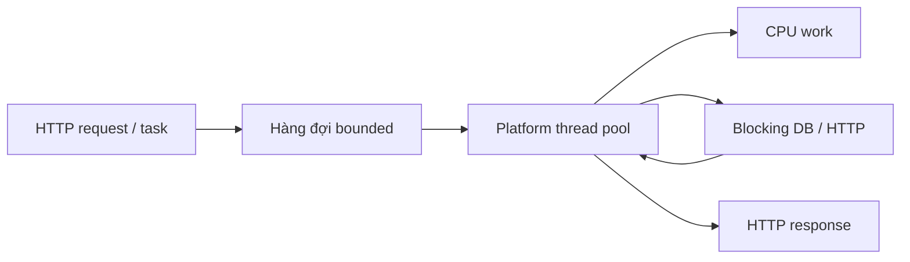
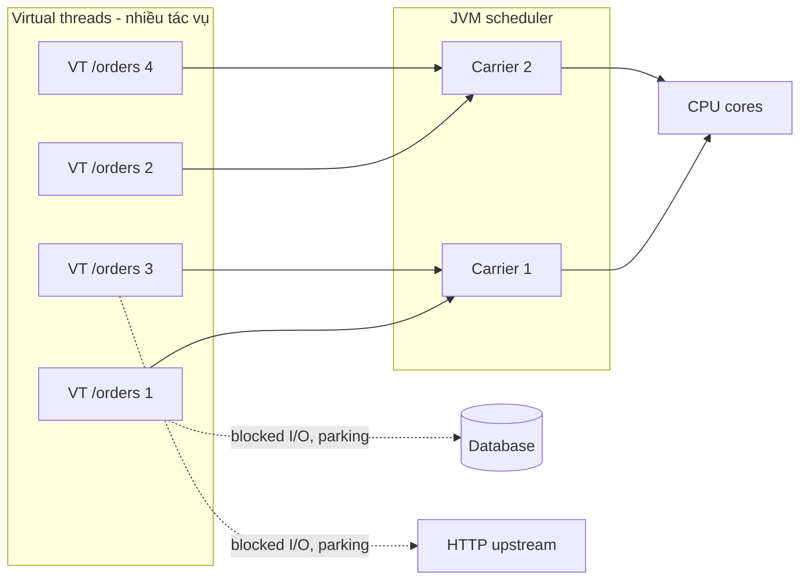
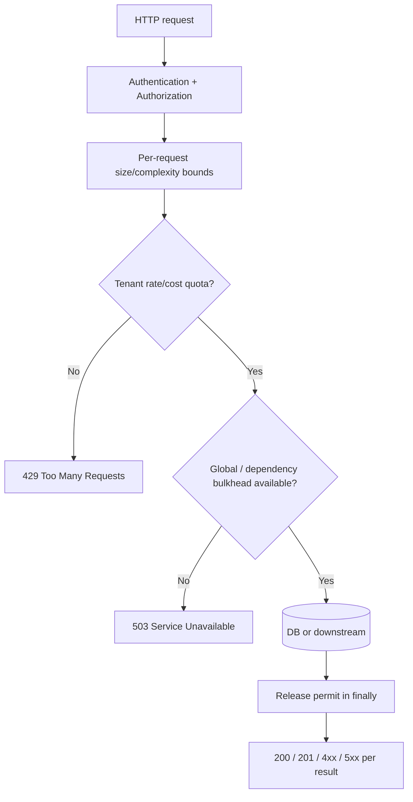

# Thread pool, virtual thread và giới hạn tài nguyên thực tế

> **Chương:** Hiệu năng  
> **Module:** **INTEGRATION_API_REST** — học thiết kế REST API theo resource, URI, phương thức và mã trạng thái HTTP, hợp đồng dữ liệu rõ ràng; thực hành phân trang, cache, idempotency, OpenAPI, xác thực, phân quyền, xử lý lỗi và kiểm thử bằng Java/Spring hoặc công nghệ tương đương.
>
> **Thông điệp chính:** Tăng số thread không tự làm REST API xử lý nhiều giao dịch hơn. *Platform thread pool* giới hạn và tái sử dụng OS threads; *virtual thread* giảm chi phí giữ thread khi tác vụ chờ I/O. Cả hai vẫn tranh chấp cùng CPU, heap, database connections, socket, downstream rate quota và các khóa. Muốn hệ thống chịu tải cần **admission control, timeout, giới hạn công việc và backpressure** dựa trên năng lực thật.

## 1. Bối cảnh, mục tiêu và câu hỏi thiết kế

Giả sử `orders-api` có các endpoint:

- `GET /v1/orders/{id}`: đọc dữ liệu từ PostgreSQL, gọi `inventory-api` nếu cần kiểm trạng thái.
- `POST /v1/orders`: kiểm quyền, ghi DB, gọi `payment-api` có timeout.
- `GET /v1/orders`: lọc, phân trang và có thể tạo truy vấn nặng.
- `POST /v1/report-jobs`: tiếp nhận công việc xuất báo cáo trong vài phút.

Trong tải bình thường, request mất khoảng 300 ms nhưng CPU chỉ dùng 12 ms; thời gian còn lại chờ mạng/DB. Khi số người dùng tăng, ứng dụng có thể có:

```text
HTTP in-flight:     1,200 requests
DB pool:               16 connections
payment-api quota:     80 requests/second
CPU:                    4 vCPU
Heap:                   2 GiB
Kafka/worker queue:  1,000 pending jobs
```

Một kỹ sư thấy thread pool bận và tăng từ 200 lên 2.000 threads. Độ trễ có thể **tệ hơn**: 2.000 request cùng chờ 16 DB connections, hàng đợi tăng, context switching/heap tốn thêm và payment-api bị retry dồn dập. Chuyển sang 20.000 virtual threads cũng **không** làm 16 DB connections thành 20.000.

Sau bài học, người học có thể:

1. Giải thích sự khác nhau giữa OS/platform thread, virtual thread, worker pool, task queue, concurrency và throughput.
2. Đoán điểm nghẽn bằng **Little's Law**, CPU service time, thời gian giữ DB connection và giới hạn downstream.
3. Chọn platform thread pool hoặc virtual thread phù hợp với xử lý CPU-bound và blocking I/O trong Java 21+/Spring Boot.
4. Thiết kế giới hạn đồng thời, queue, deadline, retry và từ chối tải có kiểm soát bằng HTTP `429`/`503`.
5. Cấu hình/kiểm thử Java/Spring thực tế và nhận ra những sai lầm như thread pool không giới hạn, queue vô hạn, blocking trong monitor, quên release permit và dùng `@Async` thay durable job.
6. Đọc metrics/thread dump/JFR để phân biệt **thiếu thread** với **cạn tài nguyên phụ thuộc**.

## 2. Nền tảng: task, platform thread và virtual thread

### 2.1. Platform thread

Một **platform thread** trong Java thường tương ứng với một thread được hệ điều hành lập lịch. Khi Java thực thi blocking I/O (ví dụ một call JDBC hoặc HTTP đồng bộ), platform thread có thể bị giữ chờ; tài nguyên thread và stack vẫn tồn tại cho đến khi tác vụ tiếp tục.

`ExecutorService` với `ThreadPoolExecutor` thường dùng **một số lượng platform thread hữu hạn** và hàng đợi tác vụ:



Ý nghĩa:

- Pool 32 workers chỉ cho phép tối đa khoảng 32 tác vụ ở trạng thái chạy trong pool, dù một số đang chờ I/O.
- Task thứ 33 thường phải đợi trong queue hoặc bị từ chối theo chính sách.
- Hàng đợi dài có thể làm p99 tăng và che quá tải; pool nhỏ có thể giữ CPU ổn nhưng underutilize I/O.
- Platform thread vẫn có giá trị cho số tác vụ CPU-bound hữu hạn, các library phụ thuộc native threads hoặc công việc cần kiểm soát chặt lịch chạy.

Không gọi mọi `ThreadPoolExecutor` là “HTTP request thread pool”: trong hệ thống có thể có pool của Servlet container, DB connections, HTTP client, `@Async`, scheduled tasks và background workers. Mỗi pool giữ **loại tài nguyên khác nhau**.

### 2.2. Virtual thread (Java 21+)

**Virtual thread** là `java.lang.Thread` được JVM lập lịch trên một tập **carrier threads** (platform threads). Nhiều virtual threads có thể tồn tại với chi phí thấp hơn khi phần lớn thời gian là chờ I/O hỗ trợ cơ chế parking/unmounting. Virtual thread là kỹ thuật **concurrency**, không làm một tác vụ tính toán chạy nhanh hơn trên cùng CPU.



Khi virtual thread chờ một API blocking được JVM hỗ trợ, JVM có thể **unmount** nó khỏi carrier để carrier thực thi virtual thread khác. Khi I/O sẵn sàng, virtual thread lại được lên lịch. Điều đó làm mô hình “một thread cho một request” khả thi hơn về số lượng thread trong các workload I/O-bound.

**Những điều virtual thread không thay đổi:**

- Không tăng số CPU cores, DB connections, rate quota, sockets hay memory vô hạn.
- Không giúp thao tác CPU-bound 100 ms biến thành 10 ms.
- Không biến JDBC/HTTP call thành non-blocking protocol; chương trình vẫn dùng cú pháp blocking, còn JVM tối ưu cách chờ khi có hỗ trợ.
- Không mặc nhiên tránh lock contention, deadlock, queue bùng nổ hoặc các lời gọi native pin carrier.
- Không làm một HTTP request giữ quá lâu trở thành thao tác bất đồng bộ bền vững; browser/proxy vẫn có timeout.

### 2.3. So sánh nhanh

| Tiêu chí | Fixed platform thread pool | Virtual thread per task/request |
|---|---|---|
| Chi phí thread chờ I/O | Đáng kể, dễ hết pool khi nhiều request chờ. | Thấp hơn trong trường hợp unmount được. |
| Lập lịch | OS quản lý platform threads. | JVM lập lịch VT trên các carrier; OS vẫn lập lịch carriers. |
| CPU-bound | Pool có giới hạn gần số core thường dễ kiểm soát. | Nhiều VT vẫn cạnh tranh cùng CPU; không nhanh hơn nhờ số lượng. |
| Chặn tải khi quá đông | Có thể dùng số worker + bounded queue. | Phải thiết kế admission/quota riêng; tạo VT không tự giới hạn. |
| Thread-local | Dùng được, nhưng dễ rò nếu không dọn ở pool. | Dùng được nhưng mỗi VT có dữ liệu riêng; hàng nghìn VT làm memory tăng. |
| Mô hình mã | Blocking code quen thuộc. | Blocking code quen thuộc với Java 21+, dễ chuyển dần. |
| Nguy cơ vận hành | Queue dài, context switching, pool exhaustion. | Quá nhiều task chờ, DB/downstream saturation, pinning/native blocking. |
| Số task đang tồn tại | Worker + queue, nếu bounded thì rõ trần. | Không có trần mặc định ở `newVirtualThreadPerTaskExecutor`. |

**Đừng thiết kế “virtual thread pool 1.000 threads” như một mục tiêu.** Virtual threads được tạo theo task; giới hạn tài nguyên nên áp lên **công việc được phép đi vào DB/downstream**, và lượng task chờ phải có trần riêng.

## 3. Phân biệt concurrency, throughput và latency bằng số liệu

**Concurrency** là số thao tác cùng tồn tại/đang xử lý. **Throughput** là số request hoàn tất mỗi giây. **Latency** là thời gian từ lúc gửi đến lúc nhận kết quả.

Trong hệ thống ổn định, Little's Law cho quan hệ trung bình:

\[
L = \lambda W
\]

Trong đó:

- `L`: số yêu cầu trung bình đang trong hệ thống (*in-flight*).
- `λ`: throughput hoàn thành/giây khi ổn định.
- `W`: thời gian trung bình một request nằm trong hệ thống.

Ví dụ 150 request/giây, trung bình mỗi request 0,4 giây:

\[
L = 150 \times 0.4 = 60 \text{ requests in-flight}
\]

Nếu CPU sử dụng trung bình 12 ms/request:

\[
150 \times 0.012 = 1.8 \text{ CPU-seconds/second}
\]

Tức cần khoảng 1,8 CPU cores bận liên tục *chỉ cho phần công việc CPU được đo*, chưa tính GC, runtime, network stack hay các workload khác.

Nếu mỗi request **giữ một DB connection** trung bình 80 ms:

\[
L_{\mathrm{DB}} = 150 \times 0.08 = 12 \text{ DB connections}
\]

Pool Hikari 8 connections có capacity lý thuyết tối đa khoảng `8 / 0.08 = 100` thao tác/giây nếu mọi connection luôn phục vụ và mỗi request chỉ cần đúng một lần giữ 80 ms. Nhu cầu 150/s vượt năng lực này: queue chờ DB sẽ phình dù có 10.000 virtual threads. Pool 16 connections cho phép mức đồng thời trung bình 12/16, nhưng **không tự đảm bảo p95/p99 tốt** vì thời gian giữ connection phân bố lệch, query chậm, transaction dài và tải khác.

### 3.1. Từ thông số đến capacity plan

| Tín hiệu đo | Nếu tăng trong khi CPU còn rảnh | Hành động cần điều tra |
|---|---|---|
| Platform threads `WAITING` | Worker bị giữ chờ I/O, lock hoặc queue. | Phân loại stack: DB, HTTP, lock, pool, sleep. |
| Hikari `pending connections` | Request đợi DB connection. | Query time, transaction duration, leak, pool size và DB max connections. |
| HTTP client pool pending | Request đợi connection đến downstream. | Max connections, response close, timeout, upstream quota. |
| DB lock wait | Giao dịch giữ khóa lâu, tranh chấp. | Transaction boundaries, index, isolation, cập nhật cạnh tranh. |
| Queue depth + queue age | Tốc độ nhận > tốc độ xử lý. | Admission/rejection, worker capacity, retry amplification. |
| CPU ~100%, runnable thread nhiều | CPU là nút thắt. | Giảm CPU work, profile, scale CPU, limit active CPU tasks. |
| GC pause/heap tăng | Payload/cache/thread-local/task count lớn. | Heap allocation, response size, pending jobs, memory limits. |
| p99 tăng nhưng median ổn | Nút thắt ở đuôi, timeout/retry/locks. | Trace slow requests, dependency tails, contention. |

Một hệ thống **không ổn định** với queue tăng vô hạn không còn thỏa điều kiện vận dụng Little's Law đơn giản như bài toán công suất ổn định. Phải đo tốc độ arrival, completion và rejection riêng. **Đừng suy ra p99 từ W trung bình**: đuôi phân phối và hàng đợi quyết định trải nghiệm ở tải cao.

### 3.2. Thời gian chờ là nơi virtual threads giúp ích

Giả sử 200 concurrent requests, mỗi request chỉ chạy CPU trong 10 ms nhưng chờ downstream 290 ms. Fixed pool 32 platform threads có thể cần queue thêm request trong khi 32 thread đang chờ. Virtual threads có thể giữ nhiều request đang chờ hơn mà không chiếm 200 carrier threads.

Tuy nhiên nếu downstream chỉ cho **20 concurrent calls**, để 200 requests cùng vào downstream sẽ tăng chờ/timeout ở đó. Nên dùng semaphore/bulkhead 20 permit trước khi gọi, và trả `503`/`429` khi không thể tiếp nhận theo chính sách.

## 4. Platform thread pool: cấu hình worker, queue và rejection

`ThreadPoolExecutor` có các nút chỉnh chính:

- `corePoolSize`: số worker nền cần giữ (phụ thuộc trạng thái/tác vụ).
- `maximumPoolSize`: trần platform workers của executor.
- `workQueue`: nơi chứa tác vụ khi core workers bận; nếu vô hạn có thể tăng RAM và đợi lâu.
- `keepAliveTime`: thời gian idle của workers vượt core (theo cấu hình).
- `RejectedExecutionHandler`: hành vi khi executor đã đóng hoặc không nhận thêm task.

**Bẫy quan trọng:** Với `LinkedBlockingQueue` không giới hạn, executor thường không mở rộng vượt `corePoolSize` vì queue luôn còn chỗ. `maximumPoolSize` có thể gần như không phát huy tác dụng cho tải thường; queue lại tăng vô hạn.

### 4.1. Ví dụ Java cho CPU-bound task pool có trần

```java
package example.orders.capacity;

import java.util.concurrent.*;
import org.springframework.context.annotation.Bean;
import org.springframework.context.annotation.Configuration;

@Configuration
public class CpuWorkConfiguration {
    @Bean(destroyMethod = "shutdown")
    ExecutorService cpuWorkPool() {
        return new ThreadPoolExecutor(
            4, 4,
            0L, TimeUnit.MILLISECONDS,
            new ArrayBlockingQueue<>(32),
            new ThreadPoolExecutor.AbortPolicy()
        );
    }
}
```

Với 4 workers và queue 32, có thể có khoảng **4 task đang chạy + 32 task đang chờ** trong executor; khi hết chỗ sẽ ném `RejectedExecutionException`. Con số 4 là ví dụ cho workload CPU nặng trên 4 vCPU, không phải công thức chung. Nếu máy có cgroup CPU quota nhỏ hơn số `availableProcessors` thực tế, cần đo/điều chỉnh.

- Tại HTTP boundary, ánh xạ trạng thái từ chối thành lỗi năng lực `503 Service Unavailable` hoặc `429 Too Many Requests` tùy giới hạn toàn cụm hay quota caller.
- **Không bật `CallerRunsPolicy` vô điều kiện** trong Servlet thread: nó có thể chuyển tác vụ CPU nặng lên chính request thread, làm timeout và lan quá tải.
- Dùng bounded queue để có latency bound thực tế, đồng thời phải đo thời gian chờ; `queueSize=32` không đảm bảo task xử lý đúng deadline.
- Executor có lifecycle đóng, graceful shutdown và cancellation. `shutdown()` không mặc nhiên chờ toàn bộ tác vụ kết thúc; cần shutdown policy của ứng dụng.

### 4.2. Không dùng một pool chung cho mọi loại tác vụ

Một HTTP API có query tương tác 50 ms, email gửi 2 giây và export 4 phút. Nếu cả ba cùng vào pool 16 workers, export có thể chiếm hết worker và làm GET nhẹ chờ. Tách **resource classes**:

```text
Interactive GET  -> DB connection pool + read concurrency cap
Short CPU work   -> small bounded platform thread executor
Outgoing HTTP    -> per-dependency bulkhead + connection/time limits
Multipart upload -> stream/byte/concurrency caps
Long export      -> durable job queue + limited workers
```

Với upload và job, chỉ thêm nhiều virtual threads sẽ không giới hạn bytes đĩa, temp files, heap, scan workers hay storage. Một hàng đợi dài cần TTL/retention và phương án hủy.

## 5. Virtual threads trong Java 21+: dùng và tránh những lỗi phổ biến

### 5.1. Tạo virtual thread per task

Java 21 có `Executors.newVirtualThreadPerTaskExecutor()`:

```java
package example.orders.demo;

import java.time.Duration;
import java.util.concurrent.*;

public final class VirtualThreadDemo {
    public static void main(String[] args) throws Exception {
        // Ví dụ ứng dụng nhỏ: quản lý lifecycle executor ở cấp chương trình.
        try (ExecutorService executor =
                 Executors.newVirtualThreadPerTaskExecutor()) {

            Future<String> a = executor.submit(() -> {
                Thread.sleep(Duration.ofMillis(150)); // giả lập blocking I/O
                return "order-A";
            });
            Future<String> b = executor.submit(() -> {
                Thread.sleep(Duration.ofMillis(150));
                return "order-B";
            });

            System.out.println(a.get(1, TimeUnit.SECONDS));
            System.out.println(b.get(1, TimeUnit.SECONDS));
        }
    }
}
```

`Thread.sleep` ở virtual thread thường nhường carrier; trong ví dụ trên hai task có thể cùng chờ. **Không tạo/đóng executor trong mỗi HTTP request**: lập executor theo lifecycle service hoặc để framework quản lý. `ExecutorService.close()` chờ tác vụ còn chạy hoàn tất theo lifecycle; nó không phải cơ chế hủy tức thời mọi việc.

Virtual threads phù hợp:

- Servlet request xử lý I/O blocking bằng API Java tương thích.
- Nhiều lời gọi HTTP/DB độc lập phải chờ I/O, với **giới hạn concurrency downstream**.
- Các tác vụ I/O ngắn có deadline và kế hoạch error propagation rõ ràng.

Ít phù hợp khi:

- Tác vụ CPU-bound nặng giữ CPU liên tục: dùng trần CPU workers.
- Library/native blocking không nhường carrier như mong đợi.
- Hàng trăm nghìn tác vụ treo chờ cùng tài nguyên và giữ dữ liệu lớn trong stack/`ThreadLocal`.
- Cần công việc kéo dài và bền vững qua restart: dùng job queue/worker có state.

### 5.2. Spring Boot sử dụng virtual threads

Từ **Spring Boot 3.2+** trên **Java 21+**, có thể bật virtual threads cho những thành phần được Boot hỗ trợ:

```yaml
spring:
  application:
    name: orders-api
  threads:
    virtual:
      enabled: true
  datasource:
    hikari:
      maximum-pool-size: 16
      connection-timeout: 500
```

`maximum-pool-size: 16` giới hạn **DB connections của Hikari** trong instance này; nó **không** giới hạn HTTP requests hay virtual threads. `connection-timeout` (mili-giây với property này) giới hạn thời gian chờ lấy connection từ pool, không phải SQL statement timeout. Cần cấu hình query/transaction timeout ở tầng JDBC/ORM/DB theo hợp đồng.

Các hệ quả cần xác minh trong chính ứng dụng:

- Servlet container phù hợp có thể dùng virtual threads cho request processing theo cấu hình được Boot hỗ trợ. **Không** suy ra mọi executor do ứng dụng tự tạo, JDBC pool, Tomcat connector và library thứ ba đều chuyển thành virtual threads.
- Một số cấu hình `server.tomcat.threads.max` từng dùng với platform worker **không còn là thước đo đủ** về số request đang xử lý nếu request chạy trên VT. Kiểm runtime, thread dump và metrics thực.
- Virtual threads là daemon threads; ứng dụng chỉ dựa vào scheduler virtual threads có thể cần `spring.main.keep-alive=true` để JVM còn sống theo thiết kế. Ứng dụng web có listener/server threads thường đã có cơ chế giữ JVM, nhưng đừng nhầm cấu hình keep-alive với capacity control.
- Các bản Boot/JDK mới có thể thay đổi chi tiết tích hợp; đọc tài liệu đúng version được triển khai và benchmark chính workload.
- Bật virtual threads **không thay thế** pool Hikari, HTTP client timeouts, retry budgets, authentication/authorization hay rate limiting.

### 5.3. Pinning và blocking đặc biệt

Ở **JDK 21–23**, virtual thread có thể bị **pin** vào carrier khi blocking trong một số vùng `synchronized` hoặc native/foreign call. Pinning kéo dài làm số carrier hữu dụng giảm, gây tình trạng “đã bật VT nhưng vẫn nghẽn”.

Ví dụ có nguy cơ trên JDK 21:

```java
public final class BadPaymentGateway {
    private final Object monitor = new Object();

    public void charge() throws Exception {
        synchronized (monitor) {
            // Blocking network call chậm bên trong monitor.
            paymentHttpClient.executeCharge(); // minh họa
        }
    }
}
```

Vấn đề ở đây còn là **serialize mọi request qua cùng lock**, dù pinning có xảy ra hay không. **JDK 24, JEP 491** giảm đáng kể pinning liên quan tới monitor `synchronized`, nhưng *lock contention*, native/foreign blocking và số connection downstream vẫn tồn tại. Không sửa bằng cách bỏ mọi lock; xác định nguyên nhân qua profiling, giảm critical section và áp dụng concurrency limit phù hợp.

Một hướng thay thế khi bảo vệ trạng thái nhỏ là giữ lock trong vùng rất ngắn, còn HTTP call nằm **ngoài** vùng đồng bộ:

```java
public void charge() throws Exception {
    PaymentCommand command;
    synchronized (monitor) {
        command = snapshotCommandAndUpdateLocalState();
    }
    paymentHttpClient.executeCharge(command); // không giữ monitor khi chờ mạng
}
```

Nếu nghiệp vụ cần đảm bảo thứ tự/không trùng payment, việc tách lock phải đi kèm transaction/idempotency/state machine, tránh race condition. `ReentrantLock` không tự giải quyết semantic consistency. JFR có event liên quan virtual thread pinning trên các bản JDK hỗ trợ; **sự có mặt/vắng mặt và ý nghĩa của event phụ thuộc JDK version**. Đo theo JVM thực thay vì dựa vào một lý thuyết chung.

### 5.4. ThreadLocal, MDC, SecurityContext và memory

Virtual threads hỗ trợ `ThreadLocal`, nhưng nếu mỗi virtual thread giữ một bộ cache 1 MiB thì 10.000 threads đã có thể giữ dữ liệu rất lớn. Không đặt DB connection, HTTP client, byte buffer hoặc object graph khổng lồ vào `ThreadLocal` trên mỗi request. Dọn MDC/tracing context trong `finally` và dùng framework propagation cho async.

Spring Security context thường gắn với request/thread theo cơ chế của Spring. Khi tạo task trên thread khác bằng `Executors.newVirtualThreadPerTaskExecutor()`, **không mặc định SecurityContext hoặc MDC tự truyền tới mọi task**. Dùng wrapper/delegating executor hoặc cách truyền principal/scopes bằng tham số cụ thể theo chính sách. Chỉ nhận tenant/identity từ ngữ cảnh đã xác thực, không từ query/header tự khai.

**Đừng dùng `ThreadLocal` làm giao thức “truyền quyền” không kiểm soát sang background job**: khi job chạy sau HTTP request, auth context cũ đã hết vòng đời; job cần lưu subject/tenant/claims đã được kiểm, sau đó ủy quyền khi xử lý/đọc kết quả theo chính sách.

## 6. Giới hạn tài nguyên thực: thread chỉ là một lớp

### 6.1. Các loại giới hạn cần thiết

| Tài nguyên | Giới hạn nên có | Điều xảy ra nếu chỉ tăng thread |
|---|---|---|
| CPU | Bounded CPU executor, concurrency/CPU quota; tối ưu serialization/filter. | Runnable tasks tranh CPU, context switch, p99 tăng. |
| DB connections | Hikari `maximumPoolSize`, timeout lấy connection, query timeout. | Nhiều thread xếp hàng trên ít connection; DB có thể quá tải nếu pool tăng vô tội vạ. |
| DB query/transaction | Index, pagination, statement timeout, lock duration, max rows. | Nhiều query nặng quét dữ liệu, khóa chéo, timeout dây chuyền. |
| Outbound HTTP | Connection limits, per-host bulkhead, connect/response timeout, retry budget. | Flood downstream, socket exhaustion và retry storm. |
| Heap/RAM | Max body bytes, JSON nesting, object size, queue depth, ThreadLocal size. | OOM khi hàng nghìn task giữ body/buffer. |
| Queue | Max pending, max queue age, deadline, rejection. | Latency âm thầm tăng, stale task tiếp tục chạy. |
| Upload | Max multipart/request bytes, số upload đồng thời, scan/quarantine. | Tốn disk/temp/CPU bất kể thread nhẹ. |
| Job dài | Durable queue, max queued/running per tenant, TTL, retention. | VT chạy nhiều giờ vẫn chịu lỗi restart, không có admission bền. |
| Tenant fairness | Per-tenant quota/concurrency, identity tin cậy. | Một khách chiếm pool/DB quota của tất cả người dùng. |
| External API billing | Rate/cost quota, timeout, circuit breaker. | Hệ thống tăng số lần gọi ngoài dự kiến và chi phí. |

**Capacity limit tốt nhất đặt tại điểm chiếm tài nguyên đắt đỏ**, nhưng cần cả giới hạn sớm ở gateway/app để không nhận hàng triệu request rồi mới bắt chúng chờ ở pool phía sau.

### 6.2. Global bulkhead và per-tenant quota là hai chiều khác nhau

Một request có thể hợp lệ về quyền và còn quota tenant nhưng không được nhận vì DB toàn cụm đã đạt mức tải tối đa. Ngược lại, DB còn rảnh nhưng tenant A đã gọi 1.000 lần/giây thì quota A phải bị giới hạn để bảo vệ tenant B.



Một local `Semaphore` trong từng instance chỉ giới hạn **instance đó**. Nếu 8 replicas có mỗi replica 16 permits, tổng thực tế có thể lên tới 128 concurrent calls. Dùng quota cấp cluster, admission token phân tán, queue partition hoặc ràng buộc năng lực toàn hệ thống nếu cần giới hạn tổng. Distributed state có race, timeout và failure policy; kiểm khi autoscale.

### 6.3. Spring MVC: chặn quá tải trước khi chiếm DB

Ví dụ controller nhận Bearer token đã được Spring Security xác thực. `OrderService` tự kiểm quyền xem đơn hàng theo principal/tenant. Bộ giới hạn sau có 16 permits **cho mỗi JVM**, không dùng hàng đợi vô hạn:

```java
package example.orders.api;

import java.util.concurrent.Callable;
import java.util.concurrent.Semaphore;
import org.springframework.stereotype.Component;

@Component
public final class DatabaseBulkhead {
    private final Semaphore permits = new Semaphore(16);

    public <T> T execute(Callable<T> work) throws Exception {
        if (!permits.tryAcquire()) {
            throw new GlobalCapacityExceeded();
        }
        try {
            return work.call();
        } finally {
            permits.release();
        }
    }
}
```

`GlobalCapacityExceeded` là exception nội bộ có thể định nghĩa đơn giản:

```java
package example.orders.api;

public final class GlobalCapacityExceeded extends RuntimeException {
    public GlobalCapacityExceeded() {
        super("global_capacity_exceeded");
    }
}
```

Controller:

```java
package example.orders.api;

import org.springframework.http.ResponseEntity;
import org.springframework.security.core.Authentication;
import org.springframework.web.bind.annotation.*;

@RestController
@RequestMapping("/v1/orders")
public final class OrderController {
    private final DatabaseBulkhead bulkhead;
    private final OrderService orders;

    public OrderController(DatabaseBulkhead bulkhead, OrderService orders) {
        this.bulkhead = bulkhead;
        this.orders = orders;
    }

    @GetMapping("/{id}")
    public ResponseEntity<OrderDto> get(@PathVariable String id,
            Authentication principal) throws Exception {
        return bulkhead.execute(() ->
            ResponseEntity.ok(orders.findVisibleById(id, principal)));
    }
}
```

`OrderService` và `OrderDto` đại diện domain implementation cần viết khi tích hợp. **Gọi bulkhead trước khi bắt đầu transaction hoặc chiếm DB connection**; nếu `@Transactional` đặt ở tầng ngoài bulkhead và đã mở connection, hiệu quả giảm tải sẽ kém đi. Bộ giới hạn chỉ là một lớp bảo vệ: `orders.findVisibleById` vẫn cần giới hạn truy vấn, deadline, quyền tenant/owner, Hikari pool và error mapping.

Lớp HTTP xử lý khi không còn permit:

```java
package example.orders.api;

import org.springframework.http.*;
import org.springframework.web.bind.annotation.*;

@RestControllerAdvice
public final class CapacityAdvice {
    @ExceptionHandler(GlobalCapacityExceeded.class)
    ResponseEntity<ProblemDetail> busy(GlobalCapacityExceeded ex) {
        ProblemDetail detail = ProblemDetail.forStatusAndDetail(
            HttpStatus.SERVICE_UNAVAILABLE,
            "Hệ thống đang nhận quá nhiều yêu cầu đồng thời");
        detail.setTitle("Capacity exhausted");
        return ResponseEntity.status(HttpStatus.SERVICE_UNAVAILABLE)
            .header(HttpHeaders.RETRY_AFTER, "1")
            .cacheControl(CacheControl.noStore())
            .body(detail);
    }
}
```

Đây là **global/instance capacity exhaustion** nên `503` hợp lý. Nếu giới hạn là **per-caller/per-tenant rate quota**, thường dùng `429` với `Retry-After` và metadata quota rõ. Giá trị “1 giây” chỉ là gợi ý của policy, không đảm bảo request sẽ có slot sau đúng 1 giây.

### 6.4. Vì sao dùng `tryAcquire()` thay cho `acquire()` không thời hạn?

`acquire()` có thể làm hàng trăm nghìn virtual threads đợi trong semaphore. Chúng không nhất thiết giữ carrier, nhưng vẫn giữ request, stack, object context, thời hạn, socket/session và memory. Queue ẩn phía semaphore khiến deadline khó dự đoán.

`tryAcquire()` không chờ đưa ra quyết định **nhận hoặc từ chối ngay**. Nếu nghiệp vụ muốn đợi ngắn, có thể dùng `tryAcquire(timeout, unit)`, nhưng phải có cả trần số người đang chờ, timeout và cancellation; chỉ đặt timeout mà không giới hạn số waiter vẫn có thể làm heap tăng.

**Rủi ro fairness:** semaphore không fair mặc định có thể để một số caller lấy slot liên tục; nếu cần fairness theo tenant, admission scheduler/queue partition thường phù hợp hơn một semaphore fair toàn cục. Không dùng client-supplied `tenantId` để tính quota: lấy từ security context đã xác thực.

### 6.5. Hikari và DB sizing

Ví dụ config đi kèm:

```yaml
spring:
  datasource:
    hikari:
      maximum-pool-size: 16
      minimum-idle: 8
      connection-timeout: 500
```

`connection-timeout: 500` là thời gian tối đa Hikari chờ cấp connection (ms) trước khi báo lỗi, **không** giới hạn thời gian câu SQL đang chạy. Thêm JDBC statement timeout, transaction deadline, lock timeout và bounded pagination ở tầng thích hợp.

Pool quá lớn không nhất thiết tăng throughput: DB còn giới hạn CPU, disk IOPS, memory, connection max và lock contention. Nếu 10 application replicas × 16 Hikari connections = 160, phải cộng cả workers, admin connections và service khác vào tổng DB capacity. Khi autoscale, đánh giá lại tổng connection budget để tránh scale application làm DB sập.

Nếu request đang dùng DB connection rồi gọi HTTP bên ngoài trong transaction, thời gian giữ connection tăng theo latency upstream và chặn request khác. Thiết kế transaction ngắn, không giữ DB lock qua network call, dùng outbox/saga nếu cần nhất quán liên dịch vụ.

## 7. Timeout, deadline, cancellation và retry không được tách rời thread model

### 7.1. Timeout nhiều tầng

Một request đi qua:

```text
Browser / mobile client
  -> CDN / gateway
  -> Servlet container
  -> Authentication & controller
  -> DB pool / JDBC query
  -> inventory-api / payment-api
```

Các timeout liên quan nhưng khác nhau:

| Timeout | Bảo vệ | Không thay thế |
|---|---|---|
| Client end-to-end deadline | Người dùng không chờ vô hạn. | Server cancellation, DB timeout. |
| Gateway read/request timeout | Kết nối tới upstream có trần. | Business job deadline. |
| HTTP client connect timeout | Không chờ mở socket vô hạn. | Read/response timeout sau khi kết nối. |
| HTTP client response timeout | Không chờ upstream phản hồi vô hạn. | Admission/bulkhead khi quá nhiều call. |
| Hikari connection timeout | Không chờ connection pool vô hạn. | SQL statement/lock timeout. |
| SQL statement timeout | Query chậm bị chặn/bỏ. | Quota truy vấn/limit rows. |
| Job execution deadline | Không để worker chạy vô hạn. | Idempotency, durable state, cancellation. |

Một cấu hình timeout thường nên theo **ngân sách còn lại**: client chờ 3 giây thì các call xuống DB/HTTP không nên mỗi call đợi 30 giây. Đặt timeout phù hợp retry budget, serialization và network slack.

### 7.2. Virtual thread bị interrupt không bảo đảm rollback

`Future.cancel(true)` hoặc ngắt virtual thread có thể giúp một số blocking operation dừng và giải phóng carrier. Nhưng:

- Không phải JDBC driver, native code hay downstream call nào cũng hủy đúng lúc.
- Client disconnect không tự động đảm bảo DB transaction rollback hoặc external payment được bù trừ.
- `InterruptedException` phải được xử lý hợp lý, phục hồi interrupt flag khi tầng nhận có trách nhiệm đó, không nuốt rồi tiếp tục tác vụ quan trọng.
- Retry sau timeout có thể lặp side effect; POST nên dùng idempotency key/transaction/outbox như hợp đồng đã thiết kế.

Trong REST API, khi không biết request đã commit hay chưa, client nên kiểm trạng thái bằng ID/idempotency key trước khi retry. Gửi lại ngẫu nhiên chỉ vì thread bị ngắt có thể tạo đơn hàng trùng.

### 7.3. Retry có giới hạn

```text
request -> payment-api 503
        -> retry 1 after backoff+jitter
        -> retry 2 while deadline remains
        -> fail with controlled HTTP error if budget exhausted
```

Không retry vô hạn. Nhiều tầng (browser/gateway/service/HTTP client) cùng retry 3 lần có thể khuếch đại một request thành `3 × 3 × 3 = 27` call. Giới hạn retry ở một tầng có trách nhiệm, tôn trọng `Retry-After` khi có, thêm circuit breaker và quota downstream.

### 7.4. Job dài không phải “virtual thread giữ 10 phút”

Nếu export cần vài phút, trả `202 Accepted` sau khi **lưu/enqueue bền vững**, kèm job resource:

```http
POST /v1/report-jobs HTTP/1.1
Authorization: Bearer <access-token>
Idempotency-Key: <same-intent-key>
Content-Type: application/json

{"type":"ORDERS_EXPORT","from":"2026-11-01","to":"2026-11-15"}
```

```http
HTTP/1.1 202 Accepted
Location: /v1/report-jobs/job-72e4
Retry-After: 3
Content-Type: application/json

{"id":"job-72e4","state":"QUEUED"}
```

Worker có queue depth, concurrency limit, lease, max attempts, deadline, cancel và retention. Spring `@Async` hay virtual thread executor **không tự cung cấp durable queue** khi instance restart. `202` là đã chấp nhận xử lý, chưa chứng minh job thành công; trạng thái job/result được bảo vệ theo tenant/owner.

## 8. HTTP semantics khi quá tải và bảo mật API

### 8.1. Mã trạng thái phải phản ánh lý do

| Điều kiện | HTTP status thường phù hợp | Cách client xử lý |
|---|---|---|
| Query/filter/body sai, vượt giới hạn tham số | `400 Bad Request` hoặc `422 Unprocessable Content` theo contract. | Sửa request, không retry nguyên trạng. |
| Upload quá byte cap | `413 Content Too Large`. | Giảm/chia file theo protocol. |
| Thiếu/sai token, thiếu quyền | `401 Unauthorized` / `403 Forbidden`. | Xử lý xác thực/phân quyền, không tăng threads. |
| Rate/quota của client hoặc tenant vượt trần | `429 Too Many Requests`. | Backoff theo `Retry-After`, giảm tần suất. |
| Toàn instance/cluster hết capacity tạm thời | `503 Service Unavailable`. | Backoff bounded, kiểm tình trạng hệ thống. |
| Gateway chờ upstream quá deadline | `504 Gateway Timeout` trong vai trò gateway. | Kiểm trạng thái/idempotency trước retry write. |
| Job đã được chấp nhận bền vững | `202 Accepted` + `Location`. | Theo dõi job, không giả định hoàn tất. |

`401` và `403` vẫn phải có chính sách OAuth/JWT, scope, tenant và owner nhất quán. CORS trong browser có thể làm status bị chặn đọc nếu response thiếu header phù hợp, nhưng đây là tầng riêng của capacity limit.

Ví dụ từ chối quota:

```http
HTTP/1.1 429 Too Many Requests
Content-Type: application/problem+json
Retry-After: 10
Cache-Control: no-store

{
  "type": "https://api.example.test/problems/quota-exceeded",
  "title": "Đã vượt ngân sách yêu cầu",
  "status": 429
}
```

Không đưa số liệu quota của tenant khác, token, IP khách, stack trace hoặc thông tin DB nội bộ vào error response. Nếu gateway từ chối request trước application, gateway phải tự cung cấp error contract và logging/metrics; `@RestControllerAdvice` không nhìn thấy lỗi đó.

### 8.2. Admission, auth và fairness

Có hai nhiệm vụ phải phối hợp:

1. **Giới hạn trước xác thực:** gateway/WAF có thể áp IP/network throttling thận trọng, giới hạn body/connections để chống floods và HTTP parser exhaustion.
2. **Giới hạn sau xác thực:** xác định principal/tenant tin cậy, thực thi per-tenant quota và object-level authorization; không lấy `tenantId` từ header/body do client tự ghi.

Nếu một client ác ý tạo hàng triệu yêu cầu bị `401`, security filter/JWT decoder vẫn tốn CPU. Bảo vệ tầng ingress trước khi parse token quá lớn và giữ JWT size limit. Với virtual threads, request lỗi sớm vẫn tạo/giải phóng thread context; không có quyền bỏ qua ingress protections.

### 8.3. Chống resource exhaustion

Các vector thường gặp:

- `GET /v1/orders?limit=1000000` hoặc deep offset làm query quét dữ liệu.
- JSON body hàng trăm MB hoặc nesting sâu khiến parser tốn CPU/heap.
- Một user tạo 10.000 virtual tasks đọc cùng tenant, cùng DB pool.
- Multipart upload làm đầy temp disk; giải nén file “zip bomb”.
- Retry storm khi payment-api trả 503.
- Tạo report jobs vô hạn, polling 10 ms/lần.
- Block giữ monitor và HTTP call khiến carrier pin / thread starvation trên JDK cũ.

Giới hạn request count **chưa đủ**: phải chặn query cost, payload bytes, số item/batch, upload size, job count, pending work, wall-clock runtime và chi phí downstream.

## 9. Đo thực nghiệm để chọn cấu hình

### 9.1. Đặt giả thuyết trước khi benchmark

Ví dụ mục tiêu SLO:

- `GET /v1/orders/{id}` p95 dưới 200 ms tại 100 RPS.
- `POST /v1/orders` p95 dưới 500 ms tại 50 RPS.
- Error rate `5xx` dưới 0,5% khi tải ở mức thiết kế.
- Khi tăng lên gấp đôi tải, API **từ chối có kiểm soát** thay vì OOM hoặc giữ request nhiều phút.
- DB active connections không vượt pool size; queue age có trần.

Con số trên chỉ dùng cho bài tập, không phải SLA đề xuất mặc định. Cần phân biệt **thời gian đã warm up**, cached vs uncached DB, dữ liệu đủ lớn, tỷ lệ GET/POST, client network và môi trường container thật. Không lấy test localhost một endpoint rồi suy ra production.

### 9.2. Một ma trận thí nghiệm

| Biến thể | Cấu hình | Câu hỏi |
|---|---|---|
| A — platform | 64 Servlet workers, Hikari 16, downstream cap 12. | Baseline latency/throughput và số request xếp hàng. |
| B — virtual | Virtual threads theo Boot, Hikari 16, downstream cap 12. | Giảm chờ worker có cải thiện p95/p99 không? |
| C — virtual thiếu bulkhead | Virtual threads, Hikari 16, downstream không cap. | Tăng timeout/downstream saturation ra sao? |
| D — platform pool quá lớn | 512 workers, Hikari 16, downstream cap 12. | Context switching/queue/heap thay đổi thế nào? |
| E — virtual + admission | Virtual threads, Hikari 16, concurrency cap + 503. | Hệ thống có giữ latency ổn định khi quá tải không? |

Thay một yếu tố mỗi lần khi cần tìm nguyên nhân; cùng dataset, JVM, CPU quota, heap, phiên bản JDBC/HTTP client, retry policy, cache warm-up và phân phối input. Thực hiện nhiều lần để thấy nhiễu, dùng khoảng tin cậy hoặc ít nhất so biến thiên giữa các lần. Mục tiêu là **đo và lý giải**, không khẳng định virtual threads luôn nhanh hơn.

### 9.3. Mẫu tải bằng k6

Ví dụ script JavaScript cho công cụ `k6` (hướng dẫn, cần cài k6 và cấu hình base URL/token test trong môi trường). Không dùng token production:

```javascript
import http from "k6/http";
import { check, sleep } from "k6";

export const options = {
  scenarios: {
    orders_read: {
      executor: "constant-arrival-rate",
      rate: 100,
      timeUnit: "1s",
      duration: "2m",
      preAllocatedVUs: 100,
      maxVUs: 500
    }
  },
  thresholds: {
    http_req_failed: ["rate<0.01"],
    http_req_duration: ["p(95)<300"]
  }
};

export default function () {
  const baseUrl = __ENV.API_BASE_URL;
  const token = __ENV.TEST_ACCESS_TOKEN;
  if (!baseUrl || !token) {
    throw new Error("Missing test configuration");
  }
  const id = `ord-1001`;
  const result = http.get(`${baseUrl}/v1/orders/${id}`, {
    headers: { Authorization: `Bearer ${token}` },
    timeout: "3s"
  });
  check(result, {
    "successful or explicitly rejected": (r) =>
      r.status === 200 || r.status === 429 || r.status === 503
  });
  sleep(0.1);
}
```

**Cần hiểu đúng kết quả:** `http_req_failed` và `check` là hai chỉ số khác nhau. Một response `503` có thể là **từ chối quá tải đúng policy**, nhưng nó vẫn là lỗi HTTP mà k6 ghi nhận theo thiết lập expected status. Trong tải ngoài capacity, không nên chỉ nhìn “check pass” rồi bỏ qua tỷ lệ từ chối. Ghi riêng RPS thành công, 429/503, p95/p99 của request **được chấp nhận**, queue/DB saturation và số VU `dropped_iterations`. Đây là bài mẫu đọc GET; cần bổ sung POST/idempotency và các phân phối thực tế để đánh giá toàn bộ API.

### 9.4. Những metrics cần có

| Metric | Tại sao cần | Công cụ/thành phần tham khảo |
|---|---|---|
| HTTP RPS by route/method/status | Biết throughput, error và rejection rate. | Micrometer/Prometheus. |
| p50/p95/p99 latency | Độ trễ đuôi và trải nghiệm. | HTTP server timer/histogram. |
| In-flight request count | Áp dụng Little's Law và phát hiện backlog. | HTTP instrumentation. |
| JVM CPU, process CPU | Biết CPU-bound vs I/O-bound. | JVM/container metrics. |
| Heap/GC allocation/pause | Task/queue/cache/payload đang giữ memory. | JVM/GC metrics. |
| Hikari active/idle/pending | Phân biệt chờ DB connections với chờ threads. | Hikari pool metrics. |
| DB query/lock wait | Tìm nút thắt DB thật. | DB monitor/traces. |
| HTTP client connections/pending | Tìm downstream bottleneck và fan-out. | Client instrumentation. |
| Bulkhead available/rejected | Đo mức admission và quyết định từ chối. | Application metrics. |
| Queue depth/oldest age | Bảo vệ deadline, detect stuck jobs. | Queue/job metrics. |
| Virtual thread/JFR events | Kiểm carrier pinning, thread lifecycle/blocking. | JFR/JVM tools theo JDK version. |
| Retries/timeouts/circuit breaker | Phát hiện retry storm/cascade failure. | Resilience instrumentation. |

Không log raw token, session cookie, body PII hay tạo metric label theo user ID/order ID. Phải dùng `http.route` (template `/v1/orders/{id}`) thay vì raw URI (mỗi id thành một nhãn duy nhất). Với JFR, bật recording có kiểm soát và kiểm overhead, retention, quyền đọc profiling data.

### 9.5. Phân tích một kết quả giả định

Giả sử sau chạy test đạt:

```text
Platform threads, 64 workers:
  completed: 90 RPS
  p95 accepted: 820 ms
  Hikari pending: thường > 0

Virtual threads, no bulkhead:
  completed: 100 RPS
  p95 accepted: 1,900 ms
  Hikari pending: tăng mạnh
  timeouts: tăng

Virtual threads + DB/downstream bulkheads:
  completed: 95 RPS
  p95 accepted: 300 ms
  HTTP 503 rejections: tăng có kiểm soát khi tải vượt sức chứa
```

Đây là **số giả định minh họa**, không phải benchmark thực tế hay khuyến nghị cứng. Kết luận hợp lý là pool DB/downstream và lượng công việc được chấp nhận mới quyết định độ trễ; virtual threads có thể giảm overhead chờ OS thread nhưng không vượt qua giới hạn dependency. Cần đánh giá **latency, throughput, error/rejection, fairness và chi phí tài nguyên cùng lúc**, không chọn phương án chỉ vì RPS cao hơn vài phần trăm.

## 10. Lựa chọn kiến trúc theo workload

| Workload | Phương án thường hợp lý | Lý do |
|---|---|---|
| REST đồng bộ chờ DB/HTTP phần lớn thời gian | Virtual threads + per-dependency bulkhead + deadlines. | Giảm chi phí waiting threads, giữ mã blocking dễ đọc. |
| Mã CPU-bound xử lý ảnh/JSON lớn | Bounded platform thread executor hoặc CPU permit limit. | CPU không tăng theo số virtual threads. |
| Batch ghi nhiều DB row | Giới hạn item/bytes/cost, transaction ngắn, bounded workers. | Bảo vệ memory, lock và connection pool. |
| Upload lớn | Stream có byte cap, concurrency cap, object storage/quarantine. | Bottleneck là I/O/storage/scan, không chỉ thread. |
| Export báo cáo kéo dài | Durable queue + worker concurrency + status resource `202`. | Chịu được restart/cancel/retry, không giữ HTTP request. |
| Java reactive WebFlux thật sự end-to-end nonblocking | Dùng reactive runtime có backpressure phù hợp; cân nhắc tradeoffs. | Không cần chuyển tất cả về virtual thread nếu reactive stack đang vận hành tốt. |
| Legacy blocking JDBC/service calls | Virtual threads có thể dễ áp dụng khi JDK/library tương thích. | Vẫn cần benchmark pinning, pool, timeout. |
| Multi-tenant API | Per-tenant quota + shared global capacity. | Chống noisy neighbor; thread model không tự đảm bảo fairness. |

Virtual thread và reactive không nhất thiết là “hai công nghệ phải chọn một bên thắng”. Một ứng dụng có thể dùng nhiều mô hình cho từng nhóm công việc. Đừng trộn `block()` bừa bãi trên reactive event-loop; khi đã chọn stack, cần hiểu ngữ nghĩa thread và scheduler của nó.

### 10.1. Quy trình quyết định ngắn

1. **Đo:** CPU, p95/p99, thread state, Hikari pending, DB/HTTP latency và queue age.
2. **Phân loại:** thời gian chủ yếu ở CPU, blocking I/O, lock, connection pool hay queue?
3. **Cấu hình giới hạn:** cap per-request, quota/tenant, bounded queue, bulkhead, timeout/deadline, retries.
4. **Chọn thread model:** fixed platform workers cho CPU-bound; virtual threads khi nhiều blocking I/O và library/JDK phù hợp.
5. **Benchmark:** tải ổn định, tải tăng bậc, burst, dependency chậm, node restart, client cancellation.
6. **Quan sát và vận hành:** metrics, alerts, rejection contract, runbook, rollout/rollback.

Đừng đưa thay đổi thread model vào production chỉ dựa trên việc **unit tests chạy xanh**. Thread và resource limits là thuộc tính khi chịu tải cạnh tranh; cần load/chaos tests.

## 11. Kiểm thử hiệu năng và tính đúng của giới hạn

### 11.1. Unit test bulkhead: permit phải được giải phóng

Một bulkhead phải release permit kể cả khi business service ném exception. Bài kiểm tra dưới đây tạo lỗi trước, sau đó đồng thời chiếm toàn bộ **16 permits**: nếu lần gọi lỗi làm rò một permit, ít nhất một tác vụ không thể vào vùng bảo vệ và assertion sẽ thất bại.

```java
import static org.junit.jupiter.api.Assertions.*;

import java.util.ArrayList;
import java.util.List;
import java.util.concurrent.CountDownLatch;
import java.util.concurrent.ExecutorService;
import java.util.concurrent.Executors;
import java.util.concurrent.Future;
import java.util.concurrent.TimeUnit;
import org.junit.jupiter.api.Test;

class DatabaseBulkheadTest {
    @Test
    void releasesPermitAfterFailure() throws Exception {
        DatabaseBulkhead gate = new DatabaseBulkhead();

        assertThrows(IllegalStateException.class, () ->
            gate.execute(() -> {
                throw new IllegalStateException("business_failure");
            }));

        CountDownLatch entered = new CountDownLatch(16);
        CountDownLatch release = new CountDownLatch(1);
        ExecutorService workers = Executors.newFixedThreadPool(16);
        try {
            List<Future<Integer>> pending = new ArrayList<>();
            for (int i = 0; i < 16; i++) {
                pending.add(workers.submit(() -> gate.execute(() -> {
                    entered.countDown();
                    if (!release.await(5, TimeUnit.SECONDS)) {
                        throw new IllegalStateException("test_timeout");
                    }
                    return 42;
                })));
            }
            assertTrue(entered.await(5, TimeUnit.SECONDS));
            assertThrows(GlobalCapacityExceeded.class,
                () -> gate.execute(() -> 99));

            release.countDown();
            for (Future<Integer> future : pending) {
                assertEquals(42, future.get(5, TimeUnit.SECONDS));
            }
        } finally {
            release.countDown();
            workers.shutdownNow();
        }
    }
}
```

Test này kiểm một lần lỗi không làm mất permit, không bao giờ chạy quá 16 tác vụ trong bulkhead và task thứ 17 bị từ chối khi toàn bộ permits đã bị chiếm. Test dùng latch/timeouts hữu hạn để giảm flakiness; kết quả phụ thuộc môi trường CI có thể cấp đủ 16 platform workers nên cần điều chỉnh thời hạn chờ thực tế, vẫn không nên dùng `Thread.sleep()` để đoán thứ tự scheduling.

### 11.2. Integration test HTTP response khi hết capacity

Tạo fake service chậm có latch hoặc HTTP stub chờ phản hồi. Cho 16 request hợp lệ đi vào `DatabaseBulkhead`, request thứ 17:

- Nhận `503` và `Retry-After` theo contract; không chiếm DB connection.
- Không tạo side effect mới/đơn hàng bị trùng.
- Khi service chậm trả lại, permits được giải phóng; request sau có thể thành công.
- Khi một request bị ngắt/exceptions, hệ thống không leak permits.
- Người dùng thuộc tenant khác vẫn có quota riêng nếu có thiết kế per-tenant fairness.

Tương tự với Hikari test: connection pool max 4, tạo hơn 4 transaction có kiểm soát và assert connection timeout **theo cấu hình**, không giả định mọi exception đều là `HTTP 500`. Đảm bảo test cleanup không giữ transaction sau khi kết thúc.

### 11.3. Kiểm thử những sự cố chỉ xuất hiện ở tải cao

| Kịch bản | Kỳ vọng |
|---|---|
| 10.000 request chờ cùng DB pool | Không OOM/hàng đợi vô hạn; reject/timeout theo budget. |
| Downstream đột nhiên chậm 10 lần | Bulkhead giới hạn active calls; retry bounded; circuit breaker hoạt động. |
| CPU-bound task bùng nổ | CPU executor có trần, request khác không bị starve vô hạn. |
| Request có body JSON > giới hạn | Reject sớm ở ingress/parser; không tạo virtual task giữ body lớn. |
| DB deadlock/query dài | SQL timeout, release connection/permits và ghi metric rõ. |
| 100 tenant, một tenant gửi 80% tải | Per-tenant quota/fairness bảo vệ tenant còn lại. |
| Client hủy request trong lúc gọi payment | Không khẳng định rollback; dùng idempotency/compensation. |
| Virtual thread vào synchronized blocking (JDK 21) | Phát hiện qua JFR/profile khi hỗ trợ, giảm lock span. |
| ThreadLocal giữ 1 MiB/request | Heap tăng theo in-flight; giảm context/cleanup. |
| Worker restart sau `202` | Job vẫn tồn tại, at-least-once processing có idempotency. |
| 503 làm client/gateway cùng retry | Tổng retries có trần, không khuếch đại thành storm. |
| Scale từ 2 lên 10 replicas | Tổng DB connections, global quotas vẫn an toàn. |

### 11.4. Canary và rollback

Khi bật virtual threads trên hệ thống đang chạy:

1. Giữ nguyên Hikari pool, downstream bulkhead, timeout, JVM heap và capacity guard để so tác động riêng của thread model.
2. Triển khai canary một tỷ lệ lưu lượng nhỏ, đo p95/p99, CPU, GC, Hikari pending, 503/429, JFR và lỗi phiên bản library.
3. Chạy đủ tải spike/stale connections và so với baseline, rồi tăng dần nếu không có regression.
4. Có feature flag/config rollback rõ (`spring.threads.virtual.enabled`), kiểm restart policy, không để mixed settings làm số liệu khó đọc.
5. Thông báo lại nếu deployment có thể thay đổi semantics cancellation, thread-local context và logs/tracing khi xử lý async.

Một canary thành công ở tải nhẹ không chứng minh sức chịu tải ở 10× traffic; đó là lý do test burst/soak và phương án từ chối tải cần hoàn tất trước khi rollout rộng.

## 12. Bài tập thực hành

### Bài 1 — Tính concurrency và chọn nút thắt

`orders-api` có 4 vCPU, 8 DB connections, arrival 150 RPS, CPU 12 ms/request và DB connection hold 80 ms/request. Tính CPU-seconds/second, số in-flight tại mean latency 400 ms, số DB connections trung bình cần cho 150 RPS. Từ đó giải thích vì sao tăng lên 1.000 platform threads hoặc 10.000 virtual threads không đạt bền vững 150 RPS nếu DB hold time không đổi.

**Yêu cầu:** Trình bày Little's Law, nêu giả định công suất lý thuyết, phân biệt mean với p95/p99; đề xuất hướng giảm DB hold time, tăng pool **nếu DB có năng lực**, hoặc admission/backpressure.

### Bài 2 — Đọc sai cấu hình `ThreadPoolExecutor`

Một dự án dùng:

```java
new ThreadPoolExecutor(
    8, 128, 60, TimeUnit.SECONDS,
    new LinkedBlockingQueue<>()
);
```

Hãy giải thích vì sao `maximumPoolSize=128` thường không giải quyết backlog ở cấu hình queue vô hạn. Thay bằng bounded queue + rejection policy và xác định loại HTTP error hợp lý khi task không được nhận. Phân biệt task CPU-bound với I/O-bound.

### Bài 3 — Bật virtual threads và giữ capacity control

Cho ứng dụng Spring Boot 3.2+ / Java 21 xử lý đồng bộ `GET /v1/orders/{id}` và gọi `inventory-api`. Bật virtual threads, đặt Hikari max 16, một bulkhead 12 cho inventory, connect/response timeout và retry budget. Giải thích điều gì sẽ xảy ra nếu inventory chậm 5 giây và 500 requests cùng tới.

**Yêu cầu:** Viết một `@RestControllerAdvice` trả `503`, ghi metrics available/rejected permits, không tiết lộ thông tin tenant khác, không xử lý thanh toán hai lần sau timeout.

### Bài 4 — Kiểm pinning/lock với JDK khác nhau

Review một service giữ `synchronized` khi gọi HTTP blocking. Mô tả nguy cơ trên JDK 21–23, tác động của JEP 491 trên JDK 24 và nguyên nhân lock contention vẫn tồn tại. Đề xuất cách thu ngắn critical section, kiểm thử correctness khi tách lock, đo bằng profiler/JFR và bảo vệ downstream bằng bulkhead.

### Bài 5 — Thí nghiệm hiệu năng có đối chứng

Xây dựng hai cấu hình platform/virtual threads trên cùng máy, cùng dataset và workload `GET` + `POST`. Dùng công cụ tải với arrival-rate tăng dần, ghi RPS successful/rejected, p50/p95/p99, CPU, heap, Hikari pending, queue age, downstream timeouts, retry count và JFR observations. Nêu giả thuyết rõ, mô tả mức tải ổn định và tải bùng, giải thích kết quả dựa trên nút thắt thực đo.

### Bài 6 — Job báo cáo và bảo vệ tính nhất quán

Một đội dùng `@Async` chạy export 8 phút và trả `202` ngay, không DB job state. Sau restart, khách không tìm được kết quả. Thiết kế lại API `POST /v1/report-jobs` / `GET /v1/report-jobs/{id}`, durable queue, idempotency key, worker concurrency, cancellation, max attempts, retention và authorization cho result. Chứng minh virtual thread riêng không đáp ứng độ bền của job.

### Câu hỏi tự kiểm tra

1. Virtual thread có dùng OS thread không, và “carrier thread” có vai trò gì?
2. Tại sao 10.000 virtual threads vẫn chỉ có thể gọi DB đồng thời theo kích thước connection pool?
3. Khi nào fixed platform worker pool phù hợp hơn tạo nhiều virtual threads?
4. Little's Law áp dụng với điều kiện gì? Vì sao không suy trực tiếp p99 từ mean?
5. `LinkedBlockingQueue` không giới hạn ảnh hưởng thế nào tới `maximumPoolSize`?
6. Vì sao nên áp `tryAcquire()` ở ingress thay vì cho virtual threads chờ semaphore vô hạn?
7. `spring.threads.virtual.enabled=true` có tự giới hạn HTTP concurrency không?
8. `connection-timeout` của Hikari có dừng một SQL query đang chạy không?
9. JDK 24 thay đổi gì ở monitor pinning và điều gì vẫn không đổi?
10. `Future.cancel(true)` có chứng minh payment đã rollback không?
11. `429` và `503` biểu diễn hai loại từ chối tải khác nhau ra sao?
12. Vì sao `202 Accepted` cần durable enqueue và một job status resource?
13. Nếu autoscale 10 replicas cùng Hikari max 16, cần tính capacity DB thế nào?
14. Loại metric nào giúp phân biệt CPU saturation với Hikari pending?
15. Vì sao cần giới hạn request body và số job ngay cả khi virtual threads có chi phí thấp?

**Tiêu chí đạt:** Học viên giải thích được *nút thắt bằng số*, chỉ ra limiter ở đúng tầng, chọn mô hình thread cho loại công việc cụ thể, định nghĩa HTTP behavior khi quá tải, và lập được kế hoạch benchmark/chaos chứng minh hệ thống không queue vô hạn hoặc lặp side effect.

## 13. Checklist khi review hiệu năng REST API

- [ ] Có SLO p95/p99, RPS mục tiêu, CPU/heap/DB/downstream budgets và đo trên workload thực.
- [ ] Biết rõ HTTP worker model, `@Async` executor, DB/HTTP connection pools, queue và limits.
- [ ] Nếu bật virtual threads, chạy Java 21+/Boot version tương thích và đo JFR/pinning/native blocking theo JDK.
- [ ] Không dùng virtual threads làm lý do bỏ admission, tenant quota hoặc global bulkhead.
- [ ] CPU-bound tasks đi qua bounded executor/permits; request không tạo CPU queue vô hạn.
- [ ] Hikari connections và tổng connections của mọi replica nằm trong DB budget.
- [ ] Query có index, pagination/complexity/timeout; transaction không giữ lock qua network call.
- [ ] Downstream HTTP có timeout, bulkhead, circuit breaker và retry budget bounded.
- [ ] Payload/body/upload/queue/job count có trần; tài nguyên tạm và kết quả có retention.
- [ ] `tryAcquire`/admission không tạo hàng đợi ẩn vô hạn; permits được release trong `finally`.
- [ ] Global cap và per-tenant fairness được thực thi bằng identity tin cậy và cơ chế đúng phạm vi cụm.
- [ ] HTTP `400/413/429/503/504` và `Retry-After` có contract; `202` chỉ sau durable enqueue.
- [ ] POST có idempotency và cách giải quyết timeout không rõ commit, kể cả retry qua nhiều lớp.
- [ ] Có metrics active/pending/rejected, DB pool pending, HTTP latency, CPU/GC, queue age, retries.
- [ ] Có load/soak/burst tests, concurrency tests, chaos tests và kế hoạch canary/rollback.
- [ ] Mọi log/metric loại bỏ bearer tokens, PII, raw query hoặc dynamic IDs không cần thiết.

## 14. Kết luận và tài liệu tham khảo

**Platform threads** là workers của OS, thường hữu ích với pool hữu hạn và tác vụ CPU-bound; **virtual threads** làm nhiều request chờ I/O trở nên khả thi với cú pháp Java blocking quen thuộc. Cả hai vẫn chịu cùng các giới hạn CPU, database, network, memory, queue và downstream. Một REST API có hiệu năng tốt là API **chỉ nhận lượng công việc có thể xử lý trong deadline**, từ chối phần vượt tải rõ ràng, thực thi authorization/idempotency đúng và được kiểm bằng số liệu dưới tải.

Tài liệu tham khảo:

- [JEP 444 — Virtual Threads (Java 21)](https://openjdk.org/jeps/444) — mô hình virtual thread và mục tiêu throughput.
- [JEP 491 — Synchronize Virtual Threads without Pinning (Java 24)](https://openjdk.org/jeps/491) — thay đổi hành vi pinning của monitor.
- [Oracle Java 21: Virtual Threads](https://docs.oracle.com/en/java/javase/21/core/virtual-threads.html) — cách sử dụng, giới hạn và quan sát virtual threads.
- [Java 21 ThreadPoolExecutor Javadoc](https://docs.oracle.com/en/java/javase/21/docs/api/java.base/java/util/concurrent/ThreadPoolExecutor.html) — sizing, queue và rejection.
- [Spring Boot — Task Execution and Scheduling](https://docs.spring.io/spring-boot/reference/features/task-execution-and-scheduling.html) — executor, scheduler, virtual thread support.
- [HikariCP README](https://github.com/brettwooldridge/HikariCP) — cấu hình connections và timeout.
- [Micrometer Documentation](https://docs.micrometer.io/micrometer/reference/) — metrics latency, pool và capacity.
- [OWASP API Security Top 10 — Unrestricted Resource Consumption](https://owasp.org/API-Security/editions/2023/en/0xa4-unrestricted-resource-consumption/) — bảo vệ API trước cạn kiệt tài nguyên.
- [RFC 9110 — HTTP Semantics](https://www.rfc-editor.org/rfc/rfc9110) — HTTP 202/413/503/504 và Retry-After.
- [RFC 6585 — Additional HTTP Status Codes](https://www.rfc-editor.org/rfc/rfc6585) — 429 Too Many Requests.
- [RFC 9457 — Problem Details for HTTP APIs](https://www.rfc-editor.org/rfc/rfc9457) — lỗi HTTP có cấu trúc.
