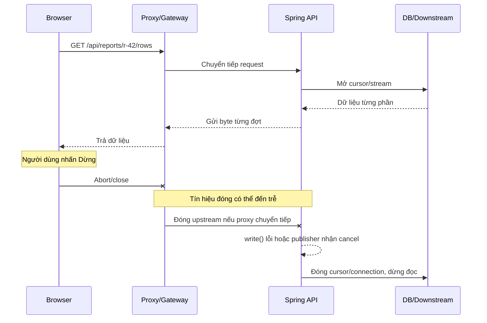

# Streaming, hủy yêu cầu và giải phóng tài nguyên sớm

## Mục tiêu học tập

Sau bài này, bạn có thể:

- Phân biệt response **buffered** với response **streaming** trong REST API; lựa chọn tải tệp, NDJSON, Server-Sent Events (SSE) hoặc tài nguyên theo dõi công việc cho từng yêu cầu.
- Hiểu **time to first byte (TTFB)**, độ trễ nhận dữ liệu đầu tiên, backpressure, buffering ở proxy và các giới hạn của giao thức HTTP.
- Dùng `fetch`, `ReadableStream`, `AbortController` để tiêu thụ và hủy một response đang streaming trong trình duyệt.
- Triển khai streaming với **Spring MVC** và **Spring WebFlux**, đồng thời xác định thời điểm đóng file, HTTP connection, cursor và subscription.
- Phân biệt **client ngắt kết nối**, **cancellation của công việc phía server** và **compensation của nghiệp vụ**; không suy luận hủy mạng đồng nghĩa rollback.
- Kiểm thử hủy giữa chừng, timeout, lỗi sau khi commit header, giải phóng tài nguyên và tác động tới throughput/p95/p99.

## 1. Vì sao API cần streaming?

Giả sử ứng dụng xuất báo cáo gồm 300.000 bản ghi. Cách buffered thường thấy:

```java
List<ReportRow> rows = repository.findEverything();
byte[] file = renderReport(rows);
return ResponseEntity.ok(file);
```

Những nguy cơ có thể xảy ra:

- Toàn bộ dữ liệu và file kết quả phải nằm trong RAM trước khi gửi, dễ làm tăng heap, GC và nguy cơ `OutOfMemoryError`.
- Người dùng nhìn thấy màn hình “đang tải” cho tới khi phần lớn công việc kết thúc.
- Nếu người dùng đóng tab sau vài giây, service có thể vẫn đọc database, tạo file hoặc gọi downstream không cần thiết.
- Khi nhiều người cùng xuất báo cáo, số byte đang giữ trong bộ nhớ và số worker/connection đang sử dụng tăng theo số request.

**Streaming** là truyền dữ liệu từng phần ngay khi sẵn sàng, thường dùng buffer hữu hạn, thay vì tạo toàn bộ kết quả trước khi gửi. API vẫn cần phân trang, quota, timeout và giới hạn concurrency: streaming **không biến một truy vấn rất chậm thành truy vấn rẻ**.

### Hai hướng truyền dữ liệu

| Hướng | Ví dụ | Vấn đề cần xử lý |
| --- | --- | --- |
| **Response streaming**: server → client | Tải tệp lớn, NDJSON, SSE | Backpressure, client disconnect, flush, đóng nguồn dữ liệu |
| **Request streaming**: client → server | Upload tệp, dữ liệu nhiều phần | Giới hạn kích thước, đọc dần, hủy giữa upload, dọn file tạm |

Bài này tập trung vào **response streaming** của REST API với Java/Spring; các nguyên tắc hủy và dọn tài nguyên cũng áp dụng cho upload và WebSocket.

## 2. “Nhanh hơn” theo nghĩa nào?

Phân biệt các phép đo:

- **TTFB**: thời gian từ lúc client bắt đầu request đến khi nhận byte đầu tiên của response.
- **Time to first useful item**: thời gian đến bản ghi/sự kiện đầu tiên mà giao diện có thể dùng được.
- **Total response time**: thời gian đến khi truyền xong toàn bộ body.
- **Throughput**: byte hoặc bản ghi xử lý mỗi giây.
- **In-flight resource cost**: số connection, thread, cursor, file handle, heap buffer và subscription còn giữ khi luồng đang mở.

Streaming có thể cải thiện TTFB hoặc time to first useful item nếu nguồn tạo dữ liệu dần dần. Tuy nhiên, nếu câu SQL phải thực hiện một phép sắp xếp lớn trước khi có hàng đầu tiên, **server chưa chắc có byte để gửi sớm**. Tốc độ tổng cộng còn phụ thuộc database, serializer, TLS, network và tốc độ đọc của client.

Ví dụ 500 MiB dữ liệu với buffer 32 KiB: thay vì giữ 500 MiB thành một `byte[]`, một implementation dùng buffer tái sử dụng có thể chỉ giữ khoảng 32 KiB cho **phần đệm của luồng đó**. Con số này chưa tính driver JDBC, codec, container, TLS, proxy và các buffer tầng khác. Nếu có 1.000 request mở cùng lúc, mỗi luồng vẫn tiêu tốn tài nguyên đáng kể.

### Không có ranh giới chunk cố định ở ứng dụng

HTTP truyền byte theo từng đợt, nhưng **ranh giới network chunk không nhất thiết trùng ranh giới bản ghi**:

- Với HTTP/1.1, server có thể dùng `Transfer-Encoding: chunked` khi không biết trước `Content-Length`.
- HTTP/2 và HTTP/3 truyền dữ liệu bằng frame tương ứng; không dùng HTTP/1.1 chunked transfer coding.
- TCP, HTTP frame, gzip và proxy có thể gộp/tách byte tùy thời điểm.
- JavaScript đọc `ReadableStream` có thể nhận nửa JSON, nhiều dòng JSON cùng lúc, hoặc một chuỗi UTF-8 bị chia giữa hai lần đọc.

Vì vậy, **protocol ở tầng ứng dụng phải tự định nghĩa ranh giới**, chẳng hạn mỗi dòng kết thúc bằng newline trong NDJSON hoặc mỗi sự kiện kết thúc bằng một dòng trống trong SSE. Một lần gọi `reader.read()` **không** tương ứng một item nghiệp vụ.

## 3. Chọn giao thức streaming phù hợp

| Kiểu | `Content-Type` | Phù hợp | Lưu ý |
| --- | --- | --- | --- |
| File/binary | `application/octet-stream`, PDF, CSV... | Tải xuống nội dung lớn, giữ thứ tự byte | Không giả định kích thước/khả năng resume nếu chưa có contract |
| **NDJSON** | `application/x-ndjson` | Danh sách bản ghi xuất dần, mỗi dòng là một JSON object | Client phải xử lý dòng chưa hoàn chỉnh, lỗi giữa luồng |
| **SSE** | `text/event-stream` | Tiến độ, thông báo đơn hướng server → browser | EventSource tự reconnect; cần định nghĩa event ID, heartbeat, auth |
| Multipart stream | `multipart/mixed` | Nhiều phần có metadata riêng | Client/parser phức tạp; cần boundary đúng |
| WebSocket | Giao thức nâng cấp/thiết lập riêng | Trao đổi hai chiều liên tục | Ngoài mô hình response REST thông thường |
| **202 + operation resource** | JSON | Công việc có thể chạy sau khi user rời trang | Theo dõi qua `GET /api/operations/{id}`, không gắn tiến độ vào connection |

Chọn streaming khi **người nhận cần dữ liệu từng phần** hoặc dữ liệu đủ lớn để tránh buffering toàn bộ. Chọn `202 Accepted` và tài nguyên tiến trình khi tác vụ kéo dài, cần tiếp tục kể cả client đã ngắt kết nối, cần retry/hủy tường minh hoặc cần trạng thái cuối được lưu bền vững. Có thể kết hợp: `POST` trả `202`, sau đó SSE phát tiến độ cho operation.

### 3.1. NDJSON qua HTTP

Request:

```http
GET /api/reports/r-42/rows HTTP/1.1
Host: api.example.com
Authorization: Bearer <access-token>
Accept: application/x-ndjson
```

Response (body dưới đây là **các dòng logic**, bỏ qua framing byte của HTTP):

```http
HTTP/1.1 200 OK
Content-Type: application/x-ndjson; charset=utf-8
Cache-Control: private, no-store
X-Content-Type-Options: nosniff

{"row":1,"sku":"keyboard-01","quantity":2}
{"row":2,"sku":"mouse-03","quantity":1}
{"row":3,"sku":"monitor-07","quantity":4}
```

Mỗi dòng hoàn chỉnh là một JSON value; ký tự xuống dòng **bên trong string** phải được escape theo JSON. Khi đọc, client cần giữ phần dòng dở, giới hạn kích thước dòng tối đa và xử lý lỗi parse. JSON thông thường dạng một array lớn `[{...},{...}]` khó xử lý tăng dần hơn nếu không có incremental JSON parser.

### 3.2. SSE cho tiến độ theo thời gian

```http
GET /api/operations/op-81/events HTTP/1.1
Host: api.example.com
Accept: text/event-stream
```

```http
HTTP/1.1 200 OK
Content-Type: text/event-stream; charset=utf-8
Cache-Control: no-cache
X-Accel-Buffering: no

id: 101
event: progress
data: {"percent":20,"stage":"READING"}

: heartbeat

id: 102
event: progress
data: {"percent":75,"stage":"WRITING"}

id: 103
event: completed
data: {"resultUrl":"/api/reports/r-42"}

```

Dòng trống kết thúc một SSE event; dòng bắt đầu bằng `:` là comment, có thể dùng làm heartbeat. `X-Accel-Buffering: no` có ý nghĩa với Nginx khi proxy hỗ trợ; **không phải header HTTP chuẩn điều khiển mọi reverse proxy**.

Nếu có `id` và native EventSource kết nối lại, browser có thể gửi `Last-Event-ID`. **Server chỉ nên hứa phát lại sự kiện nếu thực sự có event store hoặc cơ chế resume bền vững**. Trường `id` tự nó không chống mất event. Với progress có thể bỏ qua các mốc trung gian, nên cho client tra cứu trạng thái hiện tại bằng `GET` sau khi reconnect.

## 4. Hủy response streaming ở trình duyệt

Trình duyệt có thể dừng đọc response khi người dùng rời trang, bấm “Dừng” hoặc timeout. `AbortController` truyền tín hiệu abort tới `fetch` và việc đọc body:

```javascript
const controller = new AbortController();

async function downloadPreview() {
  const response = await fetch("/api/reports/r-42/rows", {
    headers: { Accept: "application/x-ndjson" },
    signal: controller.signal
  });

  if (!response.ok) {
    throw new Error("HTTP " + response.status);
  }
  if (!response.body) {
    throw new Error("Browser không cung cấp streaming body");
  }

  const reader = response.body.getReader();
  const decoder = new TextDecoder();
  let pending = "";

  try {
    for (;;) {
      const { value, done } = await reader.read();
      if (done) break;

      pending += decoder.decode(value, { stream: true });

      let separator;
      while ((separator = pending.indexOf("\n")) !== -1) {
        const line = pending.slice(0, separator).trim();
        pending = pending.slice(separator + 1);
        if (line) handleRow(JSON.parse(line));
      }

      if (pending.length > 1024 * 1024) {
        throw new Error("NDJSON row quá lớn");
      }
    }

    pending += decoder.decode(); // Hoàn tất ký tự UTF-8 còn dở.
    if (pending.trim()) handleRow(JSON.parse(pending));
  } catch (error) {
    if (controller.signal.aborted) return;
    throw error;
  } finally {
    // Hủy body nếu consumer dừng trước khi luồng kết thúc.
    await reader.cancel().catch(() => {});
    reader.releaseLock();
  }
}

document.querySelector("#stop").addEventListener("click", () => {
  controller.abort();
});
```

Đây là ví dụ minh họa, cần định nghĩa `handleRow`, cấu trúc UI và xử lý exception của ứng dụng. `reader.read()` trả **byte chunks bất kỳ**; `TextDecoder.decode(..., {stream:true})` xử lý UTF-8 bị chia ranh giới. Trong production nên kiểm tra giới hạn **từng dòng hoàn chỉnh** (không chỉ `pending`), tổng số bản ghi, tổng số byte và deadline của client, để tránh một chunk lớn chứa nhiều dòng hợp lệ vượt giới hạn.

`AbortController.abort()` làm browser ngừng quan tâm request/response và thường đóng/hủy stream mạng. Nhưng nó **không là giao dịch rollback** và cũng **không bảo đảm** logic trong server ngừng ngay. Một proxy có thể đã đọc trước dữ liệu, một lời gọi SQL có thể đang chạy, hoặc một side effect đã commit.

### Khi nào dùng `reader.cancel()`?

`reader.cancel()` báo rằng consumer không cần dữ liệu của `ReadableStream` nữa. `AbortController.abort()` là cơ chế kiểm soát cả request `fetch` và body. Có thể dùng cả hai; đừng giả định một cách tự động hủy mọi tác vụ backend hoặc đóng ngay tất cả downstream connection. Nếu chỉ dừng vòng lặp JavaScript mà không cancel/abort, browser có thể tiếp tục đọc/buffer response hoặc giữ connection lâu hơn.

Khi đặt timeout, dùng cùng một controller:

```javascript
const controller = new AbortController();
const timeoutId = setTimeout(() => controller.abort(), 15_000);

try {
  await consumeReport({ signal: controller.signal });
} finally {
  clearTimeout(timeoutId);
}
```

`consumeReport` là hàm nhận và truyền `signal` tới `fetch`/stream. Đây là **deadline phía client**, không thay thế timeout của HTTP client, DB hay worker phía server.

### SSE dùng EventSource khác fetch streaming

```javascript
const events = new EventSource("/api/operations/op-81/events");

events.addEventListener("progress", event => {
  updateProgress(JSON.parse(event.data));
});

events.addEventListener("completed", event => {
  showResult(JSON.parse(event.data));
  events.close();
});

function stopWatching() {
  events.close();
}
```

`EventSource.close()` dừng nhận sự kiện và ngăn việc tự reconnect của instance đó. Native EventSource **không cho đặt tùy ý header Authorization** trong constructor. Với session cookie có thể dùng URL cùng origin, hoặc `new EventSource(url, { withCredentials: true })` cho CORS có credentials khi chính sách cookie cho phép; server phải cấu hình CORS và CSRF/auth phù hợp. Tránh đặt bearer token trong query string vì URL có thể lọt vào access log, history, Referer hoặc công cụ giám sát. Nếu bắt buộc Bearer header, cân nhắc một client SSE dựa trên `fetch` có hỗ trợ header hoặc dùng tài nguyên polling.

## 5. Điều gì thực sự xảy ra khi client đóng kết nối?



Tín hiệu cancellation có thể thể hiện bằng `IOException` khi `write()`, tín hiệu `CANCEL` trong reactive publisher, event `onError`/`onCompletion`, hoặc timeout ở container. Trường hợp network chia cắt, server có thể **không phát hiện ngay** nếu chưa ghi byte nào. Nếu worker đang chờ một call blocking dài, việc client disconnect chưa chắc interrupt được call đó.

Vì vậy, quy trình đúng là:

1. **Giới hạn tài nguyên trước khi bắt đầu:** authentication, authorization, concurrency budget, rate limit, timeout, kích thước/độ dài response dự kiến.
2. **Truyền cancellation nếu có thể:** dừng publisher, đọc database, gọi downstream hoặc worker theo API hỗ trợ; dùng timeout riêng cho các thao tác blocking.
3. **Giải phóng trong `finally`/try-with-resources hoặc lifecycle hook:** đóng file stream, cursor, connection, subscription và buffer có quyền sở hữu.
4. **Ghi nhận outcome rõ ràng:** phân biệt completed, client canceled, server timeout và upstream error khi có đủ tín hiệu; không gán mọi `IOException` là lỗi “do client”.
5. **Phục hồi trạng thái nghiệp vụ:** nếu có side effect đã commit, chỉ hủy thông qua operation/cancellation hợp lệ; không tự rollback do một socket đóng.

**Một request HTTP có thể đã “thành công” theo tiêu đề `200` nhưng body bị cắt giữa chừng.** Client phải kiểm tra kết thúc protocol, checksum/length hoặc marker hoàn tất nếu cần bảo đảm toàn vẹn dữ liệu. Server không thể gửi lại `500` sau khi response headers đã commit.

## 6. Spring MVC: StreamingResponseBody và try-with-resources

Spring MVC dựa trên Servlet stack có thể trả `StreamingResponseBody` để ghi dần vào `OutputStream` thay vì tạo một `byte[]` lớn. Ví dụ sau mô tả endpoint tải CSV đã được phân quyền:

```java
import java.io.InputStream;
import java.nio.charset.StandardCharsets;
import org.springframework.http.CacheControl;
import org.springframework.http.HttpHeaders;
import org.springframework.http.MediaType;
import org.springframework.http.ResponseEntity;
import org.springframework.security.core.Authentication;
import org.springframework.web.bind.annotation.GetMapping;
import org.springframework.web.bind.annotation.PathVariable;
import org.springframework.web.bind.annotation.RequestMapping;
import org.springframework.web.bind.annotation.RestController;
import org.springframework.web.servlet.mvc.method.annotation.StreamingResponseBody;

@RestController
@RequestMapping("/api/reports")
class ReportDownloadController {
    private final ReportStorage storage;

    ReportDownloadController(ReportStorage storage) {
        this.storage = storage;
    }

    @GetMapping(value = "/{id}/download", produces = "text/csv")
    ResponseEntity<StreamingResponseBody> download(
            @PathVariable String id, Authentication authentication) {

        // Xác thực, phân quyền và kiểm tra tồn tại TRƯỚC khi ghi body.
        ReportFile file = storage.findAuthorized(
            id, authentication.getName());

        StreamingResponseBody stream = output -> {
            // InputStream đóng được kể cả khi write() ném IOException.
            try (InputStream input = storage.openStream(file)) {
                byte[] buffer = new byte[32 * 1024];
                int count;
                while ((count = input.read(buffer)) != -1) {
                    output.write(buffer, 0, count);
                }
                output.flush();
            }
        };

        return ResponseEntity.ok()
            .contentType(new MediaType("text", "csv", StandardCharsets.UTF_8))
            .header(HttpHeaders.CONTENT_DISPOSITION,
                "attachment; filename=\"report.csv\"")
            .cacheControl(CacheControl.noStore())
            .header("X-Content-Type-Options", "nosniff")
            .body(stream);
    }
}
```

`ReportStorage` và `ReportFile` là những thành phần minh họa cần được triển khai. `findAuthorized` phải kiểm tra **quyền đọc tài nguyên cụ thể**, không chỉ xem người dùng đã đăng nhập. Tên file ở header được đặt cố định trong ví dụ; nếu lấy từ dữ liệu người dùng, phải sanitize/encode đúng chuẩn `Content-Disposition` và không cho phép header injection.

Các điểm cần hiểu:

- `storage.openStream(file)` được gọi khi streaming bắt đầu; `try-with-resources` đóng nguồn khi đọc hết, khi `write()` ném lỗi hoặc khi có exception khác.
- **Không tự đóng** `output` thuộc quyền quản lý của servlet container. Không đóng `InputStream` từ bên ngoài trước khi callback chạy.
- Nếu file lớn nhưng nguồn đã sẵn có, dùng cơ chế serve static resource/sendfile phù hợp có thể hiệu quả hơn việc tự copy qua Java. Với các nguồn tạo dữ liệu dần dần, streaming callback thường linh hoạt hơn.
- Khi tốc độ nhận của client chậm, `output.write(...)` có thể block; đây là **backpressure ở mức ghi byte**, nhưng nó vẫn chiếm worker thread theo mô hình blocking.
- Nếu `input.read(...)` đang chờ một server lưu trữ chậm, client abort chưa chắc làm read ngừng ngay. Cần timeout và cancellation ở tầng storage/HTTP client.
- Nếu một row/file lỗi sau khi bytes đã được gửi, backend chỉ có thể đóng/đánh dấu stream lỗi theo protocol đã chọn, không thể đổi `200` đã commit thành `500`.

### Bảo vệ thread pool dùng cho streaming

`StreamingResponseBody` dùng cơ chế xử lý async của Spring MVC. Đừng coi “async” là không dùng thread: một stream sao chép từ `InputStream` và ghi `OutputStream` vẫn có thể chiếm worker trong suốt phiên tải. Nên cấu hình executor có giới hạn:

```java
import java.util.concurrent.ThreadPoolExecutor;
import org.springframework.beans.factory.annotation.Qualifier;
import org.springframework.context.annotation.Bean;
import org.springframework.context.annotation.Configuration;
import org.springframework.core.task.AsyncTaskExecutor;
import org.springframework.scheduling.concurrent.ThreadPoolTaskExecutor;
import org.springframework.web.servlet.config.annotation.AsyncSupportConfigurer;
import org.springframework.web.servlet.config.annotation.WebMvcConfigurer;

@Configuration
class MvcStreamingConfig {
    @Bean("mvcStreamingExecutor")
    ThreadPoolTaskExecutor mvcStreamingExecutor() {
        ThreadPoolTaskExecutor executor = new ThreadPoolTaskExecutor();
        executor.setCorePoolSize(8);
        executor.setMaxPoolSize(16);
        executor.setQueueCapacity(32);
        executor.setThreadNamePrefix("http-stream-");
        executor.setRejectedExecutionHandler(
            new ThreadPoolExecutor.AbortPolicy());
        executor.initialize();
        return executor;
    }

    @Bean
    WebMvcConfigurer configureMvcStreaming(
            @Qualifier("mvcStreamingExecutor")
            AsyncTaskExecutor executor) {
        return new WebMvcConfigurer() {
            @Override
            public void configureAsyncSupport(
                    AsyncSupportConfigurer configurer) {
                configurer.setTaskExecutor(executor);
                configurer.setDefaultTimeout(60_000L);
            }
        };
    }
}
```

Con số `8/16/32` chỉ là ví dụ để minh họa pool hữu hạn, **không** phải cấu hình tối ưu. `AsyncSupportConfigurer` được dùng cho async processing của Spring MVC nói chung, không chỉ một endpoint; cần đánh giá tác động tới các endpoint async khác. Khi executor hết slot/queue, phải có chính sách **admission control** và handler cho rejected task; không nên để client nhận `500` mơ hồ nếu có thể từ chối có chủ đích bằng `503 Service Unavailable` trước khi body commit.

`setDefaultTimeout(60_000L)` áp dụng timeout xử lý async, nhưng không có nghĩa mọi JDBC/file read đều bị dừng cứng ở đúng 60 giây. Timeout connection, read, statement query, tổng deadline và cancellation của thao tác được gọi phải được thiết lập riêng. Với SSE lâu dài, cấu hình timeout khác và cơ chế heartbeat/cleanup theo vòng đời.

### Không trả 202 nếu chỉ xếp streaming vào RAM

`GET /api/reports/{id}/download` phục vụ một resource đã có, có thể trả `200` và bắt đầu stream. Nếu `POST /api/reports` yêu cầu tính báo cáo tốn nhiều phút, hãy **ghi yêu cầu công việc bền vững** rồi trả `202` cùng `Location` để theo dõi tiến trình. Đừng mở một request vô hạn chỉ để giữ kết nối, cũng đừng trả `202` sau khi chỉ đưa task vào queue bộ nhớ chưa có cơ chế phục hồi.

## 7. Spring MVC: vòng đời SseEmitter

Khi dùng Spring MVC với SSE, `SseEmitter` cho phép gửi sự kiện từng đợt. Với một nguồn `Flux<ProgressUpdate>` từ nội bộ, có thể minh họa:

```java
import java.io.IOException;
import java.util.UUID;
import org.springframework.http.MediaType;
import org.springframework.security.core.Authentication;
import org.springframework.web.bind.annotation.GetMapping;
import org.springframework.web.bind.annotation.PathVariable;
import org.springframework.web.bind.annotation.RestController;
import org.springframework.web.servlet.mvc.method.annotation.SseEmitter;
import reactor.core.Disposable;

@RestController
class ProgressSseController {
    private final ProgressService progressService;

    ProgressSseController(ProgressService progressService) {
        this.progressService = progressService;
    }

    @GetMapping(value = "/api/operations/{id}/events",
                produces = MediaType.TEXT_EVENT_STREAM_VALUE)
    SseEmitter events(
            @PathVariable UUID id, Authentication authentication) {

        progressService.checkCanRead(id, authentication.getName());
        SseEmitter emitter = new SseEmitter(60_000L);

        Disposable subscription = progressService.events(id)
            .subscribe(progress -> {
                try {
                    emitter.send(SseEmitter.event()
                        .id(progress.eventId())
                        .name("progress")
                        .data(progress));
                } catch (IOException sendFailure) {
                    emitter.completeWithError(sendFailure);
                }
            }, emitter::completeWithError, emitter::complete);

        emitter.onCompletion(subscription::dispose);
        emitter.onTimeout(() -> {
            subscription.dispose();
            emitter.complete();
        });
        emitter.onError(error -> subscription.dispose());
        return emitter;
    }
}
```

Ví dụ này giả định `ProgressService.events(id)` trả luồng có khả năng dừng khi `subscription.dispose()` và các method/service đã được khai báo. Cần quan tâm **race** giữa việc đăng ký callback và việc publisher kết thúc quá nhanh: mã production nên tạo/lắp lifecycle handler trước khi start nguồn phát, quản lý subscription atomically và xử lý trường hợp emitter kết thúc trong lúc đăng ký. Lệnh `emitter.send(...)` có thể block; nếu nguồn `Flux` phát trên Netty event loop hoặc một thread nhạy cảm khác, cần chuyển phần ghi blocking sang executor có giới hạn hoặc dùng WebFlux streaming native để không chặn event loop.

Không để subscription sinh thêm công việc khi client không còn nghe. `onCompletion` có thể xảy ra sau hoàn tất bình thường, sau timeout hoặc do error; `onTimeout` và `onError` giúp khởi động cleanup sớm theo tình huống. Nếu nguồn là Kafka, message broker, database listener hoặc callback đăng ký thủ công, bản thân `dispose()` phải được nối đến hành động **unsubscribe/close** thật; chỉ bỏ reference Java không dừng được broker consumer.

Với SSE, cần cân nhắc reconnect của browser: server có thể nhận nhiều subscription trong lúc mạng chập chờn. Đặt quota per user/operation, heartbeat phù hợp và chính sách replay/resume để tránh trùng side effect hoặc resource leak. Không gửi event chứa token, thông tin thanh toán hay dữ liệu người dùng vượt quyền.

## 8. Spring WebFlux: cancellation và resource ownership

WebFlux/Reactor hỗ trợ phản ứng với tín hiệu Reactive Streams `CANCEL`. Một endpoint SSE đơn giản:

```java
import java.util.UUID;
import org.springframework.http.MediaType;
import org.springframework.http.codec.ServerSentEvent;
import org.springframework.security.core.Authentication;
import org.springframework.web.bind.annotation.GetMapping;
import org.springframework.web.bind.annotation.PathVariable;
import org.springframework.web.bind.annotation.RestController;
import reactor.core.publisher.Flux;
import reactor.core.publisher.SignalType;

@RestController
class ReactiveProgressController {
    private final ReactiveProgressService progressService;

    ReactiveProgressController(ReactiveProgressService progressService) {
        this.progressService = progressService;
    }

    @GetMapping(value = "/api/operations/{id}/events",
                produces = MediaType.TEXT_EVENT_STREAM_VALUE)
    Flux<ServerSentEvent<ProgressUpdate>> events(
            @PathVariable UUID id, Authentication authentication) {

        return progressService.listenAuthorized(id, authentication)
            .map(progress -> ServerSentEvent.<ProgressUpdate>builder()
                .id(progress.eventId())
                .event(progress.terminal() ? "completed" : "progress")
                .data(progress)
                .build())
            .doFinally(signal -> {
                if (signal == SignalType.CANCEL) {
                    recordCanceledStream();
                } else {
                    recordTerminatedStream(signal);
                }
            });
    }
}
```

`ReactiveProgressService`, `ProgressUpdate` và các hàm ghi metric là những thành phần minh họa. `listenAuthorized` phải thực sự kiểm tra quyền đọc operation và trả một publisher có lifecycle gắn với subscription. `doFinally` hữu ích để quan sát `ON_COMPLETE`, `ON_ERROR`, `CANCEL`, **nhưng việc ghi metric trong callback không tự đóng resource bị giữ bên ngoài publisher**.

### Sở hữu tài nguyên với `using`/`usingWhen`

Nếu một subscription mở connection/file/stream riêng, hãy dùng operator quản lý vòng đời. `Flux.using` thích hợp cho tài nguyên đóng đồng bộ; `Flux.usingWhen` cho cleanup bất đồng bộ:

```java
// Pseudocode Reactor: BrokerSubscription phải cung cấp events(),
// closeAsync() và client.openSubscription() tương ứng.
Flux<ProgressUpdate> progress = Flux.usingWhen(
    client.openSubscription(operationId), // Mono<BrokerSubscription>
    subscription -> subscription.events(),
    subscription -> subscription.closeAsync(),         // Complete
    (subscription, error) -> subscription.closeAsync(), // Error
    subscription -> subscription.closeAsync()          // Cancel
);
```

Khi downstream cancel, Reactor kích hoạt nhánh cleanup của `usingWhen`. Contract của `closeAsync()` phải idempotent và có timeout hợp lý; cleanup có thể thất bại nên cần metric/alert tương ứng. Trường hợp callback tự chạy một thread/vòng lặp bên ngoài publisher, phải liên kết cancellation tới vòng lặp đó thay vì chỉ dùng `doOnCancel` để ghi log.

### WebFlux không có nghĩa là mọi thao tác đều non-blocking

Nếu gọi JDBC blocking, `Thread.sleep()` hoặc đọc filesystem blocking ngay trên Netty event loop, một ít stream có thể làm chậm rất nhiều request khác. Khi phải dùng thư viện blocking, cân nhắc `Schedulers.boundedElastic()`/executor phù hợp và giới hạn concurrency; không biến `boundedElastic` thành lý do cho phép hàng nghìn thao tác blocking kéo dài vô hạn.

Đối với file trong WebFlux, Spring có `DataBufferUtils.read(...)` để đọc dần từng `DataBuffer`:

```java
import java.nio.file.Path;
import org.springframework.core.io.buffer.DataBuffer;
import org.springframework.core.io.buffer.DataBufferUtils;
import org.springframework.core.io.buffer.DefaultDataBufferFactory;
import reactor.core.publisher.Flux;

Path safePath = reportStorage.authorizedPath(reportId, principal);

Flux<DataBuffer> bytes = DataBufferUtils
    .read(safePath, DefaultDataBufferFactory.sharedInstance, 16 * 1024)
    .doOnDiscard(DataBuffer.class, DataBufferUtils::release);
```

`reportStorage.authorizedPath(...)` phải kiểm tra quyền và chống path traversal; đoạn này chỉ minh họa nguồn body cho handler WebFlux. **DataBuffer có quy tắc ownership và reference count tùy implementation**: không gọi `release` ngay sau khi emit một buffer vẫn được HTTP writer sử dụng. Khi tự tạo buffer, dùng Netty pooled buffer hoặc bỏ/drop element, phải hiểu rõ ai release từng buffer; `doOnDiscard` xử lý phần bị loại theo chuỗi operator nhưng không thay thế việc đóng connection/reader ở nguồn.

Sử dụng operator `onBackpressureBuffer` không giới hạn có thể biến memory thành queue vô hạn. Nếu upstream là hot source không tuân theo demand, chọn buffer hữu hạn, drop/error policy phù hợp và đo queue depth. Với file/sự kiện cần đủ từng byte, **không được bỏ dữ liệu âm thầm** chỉ để giảm tải; từ chối sớm hoặc chậm nguồn phát là lựa chọn phù hợp hơn.

## 9. Đóng resource đúng lúc: không chỉ mỗi HTTP connection

Một stream có thể giữ nhiều tài nguyên hơn người đọc tưởng:

| Resource đang giữ | Nơi cấp phát | Khi nào cần giải phóng | Sai lầm thường gặp |
| --- | --- | --- | --- |
| `InputStream`/file handle | Filesystem, object storage SDK | Hoàn tất, lỗi, client cancel | Không dùng try-with-resources; chỉ đóng khi gửi đủ byte |
| JDBC `ResultSet`/`Statement`/`Connection` | Database/HikariCP | Không còn đọc dữ liệu hoặc lỗi | Trả `Stream<Row>` ra ngoài transaction rồi để callback đọc sau |
| HTTP response body/connection downstream | `WebClient`, Apache HttpClient, SDK | Đọc hết hoặc cancel/close theo client API | Chỉ thoát vòng lặp mà không đóng response |
| Worker thread | MVC async executor | Kết thúc/cancel/timeout công việc | Mỗi SSE giữ một thread blocking vô thời hạn |
| Subscription/listener | Reactor, broker, callback registry | Không còn subscriber hoặc operation hết hạn | Client reconnect tạo thêm listener mà listener cũ không bị gỡ |
| Byte buffer | Servlet/Netty/codec | Theo ownership của producer/consumer | Release quá sớm, release hai lần hoặc quên release buffer bị drop |
| File tạm của upload/export | Local filesystem/object store | Hoàn tất, hủy, TTL | Client rời trang nhưng file tạm vẫn tồn tại mãi |

### JDBC stream và transaction

Ví dụ sau dễ gặp lỗi vòng đời:

```java
@Transactional(readOnly = true)
public Stream<OrderRow> openRows() {
    return repository.streamAllRows();
}

// Nơi gọi đọc stream sau khi openRows() đã trả về.
Stream<OrderRow> rows = service.openRows();
rows.forEach(this::writeCsvRow);
```

Trong proxy transaction thông thường, transaction của `openRows()` có thể đã kết thúc khi method trả về, trước lúc caller đọc stream. Cursor/JDBC resources có thể đã bị đóng; hoặc hệ thống cố giữ connection quá lâu trong khi client nhận chậm.

Hai cách thiết kế thực tế:

1. **Streaming trực tiếp từ JDBC cursor:** mở transaction/cursor ở đúng vòng đời đọc và đóng `Stream`/ResultSet/connection trong `try-with-resources`; bảo đảm timeout, giới hạn concurrency, kích thước fetch, hỗ trợ cancellation của driver. Nhược điểm là **giữ connection/transaction trong suốt thời gian truyền mạng**; client chậm có thể chiếm connection rất lâu.
2. **Đọc theo từng batch bằng keyset pagination:** mỗi lần chỉ fetch một batch trong transaction ngắn, serialize và gửi, rồi fetch batch kế tiếp bằng cursor/key đã chọn. Giảm thời gian giữ DB connection nhưng cần **thứ tự ổn định** và quy tắc nhất quán dữ liệu khi có insert/update đồng thời.

Ví dụ thuật toán đọc batch (pseudocode):

```java
StreamingResponseBody body = output -> {
    Cursor next = Cursor.start();

    while (next != null) {
        // Mỗi lần gọi trả về dữ liệu đã materialize trong batch nhỏ.
        // Query, transaction và connection kết thúc trước khi ghi mạng.
        ReportBatch batch = reportService.readNextBatch(next, 500);

        for (ReportRow row : batch.rows()) {
            byte[] csvLine = serializeCsvRow(row);
            output.write(csvLine);
        }
        next = batch.nextCursor();
    }
};
```

Các class/helper được giản lược để tập trung vào ý tưởng. **Không dùng OFFSET đơn giản nếu dataset lớn hoặc biến động** mà chưa đánh giá hiệu năng và trùng/mất bản ghi. Với báo cáo tài chính cần snapshot dữ liệu đúng thời điểm, cách chắc chắn hơn thường là **job xuất báo cáo bền vững**, lấy dữ liệu ở snapshot đã định nghĩa, lưu file kết quả rồi cho client download (hỗ trợ resume nếu cần).

Không nên cache mọi batch vào một `List` khổng lồ; mục tiêu là giới hạn lượng dữ liệu cùng tồn tại trong bộ nhớ. Bên cạnh đó, phải kiểm tra người dùng còn quyền đọc trong suốt vòng đời nếu chính sách đòi hỏi, và có timeout/TTL cho dữ liệu xuất.

### HTTP client và side effect ở downstream

Khi stream tổng hợp dữ liệu từ các service bên ngoài, cần liên kết cancellation của client tới publisher hoặc HTTP request downstream **nếu thư viện hỗ trợ**. Tuy nhiên, hủy subscription chỉ ngăn bạn **tiếp tục nhận kết quả**; downstream có thể đã chạy và commit giao dịch. Mọi lệnh thay đổi trạng thái như thanh toán, tạo đơn, gửi email vẫn phải có idempotency và contract hủy riêng.

Nếu một business operation cần chạy hoàn tất sau khi người dùng đóng tab, không nên buộc operation phụ thuộc vào stream. Dùng `POST /api/operations` → `202 Accepted` → `GET /api/operations/{id}`; hỗ trợ yêu cầu hủy tường minh qua `POST /api/operations/{id}/cancellation` khi nghiệp vụ cho phép. Hủy operation có thể kích hoạt Saga compensation, hoàn toàn **khác** thao tác ngắt stream mạng.

## 10. Proxy, buffering, timeout và flush

Một server có thể `flush` byte sau mỗi dòng nhưng client vẫn không thấy ngay nếu một lớp ở giữa buffer lại. Các lớp thường gặp: reverse proxy, API gateway, service mesh, CDN, gzip encoder, TLS hoặc buffering của trình duyệt.

Ví dụ Nginx (chỉ áp dụng cho endpoint SSE đã định danh):

```nginx
location ~ ^/api/operations/[^/]+/events$ {
    proxy_pass http://spring_backend;
    proxy_http_version 1.1;
    proxy_buffering off;
    proxy_read_timeout 75s;
}
```

Regex location này chỉ nhắm đến endpoint `/api/operations/{id}/events`; cần điều chỉnh route theo ứng dụng thực tế. `proxy_buffering off` giúp response được chuyển tiếp thay vì tích lũy trong buffer của Nginx. `proxy_read_timeout` là thời gian chờ giữa các lần đọc từ upstream theo ngữ nghĩa Nginx, **không phải tổng thời lượng tối đa của SSE**. Nếu có heartbeat mỗi 15 giây, phải tính cả timeout ở load balancer, CDN và gateway khác; không có một cấu hình Nginx bảo đảm mọi proxy trên đường đi đều không buffer.

Những điểm cần xác minh trên hệ thống triển khai:

- Response có `Content-Type` đúng, `Cache-Control` phù hợp và không bị thay đổi trái ý bởi CDN.
- Proxy không đệm toàn bộ SSE/NDJSON cho tới khi đủ vài KiB hoặc stream kết thúc. Với SSE, `X-Accel-Buffering: no` có thể hỗ trợ khi Nginx cho phép.
- Compression không gom nhiều bản ghi quá lâu; không tắt gzip trên mọi endpoint chỉ để sửa một stream nếu có giải pháp cấu hình theo route.
- `Connection`/keep-alive, HTTP/2 và giới hạn số stream hoạt động ở gateway phù hợp quy mô; SSE trên HTTP/1.1 có thể vướng giới hạn số kết nối của browser với một origin.
- Idle timeout, write timeout, upstream read timeout và heartbeat có quan hệ được đo; heartbeat phải thực sự được flush qua proxy.
- Khi lỗi xảy ra **trước khi gửi header**, API còn có thể trả `4xx/5xx` dạng Problem Details. **Sau khi header/body đã commit**, không thể đổi mã trạng thái.

### Phân biệt flush với hoàn tất

`output.flush()` yêu cầu đẩy dữ liệu khỏi buffer gần nhất, **không bảo đảm byte đã được hiển thị cho user** hoặc được lưu bền vững ở client. Với NDJSON, flush từng row nhỏ có thể gây overhead; thường nên flush theo batch hoặc theo thời gian, tùy yêu cầu latency. Với SSE, flush theo event/heartbeat thường quan trọng để client nhận tiến độ.

Đừng ép `Content-Length` khi không biết chính xác kích thước body. Nếu tải file đã lưu và kích thước biết trước, đặt `Content-Length` có thể giúp client hiển thị tiến độ và nhận biết body thiếu; cần đảm bảo content không đổi giữa lúc đo và lúc đọc.

### Resume download là chức năng riêng

Một download tệp có thể hỗ trợ:

```http
GET /api/reports/r-42/download HTTP/1.1
Range: bytes=1048576-
If-Range: "revision-9"

HTTP/1.1 206 Partial Content
Content-Range: bytes 1048576-2097151/2097152
Accept-Ranges: bytes
ETag: "revision-9"
Content-Type: application/octet-stream
```

Đây là ví dụ **giả định server đã triển khai byte-range request** đúng quy tắc HTTP, file bất biến theo ETag và có quyền truy cập hợp lệ. `Range`/`206` không tự xuất hiện chỉ vì endpoint streaming; đối với NDJSON động không có snapshot ổn định, nối tiếp từ một offset byte có thể trả dữ liệu sai hoặc trùng. Hãy dùng cursor nghiệp vụ hoặc snapshot/job xuất báo cáo khi cần resume dữ liệu động.

## 11. Lỗi giữa stream: hợp đồng toàn vẹn và kết thúc

Khi đầu response đã được gửi:

```text
HTTP/1.1 200 OK
Content-Type: application/x-ndjson

{"type":"row","id":1}
{"type":"row","id":2}
... upstream lỗi, network vẫn có thể đã gửi hai dòng ...
```

Ở thời điểm này, server **không còn đổi `200` thành `503`**. Có ba cách tùy protocol:

1. **Đóng stream khi lỗi** và để client nhận biết body thiếu qua transport error, `Content-Length`/checksum hoặc marker hoàn tất. Một kết thúc EOF trông bình thường có thể gây nhầm nếu không có marker.
2. **Định nghĩa terminal record có cấu trúc**, ví dụ:

   ```json
   {"type":"error","code":"EXPORT_SOURCE_UNAVAILABLE"}
   ```

   Client phải coi record này là thất bại nghiệp vụ, không lưu file như kết quả hợp lệ.
3. **Tách công việc nền khỏi stream** bằng operation resource. Client đọc trạng thái `SUCCEEDED` hoặc `FAILED` đã ghi bền vững, chỉ tải file khi `SUCCEEDED`.

Với NDJSON cần kiểm chứng hoàn tất, có thể định nghĩa:

```json
{"type":"row","id":1}
{"type":"row","id":2}
{"type":"complete","rows":2}
```

Khi không thấy `complete`, client coi kết quả chưa hoàn chỉnh, kể cả trường hợp kết nối đóng “êm” sau dòng cuối. `rows` ở marker chỉ là một cách kiểm đếm; dữ liệu quan trọng có thể cần checksum của file, manifest hoặc revision ổn định. Không nhúng error marker lẫn vào một định dạng CSV/binary mà client không được thiết kế để hiểu.

**SSE** có thể gửi event `failed` với JSON code an toàn, sau đó hoàn tất connection; cũng có lỗi mạng khiến event không đến. Native `EventSource.onerror` mô tả lỗi kết nối và có thể tự reconnect, **không tự khẳng định nghiệp vụ thất bại**. Endpoint `GET /api/operations/{id}` là nguồn tra cứu kết quả bền vững hơn.

## 12. Bảo mật và consistency của stream

Streaming làm tăng thời gian giữ request nên có một số rủi ro riêng:

- **Authentication/authorization trước khi gửi header**: kiểm tra user có quyền tải report/đọc operation trước khi body chạy. Với stream dài, xác định chính sách khi quyền bị thu hồi trong lúc stream còn mở.
- **Định danh resource**: không mở file theo path do client truyền thẳng; chống path traversal, dùng owner/tenant được xác minh.
- **CORS/credentials**: trình duyệt chỉ được đọc cross-origin stream nếu response CORS hợp lệ; cookie `SameSite`/`Secure`/`HttpOnly` và CSRF vẫn áp dụng theo cách xác thực. Không đặt bearer token trong URL SSE.
- **Payload và log**: không log toàn bộ nội dung export, access token, cookie, query có PII hay các chunk vừa gửi; chỉ log route template, status, số byte, duration và outcome code.
- **Quota**: stream dài có thể giữ kết nối; áp dụng giới hạn in-flight theo tenant/user, lượng byte tối đa, tốc độ và thời gian.
- **Tài nguyên bất biến**: nếu file thay đổi giữa các lần tải hoặc giữa các batch, client có thể nhận nội dung không nhất quán. Dùng ETag/revision/snapshot khi nghiệp vụ đòi hỏi.
- **Xóa dữ liệu tạm**: file upload/export tạm phải có TTL/reconciler để dọn cả khi ứng dụng crash trước khi `finally` chạy.

**GET nên an toàn theo nghĩa HTTP.** Một GET download có thể ghi access log, cache hoặc metric, nhưng không nên tự tạo thanh toán hay đơn hàng. Nếu “xuất báo cáo” là một tác vụ thay đổi dữ liệu/trạng thái, dùng `POST` để khởi tạo operation và GET riêng để tải kết quả. Hủy HTTP GET không thay thế được hủy operation đã bắt đầu.

## 13. Metric, log và giới hạn vận hành

Một hệ thống có thể trả nhiều `200 OK` nhưng người dùng nhận tệp cắt giữa chừng, hoặc có hàng trăm SSE connection bị bỏ quên. Vì vậy quan sát streaming cần sâu hơn chỉ số status:

| Metric/Log field | Câu hỏi cần trả lời |
| --- | --- |
| `http_streams_active` theo route/loại stream | Hiện có bao nhiêu stream mở? |
| `stream_started_total`, `stream_completed_total` | Bao nhiêu stream thực sự bắt đầu và hoàn tất? |
| `stream_canceled_total`, `stream_failed_total`, `stream_timeout_total` | Hủy, lỗi và timeout có tăng bất thường? |
| TTFB / time-to-first-item histogram | Client thấy dữ liệu hữu ích sau bao lâu? |
| Stream duration `p50/p95/p99` | Request kéo dài bao lâu và có đuôi dài không? |
| Bytes sent / item count | Dữ liệu được ghi ra bao nhiêu? Có stream hoàn tất rỗng bất thường? |
| Worker pool active/queue/rejection | Spring MVC async executor có bị chiếm hết không? |
| HTTP/JDBC pool active/pending, file handles | Resource có được giải phóng khi cancel không? |
| Downstream read timeout/cancel | Việc ngắt client có lan xuống nguồn dữ liệu không? |
| Proxy disconnect/upstream reset/idle timeout | Stream bị đóng ở tầng nào? |

Ghi metric bằng **route template**, protocol và outcome code; tránh dùng user ID, token, raw URL, file name nhạy cảm hay nội dung từng chunk làm label. Trong môi trường nhiều replica, xem số lượng connection, thread, cursor và byte buffer theo **từng instance**, không chỉ số trung bình toàn cụm.

Một cách phân loại outcome có thể là:

```text
COMPLETED       Gửi trọn vẹn body theo contract
CLIENT_CANCELED Có tín hiệu abort/disconnect đủ tin cậy
SERVER_TIMEOUT  Vượt deadline server
UPSTREAM_ERROR  Nguồn dữ liệu lỗi trong lúc stream
REJECTED        Từ chối vì hết slot trước khi bắt đầu stream
UNKNOWN         Không thể kết luận, chẳng hạn mất network mơ hồ
```

Không phải mọi `IOException` đều là `CLIENT_CANCELED`; nó có thể do disk, downstream hoặc tầng mạng server. Khi response bị commit rồi đứt, status đã ghi vào access log có thể vẫn là `200`. Cần correlation ID/trace ID, logs theo enum và counter riêng cho “stream terminated early”.

### Tính ngân sách kết nối bằng Little's law

Với stream kéo dài trung bình 30 giây và 20 stream mới mỗi giây ở trạng thái ổn định:

\[
L = \lambda W = 20 \times 30 = 600\ \text{stream đang mở trung bình}
\]

Nếu mỗi stream giữ một servlet worker blocking, 600 stream có thể vượt xa một executor vài chục thread. Nếu mỗi stream giữ JDBC connection, pool database cũng nhanh chóng cạn. Streaming giúp giảm RAM cho **mỗi payload**, nhưng cần mô hình hóa **tài nguyên cố định của mỗi kết nối dài**. Giảm số resource gắn với stream, giới hạn concurrency, dùng nguồn reactive hợp tác khi phù hợp hoặc chuyển sang `202` và lấy file sau.

## 14. Kiểm thử cleanup, hủy và streaming thực

### 14.1. JUnit: InputStream phải đóng khi client write lỗi

Test sau dùng `OutputStream` giả lập lỗi ghi byte (tương tự một tình huống client đứt kết nối) và kiểm tra `InputStream` đã đóng:

```java
import static org.junit.jupiter.api.Assertions.assertThrows;
import static org.junit.jupiter.api.Assertions.assertTrue;
import java.io.ByteArrayInputStream;
import java.io.IOException;
import java.io.InputStream;
import java.io.OutputStream;
import java.nio.charset.StandardCharsets;
import java.util.concurrent.atomic.AtomicBoolean;
import org.junit.jupiter.api.Test;
import org.springframework.web.servlet.mvc.method.annotation.StreamingResponseBody;

class StreamingCleanupTest {
    @Test
    void closesInputWhenClientOutputFails() {
        AtomicBoolean closed = new AtomicBoolean();
        InputStream source = new ByteArrayInputStream(
            "row-1\n".getBytes(StandardCharsets.UTF_8)) {
            @Override
            public void close() throws IOException {
                closed.set(true);
                super.close();
            }
        };

        StreamingResponseBody body = output -> {
            try (InputStream input = source) {
                byte[] buffer = new byte[1024];
                int count;
                while ((count = input.read(buffer)) != -1) {
                    output.write(buffer, 0, count);
                }
            }
        };

        OutputStream disconnected = new OutputStream() {
            @Override
            public void write(int b) throws IOException {
                throw new IOException("simulated client disconnect");
            }
        };

        assertThrows(IOException.class,
            () -> body.writeTo(disconnected));
        assertTrue(closed.get(), "Source must be closed");
    }
}
```

Test kiểm tra **nghĩa vụ cleanup theo exception path** và chạy được với JUnit/Spring MVC dependency phù hợp. Nhưng nó không bảo đảm rằng servlet container phát hiện disconnect ngay: test trực tiếp `writeTo`, không có proxy, socket hoặc storage driver thật. Ở ứng dụng thực, test phải sử dụng **implementation sản xuất** thay vì chép lại logic mới trong test; ví dụ inject stream source có thể quan sát `close()` vào download service/controller.

### 14.2. Reactor StepVerifier: hủy subscription phải dọn resource

`Flux.using` cho phép gắn tài nguyên vào vòng đời của publisher:

```java
import static org.junit.jupiter.api.Assertions.assertTrue;
import java.util.concurrent.atomic.AtomicBoolean;
import org.junit.jupiter.api.Test;
import reactor.core.publisher.Flux;
import reactor.test.StepVerifier;

class ReactorCancellationTest {
    static final class TestHandle {
        private final AtomicBoolean closed;
        TestHandle(AtomicBoolean closed) {
            this.closed = closed;
        }
        void close() {
            closed.set(true);
        }
    }

    @Test
    void usingClosesHandleWhenSubscriberCancels() {
        AtomicBoolean closed = new AtomicBoolean();

        Flux<String> stream = Flux.using(
            () -> new TestHandle(closed),
            handle -> Flux.<String>never(),
            TestHandle::close
        );

        StepVerifier.create(stream)
            .thenCancel()
            .verify();

        assertTrue(closed.get(), "Cancellation must clean up");
    }
}
```

Đây là test vòng đời operator; khi dùng `Flux.usingWhen` với cleanup bất đồng bộ, test thêm việc đóng resource có kết thúc và lỗi cleanup được quan sát. Với luồng sự kiện thực, inject fake subscription rồi xác nhận `unsubscribe` được gọi khi browser hủy. Không chỉ assert `doFinally(CANCEL)` nếu broker subscription vẫn đang chạy bên ngoài publisher.

### 14.3. Kiểm thử qua HTTP và proxy

Thực hiện cả luồng bình thường và hủy giữa chừng:

1. **Đọc toàn bộ:** response có đúng `Content-Type`, bản ghi đầu đến sớm, không thiếu/nhân đôi bản ghi, marker hoàn tất/checksum đúng, file/cursor/connection được đóng.
2. **Hủy sớm:** client nhận vài dòng rồi abort; theo dõi số stream hoạt động giảm và không còn file/JDBC handle bị giữ quá thời gian cleanup được định nghĩa.
3. **Client nhận chậm:** đặt tốc độ đọc rất thấp; xác nhận buffer không tăng vô hạn, memory/pool ổn định, throughput giảm có kiểm soát.
4. **Upstream lỗi ở giữa:** khi headers đã commit, client phát hiện incomplete/error marker; không công bố file hợp lệ hoặc biến `200` thành “thành công nghiệp vụ”.
5. **Timeout:** kiểm tra client, Spring container, DB, storage SDK, gateway và proxy; đảm bảo timeout nào gây ra sự kiện gì và có cleanup.
6. **Đồng thời nhiều stream:** vượt ngân sách phải từ chối sớm có chủ đích; request khác/health check vẫn hoạt động.
7. **SSE reconnect:** đóng tab, reconnect, `Last-Event-ID` khi được hỗ trợ, xác nhận không nhân đôi listener và luôn có cách đọc trạng thái mới nhất.
8. **Bảo mật:** user khác/tenant khác không đọc được stream; không chứa token trong URL, log, SSE data hoặc lỗi.

Để xem dữ liệu chảy theo thời gian, `-N` yêu cầu curl không tự buffer output trước khi in; `--limit-rate` có thể mô phỏng người nhận chậm:

```bash
curl -N -i "https://api.example.com/api/operations/op-81/events"
curl -N --limit-rate 5k "https://api.example.com/api/reports/r-42/rows"
```

Ví dụ `curl` giả định endpoint có thể truy cập trong môi trường kiểm thử; nếu cần authentication, dùng credential **giả/test** và tránh ghi secret thật vào command history hoặc log. Bấm Ctrl+C để mô phỏng dừng client, rồi kiểm tra metric/log của server. `curl -N` giúp thấy buffering của **curl**, không chứng minh mọi proxy và HTTP client đều chuyển tiếp ngay lập tức.

Một test browser bằng Playwright/Cypress hoặc harness tương đương có thể mở response stream, nhận vài item, gọi `AbortController.abort()`, rồi quan sát cleanup qua metric/fake source. Với SSE, kiểm tra `EventSource.close()` và reconnect theo chính sách. Test trực tiếp bằng MockMvc hữu ích cho header/status nhưng thường không mô phỏng toàn bộ lifecycle network/proxy; cần integration test chạy qua stack thực.

### Đánh giá hiệu năng sau thay đổi

So sánh ít nhất hai kịch bản **buffered** và **streaming** trên cùng dataset và điều kiện:

| Chỉ số | Câu hỏi so sánh |
| --- | --- |
| TTFB / first useful item | Người dùng thấy kết quả đầu sớm hơn bao nhiêu? |
| Total response time | Tổng thời gian có tăng do nhiều flush/serialization không? |
| Heap peak / allocations | Đã giảm buffer toàn file hay vẫn giữ toàn bộ ở repository? |
| p95/p99 và error rate | Slow client có kéo chậm API khác không? |
| Thread/connection/DB pool usage | Resource tồn tại lâu hơn hay ít hơn? |
| Cancellation cleanup latency | Dừng client xong bao lâu tài nguyên trở về mức bình thường? |
| Bytes actually received / complete-marker rate | Có tăng số response `200` nhưng thiếu dữ liệu không? |

K6/Gatling/JMeter có thể đo tải và concurrency, nhưng cần cấu hình/driver **thực sự đọc streaming** nếu muốn đo thời điểm từng chunk. Công cụ load test chỉ đọc body sau khi hoàn tất sẽ không cho kết luận đúng về TTFB của NDJSON/SSE.

## 15. Bài tập thực hành

**Bài 1 — Chọn cơ chế phù hợp.** Với (a) tải file PDF 2 GiB đã có, (b) xuất 2 triệu dòng sang CSV, (c) cập nhật tiến độ một job 5 phút, (d) tạo đơn hàng gồm thanh toán và giữ tồn kho, hãy chọn giữa file streaming, NDJSON, SSE và `202 + operation`. Nêu cách phát hiện incomplete, cách hủy và resource nào phải đóng.

**Bài 2 — Client dừng đọc NDJSON.** Viết JavaScript gọi `GET /api/reports/{id}/rows` bằng `fetch`, xử lý một JSON record có thể bị cắt giữa nhiều chunk, dừng với `AbortController` khi người dùng bấm nút và giới hạn tối đa 1 MiB cho mỗi dòng. Giải thích vì sao `reader.read()` không thể coi là một JSON object.

**Bài 3 — Giải phóng resource Spring MVC.** Tạo endpoint `GET /api/reports/{id}/download` dùng `StreamingResponseBody` và một `InputStream` giả lập. Viết JUnit test khi output stream ném `IOException` giữa chừng; khẳng định input đã đóng và không có side effect mới. Sau đó kiểm tra giới hạn executor để 100 client chậm không chiếm vô hạn thread.

**Bài 4 — Cancellation Reactor.** Tạo `Flux` có resource subscription giả, dùng `using` hoặc `usingWhen`. Gọi `StepVerifier.thenCancel()` và assert cleanup chạy đúng một lần. Nếu publisher kết nối broker thật, nêu cách loại bỏ subscription và xử lý event đến sau khi cancel.

**Bài 5 — Mất dữ liệu sau 200.** Server trả NDJSON và đã gửi 100 dòng, sau đó database timeout. Thiết kế protocol có `row`, `complete` và `error` marker. Mô tả client xử lý trường hợp nhận `error`, kết nối đóng không có `complete` và server muốn trả lỗi `503` sau khi headers đã commit.

**Bài 6 — Capacity và độ trễ.** Một hệ thống có 30 request streaming mới mỗi giây, mỗi request mở trung bình 25 giây. Theo Little's law, ước lượng số stream trung bình đồng thời. Nếu Spring MVC có 32 worker blocking và mỗi stream giữ một worker, dự đoán điểm nghẽn và đề xuất thay đổi để không khiến API khác hết thread.

*Gợi ý:* `L = 30 × 25 = 750` stream đồng thời trung bình ở trạng thái ổn định; cần giảm thời gian giữ worker, dùng non-blocking khi phù hợp, áp dụng concurrency limit và/hoặc chuyển công việc dài sang `202` với download khi hoàn tất.

**Tiêu chí tự đánh giá:** Bạn biết khi nào streaming cải thiện trải nghiệm nhưng tăng thời gian giữ connection; client abort có thể được gửi nhưng không tự rollback; nguồn dữ liệu được đóng ở cả success/error/cancel; trạng thái HTTP khác trạng thái toàn vẹn của body; và test có thể chứng minh không rò file, JDBC connection, worker hoặc subscription khi stream bị cắt.

## Tài liệu tham khảo

- [MDN — Streams API](https://developer.mozilla.org/en-US/docs/Web/API/Streams_API)
- [MDN — AbortController](https://developer.mozilla.org/en-US/docs/Web/API/AbortController)
- [MDN — Using server-sent events](https://developer.mozilla.org/en-US/docs/Web/API/Server-sent_events/Using_server-sent_events)
- [Spring Framework — Asynchronous Requests](https://docs.spring.io/spring-framework/reference/web/webmvc/mvc-ann-async.html)
- [Spring Framework — WebFlux](https://docs.spring.io/spring-framework/reference/web/webflux.html)
- [Spring Framework — DataBuffer and Codecs](https://docs.spring.io/spring-framework/reference/core/databuffer-codec.html)
- [Project Reactor — Reference Guide](https://projectreactor.io/docs/core/release/reference/)
- [RFC 9110 — HTTP Semantics (Range, Partial Content)](https://www.rfc-editor.org/rfc/rfc9110)
