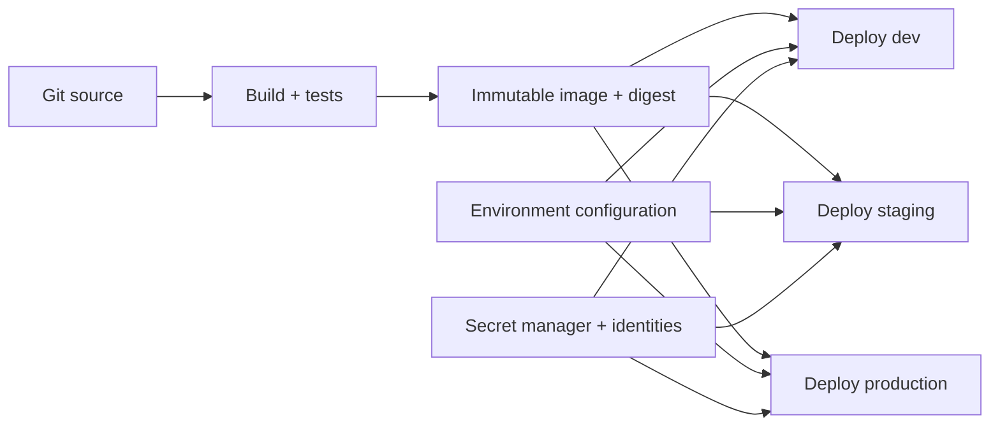
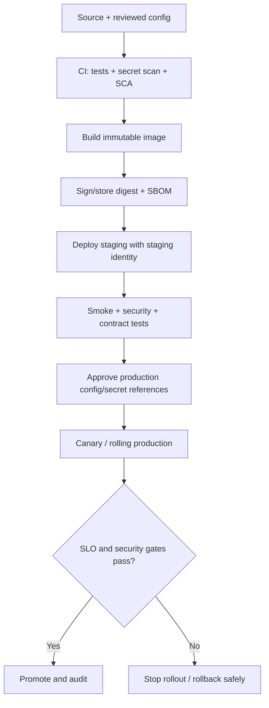

# Cấu hình theo môi trường và quản lý secret

Một REST API chạy tốt trên máy lập trình viên nhưng thất bại sau khi triển khai: `orders-api` trỏ nhầm vào cơ sở dữ liệu staging, frontend production bị CORS từ chối, token JWT không được chấp nhận vì sai issuer, hoặc thông tin truy cập đối tác bị vô tình in vào log. Những lỗi này thường không nằm trong thuật toán nghiệp vụ; chúng xuất phát từ việc **cấu hình theo môi trường** và **secret** không được thiết kế như một phần của hợp đồng triển khai.

Bài này thuộc chương **Triển khai và vận hành** của module `INTEGRATION_API_REST`. Phạm vi là một REST API Java/Spring thiết kế theo resource, URI, HTTP method/status và hợp đồng dữ liệu; có phân trang, cache, idempotency, OpenAPI, xác thực, phân quyền, xử lý lỗi và kiểm thử. Ví dụ xuyên suốt là `orders-api` gọi `payment-api` và lưu vào PostgreSQL. Cùng một image triển khai lên `dev`, `staging` và `production`, nhưng cấu hình runtime và quyền lấy secret khác nhau.

Nguyên tắc quan trọng: **mã ứng dụng và artifact không được chứa bí mật hay địa chỉ phụ thuộc cố định cho một môi trường**. Môi trường quyết định cấu hình lúc triển khai, nhưng không được tùy tiện làm yếu kiểm soát bảo mật của chính API.

## 1. Mục tiêu học tập

Sau bài học, người học có thể:

1. Phân biệt config thông thường, secret, feature flag và dữ liệu nghiệp vụ; nhận diện nơi nào không được đặt credential.
2. Thiết kế cùng một artifact chạy qua dev/test/staging/prod bằng cấu hình ngoại sinh, có mặc định an toàn và quy tắc ưu tiên rõ ràng.
3. Sử dụng Spring Boot `application.yaml`, Spring profiles, environment variables, `@ConfigurationProperties` và startup validation đúng mục đích.
4. Quản lý secret theo nguyên tắc least privilege: cấp phát runtime, không để trong Git/image, hạn chế log, có vòng đời xoay/thu hồi và audit.
5. Phối hợp Docker/Kubernetes/secret manager để triển khai, kiểm readiness, rollback và khắc phục lỗi không làm rò bí mật.
6. Kiểm thử các tình huống sai cấu hình, secret thiếu/hết hạn, lỗi xác thực HTTP, cấu hình CORS/JWT sai và thay đổi khi rolling deployment.

## 2. Cấu hình và secret: phải phân loại trước

**Configuration** là các tham số giúp chương trình biết cách hoạt động trong một môi trường: URL của dependency, timeout, connection pool size, CORS allowed origins, OAuth issuer, cache TTL, quota hoặc logging level. **Secret** là thông tin mà nếu bị lộ có thể giúp người khác vượt qua một ranh giới bảo mật: password, API key, OAuth client secret, private key, token, credential DB hay mTLS private key.

| Giá trị | Phân loại | Ví dụ | Vị trí quản lý thích hợp |
|---|---|---|---|
| Payment API base URL | Config | `https://payments.prod.example` | Cấu hình triển khai theo môi trường |
| Timeout HTTP | Config | `2s` | Config được validate và đo bằng SLO |
| Spring `issuer-uri`/JWKS URI | Config tin cậy | `https://id.example.com/realms/shop` | Config được phê duyệt; không lấy từ request JWT |
| CORS allowed origins | Security config | `https://app.example.com` | Allowlist exact origin, review thay đổi |
| Database JDBC URL | Config nhạy cảm về hạ tầng | `jdbc:postgresql://db.internal:5432/orders` | Config không public; **không gắn user/password vào URL** |
| Database password | Secret | Giá trị credential | Secret manager/mount runtime |
| Payment API key | Secret | Key đối tác | Secret manager/mount runtime |
| JWT verification public key/JWKS | Public key/trust config | Public JWKS | Có thể công khai; vẫn cần nguồn issuer tin cậy |
| JWT signing private key | Secret đặc biệt nhạy cảm | Private key PEM/KMS handle | KMS/HSM/secret manager; hạn chế quyền ký |
| Feature flag phát hành UI | Config | `checkout_v2=true` | Flag/config service có audit |
| Flag bỏ qua authorization | Thiết kế nguy hiểm | `disable-auth=true` | **Không** dùng như một toggle vận hành production |
| Order ID, amount, tenant | Dữ liệu nghiệp vụ | `ord_42` | Database/transaction; không lưu như secret cấu hình |

**Không phải mọi config đều public.** URL nội bộ, topology mạng, hostname dịch vụ hoặc schema cơ sở dữ liệu có thể nhạy cảm và nên giới hạn quyền đọc. Tuy nhiên, cần phân biệt mức bảo vệ: một tham số timeout không nên bị đưa vào secret store chỉ để “bảo mật hơn”, trong khi password lại bị đặt trong ConfigMap cho tiện.

### 2.1. Chỉ một artifact, nhiều môi trường

Mẫu triển khai ưu tiên:



Image được build **một lần**, sau đó promote theo digest qua môi trường. Không build lại code chỉ để thay JDBC URL hoặc API key. Kết quả là binary được test ở staging giống binary production, dễ truy lỗi và rollback. Lưu config revision và deployment revision riêng để phân biệt thay đổi code với thay đổi vận hành.

Nên có **cùng tên property** và cùng schema ở mọi môi trường, khác **giá trị**. Dev/test có thể dùng fake service hoặc secret thử nghiệm; staging dùng hệ thống gần production nhưng vẫn cô lập dữ liệu; production dùng least-privilege identity/credential thực và chính sách chặt.

| Thuộc tính | Development | Test/CI | Staging | Production |
|---|---|---|---|---|
| `app.payment.base-url` | Local mock/test server | MockWebServer/Testcontainers | Sandbox đối tác | Payment service production |
| `app.payment.request-timeout` | `3s` để debug | `300ms` có kiểm soát | Gần production | Theo SLO/telemetry |
| `spring.datasource.url` | DB riêng developer | DB tạm theo test | DB staging riêng | DB production riêng |
| DB password/API key | Fake/local-only | Credential CI scope hẹp | Secret staging | Secret production |
| CORS allowlist | `http://localhost:5173` | Origin fixture | `https://staging-app.example.com` | `https://app.example.com` |
| JWT issuer/audience | Test realm | Mock issuer/test keys | Staging identity provider | Production identity provider |
| Logging | Có thể verbose, vẫn redaction | Assert không lộ secret | Debug có thời hạn | Level giới hạn, structured logs |
| Health readiness | Kiểm startup/config | Test fail-fast | Bắt buộc | Bắt buộc + rollout gates |

Không sao chép secret hoặc dữ liệu cá nhân production về dev/test để “giống thật”. Kể cả staging gần production cũng phải có credential, database, identity, network policy và audit riêng; nếu dùng dữ liệu sản xuất cho kiểm thử thì phải có quy trình bảo vệ/ẩn danh phù hợp.

## 3. Quy tắc externalized config và precedence

Spring Boot có nhiều nguồn property: file config được đóng gói, file bên ngoài, environment variables, Java system properties, command-line args, test overrides và các nguồn do ứng dụng/secret provider bổ sung. **Nguồn có độ ưu tiên cao hơn có thể ghi đè giá trị thấp hơn**; thứ tự đầy đủ phụ thuộc phiên bản và vị trí config data, nên cần kiểm tài liệu Spring Boot của bản đang chạy thay vì tự ghi nhớ một danh sách cố định.

Trong thiết kế, nên quy ước rõ:

1. `application.yaml` trong image chứa **mặc định không nhạy cảm và an toàn**, không chứa password/API key production.
2. File `application-<profile>.yaml` có thể mang những khác biệt không bí mật cho dev/test. Mọi cấu hình production quan trọng nên có nguồn deploy được quản lý và review.
3. Deployment cung cấp biến môi trường hoặc file config/secret mount; lệnh CLI có thể override, do đó phải kiểm pipeline launch/entrypoint để tránh biến ngoài ý muốn.
4. Secret manager cấp credential theo identity runtime; secret không đi qua Git, build cache, Docker build args, CLI arguments hay public HTTP response.
5. Ứng dụng validate contract config ngay lúc khởi động và **không cho pod nhận traffic nếu thiếu config bắt buộc**.

### 3.1. Spring profiles không phải ranh giới bảo mật

Profile như `dev`, `test`, `staging`, `prod` giúp chọn nhóm cấu hình hoặc bean. Profile được chọn qua deployment (`SPRING_PROFILES_ACTIVE=prod`), **không phải bằng path/query/header của HTTP request**. Nếu nhầm profile có thể dẫn tới dùng sai dependency, nhưng profile không tự ngăn được tài khoản service truy cập secret/mạng production: IAM, network policy và sự cô lập môi trường vẫn cần thiết.

Ví dụ cấu hình cơ bản (không chứa secret):

```yaml
# application.yaml
spring:
  application:
    name: orders-api

app:
  payment:
    base-url: https://payments.invalid
    request-timeout: 2s
  cors:
    allowed-origins: []
  public-base-url: https://api.invalid

management:
  endpoint:
    health:
      show-details: never
```

```yaml
# application-dev.yaml (không commit credential thật)
app:
  payment:
    base-url: http://localhost:9091
    request-timeout: 3s
  cors:
    allowed-origins:
      - http://localhost:5173
  public-base-url: http://localhost:8080
```

Giá trị `*.invalid` khiến deployment chưa cấu hình không vô tình gọi production. Trong ứng dụng thật, có thể **không cung cấp mặc định cho property bắt buộc** và để startup validation thất bại ngay, thay vì sử dụng giá trị giả để chạy nửa vời. Hai lựa chọn phải có mục đích rõ; ví dụ minh họa bên dưới dùng kiểm tra validation cho các property.

Ở production, deployment cung cấp:

```text
SPRING_PROFILES_ACTIVE=prod
APP_PAYMENT_BASEURL=https://payments.prod.example
APP_PAYMENT_REQUESTTIMEOUT=1500ms
APP_PUBLICBASEURL=https://api.example.com
APP_CORS_ALLOWEDORIGINS_0=https://app.example.com
```

Đây là ví dụ quy tắc **Spring relaxed binding** khi chuyển tên property canonical sang env: thay dấu chấm bằng `_`, **bỏ dấu gạch ngang**, viết hoa và dùng `_0` cho phần tử list. Ví dụ `app.payment.base-url` tương ứng `APP_PAYMENT_BASEURL`, không phải `APP_PAYMENT_BASE_URL`. Với **list origins**, cần **test kết quả bind** trên phiên bản Boot đang dùng, không giả định một chuỗi ngăn dấu phẩy luôn giữ đúng list/escaping. Khi cấu hình phức tạp, ưu tiên file ngoài image được review.

### 3.2. Đừng để config quyết định danh tính từ dữ liệu client

Các property như `jwt.issuer-uri`, `allowed-origins`, `payment.base-url` và `database.host` là **nguồn tin cậy của server**. Không lấy issuer/JWKS URL từ trường `iss`/`jku` của JWT rồi fetch tùy ý; không phản chiếu mọi `Origin` trong CORS; không nhận `paymentBaseUrl` từ body để đổi đích gọi API có credential. Các mẫu đó có thể mở lỗi xác thực, phân quyền hoặc SSRF.

Nếu nghiệp vụ hỗ trợ nhiều đối tác, tạo registry ID → endpoint đã phê duyệt, phân quyền tenant được sử dụng đối tác nào, và kiểm đích tại outbound transport. Cấu hình môi trường và lựa chọn runtime của người dùng phải có ranh giới rõ.

## 4. Spring Boot: bind kiểu mạnh và validate fail-fast

Đọc cấu hình rải rác bằng hàng chục `System.getenv()`/`@Value` khiến property name trùng lặp, thiếu validation và khó test. Ưu tiên `@ConfigurationProperties` cho nhóm config có hợp đồng rõ, kiểu dữ liệu cụ thể và `@Validated` cùng Jakarta Validation.

### 4.1. ConfigurationProperties có kiểu dữ liệu và validation

```java
package com.example.orders.config;

import jakarta.validation.Valid;
import jakarta.validation.constraints.NotBlank;
import jakarta.validation.constraints.NotEmpty;
import jakarta.validation.constraints.NotNull;
import java.net.URI;
import java.time.Duration;
import java.util.List;
import org.springframework.boot.context.properties.ConfigurationProperties;
import org.springframework.validation.annotation.Validated;

@Validated
@ConfigurationProperties(prefix = "app")
public record OrdersSettings(
        @NotNull @Valid Payment payment,
        @NotNull @Valid Cors cors,
        @NotNull URI publicBaseUrl) {

    public record Payment(
            @NotNull URI baseUrl,
            @NotNull Duration requestTimeout) {}

    public record Cors(
            @NotEmpty List<@NotBlank String> allowedOrigins) {}
}
```

Đăng ký bằng:

```java
@SpringBootApplication
@ConfigurationPropertiesScan
public class OrdersApplication {
    public static void main(String[] args) {
        SpringApplication.run(OrdersApplication.class, args);
    }
}
```

Spring Boot parse thời lượng như `1500ms`, `2s` thành `Duration` và bind nested group `app.payment.*` thành record. `@NotNull` và `@NotEmpty` ngăn thiếu giá trị, nhưng **chưa đảm bảo URL dùng HTTPS, timeout dương hay origin hợp lệ**. Đây là các **cross-field/semantic invariants** phải kiểm thêm bằng custom Jakarta Validator hoặc startup policy:

```java
package com.example.orders.config;

import java.net.URI;
import java.time.Duration;
import java.util.Set;
import org.springframework.stereotype.Component;
import jakarta.annotation.PostConstruct;

@Component
public final class ConfigPolicy {
    private final OrdersSettings settings;

    public ConfigPolicy(OrdersSettings settings) {
        this.settings = settings;
    }

    @PostConstruct
    void validate() {
        URI payment = settings.payment().baseUrl();
        if (!payment.isAbsolute()
                || !"https".equalsIgnoreCase(payment.getScheme())
                || payment.getHost() == null
                || payment.getRawUserInfo() != null
                || payment.getRawFragment() != null) {
            throw new IllegalStateException(
                    "Invalid payment base URL configuration");
        }

        Duration timeout = settings.payment().requestTimeout();
        if (timeout.isZero() || timeout.isNegative()
                || timeout.compareTo(Duration.ofSeconds(10)) > 0) {
            throw new IllegalStateException(
                    "Invalid payment request timeout");
        }

        URI publicBase = settings.publicBaseUrl();
        if (!publicBase.isAbsolute()
                || publicBase.getHost() == null
                || publicBase.getRawUserInfo() != null
                || publicBase.getRawFragment() != null
                || !Set.of("https", "http").contains(
                        publicBase.getScheme().toLowerCase())) {
            throw new IllegalStateException(
                    "Invalid public base URL configuration");
        }

        for (String origin : settings.cors().allowedOrigins()) {
            URI uri;
            try {
                uri = URI.create(origin);
            } catch (IllegalArgumentException ex) {
                throw new IllegalStateException(
                        "Invalid CORS origin configuration");
            }
            if (!uri.isAbsolute() || uri.getHost() == null
                    || uri.getRawUserInfo() != null
                    || uri.getRawFragment() != null
                    || uri.getRawQuery() != null
                    || (uri.getRawPath() != null
                        && !uri.getRawPath().isEmpty())
                    || !Set.of("https", "http").contains(
                            uri.getScheme().toLowerCase())) {
                throw new IllegalStateException(
                        "Invalid CORS origin configuration");
            }
        }
    }
}
```

Đây là **mẫu rút gọn**: production nên có quy tắc profile/môi trường rõ ràng (ví dụ chỉ cho HTTP localhost ở dev), không cho `http://untrusted.example` trong production, kiểm port/IDN/trailing dot nhất quán. Constructor validation tại binding phù hợp hơn nếu muốn fail trước khi tạo bean phụ thuộc; `@PostConstruct` vẫn đạt fail-fast trong giai đoạn dựng Spring context nhưng có thể chạy sau một số khởi tạo khác. Tránh đưa URL có userinfo, secret hoặc giá trị nhạy cảm vào exception message.

Lưu ý `URI.getPath()` có thể là chuỗi rỗng hoặc `/` khi origin có slash cuối; ví dụ này **cố ý chỉ chấp nhận origin không kèm path**. Một origin chính thức chỉ gồm scheme, host, port; điều này giảm mơ hồ của cấu hình.

### 4.2. CORS Spring Security dùng config, không reflect request

```java
@Bean
CorsConfigurationSource corsConfigurationSource(OrdersSettings settings) {
    CorsConfiguration cors = new CorsConfiguration();
    cors.setAllowedOrigins(settings.cors().allowedOrigins());
    cors.setAllowedMethods(List.of("GET", "POST", "PATCH", "DELETE"));
    cors.setAllowedHeaders(List.of(
            "Authorization", "Content-Type", "Idempotency-Key", "If-Match"));
    cors.setExposedHeaders(List.of("Location", "ETag"));
    cors.setAllowCredentials(false);

    UrlBasedCorsConfigurationSource source =
            new UrlBasedCorsConfigurationSource();
    source.registerCorsConfiguration("/v1/**", cors);
    return source;
}
```

Đây là phần bean cần import các lớp `org.springframework.web.cors`. Security chain cần gọi `http.cors(Customizer.withDefaults())` để preflight được xử lý trước JWT authentication. Khi dùng cookie/session và `credentials: include`, phải dùng exact allowed origins, `Access-Control-Allow-Credentials: true` nếu cần và bảo vệ CSRF; không cho ACAO wildcard kết hợp credentials. CORS không phải ranh giới xác thực, dù được cấu hình từ file production.

### 4.3. Tách security config khỏi business feature flags

Không dùng các flag vận hành như `security.enabled=false` hoặc `skip-jwt-validation=true` để “chữa” sự cố production. Các property đáng tin của resource server như `spring.security.oauth2.resourceserver.jwt.issuer-uri` phải được kiểm bằng test token thật, và audience validator phải đúng API. Nếu issuer đổi khi migrate identity provider, cần kế hoạch chuyển đổi đã phê duyệt, không cho nhận mọi issuer/algorithm trong thời gian chuyển tiếp.

## 5. Vòng đời một secret: tạo, phân phối, sử dụng, xoay, thu hồi

Secret management không chỉ là “đưa password ra khỏi source code”. Một secret có **nguồn tạo, chủ sở hữu, phạm vi quyền, nơi lưu, thời hạn, lần đọc, sự kiện xoay và bước thu hồi**. Nếu chưa biết ai có thể truy cập secret, secret nào đang còn hiệu lực và cách thay thế khi lộ, hệ thống vẫn dễ gặp sự cố.


| Bước | Trách nhiệm vận hành | Bằng chứng/test |
|---|---|---|
| Phát hành | Secret đủ entropy, đúng issuer, đúng môi trường, scope thấp nhất | Credential sandbox không dùng được ở production; không dùng chung giữa service |
| Lưu trữ | Secret manager/KMS với encryption, RBAC và audit | Quyền đọc/ghi được tách; không commit secret vào Git |
| Phân phối | Workload identity/service account lấy đúng secret khi chạy | Pod A không đọc secret của pod/tenant B |
| Sử dụng | Chỉ gửi credential tới dependency đích, qua TLS đã xác thực | Không lộ vào URL/query, redirect, log, trace, heap dump tùy tiện |
| Xoay | Tạo phiên bản mới, chuyển client, xác nhận rồi thu hồi cũ | Test overlap/rollback theo cơ chế đối tác hỗ trợ |
| Thu hồi | Khi nhân sự rời dự án, lộ khóa, service bị chiếm quyền | Secret cũ không còn quyền; có audit thời điểm và owner |
| Giám sát | Theo dõi lỗi lấy secret, gần hết hạn, sử dụng bất thường | Alert có mã lỗi/secret reference, **không in giá trị** |

### 5.1. Secret thường lộ qua đâu?

Những đường rò rỉ cần đưa vào threat model:

- **Source control:** `application-prod.yaml` có password, file `.env` bị commit, test fixture chứa token thật, lịch sử Git còn giữ key sau khi xóa dòng.
- **Build/CI:** Dockerfile `ARG API_KEY` hoặc `ENV TOKEN=...` đưa credential vào image layer/history; build log in biến môi trường; artifact/test report đính kèm response có token.
- **Runtime:** process environment, command-line arguments, `/proc`, debug endpoint, thread/heap dump, core dump, JVM diagnostic command; dữ liệu có thể bị đọc bởi người/process có quyền phù hợp.
- **HTTP:** `?api_key=...` trong query bị ghi ở reverse proxy/access log; header `Authorization` bị log toàn bộ; redirect sang host không tin cậy; TLS verification bị vô hiệu hóa.
- **Framework/observability:** exception tự in config object, `@ConfigurationProperties` record mặc định `toString` có secret; Actuator `env`/`configprops` hoặc trace/span attributes bị lộ.
- **Browser/frontend:** secret server được đưa vào bundle JS, file cấu hình static, `NEXT_PUBLIC_*`/`VITE_*`, HTML hoặc response JSON. Mọi giá trị gửi xuống browser đều phải xem là công khai với người dùng.
- **Vận hành:** paste credential vào ticket/chat/dashboard, chụp màn hình console hoặc chia sẻ manifest chứa Secret YAML plaintext.

Nếu phát hiện secret đã commit vào Git, **xóa file hoặc sửa commit không đủ**: phải thu hồi/xoay credential theo quy trình, đánh giá nơi đã clone/cache/index repository và làm sạch lịch sử nếu phù hợp. Không giả định một secret “không ai xem” chỉ vì repository là private.

### 5.2. Mô hình quyền truy cập secret

Ưu tiên **workload identity** để runtime xác thực với secret manager, thay vì phải cất thêm một “master API key” trong pod để đọc các secret khác. Ví dụ: service account `orders-api` chỉ có quyền đọc secret `orders/prod/payment-api-key` và `orders/prod/db-credentials`; không có quyền list tất cả secret, không thể sửa hay cấp quyền, không truy cập secret staging hoặc của service khác.

Ràng buộc thêm:

1. **Environment isolation:** tách tài khoản/cloud project, namespace, VPC, key policy khi khả thi; không tái sử dụng prod credential ở dev/staging.
2. **Least privilege:** DB user chỉ được thao tác schema/table cần thiết; payment key chỉ được gọi API nghiệp vụ cần dùng.
3. **Short-lived credentials:** ưu tiên dynamic DB credential, workload identity hoặc token ngắn hạn khi hệ thống hỗ trợ; giảm thời gian rủi ro nếu bị lộ.
4. **Audit:** ai/công việc nào đã đọc, cập nhật, revoke; giám sát hành vi bất thường mà không ghi plaintext.
5. **Emergency access:** quyền break-glass có phê duyệt, thời hạn, log và quy trình thu hồi; không dùng tài khoản admin cố định trong config ứng dụng.

Đừng mặc định mọi secret manager đều tự xoay tất cả credential. **Rotation policy, ứng dụng cập nhật secret và bên cấp credential chấp nhận phiên bản mới** là ba phần có thể độc lập và phải cùng được kiểm chứng.

## 6. Nạp secret vào Spring Boot ở runtime

Có ba hướng phổ biến:

| Cách cấp | Ưu điểm | Hạn chế cần tính |
|---|---|---|
| **Environment variable** `DB_PASSWORD` | Dễ triển khai, nhiều framework hỗ trợ | Có thể bị lộ qua công cụ debug/inspect/process environment; thay đổi thường cần restart; không nên in env |
| **File mount** (K8s Secret/CSI/secret agent) | Có thể giới hạn file permission, dễ cấu hình `configtree` | App cần biết đường dẫn, read permission, refresh/restart semantics; secret vẫn tồn tại trong filesystem container |
| **Secret manager SDK** qua workload identity | IAM/lease/audit, dynamic credential, chủ động refresh | Phụ thuộc mạng/latency/quota, cache/TTL/circuit breaker, xử lý lỗi và bootstrap identity |

Khi dùng env var, secret có thể tồn tại trong process environment và dump; file mount cũng không “an toàn tuyệt đối” vì process có quyền đọc file vẫn có thể tiết lộ. Chọn cách dựa vào threat model và nền tảng; bắt buộc kết hợp IAM/RBAC, hạn chế debug quyền cao, audit và redaction.

### 6.1. Spring Config Data với configtree

Spring Boot hỗ trợ `configtree:` để đọc mỗi file trong một thư mục thành một property; thích hợp với secret được mount thành file. Ví dụ **đường dẫn file trong container**:

```text
/run/secrets/
  app.payment.api-key
  spring.datasource.username
  spring.datasource.password
```

Trong runtime, cấu hình:

```yaml
# application-prod.yaml: đường dẫn, KHÔNG chứa nội dung secret
spring:
  config:
    import: "configtree:/run/secrets/"
```

File `/run/secrets/app.payment.api-key` chứa *giá trị* key, không chứa `app.payment.api-key=...`; tên file là tên property. Khai báo `configtree:` (không có `optional:`) khiến thiếu thư mục nạp cấu hình gây lỗi khởi động, phù hợp các deployment bắt buộc secret. Nếu chọn `optional:configtree:...` để tiện development, cần validation bắt buộc ở lớp bean để production không âm thầm bỏ qua secret. Các file được mount **phải có tên/key phù hợp** và app phải có quyền đọc; quy tắc xử lý tên key và thứ tự property source tuân Spring Boot bản chạy thực.

Một bean đóng gói credential, không vô tình in bằng `record.toString()`:

```java
package com.example.orders.integration;

import org.springframework.beans.factory.annotation.Value;
import org.springframework.stereotype.Component;

@Component
public final class PaymentCredential {
    private final String apiKey;

    public PaymentCredential(
            @Value("${app.payment.api-key}") String apiKey) {
        if (apiKey == null || apiKey.isBlank()
                || apiKey.indexOf('\r') >= 0
                || apiKey.indexOf('\n') >= 0) {
            throw new IllegalStateException(
                    "Invalid payment credential configuration");
        }
        this.apiKey = apiKey;
    }

    String value() {
        return apiKey;
    }

    @Override
    public String toString() {
        return "PaymentCredential{apiKey=<redacted>}";
    }
}
```

Validation trên giả định API key theo hợp đồng **không cho ký tự xuống dòng**. Nếu secret file được tạo bằng lệnh thêm newline cuối, nên sửa cách cấp secret (ví dụ tránh newline khi tạo key), không tự `trim()` mọi credential: có secret hợp lệ chứa whitespace và việc tự cắt có thể đổi ý nghĩa. `String` trong JVM không có cơ chế xóa bộ nhớ bảo đảm; với loại khóa nhạy cảm hơn như private key, ưu tiên KMS/HSM hoặc cơ chế ký không xuất private key vào application heap.

Một client đi tới host **đã cố định từ server config** và gửi key chỉ cho service đó:

```java
package com.example.orders.integration;

import com.example.orders.config.OrdersSettings;
import org.springframework.context.annotation.Bean;
import org.springframework.context.annotation.Configuration;
import org.springframework.web.client.RestClient;

@Configuration
class PaymentClientConfiguration {
    @Bean
    RestClient paymentRestClient(RestClient.Builder builder,
                                 OrdersSettings settings,
                                 PaymentCredential credential) {
        return builder
                .baseUrl(settings.payment().baseUrl().toString())
                .requestInterceptor((request, body, execution) -> {
                    request.getHeaders().set(
                            "X-Api-Key", credential.value());
                    return execution.execute(request, body);
                })
                .build();
    }
}
```

**Điều kiện không thể bỏ qua:** HTTP transport cần giới hạn redirect, scheme/host/port được phép, TLS certificate verification, timeout, retries và response size. Không cho caller cung cấp URL đích rồi dùng client có `X-Api-Key` để gọi URL đó; đó là nguy cơ SSRF/credential exfiltration. Với redirect, cấu hình theo mặc định **không theo redirect** hoặc kiểm từng hop/strip credential theo origin; không giả định interceptor tự bảo vệ key. Chỉ dùng outbound auth scheme thực sự được nhà cung cấp quy định; `X-Api-Key` ở đây là hợp đồng giả định.

Nếu credential được thay ở secret store hoặc file mount sau startup, bean `PaymentCredential` trên **không tự reload giá trị**. Cần restart/rolling deployment hoặc cơ chế refresh được thiết kế và test riêng, đặc biệt nếu thay credential liên quan HTTP connection, JDBC pool, mTLS session hoặc signer.

### 6.2. Kubernetes ConfigMap và Secret: ví dụ đường đi

Ví dụ manifest được rút gọn. `ConfigMap` chỉ chứa tham số **không bí mật**; `Secret` đã được provision riêng từ secret manager/external secret controller hoặc quy trình quản trị. Không đưa literal secret vào source code hoặc chính manifest này:

```yaml
apiVersion: v1
kind: ConfigMap
metadata:
  name: orders-api-settings
data:
  APP_PAYMENT_BASEURL: "https://payments.prod.example"
  APP_PAYMENT_REQUESTTIMEOUT: "1500ms"
  APP_PUBLICBASEURL: "https://api.example.com"
  APP_CORS_ALLOWEDORIGINS_0: "https://app.example.com"
  SPRING_DATASOURCE_URL: "jdbc:postgresql://db.internal:5432/orders"
---
apiVersion: apps/v1
kind: Deployment
metadata:
  name: orders-api
spec:
  replicas: 3
  selector:
    matchLabels:
      app: orders-api
  template:
    metadata:
      labels:
        app: orders-api
    spec:
      serviceAccountName: orders-api
      containers:
        - name: orders-api
          image: registry.example.com/orders-api@sha256:REPLACE_WITH_VERIFIED_DIGEST
          envFrom:
            - configMapRef:
                name: orders-api-settings
          env:
            - name: SPRING_PROFILES_ACTIVE
              value: prod
          volumeMounts:
            - name: runtime-secrets
              mountPath: /run/secrets
              readOnly: true
      volumes:
        - name: runtime-secrets
          secret:
            secretName: orders-runtime-credentials
            items:
              - key: payment-api-key
                path: app.payment.api-key
              - key: db-user
                path: spring.datasource.username
              - key: db-password
                path: spring.datasource.password
```

Kubernetes Secret **không phải encryption chỉ vì YAML chứa base64**. Cần cấu hình encryption at rest (thường thông qua KMS), RBAC, giới hạn quyền đọc API server/etcd, namespace isolation và workload identity. Secret mount là file được kubelet quản lý; khi secret thay, projected volume thông thường có thể cập nhật sau một khoảng trễ, **nhưng Spring Config Data đã bind lúc startup không tự refresh bean hoặc connection pool**. Một CSI driver/secret agent khác còn có refresh semantics riêng. Vì vậy việc xoay key phải kết hợp secret backend, cơ chế sync, restart/refresh ứng dụng và kiểm kết nối.

Trong ví dụ, khi profile `prod` active, `application-prod.yaml` import `configtree:/run/secrets/`; các file tên property dưới mount cung cấp credential. `envFrom` đưa cấu hình thường từ ConfigMap vào môi trường. Một deployment thực phải điền **digest hợp lệ**, cấu hình resource requests/limits, readiness/liveness, network policy, service accounts/RBAC và rollout strategy trước khi dùng. Đừng áp manifest rút gọn trên production như một thiết kế bảo mật hoàn chỉnh.

Nếu staging và production dùng chung cluster, đừng chỉ dựa vào namespace như một ranh giới tuyệt đối: kiểm RBAC, IAM, network policy, admission policies và tách vùng dữ liệu. Việc có `serviceAccountName` cũng chưa chứng minh đã có quyền IAM phù hợp hoặc không có quyền quá rộng.

## 7. Xoay vòng, thu hồi và sự cố lấy secret

Secret rotation phải trả lời bốn câu hỏi: **ai phát phiên bản mới, bên nhận chấp nhận phiên bản nào, ứng dụng tải phiên bản mới ra sao và khi nào phiên bản cũ bị thu hồi**. Thay value trong secret manager không tự làm ứng dụng đã cache credential đổi theo.

### 7.1. Quy trình rotation có khoảng chồng lấn

Giả sử payment provider hỗ trợ hai API key cùng hiệu lực:

1. Chuẩn bị key **B** với quyền giống mức tối thiểu cần thiết của key **A**; lưu ở secret manager theo version, không gửi value qua ticket.
2. Cấu hình runtime mới dùng B: secret mount mới hoặc token provider. Rolling deployment/cơ chế reload đáng tin cậy để từng pod chuyển B.
3. Thực hiện canary, health/readiness và một số gọi thử được kiểm soát. Metric xác nhận tỷ lệ lỗi xác thực với payment provider không tăng; xác nhận tất cả pod đang dùng B theo **version metadata**, không log giá trị key.
4. Chỉ sau khi consumer đã chuyển, thu hồi A. Theo dõi lỗi muộn do một job, worker hoặc cronjob còn dùng key cũ.
5. Ghi audit rotation và rút ngắn vòng đời những token/cert/credentials tương tự nếu cần.

Nếu provider không cho chạy song song hai credential, cần kế hoạch cutover/rủi ro downtime, rollback hoặc một cơ chế chuyển đổi có hỗ trợ chính thức; không được giả định luôn có thể giữ key A để rollback. Với DB password, cách triển khai phụ thuộc database, pool và khả năng tồn tại hai tài khoản/credential. Với JWT **signing key**, thiết kế rotation thường gồm phát public key mới lên JWKS, bắt đầu ký bằng private key mới, giữ public key cũ đủ lâu để validate token chưa hết hạn, rồi mới gỡ; public key không phải secret nhưng private signing key phải được bảo vệ.

### 7.2. Khi secret manager hoặc mount lỗi

Tình huống cần phân biệt:

| Sự cố | Hành vi an toàn | Sai lầm cần tránh |
|---|---|---|
| Secret bắt buộc thiếu khi startup | **Fail fast**, pod không ready | Khởi động với empty key hoặc fallback secret cũ không được phép |
| Secret manager không thể truy cập tạm thời | Có thể dùng credential đã cache **còn hợp lệ**, đúng policy TTL/lease; alert | Tắt TLS verification hoặc dùng default admin credential |
| Secret hết hạn/đã revoke | Dừng gọi downstream bằng secret hết quyền, refresh hoặc fail | Retry liên tục với cùng key hỏng, tạo thác lỗi |
| Secret mới không hoạt động | Tạm dừng rollout, điều tra version và provider auth | In giá trị secret để debug |
| Secret bị lộ | Revoke/rotate khẩn cấp, đánh giá logs/artifacts/dữ liệu đã truy cập | Chỉ xóa dòng config rồi coi như đã xử lý |
| Mất permission đọc secret | Không ready/không nhận thêm traffic cần secret, cảnh báo RBAC | Mở rộng quyền đọc toàn namespace/secret store |

**Fail closed** nghĩa là không tự bỏ qua xác thực hoặc chọn key mặc định khi secret lỗi. Tuy nhiên “fail closed” cũng phải gắn với nhu cầu nghiệp vụ: một endpoint chỉ đọc danh mục public có thể vẫn hoạt động nếu payment key lỗi, trong khi endpoint tạo thanh toán phải từ chối có kiểm soát. Phân chia readiness/degraded mode theo khả năng phục vụ thật; không để health check đơn giản tuyên bố mọi route khỏe khi thành phần thanh toán bắt buộc không hoạt động.

### 7.3. Không giả định rotation là tự động

Một secret mount thay đổi không đồng nghĩa các đối tượng sau đã nhận giá trị mới:

- Bean Spring `@ConfigurationProperties`/`@Value` được tạo lúc startup.
- `RestClient` interceptor giữ instance credential cũ.
- JDBC connection pool có connection đang mở hoặc thông tin auth được cache.
- TLS `SSLContext`, client certificate hoặc HTTP connection pool giữ session đã tạo.
- Scheduled job, worker riêng hoặc consumer queue không được rolling restart cùng web deployment.

Cần **version observability** an toàn: có thể log mã version không nhạy cảm, hash định danh version từ secret manager hoặc thời điểm rotate (theo chính sách), nhưng không log raw secret hay hash trực tiếp của password yếu có thể bị dò offline. Với TLS/JWT, verify key ID/certificate serial có kiểm soát, không in private key.

## 8. Cấu hình sai ảnh hưởng hợp đồng HTTP như thế nào?

Trong REST API, lỗi cấu hình có thể biến thành status HTTP mà client nhìn thấy. Cần phân biệt **lỗi credential của client** với **lỗi credential/config của chính service**. Không đẩy nguyên upstream error hoặc secret version ra cho người dùng.

| Tình huống | Kết quả HTTP thường phù hợp | Quy tắc quan trọng |
|---|---|---|
| Client không gửi JWT hoặc JWT sai chữ ký/issuer/audience/expiry | `401 Unauthorized` + Bearer challenge | Không nới validator chỉ để “API chạy” |
| JWT hợp lệ nhưng scope hoặc quyền sở hữu đơn hàng không đủ | `403 Forbidden` (hoặc 404 theo policy) | Cấu hình CORS không thay authorization |
| JSON sai cú pháp hoặc field không hợp lệ | `400 Bad Request`/`422 Unprocessable Content` theo contract | Không nhầm với secret/config lỗi |
| Payment dependency trả `401` vì **API key của orders-api** bị revoke | Lỗi upstream/dependency, thường ánh xạ `502` hoặc `503` theo policy | **Không** chuyển thành 401 làm client nghĩ token của họ sai; alert vận hành |
| Secret manager mất kết nối và không có credential hợp lệ | Service tạm không phục vụ một số operation: thường `503 Service Unavailable` | Fail closed, không gửi request có key rỗng |
| Outbound request tới payment timeout | `504 Gateway Timeout` nếu API đóng vai gateway và hợp đồng quy định | Giữ timeout budget, idempotency; không lặp POST thanh toán mù |
| Rate limit bị vượt | `429 Too Many Requests` | Quota của API là chính sách riêng; secret lỗi không phải 429 |
| Secret bắt buộc thiếu khi pod startup | Không ready/không nhận request | Không cần tạo response 500 cho traffic khi startup chưa hợp lệ |
| CORS origin chưa được allowlist | Browser không đọc response cross-origin | Không cấp quyền resource chỉ bằng cách thêm origin vào allowlist |

Ví dụ khi cấu hình payment key bị thu hồi, nếu API còn xử lý request và chủ động trả lỗi tạm thời:

```http
HTTP/1.1 503 Service Unavailable
Content-Type: application/problem+json
Cache-Control: no-store
X-Correlation-ID: 5d70ee7d-df62-4ca7-a2cb-8b1e61cb6c20

{
  "type": "https://api.example.com/problems/dependency-unavailable",
  "title": "Dependency temporarily unavailable",
  "status": 503,
  "detail": "The operation cannot be completed right now"
}
```

Response **không** chứa “Payment key v3 rejected by host 10.0.2.9”, raw upstream body, secret value, stack trace hay tên tài khoản DB. Log nội bộ có thể ghi `errorCode=PAYMENT_CREDENTIAL_REJECTED`, `deploymentRevision` và **secret version reference không nhạy cảm** để người vận hành điều tra. `Retry-After` chỉ nên xuất hiện khi hệ thống có cơ sở dự đoán thời điểm phục hồi; đừng tạo retry storm trên lỗi cấu hình có thể kéo dài.

### 8.1. Kết nối với idempotency và các tác vụ có side effect

Nếu `POST /v1/payments` timeout ngay sau khi upstream đã commit, xoay secret hoặc rollback app rồi retry **không chứng minh** transaction chưa ghi. API nên yêu cầu/hỗ trợ `Idempotency-Key`, lưu request fingerprint và kết quả theo tenant/người gọi, đồng thời có resource tra trạng thái thanh toán hoặc đối soát. Idempotency key không phải secret, nhưng không được dùng như bằng chứng phân quyền hay để người khác truy vấn giao dịch.

Khi cấu hình JWT issuer/JWKS mới được rollout, xác thực JWT phải còn dựa trên issuer/audience/algorithm/key set tin cậy. Việc đổi issuer đột ngột không đồng nghĩa mọi request cần trả 500; token không hợp lệ theo chính sách mới thường trả 401, nhưng sự cố cutover phải được xử lý bằng migration/compatibility plan, không cho hệ thống chấp nhận mọi issuer.

### 8.2. OpenAPI và môi trường

OpenAPI mô tả **hợp đồng API ổn định** như `paths`, method, status, schemas, auth schemes; các môi trường có thể khác server base URL. Không chèn API key, password, Bearer token thật hay JDBC URL nội bộ vào spec và `examples`.

```yaml
openapi: 3.1.0
info:
  title: Orders API
  version: 1.0.0
servers:
  - url: https://api.example.com
paths:
  /v1/orders:
    post:
      security:
        - bearerAuth: []
      responses:
        "201":
          description: Order created
        "401":
          description: Invalid or missing access token
        "403":
          description: Insufficient permission
        "503":
          description: A required dependency is unavailable
components:
  securitySchemes:
    bearerAuth:
      type: http
      scheme: bearer
      bearerFormat: JWT
```

Ví dụ spec rút gọn để minh họa bảo mật/config, không thay một OpenAPI hoàn chỉnh. Có thể có một bản spec với `servers` theo từng môi trường hoặc runtime-generated server URL đã chuẩn hóa; không để host thực từ `Host`/`X-Forwarded-Host` do client tùy ý giả mạo thành link công khai. Nếu xử lý forwarded headers sau reverse proxy, chỉ tin proxy đã được cấu hình.

## 9. CI/CD: build một lần, kiểm cấu hình rồi promote

Thay đổi config hoặc secret **là thay đổi vận hành có rủi ro**, không “miễn review” vì code không đổi. Một pipeline hợp lý:



### 9.1. Trước khi deploy

- **Secret scanning** trên code, Git history, test artifacts và CI output; không in tất cả environment variables để debug pipeline. Có quy trình revoke khi phát hiện key lộ.
- **Static/dep scanning và SBOM:** đánh giá dependency dễ bị khai thác, provenance và image signing theo khả năng platform. Khóa image digest để tránh tag bị đổi sau review.
- **Config schema validation:** mọi property bắt buộc có giá trị và kiểu hợp lệ; production không có `localhost`, `*.invalid`, HTTP không TLS (trừ ngoại lệ đã duyệt), demo issuer, wildcard CORS hoặc flag bỏ auth.
- **Manifest/policy validation:** namespace, service account, RBAC, mounts, network policy, TLS, health probes, resource limits. CI không cần quyền đọc giá trị production secrets để validate rằng **secret reference tồn tại và quyền được phê duyệt**.
- **Migrations:** schema DB tương thích với cả version cũ/mới trong rolling deployment, không để rollback code phụ thuộc schema đã bị xóa ngay.

### 9.2. Rollout an toàn

1. Triển khai ở staging bằng **chính image digest** sẽ lên production, nhưng staging secrets và dữ liệu tách biệt.
2. Chạy smoke test: health/readiness, `GET` public/nonpublic theo auth contract, `401` với token invalid, `403` thiếu scope, `201/Location` nếu tạo tài nguyên thử, CORS preflight từ origin hợp lệ và bị cấm.
3. Với payment, chỉ kiểm luồng sandbox hoặc transaction thử có cơ chế đối soát; không thực hiện thu tiền thật không cần thiết chỉ để kiểm rollout.
4. Canary một phần traffic production; theo dõi `5xx`, `401/403` bất thường, latency p95/p99, payment provider auth failure, secret fetch failure, connection pool và readiness flaps. Cần baseline trước rollout để phân biệt lỗi mới.
5. Promote từng bước, giữ release revision/config revision/secret reference version trong audit. Nếu rollback, **đừng tự phục hồi secret đã bị revoke hoặc khóa bị lộ** chỉ vì bản cũ chạy dễ hơn.

Một production rollout có thể phải deploy app và secret theo thứ tự: cung cấp secret B được provider chấp nhận → đổi secret reference, rollout pod → xác nhận → revoke A. Nếu đảo thứ tự hoặc quên worker nền, có thể gây gián đoạn. Lịch kiểm tra rotation và rollback cần được diễn tập.

## 10. Readiness, liveness và config drift

**Liveness** trả lời ứng dụng có nên bị restart không; **readiness** trả lời instance này có nhận traffic hay chưa. Nếu cấu hình không hợp lệ, app nên fail startup; nếu một dependency tạm chậm, đừng tự động giết/restart mọi pod vì liveness phụ thuộc DB hoặc secret manager, tạo restart storm.

Ví dụ Spring Boot Actuator tối giản:

```yaml
management:
  endpoint:
    health:
      probes:
        enabled: true
      show-details: never
  endpoints:
    web:
      exposure:
        include: health,info
```

Trong Kubernetes, probe có thể gọi `/actuator/health/liveness` và `/actuator/health/readiness` nếu được cấu hình phù hợp. Phân quyền truy cập Actuator, quản lý `management.server.port`/management network và `show-details` cần được review; **không expose `/actuator/env`, `/actuator/configprops`, `/actuator/heapdump` hoặc debug endpoints ra Internet**. Ngay cả khi framework có cơ chế sanitize, không nên dựa duy nhất vào việc hiển thị che giá trị.

Readiness cần đại diện khả năng phục vụ traffic thực: đủ config bắt buộc, server đã sẵn sàng, pool khởi tạo phù hợp, endpoint critical có thể hoạt động theo policy. Tuy nhiên, việc cho readiness phụ thuộc toàn bộ upstream có thể khiến mọi pod cùng bị loại khỏi load balancer khi một dependency gặp sự cố; chọn dependency check có chủ đích và tách trạng thái degraded theo nghiệp vụ. Một lỗi payment key có thể làm `POST /v1/payments` tạm không phục vụ, nhưng `GET /v1/catalog` vẫn khỏe; kiến trúc đơn monolith có thể cần quyết định readiness riêng hoặc tách workload để giảm ảnh hưởng.

### 10.1. Config drift

Config drift xảy ra khi hai replica cùng version code nhưng có property/secret reference khác nhau, hoặc staging và production lệch một thuộc tính không được ghi nhận. Drift có thể gây lỗi “chỉ 1/3 request trả 401” vì một pod dùng JWT issuer cũ.

Ghi nhận **config revision/hash của dữ liệu không nhạy cảm và reference/version ID** sau review, không ghi giá trị secret. So sánh revision giữa replicas, alert khi lệch. Nếu cần fingerprint để phát hiện khác secret, dùng metadata/version có sẵn của secret manager thay vì băm password đơn giản và xuất hash ra log; hash secret yếu vẫn có thể giúp tấn công offline.

Thay đổi nguồn env/config thường cần **rollout restart**. Không giả định cập nhật ConfigMap, Secret hay hệ thống flag sẽ tự làm mọi bean, client, pool và job cập nhật theo thời gian thực. Nếu cần dynamic config, định nghĩa nhất quán nguồn, TTL, atomicy, audit, validation và rollback; tránh hot reload các security property như issuer/algorithms/CORS một cách không kiểm soát.

## 11. Kiểm thử cấu hình và secret theo nhiều tầng

Chỉ chạy unit test của `OrderService` không phát hiện được thiếu property, lỗi bind Duration, CORS wildcard trên production hoặc pod không đọc được file mount. Cần kiểm từ **schema/config class** đến **HTTP API và môi trường triển khai**.

### 11.1. Unit/application context test: sai cấu hình phải fail-fast

Với Spring Boot Test, `ApplicationContextRunner` cho phép tạo một context gọn, truyền property test và xác minh startup validation:

```java
package com.example.orders.config;

import static org.assertj.core.api.Assertions.assertThat;
import org.junit.jupiter.api.Test;
import org.springframework.boot.autoconfigure.AutoConfigurations;
import org.springframework.boot.autoconfigure.validation.ValidationAutoConfiguration;
import org.springframework.boot.context.properties.EnableConfigurationProperties;
import org.springframework.boot.test.context.runner.ApplicationContextRunner;
import org.springframework.context.annotation.Configuration;
import org.springframework.context.annotation.Import;

class OrdersSettingsTest {
    @Configuration(proxyBeanMethods = false)
    @EnableConfigurationProperties(OrdersSettings.class)
    @Import(ConfigPolicy.class)
    static class Config {}

    private final ApplicationContextRunner runner =
            new ApplicationContextRunner()
                .withConfiguration(AutoConfigurations.of(
                        ValidationAutoConfiguration.class))
                .withUserConfiguration(Config.class)
                .withPropertyValues(
                        "app.payment.base-url=https://payments.test.example",
                        "app.payment.request-timeout=500ms",
                        "app.public-base-url=https://api.test.example",
                        "app.cors.allowed-origins[0]=https://app.test.example");

    @Test
    void bindsAndValidatesConfiguration() {
        runner.run(context -> {
            assertThat(context).hasNotFailed();
            OrdersSettings cfg = context.getBean(OrdersSettings.class);
            assertThat(cfg.payment().requestTimeout().toMillis())
                    .isEqualTo(500);
            assertThat(cfg.cors().allowedOrigins())
                    .containsExactly("https://app.test.example");
        });
    }

    @Test
    void rejectsWrongPaymentScheme() {
        runner.withPropertyValues(
                "app.payment.base-url=ftp://payments.test.example")
            .run(context -> assertThat(context).hasFailed());
    }

    @Test
    void rejectsNegativeTimeout() {
        runner.withPropertyValues(
                "app.payment.request-timeout=-1s")
            .run(context -> assertThat(context).hasFailed());
    }
}
```

Mẫu test giả định có `spring-boot-starter-validation` cùng các dependency test, và `ConfigPolicy`/`OrdersSettings` như mục 4. Ở các phiên bản Boot khác nhau, hãy kiểm API test hỗ trợ đúng `hasNotFailed()/hasFailed()`; điều quan trọng là **context thật fail** và lỗi không in secret. Nếu test config lấy giá trị từ môi trường máy developer/CI, cần chủ động loại override ngoài ý muốn hoặc dùng tên property chuyên biệt.

Test bổ sung cần có:

- Thiếu một field bắt buộc (base URL, timeout, allowed origins, issuer/audience) → context không ready; không tiếp tục sử dụng default tùy tiện.
- ConfigMap dùng tên `APP_PAYMENT_BASE_URL` sai quy tắc cho `app.payment.base-url` → test binder để phát hiện key không được đọc đúng.
- Timeout bằng `abc`, `0ms` hoặc `-1s`; CORS origin có path hoặc userinfo; payment URL trỏ `localhost` trong profile prod.
- Hai property source ghi đè nhau → quan sát **giá trị hiệu lực đã được sanitize**, không dump toàn bộ environment.
- Profile `dev` không được phép khi deployment target là production theo admission/pipeline policy; test `SPRING_PROFILES_ACTIVE=prod` từ manifest.

### 11.2. Test secret từ nguồn runtime, không dùng secret thật

Với local/CI, dùng fake credential **được tạo riêng cho test**. Có thể khởi tạo một thư mục tạm chứa các file mang tên `app.payment.api-key`, `spring.datasource.username` và `spring.datasource.password` rồi cấu hình `spring.config.import=configtree:<temp-dir>/`. Xác minh:

1. File đầy đủ, permission phù hợp và key giả có format đúng → application context có thể khởi động.
2. File secret thiếu hoặc import path sai → startup fail; không chạy với key rỗng.
3. Key giả chứa CR/LF khi hợp đồng cấm → fail-fast mà không in giá trị key.
4. File bị thay **sau startup** → test mô tả rõ bean giữ credential cũ cho đến reload/restart, không giả định hot reload.
5. Error/log/trace/HTTP response không chứa chuỗi marker giả, ví dụ `UNIT_TEST_PAYMENT_KEY_DO_NOT_LOG_42`. Test phải thu log/trace bằng harness có kiểm soát và assert marker vắng mặt.

Test không đòi CI đọc secret production. Nếu CI cần một secret thật để kiểm tích hợp đối tác sandbox, dùng **credential sandbox scope hẹp** qua identity/secret store, hạn chế retention và revoke sau khi không dùng. Không biến một token do developer copy từ production thành “fixture tạm”.

### 11.3. HTTP contract và Security test

Để chứng minh config bảo mật có hiệu lực, kiểm endpoint như một client thật:

| Kịch bản | Thiết lập | Kỳ vọng |
|---|---|---|
| JWT hợp lệ | Issuer/audience/signature/scope đúng với env | `GET /v1/orders/{id}` trả kết quả theo quyền resource |
| JWT từ issuer khác | Token vẫn đúng chữ ký của issuer khác | `401`, không chấp nhận vì endpoint production misconfigured |
| JWT không đủ scope | Token hợp lệ, thiếu `orders:write` | `403` khi `POST /v1/orders` |
| Order của tenant khác | Token hợp lệ, đúng scope chung | Bị chặn tại service (403 hoặc 404 theo contract) |
| Origin staging ở production | `Origin: https://staging-app.example.com` | Không được cấp ACAO production; preflight không duyệt |
| Origin production | `Origin: https://app.example.com` | CORS chính xác, allowed headers/methods đúng |
| Provider key giả không hợp lệ | Mock payment trả 401 cho **credential backend** | API không chuyển thành 401 “token client sai”; phân loại dependency lỗi |
| Secret provider tạm down | Không có credential hợp lệ | Fail closed; operation phụ thuộc secret trả 503/không ready theo policy |
| Error response | Sai token, validation lỗi, dependency down | Problem JSON/status đúng, không chứa giá trị secret |
| Cache/header | Dữ liệu cá nhân và `Location` sau POST | `Cache-Control` phù hợp; URI công khai theo env, không lộ private host |

`MockMvc` có thể kiểm method/status/header/JSON và Security filters, nhưng `jwt()` của `spring-security-test` tạo Authentication giả; **nó không chứng minh JWT thực có issuer, audience và signature đúng**. Để kiểm config JWT, dùng integration test với issuer/JWKS test server và token ký thật hoặc một test identity provider. Đồng thời cần test ứng dụng đằng sau gateway/TLS vì forwarded headers, CORS, `Location` và auth lỗi có thể bị proxy đổi.

Một fragment MockMvc minh họa:

```java
// Test này cần Spring Security Test và filter chain thật.
mockMvc.perform(get("/v1/orders/ord_42"))
    .andExpect(status().isUnauthorized())
    .andExpect(header().string(
            "WWW-Authenticate", startsWith("Bearer")));

mockMvc.perform(post("/v1/orders")
        .with(jwt().authorities(
                new SimpleGrantedAuthority("SCOPE_orders:read")))
        .contentType(MediaType.APPLICATION_JSON)
        .content("{\"items\":[{\"sku\":\"SKU-42\",\"quantity\":1}]}"))
    .andExpect(status().isForbidden());
```

Đoạn trên là fragment trong lớp test đã import `MockMvc`/Spring Security matchers; không phải chương trình Java độc lập. Nó kiểm scope/method, còn test tenant ownership, config secret và JWT thật phải là các test khác. Không tắt `SecurityFilterChain` hoặc CSRF policy của API cookie chỉ vì test không đi qua auth.

### 11.4. Kiểm thử Docker/Kubernetes và rotation

Trong một namespace test cô lập, dựng ConfigMap/Secret **giả**, chạy pod và kiểm:

- Secret mount có đúng tên file/property và permission; workload không thấy secret của namespace/service khác.
- Pod không ready nếu secret bắt buộc thiếu, sai path hoặc service account thiếu quyền; error không log secret value.
- Sau khi thay secret B, chọn cơ chế **rolling restart** như thiết kế; xác minh từng pod đang dùng B qua hành vi sandbox/version metadata, không qua việc in secret.
- Khi revoke A, không còn web pod, cronjob, queue worker nào gọi bằng A; audit và alert xuất hiện nếu có consumer sót.
- Rollback image hoạt động với schema/config hiện tại và secret **còn hợp lệ**; không phục hồi key đã revoke do lộ.
- HTTP `401/403` từ client, `503` khi dependency không phục vụ và CORS/header/cache policy nhất quán qua ingress.
- Secret outage, DB auth failure và startup delay không dẫn tới restart storm hoặc pod liên tục nhận traffic khi chưa ready.

Kubernetes test nên tránh thao tác gây nguy hiểm trên cluster thật; dùng môi trường test có dữ liệu và credential riêng. **Không dùng lệnh `kubectl get secret -o yaml` để gỡ lỗi rồi đính output vào ticket**. Quan sát tên/phiên bản secret reference và trạng thái mount từ deployment/pod metadata đã phân quyền là đủ cho phần lớn bước xác minh.

## 12. Quan sát và runbook khi cấu hình/secret gặp sự cố

Metric, log và audit cần giúp xác định **tham số hoặc giai đoạn lỗi** nhưng không lộ giá trị. Một số tín hiệu:

| Tín hiệu | Nhãn nên dùng | Điều cần tránh |
|---|---|---|
| `config.validation.failure.total` | service, environment, reason code hữu hạn | In toàn bộ object config trong metric |
| `secret.fetch.failure.total` | provider type, failure category, service | Gắn secret path/token/username tùy ý làm label |
| `secret.rotation.lag.seconds` | credential class, environment | Lộ raw secret hoặc hash password yếu |
| `http.client.requests` | dependency alias, status class | Log full Authorization/URI query chứa credential |
| `http.server.requests` | method, route template, status | Metric label có order ID, tenant ID, request ID vô hạn |
| `deployment.config.revision` | revision ID đã review | Công bố JSON config chứa thông tin nhạy cảm |
| `readiness.flaps.total` | deployment, reason code | Tự restart mọi pod khi một upstream chậm |

Một log có thể giữ `errorCode=SECRET_NOT_AVAILABLE`, service, config revision và trace/correlation ID để tìm sự kiện. Đối với errors trả cho client, chỉ dùng title/detail không lộ dependency nội bộ hoặc path secret store. Trace/span attributes cũng được coi là telemetry; không gắn `apiKey`, `Authorization`, token, password hay JDBC URL có credential.

### 12.1. Sự cố: sau rollout 1/3 request trả 401

Runbook:

1. Xác minh `401` ở **API resource server** hay từ upstream payment. Nếu upstream trả 401 do service key thì đừng yêu cầu client đăng nhập lại.
2. So sánh deployment/config revision trên các replicas; kiểm issuer URI, audience, trusted JWKS và rollout order **bằng giá trị config không nhạy cảm**.
3. Kiểm network/TLS tới identity provider, cache JWKS và quy trình xoay khóa; đừng tắt kiểm JWT signature.
4. Nếu chỉ một replica sai, stop rollout/đưa instance lỗi khỏi traffic; điều chỉnh config và redeploy theo revision đã phê duyệt.
5. Test token hợp lệ/sai issuer/sai audience và thử CORS/response lỗi trước khi promote. Ghi rõ thay đổi nào đã khắc phục.

### 12.2. Sự cố: payment bắt đầu trả lỗi sau khi xoay key

Runbook:

1. Tìm thời điểm version key B được phát hành, mount và được từng pod/worker nạp; đối chiếu với tỷ lệ lỗi provider auth và idempotency failures.
2. Xác minh workload identity/service account có quyền đọc secret B, mount path/property đúng, Spring bean/client đã thực sự dùng version mới. **Không** in value để “so sánh”.
3. Kiểm provider đã cho B quyền/scope đúng và có chấp nhận song song A/B không.
4. Nếu B lỗi, dừng rollout; quay lại A **chỉ khi A vẫn hợp lệ và chưa bị revoke vì lộ**. Nếu không, tạo B2 theo quy trình thay thế và điều phối cutover.
5. Kiểm job nền/worker và JDBC/HTTP pool có còn dùng version cũ; đo hồi phục và audit kết quả. Với thanh toán, đối soát giao dịch có response timeout để tránh retry gây charge trùng.

### 12.3. Sự cố: phát hiện API key trong Git hoặc log

1. Phân loại secret, scope và nơi nó có thể đã xuất hiện (Git history, build cache, image, CI logs, log collector, ticket, chat). Không chia sẻ lại secret trong báo cáo.
2. Thu hồi/xoay credential **ngay theo mức độ nguy cơ**, điều phối consumer và nhà cung cấp; không chờ làm sạch Git rồi mới revoke.
3. Kiểm audit quyền sử dụng secret, hoạt động bất thường, khả năng truy cập dữ liệu; xem xét các token/credential khác có thể bị lộ cùng môi trường.
4. Loại bỏ nguồn rò rỉ (debug logging, toString, query URL, secret env dump, thiếu RBAC), chỉnh access/retention và lịch sử artifacts phù hợp.
5. Bổ sung regression tests, scanner/policy và diễn tập rotation; theo dõi cho tới khi không còn key cũ được sử dụng.

### 12.4. Chẩn đoán nhanh nhưng không xem giá trị secret

Trong môi trường Kubernetes có quyền đọc deployment metadata, các lệnh như sau chỉ nhằm quan sát rollout/pod status, **không đọc nội dung Secret**:

```bash
kubectl -n prod rollout status deployment/orders-api
kubectl -n prod get pods -l app=orders-api
kubectl -n prod describe deployment orders-api
```

Không chạy lệnh trên môi trường thật nếu không có quyền/quy trình vận hành. `describe` có thể cho thấy **tên key/reference hoặc environment không nhạy cảm**, nhưng vẫn phải kiểm log/output trước khi chia sẻ; một số môi trường có annotation/args chứa dữ liệu cần bảo vệ. Không sử dụng `kubectl exec ... printenv`, `cat /run/secrets/...` hay dump Actuator `env` làm đầu ra mặc định của runbook.

## 13. Bài tập thực hành

### Bài 1 — Phân loại giá trị và thiết kế cấu hình bốn môi trường

Một nhóm có các giá trị:

```text
DATABASE_URL
DATABASE_PASSWORD
PAYMENT_BASE_URL
PAYMENT_API_KEY
JWT_ISSUER_URI
JWT_SIGNING_PRIVATE_KEY
CORS_ALLOWED_ORIGINS
ORDER_LIST_PAGE_SIZE
CHECKOUT_V2_ENABLED
AUTHENTICATION_DISABLED
```

Yêu cầu: phân loại config, secret, public key/trust config, feature flag và **anti-pattern**; lập bảng dev/test/staging/prod. Giải thích giá trị nào được đóng gói trong `application.yaml`, giá trị nào được inject runtime, giá trị nào phải có IAM/RBAC và bước kiểm fail-fast.

*Gợi ý kiểm tra:* `DATABASE_PASSWORD`, `PAYMENT_API_KEY`, `JWT_SIGNING_PRIVATE_KEY` là secret; issuer/CORS/base URL là security config tin cậy, không lấy từ người dùng; `AUTHENTICATION_DISABLED` không nên là flag được phép bật production. Một image duy nhất; không dùng production credential ở test.

### Bài 2 — Bắt lỗi Spring relaxed binding và startup validation

Ứng dụng đọc `app.payment.base-url`, `app.payment.request-timeout` và `app.cors.allowed-origins`. Manifest khai:

```yaml
env:
  - name: APP_PAYMENT_BASE_URL
    value: https://payments.prod.example
  - name: APP_PAYMENT_REQUEST_TIMEOUT
    value: 1500ms
  - name: APP_CORS_ALLOWED_ORIGINS_0
    value: https://app.example.com
```

Yêu cầu: chỉnh tên biến môi trường theo quy tắc Spring Boot canonical-to-env, viết test `ApplicationContextRunner` xác minh bind thành công và test URL `ftp://...`/timeout `-1s` phải fail startup. Giải thích vì sao không thể kết luận biến đã bind chỉ từ việc `printenv` cho thấy nó tồn tại.

*Gợi ý kiểm tra:* dạng env tương ứng là `APP_PAYMENT_BASEURL`, `APP_PAYMENT_REQUESTTIMEOUT`, `APP_CORS_ALLOWEDORIGINS_0`. Kiểm property source thực, profile, binder và validation; không dump toàn bộ env hoặc in secret trong test log.

### Bài 3 — Secret mount và Spring configtree

Thiết kế Kubernetes deployment cho `orders-api` cần DB username/password và payment API key. Giá trị được tạo trong secret manager và sync vào Kubernetes Secret có ba key; Spring Boot dùng `configtree:/run/secrets/`.

Yêu cầu: trình bày mount path/tên file sao cho trở thành `spring.datasource.username`, `spring.datasource.password` và `app.payment.api-key`; đảm bảo pod không ready khi thiếu secret. Đưa ra test với file giả trong CI và giải thích vì sao `base64` không phải encryption at rest.

*Gợi ý kiểm tra:* dùng Secret volume `items[].path` đúng tên Spring property; `spring.config.import` không optional hoặc validator fail-fast; namespace/RBAC, service account, encryption at rest và secret read audit. Không nhúng literal secret vào ConfigMap hoặc image.

### Bài 4 — Quy trình xoay API key không gián đoạn

Payment provider cho phép hai key A và B cùng có hiệu lực. Hệ thống có ba replica web, hai worker xử lý queue và một scheduled job; các consumer giữ credential trong bean/connection pool từ startup.

Yêu cầu: lập thứ tự phát B, cập nhật secret reference, rolling restart các consumer, xác nhận chuyển phiên bản và revoke A. Xác định điểm dừng/rollback nếu một worker không nhận B hoặc provider từ chối B.

*Gợi ý kiểm tra:* overlap A+B, canary, version metadata thay vì log secret, không quên worker/cronjob. Chỉ revoke A sau khi tất cả consumer chuyển và có bằng chứng. Nếu A bị lộ/thu hồi khẩn cấp, không dùng A làm phương án rollback.

### Bài 5 — Phân biệt 401 của người dùng và 401 của upstream

Client gửi `POST /v1/orders` với JWT hợp lệ, scope `orders:write` đúng. `orders-api` gọi payment provider bằng API key vừa bị revoke; provider trả `401 Unauthorized`.

Yêu cầu: chọn status mà `orders-api` nên trả theo vai trò gateway và hợp đồng lỗi, thiết kế body `application/problem+json`, log/metric/alert. Giải thích vì sao không được tự động chuyển `401` của provider thành `401` của client và tại sao retry liên tục cùng API key hỏng có thể gây quá tải.

*Gợi ý kiểm tra:* ánh xạ sang lỗi dependency như `502`/`503` theo policy; response không lộ provider hostname/key; nội bộ log error code/secret version reference có kiểm soát; dừng retry vô ích, trigger rotation/rollback phù hợp. Không đổi JWT validator để “sửa” lỗi provider.

### Bài 6 — Audit rò rỉ credential

Một developer để `PAYMENT_API_KEY` trong Docker `ARG` lúc build; CI in biến đó khi `set -x`; Logback in `record PaymentProperties(apiKey=...)` vào error log. Có người phát hiện secret xuất hiện trong log collector.

Yêu cầu: xác định đường rò rỉ, xử lý khẩn cấp, cách thay đổi mã/build pipeline, cơ chế phát hiện tái diễn và điều gì cần kiểm trước khi đóng incident.

*Gợi ý kiểm tra:* thu hồi/rotate ngay, đánh giá image layers/CI logs/log retention và truy cập bất thường, thay bằng runtime secret manager, redaction và `toString` an toàn, secret scanning, least privilege. Xóa dòng khỏi source không làm credential đã lộ trở nên an toàn.

### Bài 7 — Test toàn tuyến từ startup đến HTTP

Tạo test suite cho `orders-api` bằng Spring Boot và một mock payment server:

1. Thiếu `app.payment.api-key` → application context fail.
2. Base URL không hợp lệ/timeout âm → context fail.
3. Config đúng, JWT sai issuer → HTTP 401 + Bearer challenge.
4. JWT hợp lệ thiếu scope → HTTP 403.
5. Payment mock trả 401 với backend key giả → API trả dependency error theo contract, không rò key.
6. Mock provider timeout → HTTP 504 khi API đóng vai gateway, giữ idempotency.
7. CORS origin staging không được production chấp thuận.

*Tiêu chí đạt:* phân tầng rõ unit/context test, HTTP integration test và gateway smoke; credential đều là test fixtures; header/Problem Details chính xác; không test bằng cách tắt Security filter hoặc gọi production service.

### Bài 8 — Thiết kế release và rollback khi đổi DB credential

Staging vượt tất cả tests, nhưng production có một replica dùng config revision cũ và DB password đã bị thay đổi. Hãy thiết kế canary, readiness, dấu hiệu metrics và kế hoạch rollback. Giải thích khi nào phải rollback code, rollback config reference hoặc **không được** dùng lại secret đã thu hồi.

*Gợi ý kiểm tra:* so revision trên replicas, xác nhận password mới đã được DB chấp nhận và pool đã refresh; canary và SLO gates; nếu secret cũ bị lộ, phải sửa forward bằng credential mới chứ không rollback secret cũ. Mọi thay đổi có audit và test lại.

## 14. Checklist đưa REST API vào production

| Nhóm | Câu hỏi cần kiểm |
|---|---|
| Build | Cùng một immutable image digest được promote qua các môi trường? Có provenance/SBOM/scanning phù hợp? |
| Config contract | Các property quan trọng có tên, kiểu, mô tả, default an toàn, validation và owner? |
| Precedence | Đã kiểm giá trị thực sau bind, profile và nguồn override? Không có config vô tình đến từ CLI/host env? |
| Environment | Dev/test/staging/prod có DB, identity, network, secret, audit và dữ liệu được cô lập? |
| Secrets | Không có plaintext secret trong Git/history, image/build args, pipeline log, ticket, static web bundle? |
| Identity | Secret manager dùng workload identity/RBAC tối thiểu, có audit và quyền tách đọc/ghi? |
| Runtime | File mount/configtree/SDK hoạt động; secret không optional nếu bắt buộc; startup fail khi thiếu? |
| Security | HTTPS/TLS verification bật, credential chỉ đến host allowlist; không SSRF hoặc leak qua redirect? |
| JWT/CORS | Issuer/audience/JWKS và allowed origins theo từng môi trường đúng; không disable auth/CSRF? |
| HTTP contract | 401/403/502/503/504 được phân biệt; Problem Details và log không lộ secret? |
| Rotation | Có owner, version, overlap/revoke, restart/reload plan cho web + queue + scheduled jobs? |
| Health | Liveness không phụ thuộc upstream dễ lỗi; readiness đại diện khả năng nhận traffic? Actuator bị bảo vệ? |
| Deploy | Có rollout canary, SLO gates, migration compatibility, stop/rollback và audit revision? |
| Tests | Có config binding, fail-fast, secret missing/expired, JWT/CORS, provider failure, HTTP integration, rotation và redaction tests? |
| Monitoring | Theo dõi config drift, secret fetch errors, auth failures, SLO, readiness flaps, deployment/secret version metadata? |
| Incident | Có runbook lộ credential, mất secret manager, sai issuer/DB password và phương án phục hồi không dùng key đã lộ? |

## 15. Tài liệu chuẩn để đọc thêm

- **The Twelve-Factor App — Config:** tách cấu hình có thể thay đổi theo triển khai khỏi mã và artifact.
- **Spring Boot Reference — Externalized Configuration, Profiles, Config Data và Type-safe Configuration Properties:** property sources/precedence, relaxed binding, `configtree:`, `@ConfigurationProperties` và validation.
- **Spring Security Reference — OAuth 2.0 Resource Server / CORS:** cấu hình issuer/JWKS, JWT verification, CORS với browser và cách giữ authentication/authorization độc lập.
- **Kubernetes Documentation — Secrets, ConfigMaps, RBAC, Service Accounts và Configure Liveness/Readiness/Startup Probes:** runtime mount, secret handling, access control và health checks. Base64 trong Secret manifest không phải mã hóa.
- **OWASP Secrets Management Cheat Sheet:** vòng đời secret, quyền tối thiểu, xoay vòng, audit và giảm lộ credential.
- **OWASP API Security Top 10:** các rủi ro authentication/authorization, SSRF và cấu hình bảo mật sai trong API.
- **RFC 9110 — HTTP Semantics:** ý nghĩa `401`, `403`, `429`, `502`, `503`, `504`, `Retry-After`.
- **RFC 9457 — Problem Details for HTTP APIs:** cấu trúc error response không để lộ thông tin hạ tầng.
- **OpenAPI Specification 3.1:** định nghĩa `servers`, security schemes, request/response headers, status và media type.

**Điểm cần nhớ:** một ứng dụng REST có thể cùng image ở mọi môi trường mà vẫn an toàn nếu cấu hình được quản lý như một hợp đồng có validation và audit, còn secret được phát hành, cấp quyền, nạp và xoay bằng cơ chế riêng ở runtime. Không có công cụ nào thay được ranh giới tin cậy: `application.yaml`, Kubernetes Secret, secret manager, Spring Security, gateway và CI/CD phải phối hợp để bảo vệ cả HTTP API lẫn tài nguyên bên dưới. Một rollout chỉ hoàn tất khi **cấu hình đúng, secret còn hợp lệ, các replica đã nhận phiên bản dự kiến, kiểm thử HTTP đạt và hệ thống có thể quan sát/khôi phục khi lỗi**.
