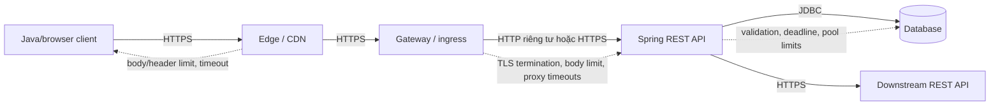

# TLS termination, giới hạn nội dung và timeout giữa các tầng

## 1. Một REST API không chỉ chạy trong Spring Boot

Khi ứng dụng chạy sau CDN, load balancer, ingress hoặc API gateway, một lời gọi REST không còn là một kết nối trực tiếp từ người dùng tới `@RestController`. Mỗi tầng có thể **kết thúc TLS**, kiểm tra kích thước request, giữ bộ đệm, chờ upstream hoặc tự tạo response lỗi. Nếu các chính sách không khớp, một request có thể bị từ chối tại ingress trước khi Spring nhận được, hoặc hết hạn ở client dù transaction trong database vừa commit.



Bài thuộc chương **Triển khai và vận hành** của module **INTEGRATION_API_REST**: thiết kế REST dựa trên resource, URI, HTTP method/status và hợp đồng dữ liệu rõ ràng; thực hành phân trang, cache, idempotency, OpenAPI, xác thực/phân quyền, xử lý lỗi và kiểm thử bằng Java/Spring hoặc công nghệ tương đương.

**Mục tiêu:** lựa chọn ranh giới TLS và mTLS; bảo vệ `Forwarded`/`X-Forwarded-*`; đặt giới hạn request body, headers, multipart và nội dung giải nén; phân biệt timeout kết nối, đọc, request tổng và deadline nghiệp vụ; giữ đúng mã HTTP, an toàn retry; triển khai ví dụ Nginx/Spring/Java, kiểm thử xuyên tầng và xây runbook vận hành.

### 1.1. Ba sự cố thường gặp

1. **TLS kết thúc tại gateway:** backend tin `X-Forwarded-Proto: https` do người dùng tự gửi, tạo redirect/cookie hoặc quyết định bảo mật sai khi có đường gọi trực tiếp.
2. **Giới hạn không đồng nhất:** gateway nhận upload 20 MB nhưng Spring chỉ cho 10 MB; client thấy `413` không rõ do tầng nào. Một JSON nhỏ khi nén lại có thể mở rộng tới hàng trăm MB nếu server tự giải nén không giới hạn.
3. **Timeout đảo thứ tự:** gateway ngừng chờ sau 5 giây nhưng application/DB tiếp tục chạy 30 giây. Client retry POST bằng key mới và phát sinh side effect trùng.

Điểm chung: **TLS, content limit và timeout đều là chính sách của một *chuỗi hop***. Không thể xem một property Spring Boot là đủ cho toàn tuyến.

## 2. TLS termination: chọn nơi xác thực kết nối

### 2.1. Ba kiểu topology

| Kiểu | Luồng kết nối | Ưu điểm | Ranh giới phải kiểm soát |
| --- | --- | --- | --- |
| **TLS termination tại edge/gateway** | Client `HTTPS` → Gateway; Gateway `HTTP` → App | Quản lý cert, routing, WAF và observability tập trung | Hop nội bộ không mã hóa; chặn bypass, giới hạn network và identity |
| **TLS termination + re-encryption** | Client `HTTPS` → Gateway; Gateway `HTTPS` → App | Bảo vệ cả hop nội bộ, kiểm chứng upstream identity | Gateway phải verify CA/SAN/hostname upstream; rotation cả hai đầu |
| **TLS passthrough** | Client `TLS` → proxy L4 → App | App trực tiếp verify TLS client, phù hợp mTLS end-to-end | L4 proxy thường không inspect HTTP path/body để áp L7 policies |

**TLS termination không “chuyển” một kết nối TLS gốc vào Spring.** Gateway xác thực và giải mã request rồi tạo một kết nối mới tới upstream. Nếu re-encrypt, chứng chỉ mà application thấy ở hop nội bộ thường là identity của gateway/sidecar, **không mặc nhiên là client certificate Internet ban đầu**.

Đặc biệt với **mTLS**, cần ghi rõ ai là TLS client/server trên từng hop, CA nào được tin và identity nào được phép gọi API. Không tin một chuỗi `X-Client-Cert`/`X-Forwarded-Client-Cert` chỉ vì header tồn tại: client có thể tự gửi nó nếu gateway không xóa/ghi đè. Nếu cần truyền danh tính qua proxy, chỉ nhận từ proxy đã xác thực, qua kết nối bảo vệ, và bảo đảm không tồn tại đường bypass backend.

### 2.2. Checklist của một TLS boundary

- **Server certificate:** chain hợp lệ, SAN khớp hostname mà peer kết nối, private key được bảo vệ, có lịch rotate trước ngày hết hạn.
- **Protocol/cipher:** dùng TLS 1.2/1.3 theo baseline tổ chức, vô hiệu phiên bản/cipher yếu; không bật `trustAll` hoặc bỏ hostname verification trong Java client.
- **SNI và ALPN:** có thể ảnh hưởng chọn certificate và HTTP/1.1, HTTP/2 hoặc HTTP/3; HTTP/3 dùng QUIC và phải kiểm tra khả năng hỗ trợ của hạ tầng.
- **Redirect từ HTTP:** nếu dùng `http://` cho port 80, chỉ redirect tới HTTPS ở ranh giới phù hợp; không để tài nguyên nhạy cảm phục vụ qua HTTP.
- **HSTS:** chỉ gửi trên response HTTPS của host đã được quản trị; `includeSubDomains`/preload chỉ khi tất cả host liên quan sẵn sàng cho HTTPS.
- **Cert rotation/renewal:** test trên kết nối TLS **mới**, không chỉ keep-alive connection đã handshake; có giám sát cert expiry và thủ tục rollback.

`Host` trong HTTP request và `SNI` trong TLS có liên quan nhưng **không phải một chứng cứ danh tính tương đương**. Xác minh server phải dựa trên TLS certificate/SAN và endpoint định cấu hình; không cấp quyền cho một workload chỉ vì nó có thể đặt `Host: admin.example.test`.

### 2.3. Trust boundary và HTTP status

Một TLS handshake thất bại (sai CA, hostname, cert hết hạn hoặc mTLS client cert không hợp lệ) thường khiến client nhận **lỗi kết nối/TLS**, không có HTTP response từ REST controller. Chỉ sau handshake hoàn tất, gateway/application mới có thể trả `401 Unauthorized`, `403 Forbidden`, `413 Content Too Large` hoặc `503 Service Unavailable` theo trạng thái xử lý.

Nhật ký của proxy nên phân biệt **TLS handshake failures** và **HTTP status distribution**; nếu chỉ đếm status của Spring, toàn bộ request bị chặn ở TLS boundary sẽ không xuất hiện.

## 3. Nginx và Spring: termination kèm forwarded headers an toàn

### 3.1. Ví dụ reverse proxy có giới hạn và timeout

Giả sử Nginx là **edge đáng tin cậy trực tiếp nhận traffic Internet** và application chỉ nghe trên mạng nội bộ. File dưới đây là đoạn cấu hình minh họa trong `http` context; đường dẫn cert/hostname phải được thay bằng tài sản được quản trị thực tế:

```nginx
server {
    listen 443 ssl;
    server_name api.example.test;

    ssl_certificate     /etc/nginx/tls/api-fullchain.pem;
    ssl_certificate_key /etc/nginx/tls/api-private.key;
    ssl_protocols TLSv1.2 TLSv1.3;

    # Chỉ bật HSTS sau khi host public đã hoàn tất HTTPS cutover.
    add_header Strict-Transport-Security "max-age=31536000" always;

    # Limit của toàn HTTP body; mỗi API còn có limit nhỏ hơn.
    client_max_body_size 12m;
    client_body_timeout 10s;

    location /api/ {
        proxy_pass http://orders-api.internal:8080;
        proxy_http_version 1.1;

        # Edge đầu tiên ghi đè, không tin identity headers do client tự gửi.
        proxy_set_header Host              $host;
        proxy_set_header X-Forwarded-Host  $host;
        proxy_set_header X-Forwarded-Proto $scheme;
        proxy_set_header X-Forwarded-Port  443;
        proxy_set_header X-Forwarded-For   $remote_addr;
        proxy_set_header X-Request-Id      $request_id;
        proxy_set_header Forwarded "";
        proxy_set_header X-Forwarded-Client-Cert "";

        proxy_connect_timeout 2s;
        proxy_send_timeout 8s;
        proxy_read_timeout 9s;

        proxy_request_buffering on;
        proxy_buffering on;
    }
}
```

Trong topology này, `HTTP` từ Nginx đến application **chỉ chấp nhận được nếu hop đó thực sự được cách ly** (network policy, không có ingress công khai tới port 8080, kiểm soát máy chủ trung gian). Nếu cluster hay tổ chức bắt buộc mã hóa trong mọi hop, sử dụng **re-encryption**:

```nginx
# Biến thể trong location /api/, thay cho proxy_pass HTTP.
proxy_pass https://orders-api.internal:8443;
proxy_ssl_server_name on;
proxy_ssl_name orders-api.internal.example;
proxy_ssl_verify on;
proxy_ssl_trusted_certificate /etc/nginx/trust/internal-ca.pem;
proxy_ssl_verify_depth 3;
```

Chứng chỉ upstream phải có SAN khớp `orders-api.internal.example`; đừng bỏ `proxy_ssl_verify` để “khắc phục” lỗi tên host. Nếu cần **mTLS gateway → backend**, cấu hình thêm `proxy_ssl_certificate`/`proxy_ssl_certificate_key` theo chính sách của PKI. Hai đoạn là **hai lựa chọn triển khai**, không áp cùng lúc; kết nối HTTPS upstream cũng cần network policy và authorization.

**Lưu ý:** `client_body_timeout`, `proxy_send_timeout` và `proxy_read_timeout` của Nginx chủ yếu đo **khoảng gián đoạn giữa các thao tác đọc/ghi**, không phải deadline tổng từ khi client bắt đầu request đến khi nhận response hoàn chỉnh. Một upstream liên tục gửi byte nhỏ có thể kéo dài vượt giá trị `proxy_read_timeout`; cần hard deadline ở các tầng hỗ trợ nếu business yêu cầu. Cấu hình bộ đệm `proxy_request_buffering on` có thể làm Nginx đọc hết body trước khi kết nối upstream; thời gian tải lên phía client **không nằm trọn** trong proxy read timeout.

### 3.2. Spring chỉ tin forwarded headers từ proxy đáng tin

Spring Boot có thể sử dụng forwarded headers để dựng đúng scheme, host và port public cho redirect, `Location` và absolute links:

```yaml
server:
  port: 8080
  forward-headers-strategy: framework
```

Với `framework`, Spring có thể dùng `ForwardedHeaderFilter` để diễn giải `Forwarded`/`X-Forwarded-*`. **Bộ lọc không tự chứng minh proxy gửi header là đáng tin.** Ở ví dụ trên Nginx đã ghi đè giá trị tin cậy, xóa những identity header không dùng, và backend phải bị chặn gọi trực tiếp từ Internet. Không cấp quyền theo `X-Forwarded-For` do caller gửi; địa chỉ IP cũng không thay authentication, mTLS hoặc quyền trên từng resource.

Ví dụ tạo `Location` trên một API mới:

```http
HTTP/1.1 201 Created
Location: https://api.example.test/api/orders/ord-42
Content-Type: application/json

{"id":"ord-42","status":"CREATED"}
```

Nếu application hiểu sai scheme là `http`, nó có thể tạo link HTTP, cookie không an toàn hoặc vòng lặp redirect HTTPS. Cách sửa là **chỉnh trust boundary và forwarded headers**, không hardcode URL public vào mọi controller. Tách cookie/CSRF policies khi API phục vụ browser với session; CORS không phải một cơ chế xác thực hoặc phân quyền.

**Khi có nhiều proxy:** không tự tin rằng `$remote_addr` luôn là IP người dùng gốc; có thể là IP của CDN. Hãy cấu hình `real_ip`/trusted proxy CIDRs hoặc cơ chế tương ứng để xác định client address, chỉ tin chain headers do hạ tầng kiểm soát, không nhận địa chỉ tự khai báo của một public caller. IP address phục vụ rate limit/risk signals, nhưng token/service identity vẫn phải được xác minh riêng.

## 4. Giới hạn nội dung: không chỉ `Content-Length`

### 4.1. Đặt giới hạn theo từng kiểu dữ liệu

| Loại dữ liệu | Giới hạn ví dụ | Tầng áp dụng |
| --- | --- | --- |
| HTTP request headers | Tổng bytes và số field hợp lý | CDN/gateway/HTTP connector |
| JSON tạo đơn | 1 MiB body giải mã tối đa | Gateway/servlet filter/route + JSON parser |
| Multipart upload | Một file 8 MiB, tổng request 10 MiB | Gateway 12 MiB + Spring multipart |
| JSON array/query pagination | Số phần tử/độ sâu/`limit` trang | Bean Validation + domain service |
| Payload gzip/zip/ảnh | Bytes **sau giải nén**, file count, depth, pixel count | Decoder, scanner, storage workflow |
| Response/export | Kích thước output, phân trang/streaming, thời gian tạo | Service, gateway/client memory budget |

Nên có **hard cap** ở edge để loại bỏ payload cực lớn trước khi vào ứng dụng và **limit nhỏ hơn theo operation** tại backend. Ví dụ edge 12 MiB, multipart tổng 10 MiB và mỗi file 8 MiB; phần dư bao gồm form fields, multipart framing và các nội dung khác. Với JSON thông thường, cap 1 MiB giúp tránh việc toàn API mặc nhiên chấp nhận request tới 12 MiB chỉ vì có upload endpoint.

`Content-Length` chỉ là gợi ý kích thước ở thời điểm đầu; không được lấy giá trị header làm bằng chứng duy nhất. HTTP/1.1 có thể dùng `Transfer-Encoding: chunked`; HTTP/2 có data frames; proxy có thể reframe request; một số request bị nén lại. **Cần chặn trên số bytes thực đọc**, đồng thời giới hạn kích thước **sau giải nén** và độ phức tạp parse (JSON nesting, chuỗi quá dài, số field) để phòng payload nhỏ nhưng gây cạn CPU/RAM.

### 4.2. Những HTTP status cần phân biệt

| Mã | Ý nghĩa trong deployment | Ai thường phát sinh |
| --- | --- | --- |
| **400 Bad Request** | Cú pháp/framing JSON không hợp lệ hoặc input sai theo contract | Parser, controller, gateway |
| **408 Request Timeout** | Server không nhận đủ request trong thời gian sẵn sàng chờ | HTTP server/gateway |
| **413 Content Too Large** | Request content vượt giới hạn mà server muốn/cho phép xử lý | Gateway, multipart/parser |
| **414 URI Too Long** | URI/query vượt ngưỡng cho phép | Gateway/server |
| **415 Unsupported Media Type** | Loại nội dung không được endpoint chấp nhận | Controller/content negotiation |
| **422 Unprocessable Content** | Nội dung đúng cú pháp nhưng không thể xử lý theo rule domain, nếu contract dùng | Service |
| **429 Too Many Requests** | Caller vượt quota/rate limit | Gateway/rate limiter |
| **431 Request Header Fields Too Large** | Header fields quá lớn | Edge/server |

`413` từng được biết đến qua tên cũ *Payload Too Large*; theo HTTP Semantics hiện hành tên là **Content Too Large**. Server có thể đóng kết nối thay vì trả JSON chuẩn nếu request đã bị từ chối **trước** khi routing hoàn tất, hoặc theo hành vi/giới hạn connector. **Không cam kết mọi 413 đều có `application/problem+json`**, nhất là khi response xuất phát từ CDN/Nginx chứ không phải Spring.

Một `Expect: 100-continue` có thể giúp client tránh gửi toàn bộ body nếu server từ chối sớm, nhưng cần kiểm thử hỗ trợ thực tế trên client/proxy và vẫn duy trì giới hạn bytes khi đọc. Không chỉ tin `Expect` hoặc `Content-Length` như biện pháp an ninh.

### 4.3. Spring Boot: phân biệt multipart, form và JSON

Ví dụ cấu hình cho **Java 17, Spring Boot 3.x với embedded Tomcat**:

```yaml
server:
  max-http-request-header-size: 16KB
  tomcat:
    max-http-form-post-size: 2MB
    connection-timeout: 5s

spring:
  servlet:
    multipart:
      max-file-size: 8MB
      max-request-size: 10MB
      file-size-threshold: 0B
```

**Phạm vi của từng property phải chính xác:**

- `server.max-http-request-header-size` bảo vệ kích thước HTTP **request headers**, không phải toàn body.
- `server.tomcat.max-http-form-post-size` liên quan parsing **form data** ở Tomcat; **không** giới hạn mọi `application/json` request.
- `spring.servlet.multipart.max-file-size` và `max-request-size` áp cho **multipart uploads** qua Spring multipart handling; không tự áp cho một JSON POST thông thường.
- `file-size-threshold: 0B` hướng dữ liệu multipart qua cơ chế lưu tạm theo implementation; cần cấu hình thư mục tạm, quota disk, cleanup, permission và virus/malware scanning khi upload rủi ro.
- `server.tomcat.connection-timeout` chủ yếu liên quan timeout của connector khi chờ dữ liệu đầu request/kết nối, **không** phải thời hạn xử lý logic controller.

**Không có một property Spring Boot chung tên `server.max-request-size` áp mọi loại request.** Tách limits theo tầng, và với JSON, cân nhắc filter/handler đọc bytes có giới hạn, constraints của JSON parser và request concurrency.

### 4.4. Ví dụ Java/Spring: giới hạn thực bytes đọc cho endpoint JSON

Đoạn dưới minh họa một endpoint **nhỏ, chuyên biệt** chỉ nhận JSON tối đa 1 MiB. Nó đọc **tối đa MAX+1 bytes** từ servlet input stream, không dựa vào `Content-Length` của client:

```java
package example.orders.api;

import com.fasterxml.jackson.core.JsonProcessingException;
import com.fasterxml.jackson.databind.ObjectMapper;
import jakarta.servlet.http.HttpServletRequest;
import java.io.IOException;
import java.util.List;
import java.util.Map;
import org.springframework.http.HttpStatus;
import org.springframework.http.MediaType;
import org.springframework.web.bind.annotation.*;
import org.springframework.web.server.ResponseStatusException;

record PreviewRequest(List<String> productIds) {}

@RestController
class ImportPreviewController {
    private static final int MAX_JSON_BYTES = 1024 * 1024;
    private final ObjectMapper mapper;

    ImportPreviewController(ObjectMapper mapper) {
        this.mapper = mapper;
    }

    @PostMapping(path = "/api/import-previews",
                 consumes = MediaType.APPLICATION_JSON_VALUE)
    Map<String, Integer> preview(HttpServletRequest request)
            throws IOException {
        long advertised = request.getContentLengthLong();
        if (advertised > MAX_JSON_BYTES) {
            throw new ResponseStatusException(
                HttpStatus.PAYLOAD_TOO_LARGE);
        }

        // Ngay cả chunked request không có Content-Length vẫn bị chặn.
        byte[] bytes = request.getInputStream()
            .readNBytes(MAX_JSON_BYTES + 1);
        if (bytes.length > MAX_JSON_BYTES) {
            throw new ResponseStatusException(
                HttpStatus.PAYLOAD_TOO_LARGE);
        }

        PreviewRequest dto;
        try {
            dto = mapper.readValue(bytes, PreviewRequest.class);
        } catch (JsonProcessingException malformed) {
            throw new ResponseStatusException(
                HttpStatus.BAD_REQUEST, "Invalid JSON");
        }
        if (dto == null || dto.productIds() == null
                || dto.productIds().isEmpty()
                || dto.productIds().size() > 100
                || dto.productIds().stream().anyMatch(id ->
                    id == null || !id.matches("[A-Za-z0-9_-]{1,64}"))) {
            throw new ResponseStatusException(
                HttpStatus.BAD_REQUEST, "Invalid product list");
        }

        // Preview không thực thi import có side effect.
        return Map.of("items", dto.productIds().size());
    }
}
```

Đây là **một kỹ thuật bounding theo route**, không phải middleware bảo vệ toàn hệ thống. `readNBytes` chỉ đọc đến ngưỡng và có thể phải chờ cho đến khi có dữ liệu/EOF; cần timeout body ở proxy/connector và chính sách đóng/drain kết nối sau khi từ chối. Trong production, cần **giới hạn concurrency** để 1 MiB × số request đồng thời không làm cạn heap. Khi có request decompression trong application, đặt giới hạn **sau khi giải nén**, chống zip/gzip bombs; đặt ranh giới JSON parser cho nesting depth, string length, array/number constraints theo phiên bản Jackson.

Không tự đọc servlet input stream trước một controller `@RequestBody` khác rồi mong Spring deserialize lần nữa: body có thể chỉ đọc được một lần nếu không có wrapper/caching được thiết kế đúng. Với API thường dùng DTO `@Valid @RequestBody`, nên áp max body tại gateway cộng với filter **đếm bytes thực qua stream** hoặc cấu hình container chuyên dụng, rồi dùng Bean Validation cho semantics; triển khai filter phải tương thích async dispatch, multipart và lifecycle của servlet. Ví dụ trên chỉ dùng `HttpServletRequest` để minh họa trực tiếp giới hạn.

Controller minh họa không khai báo `SecurityFilterChain`; khi đưa vào REST API thực tế phải yêu cầu access token/scope và kiểm tra quyền của caller **trước khi thực hiện import hoặc ghi dữ liệu**. Giới hạn body bảo vệ capacity, không thay thế authentication, authorization hay anti-abuse quotas.

### 4.5. Multipart, nội dung nén và response lớn

- Upload file phải kiểm tra file size **sau khi multipart parser xử lý**, số lượng file/part, MIME type thực, tên file/đường dẫn, phần mở rộng được phép và quét mã độc khi phù hợp. **Không tin filename hoặc `Content-Type` do client khai** để tạo filesystem path.
- Với `Content-Encoding: gzip`, hãy xác định tầng nào giải nén; limit bytes **trước và sau** giải nén. Tương tự, ảnh có kích thước pixel khổng lồ hoặc zip chứa quá nhiều entry có thể gây cạn memory/disk dù file nén nhỏ.
- Response JSON quá lớn cũng gây tác động memory, proxy buffering và client timeout. Dùng **pagination/cursor**, streaming có giới hạn, hoặc export bất đồng bộ `202 Accepted` + operation resource khi cần; kiểm tra authorization và retention của file export.
- Nếu proxy bật **request/response buffering**, đo disk/temp usage, write amplification và memory; với SSE/streaming cần chính sách buffering/idle-timeout riêng, không tắt buffering toàn cụm mà không có capacity guard.

## 5. Timeout giữa các tầng: mỗi loại có một ý nghĩa khác nhau

| Timeout/budget | Bắt đầu và kết thúc thường gặp | Điều **không** được suy ra |
| --- | --- | --- |
| TLS handshake timeout | Đợi thương lượng TLS, certificate exchange | Không phải HTTP `504` sau khi controller chạy |
| Client total/request timeout | Từ client gửi/đợi operation theo API client | Server chắc chắn đã rollback khi client timeout |
| Gateway client-body timeout | Giới hạn khoảng chờ dữ liệu request body | Luôn là deadline tổng upload |
| Proxy connect timeout | Chờ kết nối TCP/TLS tới upstream | Không giới hạn thời gian upstream tính toán |
| Proxy send timeout | Chờ gửi request tới upstream theo hành vi proxy | Không giới hạn toàn bộ thời gian xử lý |
| Proxy read timeout | Chờ nhận dữ liệu response từ upstream | Không luôn là tổng deadline một response streaming |
| Server connector timeout | Chờ request line/header/idle socket tùy container | Không hủy `@Transactional` đang chạy |
| Application workflow deadline | Toàn nghiệp vụ trong service đã định nghĩa rõ | Tự rollback external side effects sau cancel |
| DB pool-acquire timeout | Chờ mượn JDBC connection | SQL đã nhận connection chắc chắn hoàn tất đúng hạn |
| DB statement/transaction timeout | Thời gian SQL/transaction theo DB/driver | Không hạn chế tất cả remote HTTP requests |
| Outbound connect/read timeout | Kết nối hoặc đợi bytes từ dependency | Bảo đảm một retry đã không gây side effect |

**Đừng nhầm “idle timeout” với “absolute deadline”.** Ví dụ `proxy_read_timeout 9s` có thể được làm mới nếu upstream tiếp tục truyền dữ liệu; một controller chạy lâu và streaming từng chunk có thể không bị đóng trong tổng 9 giây. Nếu nghiệp vụ bắt buộc tổng 7 giây, phải áp deadline ở application/worker hoặc một tầng hỗ trợ **hard request deadline**, không chỉ dựa vào timer giữa các lần đọc.

### 5.1. Vẽ timeout budget theo thứ tự, nhưng không coi đó là phép cộng đơn giản

Một thiết kế cho request **đồng bộ, không streaming** có thể đặt:

```text
HTTP client total budget                    12 s
  Gateway policy / externally enforced max  10 s
    Spring application workflow deadline     7 s
      HTTP outbound total budget             3 s
         Connect timeout                    0.5 s
      JDBC connection acquire budget        0.3 s
      SQL statement budget                   2 s
      Validation, serialization, overhead   ~1 s
```

Các con số là **ví dụ có giả định** (một DB operation và một outbound call chính), không áp máy móc cho mọi API. Không đơn giản cộng tất cả sub-budgets nếu các tác vụ song song, có wait time ở pool hoặc nhiều attempts; hãy xem **critical path** và ngân sách còn lại tại từng bước. Cần dự trữ cho network jitter, serialization và ghi response, đồng thời bảo đảm client/gateway thường chờ lâu hơn thời gian application có thể trả lỗi có kiểm soát.

Lưu ý: cấu hình Nginx ở mục 3 dùng `proxy_read_timeout 9s`, là **idle timeout**, nên nó **không thực thi chính xác “gateway absolute max 10s”** trong sơ đồ. Nếu cần hard cap 10 giây, chọn gateway/runtime có hỗ trợ deadline tổng hoặc bổ sung một cơ chế time-budget phù hợp và kiểm thử nó.

### 5.2. Timeout phải đi cùng cancellation, transaction và retry

Client gặp `SocketTimeoutException` khi gửi POST có side effect **không biết** server đã commit hay chưa. Nếu tạo order/reservation/payment, dùng `Idempotency-Key` ổn định cho cùng ý định, lưu outcome bền vững và có resource tra cứu trạng thái. Timeout ở gateway **không phải** lệnh rollback một transaction đã chạy trong backend; việc client ngắt kết nối cũng không đảm bảo external payment call bị hủy.

Đừng bật retry ở **tất cả** client, gateway và service: một request có thể bị nhân số attempts, làm dependency đang yếu càng quá tải. Đặt retry budget tổng, exponential backoff/jitter, giới hạn tối đa, tôn trọng `Retry-After` theo policy, không retry `400/401/403/409/412` như lỗi transport. Với streaming hoặc background jobs, cancellation cần đóng input/output stream, trả connection và chuyển state operation đúng; không che bằng response thành công giả.

## 6. Java/Spring: cấu hình đúng chỗ, không nhầm timeout tên giống nhau

### 6.1. Outbound HTTP client với connect/read timeout

Ví dụ **Spring Boot 3.2+ / Spring Framework 6.1+, Java 17** dùng `RestClient` và JDK transport:

```java
package example.orders.integration;

import java.net.http.HttpClient;
import java.time.Duration;
import org.springframework.beans.factory.annotation.Value;
import org.springframework.context.annotation.Bean;
import org.springframework.context.annotation.Configuration;
import org.springframework.http.client.JdkClientHttpRequestFactory;
import org.springframework.web.client.RestClient;

@Configuration
class InventoryHttpConfiguration {

    @Bean
    RestClient inventoryRestClient(RestClient.Builder builder,
            @Value("${integrations.inventory.base-url}") String baseUrl) {
        HttpClient transport = HttpClient.newBuilder()
            .connectTimeout(Duration.ofMillis(500))
            .followRedirects(HttpClient.Redirect.NEVER)
            .build();

        JdkClientHttpRequestFactory requestFactory =
            new JdkClientHttpRequestFactory(transport);
        requestFactory.setReadTimeout(Duration.ofSeconds(3));

        return builder
            .baseUrl(baseUrl)
            .requestFactory(requestFactory)
            .build();
    }
}
```

`baseUrl` phải là HTTPS endpoint đáng tin đã được cấu hình; không nhận trực tiếp URL của người dùng rồi forward bearer token hoặc mTLS credentials sang host mới (**SSRF**). `connectTimeout` giới hạn thời gian thiết lập kết nối trong điều kiện áp dụng; `setReadTimeout` đặt read timeout của request factory/HTTP client. **Không coi hai giá trị này là deadline của toàn workflow** khi có nhiều calls, retries, DB queries và thời gian chờ lấy connection.

Nếu dùng thuần JDK `HttpClient`, mỗi request còn có timeout:

```java
HttpRequest request = HttpRequest.newBuilder(
        URI.create("https://inventory.internal.example/api/inventory/sku-7"))
    .timeout(Duration.ofSeconds(3))
    .header("Accept", "application/json")
    .GET()
    .build();
HttpResponse<String> response = transport.send(
    request, HttpResponse.BodyHandlers.ofString());
```

Đoạn là minh họa trong method có `transport` đã cấu hình và imports `java.net.URI`, `java.net.http.*`, `Duration`. `HttpRequest.timeout()` giới hạn khoảng thời gian cho **request cụ thể** theo implementation của JDK client; nhiều attempts vẫn cần một **ngân sách tổng**. Không bỏ kiểm tra TLS server certificate/hostname; khi dùng streaming body handler, đọc/đóng stream cần chính sách timeout riêng phù hợp ứng dụng.

### 6.2. Server-side: property nào không phải business deadline?

```yaml
spring:
  datasource:
    hikari:
      connection-timeout: 500
  mvc:
    async:
      request-timeout: 7s
```

- `spring.datasource.hikari.connection-timeout` (millisecond) giới hạn **thời gian đợi mượn connection**. SQL đã lấy được connection vẫn có thể chạy lâu; cần statement timeout, query planning, lock timeout và database capacity.
- `spring.mvc.async.request-timeout` ảnh hưởng **Spring MVC asynchronous request processing**, chẳng hạn `Callable`/`DeferredResult`; **không** áp hard deadline cho mọi synchronous `@RestController` method.
- `@Transactional(timeout = 5)` là ngân sách transaction theo transaction manager, có thể ảnh hưởng JDBC/JPA statements theo khả năng stack, **không** tự hủy tất cả các HTTP calls bên ngoài và không biến transaction DB thành distributed transaction.
- Servlet response write timeout/client disconnect cũng khác deadline nghiệp vụ; framework có thể nhận biết client đã đi mất **sau khi** transaction vừa commit.

Với PostgreSQL có thể cấu hình/thiết lập `statement_timeout` phù hợp ở session/transaction để giới hạn SQL, đồng thời theo dõi `pg_stat_activity`, lock waits và connection pool. Đừng mặc định chỉ cần đặt read timeout 3 giây cho một downstream là request đầu-cuối luôn hoàn tất trong 3 giây. Khi triển khai WebFlux, `.timeout(...)` báo lỗi/cancel pipeline nhưng **không đảm bảo** remote side effect đã rollback.

### 6.3. Deadline propagation giữa các service

Với một workflow `Order → Inventory → Payment`, giả sử còn 5 giây ngân sách: Order không nên trao mỗi downstream một timeout cố định 5 giây rồi retry ba lần. Có thể truyền **deadline tuyệt đối đã được chuẩn hóa ở ranh giới đáng tin** hoặc tính thời gian còn lại nội bộ; mỗi hop giới hạn request budget theo policy, dành thời gian ghi response và bù network jitter.

Header kiểu `X-Request-Deadline` tự đặt **không phải một chuẩn HTTP buộc mọi proxy tuân theo**, và giá trị từ client không được tin vô điều kiện. Nếu sử dụng, gateway phải validate/giới hạn, chọn clock policy rõ ràng và không cho caller kéo deadline vượt ngân sách server. Trace context hữu ích cho correlation, **không** tự tạo cancellation distributed. Với batch/long-running operations, mô hình `202 Accepted` và resource `/operations/{id}` có thể đúng hơn việc kéo một HTTP request qua nhiều timeout.

## 7. HTTP error mapping và xử lý hậu quả của timeout

Một request có thể bị ngắt ở ba vị trí khác nhau:

```text
A. Client -> edge: request body còn thiếu / quá lớn
   Edge có thể trả 408, 413, 414, 431 hoặc đóng kết nối

B. Edge/gateway -> Spring: upstream không kết nối/đọc được
   Gateway có thể trả 502, 503, 504; Spring không thấy request

C. Spring -> DB/downstream: app đã nhận request, dependency lỗi
   Spring trả status/error contract nếu còn kịp phản hồi
```

| Status/kết quả | Diễn giải đúng trong vận hành |
| --- | --- |
| **502 Bad Gateway** | Gateway/proxy nhận phản hồi không hợp lệ từ upstream, theo nguyên nhân cụ thể |
| **503 Service Unavailable** | Service tạm không xử lý được (quá tải, maintenance, dependency unavailable), có thể có `Retry-After` |
| **504 Gateway Timeout** | Gateway/proxy không nhận phản hồi từ upstream đúng thời gian cần thiết |
| **408 Request Timeout** | Server không nhận request hoàn chỉnh trong thời gian sẵn sàng chờ; **khác 504** |
| **429 Too Many Requests** | Quota của caller bị vượt; **không đồng nghĩa** DB pool đã hết |
| **Client timeout/connection reset** | Không nhất thiết có HTTP response; outcome nghiệp vụ có thể **UNKNOWN** |

Một số reverse proxies ghi **`499`** trong access logs để biểu thị client đóng kết nối; đó là **mã riêng không chuẩn hóa trong HTTP Semantics**, không phải response HTTP `499` mà mọi client nhất thiết nhận. Với client thấy `SocketTimeoutException`, không thể kết luận upstream đã hay chưa commit chỉ dựa trên exception. Phải kiểm tra operation theo idempotency key hoặc trạng thái authoritative.

Ví dụ Problem Details khi **Spring thực sự xử lý** và thấy dependency unavailable:

```http
HTTP/1.1 503 Service Unavailable
Content-Type: application/problem+json
Cache-Control: no-store
Retry-After: 2

{
  "type": "https://api.example.test/problems/dependency-unavailable",
  "title": "Temporarily unavailable",
  "status": 503,
  "code": "DEPENDENCY_UNAVAILABLE"
}
```

Khi `413` do gateway phát, body có thể là HTML/không có body; khi TLS handshake thất bại, **không có HTTP response** từ Spring. Client tốt phải xử lý cả ba: `application/problem+json`, lỗi do proxy với format khác, và exception network/TLS. Không gửi raw SQL, stack trace, nội bộ host, request body nhạy cảm, certificate private key hoặc token trong error messages.

### 7.1. Spring xử lý lỗi multipart vượt giới hạn

```java
package example.orders.api;

import org.springframework.http.CacheControl;
import org.springframework.http.HttpStatus;
import org.springframework.http.ProblemDetail;
import org.springframework.http.ResponseEntity;
import org.springframework.web.bind.annotation.ExceptionHandler;
import org.springframework.web.bind.annotation.RestControllerAdvice;
import org.springframework.web.multipart.MaxUploadSizeExceededException;

@RestControllerAdvice
class UploadErrorAdvice {
    @ExceptionHandler(MaxUploadSizeExceededException.class)
    ResponseEntity<ProblemDetail> tooLarge() {
        ProblemDetail problem =
            ProblemDetail.forStatus(HttpStatus.PAYLOAD_TOO_LARGE);
        problem.setTitle("Request content is too large");
        problem.setProperty("code", "REQUEST_CONTENT_TOO_LARGE");
        return ResponseEntity.status(HttpStatus.PAYLOAD_TOO_LARGE)
            .cacheControl(CacheControl.noStore())
            .body(problem);
    }
}
```

`@RestControllerAdvice` chỉ xử lý **exception mà request tới được Spring MVC**; nếu Nginx từ chối `client_max_body_size` trước đó, advice không chạy. Cùng status `413` nhưng các tầng khác nhau có thể tạo body/headers khác nhau. Khi streaming request bị từ chối, server có thể phải đóng connection thay vì cố đọc toàn bộ body để giữ keep-alive; test client phải chịu được tình huống đó.

## 8. Kiểm thử xuyên tầng: đúng điểm đo, đúng failure mode

### 8.1. MockMvc chỉ chứng minh logic Spring, không chứng minh gateway

JUnit 5 + Spring Test kiểm tra handler `ImportPreviewController` với payload vượt 1 MiB; ví dụ sử dụng `MockMvcBuilders.standaloneSetup(...)` để cố ý **không** cần TLS/socket/proxy:

```java
package example.orders.api;

import static org.springframework.test.web.servlet.request
    .MockMvcRequestBuilders.post;
import static org.springframework.test.web.servlet.result
    .MockMvcResultMatchers.status;

import com.fasterxml.jackson.databind.ObjectMapper;
import java.nio.charset.StandardCharsets;
import org.junit.jupiter.api.Test;
import org.springframework.http.MediaType;
import org.springframework.test.web.servlet.MockMvc;
import org.springframework.test.web.servlet.setup.MockMvcBuilders;

class ImportPreviewControllerTest {
    private final MockMvc mvc = MockMvcBuilders.standaloneSetup(
        new ImportPreviewController(new ObjectMapper())).build();

    @Test
    void rejectsActualBodyLargerThanOneMebibyte() throws Exception {
        byte[] large = new byte[1024 * 1024 + 1];
        mvc.perform(post("/api/import-previews")
                .contentType(MediaType.APPLICATION_JSON)
                .content(large))
            .andExpect(status().is(413));
    }

    @Test
    void acceptsValidSmallJson() throws Exception {
        mvc.perform(post("/api/import-previews")
                .contentType(MediaType.APPLICATION_JSON)
                .content("""
                    {"productIds":["sku-7","sku-8"]}
                    """.getBytes(StandardCharsets.UTF_8)))
            .andExpect(status().isOk());
    }
}
```

**Giới hạn của test:** trong `standaloneSetup` không có đầy đủ Spring Security/servlet connector/network. Vì vậy nó **không chứng minh** `client_max_body_size`, multipart parser behavior thực, TLS SAN validation, `Content-Length`/chunked framing ở gateway hoặc thứ tự timeout trên socket. Những yêu cầu này cần real-HTTP/TLS integration tests với cấu hình deployment tương ứng.

### 8.2. TLS/HTTP integration bằng curl có xác minh certificate

Với test environment có Nginx đang nghe tại loopback và chứng chỉ `api.example.test` do test CA cấp:

```bash
curl --verbose \
  --resolve api.example.test:443:127.0.0.1 \
  --cacert test-pki/edge-ca.pem \
  -H "Authorization: Bearer ${TEST_ACCESS_TOKEN}" \
  https://api.example.test/api/orders/ord-42
```

`--resolve` chỉ thay kết quả DNS, **giữ hostname TLS và `Host`**, cho phép kiểm chứng SAN/CA ngay cả khi dịch vụ local. **Không dùng `-k`/`--insecure`** để biến một cấu hình certificate sai thành test xanh. Với mTLS ở edge, thêm `--cert`/`--key` bằng chứng chỉ test, rồi thử cert client sai CA, hết hạn hoặc thiếu cert; TLS handshake failure **khác** HTTP 401/403 sau handshake.

Để thử gateway body limit (sử dụng fixture **đã tạo sẵn trong test**):

```bash
curl --resolve api.example.test:443:127.0.0.1 \
  --cacert test-pki/edge-ca.pem \
  -H "Authorization: Bearer ${TEST_ACCESS_TOKEN}" \
  -H "Content-Type: application/json" \
  --data-binary @payload-over-12m.bin \
  --output response-body.txt \
  --write-out 'status=%{http_code}\n' \
  https://api.example.test/api/import-previews
```

Kỳ vọng edge từ chối (thường `413`) **trước khi forward**; đối chiếu request/trace counters ở gateway và Spring để xác nhận không có side effect. Với payload cỡ 2 MiB, Nginx 12 MiB cho đi qua nhưng **handler JSON 1 MiB** phải trả `413`; hai test này cùng mã HTTP nhưng ở **hai ranh giới khác nhau**. `payload-over-12m.bin`/`response-body.txt` chỉ là đường dẫn fixture/lệnh ví dụ, không phải file mà worker tạo.

### 8.3. Ma trận các ca cần bắt buộc

| Ca | Thiết lập | Bằng chứng/kỳ vọng |
| --- | --- | --- |
| **TLS-1** | Hostname SAN hoặc CA sai | Client từ chối TLS, **không** dùng `-k`; không xử lý nghiệp vụ |
| **TLS-2** | mTLS yêu cầu nhưng thiếu/sai client cert | Handshake fail; không giả định Spring trả HTTP 401 |
| **PROXY-1** | Caller tự gửi `X-Forwarded-Proto`, `Forwarded`, `X-Forwarded-Client-Cert` giả | Edge ghi đè/xóa, backend không tin spoofed identity |
| **PROXY-2** | Backend port bị gọi trực tiếp từ ngoài | Network policy từ chối; không bypass auth/limits |
| **BODY-1** | JSON 1 MiB + 1 byte hoặc chunked không `Content-Length` | Backend reject 413, không đọc/ghi không giới hạn |
| **BODY-2** | Multipart 9 MiB trong một file khi limit 8 MiB | Spring reject, temp file cleanup; edge có thể vẫn nhận request |
| **BODY-3** | JSON nén nhỏ nhưng giải nén cực lớn, JSON nesting sâu | Decompression/parser limit chặn, không OOM |
| **HEADER-1** | Cookie/Authorization headers quá lớn | 431 hoặc connector rejection có kiểm soát |
| **TIME-1** | Client gửi body rất chậm | Đúng request-body timeout; không kéo dài socket vô hạn |
| **TIME-2** | Upstream mất kết nối hoặc không trả header/bytes | Proxy trả 502/504 theo tình huống; app counters khác gateway |
| **TIME-3** | Controller trả stream từng chunk | Kiểm tra **idle timeout** khác **hard deadline** |
| **RETRY-1** | POST commit rồi gateway/client làm mất response | Retry cùng idempotency key không tạo hai side effects |
| **OPS-1** | Deployment đổi cert và limits | Canaries, log, metrics, rollback và connection mới hoạt động |

Test lỗi HTTP framing (header mâu thuẫn, `Content-Length`/`Transfer-Encoding` không hợp lệ, request smuggling giữa các parser) phải theo **bộ kiểm thử giao thức được cho phép** trên hạ tầng test. Dùng gateway/server được vá lỗi, cấu hình chặn framing mơ hồ, thay vì tự parse HTTP headers một cách tùy tiện trong controller.

### 8.4. Không nhầm công cụ và nơi xác minh

- `MockMvc`: request mapping, validation, Spring status/Problem Details, policy của filter khi chạy đầy đủ Spring context.
- Real HTTP tới embedded Tomcat: connector behavior, request streaming, socket close, JWT filter chain, giới hạn body app nếu đã cấu hình.
- Real HTTPS qua ingress/gateway: TLS cert/SAN, forwarded headers, edge body/header limit, upstream TLS verification và timeout từng hop.
- Fault injection tới DB/downstream: thời gian chờ pool/SQL, cancellation, timeout sau commit, retry/idempotency.
- Load tests có giới hạn: memory/disk temp usage, thread/connection pool saturation, latency p95/p99 và HTTP 413/429/5xx dưới tải.

Không xem `MockMvc` thành công là bằng chứng đã test TLS hoặc proxy. Không cần thử lỗi an ninh trên production khi chưa có phạm vi được cho phép.

## 9. Observability và runbook: xác định tầng nào trả lỗi

### 9.1. Metrics/logs tối thiểu trên mỗi ranh giới

| Tầng | Quan sát đề xuất | Giải thích |
| --- | --- | --- |
| Edge/CDN | TLS handshake failure, request/response sizes, 413/431, request duration | Request có thể dừng trước gateway |
| Gateway/ingress | Upstream connect/response timings, gateway status vs upstream status, 502/504 | Phân biệt gateway tạo lỗi hay proxy chuyển lỗi |
| Spring server | `http.server.requests`, p95/p99, active/queued threads, 413/5xx | Chỉ thấy request đã đến Spring |
| Multipart/parser | Request rejection, temp disk usage, parser errors, decompression ratio | Không để memory/disk tăng không giới hạn |
| DB/HTTP client | Pool acquisition, statement latency, outbound timeout, retry attempts | Giải thích gốc tail latency và saturation |
| Business operations | Idempotency replay, operation status, outbox backlog, duplicate side effect | Phát hiện timeout đã thành commit hoặc workflow kẹt |

Với Nginx có thể log **edge request ID**, request time, upstream response time/status và số byte request/response; kết hợp `X-Request-Id` do edge cấp với trace IDs tại Spring. **Không** đưa raw JWT, cookie, signed URL, body PII hoặc certificate private key vào logs. Metric labels dùng **route template**, status group, bounded dependency name; không gắn `orderId`, userId hoặc idempotency key để tránh cardinality vô hạn và rò thông tin.

Đặc biệt, nếu client báo timeout mà Spring **không có request log**, hãy kiểm tra CDN/gateway/TLS/body limits trước khi chẩn đoán service. Nếu gateway trả 504 nhưng Spring đã commit transaction, cần kiểm tra **business outcome/DB idempotency record**, không tự đánh dấu operation thất bại chỉ từ gateway status.

### 9.2. Runbook ngắn theo triệu chứng

1. **TLS handshake lỗi:** xác minh hostname/SAN/CA, chain, expiry, protocol, SNI, trust bundle và client cert nếu mTLS; test một kết nối mới có hostname verification.
2. **413/431 tăng:** tách status ở gateway và app; xem API operation, kích thước body/header, multipart boundaries, gzip ratio, temp disk; chỉ tăng limit sau khi xác nhận nhu cầu và budget.
3. **504 nhưng app vẫn chạy:** so gateway timeout với app/DB/outbound durations; xác định idle vs hard cap, đo idempotency replay, pool waits và side effects.
4. **Redirect HTTP/HTTPS vòng lặp:** kiểm tra forwarded host/proto bị giả mạo, trust proxy network, TLS termination topology và cookie Secure.
5. **SSE/upload treo:** kiểm tra buffering, slow client behavior, stream cleanup, idle timeouts và số socket đang giữ.

Thay đổi cert, proxy limits và timeouts nên qua **canary**, kiểm tra metric/trace và rollback plan. Đừng đồng loạt tăng timeout khi upstream đang quá tải; đó có thể tăng số connections bị giữ và khiến lỗi lan truyền.

## 10. Bài tập tình huống: triển khai Order API sau gateway

**Bối cảnh:** `Orders Service` chạy Spring Boot 3 trên cổng 8080 trong cluster, chỉ Nginx ingress được phép kết nối. Public URL là `https://api.example.test`. API có:

```text
POST /api/orders                 JSON <= 1 MiB
POST /api/orders/{id}/attachments  multipart: file <= 8 MiB, total <= 10 MiB
GET  /api/orders/{id}            JSON phân trang/giới hạn field
POST /api/orders/{id}/submit     có side effect, cần idempotency
```

Edge cho tối đa 12 MiB body; controller JSON có limit 1 MiB; multipart Spring có trần 8/10 MiB. Một yêu cầu bình thường có deadline ứng dụng 7 giây, HTTP client total 12 giây; Inventory API là upstream có timeout tối đa 3 giây. Nginx `proxy_read_timeout` là 9 giây (idle). Giả định tất cả tầng đều được cấu hình như các ví dụ trong bài.

**Yêu cầu:**

1. Vẽ lại TLS topology khi gateway chỉ kết thúc TLS với client rồi gọi backend HTTP nội bộ. Nêu hai thay đổi cần làm để chuyển sang TLS re-encryption có hostname verification. Nếu backend nhận `X-Forwarded-Proto` trực tiếp từ Internet thì có vấn đề gì?
2. Giải thích hành vi với (a) JSON 1 MiB + 1 byte; (b) multipart chứa một file 9 MiB, tổng 9,5 MiB; (c) payload HTTP 13 MiB; (d) request chunked không có `Content-Length` nhưng vượt limit.
3. Client nhận `504` sau `POST /submit`; server đã ghi order và outbox nhưng proxy hết hạn trước khi nhận response. Client nên làm gì để **không** tạo order/submission thứ hai?
4. Vì sao `proxy_read_timeout 9s` **không** chứng minh “mọi request sẽ trả sau tối đa 9 giây”? Hãy đề xuất chỗ thực thi hard deadline 7 giây và cách đo client/ingress/service.
5. Viết ít nhất sáu test gồm một test TLS, hai test content limit, một test header spoof, một test slow response và một test retry sau response loss. Mỗi test phải nêu **điểm quan sát** và kỳ vọng về side effect.

### 10.1. Hướng giải và tiêu chí chấm

**Câu 1:** topology hiện tại `client --HTTPS--> Nginx --HTTP private--> Spring`; nếu re-encrypt: `proxy_pass https://...` và **bật verify upstream CA/hostname** (`proxy_ssl_verify on`, trusted CA, `proxy_ssl_name` khớp SAN). `X-Forwarded-Proto` không phải dữ liệu có thể tin từ public caller; edge phải ghi đè, backend chỉ nhận traffic từ proxy.

**Câu 2:** (a) proxy nhận vì dưới 12 MiB nhưng JSON handler từ chối `413`; (b) proxy nhận nếu body thực dưới 12 MiB nhưng Spring multipart từ chối do file > 8 MiB; (c) edge từ chối sớm, thường `413`, Spring không thấy request; (d) vẫn phải chặn theo bytes thực đọc, không được bỏ limit vì thiếu Content-Length. Khi proxy đóng socket giữa upload, client có thể thấy lỗi connection thay vì body JSON chuẩn.

**Câu 3:** client giữ **cùng idempotency key, payload và scope**, kiểm tra operation/resource authoritative hoặc replay theo contract; không tự tạo key khác vì đã thấy 504. Phải xác minh ở database có **một logical submission/outbox event**, không chỉ một response `201/202`.

**Câu 4:** Nginx `proxy_read_timeout` là khoảng chờ giữa các lần nhận dữ liệu upstream. Hard deadline nghiệp vụ cần được thực thi ở application/workflow hoặc gateway hỗ trợ tổng thời gian, kèm cancellation/transaction-safe state; metrics ở ingress và app phải phân biệt `gateway 504`, `application 503`, timeout ở DB/pool và client cancel.

**Câu 5:** kiểm thử qua HTTPS thật với test CA và hostname, upload qua edge, chunked/body cap trong backend, fake forwarded headers không vượt qua identity policy, stub upstream gửi chậm, POST commit rồi mất response. Với trường hợp từ chối trước processing, xác minh **không có DB side effect**; với response loss sau commit, xác minh **không có side effect thứ hai**.

## 11. Checklist cuối trước khi phát hành

- [ ] Có sơ đồ rõ mỗi TLS hop, cert/CA/SAN, mTLS policy và người sở hữu rotation; verify hostname trên kết nối mới.
- [ ] Backend không có đường truy cập trái phép bypass ingress; forwarded headers chỉ được dùng từ proxy đáng tin.
- [ ] Content limits nhất quán giữa CDN/gateway/connector/multipart/JSON parser; kiểm tra cả bytes thực đọc, decompression và temp disk.
- [ ] Phân biệt 408, 413, 414, 415, 431, 429 với 502/503/504 và lỗi TLS/transport không có HTTP response.
- [ ] Có bảng **idle timeout vs hard deadline** cho client, gateway, servlet, JDBC, outbound HTTP; dành ngân sách trả response.
- [ ] Retry hữu hạn; POST có side effect được bảo vệ bằng idempotency/outcome bền vững và tra cứu trạng thái khi timeout.
- [ ] Lỗi Proxy và Spring được đo riêng; quan sát p95/p99, 413, 431, 502/503/504, pool pending, temp disk và trace correlation.
- [ ] Đã chạy MockMvc, HTTP integration và real-TLS/gateway tests; gồm ca spoofed header, oversized chunked, multipart, slow upload, timeout và retry sau commit.
- [ ] Có canary/rollback, dashboard và owner chịu trách nhiệm cho cấu hình TLS, body limits và timeouts.

**Kết luận:** TLS termination quyết định **ranh giới tin cậy**, body/header limits bảo vệ **tài nguyên của từng hop**, còn timeout quyết định **mỗi tầng được chờ bao lâu**. Một REST API Java/Spring đáng vận hành phải đặt chính sách nhất quán, kiểm thử tại **tầng thực sự xử lý**, và giữ đúng semantics HTTP/idempotency ngay cả khi gateway đóng kết nối trước khi nghiệp vụ hoàn tất.

### Tài liệu chuẩn tham khảo

- [RFC 8446 – TLS 1.3](https://www.rfc-editor.org/rfc/rfc8446) và [RFC 6797 – HSTS](https://www.rfc-editor.org/rfc/rfc6797).
- [RFC 9110 – HTTP Semantics](https://www.rfc-editor.org/rfc/rfc9110) (413, 408, 502/503/504, idempotency); [RFC 6585](https://www.rfc-editor.org/rfc/rfc6585) (431) và [RFC 9457 – Problem Details](https://www.rfc-editor.org/rfc/rfc9457).
- [Nginx – HTTP Core Module](https://nginx.org/en/docs/http/ngx_http_core_module.html) (`client_max_body_size`, `client_body_timeout`) và [Proxy Module](https://nginx.org/en/docs/http/ngx_http_proxy_module.html) (`proxy_*_timeout`, buffering, upstream TLS).
- [Spring Boot – Multipart Support](https://docs.spring.io/spring-boot/reference/web/servlet.html) và [Spring MVC – Forwarded Headers](https://docs.spring.io/spring-framework/reference/web/webmvc/filters.html#filters-forwarded-headers).
- [Java HttpClient API](https://docs.oracle.com/en/java/javase/17/docs/api/java.net.http/java/net/http/HttpClient.html) và [HttpRequest API](https://docs.oracle.com/en/java/javase/17/docs/api/java.net.http/java/net/http/HttpRequest.html).

