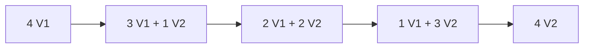
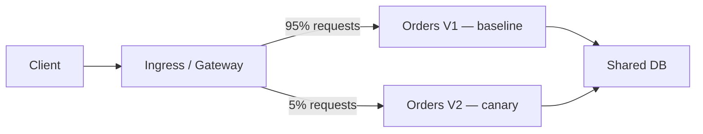
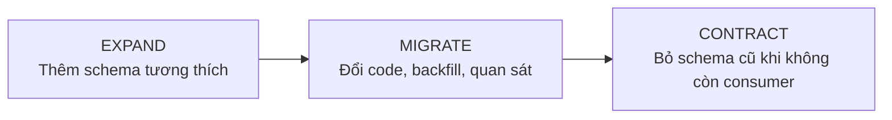
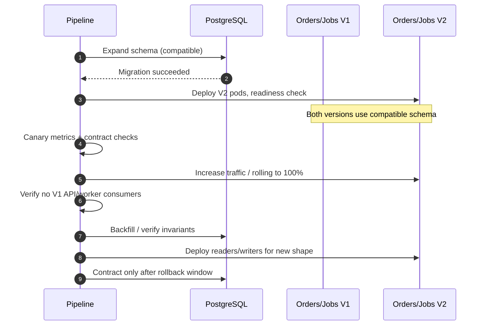

# Rolling deployment, canary và tương thích dữ liệu khi chạy nhiều phiên bản

Triển khai phiên bản mới của một REST API hiếm khi là thao tác thay thế tức thì tất cả máy chủ. Trong vài phút hoặc vài giờ, cùng một hệ thống có thể có **pod chạy phiên bản V1**, **pod chạy phiên bản V2**, **job nền chạy code cũ**, **client chưa nâng cấp**, và một **cơ sở dữ liệu dùng chung**. Nếu V2 đổi cách đọc bảng hoặc ghi ra trạng thái mà V1 không hiểu, những request đi qua hai phiên bản có thể lỗi dù cả hai bản đều chạy tốt khi kiểm thử riêng.

Bài học thuộc chương **Triển khai và vận hành** của module **INTEGRATION_API_REST**. Người học thiết kế REST API có hợp đồng dữ liệu rõ ràng, triển khai an toàn với **rolling deployment**, thử nghiệm **canary**, thực hiện **expand–migrate–contract** cho dữ liệu, đồng thời kiểm chứng khả năng rollback bằng Java/Spring, PostgreSQL và Kubernetes hoặc công nghệ tương đương.

## 1. Mục tiêu học tập

Sau bài học, bạn có thể:

1. Phân biệt rolling deployment, canary, blue–green và hiểu lúc nào hai phiên bản phải chạy đồng thời.
2. Thiết lập readiness, liveness, graceful shutdown và chính sách rollout để giảm lỗi khi thay pod.
3. Đánh giá tính tương thích của HTTP request/response, OpenAPI, database schema, event, cache và cấu hình giữa V1/V2.
4. Lập kế hoạch thay đổi database theo các pha **expand → migrate → contract**, có kiểm thử việc đọc và ghi qua lại giữa hai phiên bản.
5. Xác định điều kiện tăng/giảm phần trăm canary, tiêu chí dừng rollout và giới hạn của rollback.
6. Viết test contract và integration test có dữ liệu do phiên bản khác tạo ra; lập runbook triển khai và phục hồi có thể thực hiện được.

## 2. Hiểu vấn đề tương thích trong một đợt triển khai

Giả sử hệ thống quản lý đơn hàng:

```text
Client / Mobile / Partner
          |
          v
      API Gateway
          |
       /-----\
      v       v
  Orders V1  Orders V2
      \       /
       \     /
      PostgreSQL
          |
     Workers V1/V2
```

Một request `POST /orders` có thể vào V2, tạo dữ liệu trong PostgreSQL, rồi request `GET /orders/{id}` tiếp theo được gateway gửi tới V1. Người dùng không quan tâm request do pod nào xử lý; họ kỳ vọng cùng một contract và trạng thái nhất quán.

Các **hướng tương thích** phải xét độc lập:

| Thành phần | Câu hỏi trong thời gian chạy nhiều phiên bản |
|---|---|
| Client cũ → V2 API | V2 còn chấp nhận request cũ, header cũ, enum cũ không? |
| Client mới → V1 API | Client mới có gọi endpoint hoặc gửi field mà V1 chưa hiểu không? |
| V1 đọc dữ liệu V2 ghi | V2 có tạo giá trị/định dạng mà V1 parser, entity hoặc constraint không chấp nhận? |
| V2 đọc dữ liệu V1 ghi | V2 có dựa vào cột mới luôn có giá trị dù V1 không biết và không ghi cột đó? |
| V1/V2 cùng ghi | Có cơ chế nào tránh ghi đè mất dữ liệu hoặc phá bất biến nghiệp vụ không? |
| Worker cũ ↔ event mới | Event schema, topic, enum và idempotency có tương thích không? |
| Cache/session/job | Key và dữ liệu serialize có đọc được qua hai phiên bản? |
| Rollback | Sau khi V2 đã ghi dữ liệu thật, V1 có còn hoạt động đúng khi quay lại không? |

**Build thành công và application health xanh không đủ chứng minh khả năng tương thích**. Một hệ thống có thể vượt qua readiness probe nhưng trả lỗi tại một endpoint hiếm dùng hoặc gặp lỗi khi V1 đọc row mới do V2 tạo.

## 3. Rolling deployment, canary và blue–green khác nhau thế nào?

### 3.1. Rolling deployment

Rolling deployment thay dần instance cũ bằng instance mới. Ví dụ có bốn replica:



Kubernetes đánh giá tính sẵn sàng của pod mới trước khi giảm số pod cũ theo chiến lược đã cấu hình. Trong giai đoạn chuyển tiếp, mọi pod `Ready` có thể nhận traffic nếu cùng được Service chọn. Rolling deployment **không mặc nhiên chỉ định chính xác 5% request vào phiên bản mới**, cũng không đủ để đánh giá tác động trên một nhóm người dùng được chọn.

Ưu điểm là cơ chế triển khai tương đối đơn giản và thường dùng cùng một Deployment. Đổi lại, V1/V2 bắt buộc tương thích ở mọi thời điểm có overlap, và rollback bằng image cũ chỉ an toàn nếu dữ liệu, cache, job và schema vẫn tương thích.

### 3.2. Canary deployment

Canary cho phép một phần lưu lượng thật đi vào phiên bản mới trước khi mở rộng. Chẳng hạn:



Tỷ lệ 95/5 chỉ đạt đúng theo cách định tuyến được cấu hình và đặc tính traffic; trên số lượng request nhỏ, phân bổ quan sát thực tế có thể lệch. Có thể route theo trọng số request, tenant allowlist, cookie, header nội bộ hoặc nhóm người dùng thử nghiệm. Mỗi cách có thiên lệch quan sát riêng.

Canary thích hợp khi cần đo error rate, latency, tính đúng đắn và các chỉ số nghiệp vụ của phiên bản mới bằng traffic thật, rồi quyết định tăng 5% → 25% → 50% → 100% theo cổng kiểm soát. Nhưng vì dùng **cùng database và hệ thống phụ thuộc**, lỗi ghi dữ liệu từ 5% canary vẫn có thể ảnh hưởng 95% request V1. Canary không phải một sandbox dữ liệu riêng.

### 3.3. Blue–green và feature flag

**Blue–green** giữ hai môi trường phục vụ (blue hiện tại, green mới), chuyển routing từ blue sang green khi green đủ điều kiện. Phương pháp này có thể chuyển traffic nhanh và giúp quay lại routing cũ, nhưng **database dùng chung** vẫn cần tương thích và có thể làm rollback khó.

**Feature flag** giúp deploy code trước và bật hành vi sau. Ví dụ V2 hỗ trợ một trường response mới nhưng chưa phát trạng thái nghiệp vụ mới cho đến khi toàn bộ consumer đã nâng cấp. Flag cần có owner, giới hạn đối tượng bật, giám sát và khả năng tắt nhanh; không dùng flag để tạm vô hiệu hóa xác thực hoặc phân quyền.

| Tiêu chí | Rolling | Canary | Blue–green |
|---|---|---|---|
| Mục tiêu chính | Thay dần replica | Kiểm soát rủi ro bằng traffic nhỏ và số đo | Chuyển traffic giữa hai môi trường |
| Cần đồng thời V1/V2? | Có trong quá trình rollout | Có trong giai đoạn đánh giá | Có khi chuẩn bị/chuyển đổi |
| Điều khiển traffic theo %/cohort | Không có sẵn trong Deployment thông thường | Có, cần gateway/service mesh/công cụ hỗ trợ | Thường chuyển phần lớn hoặc toàn bộ |
| Khả năng quay lại nhanh | Có thể đổi image/revision nếu còn tương thích | Giảm canary về 0 nếu dữ liệu còn an toàn | Chuyển routing về blue nếu phụ thuộc còn tương thích |
| Database shared có rủi ro? | Có | Có | Có |

Trong thực tế có thể kết hợp: rolling để cập nhật các pod bên trong Deployment canary, canary để tăng phần trăm traffic, và feature flag để trì hoãn kích hoạt hành vi nghiệp vụ.

## 4. Rolling với Kubernetes và Spring Boot

### 4.1. Cấu hình Deployment minh họa

Giả sử Spring Boot có Spring Boot Actuator và endpoint health probe. Ví dụ YAML:

```yaml
apiVersion: apps/v1
kind: Deployment
metadata:
  name: orders-api
spec:
  replicas: 4
  strategy:
    type: RollingUpdate
    rollingUpdate:
      maxSurge: 1
      maxUnavailable: 0
  selector:
    matchLabels:
      app: orders-api
  template:
    metadata:
      labels:
        app: orders-api
    spec:
      terminationGracePeriodSeconds: 45
      containers:
        - name: api
          image: registry.example.invalid/orders-api:2.3.0
          ports:
            - containerPort: 8080
          startupProbe:
            httpGet:
              path: /actuator/health/liveness
              port: 8080
            periodSeconds: 2
            failureThreshold: 30
          readinessProbe:
            httpGet:
              path: /actuator/health/readiness
              port: 8080
            periodSeconds: 5
            failureThreshold: 3
          livenessProbe:
            httpGet:
              path: /actuator/health/liveness
              port: 8080
            periodSeconds: 10
            failureThreshold: 3
          resources:
            requests:
              cpu: "250m"
              memory: "384Mi"
            limits:
              memory: "768Mi"
```

Đây là cấu hình minh họa, không phải manifest triển khai cho mọi cluster. `maxSurge: 1` cho phép thêm tối đa một pod vượt số replica mong muốn trong rollout; `maxUnavailable: 0` đặt mục tiêu duy trì số replica sẵn sàng theo cơ chế rollout. Cluster phải có năng lực chạy thêm pod; nếu thiếu CPU, quota hoặc capacity, rollout có thể dừng dù cấu hình không cho giảm sẵn sàng.

Cần kiểm tra giới hạn tài nguyên, thời gian startup và graceful termination bằng kết quả đo thực tế. Nếu traffic được chia theo một Service chung, Kubernetes load balancing không bảo đảm pod mới nhận đúng tỷ lệ mong muốn để thay thế một canary controller.

### 4.2. Health probe có trách nhiệm riêng

| Probe | Câu hỏi | Không nên làm |
|---|---|---|
| `startupProbe` | Ứng dụng đã khởi động đủ để bắt đầu kiểm tra thường xuyên? | Giết ứng dụng khởi động chậm trước khi warmup hợp lý |
| `readinessProbe` | Instance **có thể nhận traffic mới** ở thời điểm này? | Báo ready trước khi chuẩn bị tài nguyên thiết yếu |
| `livenessProbe` | Process đang ở trạng thái cần restart hay vẫn phục hồi được? | Cho liveness phụ thuộc DB/HTTP provider, gây restart hàng loạt khi downstream lỗi |

Với Spring Boot Actuator, ví dụ cấu hình:

```yaml
management:
  endpoint:
    health:
      probes:
        enabled: true

server:
  shutdown: graceful

spring:
  lifecycle:
    timeout-per-shutdown-phase: 30s
```

Spring Boot có thể hỗ trợ các health group tại `/actuator/health/liveness` và `/actuator/health/readiness` khi cấu hình tương ứng. Đường dẫn và việc mở management port phụ thuộc cài đặt thực tế; nếu Actuator chạy ở port khác hoặc base path khác thì phải điều chỉnh probe. Không để actuator management endpoint nhạy cảm công khai ra Internet.

Readiness cần phản ánh các điều kiện **thực sự bắt buộc để nhận request**, nhưng đưa mọi dependency không ổn định vào readiness có thể làm toàn bộ pod đồng loạt rời Service và khiến sự cố nặng hơn. Liveness nên đánh giá khả năng process tự tiến triển, không dùng để kiểm tra sự sống của PostgreSQL hoặc payment provider.

### 4.3. Graceful shutdown và request đang xử lý

Khi pod bị xóa, Kubernetes bắt đầu quá trình kết thúc; app cần ngừng nhận request mới, cho request đang chạy thời gian kết thúc và đóng tài nguyên hợp lý. `server.shutdown=graceful` hỗ trợ cách xử lý này trong Spring Boot tùy embedded server và phiên bản.

Điều cần thử bằng tải thật:

1. Pod bị đánh dấu terminating và dần bị loại khỏi routing khi endpoint/Service cập nhật.
2. Request mới được gửi tới pod sẵn sàng khác; vẫn có khoảng trễ lan truyền trạng thái giữa proxy/ingress/service mesh.
3. Request đang xử lý có thời gian hoàn thành trong giới hạn termination; long-running request cần deadline/thiết kế async.
4. Worker background và consumer queue ngừng nhận việc mới, hoàn thành hoặc trả lại công việc bằng cơ chế retry/idempotency phù hợp.
5. Khi hết `terminationGracePeriodSeconds`, process có thể bị buộc kết thúc; không giả định mọi request đều hoàn thành.

Nếu một thao tác thanh toán đã commit tại provider nhưng client mất response do pod bị kill, client sẽ retry; API cần **idempotency**, kiểm tra trạng thái và audit log, không chỉ tăng grace period.

## 5. REST API phải tương thích theo hợp đồng HTTP

Phần lớn sự cố rollout không nằm ở file triển khai, mà ở **contract khác nhau giữa các phiên bản**.

### 5.1. Những thay đổi thường có thể triển khai cộng dồn

| Thay đổi | Điều kiện để tương thích |
|---|---|
| Thêm endpoint mới | Client cũ không bị ảnh hưởng; client mới chỉ gọi khi V2 đã phủ đủ hoặc được định tuyến tới V2 |
| Thêm field **tùy chọn** vào response | Client cũ phải chấp nhận unknown field; cần test cả mobile/SDK strict parser |
| Thêm request field tùy chọn | V2 có default khi client cũ không gửi; V1 phải xử lý request của client mới nếu có khả năng đi vào V1 |
| Thêm mã lỗi có cấu trúc | Client vẫn hiểu status HTTP, không giả định chỉ có một error code |
| Thêm header mới | Proxy và client không bị đổi cách xử lý bất ngờ |
| Tăng khả năng xử lý nội bộ không đổi contract | Cần test behavior, latency, error và state side effect |

Không nên tuyên bố "thêm field JSON luôn backward-compatible". Một số client dùng JSON decoder cấu hình fail on unknown properties, schema validation nghiêm ngặt hoặc switch trên enum không có default. Tương thích phải được xác minh với **consumer thực**, không chỉ dựa vào HTTP/JSON cho phép thêm thuộc tính về mặt cú pháp.

### 5.2. Những thay đổi dễ phá vỡ client cũ

- Đổi tên hoặc xóa field, đổi kiểu dữ liệu (`amount` từ số sang chuỗi), đổi ý nghĩa trường.
- Biến request field đang tùy chọn thành **bắt buộc**.
- Thêm giá trị enum mà client cũ dùng exhaustive switch không có nhánh unknown.
- Đổi mã trạng thái `200` sang `202` khi client vẫn coi request đã hoàn thành đồng bộ.
- Đổi response body, content type, semantics của pagination/cursor hoặc lỗi `400/409/422`.
- Đổi đường dẫn, HTTP method, authentication scope hoặc policy phân quyền mà chưa nâng cấp client.
- Thay đổi idempotency key semantics, thời gian lưu key hoặc cách xử lý retry.

Ví dụ V2 muốn thêm `deliveryNote` vào đơn hàng:

```json
{
  "id": "11111111-1111-4111-8111-111111111111",
  "status": "PAID",
  "amount": 150000,
  "deliveryNote": "Gọi trước khi giao"
}
```

Nếu V1 client chỉ mong `id/status/amount` và bỏ qua field không biết, response này tương thích. Nếu client giải mã bằng schema cấm field lạ, cần điều chỉnh client trước, dùng serializer có hợp đồng mềm dẻo hoặc version API thích hợp.

**Hai chiều lưu lượng:** Trong rolling rollout, V2 client có thể gửi `deliveryNote` tới V1 server. Nếu V1 không biết field đó, request có thể bị từ chối hoặc bị bỏ qua. Không cho client phụ thuộc vào tính năng mới cho đến khi routing/rollout bảo đảm request sẽ đến server hiểu tính năng đó; feature flag hoặc version routing là lựa chọn.

### 5.3. API versioning không loại bỏ bài toán overlap

Có thể dùng `/v1/orders` và `/v2/orders`, hoặc version qua media type/header theo hợp đồng. Điều này phân tách client contract, nhưng **database, event, cache và background worker vẫn dùng chung** nếu kiến trúc không tách chúng. Giữ một endpoint `/v1` ổn định không có nghĩa V2 có thể drop cột database mà binary cũ còn đọc.

OpenAPI nên xuất bản rõ contract mỗi version. Sử dụng kiểm tra diff để phát hiện xóa/đổi kiểu field, request required mới, enum hoặc response status mới; sau đó chạy **consumer-driven contract tests** với client/SDK quan trọng. OpenAPI diff hữu ích nhưng không thể tự xác minh ý nghĩa nghiệp vụ hay logic đồng thời.

## 6. Tương thích dữ liệu: Nguyên tắc expand–migrate–contract

Schema database là nơi V1 và V2 có thể va chạm trực tiếp. Một thay đổi schema được coi là an toàn trong rollout khi **tất cả phiên bản đang hoạt động có thể đọc/ghi dữ liệu theo schema ở thời điểm đó** và các bất biến nghiệp vụ vẫn được giữ.



Ba pha này **không nhất thiết là ba migration SQL liên tiếp trong một deployment**. Chúng thường trải qua nhiều lần release, đặc biệt khi phải duy trì khả năng rollback.

### 6.1. Thay đổi cộng dồn: thêm cột tùy chọn

V1 có bảng:

```sql
CREATE TABLE orders (
    id uuid PRIMARY KEY,
    tenant_id uuid NOT NULL,
    status text NOT NULL,
    created_at timestamptz NOT NULL DEFAULT now()
);
```

V2 cần thêm ghi chú giao hàng. Bước expand:

```sql
ALTER TABLE orders
    ADD COLUMN delivery_note text;
```

Cột mới nullable, V1 không cần biết đến nó. V2 phải đọc khi `delivery_note IS NULL` và xử lý không có ghi chú. Tránh ngay lập tức thêm `NOT NULL` không có default phù hợp, hoặc làm V1 `INSERT` không còn hợp lệ.

Bước migrate: chạy cả V1 và V2, quan sát V1 đọc record do V2 tạo; V2 trả behavior hợp lệ với record V1 tạo không có `delivery_note`. Nếu cần dữ liệu mặc định, thực hiện backfill theo batch có giám sát.

Bước contract: chỉ đặt constraint chặt hoặc xóa cơ chế fallback sau khi xác nhận tất cả writers và dữ liệu lịch sử đáp ứng invariant. Thêm column là trường hợp đơn giản; **đổi tên hoặc đổi ý nghĩa cột** thường cần nhiều release hơn.

### 6.2. Đổi tên cột không được làm bằng một lệnh khi V1 còn chạy

Giả sử V1 dùng `customers.name` và V3 muốn dùng `customers.display_name`. Lệnh trực tiếp sau có thể phá V1 ngay:

```sql
ALTER TABLE customers
    RENAME COLUMN name TO display_name;
```

V1 vẫn gửi SQL đọc/ghi `name` nên lỗi `column does not exist`. Một lộ trình an toàn hơn:

| Pha/release | Database | Code chạy trong pha | Invariant cần giữ |
|---|---|---|---|
| **E1 — Expand** | Thêm `display_name nullable`, giữ `name NOT NULL` | Chỉ V1 hoặc V1+V2 | V1 vẫn hoạt động bình thường |
| **E2 — V2** | Cả hai cột | V2 **đọc `name` làm nguồn chuẩn**, ghi **cả `name` và `display_name`** trong cùng transaction | V1 vẫn đọc/ghi `name`; V2 không phụ thuộc giá trị mới |
| **M1 — Backfill** | Đồng bộ `display_name` từ `name` theo batch | Chỉ sau khi **toàn bộ V1 writer** đã ngừng hoặc có cơ chế đồng bộ cột chặt hơn | Không để V1 cập nhật `name` làm `display_name` lỗi thời sau backfill |
| **M2 — V3** | Cả hai cột có dữ liệu đúng | V3 đọc `display_name` (fallback nếu chính sách cho phép), vẫn dual-write hai cột | Rollback về V2 vẫn đọc được `name` đúng |
| **C1 — V4** | Trước khi bỏ ghi `name`, gỡ `NOT NULL` của cột cũ và xác minh cột mới đã được backfill | Chỉ khi V1/V2 và mọi reader `name` đã hết, V4 mới ghi `display_name` duy nhất | Không còn nhu cầu rollback về version cũ cần `name`; V3 nếu còn song song phải chịu được `name IS NULL` |
| **C2 — Contract** | Xác minh trước khi drop `name`; thêm constraint/index cần thiết | Chỉ V4+ hiểu `display_name` | Không còn binary, job, migration, report hay consumer dùng `name` |

Nếu backfill chạy trong lúc V1 vẫn có thể cập nhật `name`, V2 đọc tên cũ chính xác nhưng `display_name` có thể không còn đồng bộ. **Không chuyển V3 sang đọc cột mới khi chưa có bảo đảm đồng bộ**. Có thể dùng database trigger được thiết kế cẩn thận, cơ chế CDC hoặc trì hoãn cutover đến khi V1 ngừng ghi; ví dụ bảng trên chọn phương án trì hoãn để dễ kiểm chứng.

Trước khi V4 ngừng ghi `name`, cần nới ràng buộc bắt buộc của cột cũ, ví dụ `ALTER TABLE customers ALTER COLUMN name DROP NOT NULL;`, nếu không các lệnh `INSERT` chỉ có `display_name` sẽ vẫn lỗi. Phải bảo đảm V3 còn phục vụ, nếu có, đọc an toàn khi `name` là `NULL` (kể cả mapper/validation), và kiểm chứng rollback V4 → V3 trên dữ liệu V4 mới tạo. Nếu không bảo đảm được điều này, tiếp tục **dual-write** ở V4 và trì hoãn chuyển đổi; tuyệt đối không rollback về V1/V2 chỉ đọc `name` sau khi V4 đã tạo các dòng thiếu cột cũ.

Backfill có thể chạy theo từng batch có giới hạn thay vì một `UPDATE` toàn bảng gây transaction kéo dài:

```sql
-- PostgreSQL: ví dụ cập nhật một batch theo khóa chính.
WITH batch AS (
    SELECT id
    FROM customers
    WHERE display_name IS DISTINCT FROM name
    ORDER BY id
    LIMIT 500
    FOR UPDATE SKIP LOCKED
)
UPDATE customers AS c
SET display_name = c.name
FROM batch
WHERE c.id = batch.id;
```

Chạy lặp với tiến độ/giới hạn tải cho đến khi không còn dòng lệch; cần logic xác nhận đã hoàn tất và phát hiện writer cũ còn chạy. `SKIP LOCKED` ở đây chỉ là một kỹ thuật để nhiều worker không chờ cùng row, không thay thế việc kiểm soát consistency hay tránh race với các writer khác. Thực hiện trong các transaction ngắn, đo lock wait, WAL, replication lag.

### 6.3. V2 Java/Spring dual-write minh họa

V2 vẫn đọc cột cũ vì có thể còn V1 writer:

```java
@Service
public class CustomerNameService {
    private final CustomerRepository customers;

    public CustomerNameService(CustomerRepository customers) {
        this.customers = customers;
    }

    @Transactional
    public void rename(UUID customerId, String newName) {
        Customer customer = customers.findById(customerId)
            .orElseThrow(() -> new EntityNotFoundException(
                "Customer not found"));

        // Pha V2: name là nguồn chuẩn trong lúc V1 còn hoạt động.
        customer.setName(newName);
        customer.setDisplayName(newName);

        // Cùng một DB transaction để cập nhật hai field.
        // Cần @Version hoặc điều kiện cập nhật để tránh lost update.
    }

    @Transactional(readOnly = true)
    public String readName(UUID customerId) {
        return customers.findById(customerId)
            .orElseThrow()
            .getName();
    }
}
```

Mẫu code giả định entity đã ánh xạ cả hai cột và repository có hỗ trợ JPA. Điều kiện cốt lõi là **đọc nguồn còn được V1 cập nhật** và dual-write trong cùng transaction; không dựa vào việc `save()` là commit. Với transaction ghi đồng thời, thêm optimistic locking hoặc khóa phù hợp để bảo vệ dữ liệu.

Cần kiểm tra tất cả writer: REST controller, scheduled job, message consumer, import tool, batch script và administrative SQL. Chỉ kiểm tra số pod HTTP V1 bằng 0 chưa đủ nếu worker V1 hoặc cron cũ vẫn sửa `name`.

### 6.4. Những thay đổi dữ liệu nguy hiểm khác

| Thay đổi | Nguy cơ trong mixed-version | Cách mở đường tương thích |
|---|---|---|
| Drop/rename column | V1 query lỗi lập tức | Expand với cột mới; cập nhật mọi consumer; contract sau |
| Add `NOT NULL`/unique constraint | Writer V1 chưa gửi field hoặc dữ liệu cũ không hợp lệ | Backfill + sửa writer, kiểm chứng vi phạm trước khi enforce |
| Đổi kiểu field | JDBC/JPA mapper cũ không parse hoặc tràn số | Thêm cột/version mới, chuyển đổi có kiểm chứng |
| Thêm enum/status mới | V1 `switch` không biết `RETURNING`/`REFUNDED` | Deploy reader hiểu unknown trước; bật writer phát status sau |
| Đổi khóa/định danh | Cache, FK, idempotency, client reference cũ sai | Dùng mapping/double-read và cutover nhiều pha |
| Xóa giá trị hoặc gom trạng thái | V1 còn dựa vào ý nghĩa cũ | Thiết kế state machine chung và quy tắc ánh xạ |
| Thêm index | Tăng tải I/O, WAL và thời gian migration | Đo dung lượng, xây ngoài giờ cao điểm; PostgreSQL `CONCURRENTLY` nếu thích hợp |

Đặc biệt, migration xóa dữ liệu hoặc làm mất thông tin thường **không thể rollback** đơn giản bằng đổi image ứng dụng. Nếu cần đảo thay đổi có mất mát, phải có backup/snapshot, kiểm chứng khả năng restore và quy trình khôi phục được phê duyệt; không giả định script `down` tạo lại được dữ liệu đã xóa.

## 7. Migration phải có thứ tự với rolling/canary

Không triển khai một phiên bản mới cần cột `display_name` trước khi migration expand tạo cột đó. Ngược lại, không xóa `name` khi V1 còn chạy.

Một thứ tự triển khai an toàn:



Các bước quan trọng:

- Migration schema chạy **một lần theo điều phối**, không để mỗi pod đồng thời tự thực hiện một migration phá vỡ khi startup. Flyway/Liquibase có thể hỗ trợ lock và lịch sử migration, nhưng cần quy hoạch nơi/khi nào chạy, giám sát lỗi và xử lý lâu.
- DDL có thể giữ lock hoặc ảnh hưởng query trong production. Đo trước trên dữ liệu đại diện, dùng timeout hợp lý, tránh lệnh rewrite hàng lớn không có kế hoạch.
- Sau mỗi pha cần **điều kiện chấp nhận đo được**: cột tồn tại, writers cũ vẫn chạy, tỷ lệ row đã backfill, không có consumer cũ, rollback path còn hoạt động.
- Tạm dừng hoặc rollback **application traffic** không tự đảo schema. Migration expand tương thích thường được **giữ lại** khi rollback app.
- Chỉ chạy contract/drop sau khi hết thời hạn rollback cần thiết và xác nhận mọi dependency đã nâng cấp.

### 7.1. Bảng tương thích nên lập trước khi bấm Deploy

Ví dụ:

| App version | DB S0 (chỉ `name`) | DB S1 (`name` + `display_name`) | DB S2 (chỉ `display_name`) |
|---|---|---|---|
| V1 đọc/ghi `name` | Được | Được | **Không** |
| V2 đọc `name`, dual-write | Không (thiếu cột mới) | Được | **Không** |
| V3 đọc mới, dual-write | Không | Được sau backfill/sync | **Không** |
| V4 chỉ đọc/ghi `display_name` | Không | Được **sau khi** gỡ `name NOT NULL` và hết reader cũ | Được |

Vì V2 cần DB S1 trước khi deploy, pipeline phải chạy expand rồi mới tăng phiên bản. Vì V1 không dùng được DB S2, drop `name` chỉ hợp lệ sau khi V1/V2/V3 đã bị loại bỏ và phương án rollback về chúng không còn yêu cầu.

Ma trận phải tính cả **app binary, worker, migration job, reporting query và consumer ngoại vi**. Nếu một báo cáo SQL ngoài hệ thống vẫn SELECT `name`, contract migration còn nguy hiểm dù HTTP API toàn bộ là V4.

## 8. Canary: thiết kế traffic và cổng tăng tỷ lệ

Một luồng ví dụ với gateway/service mesh hỗ trợ weighted routing:

```text
B0: V1 100%, V2 0%  → expand schema + readiness
B1: V1 99%, V2 1%   → smoke test và cohort nội bộ
B2: V1 95%, V2 5%   → đánh giá latency/error chức năng chính
B3: V1 75%, V2 25%  → kiểm tra capacity và đa dạng endpoint/tenant
B4: V1 50%, V2 50%  → so sánh dưới tải đủ lớn
B5: V1 0%, V2 100%  → giám sát sau rollout, tiếp tục rollback window
```

Đây là **lịch ví dụ**, không phải tỷ lệ/độ dài chuẩn cho mọi hệ thống. Mỗi lần tăng phải có thời gian quan sát và lượng request đủ để phát hiện lỗi trọng yếu. Một canary 1% với 20 requests/phút có thể không chạm endpoint hiếm hoặc tenant có dữ liệu lớn.

### 8.1. Những metric bắt buộc theo phiên bản

| Nhóm | So sánh V2 canary với V1 baseline |
|---|---|
| HTTP | Request rate theo route/method/status; tỷ lệ `5xx`, `429`, `4xx` ngoài dự kiến |
| Độ trễ | p50/p95/p99 theo endpoint và luồng quan trọng; tránh chỉ nhìn latency trung bình |
| Tài nguyên | CPU, memory, GC, thread pool, connection pool, pod restart, saturation |
| Database | Query duration, lock wait, deadlock, lỗi schema/SQL, replication lag, WAL |
| Business | Tỷ lệ tạo đơn thành công, thanh toán thành công, duplicate operations, state transition lỗi |
| Phụ thuộc | Timeout, circuit breaker open, retry attempts, backlog queue/outbox |
| Dữ liệu | Parse error, enum unknown, deserialization fail, số row chưa backfill |
| Bảo mật | `401/403` bất thường, cross-tenant access denial, JWT/JWKS validation errors |

Mỗi request nên có metric/log/tracing cho **service version/build** bằng nhãn có cardinality hữu hạn. Tránh nhãn metric gồm raw user ID, request ID, order ID, tenant ID hàng trăm nghìn giá trị. Khi điều tra một case cụ thể, sử dụng trace/log có quyền truy cập phù hợp.

Không kết luận V2 kém hơn chỉ vì error rate canary cao nếu route/tenant distribution khác V1. Nên **phân tầng theo route, mức tải, nhóm tenant và release cohort**. Với dữ liệu mỏng, ghi rõ độ không chắc chắn; có thể dùng synthetic smoke test hoặc giữ canary lâu hơn trước khi mở rộng.

### 8.2. Cổng quyết định tăng/dừng/rollback

Ví dụ chính sách vận hành được điều chỉnh theo SLO:

- **Tiếp tục:** readiness ổn định, không có lỗi dữ liệu/authorization, error rate và latency ở giới hạn chấp nhận, các nghiệp vụ chính đã chạy đủ mẫu kiểm thử.
- **Tạm dừng:** traffic quá ít để kết luận, metric thiếu, xuất hiện lệch nhẹ chưa phân loại được, migration/backfill chưa đạt invariant.
- **Giảm traffic hoặc rollback:** tăng lỗi `5xx`/p95 vượt ngưỡng, pod crash loop, DB deadlock/lock wait tăng, cross-tenant data leak, duplicate charge, schema incompatibility hoặc sự cố nghiêm trọng khác.

Ngưỡng cụ thể phải dựa SLO và độ nhạy nghiệp vụ. Các sự cố **đúng đắn dữ liệu và bảo mật** nên có cổng dừng riêng, không đợi đủ số lượng request như với lỗi hiệu năng.

Có thể tự động hóa promotion/rollback qua rollout controller, nhưng **cấu hình metric sai hoặc chỉ dựa trên HTTP 2xx có thể cho bản lỗi đi tiếp**. Runbook cần nêu ai có quyền dừng và cách kiểm chứng rollback.

### 8.3. Sticky routing, session và canary khó đo

Nếu client có stateful session hoặc phiên bản mới dùng cookie/session format khác, route ngẫu nhiên giữa V1 và V2 có thể làm request 1 thành công, request 2 thất bại. Sticky sessions có thể hạn chế một số lỗi nhưng khiến 5% request không tương đương 5% user, gây thiên lệch khi so metric; cũng không bảo vệ workers và dữ liệu DB khỏi tình trạng mixed-version.

Ưu tiên service stateless hoặc session lưu theo định dạng tương thích, token/JWT validation đồng nhất và contract chung. Khi dùng cohort theo tenant/user, bảo đảm không dùng header do client công khai tự khai để vượt qua phân quyền hoặc truy cập tính năng chưa cho phép.

## 9. Dữ liệu event, cache và tác vụ bất đồng bộ

Một ứng dụng REST thường không dừng ở HTTP + database. Khi chạy nhiều phiên bản, **consumer cũ có thể gặp message do producer mới tạo**.

### 9.1. Event và queue

Ví dụ V2 phát:

```json
{
  "eventId": "f10c37d9-5051-4db3-a8f2-613fed665106",
  "type": "OrderStatusChanged",
  "schemaVersion": 2,
  "orderId": "11111111-1111-4111-8111-111111111111",
  "status": "RETURNING",
  "deliveryNote": "Gọi trước khi giao"
}
```

Nếu consumer V1 chỉ chấp nhận `PAID`, `PENDING`, `CANCELLED`, giá trị `RETURNING` có thể làm parser/enum switch lỗi. Thêm `schemaVersion` **không tự làm consumer hiểu schema mới**. Chiến lược an toàn thường là:

1. Deploy reader/consumer có khả năng xử lý field không biết và status mở rộng phù hợp trước.
2. Quan sát các consumer cũ đã hết hoặc route event được phân phiên bản.
3. Chỉ khi tương thích được xác nhận mới bật producer V2 phát giá trị/trường mới.
4. Đảm bảo retry/DLQ không nhân đôi tác động: dùng event ID, idempotency và transaction boundary rõ ràng.

Nếu thay cả ý nghĩa event hoặc yêu cầu xử lý cũ khác hẳn, cân nhắc version event/topic có chủ đích thay vì ép schema cũ chứa hai ý nghĩa mâu thuẫn.

### 9.2. Cache, serialized data và session

Trong rolling/canary, hai phiên bản có thể cùng dùng Redis/HTTP cache. Những lỗi điển hình:

- V2 ghi giá trị cache dạng mới, V1 deserializer không đọc được.
- Key thiếu version khi semantics đổi; V1 nhận dữ liệu từ cách tính của V2.
- Cache response cho tenant A bị dùng lại cho tenant B khi partition key hoặc quyền không đúng.
- V2 chỉ giữ field mới trong cache, sau rollback V1 gặp `null` hoặc lỗi parse.

Dùng schema tương thích hoặc version key namespace khi semantics thay đổi, TTL hữu hạn, phương án invalidation và kiểm thử đọc chéo. Cache key versioning phải cân nhắc giai đoạn V1/V2 cùng chạy, khả năng warmup và tốn dung lượng. Cache không được trở thành nguồn phân quyền tin cậy nếu quyền đã bị thu hồi; mỗi request vẫn phải tuân thủ authorization.

### 9.3. Background job và scheduler

Pod V1 có thể tiếp tục chạy scheduler sau khi V2 nhận HTTP traffic. Nếu cả hai phiên bản đều bật scheduler độc lập, một công việc có thể bị xử lý hai lần hoặc code cũ ghi lại format cũ.

Dùng job ownership rõ ràng: worker deployment riêng, distributed lock/lease, queue claim, idempotency key và fencing token khi cần. Khi draining, đảm bảo job đang chạy được hoàn thành hoặc có thể chạy lại an toàn. Kiểm kê cả cron, outbox publisher, CDC consumer, batch import và admin script trước khi contract migration.

## 10. Tính đúng đắn khi V1 và V2 cùng ghi

Ví dụ hai API cùng cập nhật đơn hàng:

```text
T0: V1 đọc Order(id=O1, status=PAID, version=7)
T1: V2 đọc cùng Order version=7
T2: V2 cập nhật deliveryNote, version=8
T3: V1 ghi toàn bộ entity cũ, version=7 → nguy cơ ghi đè note mới
```

Nếu dùng optimistic locking với `version` và cập nhật theo phiên bản, thao tác của V1 ở T3 phải bị từ chối hoặc xử lý xung đột thích hợp. Nếu ORM ghi toàn bộ cột với snapshot cũ và không có kiểm soát concurrency, V1 có thể ghi đè giá trị mới của V2, kể cả khi schema không bị phá.

Ví dụ SQL cập nhật có điều kiện:

```sql
UPDATE orders
SET status = :newStatus,
    version = version + 1
WHERE id = :orderId
  AND tenant_id = :tenantId
  AND version = :expectedVersion;
```

Ứng dụng kiểm tra số row cập nhật; `0` có thể là không tồn tại, sai tenant/quyền hoặc stale version và phải xử lý theo contract, không retry mù quáng. Với Hibernate có thể dùng `@Version`, nhưng cần kiểm tra mọi đường cập nhật, kể cả native SQL, batch và jobs.

**Chú ý:** optimistic locking không tự giải quyết trường hợp V1 **không biết field mới** nhưng vẫn ghi nguyên entity bằng đường SQL khác hoặc cùng record không có version. Cần kiểm thử update từ hai phiên bản và thống nhất quy tắc ghi partial update, semantics của null và trạng thái.

### 10.1. Idempotency xuyên phiên bản

Với `POST /payments` hoặc `POST /orders`, client có thể timeout ở V2 rồi retry sang V1. Nếu idempotency key chỉ lưu trong bộ nhớ pod, request lần hai có thể tạo giao dịch trùng.

Thiết kế:

- Idempotency record lưu trong backend chung bền vững, key gắn với tenant/actor, endpoint và payload fingerprint.
- V1 và V2 thống nhất namespace, ý nghĩa key, TTL, trạng thái đang xử lý và kết quả replay.
- Transaction ghi idempotency record và thay đổi nghiệp vụ phải có cách bảo đảm atomic hoặc cơ chế phục hồi đã thiết kế.
- Không tự động retry thao tác không idempotent sau timeout nếu provider ngoài có thể đã thực hiện; tra trạng thái hoặc dùng provider idempotency key ổn định.
- Audit ghi một business event đã commit theo operation, dù có nhiều HTTP attempts qua nhiều pod.

Canary 5% đủ gây double charge nếu policy idempotency bị thay đổi không tương thích. Đây là lý do phải test luồng retry qua **V2 → V1** trước khi tăng traffic.

## 11. Bảo mật và phân quyền khi phối hợp phiên bản

Rolling deployment không chỉ là thay binary. Những thay đổi an ninh cần xem như thay đổi contract:

| Thay đổi | Rủi ro trong overlap | Cách kiểm chứng |
|---|---|---|
| JWT/JWKS key rotation | V1 không nhận `kid` mới, request từ client thất bại ngẫu nhiên | Cả V1/V2 tin các public key cần thiết trước khi IdP phát token mới |
| Thêm scope/action | V1 thiếu policy hoặc V2 yêu cầu scope client chưa có | Kiểm thử `401/403` và quyền theo route/tenant |
| Dữ liệu tenant mới | V1 truy vấn thiếu cột/phạm vi tenant | Integration test cross-tenant, list/detail/write |
| Bật tính năng admin mới | V1 route khác hoặc bỏ kiểm tra quyền | Feature flag + server authorization, test theo mọi phiên bản |
| Token/session serialization | V1 không giải mã token/cookie do V2 tạo | Kiểm thử đăng nhập và request liên tiếp V1↔V2 |
| Secret/config rotation | Pod cũ và mới dùng secret không giao nhau | Giai đoạn chấp nhận đồng thời, theo dõi và thu hồi sau |

Không dùng canary cohort/route override từ client như một cách mặc nhiên vượt quyền. Header định tuyến phải được gateway tin cậy chuẩn hóa hoặc giới hạn trong luồng kiểm thử nội bộ. Sau khi rollback, đừng quay lại một phiên bản có lỗ hổng bảo mật nghiêm trọng chỉ để khôi phục traffic; cần phương án giảm tải hoặc hotfix tương thích.

## 12. Kiểm thử trước khi triển khai nhiều phiên bản

Một phiên bản chạy riêng chưa thể hiện các trường hợp quan trọng. Cần ít nhất một bộ kiểm thử **version matrix**:

| Test | Hệ thống | Điều phải chứng minh |
|---|---|---|
| V1 + expanded DB | V1 trên schema mới | Query cũ vẫn đọc/ghi bình thường |
| V2 + expanded DB | V2 trên schema mới | V2 đọc được row cũ thiếu field mới |
| V2 write → V1 read | V1/V2 + shared DB | V1 hiểu dữ liệu do V2 ghi |
| V1 write → V2 read | V1/V2 + shared DB | V2 không giả định field mới luôn có |
| Đồng thời V1/V2 write | Hai phiên bản cập nhật cùng resource | Không lost update, trạng thái không vi phạm invariant |
| V2 canary → rollback V1 | V2 ghi dữ liệu, chuyển routing về V1 | V1 vẫn đọc/ghi/đối soát được |
| Retry đổi phiên bản | Request lần 1 vào V2, lần 2 vào V1 | Idempotency không tạo hai effect |
| JWT/scope/tenant | Token và dữ liệu đa tenant | Không tăng `401/403` bất thường hoặc rò dữ liệu |
| Async consumer | V2 publish, V1 consume | Không crash vì field/status chưa biết |
| Cache/session | V2 write, V1 read và ngược lại | Không deserialization error hoặc tenant leak |
| Pod draining | Kill pod lúc đang có request/job | Không mất nghiệp vụ, retry an toàn, mức lỗi trong SLO |
| Migration fail halfway | DDL/backfill lỗi giữa chừng | Có checkpoint, retry tiếp được, không phá V1 |

Tạo fixture gồm: nhiều tenant, dữ liệu có `NULL` ở cột mới, dữ liệu do V1 tạo, record do V2 tạo, enum/status ở biên, requests lặp, các job chưa hoàn tất. Với PostgreSQL, nên dùng môi trường Testcontainers hoặc DB staging có tính năng đúng production để kiểm tra DDL/transaction/locking.

### 12.1. Kiểm thử REST contract bằng Java/Spring

Ví dụ kiểm tra V2 vẫn chấp nhận request V1 không có trường mới:

```java
@SpringBootTest
@AutoConfigureMockMvc
class OrdersBackwardCompatibilityIT {

    @Autowired MockMvc mvc;

    @Test
    void oldClientCanCreateOrderWithoutDeliveryNote()
            throws Exception {
        mvc.perform(post("/api/orders")
                .with(jwt().jwt(jwt -> jwt.subject("alice"))
                    .authorities(new SimpleGrantedAuthority(
                        "SCOPE_orders:write")))
                .contentType(MediaType.APPLICATION_JSON)
                .header("Idempotency-Key", "compat-order-01")
                .content("""
                    {
                      "customerId": "11111111-1111-4111-8111-111111111111",
                      "items": [
                        {"sku":"SKU-01","quantity":1}
                      ]
                    }
                    """))
            .andExpect(status().isCreated())
            .andExpect(jsonPath("$.id").exists());
    }
}
```

Ví dụ này giả định endpoint `POST /api/orders` trả `201 Created`, dữ liệu khách hàng và sản phẩm đã được seed, và ứng dụng có cấu hình Spring Security phù hợp; đây là khung cần bổ sung fixture và imports. `jwt()` của Spring Security Test tạo principal giả để kiểm tra authorization, **không chứng minh JWT thật được verify signature/issuer/audience**; nhóm test auth riêng vẫn cần.

Bài test trên chỉ chứng minh **một hướng** client V1 → API V2. Để chứng minh V2 writes → V1 reads, cần khởi chạy binary V1 và V2 (ví dụ hai container cùng trỏ database test), thực hiện thao tác qua URL từng container và assert dữ liệu. Unit test chỉ chạy class V2 không mô phỏng được consumer/parser V1.

### 12.2. Kiểm thử PostgreSQL migration

Một kịch bản cần có:

```text
1. Start database schema S0 và ứng dụng V1.
2. Seed record lịch sử qua API V1; xác nhận contract V1.
3. Apply migration expand S1; V1 tiếp tục hoạt động.
4. Start V2 cùng DB; tạo/sửa record qua V2.
5. Đọc/sửa những record đó qua V1; kiểm tra dữ liệu không hỏng.
6. Dừng V1 writer/worker; chạy backfill có kiểm tra tiến độ.
7. Start V3 reader mới; xác nhận đọc cả dữ liệu cũ và mới.
8. Rollback thử V3 → V2 khi còn trong rollback window.
9. Chỉ sau khi mọi consumer dùng cột cũ biến mất mới thử contract.
```

Nếu dùng Flyway/Liquibase, kiểm thử migration từ **schema sản xuất của phiên bản trước** chứ không chỉ tạo schema mới tinh ở version hiện tại. Cần test migration có thể được chạy lại an toàn hoặc có state/checkpoint rõ ràng sau lỗi; không sửa migration đã phát hành một cách tùy tiện.

### 12.3. Load test và fault injection

Mô phỏng một lượng request tương đương production trong lúc rolling:

- Cài `maxSurge/maxUnavailable`, hạ pod cũ khi đang có HTTP requests.
- Cố ý làm V2 startup chậm, readiness thất bại hoặc provider ngoài timeout.
- So sánh p95/p99 latency, `5xx`, pool saturation, CPU, GC và số request bị timeout.
- Kiểm tra min available capacity khi pod V2 warmup và cache cold.
- Gửi request ghi có idempotency key, cố ý ngắt kết nối sau khi DB commit, rồi retry qua pod phiên bản khác.
- Mô phỏng schema lỗi hoặc event mới không tương thích; chứng minh gate canary chặn tăng traffic.

Không dùng thử nghiệm lỗi có thể gây thu tiền thật hoặc truy cập dữ liệu nhạy cảm trong production nếu không có cơ chế cách ly phù hợp; dùng sandbox/fixture cho nghiệp vụ có side effect mạnh.

## 13. Runbook triển khai và rollback

Một runbook tốt đưa ra **thứ tự thao tác, bằng chứng và điều kiện quyết định**, thay vì chỉ ghi “nếu lỗi thì rollback”.

### Trước rollout

1. Chốt phiên bản image bất biến, cấu hình và danh sách schema migration.
2. Xem OpenAPI diff, consumer contract và version matrix V1/V2; kiểm tra các breaking changes có cách tương thích.
3. Xác nhận expand schema tương thích V1, đã thử với dữ liệu sản xuất mô phỏng; có backup/restore plan khi migration có rủi ro.
4. Kiểm tra capacity thêm pod, readiness/liveness/startup/graceful shutdown, timeout, resource limit và dashboard release labels.
5. Xác nhận người chịu trách nhiệm giám sát, cổng promotion, tiêu chí dừng, quyền rollback và liên hệ khi có sự cố.

### Trong rollout

1. Chạy **expand migration** trước, kiểm tra query/health của V1.
2. Khởi chạy V2, đợi readiness; thực hiện synthetic smoke test theo endpoint trọng yếu.
3. Route canary nhỏ, đối chiếu metric với V1 và kiểm thử dữ liệu đọc chéo.
4. Tăng traffic theo gate chỉ khi có đủ bằng chứng, quan sát DB, queue, auth, latency và business KPI.
5. Kiểm kê worker V1, scheduler và consumer trước khi tắt các đường đọc/ghi cũ.
6. Sau 100% V2 vẫn giữ cửa sổ giám sát và rollback đã định.

### Khi phải dừng hoặc rollback

1. Dừng promotion và giảm canary traffic về 0 hoặc rollback image/revision theo phương án hệ thống.
2. Xác minh V1 có thể đọc **dữ liệu đã được V2 ghi**, không có enum/status/column format mới gây lỗi.
3. **Không tự động chạy down-migration** xóa cột hoặc khôi phục dữ liệu khi chưa kiểm chứng tác động. Expand schema an toàn thường nên giữ.
4. Tắt feature flag đã kích hoạt behavior mới nếu flag có thể làm V1 không đọc được dữ liệu.
5. Kiểm tra backlog, công việc đang xử lý, payment/outbox/idempotency, và đối soát những request có kết quả chưa xác định.
6. Ghi nhận incident, phát hiện bug qua version metrics/traces, chỉ rollout lại sau khi sửa và test regression.

### Sau rollout

Kiểm tra không còn dependency version cũ, hoàn tất backfill/consistency validation, đo lại SLO, dọn flag hết hạn. Chỉ lên lịch contract migration sau khi đã rút hết consumer của schema cũ và hết cửa sổ rollback về phiên bản không tương thích.

## 14. Những sai lầm thường gặp

| Sai lầm | Hậu quả | Cách khắc phục |
|---|---|---|
| Rename/drop cột trong cùng release rollout V2 | V1 query lỗi khi còn đang phục vụ | Expand–migrate–contract qua nhiều release |
| V2 chỉ đọc field mới `NOT NULL` | Record cũ do V1 ghi bị lỗi | Dùng nullable/default/fallback, backfill trước khi enforce |
| Canary 5% được coi là cô lập hệ thống | V2 ghi vào shared DB, làm V1 lỗi | Test cross-version data và kiểm soát producer behavior |
| Tăng traffic chỉ khi `/health` xanh | Lỗi nghiệp vụ/authorization không bị phát hiện | Canary metrics + contract + business checks |
| Rollback image và coi hệ thống đã quay về trạng thái cũ | Data/schema/event V2 vẫn tồn tại | Kiểm tra rollback compatibility, tách database contract |
| Client mới dùng field mới khi V1 còn nhận traffic | Request bị ignore/reject hoặc sai nghiệp vụ | Phân tuyến đúng version, flag và staged client rollout |
| Thêm enum/status mới ngay khi V2 deploy | V1 reader/worker deserialization fail | Reader-first, producer-later |
| Chỉ đếm pod HTTP V1 | Job/consumer cũ vẫn ghi dữ liệu | Kiểm kê mọi writers/consumers |
| Dùng liveness phụ thuộc database | Outage DB dẫn tới restart storm | Giữ liveness độc lập, readiness cân nhắc phụ thuộc |
| Không draining worker khi scale down | Job bị mất hoặc xử lý trùng không kiểm soát | Lease, idempotency, retry và graceful shutdown |
| Gắn canary bằng header do client tự chọn mà không xác thực | Có thể truy cập feature chưa cấp quyền | Gateway trust boundary và authorization độc lập |
| Giữ fallback/dual-write mãi mãi | Tăng độ phức tạp và nguy cơ lệch dữ liệu | Theo dõi owner, deadline, điều kiện contract rõ |

## 15. Bài tập thực hành

### Bài tập 1 — Phân biệt rolling và canary

Một REST API có 6 replica V1, chuẩn bị V2. Chọn `maxSurge=2` và `maxUnavailable=1`. Hãy mô tả giới hạn capacity và các trạng thái có thể xảy ra trong rollout. Cần thêm thành phần gì nếu mục tiêu là chỉ 5% request tới V2 trong 30 phút, rồi tăng theo metric? Vì sao chỉ tăng số replica V2 không bảo đảm chính xác 5% request?

*Gợi ý:* rolling strategy điều khiển pod replica availability; trọng số request cần gateway/service mesh hoặc một controller tương ứng. Tỷ lệ pod không luôn là tỷ lệ traffic khi sticky sessions, connection reuse hoặc routing khác nhau.

### Bài tập 2 — Viết migration ba pha

V1 đang dùng `users.full_name NOT NULL`, V2 muốn dùng `users.display_name`. Thiết kế các release để thêm cột, dual-write, chọn nguồn đọc chuẩn, backfill, dừng writer cũ, chuyển reader và cuối cùng drop cột cũ. Nêu rõ giai đoạn nào có thể rollback về V1/V2; khi nào không thể nữa.

*Tiêu chí tự đánh giá:* không có lúc nào V1 đọc cột đã bị xóa, không chuyển reader sang `display_name` khi dữ liệu còn stale, không ngừng ghi cột cũ trước khi hết reader/rollback phụ thuộc, mọi backfill có kiểm soát tải và lỗi.

### Bài tập 3 — Kiểm tra JSON/API contract

V2 thêm `deliveryNote` và trạng thái đơn `RETURNING`. Giả sử V1 client cho phép unknown response fields nhưng không biết enum `RETURNING`. Đề xuất staged rollout với reader-first/producer-later, feature flag, contract test và điều kiện bật producer. Viết ít nhất 5 test HTTP/JSON để xác minh khi có request cũ, request mới, response mới và retry.

### Bài tập 4 — Canary có error rate cao

V2 nhận 5% traffic, p95 latency cao hơn V1 40% ở endpoint `GET /orders`, nhưng tổng số request canary thấp và chủ yếu đến từ một tenant có dữ liệu lớn. Bạn có tăng lên 25% không? Hãy định nghĩa dữ liệu bổ sung cần thu, cách chia theo tenant/endpoint, gate tạm dừng và phép thử xác định lỗi index/query ở V2 hay do cơ cấu traffic.

*Gợi ý:* không tăng khi chưa hiểu nguyên nhân; cần sample đủ và so sánh có cùng phân bố workload, đồng thời kiểm tra correctness và các chỉ số DB.

### Bài tập 5 — Rollback sau ghi dữ liệu

V2 đã phát event `OrderStatusChanged(status=RETURNING)`, V1 worker không hiểu. Sau 10 phút, canary bị rollback. Thiết kế thủ tục khôi phục event backlog, consumer routing/schema compatibility, idempotency và cách tránh lặp side effect. Phân biệt rollback traffic ứng dụng với việc khôi phục trạng thái nghiệp vụ đã phát sinh.

## 16. Checklist phát hành an toàn

- [ ] Có ma trận V1/V2 ↔ schema, REST contract, event, cache và worker khi chạy đồng thời.
- [ ] DDL expand chạy trước code cần schema mới; cột/constraint mới tương thích writer cũ.
- [ ] Quy tắc đọc/ghi và backfill được định nghĩa; không chuyển sang nguồn dữ liệu mới khi V1 còn có thể ghi nguồn cũ làm lệch.
- [ ] Contract/drop chỉ chạy sau khi hết mọi consumer cũ và rollback window.
- [ ] REST/OpenAPI diff và consumer contract test xác minh request/response/status/enum qua các phiên bản.
- [ ] Readiness, liveness, startup, graceful termination và capacity khi maxSurge hoạt động đã được kiểm tra.
- [ ] Canary có chiến lược route rõ ràng, phân tầng metric và gate promotion/rollback.
- [ ] Feature flag cho behavior mới có điều kiện bật/tắt, owner và thời hạn dọn.
- [ ] HTTP writes, outbox, job và thanh toán giữ idempotency xuyên pod/phiên bản.
- [ ] Cache, queue, session, JWT/JWKS, background workers và tenant authorization đều có test tương thích.
- [ ] Có test từ V1 → V2 và V2 → V1, test concurrent updates, timeout, retry và rollback sau khi V2 đã ghi data.
- [ ] Runbook chỉ rõ cách dừng traffic mới, giữ schema expand, đối soát backlog và xử lý sự cố khi rollback.
- [ ] Quan sát sau rollout đủ lâu và có bằng chứng trước khi thực hiện contract migration.

**Nguyên tắc cần nhớ:** Trong rolling deployment hoặc canary, **phiên bản cũ và mới là các tác nhân cùng đọc/ghi một hệ thống đang sống**. Triển khai an toàn đòi hỏi *contract tương thích trước*, *schema mở rộng trước*, *tăng traffic theo bằng chứng*, và *chỉ thu hẹp/xóa giao diện cũ sau khi không còn người dùng nó*. Rollback ứng dụng chỉ thực sự an toàn khi dữ liệu và side effect do phiên bản mới tạo vẫn được xử lý đúng.
